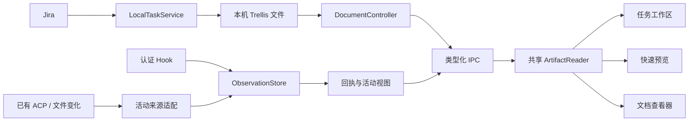

# 技术设计 · 驾驶舱 S0 v2

状态：规划修订稿。对应 [PRD](prd.md) FR1–FR5 / AC1–AC10；执行顺序见 [implement.md](implement.md)。本文件是当前设计依据，review 目录保留原审查与历史建议，不再把原稿中的错误契约注入实现。

## 1. 关键决定与现有资产

| 决定 | 采用方式 | 理由与边界 |
| --- | --- | --- |
| 桌面架构 | 保留 Electron/React/TypeScript，模块化单仓库 | 不为 S0 换壳或引入团队服务器 |
| 阅读入口 | Tasks、TaskDetail、ArtifactViewer 共用读取控制器/阅读组件 | 主任务页已有工作区，只改抽屉会漏掉主入口 |
| 视觉 | 沿用用户截图和 styles.css tokens，快速预览可展开 | 不引入第二套全局导航或整体替换主题 |
| 文本对比 | jsdiff 行级差异，按需加载 | DiffModal 仅是任务字段对比；不承诺段落语义对齐 |
| 观测存储 | 本机 SQLite，JSONL 仅作显式导出 | 用事务、唯一约束和查询索引代替自建追加日志恢复 |
| 驱动 | 优先 node:sqlite（专用 worker）＋Python 标准库 sqlite3 | 现机内存探测可用；打包、跨进程、故障验证是 G1 门槛 |
| 校验 | shared 中版本化 Zod schema，跨语言黄金样例 | TS 类型不能自动约束 Python 生产者 |
| 首发宿主 | Codex 原生 SubagentStart 对应 subagent-context Hook | 仅此组合列入认证；workflow-state Hook 后置，不假设其有相同文件预算 |
| Jira 创建 | 单一 LocalTaskService，统一现有创建入口 | IntakeModal 现为手填待办，不是现成的 Jira→PRD 流程 |
| 状态解释 | 任务状态、活动、归档独立 | 不从 in_progress 推导实施/检查已依次完成 |

**事实依据**：当前安装 Electron 44.4.3 / Node 24.21.0 的 node:sqlite 内存探测可用（SQLite 3.53.4）；当前 Python 3.10.11 内置 SQLite 3.40.1。不是打包版或其他员工电脑的兼容证明。Node API 官方仍为 Release candidate，固定经测试版本，驱动藏在接口后，升级需回归。[Node 文档](https://nodejs.org/download/release/latest-v24.x/docs/api/sqlite.html)

**规范差异登记 D-SQLITE**：现有 backend/database.md 提供 Drizzle＋better-sqlite3＋WAL 的指导示例，但当前 package.json 没有这些依赖。本任务选择内置驱动、参数化 SQL、默认回滚日志模式以控制原生依赖和跨版本成本；继承事务/迁移/约束原则。实施中先验证该选择，再同步数据库规范的适用范围；本轮不把未落地选型写成全项目既成规范。

## 2. 模块与数据权威



推荐组织，不强制机械新增全部文件；先复用对应资产：

| 所在层 | 责任 | 不能混入的行为 |
| --- | --- | --- |
| shared/observability | 事件 schema、字节定义、capability、查询/错误类型 | Electron、数据库连接、文件 IO |
| main/services/documents | 限界读取、revision、Git 基线、文件定向失效 | 推断执行成功、无界缓存全文 |
| main/services/task-identity | 本机工作区/任务定位与归档别名 | 只按文件名或当前会话猜归属 |
| main/services/observability | 观测库 worker 驱动、查询、保留、迁移、健康 | 把未知补成成功、清理控制记录 |
| main/services/local-task | 独立控制库中的任务创建、来源关联、中断恢复 | 新建第二套任务状态真值、依赖观测开关 |
| renderer 共享 reader/hook | 标签、目录、对比、位置与错误显示 | 直接读数据库/任意本机路径 |
| 既有 IPC/preload/store | 有范围的调用、订阅、取消、缓存 | 主进程长时间同步查询、无界 localStorage |

权威关系：PRD/design/task.json 属于仓库；Jira 状态属于 Jira；回执是本机来源报告；归档位置从实际目录读取。数据库只保存观察/关联和必要的本机操作记录，不替代 Trellis 文件。观测证据不是防篡改证明，不能升级为绩效或安全审计结论。

## 3. 身份与 v1 事件契约

### 3.1 身份建立

- Panel 在仓库外持久化随机 installationId（Windows 首发位置：%LOCALAPPDATA%/TrellisPanel/installation.json，普通升级保持不变）；Hook 按相同固定规则读取，不接受仓库内容提供任意本机身份文件路径。首次显式绑定时生成 workspaceId，记录 installationId、canonical root、git common dir、worktree root。非 Git 仓库允许绑定，但 Git 比较不可用。
- repositoryId 是本机绑定组 ID；只有已验证的 Git common dir 关系才归为同组，不凭 remote URL 跨设备合并。
- taskRef 是该绑定内的稳定本机 ID，映射 Trellis task.json.id 与原始相对目录。归档后用明确移动关系或“原路径消失且唯一同 ID 目标”续接；多个候选、复制目录或重复 task ID 显示待确认，不自动合并。
- 绑定记录保存在 root 的私有 runtime 目录；本机 installationId 缺失/不符或 canonical root 不符时停止采集并要求重新绑定/确认迁移。复制仓库到另一机器的相同绝对路径也会因安装 ID 不符而停止；它只用于绑定隔离，不是防篡改或硬件身份证明。安装身份被重置时保留旧数据，显式确认迁移后恢复关联。
- Hook 只读取匹配当前 cwd/worktree 的已存在绑定；taskRef 在绑定索引中可确定就填，不可确定则携带 task ID/相对目录并标未归属。主进程可建立带依据的解析映射，不改原始事件。
- 每次注入生成 injectionId，组装与输出事件共用；每个事件另有 eventId。父/子会话与 ACP run 仅填宿主实际提供的值，不制造看似真实的 ID。

### 3.2 事件最小结构

```ts
type ContextEventV1 = {
  schemaVersion: 1
  eventId: string             // UUID，重复内容另存 payloadDigest 核对
  injectionId: string
  kind: 'context.assembled' | 'context.emitted' | 'context.output_failed'
  occurredAtMs: number        // Unix 毫秒，存储另有 receivedAtMs/seq
  producer: { host: string; hook: string; version: string; capability: string }
  scope: {
    repositoryId: string; workspaceId: string
    taskRef: string | null; trellisTaskId: string | null
    taskPath: string | null; association: 'resolved' | 'unresolved'
  }
  session: { parentId: string | null; childId: string | null; runId: string | null }
  materials: MaterialResult[]
  totals: {
    expectedEntries: number | null; recordedEntries: number; omittedEntries: number
    contextUtf8Bytes: number; stdoutUtf8Bytes: number | null
    budgetBytes: number | null; completeness: 'complete' | 'partial' | 'not_applicable'
  }
  outputDigest: string | null  // 实际上下文字段 UTF-8 的完整 SHA-256
  diagnosticCode: string | null
}
```

MaterialResult 必含相对路径/逻辑来源、纳入结果及原因；sourceBytes/sourceDigest 是当次已读取的源字节及完整 SHA-256，includedBytes/includedDigest 是实际纳入的源文本片段 UTF-8 及摘要。不把标题、提示文案算作源片段；它们计入 contextUtf8Bytes。读不到、未读取或不适用用 null，不能填 0 暗示空文件。stdoutUtf8Bytes 是整个宿主协议包装字节，仅最终序列化后可得。

时间遵守 shared/timestamp.md：事件、数据库和 IPC 均用有限安全整数 Unix 毫秒（occurredAtMs/receivedAtMs），Python 使用 time.time_ns() // 1_000_000，格式化只在 UI/报告边界进行。外部来源若为 ISO 文本，由适配器明确解析并校验，解析失败保留诊断；不得将秒值直接当毫秒。时间不证明跨进程因果顺序。

材料结果：included、truncated、index_only、missing、unreadable；二进制以 index_only＋binary 原因表达。文件摘要只在 UI 缩写；完整性是“本次采集所列材料是否完整”，不代表规范覆盖完整。预期数量未知时不计算缺失率。

材料化函数在生成上下文时同时产出元数据，不二次扫描重读。上下文可能包括直接拼接的 workflow/prompt 段：登记逻辑来源或标不适用，不声称全部输出均来自文件。支持未知字段保留；不认识的 schema 主版本进入 bounded unsupported 诊断，不能按旧格式硬解释。

Python 与 TS 共用成功/裁剪/索引/不可读/并发/未知版本夹具。Python 不导入 Zod；由跨语言验收证明实际输出符合相同契约。

### 3.3 输出时机和允许的证据

1. 读取与组装，生成同源元数据。
2. 尝试事务记录 assembled；失败不阻止下文。
3. 完成宿主输出对象序列化。
4. stdout write＋flush 成功后，才尝试事务记录 emitted。
5. 序列化或输出确实报错时可尝试记录 output_failed，保留宿主原有失败语义；不重新发送 stdout。

emitted 包含足以独立显示的元数据，前一条 assembled 丢失不能使其消失。两条均不存在不能据此断言没有调用；输出成功后落账失败只能缺证据。禁止提前记成功来规避这个窗口。

UI 词汇：未观察到 / 已组装 / 已输出至宿主通道。宿主确认和规范遵守不在 S0。storage/adapter 健康状态独立显示；无回执不自动归类仪器故障。

## 4. 本机存储、并发与恢复

### 4.1 路径与模式

```text
<repo>/.trellis/.panel/runtime/
  binding.json             本机绑定与采集启用配置，原子替换
  observations.sqlite      可降级的观测事件与用量
  observations.sqlite-*    引擎 sidecar，不单独复制/删除
  control.sqlite           任务别名、来源关联与本地创建操作
  control.sqlite-*         控制库 sidecar，独立备份/恢复
  diagnostics/             有界、脱敏诊断，写失败可不可见
```

精确忽略 root runtime 路径，排除 Git、任务归档、知识索引、普通活动扫描；不以“所有 .panel 都忽略”覆盖未来可携带任务批准资料。当前库仅支持本机本地磁盘；网络/同步盘不认证。检测不确定时显示未验证，用户指定本地路径前不自动启用采集。

Panel 创建/迁移库，worker 承担同步 SQLite 调用，UI 主进程不跑长事务。初版默认 journal_mode=DELETE，synchronous=FULL，短事务和短查询；不在 S0 顺手引入 WAL 调优。WAL 如有后续必要，应在兼容矩阵和 checkpoint/容量测试后另作决策。[SQLite 官方说明](https://sqlite.org/wal.html)

### 4.2 数据与事务

两个库由同一 worker 管理，但有独立的版本、连接、事务和生命周期；不假装跨库提交是原子的。观测禁用/配额/清理只作用于 observations.sqlite，不阻断正常阅读、已有 Agent 或本地任务创建。

观测库表组：

- schema_meta：dbVersion、支持的事件协议范围、migration 状态。
- events：seq 单调不复用、eventId UNIQUE、payloadDigest、injectionId、身份/类型/时间索引、结构化 payload。
- store_usage：逻辑事件条数/字节、采集模式及暂停原因。

控制库表组：control_schema_meta、task_aliases、source_links、local_operations。task_aliases 保存 taskRef 与已核实的目录；source_links/local_operations 保存 issue/项目/目标目录、operationId、创建阶段与结果，不承担自动 Jira 同步队列。Hook 不写控制库；观测库失败不能吞掉控制库错误。

“清理观测”仅删除事件/观测诊断并更新该库的 cursor epoch；不删除 control.sqlite、绑定、来源关联或操作进度。控制库初始化独立于观测是否启用。

事件 INSERT 与 usage 变更同一事务提交。重复 eventId＋同 digest 返回已有结果，不重复计数；同 ID 异内容保留冲突诊断，不覆盖。seq 用于查询游标，不是跨进程因果时间；receivedAtMs 不替代宿主 occurredAtMs。

Hook 使用 Python sqlite3 连接现有库，显式 mode=rw、短 timeout，不做建库/迁移/清理；初始锁等待预算每次 5ms，无循环重试。事务失败明确 rollback/close，最终输出不依赖插入结果。timeout 只限制锁等待，不能保证磁盘 IO 的硬实时上限。[Python 接口](https://docs.python.org/3.10/library/sqlite3.html)

### 4.3 容量与故障

初始试验参数，G1/G4 根据测量确认或修订：

| 项目 | 初值 | 超限行为 |
| --- | --- | --- |
| 单事件编码 | 64KiB | 删减明细并标 partial/遗漏数；汇总仍超限则跳过观测 |
| 保留 | 14 天、50,000 条、64MiB payload | Panel 清理过期/最旧记录；Hook 检查事务内计数，满额暂停新增 |
| 库＋sidecar 物理体积 | 128MiB 软保护阈值 | 检查只 stat 固定文件；超限不写新观测，Panel 空闲恢复/整理 |
| 诊断 | 1MiB 总量、有限轮换 | 保留最近摘要与计数，不保留原始上下文 |

物理阈值不是精确磁盘硬配额，单次写和竞争可产生有限超额；需实测最大偏差并记录。面板关闭时不删除历史，但 Hook 的逻辑配额检查仍有效，不能无限积累。禁止为写入大事件扫描目录或清理整库。

进程在 commit 前退出没有成功行；commit 后退出可由 eventId 去重。提交失败不得发布“已持久化”通知。观测库损坏：保留原文件、关闭观测写入并显示不可用，由用户选择重建 observations.sqlite；不自动删除证据，不触碰控制库或 Trellis 文档。重建生成新 storeEpoch，旧 cursor 返回 resetRequired。

控制库损坏或无法持久化：停止新的创建/恢复写操作并提示，普通阅读和已存在的 Agent 不受影响；不能按遥测降级规则继续创建。恢复优先验证备份，再用任务中的来源/operationId、已知目标目录和实际文件做对账。来源尚未写入或多个候选时保留半成品、列出恢复预览等待确认，不自动重建/删除目录。对恢复后的 taskRef 与旧回执关联须保留证据；不能确定就显示未归属。

两个库分别迁移和备份：观测迁移暂停采集，控制迁移暂停本地创建；使用 SQLite 备份机制，不复制打开中的裸文件。未来版本库在旧客户端中只显示不兼容，禁止降级写入。禁用立即影响后续 Hook；清理需作用域预览/用户显式确认，删除观测不等于归档任务。

只保存材料相对路径、摘要、结果和计量；外部路径可用用户本机可解释的逻辑别名，不能向共享包泄露绝对路径。日志和错误文本不得包含原始代码、完整 prompt、key 或环境变量。记录是本机私有来源报告，非防篡改审计。

## 5. 读取、订阅与状态解释

### 5.1 IPC 契约

使用现有 ipc-channels → registry → shared PanelApi → preload → renderer API 链。以下为逻辑契约，实际命名按规范统一：

```ts
ObservationScope = { workspaceId: string; taskRef?: string }
ObservationCursor = { storeEpoch: string; seq: number }
query(scope, { after?, before?, limit }) ->
  { items, highWatermark, nextCursor, retainedFrom, resetRequired, health }
subscribe(scope, { afterCursor }) -> unsubscribe
documentRead(scope, { relativePath, requestId }) ->
  { revision, rawText, parsed, diagnostics, source, requestId }
```

query 限定每页最大 100 条。订阅从快照 highWatermark 回补，再推增量，事件去重；不能先快照后裸订阅造成空窗。清理/重建造成 cursor 不可用时返回 resetRequired，不默默跳过。仅允许已打开工作区的授权路径，校验 realpath/软链接越界；宿主允许读取的其他材料不因此授权 renderer 任意打开它。

项目切换取消订阅、递增 generation，旧响应被丢弃；缓存键包含 workspaceId、taskRef、路径/revision。新 slice 同时登记 store/types.ts 和 store/index.ts；不另存可推导的阶段真值，不将无界事件写 localStorage。

### 5.2 独立失效通道

普通 TrellisWatcher、scanProject 活动通道、知识索引均排除 root runtime。回执采用 worker 中独立的高水位查询：可见页面初始 1s、后台初始 5s，关闭工作区后停止。即使无变化也有查询成本，不宣称零 IO。轮询延迟允许，但不会漏掉已提交的记录。

文档按 canonicalPath＋内容 digest 定向失效。task 对象引用变化、回执更新或托盘刷新都不触发正文 loading。对原地写入文件做有限稳定性重试，读不到就保留旧版及“文件暂不可读”；JSON 半写不能当空任务。

### 5.3 活动解释

原始 status 直接显示；归档从真实目录位置判断；已有 ACP 工具事件和文件变化带 sourceKind 与已知会话/任务范围进入活动适配器。没有稳定事件 ID 的观察不与别的来源强行合并为同一个事实。

spec 更新是项目级活动。任务路径无法确定就保留项目级/未归属，不借当前 UI 选中任务补全。只有明确提供语义的 phase.started/finished 类来源才允许解释阶段；认证 Hook 的上下文事件本身不生成阶段通过。持续时间仅计算同一来源/运行中的配对事件，缺边不显示。

## 6. 文档阅读与 UI 交互

### 6.1 三入口共用，保留现有外壳

- Tasks 内嵌工作区为完整阅读主入口；TaskDetail 保持快速预览容器，提供展开按钮；ArtifactViewer 使用同一 reader/controller。
- 复用 MarkdownView、JsonTree、现有原文 CodeView、目录与位置资产，补稳定 heading ID 和引用一致性；不新建第四套完整阅读器。
- 顶部依次为任务标题/来源状态、文档标签、版本与工具条、正文。观察面板按需展开，不重复堆概览 KPI。
- Markdown 文本可选择；task.json 卡片保留未知字段和原文；ContextManifestView 保留实际行号、unknown 字段和坏行原文。JsonTree 不替代逐字原始文本。

### 6.2 阅读会话与对比

文档首次成功加载建立 baseRevision/baseText；当前展示版为 displayedRevision；发现外部变化只更新 latestRevision 标记。点击“查看变化”先比较当前展示版与最新候选；版本选择可切回“本次打开版本”。点击“阅读新版”才替换 displayed，不改变首次基线；支持显式“以当前为本次基线”。

S0 基线仅当前打开的文档会话内保留，关闭/重启后没有旧草稿就明确说明。比较最近提交使用参数数组调用 Git，仅解析校验过的 repo 内路径与提交对象；无提交、未跟踪、重命名无法匹配时有明确说明。任意历史提交选择器不实现。

jsdiff 负责行级计算，纯文本转义输出，默认统一单列，足够宽才可并列；不渲染不可信 diff 为 HTML。初始对比限制为每侧 2MiB、worker 计算超时 1s、最大编辑量可配置；超限提供原文/外部打开入口，不冻结页面。文档读取默认上限 5MiB；更大文档显示限额和本机打开入口，不无界装载。上述限制在试点验证可读性后固定。

应用新版按稳定标题锚点＋段内偏移定位，锚点消失定位到最近存活章节并提示；不只复原数字 scrollTop。当前选择和正在阅读的内容在确认前保持不变。

### 6.3 布局与键盘

| CSS 宽度 | 规则 |
| --- | --- |
| 1280 | 选任务后可收起列表；观察/目录按需切换，正文优先 |
| 1440 | 全局侧栏＋任务列表＋正文；观察默认收起，打开可收起列表 |
| 1920 | 正文仍有足够空间时支持列表＋正文＋观察；不默认全部展开 |
| 更窄/高缩放 | 工具条收纳次要操作，单列正文，表格自身滚动 |

680/760/880 为最大宽度偏好，实际不超过可用区域；正文建议 15–16px/约 1.75 行高，导航密度沿用当前风格。颜色与 Lucide 图标沿用 styles.css；未知使用中性色与文字，明确损坏/错误才用错误态。

统一 Esc 层级：菜单/模态 → 专注 → 快速预览，每次只处理一层，关闭后焦点回触发处。分栏、标签、目录、观察开关键盘可达；调整分栏确需重做时优先验证 react-resizable-panels 的兼容版本，不直接替换成最新版全套 shadcn。

### 6.4 四个关键交互结果

1. Agent 连续保存：读者先看到新版提示，再决定比较/切换。
2. 查看规范：清单中列入与本次输出结果分开，当前文件变了显示版本不同。
3. 无回执：默认未观察到；观测配置检查可指出未安装/禁用/不兼容/明确存储错误。
4. Jira 已完成而本地仍进行中：两者同时显示并注明来源，不自行覆盖。

开源来源、现有截图与完整场景见 [UI 修订方向](review/03-ui-ux-direction.md)。本设计只借 参考 的 peek/full workspace 模式；使用 jsdiff，按需使用 resizable-panels，不整体迁移 参考/shadcn/CodeMirror。

## 7. Jira 与本地任务契约

### 7.1 查询与基线

复用现有认证与网络服务；扩充 issueId/key、issueTypeId/name、fixVersionId/name、description、updatedAt。公司 Jira 类型/版本在 G0/G4 确认，适配支持的分页协议，不把 Cloud/Server 视为完全相同。

按每个指定 fixVersion 独立查询，逐页收集、按 issue ID/key 去重，支持取消、错误重试和不完整结果；达用户配置最大页数仍未取全就标样本。工单多版本分别计入各自分布，跨版本汇总另去重。记录采集前后时间、JQL、返回数/总数及是否存在快照期间变化；不能把 total 等于抓取数作为所有一致性的唯一证明。

### 7.2 单一创建器与中断恢复

入口为当前 Jira 行，默认当前工作区；IntakeModal 可复用基础字段样式，但新增 Jira seed 和来源展示。所有实际 Trellis 任务创建通过 LocalTaskService；既有手动待办录入仍是待办，不能被悄悄改成任务。

本地操作键为 workspaceId＋Jira instanceId＋issueId＋明确的新增序号；同键并发加互斥，并在 local_operations 建 operationId、逻辑 slug、当前预备目录和来源快照。默认已有映射就打开；显式“一单多任务”才产生新增序号。

操作步骤：准备来源快照/预备目录并成功提交控制库操作记录 → 通过 task.py create --no-start 的现有 --meta 参数把 operationId/来源随首个 task.json 一起写入 → 生成最小 PRD 来源草稿 → 写关联信息 → 验证结果 → 标 ready。控制记录提交失败则不调用 CLI。CLI 通过现有 Python 解析能力和参数数组执行，固定工作目录，检查退出码；禁止 --force 覆盖已有任务。

现有 --meta 是可重复的 key=value，值原样保存为字符串、不自动嵌套或 JSON 转型。因此用明确的扁平键，例如 panel_operation_id、panel_jira_instance_id、panel_jira_issue_id、panel_jira_issue_key、panel_source_updated_at_ms；调用方通过参数数组传值，时间值读取后显式校验/转换。不要假设传一个 JSON 对象就会生成嵌套 meta。完整描述不走命令行参数，避免超出命令长度。

CLI 的 MM-DD 目录前缀取执行当天，不保证可创建旧日期目录；不得把预备路径当成 CLI 强制固定路径。每次恢复先按 operationId/来源对账实际目录：已有 task.json 骨架只续写必要资料，不再次 create；尚未创建且跨日，则先原子更新控制库预备目录，再调用 create。以返回并核实的实际路径登记最终关联。夹具覆盖午夜前后、写完 task.json 尚未写 PRD 时中止、同名不同 operationId；冲突保持可见，不复用别人的目录。

不修改会话当前任务指针，不直接设 in_progress。来源快照包含 issue 标识、URL、updatedAtMs、fetchedAtMs 与描述摘要；PRD 的业务来源部分保留取得的完整规范化描述，摘要只用于任务简介/来源索引。富文本按实际 Jira 格式安全转换，不能转换的内容保留可打开的原来源链接并注明；接口缺字段、权限限制或明确大小限额导致不完整时必须提示，不能静默摘要替代完整输入。PRD 标“待结合本机代码确认”。Jira 描述是业务数据，不作为执行命令或高优先级指令。

任务文件多步写入不伪装为数据库原子事务。每阶段记录进度，文件用同目录临时文件原子替换；中断后按 operationId 与真实路径对账，已有用户修改不得覆盖。可确认安全则续写，无法确认则显示恢复预览，不盲目新建或删除整个目录。来源/operationId 的最小标识随任务保存，内部重试/错误/本机路径仅留控制库；显式共享时按发布白名单处理。

### 7.3 归档与手动回写

沿用 Trellis 的归档语义并更新别名；Jira 操作显式选择当前可用 transition，展示目标状态后执行。成功依据服务响应并重新读取核实；timeout/不确定结果先查询，再决定是否重试，不盲目重复 transition/comment。权限不足、transition 失效、离线分别提示；本地归档成功不因此回滚。S0 不自动分派、不新增同步调度队列。

## 8. Hook 分发、兼容、回退

本项目 .codex/hooks 是生成副本，不是上游模板源。G0 要记录真实 Trellis 源仓库、对应模板路径/版本、更新入口和最小认证宿主版本；尚未核实的字段不得编造。

首选流程：上游模板改动与测试 → 发布明确版本 → 干净/用户修改项目升级试验 → Panel 能力探测启用。G1 可在隔离 fixture 做实验，但未有分发证据不得关闭 AC9。

不以“上游暂不可用”自动改成员工逐仓手改副本。若必须转 Panel 管理安装器，单独修订设计，补安装位置、备份、冲突检测、禁用、卸载恢复，再复审；不在实现过程中暗换路径。

能力握手包含协议版本、producer 版本、支持的事件、绑定是否可用。其他宿主继续读文件，回执区显示未认证/不支持，不借 Codex 的通过结果背书。旧 hook/新库、新 hook/旧库不兼容时停止观测，保持宿主原流程。

回退按层执行：关闭观测 → 回退兼容的 UI/服务 → 恢复上游生成文件版本（保留用户修改）→ 保留观测库供诊断。库不可降级写入，不破坏 Trellis 文件/已创建任务/Jira 状态。

## 9. 验证预算、发布边界与后续

初始性能试验目标：正常本地场景观测额外开销 p95 ≤50ms、p99 ≤150ms，另记录最大值；预热后正常/大材料各至少 200 次，故障另列，保留冷启动。它们是待验证预算，不是已有性能事实；不满足时优化或明确调整方案后重测，不仅交表即放行。

已提交回执通常在可见页面两次轮询内出现；回执变化不触发普通全项目扫描。验证 50,000 条查询/清理、半天运行、项目切换、内存及物理体积。超限/缺证据不改变模型使用。维护者时间记录纳入试点报告。

S1 扩展权限卡/批准门时，操作记录与观察分开，批准绑定材料 hash 和人；S2 再做 SyncIntent、外部系统冲突/重试；S3 若建设团队服务只承载身份权限、任务关联、显式发布版本与评论，不上传全仓库或调度员工 Agent。本机 SQLite 不放共享盘充当团队数据库。

容量、轮询和对比限额是本设计的试验初值；G1/G4 报告可提出有证据调整。改变用户边界、默认共享、宿主认证范围或采用不同 Hook 分发方式属于设计变更，必须先修订规划再实施。发布门槛按 PRD AC1–AC10，不以文档定稿代替验证。
