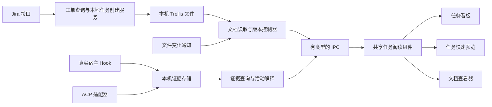
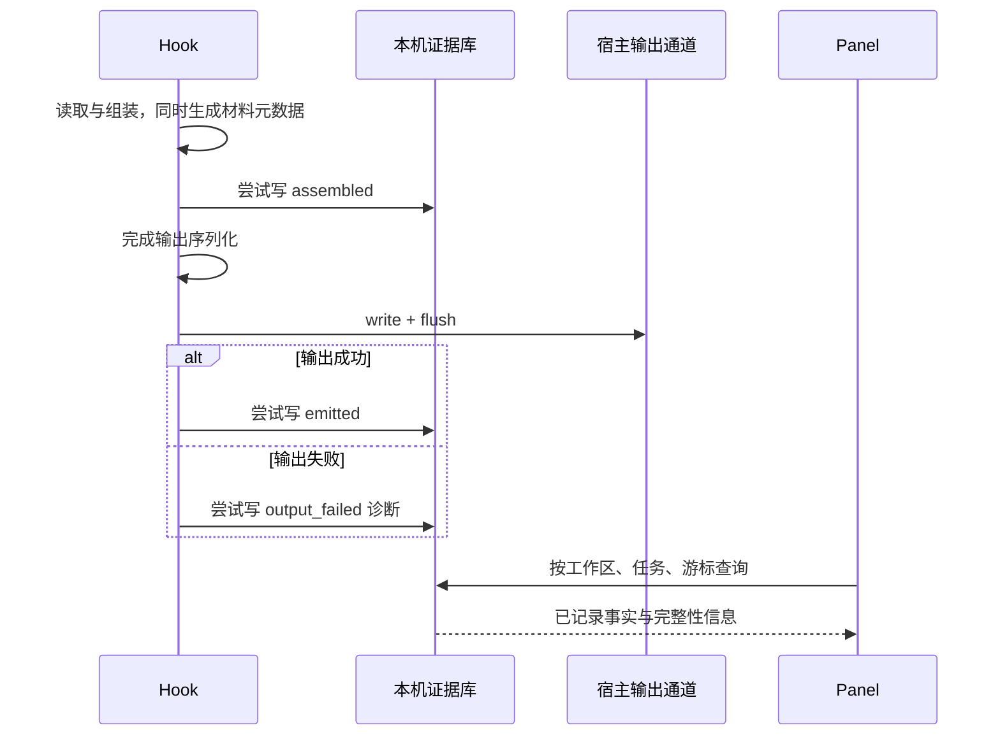

# 技术架构修订方向

状态：供 GLM 修订设计的建议，不代表已经实现或已经双方确认。适用约 12 人、8 名开发、代码留本机的团队；日常使用频率已知，开发维护产能仍未确认。

## 1. 先确定每种数据由谁说了算

| 信息 | 权威来源 | 平台能做什么 |
| --- | --- | --- |
| 业务需求、分派、Jira 状态 | Jira 与产品成员确认的业务资料 | 引用、澄清、建立关联；写回需要实际响应与核对 |
| 本机 PRD/design/上下文清单 | 员工仓库内 Trellis 文件 | 读取、对比、定位；后续受控修改不能绕过仓库流程 |
| Agent 本次输出了什么上下文 | 具体宿主适配器产生的证据 | 记录来源和证据边界，不扩大为模型遵守证明 |
| 某阶段是否完成 | 明确的阶段/检查事件或人工确认 | 展示来源；task.status 不足时承认未知 |
| 代码合并、测试结果 | Git/MR/CI 的具体版本与检查记录 | 关联到任务及代码版本，不能从 Agent 的“完成了”推导 |
| 团队共享材料 | 开发主动发布的材料版本，未来由共享服务保存 | 展示发布者、时间、版本及过期提示，不读取员工整仓库 |

产品成员可以和 Agent 澄清业务、查已发布知识，但不能据此声称完成了基于代码的技术设计。开发在本机绑定仓库后，才生成或修订带代码依据的 PRD/design，并把适合协作者看的版本发布出去。

S0 是这个产品的本地基础能力。仅有 S0 还不能宣称团队成员已经可以跨机器实时协作；首轮必须安排真实的第二位开发和需求协作者验证材料交接。

## 2. 保留桌面壳，建立明确模块边界

选择现有 Electron + React + TypeScript。S0 不迁移 Tauri，不建微服务，不拆 monorepo。保持现有构建、分发、ACP、MCP 与 IPC 的有效资产；把混在页面中的数据规则拆开。

| 模块 | 职责 | 明确不承担的职责 |
| --- | --- | --- |
| `DocumentController` | 读取、坏文件处理、revision、阅读会话快照、Git 版本 | 推断任务完成、修改 Jira |
| `TaskIdentity` | 工作区/任务定位、归档别名、多项目隔离 | 把路径正则当全球唯一身份 |
| `ObservationStore` | 事务写入、唯一事件、查询游标、容量、迁移 | 改写原始证据为乐观成功 |
| `ReceiptProjection` | 配对一次注入、汇总材料结果 | 推断 Agent 理解或执行了规范 |
| `ActivityProjection` | 解释有来源的活动，保留原始状态 | 生成未经观察的完整流程图 |
| `HostAdapter` | 宿主能力探测、输出/权限协议转换 | 让任何宿主都假装具有同等能力 |
| `LocalTaskService` | 统一 Jira/待办/手动入口的创建与关联 | 重复造多个行为不同的创建器 |

这些先是单仓库内的模块和窄接口，不要求发布成六个 npm 包。SQLite 操作放受控 worker 中；IPC handler 不承担批量扫描、同步数据库长查询和迁移。渲染端只接收视图数据，不拿数据库句柄、任意文件读取或任意命令执行能力。

## 3. 回执存储：建议 SQLite，文件日志作为导出格式

### 为什么调整 GLM 的选型

| 方案 | 获得的东西 | 需要自己负责的东西 | 本轮建议 |
| --- | --- | --- | --- |
| 片段 → 追加 JSONL → 删除片段 | 人可读、易导出 | 半行修复、持久去重、删除时机、游标、索引、并发与压缩 | 不按当前未定义的协议实施 |
| 原子不可变事件文件 + 可重建索引 | 不必维护易损的合并日志 | 大量文件、目录配额、索引重建、保留与分页 | SQLite 无法通过验证时的有限备选 |
| 本机 SQLite + JSONL 导出 | 事务、唯一约束、索引和分页 | 连接预算、迁移、容量、故障与驱动兼容 | **优先验证并采用** |

本轮实际探测：仓库已安装的 Electron **44.4.3 / Node 24.21.0** 可以加载 `node:sqlite` 并创建内存数据库，内置 SQLite **3.53.4**；当前 Python **3.10.11** 的 sqlite3 为 **3.40.1**。探测没有读写产品数据库，不能据此声称跨进程或打包版兼容已通过。

Node 文档把这层 API 标为 **Stability 1.2 / Release candidate**，`DatabaseSync` 是同步接口。因此固定经过验证的 Electron 版本，封装驱动，放 worker，升级必须重跑兼容用例；不要把“SQLite 引擎成熟”偷换为“该 Node API 无版本风险”。[Node 官方文档](https://nodejs.org/download/release/latest-v24.x/docs/api/sqlite.html)

Python 自带数据库接口，有连接超时参数；不能沿用默认五秒等待，拖慢每次 hook。[Python 官方文档](https://docs.python.org/3.10/library/sqlite3.html)

### S0 建议协议

- 一个已绑定本机工作区对应一个私有观测库，默认放本地磁盘的 `.trellis/.panel/runtime/observations.sqlite`；明确忽略数据库及其 sidecar 文件，不参与任务归档和团队同步。网络盘或同步盘不列入首发支持范围；探测不清楚就显示未验证，不能宣称支持。
- Panel 创建库和迁移。Hook 只打开已存在、版本兼容的库，插入固定格式记录；它不负责建表、迁移、清理历史、VACUUM 或修复数据库。首次未绑定/未初始化时是“观测未启用”，正常输出仍继续。
- S0 起步使用 SQLite 默认回滚日志模式，短事务与短读查询。先不同时引入 WAL/checkpoint 参数调优。不同 Python 内置 SQLite 版本必须进入兼容矩阵；不要因为主进程版本新就假定 hook 也是同一版本。
- 若锁冲突测试证明默认模式不足，再评估 WAL；官方明确 WAL 仍会有 busy，且要求同一机器、需要 checkpoint 管理。模式切换是有验证的决策，不是“打开 WAL 就解决并发”。[SQLite 官方说明](https://sqlite.org/wal.html)
- 每事件唯一 `eventId`；`injectionId` 连接同一次组装与输出。插入和用量记账同一事务完成；相同 ID 相同内容是重试，相同 ID 不同内容是冲突，不能静默覆盖。
- 建议最小表：`schema_meta`、`events`、`task_aliases`、`store_usage`。事件表包含单调写入序号、eventId 唯一约束、injectionId、身份索引、schemaVersion、kind、UTC 时间、结构化 payload。写入序号用于查询稳定排序，不证明跨进程的因果顺序。
- Hook 每次仅做有界元数据序列化、摘要计算与两次短记录。锁等待初始候选值为每次 **5ms**，无循环重试；这是等待预算，不是整个磁盘操作的硬实时上限。输出失败和观测失败必须分别捕获，观测错误不得吞掉输出错误。
- 字段内容不得包含原始代码、完整 prompt、密钥或环境变量。单事件候选上限 **64KiB**；材料过多时保留总数/遗漏数/`evidenceCompleteness: partial`，禁止仍标完整清单。源摘要复用已经读取的内容，不额外遍历仓库。
- 保留候选值：**14 天 / 50,000 条 / 64MiB payload**，先达到者进入清理或暂停采集。Hook 通过同一事务内用量检查停止新增，面板关闭时也不能无限增长。物理数据库大小与 payload 配额不同；另设物理大小保护与可见诊断，面板在空闲时处理回收，hook 不做收缩。
- 落账失败仅意味着证据不可得。磁盘满或数据库损坏时若诊断也无法写入，面板不能自动知道那一次调用发生过；只能在下一次健康检查提示“存储不可用，期间记录可能不完整”。
- 导出 JSONL 是显式诊断/交接动作，不是第二份并行权威日志。未来审批记录与观测数据库分离：审批必须保存材料版本和操作人，写失败不得假报批准成功。

这改动需要正式修改 PRD 中“不引入数据库、唯一新增依赖”的约束。它不增加后台数据库服务，也不增加云端开发要求。

### 必须通过的短验证

1. 打包后的应用 worker 能创建/查询库，Python hook 能写；库路径带中文与空格，应用/仓库移动有明确重新绑定方式。
2. 两个同类型子 Agent 并发写，另一连接持有锁：正常写不串线；超预算写被跳过且不妨碍 stdout。
3. 提交前/后杀进程、重复写、磁盘只读/满：不会产生半条成功事件或重复结果。
4. 老库升级、新 hook 对老库、老 hook 对新库都有明确兼容/拒绝状态；迁移失败不损伤 Trellis 文件。
5. 稳态 50,000 条记录下分页、冷启动、清理、配额暂停与恢复可接受。若做不到，缩减首发能力或更换存储适配，不跳过验证。

## 4. 证据与身份 v1 应写清什么

协议至少包含以下内容；最终字段用一份版本化 schema 与 Python/TS 共用测试样本固定。

| 组 | 字段/语义 |
| --- | --- |
| 版本与来源 | `schemaVersion=1`、`producerVersion`、`hostKind`、`hookName`、`capabilities` |
| 事件关联 | `eventId`、`injectionId`、`kind`、`occurredAt`；同次注入的材料与输出共用 injectionId |
| 工作区 | Panel 首次绑定分配 `workspaceId`；本机 canonical root + Git worktree 位置用于匹配，不能只用 remote URL |
| 任务 | 已知 Trellis task ID + 原始相对目录 + 本地 taskRef；归档用 ID/明确移动关系保留别名；重复 ID、仅同名或无法确定移动时保持未归属，不能猜 |
| 会话 | `parentSessionId`、`childSessionId`、`runId` 只填实际可得值；不要把父 session 填成 child |
| 材料 | `path`、`sourceDigest`、`sourceBytes`、`includedBytes`、`result`、`reason`；result 区分 inline/truncated/index-only/missing/unreadable/binary |
| 输出 | 最终 additionalContext/updatedInput 字段的 UTF-8 字节数和完整 digest；stdout 包装字节另记，不能混用 |
| 完整性 | 清单是否完整、遗漏条目数、字段不适用原因；缺失/裁剪计数以实际预期清单为分母 |

Project/worktree 拷贝后，本地 binding 不能当团队身份沿用。Jira issue 可以关联多个仓库任务；也不能将 Jira key 当作某一次本地运行的唯一标识。S0 保留原始定位以便诊断；未来跨设备发布使用另一层明确的共享对象 ID。

`assembled` 写失败不阻止输出。`emitted` 可携带足够的材料摘要独立显示，不能因缺前一条就丢弃唯一有效证据；同样不能凭 assembled 推导 emitted。`output_failed` 只有真的捕获输出错误才存在。宿主收到/理解/遵循均不从此图推出。

## 5. 文档和回执各自刷新

- 三个入口复用 `ArtifactReader` 与 `DocumentController`，容器保留自身导航与关闭逻辑。共享能力不等于重写全部页面。
- 文档键为 `{workspaceId, canonicalPath}`，内容 revision 用摘要标识；任务对象的其他字段变化不触发正文 loading。
- 首次打开保留一份会话内快照。外部保存只标“发现新版本”；用户点击后再替换当前内容，并按标题锚点＋偏移恢复位置。失败时保留正在看的旧版并注明，不显示空白替代。
- “比较本次打开版本”覆盖未提交修改；“比较最近提交”走安全参数化 Git 调用；长文档对比延迟加载，设置大小/耗时上限。S0 不承诺跨重启草稿历史。
- 普通项目 watcher、知识索引、活动统计均排除 runtime 目录。证据查询使用独立的可取消轮询/通知通道；可见任务短周期读取，后台降频。不能把“没有数据变化”称为零 IO。
- IPC 注册沿用现有 shared channels → handler registry → preload → renderer API 全链；查询返回 `cursor`，订阅以 `afterCursor` 回补，按 eventId 去重。清理导致游标过期时明确返回 `resetRequired` 与保留范围。
- 项目切换取消订阅并递增请求 generation；旧项目异步响应被丢弃。store 以 workspace+task 作为键，不把无界事件塞入 localStorage。

## 6. 安装、升级和禁用必须是一条完整路径

首发只认证一个宿主组合，但能力探测应真实展示“支持/未安装/版本不兼容/未验证”。其他平台继续能读 Trellis 文件，不能亮起假的回执支持标识。

**首选上游路径**：确认 Trellis 真实模板源仓库 → 修改生成源与对应夹具 → 发布包含回执协议的 Trellis 版本 → 在干净项目和有用户修改的项目验证升级 → Panel 根据能力标识启用采集。此处源仓库/提交/发布版本尚未取得，本轮不填一个猜测地址。

临时实验可在隔离夹具验证 hook 改法，但不计为部署完成。若上游节奏无法满足，需要另行选定 Panel 管理适配器；安装器必须只改明确的挂接位置、留备份、检测用户修改并支持回退，不能批量覆盖员工 hook。

用户禁用观测后不再产生事件；旧记录可查看/删除。卸载 Panel 不破坏 Trellis 主流程。数据库 schema 与 hook 协议分版本；可向前识别的未知字段保留，无法解释的新主版本显示不兼容，不静默丢弃。

## 7. Jira 与轻任务：从用户的真实动作做接口

首发流程建议为：**打开分配给我的工单 → 在当前仓库建立本地任务 → 本机澄清/开发 → 查看归档结果 → 选择可用 Jira 流转并确认结果**。

“认领”如需修改 assignee，是独立 Jira 能力，要补真实 API；只打开已分配工单就不叫认领。PRD 草稿标出来源及待本机确认内容，不能把 Jira 文本直接升级成已经完成技术分析的 PRD。

`LocalTaskService` 统一现有三种入口，记录稳定来源与创建结果。对同项目同工单重复点击，先展示已有任务；一个 issue 确有多个本地任务时允许显式新增。创建中途失败能定位已写内容并恢复，不先回写 Jira 宣告成功。调用 CLI 时用参数数组、固定程序路径和退出码检查，不拼 shell 字符串。

版本统计根据公司实际 Jira 版本/API 类型选择分页方式，不能提前假定 Cloud/Server 接口完全一致。每个版本独立查询、按 issue key 去重；工单同时属于两个版本时在各自分布中均出现，跨版本总计另做去重。结果附服务器总数/实际返回数/时间/JQL/完整性，期间数据变化可能影响统计也应注明。

S0 的归档与 Jira 流转是两个动作、两个结果。远端超时后先读当前状态再重试，不能用本地 completed 覆盖远端失败。可靠的自动同步队列、冲突解决和批量团队看板留 S2。公司权限暂不可用时允许先验收本地阅读能力，但 Jira 验收项保持未通过，不能宣称完整 S0 发布完成。

## 8. 后续团队平台沿同一边界扩展

| 角色/场景 | 本机核心之后要增加的能力 | 需要先证明什么 |
| --- | --- | --- |
| 产品修改范围，开发正写旧方案 | 发布业务材料版本，开发显示“来源已更新”，人工确认是否修订技术设计 | 版本差异与过期标识可理解；PM 不能直接驱动开发 Agent |
| 测试复现失败，需要补充结果 | 关联同一 issue 的复现步骤、环境、构建/MR版本和人工反馈 | 使用既有 Jira/CI 事实，不再造一套测试通过真值 |
| 第二个开发接手任务 | 阅读已发布文档、当前代码引用、未决问题；本机重新绑定仓库后继续 | 不依赖上一位开发的私有聊天和绝对路径 |
| 技术负责人沉淀规范 | 候选规范 → 人工评审 → 发布版本 → 本机引用明确版本 | 不能把一次 Agent 总结自动升为团队强制规范 |
| 管理者看进展 | Jira 状态＋已发布成果＋阻塞说明 | 不把个人回执、在线时长或 token 数当绩效指标 |

需要跨机器共享时再引入一个公司内部协作服务：保存用户/权限、任务关联、发布文档版本、评论及同步操作记录。PostgreSQL/对象存储等选型在此阶段依据部署条件决定，不能把本机 SQLite 搬到共享盘当团队服务。员工 Agent、代码和私有观测库仍留本机；离线设备的共享视图标最后发布时间。

ACP 是本机 Agent 的一个适配层，不是整个平台的核心数据模型。平台应允许编辑器内已有 Agent 继续工作，未接入 ACP 也可读文档。MCP 复用已有知识连接，检索引用保存来源/版本/权限范围；知识检索不能让 PM 间接绕过仓库权限。BYOK 沿用员工现有模型配置，密钥不进入任务、日志和共享发布包；公司统一模型代理是后续可选适配，不在 S0 同时重造网关。

## 9. 实施顺序与发布检查

| 步骤 | 交付物 | 停下来修正的条件 |
| --- | --- | --- |
| A · 修订施工图 | R01–R12 逐项回应；PRD/design/implement/context 清单一致 | 仍把推断当证据，或主入口未覆盖 |
| B · 最大风险验证 | 一个真实宿主的输出证据、生成源升级路径、SQLite 跨进程/打包/故障报告 | 只能改本地副本；记录拖慢/破坏输出；驱动不可用 |
| C · 阅读能力统一 | 三入口共享、草稿会话对比、坏文件/更新保持、键盘层级 | 保存即重置阅读；窄窗口强塞三栏 |
| D · 真实观察 | v1 契约、独立刷新、身份与未知状态、历史分页/清理 | 串线、假成功、无界增长 |
| E · 工单与试点 | 轻任务路径、完整 Jira 样本、第二开发/需求协作者记录 | 额外重复录入、未发布材料被假定可共享 |

候选性能发布目标（建议，尚未实测）：正常本地场景观测额外开销 p95 ≤50ms、p99 ≤150ms；如实测不能达到，应关闭高成本明细或调整记录方式后重测。锁等待预算不代替这个端到端指标。预热后以至少 200 次正常/大材料场景做首轮统计，同时保留冷启动和故障场景最大值；p99 仍只代表本次样本，不是全体机器保证。

面板目标：回执变化不触发普通全项目扫描；短读取分页不阻塞输入；连续工作半天内存/存储可解释；暂停、断线、过期和容量满都有文字状态。不能用“CPU 看起来不高”替代记录。

基础检查沿用 `npm run typecheck`、`npm run build` 与适用的 `scripts/smoke/`；新增协议、SQLite 故障、窗口/订阅场景需要对应测试入口。`trellis-check` 是执行审查流程，当前不是 `trellis check` 命令。通过上述实施验证才可称 S0 可发布。

体积问题另建有数据的比较：先量安装包、解压体积、冷启动与常驻内存，再拆运行时/依赖/资源。S0 不承诺仅换组件或数据库就显著缩小 exe。是否迁移 Tauri，需要用 ACP 子进程、Windows 更新、文件监听和同一 UI 的实际样机对比后决定；这一轮不以体积焦虑迫使核心功能重写。
