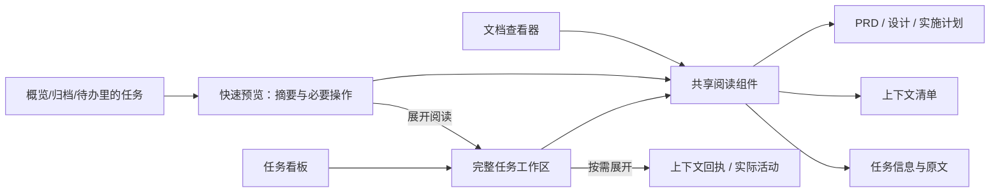

# UI/UX 方向：沿用现有外壳，把任务内容做好

**本次选择：以用户截图中的现有 UI 为 S0 视觉基线。此前方案原型不作为实现或验收标准。**

这次不再交付另一张脱离现有组件的概念图。现有浅色侧栏、白色内容卡、蓝绿强调和图标体系已经能够承载目标；不足主要在任务内容的阅读、版本与证据组织。下面明确要改的交互、现有资产和开源借鉴方式，供 GLM 直接修订设计。

## 1. 截图证据与能判断的范围


**步骤 1：进入当前项目概览。** 截图来自用户本轮附件，已原样复制并核对 SHA-256，检查了保存后的图片；没有将旧原型当成当前产品截图。

| 从这一屏可以看到 | 判断与处理 |
| --- | --- |
| 分组侧栏、项目标题、任务列表与配置区域层次清楚 | 保留布局与视觉语言，避免全员重新学习导航 |
| 当前任务与近期任务有直接入口 | 让快速预览和任务看板进入同一套阅读能力 |
| 计数卡、平台卡、配置卡适合项目概览 | 长文档工作区不用再重复放一排大统计卡 |
| 灰色说明文字较浅、部分信息字号较小 | 属于需检验的可读性风险；实际对比度须从渲染样式测量，不能仅凭缩放截图判合格/不合格 |

**限制**：只有概览这一屏的真实截图。未见任务详情的真实运行截图；以下阅读布局属于基于源码的设计建议，不伪装为已完成界面。键盘顺序、屏幕阅读器、窗口缩放和动效需要运行验收，不能从截图判定无障碍合规。

## 2. 用已有入口形成一套体验



快速预览用于看任务是什么、谁负责、目前有哪些材料，读一小段后能展开。完整任务工作区用于长时间读 PRD/design；它沿用任务看板现有工作区，保留返回时的列表位置。ArtifactViewer 继续适用于单文件，不再维护另一份互不一致的文档解析/对比实现。

这个模式可借鉴 参考：官方文档明确区分 side peek、modal 和 full screen。我们借鉴打开方式与内容层级，具体样式沿用本产品；没有完整实测 参考 的所有交互。[参考 工作项详情](https://docs.参考.so/work-items/work-item-details)

## 3. 工作区里只放当前要看的信息

桌面宽窗口的内容顺序如下，这是布局说明而非像素成品图：

```text
现有侧栏 │ 任务列表（可收起） │ 任务标题 / 原始状态 / Jira 关联
         │                   │ PRD · 设计 · 实施计划 · 上下文清单 · 任务信息
         │                   │ 文档来源与版本      对比 / 目录 / 专注 / 观察
         │                   │
         │                   │         主阅读区            │ 观察面板（按需）
         │                   │                             │ 本次回执
         │                   │                             │ 实际活动
```

- 不增加第二套全局导航，也不在正文左侧再叠一层永久文件树。任务列表和任务内文档各司其职。
- 标题区域显示 `任务记录：进行中`；有证据时另显示 `最近活动：检查 Agent 启动于…`。不再强行画六个已完成/未完成阶段。
- 文档顶部工具条固定在自己的阅读容器内，正文有稳定的最大宽度。目录和观察面板可切换，窄窗口不同时抢正文空间。
- PRD/design 等 Markdown 默认阅读视图；任务 JSON 用字段卡＋原文；上下文清单用文件、用途、来源/可读性列表。不存在的文件显示“尚未创建”，并说明它不是错误或漏执行证明。
- “上下文清单”回答计划提供哪些材料；“回执”回答这次输出实际包含什么。二者可关联查看，但名称、时间来源与状态不能混合。

## 4. 五个必须做对的交互

### 场景 A：开发在读设计，Agent 又保存了文件

1. 开发在“异常处理”章节选中一段文字。
2. Agent 保存 design.md 后，顶部出现“发现新版本”，正文和选择保持原样。
3. 开发点击“查看变化”，比较“本次打开版本 → 当前本机版本”，不要求先有 Git 提交。
4. 点击“阅读新版本”后，尽量定位到相同标题；标题被删除时提示已定位到最近仍存在章节。不要只恢复一个在新文档中已经失效的 scrollTop。

验收：连续多次保存不反复 loading；读者能说清自己正在读哪一版。关闭重开之后没有会话快照，就明确说明不再保留上次打开版本，不冒充跨重启历史。

### 场景 B：开发怀疑一条规范没有进入上下文

1. 打开“观察”中的最近一次回执，先看到宿主、时间、任务和证据说明。
2. 状态写“已输出至宿主通道”，下面用普通话补充“尚无宿主接收确认”。L1/L2 编号仅放解释信息，不要求员工学习编号才能看懂。
3. 搜索规范名称，查看是完整纳入、截断、只提供索引还是不可读取，并展示当时的版本摘要。
4. 若当前规范已被改动，标“当前文件与当时记录不同”；不能用现在的文件冒充当时内容。
5. 回执没记录则显示“未观察到”，入口是“检查观测配置”；有明确错误时才显示“观测记录失败”。

验收：能区分清单中有、实际已输出、宿主确认三个概念；不出现“规范已被遵守”的暗示。

### 场景 C：从 Jira 接一个小修复

1. 开发打开本人已分配工单，点“在当前项目创建任务”。
2. 标题/描述/来源自动带入，当前仓库清楚可见；需要换仓库再显式选择。
3. 如果已有本地关联，优先打开已有任务。生成草稿后显示“待结合本机代码确认”。
4. 完成后分别显示本地归档结果和 Jira 流转结果。Jira 失败时能重试/打开工单处理，不撤销已完成的本地归档，也不假报远端同步成功。

验收：没有重复抄写标题；不把必须的业务阅读计为“无用操作”；远端状态是否变更一眼可辨。

### 场景 D：产品成员要确认一项实现范围

产品成员阅读开发已发布的说明，确认业务范围和未决问题，不需要看到本机绝对路径、token、hook 或全部文件清单。S0 尚未有共享发布通路时，试点用明确的导出版本/现有文档载体；静态版本不能标实时。后续接入团队服务后继续保留“发布于何时、代码/材料依据是哪版”。

验收：产品知道自己确认的是哪一版内容；没有“远程启动开发 Agent”按钮或隐含授权。

### 场景 E：测试或接手者发现状态与实际不一致

任务上可同时显示“本地记录已完成”和“Jira 仍为进行中”；展开说明来源，不自动选一个覆盖另一个。检查活动只写观察到的事实；没有当前提交的检查记录，就不显示通过。接手者能定位文档、关联工单和未决问题，不必读完上一人的全部对话。

## 5. 尺寸、视觉与键盘要求

以下为 CSS 像素预算，不直接把附件图片像素当作应用尺寸。现有源码主侧栏约 208px；任务导轨/辅助栏约 224px。Windows 缩放会改变实际可用 CSS 宽度。

| 可用窗口宽度 | 默认表现 |
| --- | --- |
| 1280 | 选中任务后任务列表可收起；观察信息用抽屉/切换面板；正文优先，不强制三栏 |
| 1440 | 主侧栏＋任务列表＋正文；观察默认收起，打开时可暂时收起列表 |
| 1920 | 正文最小可用宽度满足后允许同时展开列表和观察；正文仍限制最大宽度 |
| 更窄窗口或高缩放 | 工具条折叠次要操作、单列阅读；表格自身横向滚动，不让整个界面溢出 |

阅读宽度 680/760/880 是 `max-width` 偏好，实际取容器可用宽度；长中文正文建议 15–16px、行高约 1.75，仅作用于阅读区，保持现有导航和表格密度。采用当前 `styles.css` 的颜色变量、card/button/chip 和 Lucide 图标；浅色背景约 #F2F4F8、侧栏 #E8ECF2、白色阅读面、现有 leaf 色系。状态须有文字与图标，不能只靠蓝绿/灰色区分。

Esc 只处理最上层：打开的菜单/对话框 → 专注模式 → 快速预览。退出后焦点回到触发按钮，不能一次 Esc 同时把任务也关闭。目录、文档标签、观察开关、分栏手柄均需键盘可达；焦点高亮在当前浅色主题下可见。Markdown 中的文本选择不可被全局 `select-none` 吞掉。

## 6. 开源 UI/UX 怎么借，哪些不引入

调研时间 2026-10-11。下表是官方文档/代码层面的适配判断，不等于完成安装、集成、许可证法律审查或完整产品实测。

| 开源来源 | 借用的具体能力 | 与本项目的适配和决定 |
| --- | --- | --- |
| [参考 工作项详情](https://docs.参考.so/work-items/work-item-details) / [源码](https://github.com/参考仓库) | 快速侧览、展开工作区、属性与主内容分层 | **借交互，不搬整套应用**。它包含独立服务栈，源码标 AGPL-3.0；S0 没必要为阅读器引入第二个项目管理平台 |
| [shadcn/ui](https://github.com/shadcn-ui/ui) / [Resizable](https://ui.shadcn.com/docs/components/base/resizable) | 可组合的面板、菜单、侧栏等组件模式 | MIT；保留作为局部组件来源。现项目 React 18/Tailwind 3，不能直接执行最新版生成器覆盖主题；有缺口时锁定兼容实现并映射现有 tokens |
| [react-resizable-panels](https://github.com/bvaughn/react-resizable-panels) | 分栏尺寸约束、折叠与键盘调整 | MIT；需要重做可拖动阅读布局时优先验证它，避免再写一套鼠标拖拽系统。明确选定版本/API，别混用不同主版本示例 |
| [jsdiff](https://github.com/kpdecker/jsdiff) | 文本行差异计算及耗时限制 | BSD-3-Clause；**S0 文档对比优先采用**，显示层复用当前只读文本样式。长文档用 worker/超时与大小上限，原始文本安全转义 |
| [CodeMirror Merge](https://codemirror.net/docs/ref/#merge) / [项目说明](https://github.com/codemirror/merge) | 完整并排/单列差异界面 | MIT；若后续需要大型代码对比再评估。S0 长 Markdown 不必为了 diff 先嵌入整套编辑器；其 GitHub 仓库已标迁移，不能把旧仓库当持续更新源 |

当前建议新增的 UI 依赖只有“确实需要替换手写分栏时的 resizable-panels”和“只读文本差异 jsdiff”，都先做兼容验证；不强制同时接入 shadcn、Radix、CodeMirror 三套体系。Zod 负责协议校验，不承担交互组件职责。依赖最少不是绝对目标，能减少自制高风险基础能力才是理由。

## 7. UI 验收以真实数据和已有页面为准

下一份可批准的界面稿应直接建立在现有 TaskWorkspace 上，展示同一任务的 PRD、上下文清单、一次有裁剪的真实回执、未观察到状态和本次打开版本 diff。使用模拟数据时必须标样例，不用漂亮的全绿流程取代故障和空态。

需要的证据截图为：1280 阅读、1440 对比、1920 打开观察、快速预览展开、外部更新提示、错误/未知状态；并完成键盘顺序及 Esc 验证。本轮只有用户提供的概览图，不假装这些验收截图已经存在。

这次的视觉取舍已经明确：**保留现有 UI，借成熟的阅读与查看交互；不继续沿用用户不满意的旧原型。**
