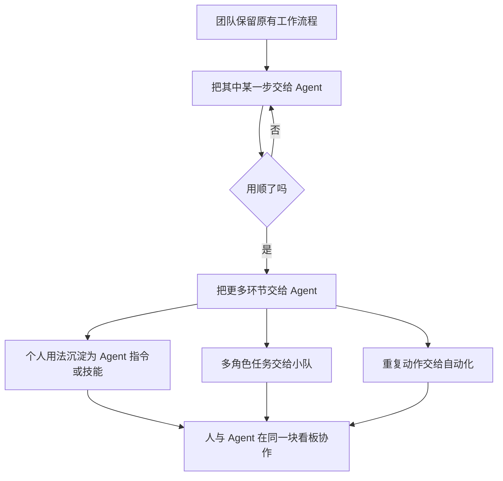
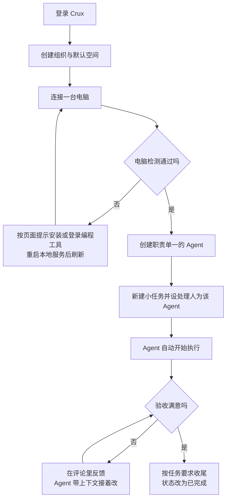

# Crux 产品需求文档（PRD）—— 第1章 开始使用 Crux

## 文档信息

| 项目 | 内容 |
| --- | --- |
| 产品名称 | Crux（渐进式 AI native 团队协作平台） |
| 文档章节 | 第1章 开始使用 Crux |
| 文档版本 | V1.0（逆向整理稿） |
| 编制日期 | 2026-10-22 |
| 信息来源 | https://help.crux.com/docs/welcome（官方文档，提取日期 2026-10-22） |
| 整理方式 | 基于官方已上线功能的文档做逆向需求整理，状态均为「已上线-现状整理」 |

## 功能模块总览

| 模块编号 | 功能模块 | 状态 | 一句话说明 |
| --- | --- | --- | --- |
| 1.1 | 产品定位与核心价值（概述） | V1.0 · 已上线 | 阐明「渐进式 AI native」定位：保留原有协作方式，先把某一步交给 Agent，用顺后再扩大 Agent 覆盖环节 |
| 1.2 | 快速上手 Crux | V1.0 · 已上线 | 首次跑通最小闭环：登录建组织与空间 → 连接电脑 → 创建 Agent → 派发一条小任务并验收 |

---

## 1.1 产品定位与核心价值（概述）（V1.0 · 已上线-现状整理）

> 来源：https://help.crux.com/docs/welcome ｜ 原文标题：欢迎使用 Crux

### 1.1.1 使用场景描述

**业务目标**：让团队以「渐进式 AI native」方式协作：保留原来的工作流程与协作工具，先把其中某一步交给 Agent 执行，其他步骤保留原状；等用顺了再把更多环节交给 Agent，不必第一天就把所有任务都派给 Agent，也不必为了用 AI 换掉现在的协作工具。

**目标用户**：已在个人电脑使用 Claude Code、Codex、Cursor 等 AI 编程工具的研发团队；需要在同一块看板上协作的产品、开发、测试角色。

**触发场景**：
- 需求还在 Jira、TAPD、飞书群、文档、评论和截图里，每次都要复制给 AI，做完再把进展、阻塞和结果搬回任务系统；
- 几个人同时开着终端时，看板上看不到哪个 Agent 在做什么；Agent 改到同一个目录时文件会互相覆盖；
- 个人调顺的用法留在自己的终端里，同事用不上；个人工作流已经 AI native，但团队协作仍被困在原有的 Jira、禅道上。

**User Story**：
- 作为团队负责人，我想要保留现有任务系统与 IM 通知、只把某一步交给 Agent，以便于渐进升级为 AI native 协作而不更换工具。
- 作为开发者，我想要把调顺的做法沉淀成 Agent 指令或技能，以便于同事把同类任务直接派给同一个 Agent 复用。
- 作为团队，我想要把站会汇总、缺陷分流等重复动作交给自动化，以便于人力集中在判断、分工与验收上。

### 1.1.2 原型图 / UI 示意

图 1.1.2-1 按状态组织的任务看板

### 1.1.3 功能详细说明

本页为概述类页面，按「关键概念 / 步骤」两列结构整理：

| 关键概念 / 步骤 | 说明 |
| --- | --- |
| 渐进式 AI native | - 团队保留原来的工作流程 - 可以先把其中某一步交给 Agent，其他步骤保留原状 - 等用顺了再把更多的环节交给 Agent；不必第一天就把所有任务都派给 Agent，也不必为了用 AI 换掉现在的协作工具 |
| 保留原来的协作方式 | - 支持接入 Jira、TAPD 和禅道：把已有任务导入进来，或绑定之后双向同步；Jira 也可以用导出的 CSV 导入，TAPD 可以用官方 Excel - 需求、状态和人与人的流程都保留在原来的地方，Agent 的执行再接上去 - 通知也可以继续发到团队正在用的 IM 里：飞书、钉钉和企业微信 |
| 任务 / 专项 / 迭代 / 看板 | - 任务记录需求、缺陷和要做的事，含标题、描述、优先级、状态、处理人和历史记录，后来补上的限制、截图和验收标准也留在这里 - 专项把一组相关任务收在同一个目标下；迭代把这一轮要交付的任务放进同一个时间窗口，范围、已完成和还没做完的部分对团队可见 - 看板按状态把任务摊开；常用的筛选可以存成视图，比如「本周待评审」「我的未完成」 |
| 先把某一步交给 Agent | - 像派给同事一样把任务处理人设成 Agent，它按这条任务动手：改代码、跑检查，产出一段可以 review 的代码 - 调研、汇总、测试这类任务，把报告写回任务里；不必先复制到终端再把结果搬回来 - Agent 自己读任务上下文、实现规范和同事讨论，做完了自动提交代码，再找人来验收；进展和卡住的地方写回同一条任务，需要确认的事进入收件箱 |
| Agent（沉淀个人用法） | - 把个人习惯写进一个 Agent 的指令里：它负责什么、动手前要检查什么、改完要跑哪些验证、做完怎么汇报 - 配好之后，看板上的同类任务谁都可以派给它 |
| 技能 | - 会反复用到、而且不只这一个 Agent 需要的流程，沉淀成技能，绑给需要的 Agent - 一次任务特有的目标仍然写在任务里，不必写进 Agent |
| 小队 | - 一条任务需要多个人和多个 Agent 时交给小队 - 由一个队长 Agent 协调，成员可以是其他 Agent，也可以是同事；结果仍汇总在同一个任务上 |
| 自动化 | - 一条自动化就是一条规则：什么时候触发、交给谁、执行什么 - 可每天汇总被挡住的任务、每周汇总专项进度、任务进入某状态时做初步检查、评论出现指定说法时走固定流程、接收 GitHub / GitLab / CI 的 Webhook 创建或更新任务；定期要看的失败测试、长期没人更新的任务、还没分配的任务可按时间去查 - 分给谁由这条规则决定，可以是合适的人，也可以是合适的 Agent |
| 适用场景 | - 产品研发工作流：需求记成任务，Agent 调研补全上下文，人确认范围和验收标准，再并行执行，最后由人验收；专项和迭代看整体进度 - 全流程自动化测试：测试拆给不同 Agent（读代码做提测前检查、核对测试版本、需求转用例、实际执行），测试人员负责安排、确认疑点和最终验收 - 用户支持：在飞书等 IM 话题里 @ Crux 的 Agent，把讨论整理成任务并同步进展回原话题 - 自动更新文档：Agent 定时检查已发布任务，人生成并审核修改计划后，由文档 Agent 修改、提交并推送预览 |
| 怎么开始（三步） | - 连接一台电脑：Agent 用这台电脑上已装好的 AI 编程工具，本地电脑或云服务器都可以 - 创建一个 Agent：先让它只负责一类事（比如缺陷修复），写清它能做什么、做完怎么汇报 - 把一条小任务派给它：处理人设成这个 Agent，执行过程、阻塞和结果都会回到这条任务里 |

### 1.1.4 业务规则与流程说明

| 序号 | 规则/流程说明 | 备注 / 异常处理 |
| --- | --- | --- |
| 1 | Crux 不是再做一个代码 Agent，不替代 Claude Code、Codex 或 Cursor；这些工具继续负责写代码 | 费用还是走已有的 Coding Plan 或 API Key |
| 2 | 任务处理人默认是负责推进它的同事；需要判断、分工或跨团队确认的工作，继续由人来做 | 后来补上的限制、截图和验收标准也留在任务里 |
| 3 | 讨论留在任务评论区而不是散到各人的聊天窗口里：可以 @ 该看的人，也可以把某段讨论标成已解决 | 另一个人打开这条任务就能看到之前为什么这么定，不必再问一遍 |
| 4 | 多个任务可以并行执行，每个任务都有独立的 worktree，不会互相覆盖 | 合并前仍然由人 review |
| 5 | Agent 做完了自动提交代码，再找人来验收；需要确认的事进入收件箱等用户查看 | 不必先复制到终端，再把结果搬回来 |
| 6 | 产品、开发、测试仍然在同一块看板上协作，站会和分工都在这块看板上进行 | 参见图 1.1.2-1；常用筛选可存成视图 |
| 7 | 站会、周报、缺陷分流、需求补全等重复动作可以交给自动化 | 等团队已经习惯把某一类任务交给 Agent 后再启用 |
| 8 | 不是每条任务都适合一个 Agent 从头做到尾；复杂需求可拆开后交给小队，让人和 Agent 各做自己负责的那一步 | 小队结果仍汇总在同一个任务上 |

### 1.1.5 附件与截图

暂无补充截图（正文已引用原文唯一截图，见图 1.1.2-1）。

### 1.1.6 流程图

渐进式采用路径（按原文「保留原状 → 先交一步 → 用顺后扩大环节」的推进方式）：

---

## 1.2 快速上手 Crux（V1.0 · 已上线-现状整理）

> 来源：https://help.crux.com/docs/quickstart ｜ 原文标题：快速上手

### 1.2.1 使用场景描述

**业务目标**：第一次使用即跑通最小闭环：在 Crux 里建一个很小的任务并指派给 Agent，Agent 在用户的电脑上改完代码，过程和结果都回到这个任务里；先跑通这一步，其他步骤保留原状，等用顺了再决定要不要把更多环节交给 Agent。

**目标用户**：首次接入 Crux 的团队与个人开发者（拥有一台本地电脑、云服务器或虚拟机，其上已安装或准备安装 Claude Code、Codex 等 AI 编程工具）。

**触发场景**：
- 首次打开 Crux 登录，网页端建议下载桌面版；
- 按「开始使用」引导依次完成：登录建组织与空间 → 连接电脑 → 创建 Agent → 派发一条小任务；
- Agent 执行后需要通过对话记录、评论与收件箱跟进，并在验收后收尾任务。

**User Story**：
- 作为新用户，我想要按引导跑通「任务 → Agent → 电脑」的最小闭环，以便于用最小成本验证 Crux 的 Agent 执行效果。
- 作为新用户，我想要用一条不碰现有项目的示例任务做验收（双击 HTML 即可查看），以便于零风险完成第一次验收。

### 1.2.2 原型图 / UI 示意

[图片占位]

图 1.2.2-1 快速上手「开始使用」引导界面示意

原文未提供界面截图，建议后续补充原型图。

### 1.2.3 功能详细说明

按上手前置条件与四个步骤组织：

| 节点/字段名称 | 交互与业务规则 | 数据来源/关联模块 |
| --- | --- | --- |
| 前置认知：任务 / Agent / 电脑 | - 任务：这一次要做什么，比如把一个按钮的文案改掉 - Agent：谁来做、按什么规矩做，记住职责和指令，可以反复派活 - 电脑：干活的地方，AI 编程工具、代码、登录状态和命令都在这台电脑上；Crux 不另起一套工具，就用这台电脑上已有的 - 一次执行 = 任务派给 Agent → Agent 到这台电脑上改代码、跑命令 → 结果写回任务 | Agent 与电脑模块 |
| 登录方式 | - 选项：邮箱验证码 / 微信扫码 - 没有账号也直接登录，第一次会自动创建账号 | 账号体系 |
| 客户端选择 | - 网页端会先建议下载桌面版 - 桌面版能检测本机已经安装的 AI 编程工具，并顺手把这台电脑注册进来，后面少走一步，建议使用 - 想先在浏览器里看完界面，选「继续使用网页端」，电脑可以之后再接 | 桌面端 / 电脑连接 |
| 创建组织 | - 填写组织名称和组织 URL - 组织是团队和 Agent 一起工作的地方 | 组织体系 |
| 初始化默认空间 | - 进入组织后弹出「初始化默认空间」，询问这个空间主要做什么工作 - 做研发选「软件开发」，任务类型保持默认（需求和缺陷已勾选）直接保存 - 自动创建叫「默认空间」的空间，名称不用自己填；任务类型和功能模块以后都能在空间设置里改 | 空间设置 |
| 连接电脑（桌面版） | - 桌面版会在设置过程中检测并引导注册这台电脑 | 电脑连接 |
| 连接电脑（网页端） | - 在「开始使用」里点「连接电脑」，把页面给出的命令复制到那台电脑的终端执行 - 本地电脑、云服务器、虚拟机都可以 | 电脑连接 |
| 电脑详情检查 | - 显示在线只说明连上了 - 上面的编程工具没装好、没登录，或者没出现在本地服务的 PATH 里，Agent 还是跑不了任务 - 页面提示未检测到或未登录时，按它给的命令在这台电脑上处理，重启本地服务后再刷新 | 电脑详情 / Runtime 检测 |
| 创建 Agent 入口 | - 路径：全部 Agent → 创建 Agent - 第一次先让它只负责一件事，这样才知道该把什么任务交给它 | Agent 模块 |
| Agent 类型 | - 选「代码开发」；在软件开发空间里，这是默认项 | Agent 配置 |
| Agent 工作方式 | - 建议选「Agent 自动拉取 Git 代码仓库」，并把仓库加进去；每个任务使用独立的 worktree，几个任务一起跑也不会互相改乱目录；仓库能不能拉下来，取决于这台电脑上的 Git 凭证 - 备选「手动指定代码所在目录」：代码已经在这台电脑的某个目录里、暂时不想配 Git - 备选「不需要代码库」：只是临时生成一段代码、不碰现有项目 | 代码库 / Agent 工作目录 |
| Agent 名称与电脑 | - 名称自己起，比如 `Thor` - 电脑选刚才接好的那一台 | Agent 配置 |
| Agent 指令 | - 第一次建议写短的：接到任务后先读描述和评论；需求不清楚先提问，不要猜；改动尽量小；做完说明改了哪些文件、跑了什么检查 | Agent 配置 |
| Agent 可见性 | - 先用「个人」 - 等这个 Agent 确实好用，再共享给空间里的其他人 | Agent 配置 / 空间成员 |
| 新建任务 | - 在「默认空间」的任务页点「新建任务」 - 第一次不用自己想题目，可用示例任务：「示例任务：制作一个年会抽奖程序」（交付单文件 HTML、双击即可打开使用、不依赖任何外部网络资源、不碰现有项目） | 任务模块 |
| 任务处理人 | - 创建后打开任务，在属性里把处理人选成刚才的 Agent - 新建任务的默认状态是「待开始」；处理人一设好，Agent 就会开始，不用再改状态 | 任务属性 / Agent 派单 |
| 执行跟进 | - 只看这一个任务就够了：对话记录里是它正在做什么；评论里是它的结论和卡住的地方；需要处理的事项会进收件箱 | 任务动态 / 收件箱 |
| 迭代反馈与收尾 | - 不满意就在评论里直接说，它会带着已有上下文接着改（如「停止时没有撒花，补上」） - 确认没问题后，按任务里的要求收尾（如「把 HTML 文件上传到这条任务的评论里，并把任务状态改为已完成」） - 完成对应的状态叫「已完成」；改不改由用户判断，它不在「开始使用」清单里 | 任务评论 / 任务状态 |
| 接下来 | - 侧边栏「新手指引」会勾掉已经完成的步骤，剩下的不用一次做完 - 值得接着做的三件事：把同事请进组织；任务本来在 Jira、TAPD 或禅道里就接进来继续用；接上飞书、钉钉或企业微信让通知留在团队已在用的地方 - 同一个 Agent 能稳定接住一类任务之后，再拆出更专的 Agent，或把固定流程做成技能 | 成员 / 任务集成 / IM 集成 / 技能 |

### 1.2.4 业务规则与流程说明

| 序号 | 规则/流程说明 | 备注 / 异常处理 |
| --- | --- | --- |
| 1 | 没有账号也可以直接登录，第一次会自动创建账号 | 降低首次使用门槛 |
| 2 | 桌面版会检测本机已安装的 AI 编程工具并顺手注册这台电脑；网页端用户可稍后再连接电脑 | 想先在浏览器里看界面，选「继续使用网页端」 |
| 3 | 初始化空间选「软件开发」时，任务类型保持默认（需求和缺陷已勾选）直接保存 | 空间自动命名「默认空间」；任务类型和功能模块以后在空间设置里可改 |
| 4 | 电脑显示在线只说明连上了；编程工具没装好、没登录、没出现在本地服务的 PATH 里时，Agent 还是跑不了任务 | 按页面提示的命令处理，重启本地服务后再刷新 |
| 5 | 连接电脑这一步没完成时，「创建 Agent」会被拦住，弹窗标题是「没有可用的电脑」 | 按弹窗里的说明接好电脑再回来创建 |
| 6 | 工作方式选「Agent 自动拉取 Git 代码仓库」时，每个任务使用独立的 worktree | 仓库能不能拉下来，取决于这台电脑上的 Git 凭证 |
| 7 | 示例任务不碰现有项目，做完双击 HTML 就能验收 | 适合第一次零风险验证 |
| 8 | 新建任务的默认状态是「待开始」；处理人一设成 Agent 就会开始 | 不需要再手动改状态 |
| 9 | 对 Agent 结果不满意时在评论里直接说，Agent 带着已有上下文接着改 | 不必重新建任务 |
| 10 | 「已完成」状态改不改由用户判断 | 不在「开始使用」清单里 |
| 11 | 上手闭环：任务带着上下文，Agent 负责执行，用户负责验收 | 其他步骤保留原状，用顺后再决定是否扩大 |

### 1.2.5 附件与截图

暂无补充截图。

### 1.2.6 流程图

第一次跑通的上手流程：

