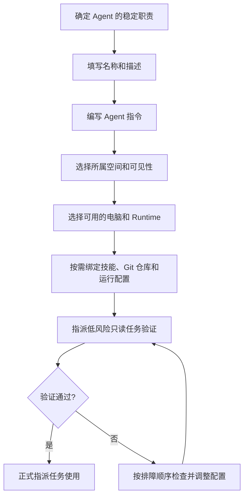
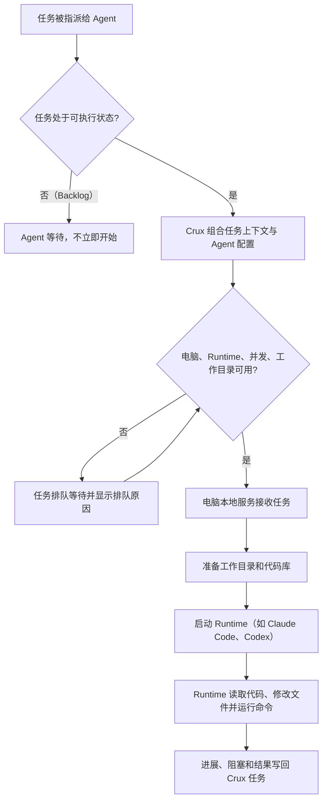
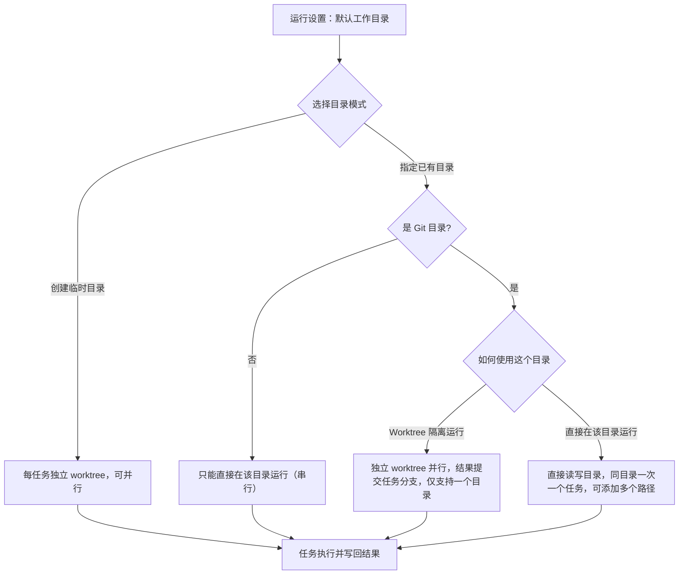
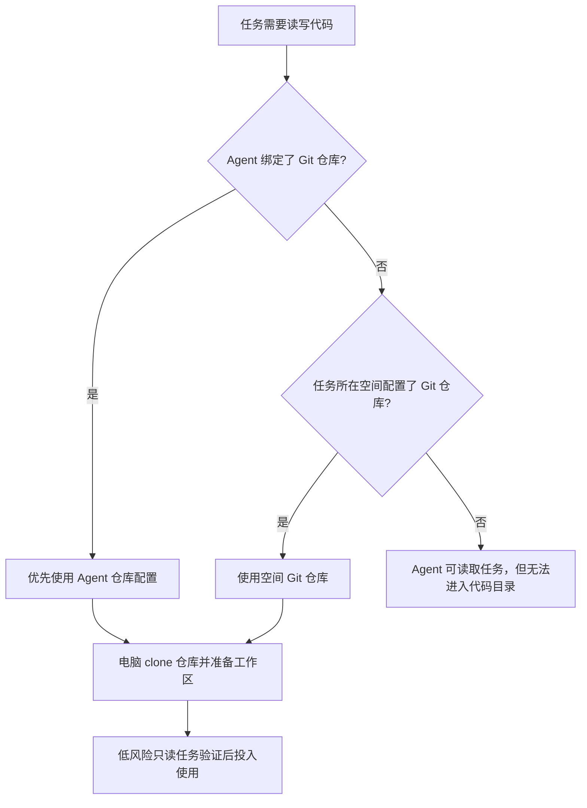
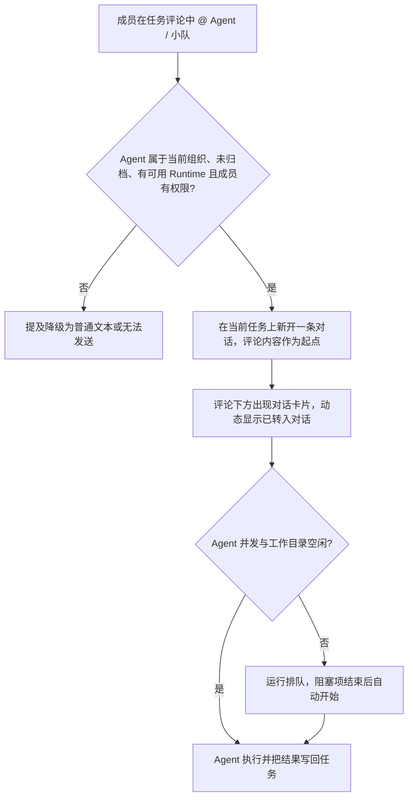
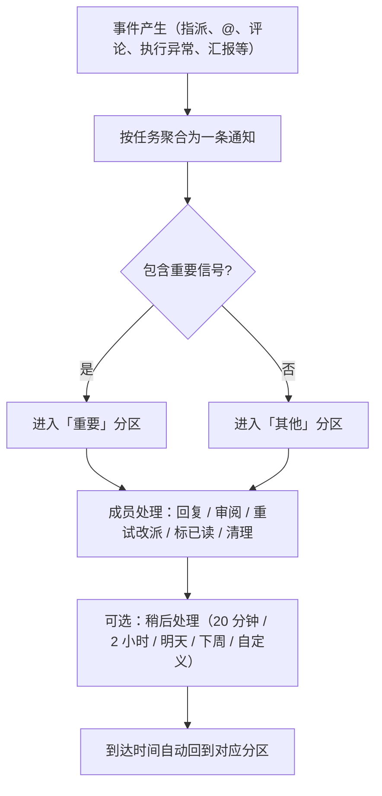
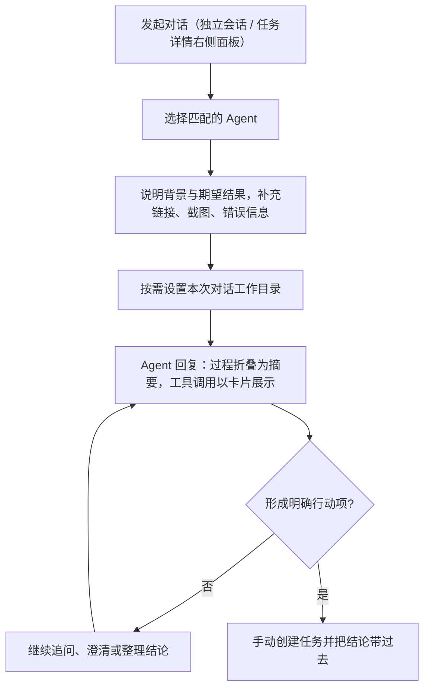
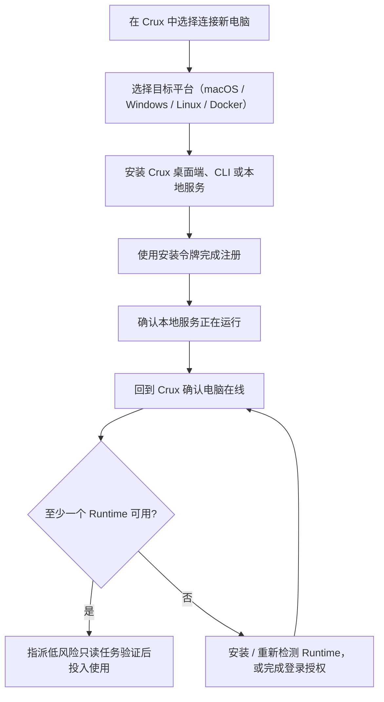
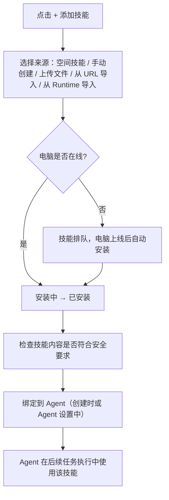
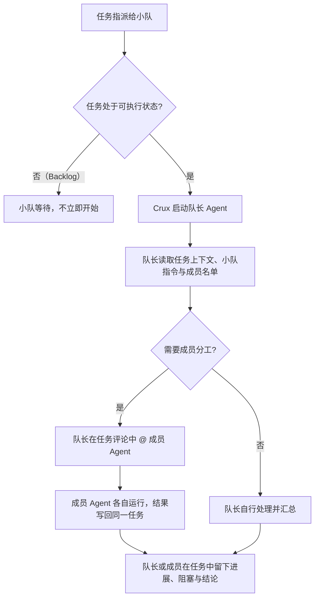

# Crux 产品需求文档（PRD）—— 第2章 使用 Agent

## 文档信息

| 项目 | 内容 |
| --- | --- |
| 产品名称 | Crux（渐进式 AI native 团队协作平台） |
| 文档章节 | 第2章 使用 Agent |
| 文档版本 | V1.0（逆向整理稿） |
| 编制日期 | 2026-10-22 |
| 信息来源 | https://help.crux.com/docs/welcome（官方文档，提取日期 2026-10-22） |
| 整理方式 | 基于官方已上线功能的文档做逆向需求整理，状态均为「已上线-现状整理」 |

## 功能模块总览

| 模块编号 | 功能模块 | 状态 | 一句话说明 |
| --- | --- | --- | --- |
| 2.1 | Agent | V1.0 · 已上线 | 以配置形式沉淀稳定工作方式（职责、指令、技能、代码库与运行设置），通过电脑上的 Runtime 执行任务 |
| 2.2 | Agent 如何执行任务 | V1.0 · 已上线 | 任务指派给 Agent 后的上下文组装、派发执行、状态流转、结果写回与失败排查机制 |
| 2.3 | Agent 工作目录 | V1.0 · 已上线 | Agent 运行设置中的默认工作目录模式（创建临时目录 / 指定已有目录）及隔离并行与串行运行规则 |
| 2.4 | 连接代码库 | V1.0 · 已上线 | 通过空间 Git 仓库、Agent Git 仓库或 Agent 指定已有目录为 Agent 提供代码访问来源与凭据 |
| 2.5 | 评论和回复 | V1.0 · 已上线 | 任务内以评论/回复承载讨论与反馈，支持讨论串已解决、快捷回复与 @ Agent 触发执行 |
| 2.6 | 收件箱 | V1.0 · 已上线 | 个人通知中心，按任务聚合评论、提及、指派、执行异常与汇报，并按重要/其他/稍后/已清理分区管理 |
| 2.7 | 与 Agent 对话 | V1.0 · 已上线 | 独立会话与任务详情对话两条入口，支持对话工作目录覆盖、Slash 命令与快捷指令 |
| 2.8 | 电脑 | V1.0 · 已上线 | 连接本地/远程电脑并登记 Runtime，管理连接状态、启动方式、并发、存储清理与运行环境 |
| 2.9 | 技能 | V1.0 · 已上线 | 沉淀可被多个 Agent 复用的流程规范，以 SKILL.md 为入口创建、导入并绑定给 Agent |
| 2.10 | 小队 | V1.0 · 已上线 | 由队长 Agent 协调多个 Agent 或成员完成拆解、分工与汇总的协作编组 |

---

## 2.1 Agent（V1.0 · 已上线-现状整理）

> 来源：https://help.crux.com/docs/agent-and-computer/agents ｜ 原文标题：Agent

### 2.1.1 使用场景描述

**业务目标**：把一套稳定的工作方式（职责、指令、技能、代码库、运行设置）保存为可复用的 Agent 配置，团队只需把合适的任务指派给它，不必每次重新解释工作方式；Agent 不是另一套模型或编程工具，而是通过电脑上的 Claude Code、Codex 等运行时（Runtime）执行任务。
**目标用户**：需要把重复性、有固定方法的工作交给 AI 执行的团队成员；负责搭建和维护团队 Agent 的所有者。
**触发场景**：一类工作具有稳定职责或工作方式（如前端修复、测试补充、代码 review、文档维护、专项助理）；团队希望复用同一套执行标准。

**User Story**：
- 作为团队负责人，我想要创建一个配置好职责、指令、代码库和 Runtime 的 Agent，以便于团队成员直接把对应任务指派给它而无需重复解释工作方式。
- 作为 Agent 所有者，我想要基于现有 Agent 创建「分身」并按需覆盖个别设置，以便于同一个 Agent 在不同空间/电脑上略有差异地使用。
- 作为成员，我想要在列表中通过视图、置顶、收藏快速找到常用 Agent，以便于高效指派任务和发起对话。

### 2.1.2 原型图 / UI 示意

图 2.1.2-1 Crux Agent 和小队列表界面示意

### 2.1.3 功能详细说明

| 节点/字段名称 | 交互与业务规则 | 数据来源/关联模块 |
| --- | --- | --- |
| 核心概念（任务 / Agent / Runtime / 电脑） | - 任务：这一次要完成什么，包含目标、上下文、评论和验收要求 - Agent：应该如何工作，保存职责、指令、技能、代码库和运行设置 - Runtime：实际执行工作的 AI 编程工具或执行入口（如 Claude Code、Codex） - 电脑：Runtime 真正运行的机器，提供代码、凭据、工作目录、网络和计算资源 | 任务系统、Agent 配置、电脑与 Runtime |
| 名称和描述 | - 名称：创建时输入框下方推荐一组名称，点击填入，每次打开创建窗口重新生成，可换一批；国内版推荐 8 个并提供 Crux 取名工具入口，国际版不展示该入口 - 描述：说明适合指派什么工作、不适合处理什么，帮助团队选择处理人 | Agent 配置 |
| 指令 | - 编辑器所见即所得，无需记 Markdown 语法 - 指令进入 Agent 的任务上下文，适合描述长期稳定的工作方式（负责/不负责什么、先检查什么、何时提问、修改后运行哪些检查、失败或缺权限如何处理、汇报什么、哪些操作不能自行执行） - 提供自动翻译为英文开关（卡片上的语言图标，悬停打开）：保存后自动翻译成英文，运行时优先使用译文；译文单独保存、原文不被修改，每次修改后自动重新翻译；译文未就绪时自动回退用原文，不阻塞任务；悬停浮层可查看翻译状态和译文 | Agent 配置、任务上下文 |
| Agent 类型 | - 选项：代码开发 / 日常办公 / 设计创意（设计创意目前不可用，开放时间以产品界面为准） - 首次在空间创建时按空间用途给默认类型：软件开发空间默认代码开发，其他空间默认日常办公；手动选择过类型后，后续创建流程记住该选择 - 日常办公不校验代码开发相关的代码库、路径配置；类型不代表额外权限，成员仍需具备对应空间、电脑、Runtime 和资源访问权限 | Agent 配置、空间设置 |
| 工作方式（代码开发） | - 选项一：Agent 自动拉取 Git 代码仓库——每个任务使用独立 Git worktree，适合团队协作 - 选项二：手动指定代码所在目录——使用电脑上已有代码目录，适合超大代码库等场景 - 选项三：不需要代码库——适合临时生成代码场景，选择后无额外输入项 - 未提供代码来源时提示「请添加 Git 代码库，或将工作方式改为"手动指定代码所在目录"或"不需要代码库"」；选手动指定但未填路径时提示「请输入代码所在目录，或修改为其他工作方式」；切换工作方式后原错误提示消失 | Agent 配置、Git 仓库配置 |
| 电脑和 Runtime 绑定 | - 创建或重新绑定时可选择离线电脑上的离线 Runtime 以便先完成配置；尚未检测到、检测失败、已卸载或不在可选范围的 Runtime 不可选 - 本机电脑排在前面并带「（本机）」标记；默认优先选在线 Runtime，无在线项时回退本机离线 Runtime - Runtime 所在电脑不允许用于 Agent 所选空间时该项置灰不能提交，提示说明当前空间不可用并带空间名称 - 不可用项悬停可「去查看」打开详情；「支持更多 Runtime」打开电脑详情查看并安装其他支持的 Runtime；创建 Agent 不会自动启动电脑 | 电脑、Runtime 状态 |
| 模型与思考深度 | - 默认跟随所选 Runtime 的模型；可在「模型」行从 Runtime 上报的模型列表另选；Runtime 在启动参数里固定模型时该行只读 - 模型公布思考深度时提供思考深度选择，默认项跟随该模型默认深度；模型未公布深度时不显示入口 - 也可在 Agent 或 Runtime 的自定义参数里指定（如「指定模型：模型名」）；OpenClaw 不会用 `--model` 选择模型；指派任务时可临时选择模型覆盖默认 | Runtime、Agent 运行设置 |
| 所属空间和可见性 | - 每个 Agent 必须且只属于一个空间，只能用于该空间中的任务 - 可见性：私有（仅所有者可见可用）/ 共享（所属空间有访问权限的成员可见可用） - 可见性影响成员能否找到 Agent、指派任务、与它对话或在评论里 @ 它；任务只能选择同一空间且当前成员有权使用的 Agent | 空间成员体系、Agent 配置 |
| 指派任务入口 | - 入口一：任务处理人选择 Agent，Agent 成为执行处理人，不移除已有人员处理人；任务处于 Todo、In Progress 等可执行状态时尝试开始运行，Backlog 时等待；电脑、Runtime、并发或工作目录不可用时排队 - 入口二：Agent 详情「指派任务」，可搜索该 Agent 所属空间中当前成员有权访问、尚未归档的同空间任务或直接新建；仅未归档、非小队专属且具备执行条件的 Agent 可用 - 指派会立即触发运行且该 Agent 已在此任务有对话时，先选择「在原有对话中运行」或「新开对话运行」（可取消，取消则指派不发生），新开后该对话成为主对话 | 任务系统、与 Agent 对话 |
| Git 设置（提交人身份） | - 提交人名称：默认「Agent 使用者名称 & Agent 名称」（如「张三 & 令狐冲」）；也可只用使用者名称、Agent 所有者名称（可带 Agent 名称）、读所在电脑 git 配置或手动设置 - 提交人邮箱：默认读所在电脑 git 配置；也可用使用者邮箱、所有者邮箱或手动设置 - 手动指定目录时优先读第一个指定目录 `git config --local` 的提交人配置；邮箱始终无法解析时用平台统一 noreply 邮箱兜底 | Git 仓库配置、电脑 |
| 连接器 | - 入口：Agent 详情页「工具 & 知识库」→「添加连接」，把第三方工具凭证授权给该 Agent；运行时可用对应 CLI 或 API 操作工具，无需把令牌写进指令 - 提供的连接器以线上列表为准，例如飞书（扫码授权，收发消息、管理日程、搜索编辑云文档等）、Apifox（填访问令牌，操作接口/数据模型/环境、跑测试场景，首次使用自动安装并附官方说明）、CNB（访问仓库与 issues） - 凭证只作用于授权它的 Agent 运行过程，不出现在指令或任务里；失效时在连接列表重新授权 | 第三方集成（飞书 / Apifox / CNB 等） |
| 运行设置 | - 默认工作目录：创建临时目录或指定电脑上已有目录 - 最大并发数（执行指派的任务）：同时处理的被指派任务数 - 最大并发数（聊天对话）：默认独立计数，可共享任务并发额度或手动输入 - 单任务最大运行时长：避免任务无限运行 - 排队超时时间：默认 24 小时，可在 1–168 小时之间调整，与单任务最大运行时长互不影响 - 总并发受电脑上限限制，可从运行设置打开电脑并发设置 | Agent 配置、电脑 |
| 环境变量和启动参数 | - 在 Agent 设置或 Runtime 详情中以表格添加、修改、删除；未配置时显示「添加」 - 粘贴多个参数自动分行；包含空格的值用引号包住；保存保留输入的换行；值默认隐藏，需要时显示 - Agent 为同一启动参数或环境变量设置的值优先于 Runtime 默认值 | Agent 配置、Runtime |
| 列表视图（全部 / Agent / 小队 / 我的） | - 顶部四个视图；选「我的」时只列出当前成员创建的 Agent 和小队 - 列表按置顶和所属空间分组，每个分组可折叠、展开 - 置顶：列表行上「置顶」，集中显示在顶部「置顶」区，用「取消置顶」放回；空间 Agents 列表与「全部 Agents」置顶互通 - 收藏：列表卡片、设置页、对话头部点星标，收藏项集中显示在左侧栏「收藏」分组；收藏同时置顶，取消收藏不取消置顶 | Agent / 小队列表 |
| 分身（variant） | - 入口：Agent 目录卡片「⋯」菜单「创建分身」，悬停显示引导说明；默认名「原 Agent 名 · 分身」，可修改，创建后直接进入设置页 - 权限：所有用户可用，但只有原 Agent 所有者能创建；分身不能再创建分身 - 识别：名称前带分身图标，悬停提示来自哪个原 Agent - 继承字段带「继承」标记（父级修改自动同步），独立取值带「已覆盖」标记，可用「恢复继承」回到跟随状态；可覆盖项包括指令、描述、头像、类型、Runtime 和模型、执行的电脑、可见性与所属空间、并发、Git 仓库等；技能由原 Agent 实时同步，分身侧只读 | Agent 配置 |
| 内置助手 | - 小助手：每个人在每个组织里一个，出现在侧栏「我的任务」下方，第一次打开时自动创建；无设置页，名称和指令由系统管理，只支持直接对话；Runtime 在对话输入区选择，不属于任何空间 - IM 任务助手：每个空间在飞书、钉钉、企业微信、Slack 上各可有一个，从外部应用集成页绑定并按该 IM 方式完成机器人绑定，绑定后可填附加提示词；只在对应 IM 里工作，不能站内私聊或 @，不出现在普通 Agent 列表或处理人选择器 - 普通 Agent 头像悬停卡片可选择「打开设置」，内置助手没有该项 | IM 集成、空间设置 |
| Agent 状态 | - 状态：空闲（当前无任务运行）/ 工作中（正在执行）/ 受阻（运行遇到需处理的问题）/ 错误（最近运行出错）/ 离线（电脑或 Runtime 不可用） - Agent 状态与单次运行状态不同：Agent 在线时任务也可能因并发已满或指定目录被占用而排队 | Agent 列表 / 详情 |
| 运行历史和消耗 | - Agent 详情可展开全屏，页内导航在「设置」和「运行历史」间切换；菜单另有「查看运行历史」入口 - 每行显示：运行状态、来源（任务、对话、自动化、工作流）、触发来源（为空显示「未知」，自动化触发显示「自动化」）、运行时间和本次消耗 Token - 点开一行仅在右侧再开一层抽屉，不层层叠加；列表到底可「加载更多」 - 详情概览 Token 为该 Agent 历史全部消耗合计，无用量数据时显示「—」 | Agent 详情 |
| 归档和恢复 | - 归档后：不能再被指派新任务或在评论中提及；正在执行的工作被取消；历史任务、评论和对话记录保留 - 恢复：Agent 列表「更多」菜单 →「已归档 Agent」→ 找到目标 Agent 选择「恢复」；恢复后重新出现在列表，空间权限、电脑和 Runtime 条件满足时可再次使用 | Agent 列表 |

### 2.1.4 业务规则与流程说明

| 序号 | 规则/流程说明 | 备注 / 异常处理 |
| --- | --- | --- |
| 1 | 不要创建「什么都能做」的 Agent；职责越明确，团队越容易知道指派什么任务，Agent 也越容易用一致方法完成工作 | 内容归属：本次任务的目标、范围和验收标准放任务描述或评论；Agent 长期职责放 Agent 指令；多 Agent 复用的流程放技能；工具和默认模型放 Runtime / 自定义参数 / 电脑工具配置 |
| 2 | 单次任务的具体需求不要长期写进 Agent 指令，否则后续不相关任务也会携带这些内容 | 创建后建议先指派只读任务验证（读 README、不改文件），确认电脑/Runtime、工具启动、上下文、代码库访问与结果回写正常后再执行写操作 |
| 3 | 电脑在线不等于 Agent 一定能工作：在线只表示本地服务心跳正常，只有 Agent 所选 Runtime 处于可用状态，任务才具备启动条件 | Agent 未开始运行时按顺序检查：任务是否仍在 Backlog → 电脑是否在线 → Runtime 是否可用 → 代码库/凭据/工作目录是否可访问 → 电脑或 Agent 并发是否已满 → 对话记录中是否有明确错误或等待原因 |
| 4 | 导入或「立即运行」等入口仍只提供在线 Runtime | 创建或重新绑定时可选离线 Runtime 仅用于先完成配置 |
| 5 | 不要把密码、Token、API Key 或私钥写进 Agent 指令、任务描述或评论 | 敏感信息应通过密钥配置或连接器授权提供 |
| 6 | 视图切换、折叠、置顶和收藏均为个人列表偏好，不改变 Agent 可见性、权限，也不影响别人的列表顺序 | 收藏 Agent 或小队时同时置顶；取消收藏不取消置顶 |
| 7 | 任务状态和 Agent 工作状态是两套概念：任务可处于 In Progress 而 Agent 运行仍在排队；Agent 已完成一轮运行但任务仍需成员 review | 完整状态与触发方式见 2.2 |
| 8 | 普通评论不会自动触发处理人 Agent；要让 Agent 继续处理需在评论里 @ 该 Agent 或进入任务上的对话 | 见 2.5、2.7 |
| 9 | 代码库优先级：Agent 绑定仓库时优先使用 Agent 自己的仓库配置；未绑定时通常使用任务所属空间配置的 Git 仓库；两边都没有配置时 Agent 可能能读取任务但无法进入代码目录完成代码工作 | 真正执行 clone、git、gh、构建和测试命令的是 Agent 所在电脑 |
| 10 | 列表里完全找不到某个 Agent 的可能原因：已归档、属于其他空间、当前成员无使用权限、被设置为小队专属 Agent；小助手和 IM 任务助手也不出现在普通 Agent 列表 | 小队专属 Agent 只能在所属小队中被调用 |
| 11 | Runtime 不接受所选思考深度时运行会明确报错，而不是页面显示一个值、运行时仍用默认深度；通过自定义参数指定思考深度且 Runtime 在首次请求前没能应用时，这次运行停止并明确报错 | 模型没有公布可选深度时不显示入口，按 Runtime 默认行为执行 |

### 2.1.5 附件与截图

暂无补充截图（本章可用截图已用于图 2.1.2-1）。

### 2.1.6 流程图

## 2.2 Agent 如何执行任务（V1.0 · 已上线-现状整理）

> 来源：https://help.crux.com/docs/agent-and-computer/agent-task-execution ｜ 原文标题：Agent 如何执行任务

### 2.2.1 使用场景描述

**业务目标**：把任务指派给 Agent 后，由 Crux 组合任务上下文、Agent 配置和电脑环境并派发执行；任务仍是协作中心，Agent 只是执行者，需求、讨论、运行记录、阻塞和结果都回到同一个任务里。
**目标用户**：把任务指派给 Agent/小队的任务处理人与关注者；需要跟进 Agent 执行进展和结果的成员。
**触发场景**：任务处理人设置为某个 Agent 或小队；任务评论中提及 Agent；与 Agent 对话；自动化触发；重试失败运行；快速创建任务。

**User Story**：
- 作为任务处理人，我想要把任务指派给 Agent 后自动开始执行并查看排队/处理/完成等状态，以便于不需要在本地终端跟踪过程。
- 作为成员，我想要在 Agent 阻塞、失败或完成时收到提醒并回到任务上下文处理，以便于及时补充信息、审阅结果或改派。
- 作为成员，我想要在指派时为这一次执行临时选择模型，以便于覆盖 Agent 默认模型满足特定需要。

### 2.2.2 原型图 / UI 示意

图 2.2.2-1 在任务详情中把任务指派给 Agent 界面示意

### 2.2.3 功能详细说明

| 节点/字段名称 | 交互与业务规则 | 数据来源/关联模块 |
| --- | --- | --- |
| 指派与触发 | - 处理人设置为 Agent 或小队后，任务处于 Todo、In Progress 等可执行状态时自动开始执行；仍在 Backlog 时 Agent 保持等待，移到可执行状态后开始 - 其他触发来源：任务评论中提及 Agent、与 Agent 的对话、自动化触发、重试某次失败运行、快速创建任务；不同来源的运行都保留在对话记录里 - 指派时可在处理人选择器中把鼠标移到 Agent 行上，点行尾模型图标为本次任务选择模型（覆盖 Agent 默认模型，选「默认」则沿用 Agent 设置）；列表、表格、看板卡片和任务详情的处理人选择器都支持 | 任务系统、Agent 配置 |
| 上下文组装 | - 任务开始执行时 Crux 交付给 Agent 的上下文包括：任务标题和描述；当前任务状态、任务类型、优先级和处理人；最近的评论和补充信息；任务所属空间、专项和标签；Agent 的指令；Agent 绑定的技能；空间或 Agent 绑定的 Git 仓库；运行所需的环境变量、密钥和启动参数 | 任务系统、Agent 配置、技能、Git 仓库配置 |
| 派发到电脑 | - 电脑可以是本地电脑、云端或团队共享电脑；电脑上的本地服务与 Crux 保持连接，接收被指派的任务 - 执行流程：任务指派 → Crux 判断任务是否可执行 → 找到 Agent 可用电脑 → 本地服务接收任务 → 准备工作目录和代码库 → 启动对应 AI 编程工具 → Agent 执行并写回进展和结果 - 电脑离线、不可用或并发已满时任务排队等待 | 电脑、本地服务 |
| 执行状态流转 | - 排队中：运行已创建、尚无电脑开始执行，下方写明等待原因 - 启动中：Crux 正在把任务派发到电脑并准备运行 - 处理中：Agent 正在执行任务 - 已完成：Agent 已完成本次运行并写回结果 - 失败：运行中发生错误 - 已取消：本次运行被停止 - 执行开始后 Agent 工作状态切换为「工作中」；完成、失败或取消后按对应运行结果更新；「排队中」也会出现在任务列表、看板、收件箱和任务详情中 | 任务详情、对话记录 |
| 排队原因 | - Agent 并发已满：达到「最大并发数」，手上一项完成后自动开始 - 电脑并发已满：这台电脑同时执行数量达上限，任一运行结束后自动开始 - Agent 正在这个任务里工作：一个对话一次只执行一项；同一 Agent 在同一任务里的不同对话可同时执行；不属于任何对话的执行、以及开启「同一电脑上的小队成员共用任务目录」的小队任务仍需依次执行 - 小队成员共用工作目录需要依次执行：同一台电脑、同一任务里的小队成员轮流执行，避免同时修改同一份代码 - 等待电脑领取：无上述限制时几秒内被领取，长时间停留应检查电脑是否在线、Crux 客户端是否在运行 | Agent 运行设置、电脑、小队 |
| 提交方式（代码结果） | - 创建临时目录或 Worktree 隔离运行时，每个任务独立 checkout 一个 worktree，不同任务可在同一仓库不同工作区并行 - 任务结果提交到 `<产品>-agent/<Agent 名称>/<任务编号>` 分支（如 `crux-agent/thor/HF-3341`）；对话产生的改动以会话 ID 结尾 - 作者署名为「触发人 & Agent」；由自动化触发、没有真人参与时只写 Agent 名；电脑未配置提交邮箱时使用平台统一 noreply 地址兜底 - 提交者（committer）始终来自该电脑本机 git 配置，并附带一条平台 Co-authored-by 标记；署名与邮箱可在 Agent 设置 Git 设置里自定义 - 任务完成后可 review 该任务 worktree 里的改动，再决定保留、合并或丢弃 | Agent 工作目录、Git 设置 |
| 汇报机制（写回任务） | - 执行过程中或结束后写回：当前进展、遇到的阻塞、需要人类确认的问题、修改了哪些内容、运行了哪些检查、成功/失败/取消的结果、建议的下一步 - 完成一轮工作但需要确认结果时，任务对话进入等人审阅，可在任务里 review 或在该对话中继续回复 - 缺少信息、权限或需要人做决定时，任务对话进入等人回复，在该对话回复或评论里再次 @ 该 Agent - 准备环境时任务对话显示克隆仓库、创建 worktree、检出代码等进度 | 任务评论 / 对话记录、收件箱 |
| 收件箱提醒 | - 进入收件箱的情况：Agent 被阻塞（权限、环境、依赖或信息缺失）、任务失败（需查看原因后重试、补充信息或改派）、Agent 已完成（需验收或推进下一步） - 「等你回复」「等你审阅」这类任务对话交接不进入收件箱：显示在主侧栏「对话」模块，通过对话发起人的桌面横幅和飞书 / Slack 提醒触达 | 收件箱、与 Agent 对话 |
| 触发者与运行权限 | - 每次运行显示触发者（让这次运行跑起来的真人）；由其他 Agent 转交或 @ 触发的运行一级级追溯到最初发起的真人；从飞书、Slack 等外部渠道触发的显示对应外部账号；无法归属到人时如实显示「系统」 - 触发者决定这次运行以谁的身份和权限执行：Agent 能读写的空间、任务和资源取决于触发真人，权限上限不超过 Agent 所有者；外部渠道或系统触发的运行按 Agent 所有者权限执行；触发者已被移出组织时运行被拒绝，不退回按所有者执行 | 组织成员权限、Agent 配置 |
| 查看执行详情 | - 任务详情可查看对话记录：开始时间、排队/等待原因、运行时长、运行类型（首次运行、评论触发、重试、自动化触发）、过程输出、失败错误原因 - 可打开执行转录查看事件和工具调用；运行记录可打开运行详情抽屉，在保留任务页面上下文的同时查看结果，长输出可滚动 - Agent 详情「运行队列」点击一行直接打开该次运行的对话详情；自动化来源的名称是可打开链接 | 对话记录、执行转录 |
| 停止和取消 | - Agent 正在运行时可停止当前运行；停止会中断运行，已完成部分保留，这次运行不再继续；完全停止可能需要几秒 - 仍需继续处理时，在任务评论里 @ 该 Agent，或在任务对话中继续回复 | 任务对话 |

### 2.2.4 业务规则与流程说明

| 序号 | 规则/流程说明 | 备注 / 异常处理 |
| --- | --- | --- |
| 1 | 任务仍在 Backlog 时 Agent 等待、不立即执行；可先在 Backlog 整理需求、补充上下文，准备开始时再移到 Todo 或其他可执行状态 | 指派后未开始的其他原因：电脑离线、并发已满、代码库和凭证配置不正确 |
| 2 | 排队中的运行不需要手动重试；挡住它的运行一结束会自动开始 | 不想再等可以停止这次运行 |
| 3 | 排队等待受 Agent「排队超时时间」限制（默认 24 小时，可在运行设置调整），超过后这次运行按失败处理，需要时重新触发 | 与「单任务最大运行时长」互不影响 |
| 4 | 代码库来源：Agent 绑定仓库优先用 Agent 配置；未绑定通常用任务所在空间 Git 仓库；两边都没有配置时 Agent 可能能看到任务但无法进入代码目录完成代码工作 | 直接运行模式下同一目录一次只能跑一个任务，被占用时后来的任务排队 |
| 5 | 修改 Runtime 执行程序后界面显示「正在重启并复核」是本地服务复核配置的中间状态：不要当作最终失败，不要重复提交互相冲突的恢复操作；等待状态变为成功、明确失败或超时，只有明确失败、超时或复核失败才按错误处理；成功后刷新电脑、Machine 和 Runtime 信息再继续执行或重试 | 见 2.8 |
| 6 | 失败说明中的 HTTP 状态码只能当线索：429 可能是频率限制或账单额度（需看 error.code，Anthropic 的 429 也可能是月度花费上限）；400 可能是格式、上下文太长、内容策略、模型不支持图片或自设花费上限；413 多为图片/附件字节太大；403 往往是模型、组织或地区权限而非密钥错误；Timeout/408/504 默认不是电脑断网 | 不要只根据一个 HTTP 状态码决定下一步；需求助时复制诊断信息（含 Crux、Runtime、运行信息、技术详情与时间）或加 Crux 群咨询 |
| 7 | 模型服务凭据未被接受：电脑负责人检查或更换密钥、登录状态；确认使用当前组织允许的账号；换好凭据后再重试，同一把被拒密钥重试通常不会恢复；403 时先检查模型、组织和地区权限 | 厂商说明：Claude Code 登录与认证、GitHub Copilot CLI 认证排障等 |
| 8 | 频率限制：稍后重试（按技术详情里的 Retry-After 等待）、降低并发或换电脑、查看服务速率限制；额度用尽：检查套餐/额度/花费上限，恢复或换号后再试，仅重试同一条请求恢复不了额度；服务繁忙（529/overloaded）：稍后再试或换可用模型 | 三类问题处理顺序不同，不要互相混淆 |
| 9 | 找不到所选模型：逐字检查模型名称（含命名空间）、确认账户或网关有权访问；Crux 不会自动替换所选模型 | 请求超出模型处理范围：缩短对话、拿掉部分附件或换更大上下文窗口的模型；413 时先检查图片/附件大小（常见约 5–20 MB，Anthropic Messages 约 32 MB 字节上限） |
| 10 | 模型无法处理图片输入：切换到明确支持图片输入的模型；或按 Runtime 配置视觉模型（omp 的 `modelRoles.vision` 与 `retry.fallbackChains`、Hermes 的 vision 角色、OpenClaw 的 `agents.defaults.imageModel`）；暂无视觉模型时先用 OCR 或能看图的服务转文字 | 不要反复重试同一请求；模型名相同不代表能力相同，排查以本次运行实际使用的模型 ID 为准 |
| 11 | 无法连接到模型服务：检查电脑到模型服务的网络、代理和证书；确认本地服务在线；网络恢复后再重试；模型服务拒绝请求：检查不支持的参数或格式，去掉实验性开关或自定义参数后再试 | 隔离运行没能建立独立工作区：worktree 未建起来时运行在改动目录前停下；失败说明中可「一键切换」为直接在该目录运行（串行）后重新发起运行；继续用隔离需确认目录是 git 仓库且至少有一次提交 |

### 2.2.5 附件与截图

暂无补充截图（本章可用截图已用于图 2.2.2-1）。

### 2.2.6 流程图

## 2.3 Agent 工作目录（V1.0 · 已上线-现状整理）

> 来源：https://help.crux.com/docs/agent-and-computer/working-directory ｜ 原文标题：Agent 工作目录

### 2.3.1 使用场景描述

**业务目标**：默认工作目录是 Agent 的运行设置，决定 Runtime 在哪份代码上工作；通过「创建临时目录」与「指定已有目录」两种模式及「Worktree 隔离运行（并行）/ 直接在该目录运行（串行）」两种使用方式，平衡任务并行、工作区隔离与本机环境复用。它不是空间 Git 仓库，也不替代 Agent 或空间的仓库配置。
**目标用户**：需要为 Agent 指定执行场所的 Agent 所有者；需要在同一仓库并行处理多个任务的团队。
**触发场景**：多数代码任务需要并行和独立工作区（创建临时目录）；代码已在本机、目录有特殊依赖或缓存、需复用现有目录（指定已有目录）。

**User Story**：
- 作为 Agent 所有者，我想要让每个任务在独立 worktree 中运行，以便于多个任务并行修改同一仓库而互不覆盖。
- 作为 Agent 所有者，我想要让 Agent 直接使用电脑上已有代码目录，以便于复用本地依赖、缓存和特殊环境。
- 作为成员，我想要在对话中为单次会话覆盖工作目录，以便于不改 Agent 默认设置地处理特定目录任务。

### 2.3.2 原型图 / UI 示意

[图片占位] 原文未提供界面截图，建议后续补充原型图（工作目录设置弹窗、如何使用这个目录确认框）。

### 2.3.3 功能详细说明

| 节点/字段名称 | 交互与业务规则 | 数据来源/关联模块 |
| --- | --- | --- |
| 配置入口 | - 打开 Agent 设置 → 运行设置 → 修改「默认工作目录」 - 与 Agent 对话时可在对话输入区为这一次对话覆盖工作目录，不改 Agent 默认设置 | Agent 运行设置、与 Agent 对话 |
| 模式：创建临时目录 | - 每个任务单独创建一个临时目录，并通过 Git worktree 准备一份独立代码工作区；任务之间不写进同一个工作区，适合并行处理同一套代码 - 任务完成后可 review 该任务对应 worktree 的改动，再决定保留、合并或丢弃 | Agent 运行设置、Git 仓库 |
| 模式：指定已有目录 | - Agent 使用电脑上已有的绝对路径；适合代码已在本机、目录有特殊依赖或缓存、或不希望每次任务重新准备代码工作区的场景 - Windows 上可直接把本地盘符根目录（如 `E:\`）指定为工作目录；手动输入裸盘符（如 `E:`）时离开输入框后自动补全为 `E:\`；网络位置与设备路径（UNC、设备路径、非本地卷根）、系统目录、用户主目录不能作为工作目录 | Agent 运行设置、电脑 |
| 如何使用这个目录：Worktree 隔离运行（并行） | - 适用保存 Git 目录时选择；每个任务独立 checkout 一个 git worktree，不修改原目录，可并行 - 任务结果提交到 `<产品>-agent/<Agent 名称>/<任务编号>` 分支，Agent 对话结果提交到 `<产品>-agent/<Agent 名称>/<会话 ID>` 分支；Agent 名称里的中文转成拼音，空格换成 `_` - 只支持设置一个目录，选择后不显示「添加路径」 - 可额外填写基线分支：任务先尝试从远程 `origin` 获取该分支，获取失败时仍使用本地已有对应引用；留空则按字面 `HEAD` 创建 worktree，不自动获取远程分支 | Agent 运行设置、Git 仓库 |
| 如何使用这个目录：直接在该目录运行（串行） | - 直接读写该目录；人和 Agent 可在同一目录协作 - 不支持多任务并行，同一目录一次只能跑一个任务，其余排队 - 可选择后再「添加路径」为一个 Agent 添加多个目录；新任务先选择空闲目录，没有空闲目录时排队，等目录释放后继续 | Agent 运行设置、电脑 |
| 默认并发规则 | - 指定已有目录且直接运行：默认并发等于已配置的目录数 - 创建临时目录，或指定目录后隔离运行：默认并发是电脑并发的 50% - 可手动调整并发；手动值高于指定目录数量时界面提示写入冲突风险 | Agent 运行设置、电脑并发 |
| 确认按钮 | - 保存「如何使用这个目录」时确认按钮为「确定」；不是 Git 目录时只能直接在该目录运行 | Agent 运行设置 |

### 2.3.4 业务规则与流程说明

| 序号 | 规则/流程说明 | 备注 / 异常处理 |
| --- | --- | --- |
| 1 | 一般建议优先选择创建临时目录，或指定目录后的隔离运行；直接在原目录运行不会为每个任务创建独立代码副本，同一目录一次只能跑一个任务，其余排队 | 更高并发会增加 CPU、内存、磁盘、网络和 Runtime provider 压力，不要盲目调高 |
| 2 | 非 Git 目录只能直接运行；同时添加了 Git 工作区和非 Git 目录时，保存后所有目录都直接运行，界面会说明无法使用隔离 worktree 的原因 | 保存路径时界面提示这一变化 |
| 3 | 同一任务或对话会继续使用原来的目录：即使该路径后来从默认列表移除，只要目录仍可用，这次任务或对话不切换到其他路径；修改默认工作目录后，新任务和新对话才使用新默认 | 修改「隔离还是原地运行」设置后，已绑定旧目录的任务或对话仍按原规则继续 |
| 4 | 选择隔离运行时若 worktree 没有准备成功（如仓库太大），任务会在改动原目录之前停下；失败说明给出原因和「一键切换」，可直接改为直接该目录运行（串行），切换成功后自动重试这次运行；原始 Git 错误仍可展开查看 | 该引导只在隔离运行准备失败时出现；无权限修改该 Agent 设置时需由 Agent 所有者或对话发起人切换 |
| 5 | 直接运行模式下目录被其他任务占用时，后来的任务排队，等它释放后再继续 | 「为什么任务在排队」的常见原因之一 |
| 6 | 工作目录只决定 Agent 在哪里工作，不等于代码库配置；Git 仓库来源仍由 Agent 和空间配置决定 | 见 2.4 连接代码库 |

### 2.3.5 附件与截图

暂无补充截图（原文未提供本章界面截图）。

### 2.3.6 流程图

## 2.4 连接代码库（V1.0 · 已上线-现状整理）

> 来源：https://help.crux.com/docs/agent-and-computer/repositories ｜ 原文标题：连接代码库

### 2.4.1 使用场景描述

**业务目标**：让处理代码任务的 Agent 能找到项目代码：通过连接 Git 仓库，Agent 执行任务时在所选电脑上 clone 对应仓库、读取代码、修改文件、运行命令并写回结果；另支持只在 Agent 层面配置的「指定已有目录」本地方式。
**目标用户**：管理空间或 Agent 代码来源的空间管理员与 Agent 所有者；需要 Agent 阅读/修改代码、补充测试、运行构建测试 lint 的团队。
**触发场景**：任务涉及阅读项目代码、修复 Bug、修改文案或 UI、补充测试、运行构建/测试/lint、分析代码结构、生成可 review 的代码变更；仅讨论需求、整理计划、总结文档的任务可能不需要代码库；临时生成代码可选「不需要代码库」。

**User Story**：
- 作为空间管理员，我想要为空间绑定默认 Git 仓库，以便于空间内任务无需逐个配置代码来源。
- 作为 Agent 所有者，我想要为某个 Agent 单独绑定仓库或指定本地目录，以便于覆盖空间默认仓库或限定该 Agent 的代码访问范围。
- 作为成员，我想要用一个低风险只读任务验证代码访问，以便于确认 clone、目录权限和结果回写正常后再执行写操作。

### 2.4.2 原型图 / UI 示意

[图片占位] 原文未提供界面截图，建议后续补充原型图（空间设置/Agent 设置中的代码仓库区块）。

### 2.4.3 功能详细说明

| 节点/字段名称 | 交互与业务规则 | 数据来源/关联模块 |
| --- | --- | --- |
| 代码来源方式 | - 空间 Git 仓库（配置于空间设置）：决定空间中任务默认使用哪些仓库，如研发空间绑主应用仓库、文档空间绑文档仓库 - Agent Git 仓库（配置于 Agent 设置）：适合只处理特定仓库、访问多空间共用仓库、空间默认仓库不适用、或需明确限定代码访问范围 - 指定已有目录（Agent 设置 → 运行设置）：只给某个 Agent 使用电脑上的本地已有目录；不是空间代码库能力，也不会作为空间默认仓库被其他 Agent 继承 | 空间设置、Agent 设置 |
| 添加 Git 仓库 | - 在空间设置或 Agent 设置中找到代码仓库，添加目标仓库 - 通常填写：仓库 URL（HTTPS 或 SSH）、仓库描述、仓库绑定到哪个空间或 Agent - 填写后建议用一个低风险任务测试 Agent 能否成功 clone 并读取仓库 | 空间 / Agent 仓库配置 |
| 基线分支 | - 添加仓库时可填写可选基线分支：任务创建临时工作区时优先从该分支开始；留空则使用远程仓库默认分支；Agent 仓库和空间仓库都可配置 - 同一仓库 URL 的分支生效顺序：本次运行明确指定的检出分支 > Agent 仓库分支 > 空间仓库分支 > 远程默认分支；Agent 未指定时才继续使用空间仓库分支，所有层都未指定时回退远程默认分支 | 空间 / Agent 仓库配置 |
| Agent 指定已有目录（操作步骤） | - 进入 Agent 设置页 → 运行设置 → 把默认工作目录从「创建临时目录」改为「指定已有目录」→ 点击「修改」选择或填写电脑上已有代码目录（如 `/Users/me/code/my-app`）→ 确认目录在 Agent 所选电脑上真实存在，且运行时有权限读取、修改和运行命令 - 保存 Git 目录后出现「如何使用这个目录」（Worktree 隔离运行 / 直接在该目录运行），规则见 2.3 | Agent 运行设置、Agent 工作目录 |
| 访问凭证 | - Crux 记录仓库配置，但真正访问仓库的是 Agent 所在电脑：Agent 通过该电脑上的 Git 凭证访问仓库 - 需确保电脑已登录 GitHub、GitLab 或内部 Git 服务；SSH key 已配置并有仓库访问权限；HTTPS token 或凭据可用；私有仓库对该电脑可访问 - 电脑无法 clone 仓库时，Agent 也无法通过 Git 仓库完成代码任务；使用指定已有目录时需确认目录存在、路径正确、运行用户有读写权限、依赖和工具可用 | 电脑 |
| Agent 命令使用的凭据 | - Agent 启动的 Git、`gh` 等命令默认使用所在电脑已配置的凭据；组织中的代码托管凭据不会自动转换成 `GH_TOKEN` 或 `GITHUB_TOKEN` 注入 Agent 运行时 - 确需为某个 Agent 显式覆盖 GitHub 身份时，在该 Agent 的环境变量中配置 token；该环境变量是授权 Agent 管理者可查看和编辑的明文配置，不是密钥存储 | Agent 环境变量、电脑 |
| 外部集成（可选） | - 可在「外部应用集成」中连接 GitHub 或 GitLab，获得 Issue 同步、合并请求关联和任务回链能力；自部署在内网的 GitLab 可通过内网代理电脑接入 | 外部应用集成 |

### 2.4.4 业务规则与流程说明

| 序号 | 规则/流程说明 | 备注 / 异常处理 |
| --- | --- | --- |
| 1 | 一般建议优先使用 Git 仓库：任务、代码库和 Agent 配置都在 Crux 中可见，更适合团队协作和多个任务并行执行 | 指定已有目录适合个人试用、本地已有代码、超大代码库，或目录已有特殊依赖、缓存和内部工具配置的场景 |
| 2 | 仓库优先级：Agent 绑定了仓库优先使用 Agent 配置；未绑定通常使用任务所在空间 Git 仓库；两边都没有配置时 Agent 可能可以看到任务但无法进入代码目录完成工作 | 「仓库已添加但 Agent 找不到代码」时检查空间设置、Agent 设置中的 Git 仓库配置及默认工作目录设置 |
| 3 | 指定已有目录不能配置在空间上：它是 Agent 的运行设置，只对该 Agent 生效；空间层面配置的是 Git 仓库，不是本地目录 | 若希望多个代码任务安全并行，更推荐绑定 Git 仓库并选择创建临时目录，或指定目录后选择隔离运行 |
| 4 | 不要把 token、API Key、部署凭据或内部服务令牌写进任务描述和评论；密钥应通过密钥配置提供，任务描述只写目标、上下文和验收标准 | 同样不要写进 Agent 指令 |
| 5 | 删除 Crux 中的仓库配置只会让 Agent 不再通过这条配置使用该仓库，不会删除 Git 服务中的代码仓库 | 恢复使用可重新添加 |
| 6 | 建议用低风险任务测试代码访问（读 README、不改文件、结论写回任务评论），验证 clone/进入目录、凭证或目录权限、读取代码、写回结果均正常后，再让 Agent 修改代码或运行更复杂检查 | 测试不通过时按凭证/路径检查 |
| 7 | Agent 说无法访问仓库时的检查顺序：使用 Git 仓库时先检查任务所在空间或 Agent 是否绑定了该仓库，再检查 Agent 所在电脑是否有 Git 访问权限、能否手动 clone 这个仓库；使用指定已有目录时检查 Agent 设置里的路径是否正确、目录在所选电脑上是否存在 | — |

### 2.4.5 附件与截图

暂无补充截图（原文未提供本章界面截图）。

### 2.4.6 流程图

## 2.5 评论和回复（V1.0 · 已上线-现状整理）

> 来源：https://help.crux.com/docs/agent-and-computer/comments-and-replies ｜ 原文标题：评论和回复

### 2.5.1 使用场景描述

**业务目标**：把任务过程中的补充信息、问题、反馈和结论留在同一个任务里，成员和 Agent 都可以基于这些上下文继续推进；一个单独的话题用评论，已有话题的延续用回复。
**目标用户**：任务处理人、关注者与被 @ 的成员；需要在任务内向 Agent 下达指令或反馈的成员。
**触发场景**：补充需求背景/限制/验收标准、上传截图或日志、给 Agent 新指令、请求成员 review、记录验收结论；回答问题、针对截图追问、对 review 意见来回确认、在 Agent 回复下继续反馈。

**User Story**：
- 作为成员，我想要在评论里 @ Agent 让它参与当前任务，以便于把新的执行指令或反馈交给它处理。
- 作为成员，我想要把处理完的讨论串标记为已解决，以便于评论区只保留待处理话题。
- 作为成员，我想要用快捷回复保存常用短句（含 Agent 提及），以便于一键发送固定反馈。

### 2.5.2 原型图 / UI 示意

[图片占位] 原文未提供界面截图，建议后续补充原型图（任务详情动态 Tab、评论更多菜单、快捷回复面板）。

### 2.5.3 功能详细说明

| 节点/字段名称 | 交互与业务规则 | 数据来源/关联模块 |
| --- | --- | --- |
| 动态 / 对话记录 Tab | - 任务详情通常有「动态」和「对话记录」两个 Tab：动态展示任务活动记录、评论和回复；对话记录查看该任务下所有 Agent 对话 - 与 Agent 的对话不占 Tab，在任务详情右侧面板打开，与评论不是同一套数据；未指派 Agent 也可开始聊 - 需要团队都看到的结论写在评论或任务描述里；任务上的 Agent 对话不会自动变成评论 | 任务详情、与 Agent 对话 |
| 评论 / 回复 | - 评论：开启新讨论话题（补充背景、上传新截图日志、给 Agent 新指令或反馈、请求成员补充信息或 review、记录验收结论）；内容可独立成话题或后来者应单独看到时写新评论 - 回复：延续已有评论话题（回答问题、针对截图日志追问、对 review 意见来回确认、补充结论细节、在 Agent 回复下继续反馈）；相关讨论聚在同一讨论串 | 任务动态 |
| 快捷回复 | - 评论和回复输入框均可使用；点条目文字直接作为评论或回复发送；悬停出现「插入」（提示「仅将内容插入到输入框，不直接发送」），点插入只写入输入框并聚焦，改完再手动发出 - 可在快捷回复入口新增、编辑、删除和排序；按个人保存，不是团队共享内容 - 可保存 Agent 提及：创建或编辑时在编辑器中选择要提及的 Agent，保存后重新打开仍保留；发送或插入后按正常 Agent 提及规则处理 - 只有当前组织、空间和成员权限允许使用的 Agent 才能作为有效提及；Agent 已归档、不可用、属其他空间或无权使用时，提及可能降级为普通文本或无法发送 - 任务处于待审状态时，成功发送「已审阅，没问题」快捷回复会自动移除待审标识（列表、任务详情和重开后一致）；仅清除待审标识，不修改任务生命周期状态，也不把任务标记为已完成 | 评论输入框 |
| 讨论串和已解决 | - 每条顶层评论可形成一个讨论串，回复显示在同一讨论串内 - 评论「更多」菜单通常包括：编辑（菜单顶部，进入后有明确编辑态）、用此评论标记为已解决（带 Resolution 标记的评论显示「重新打开评论」）、复制、复制为 Prompt、分享、删除 - 解决的是整个讨论串而非单条回复，可从顶层评论或任意回复标记；解决该讨论串的那条评论显示 Resolution 标记；已解决后仅这条评论的菜单显示「重新打开评论」，其他评论仍是「用此评论标记为已解决」（把标记改到当前评论） - 标记已解决后讨论串折叠；需继续讨论可重新打开 | 任务动态 |
| 评论里 @ Agent | - 在评论里直接 @ 某个 Agent 或小队时，Crux 在当前任务上新开一条对话，把该评论作为起点并写入对话；评论下方出现「与某某的对话」卡片并标出触发人（「某某 通过评论触发」，人工发起为「某某 发起」）；动态里可见「已转入 与某某的对话」 - 同一个 Agent 在同一个任务上可以有多条对话，互不覆盖；@ 不同 Agent 各自进入各自对话；再开一条可用对话面板「⋯ 更多操作」的「创建新对话」或「召唤 Agent」菜单的「选择 Agent 新开对话」，名单显示该对象在此任务已有几个对话（一个都没有时不显示） - 「处理人」标签标在该执行者的主对话上：最初指派时是第一次运行所在对话；再次指派选「新开对话运行」时主对话和处理人标签随之切换 - @ 不要求该 Agent 是任务处理人，但需满足：被 @ 的 Agent 属于当前组织、未归档且有可用运行时、当前成员有权限触发 - 同一 Agent 在同一任务上的多次运行排队执行，不并行；@ 发起方本身是 Agent 且被 @ Agent 在此任务已有排队中的运行时，这次 @ 会被跳过（避免 Agent 互相反复触发）；成员 @ Agent 不因此跳过 - 继续某一条对话在该对话卡片里回复；再次 @ 同一个 Agent 会新开一条而不是接上原来那条 | 任务评论、与 Agent 对话 |
| 附件 | - 支持多选上传：点附件按钮选择文件时可一次选中多个文件一起上传 - 从正文移出：能编辑任务说明的成员都可移出正文附件（含退格/删除键）；移出只去掉正文引用，文件保留在独立附件区，正文保存不失败 - 永久删除：仅附件上传者和组织管理员可永久删除；无权限时删除入口不可用，键盘移除按「从正文移出」处理 - 评论附件：从评论正文删除附件并保存会永久删除该文件；独立附件删除需确认，确认后永久删除 - 评论进入编辑后，未被当前草稿引用的附件仍显示为独立附件，可插入、移出或删除；把评论正文全部删空并保存时，若已无任何附件则询问是否删除评论，若还有评论级独立附件则保留这条只有附件的评论 - 任务说明里单击选中附件节点、双击预览；评论正文单击预览 | 任务说明 / 评论 |
| 分享评论 | - 在「动态」中从评论或回复的分享入口进入选择模式，选择一条或多条评论内容；第三方集成带入的内容可能无法选择 - 链接可见范围：获得链接的任何人 / 仅组织成员；也可复制文本（所选评论复制为纯文本）或创建分享图片 - 分享是创建时的快照，后续评论和编辑不改变已生成的分享页；「取消分享」使该来源现有分享链接失效 | 任务动态 |
| 长评论 / 图片 / 大附件 / 编辑器 | - 过长评论默认折叠，底部「全部展开」，展开后可「收起」 - 打开图片预览后可选「复制图片」粘贴到支持图片粘贴的应用；复制不可用或失败时用预览中的下载保存 - 无法直接预览的大附件用「下载」而非「打开」；下载完成后桌面端自动打开下载目录并定位或选中文件 - 回复输入框可展开为更大编辑区域；展开和收起不清空草稿、长文本或已粘贴图片 | 任务动态 |

### 2.5.4 业务规则与流程说明

| 序号 | 规则/流程说明 | 备注 / 异常处理 |
| --- | --- | --- |
| 1 | 普通评论不会自动触发处理人 Agent；只有评论里 @ Agent 或 @ 小队才会让被提及对象响应当前任务 | 任务快捷聊天、任务 Agent 对话等对话类提醒不广播给其他关注者 |
| 2 | 评论通知与 Agent 对话通知是两套规则：普通评论按任务关注和通知设置发送；Agent 在任务对话里的回复及相关交接提醒按对话发起人定向发送 | 见 2.6、2.7 |
| 3 | 任务只有一句话需求时，不建议直接让 Agent 开始实现；先在评论里让 Agent 补全背景、目标、范围、风险和验收标准并确认，再让 Agent 把稳定结论更新到任务描述 | 任务描述承载最终目标和验收标准，评论区保留讨论过程和决策记录 |
| 4 | 评论会进入 Agent 上下文：Agent 执行任务时读取任务标题、描述、状态、最近评论和相关配置；重要补充应写进评论，避免只留在外部聊天 | 不建议只用评论不写任务描述 |
| 5 | 等人回复、等待审阅等交接出现在对应任务对话中；收件箱仍可能把这些对话信号汇总到任务行 | 见 2.7 与 Agent 对话 |
| 6 | 不要分享密码、Token、API Key、私钥、个人信息、内部日志或未经脱敏的截图；获得链接的任何人都可能访问公开链接 | 分享前确认内容来源及原始外部系统访问边界 |
| 7 | 图片、视频和普通文件使用同一套删除/移出语义，预览方式可以不同；本节不涵盖对话附件 | 对话附件规则见 2.7 |

### 2.5.5 附件与截图

暂无补充截图（原文未提供本章界面截图）。

### 2.5.6 流程图

## 2.6 收件箱（V1.0 · 已上线-现状整理）

> 来源：https://help.crux.com/docs/agent-and-computer/inbox ｜ 原文标题：收件箱

### 2.6.1 使用场景描述

**业务目标**：收件箱是成员在 Crux 里的个人通知中心，把与该成员相关的评论、提及、任务指派、执行异常和汇报按任务聚合，帮助其先处理真正需要关注的事项；不把所有任务变化都当成同等重要的消息。
**目标用户**：所有 Crux 成员（通知接收方）。
**触发场景**：任务指派或处理人变化；评论中被 @；关注任务有新评论、状态或优先级变化；Agent 执行失败或被阻塞；评论被添加表情回应；自动化或汇报生成需查看的结果；空间把分拣台责任配置为「通知」时收到「此任务需要你分拣」提醒。

**User Story**：
- 作为成员，我想要同一任务的多条通知合并成一行，以便于按任务级别处理而不是逐条清理零散消息。
- 作为成员，我想要把现在不方便处理的通知设为稍后处理，以便于到时间后自动回到对应分区。
- 作为成员，我想要按任务标题、评论正文和空间筛选通知，以便于把注意力集中在当前团队的工作流上。

### 2.6.2 原型图 / UI 示意

图 2.6.2-1 Crux 收件箱分区界面示意

### 2.6.3 功能详细说明

| 节点/字段名称 | 交互与业务规则 | 数据来源/关联模块 |
| --- | --- | --- |
| 分段筛选 | - 页签下用「全部 / 重要 / 其他」三个分段筛选切换，各自显示未读数量，默认选中「全部」；读完「重要」后不会自动切到「其他」 - 未读点颜色：重要为红色、其他为蓝色；读过后淡化显示而不是消失；未读表示这组任务通知里至少还有一条没读过 | 收件箱 |
| 分区：重要 | - 需要优先处理的事项：Agent 执行失败或被阻塞、有人直接 @ 你、任务被指派给你、Agent 在你负责的任务里写了新评论 - 收件箱先按任务聚合，再根据该任务尚未稍后处理的活动计算分区：只要仍有一项「重要」信号，整个任务继续显示在「重要」；同一任务的普通评论、状态变化或完成通知不会单独把它移到「其他」；当前活动不再包含「重要」信号时，按剩余活动重新归入适用分区 - 只是任务关注者而非处理人时，同样的 Agent 状态可能以较弱提醒出现在「其他」；在任务快捷聊天或 Agent 对话中 @ 真实成员时，被提及成员在「重要」中看到可定位到该任务或对话上下文的提醒，关闭 Slack、飞书等外发通知不删除该记录 | 收件箱、任务系统 |
| 分区：其他 | - 与成员相关但不一定需要立即处理的更新：普通评论、状态变化、任务完成 | 收件箱 |
| 分区：稍后 | - 成员选择稍后处理的任务通知；到时间后自动回到对应分区（重要或其他）；稍后期间产生新通知时也可能提前回到活跃分区 - 常见选项：20 分钟后、2 小时后、明天、下周、自定义时间 - 稍后处理是任务级别的：同一任务当前的活跃收件箱通知一起进入「稍后」 | 收件箱 |
| 分区：已清理 | - 已从活跃收件箱移走的通知，需要时可以恢复（取消清理回到活跃收件箱） | 收件箱 |
| 通知点击行为 | - 点击一行打开对应任务详情；任务已关联客户请求时点击任务行仍打开任务，只有明确点击客户请求入口才打开客户请求 - 自动化运行消息点开后从右侧拉出抽屉显示完整详情，运行记录留在历史列表；关掉抽屉回到收件箱列表，地址栏停在收件箱；窗口较窄时沿用整屏详情，用返回回到列表 - 通知关联某条评论时尽量定位并高亮该评论（含评论回复：加载时间线、展开对应回复线程、滚动到目标位置后短暂高亮）；目标不存在、无权访问或无法匹配时回退到任务详情顶部 | 任务详情、自动化 |
| 已读、未读和清理 | - 读状态是任务级别的：打开一条通知后该任务相关通知标为已读；也可手动标为已读或未读 - 「全部标为已读」只影响当前分区；「清理」把该任务在当前收件箱中的活跃通知移到「已清理」；「全部清理」清理当前分区的通知，不影响其他分区 - 有筛选条件时，「全部清理」和「全部标为已读」只作用于命中当前筛选的通知 | 收件箱 |
| 搜索和空间筛选 | - 按任务标题或评论正文搜索；只看某些空间的通知；排除某些空间的通知 | 收件箱、空间 |
| 与 Agent 协作的分域 | - 主侧栏「对话」模块：Agent 等你回复、等你审阅、执行异常这类任务对话交接，以及所有你发起的任务对话的进展；点开对应行回到任务对话直接处理 - 收件箱：Agent 执行失败或被阻塞、在你负责的任务里写了新评论等按任务聚合的提醒 - 常见处理：等你回复（补充信息、回答问题或确认下一步）、等你审阅（检查结果，决定接受、继续修改或补充反馈）、执行异常（查看失败或阻塞原因，决定重试、修复配置、补充权限或改派）、Agent 已完成（验收结果或推进后续任务） | 与 Agent 对话、任务系统 |
| Slack 和飞书外发 | - 收件箱仍是完整记录，Slack 和飞书是可选外发通道；在「设置 → 通知」可为 Slack 或飞书按组静音：指派、状态变更、评论与回复、提及、Agent 活动；关掉某一组只停对应渠道私信，收件箱仍记下事件；关掉收件箱对应组，外发通道也不再出 - 要收到私信需组织侧工作区/助手和个人账号都连上；开启后只投递之后产生的事件，不回放收件箱积压 - 同一条评论 @ 了成员时，飞书只发「有人提到了你」、Slack 只发 "You were mentioned"，不再同时发新评论通知 - 从飞书或 Slack 通知点进来时直接在收件箱里打开对应任务并自动标为已读；Slack 通知里指向某次具体运行的链接仍按原样打开那次运行 | 通知设置、Slack / 飞书集成 |

### 2.6.4 业务规则与流程说明

| 序号 | 规则/流程说明 | 备注 / 异常处理 |
| --- | --- | --- |
| 1 | Agent 在任务对话里的消息和「等你回复 / 等你审阅」交接不进入收件箱：集中显示在主侧栏「对话」模块，桌面横幅和飞书 / Slack 提醒照常发送；任务没有关联任何对话时（如仅评论触发的运行），相关提醒仍按原有规则进入收件箱 | 见 2.7 |
| 2 | 分拣台是空间队列，收件箱是个人通知：分拣台的「稍后处理」隐藏待分拣任务本身，收件箱「稍后」隐藏的是成员的通知，两者不是同一件事 | 见分拣台文档 |
| 3 | 标为已读只更新未读状态，不会把任务从「重要」移到「其他」，也不改变任务、评论或活动记录 | 分区由任务活动中的重要信号计算 |
| 4 | 清理不是删除任务，也不删除评论或活动记录，只是把提醒从活跃收件箱移走 | 「已清理」中可取消清理恢复 |
| 5 | 稍后的通知不会一直留在稍后：到达指定时间后回到对应分区；稍后期间产生新的未稍后通知也可能提前回到活跃分区 | — |
| 6 | 一个任务只有一行但角标显示多条：Crux 把同一任务的多条通知合并成一行，角标表示该任务还有其他相关活动 | — |
| 7 | 看到的是「等人回复」而非「等你回复」：通常因为当前成员只是关注者，不是该任务对话的交接对象；它仍提醒任务状态，但不会把别人的待办当作强提醒 | 等人回复和等待审阅出现在对应任务对话中，收件箱不再汇总这类交接信号 |

### 2.6.5 附件与截图

暂无补充截图（本章可用截图已用于图 2.6.2-1）。

### 2.6.6 流程图

## 2.7 与 Agent 对话（V1.0 · 已上线-现状整理）

> 来源：https://help.crux.com/docs/agent-and-computer/chat-with-agent ｜ 原文标题：与 Agent 对话

### 2.7.1 使用场景描述

**业务目标**：除把任务指派给 Agent 外，提供直接与 Agent 对话的能力；对话有两条入口——独立会话（从对话入口或 Agent 详情页发起，适合未形成明确任务时询问、调研、整理思路）与任务详情里的对话（从某个任务打开，记录挂在该任务上但不是任务评论）。
**目标用户**：需要向 Agent 临时提问、调研、拆解需求或讨论方案的成员；需要在任务上下文中与 Agent 交互的任务处理人。
**触发场景**：先问问题还不确定要不要建任务；让 Agent 整理思路或拆解需求；快速了解模块/项目/问题背景；先调研再决定是否执行；与某 Agent 保持持续讨论上下文；讨论形成明确行动项后转为任务。

**User Story**：
- 作为成员，我想要不创建任务直接和 Agent 聊，以便于先理清问题再决定是否立项。
- 作为成员，我想要在对话里为这一次会话覆盖工作目录，以便于让 Agent 在指定目录上工作而不改 Agent 默认设置。
- 作为对话所有者，我想要把任务对话转让给其他成员，以便于交接跟进责任。

### 2.7.2 原型图 / UI 示意

图 2.7.2-1 在 Crux 中与 Agent 对话界面示意

### 2.7.3 功能详细说明

| 节点/字段名称 | 交互与业务规则 | 数据来源/关联模块 |
| --- | --- | --- |
| 独立会话入口 | - 从对话入口或 Agent 详情页发起；首页顶部「+」菜单有「新建 Agent 对话」（在任务类型列表下方，先挑 Agent 再进入对话，返回按钮回到任务类型列表） - 一般流程：选择匹配的 Agent → 说明背景和期望结果 → 按需补充链接、截图、错误信息 → 根据回复继续追问澄清或要求整理结论 → 讨论出明确工作则转成任务 - 侧栏对话导航可在「多会话模式」和其他会话列表模式间切换；多会话模式下用「新建会话」开新对话，历史会话可再打开、重命名或归档（归档后出现轻提示，可当场撤销，不弹二次确认；归档会话只读不能再发消息）；侧栏中不可用的 Agent 可移除，不影响历史会话打开 - 普通对话头部「新建会话」左侧有「⋯ 更多操作」：复制本地工作目录路径、导出 ACP session、转让该对话给其他人（仅对话所有者能转让，转让成功后对话立即出现在对方列表）；小队、小助手对话同样支持复制工作目录和导出 ACP session - 小助手对话标明「本机」或「远程」：本机时可按本机路径打开文件，远程时文件以附件等方式提供；普通 Agent 对话无此标识 - 侧栏布局可在「任务优先」和「聊天优先」间切换（入口：自定义导航 / 布局模式），改完同步到账号 | 对话模块 |
| 主侧栏「对话」模块 | - 汇集任务里发起的对话（指派给 Agent/小队的任务、快捷指令、评论 @ Agent 发起的对话）和与 Agent/小队的直接对话，按最近活跃排列；自动化触发的任务会话不进入该列表（仍归属任务，在任务详情对话面板查看，之后有人在会话发出第一条消息时才按发起规则出现在该人侧栏） - 每行两行显示：第一行标题（任务对话行带任务状态和类型图标，标题为任务名；直接对话行显示会话标题，无标题时显示对方 Agent 名；行尾为负责的 Agent/小队头像；非本人所有的对话同时显示所有者头像和 Agent 头像）；第二行为当前状态（工作中/排队中/等你回复/等你审阅/执行异常/已完成/已中止）、最新消息摘要和活跃时间；交接状态只对需要处理的人显示「等你…」，其他人看到「等人…」 - 行为规则：有新进展的对话排到列表顶部；仅新消息不需处理时头像下角显示绿色未读点；悬停一行行尾时间变为「✓ 完成」按钮，点击后该对话标记完成并从列表消失（任务对话同时在任务侧标记完成）；长时间不活跃的对话自动收进末尾「更多 (N)」，有新进展自动回到列表；点模块标题可折叠，折叠后按状态汇总显示图标；标题行尾「+」直接新建对话 - 任务对话行点击后直接打开该任务详情和对应对话；直接对话行在首页右侧打开聊天面板 | 对话模块、任务系统 |
| 对话工作目录 | - 对话输入区用文件夹入口打开「设置工作目录」，为这一次对话选择目录而不改 Agent 默认 - 跟随 Agent 默认设置：使用 Agent 运行设置的默认工作目录（未指定时入口只显示文件夹图标）；指定工作目录：在「选择工作目录」弹窗里从 Agent 运行的那台电脑选择文件夹（指定后入口显示目录名），弹窗下方可用单选切换「Worktree 隔离运行（并行）」或「直接该目录运行（串行）」，也可继续跟随 Agent 默认 - Web 端或在别人的电脑上对话时，弹窗通过那台电脑的本地服务逐级列出文件夹（只显示文件夹，可面包屑回上级或粘贴绝对路径跳转）；本机桌面端用系统目录选择框；仅电脑所有者、或电脑共享给当前组织/当前用户所在空间时可浏览和指定目录，无权限时不出现入口；主目录、系统目录等受保护目录可进入但不能直接作为工作目录；Windows 本地盘符根目录（如 `E:\`）可直接作为工作目录 - 电脑离线、本地服务无响应或版本过旧不支持浏览时，弹窗按具体原因提示并保留「手动输入路径」兜底 - 对话发出第一条消息后工作目录不能再中途切换：入口置灰，悬停提示「已开始的对话不能中途切换工作目录，请新开会话后切换」 | Agent 工作目录、电脑 |
| Slash 命令 | - 输入框输入 `/` 打开命令菜单，按分组列出当前 Runtime 可用的技能和命令：技能（选择已安装技能，插入后随消息发送）、Agent 命令（该 Runtime 提供的命令如 `/new`，选中后插入输入框，发送即执行） - 菜单按名称匹配排序，`Tab` 选中，`Esc` 关闭；电脑离线或读不到命令列表时菜单说明原因，恢复后可重试；命令清单取决于所连 Runtime；任务详情里的对话同样可用 | Runtime、技能 |
| 任务详情对话面板 | - 对话在任务详情右侧面板打开，不在「动态 / 对话记录」Tab 里；「对话记录」Tab 列出该任务下所有 Agent 对话（含评论 @ 触发的）；未指派也可直接聊 - 面板顶部为「召唤 Agent」入口和历史对话列表：历史对话默认列最近几条，更多收在「更多 (N)」，无历史对话时不显示；「⋯ 更多操作」菜单的「创建新对话」与「召唤 Agent」菜单的「选择 Agent 新开对话」可在当前任务再开一条对话，名单显示该对象在此任务已有几个对话 - 把任务指派给已在此任务有对话的 Agent/小队且指派后会立即运行时，先询问「在原有对话中运行 / 新开对话运行 / 取消」（取消则指派不发生）；选新开后该对话成为主对话，之后的默认运行和「处理人」标签跟着它；该执行者还没有对话时不询问，直接指派并新开一条 - 每行的会话状态表示这条对话现在需要做什么，点开操作菜单：打开会话、标记为「已完成」、查看执行日志、重试、停止执行、直接移除该标识（可用动作取决于当前状态）；「标记为『已完成』」直接改状态不再发消息，把任务对话标记完成时对应任务一并标记完成；菜单可用快捷回复直接发到会话；被停止的会话显示「已中止」，发出新消息后自动清除；回复时也可带上新状态，有新消息发出旧状态自动清除 - 「⋯ 更多操作」菜单：创建新对话；转让该对话给其他人（仅所有者能转让，非所有者禁用并提示原因；先选成员再点「转让」确认，成功后对话立即出现在对方列表，消息流显示「某某 已将该对话转让给了 某某」，若同时是任务处理人还会询问是否把任务处理人一并转给对方）；复制链接；复制本地工作目录路径（主 Agent/小队 leader Agent 的当前工作目录，主目录脱敏为 `~/…`，Windows 为 `%USERPROFILE%\…`；排队或初始化中暂不可复制）；导出 ACP session（仅当前 Runtime 支持时可用，不支持或未开始对话时禁用并说明原因） - 当前空间无可用 Agent 或小队时「召唤 Agent」菜单仍出现并说明暂无、给出「新建 Agent」；无快捷指令时显示「没有可用的快捷指令」；由快捷指令产生的对话显示指令名而不是 Agent 名 - 打开对话默认落到最新消息，更早内容上翻时按需加载；执行前显示「准备环境」进度分组（等待、准备、当前步骤与耗时，如克隆仓库、创建 worktree、检出代码），完成后可展开回看 - 自动展开规则：打开任务详情不再自动展开；指派给 Agent/小队及执行者开始运行时仍自动展开，受「设置 → 任务会话 → 指派给 Agent 后自动打开会话」（默认开启）控制，快捷指令的自动打开有独立开关；从收件箱或 @ 提及进入的链接直接打开对应任务和对话 - 容器宽度足够时任务和对话默认按 5:5 分栏，分隔条可拖拽；小于 700px 时对话改为抽屉从右侧打开，移动端抽屉提供「返回任务」（返回后仍停留同一任务详情） | 任务详情、对话模块 |
| 快捷指令 | - 任务详情头部工具条的「快捷指令」（星标、复制 ID 附近），带着当前任务上下文运行指定 Agent 或小队；和独立会话、任务普通对话不是同一入口 - 每条包含：功能名、提示词（可留空，留空则只发送任务上下文）、Agent / 小队、可见性（私有：仅本人可见可触发可编辑；共享：本空间所有人能看到并触发，只有创建者能改） - 菜单按收藏分组：主列表只列收藏的快捷指令，其余（同事共享和自己未收藏的）收在「… 更多快捷指令」；收藏是个人视角，同一共享指令被不同人收藏互不影响；无收藏时主列表为空；新建的快捷指令自动出现在收藏列表最前；底部是「管理快捷指令」 - 点某条后任务详情变左任务、右对话：系统把提示词、指定 Agent/小队和当前任务上下文发给对方，右侧可继续追问或换一个快捷指令；每次触发都创建一条任务级独立会话，保留在该任务对话记录中，不复用被指派 Agent 的对话或手工开的对话 - 刷新后恢复上次选中的快捷指令但不重发；Agent 离线时不能发送并提示离线；删除快捷指令不删已产生的对话 - 管理页中收藏指令排上面一组可拖动排序（顺序即任务菜单先后），未收藏排下面一组，悬停「+收藏」加入、已收藏可「取消收藏」；升级后自己创建过的快捷指令自动进入收藏且顺序不变 | 任务详情、Agent / 小队 |
| 分享已完成的对话内容 | - 从一条已完成回复的分享入口进入选择模式，选择一条或多条对话内容；与所选回复关联的提问、图片或附件按界面所示随选加入；正在生成、已停止或未完成的回复不能分享 - 链接可见范围：获得链接的任何人 / 仅组织成员；随后可复制链接、复制文本（对话过程复制为纯文本，按发言者分段、Markdown 原样保留、附件只带文件名）或分享图片；分享是创建时快照，后续内容不改变已生成分享页；「取消分享」使当前所有有效分享链接失效 | 对话模块 |
| 快捷回复（对话） | - 独立会话（小助手、Agent 私聊、小队聊天）和任务详情对话输入区均可用，规则与评论相同：点条目文字直接发送；悬停出现「插入」，点插入只写入输入框并聚焦不发送 - 两个归属：个人全局（按个人保存，任何输入区都能用）与对话对象（和 Agent 对话时归属当前 Agent、和小队对话时归属当前小队，所有能使用它的人共享，可一起新增、编辑、删除和排序）；「管理」里可在两个标签页间切换；两份都有时分成「来自 Agent / 来自小队」和「来自个人」两组展示，共享组在前；评论和回复里的快捷回复始终是个人全局 - Agent 也可在对话里发送文件；无法直接预览的附件用下载；从飞书、钉钉、企业微信、Slack 或微信触发的对话中，Agent 发出的文件回到原来会话；Slack 使用较旧机器人时可能需在集成页重连或新建 App 才能发文件 | 对话输入区、快捷回复 |
| 执行过程和工具调用 | - Agent 回复带上执行过程：过程中默认折叠成一行摘要，仅当前步骤展开；本轮结束后整段收成摘要并显示时长，可点开看完整步骤 - 读文件、搜索文件、打开网页、运行命令等工具有对应卡片，结果显示在卡片里；原始参数或返回从卡片「原始数据」入口查看，默认不铺开 - 本轮异常结束（失败或被中断）时已产生的过程输出保留且保持展开，失败说明显示在过程下方；Agent 调用工具时报错不算异常结束，该轮照常收起 | 对话记录 |
| 离线与归档提示 | - 离线 Agent 直接提示已离线，不显示「正在思考」或「排队中」；离线、启动中或输入区上方「状态异常」时提示带「去查看」打开对应电脑或 Runtime 详情；电脑在线但所选 Runtime 的 CLI 不在这台电脑上时，提示该电脑上没有对应 CLI 而非「该 Agent 已离线」 - 已归档 Agent 不能发新消息，输入框禁用，历史仍可看；小助手的对话仍属于助手，组织里没有其他自定义 Agent 时助手会话也不会变成「该 Agent 已归档」 - 模型选择器里也能设置思考深度（模型公布思考深度时）；对话可在输入区切换 Runtime 和模型，「选择 Agent 新开对话」和快捷指令也支持 | 电脑、Runtime、Agent 状态 |

### 2.7.4 业务规则与流程说明

| 序号 | 规则/流程说明 | 备注 / 异常处理 |
| --- | --- | --- |
| 1 | 跟 Agent 的对话仅本人可见；需要团队了解的上下文让 Agent 创建为任务或手动写入评论/任务描述 | 任务上的 Agent 对话与评论是两套数据：对话记录不出现在任务评论里；被指派 Agent 干活默认走这条对话，换处理人后旧对话留在历史列表可再打开 |
| 2 | 对话不会自动变成任务；形成明确行动项时建议手动创建任务或把结论复制到已有任务（可带背景、目标、范围、调研结论、建议方案、验收标准） | 对话适合思考和整理，正式执行和验收回到任务 |
| 3 | 任务对话中的 Agent 回复及等人回复、等待审阅、执行失败等提醒优先通知该对话发起人；对话由任务处理人发起时收件人就是 Assignee；不因关注任务而广播给其他关注者或曾参与者 | 在任务评论里 @ Agent 也会打开或继续这条任务对话 |
| 4 | 已开始的对话不能中途切换工作目录，需要换目录请新开会话 | 见对话工作目录 |
| 5 | 正在生成、已停止或未完成的回复不能分享；不要公开密码、Token、API Key、私钥、个人信息、内部日志或未经脱敏的截图，「获得链接的任何人」的链接应视为可能被外部人员访问 | 取消分享使现有链接失效 |
| 6 | 私有快捷指令只有创建者能看到、触发和编辑；共享快捷指令对本空间成员可见但只有创建者能改；删除快捷指令不删历史对话 | — |
| 7 | 没指派 Agent 的任务也能聊：任务详情里可直接找空间内 Agent 开始对话 | 侧栏布局切换（任务优先/聊天优先）同步到账号，聊天优先时原首页显示为「任务」 |

### 2.7.5 附件与截图

暂无补充截图（本章可用截图已用于图 2.7.2-1）。

### 2.7.6 流程图

## 2.8 电脑（V1.0 · 已上线-现状整理）

> 来源：https://help.crux.com/docs/agent-and-computer/computers ｜ 原文标题：电脑

### 2.8.1 使用场景描述

**业务目标**：Crux 连接成员的电脑，把可用的 AI 编程工具登记为运行时（Runtime），让配置好的 Agent 在任务中调用；电脑提供操作系统、代码、凭据、工作目录、网络和计算资源，电脑上的本地服务负责连接 Crux、接收任务、准备环境、启动 Runtime 并回传进展和结果。
**目标用户**：登记和管理电脑的电脑所有者；使用电脑执行任务的 Agent 所有者；组织管理员。
**触发场景**：Agent 需要本机环境（SSH key、依赖缓存、内部工具、调试脚本）；长时间运行、团队共享或较重的任务需要远程电脑/服务器/Docker 容器。

**User Story**：
- 作为电脑所有者，我想要把电脑连接到 Crux 并登记 Runtime，以便于 Agent 在这台机器上执行任务。
- 作为电脑所有者，我想要配置自动清理策略和存储扫描，以便于控制 Agent 运行留下的工作目录、缓存和产物占用。
- 作为 Agent 所有者，我想要查看每个 Runtime 的能力状态并一键安装/升级，以便于让任务具备启动条件。

### 2.8.2 原型图 / UI 示意

图 2.8.2-1 电脑详情中的 Runtime 列表界面示意

### 2.8.3 功能详细说明

| 节点/字段名称 | 交互与业务规则 | 数据来源/关联模块 |
| --- | --- | --- |
| 核心概念（Agent / Runtime / 电脑 / 本地服务） | - Agent：「如何工作」的配置（职责、指令、技能、代码库和所选 Runtime） - Runtime：实际执行工作的 AI 编程工具或执行入口（如 Claude Code、Codex） - 电脑：Runtime 真正运行的机器，提供操作系统、代码、凭据、工作目录、网络和计算资源 - 本地服务：运行在电脑上的后台程序，负责连接 Crux、接收任务、准备环境、启动 Runtime、回传进展和结果 - 执行链路：任务 → Crux 组合任务上下文和 Agent 配置 → 派发到电脑上的本地服务 → 本地服务准备代码和工作目录 → 启动 Agent 选择的 Runtime → 进展和结果写回 Crux 任务 | Agent 配置、任务系统 |
| Runtime 能力状态 | - 可用：已连接并具备执行条件，可用于 Agent 任务 - 离线：Runtime 或本地服务暂时失去连接；先检查本地服务和网络，不等同于工具未安装 - 未检测到：本地服务找不到对应工具；对有独立 CLI 的 Runtime 按详情页提示安装 CLI 版本（不要只装桌面应用），也可为 Agent 换其他 Runtime - 安装中：页面正在代为安装，等结束后再重新检测，安装完成前不要重复提交安装 - 检测失败：本地服务检测发生错误，按详情页提示修复配置后重新检测或测试连接 - 部分 Runtime 带「使用受限」标签（如 TRAE 仅 TRAE 企业旗舰版用户可接入），先用「了解详情」核实条件，不符合改选其他 Runtime | 电脑详情 |
| 安装 / 升级 Runtime | - 一键安装：状态「未检测到」时点「一键安装」由页面代为执行安装命令；安装期间显示「安装中」，装好后重新检测；不支持一键安装的 Runtime 按钮置灰并悬停提示手动安装；缺少所有安装方式所需前置命令（如包管理器）时页面直接说明无法一键安装 - 一键安装在自己是所有者的电脑上提供（含名下远程电脑，安装命令由目标电脑本地服务执行）；不是所有者、电脑离线或本地服务未确认支持时入口置灰或隐藏并说明原因 - 一键升级：正在使用的本机上已安装且状态「可用」的 Runtime 支持，升级命令交本机本地服务后台执行到最新版；期间按钮不可重复点击，完成后自动刷新电脑和 Runtime 信息，成功或失败都有通知；仅本机提供，远程电脑不支持；升级的是 Runtime 本身，与桌面端「检查更新」不是同一件事 - Crux 使用 Runtime 的 CLI：已安装桌面版或 IDE 插件不代表能检测到 CLI；无独立 CLI 的 Runtime（如 OpenClaw）不出该提示 - 测试连接要求 Runtime 已配置模型凭证：新安装未登录或未配置凭证时通常以超时结束，不是产品故障；失败与凭证/登录相关时失败卡片给出该 Runtime 的登录命令（如 `opencode auth login`），在目标电脑完成登录后回页面重试 | 电脑详情、本地服务 |
| 配置已检测的 Runtime | - 已检测 Runtime 显示安装位置（本地服务实际执行的那一份）；位置只在版本探测成功后上报 - 电脑所有者可配置执行程序、默认附加参数和默认环境变量；执行程序可替换检测到的默认位置；这些值为使用该 Runtime 的 Agent 提供默认启动配置，不创建新的自定义 ACP Runtime；Agent 对同一参数/环境变量设置的值优先 - 附加参数配置 `--model` 只决定默认模型不锁定选择：Runtime 设置、Agent 和聊天里仍可另选，主动保存的选择优先生效、按次选择生效，选择器注明默认模型来自启动参数 - 保存执行程序前检查可执行性与供应商/版本兼容性；检查失败时现有配置保留不被覆盖；手动保存成功后界面显示手动路径而非「自动检测」，之后自动检测不覆盖手动配置；修改后用测试连接或重新检测确认仍能启动；卸载工具后需重新检测更新状态 - 修改执行程序后本地服务可能短暂重启并复核：「正在重启并复核」是中间状态 | 电脑详情 |
| 手动设置模型 | - Runtime 尚未成功检测到任何模型时（自动检测失败、返回空列表或尚未检测），Runtime 设置、Agent 设置和聊天输入区的模型选择器底部出现「手动设置模型」，打开「Runtime 模型」对话框；检测到模型后入口不再显示，已手动添加的模型仍保留 - 「手动添加」填写 Runtime 实际接受的模型 ID（形如 `<provider-id>/<model-id>`，从 Runtime 侧复制，不凭显示名猜测）；可选填显示名称和档位（如 low、high） - 手动模型与自动检测模型合并展示、按精确 ID 去重并带「手动」标记；重新检测、刷新或本地服务重启不覆盖或丢失手动项，删除手动项不影响同 ID 自动项 - 保存手动模型列表不改变当前选中模型；输入 Runtime 不接受的 ID 时执行明确报错，不静默改用其他模型 - 模型列表按这台电脑的 Runtime 共享：无管理权限的人可查看，仅电脑所有者可修改 | 电脑详情、模型选择器 |
| 电脑类型与连接 | - 本地电脑：适合个人开发、复用本机环境（本机 SSH key、依赖缓存、内部工具、调试脚本） - 远程电脑：适合长时间运行、团队共享或较重任务，可持续在线并靠近团队内部网络、服务和共享资源 - 连接流程：选择连接新电脑 → 选择目标平台（macOS、Windows、Linux、Docker）→ 安装 Crux 桌面端、CLI 或本地服务 → 使用安装令牌完成注册（远程或命令行环境可用 `crux computer register --install-token hit_...`）→ 确认本地服务正在运行 → 回到 Crux 确认电脑在线且至少一个 Runtime 可用 - 桌面端连接新电脑时推荐「CLI / 本地服务」（连接窗口默认展开），网页版推荐「桌面端」；推荐顺序只影响入口展示 - 本地服务主动连接 Crux，常规连接通常不需要开放入站端口；连接请求较多时页面提示稍后自动重试，可取消等待，不是本地服务故障 | 电脑、本地服务 |
| 电脑连接状态 | - 启动中：本机本地服务正在启动或重启，不是离线；电脑和相关入口显示同一状态；网页没有本机时左下角状态点保持灰色；「重启服务」后进入启动中，成功后提示重启成功 - 升级中：桌面端自动升级本地服务，不是离线也不是失败；完成后自动回到在线，不必再点启动；升级中或升级后选择停止则电脑保持停止；升级失败按界面提示处理后可再次启动 - 在线：最近收到本地服务心跳，可接收任务 - 最近失联：短时间失去连接，可能网络或本地服务暂时中断 - 离线：一段时间没有心跳，新任务排队或无法开始 - 即将清理：长时间离线，相关电脑记录可能被系统自动清理 | 电脑状态 |
| 启动方式与退出应用 | - 启动方式三选：开机启动（登录系统后启动本机本地服务）/ 打开客户端时启动（打开桌面端即启动）/ 手动启动（由成员在界面或 CLI 显式启停）；选择「打开客户端时启动」时修改失败应保持原方式；CLI 或界面里停止后，当前运行期间桌面端不会因看似异常下线而立刻再启动，完全退出再打开后按当时启动方式重新判断 - 关闭主窗口默认只是收起应用，本地服务继续运行；关闭行为由设置决定：最小化到托盘 / 退出应用（macOS 和 Windows 一致，Linux 无托盘，关闭主窗口直接退出） - 显式退出桌面端弹确认窗：默认勾选「保持 Crux CLI 守护进程在后台运行」（退出后电脑仍在线，Agent 可继续接收运行任务）；取消勾选才停止守护进程并提示该电脑上的 Agent 全部离线、正在运行的任务被终止；确认停止时显示「正在停止 Crux CLI」「正在停止后台服务」进度；该勾选与电脑设置里的同名开关是同一设置，改一处另一处跟着变 - 系统关机、注销及「重启更新」不弹该确认窗 | 桌面端设置 |
| 更新与修复 | - 桌面端设置里可「检查更新」；后台自动检测到新版本时更新在后台完成，不自动弹出「发现新版」，仅手动检查时出现提示 - 电脑详情可能提示：重启更新（本机已下载新版本未重启完成升级时出现，点击完成本机升级）、立即升级（远程电脑 CLI 过旧时出现，或按页面命令在目标电脑升级） - 左下角未完成注册的「这台电脑（本机）」可点开走「修复并重连」；本机本地服务启动异常时弹出修复说明和可复制终端命令；启动失败时修复弹窗说明问题，提供一键修复和命令行修复两条路径并列出原始错误；界面状态与实际连通性不一致时以测试连接或重新检测结果为准 - 桌面端点本机「启动」被占用时：本产品相关占用在应用内自动恢复；其他程序占用显示进程名和运行时长，确认后才能结束占用并启动；识别不出占用者时只说明原因不结束未知进程；界面修复操作明确失败后主操作变为「修复并重连」，原修复按钮仍可再试 | 桌面端、本地服务 |
| 重启 / 停止服务与 CLI 检查 | - 电脑详情可对本地服务「重启服务」（该电脑 Runtime 和 Agent 短暂离线；手动重启立即执行，不等运行中任务结束，仅任务执行期间触发的自动重启可能等待）和「停止服务」（停止后该电脑 Runtime 和 Agent 离线）；与网页「启动」不是同一入口，停止后需再启动才重新上线 - CLI 检查：`crux computer status`、`crux computer logs -n 100`（当前电脑本地服务）；`crux computer list`、`crux computer show <computer-id>`（注册信息与 Runtime）；`crux computer ping <computer-id> <runtime-id> --wait`（验证指定 Runtime 经本地服务往返） | 电脑详情、Crux CLI |
| 并发与运行条件 | - 一台电脑可服务多个 Agent；任务可能因以下原因排队或无法开始：电脑离线、所选 Runtime 不可用、电脑或 Agent 并发已满、指定已有目录被其他任务占用、代码库/凭据/必要命令不可用 - 创建临时目录或 Worktree 隔离运行时不同任务可在各自 worktree 并行；指定已有目录直接运行时同一目录一次一个任务，无空闲目录时排队；默认并发规则：直接运行=已配置目录数，临时目录或隔离运行=电脑并发的 50%；并发越高对 CPU、内存、磁盘、网络压力越大 | Agent 运行设置、Agent 工作目录 |
| 可见性和允许的组织 | - 电脑可见性：个人（仅所有者可用）/ 组织（组织成员可用）/ 空间（所选空间成员可用） - 本地个人电脑所有者可决定允许的组织：所有组织（当前及之后加入的组织都可用）/ 选定的组织（仅明确选择的组织）；可见性和允许的组织是两层限制，仅电脑所有者可修改个人电脑允许的组织，组织 Owner 或 Admin 不因此自动获得管理他人个人电脑的权限 - 本机已在某组织连上但切换到未允许组织时，提示这台电脑不允许在当前组织使用并提供「设置允许的组织」；设置入口打开该电脑在已允许组织中的详情并定位；把当前组织加进列表保存后即可正常使用；转让电脑所有权后允许的组织可能只剩新所有者当前所在组织，切换其他组织走同一套提示 | 电脑设置、组织 |
| 防止休眠 | - 仅出现在桌面端的本机电脑，不出现在共享或远程电脑 - 开启后阻止系统睡眠，屏幕仍可按系统设置熄灭；作用是避免本机任务和 Agent 连接因系统睡眠中断 - 时长选项：5 分钟、30 分钟、1 小时、2 小时、5 小时、8 小时、始终；到期自动关闭，修改时长重新计时；桌面端记住勾选状态与时长，重启应用后自动恢复（定时档自重启时刻重新计时） - 合盖时不休眠为独立选项，仅 macOS 且系统能力可用时出现，勾选后在仍连接电源的重启后自动恢复；未连接电源时提示连接电源后再试，系统不支持时不出现 | 桌面端（本机） |
| 清理设置与存储 | - 清理设置可配置：清理频率、终态运行保留天数、最低可用空间、缓存到期后额外保留天数、托管存储上限（GiB，0 表示不限制）；保存策略后需重启本地服务或重新注册电脑 - 常规清理按计划执行；终态自动化运行通常完成或取消后保留约 1 小时、失败运行约 4 小时；聊天、任务和工作流目录保留续聊所需工作目录，可先回收可再生缓存；扫描快照最多缓存约 10 分钟，清理执行前重新检查资格 - 托管存储接近上限或磁盘可用空间低于安全阈值时触发分层清理：先处理可再生 artifact，再按具备删除资格的运行做 LRU 回收；活跃、排队、pinned、待发送终态报告、未排空消息 outbox、指定 `local_directory` 或仍需排查的失败运行不因配额清理而可删除 - 存储区域可扫描托管数据、按任务/对话/自动化/工作流筛选并按运行年龄预览安全清理：安全模式只处理明确符合资格的数据；深度模式也必须满足终态运行的 cleanup eligibility/grace 时间，不能绕过活动目录、pinned、续聊、provider 用户目录等守卫；立即清理前再次确认且只删除当时符合安全规则的数据；打开运行目录只接受当前快照中的 opaque run key 和固定 `storageRoot` 目标 - 配置 `GC_ARTIFACT_PATTERNS=none` 关闭 artifact 清理；其他 artifact 只按产品维护的 basename 白名单匹配，不解析 `.gitignore`；`node_modules`、`.next`、`dist`、`build`、`target` 等可再生目录名只用于生成候选，仅在 Git 确认仓库忽略该目录且目录中无已跟踪文件时才删除；`.task-env` 等状态目录即使被仓库忽略也保留 - 系统永不自动删除 provider/global 用户目录、认证配置、pinned 运行、活动环境根目录或仍需续聊的目录；自动清理不会删除正在运行或排队的任务、pinned 运行、仍需排查的失败运行、`~/.claude/worktrees` 等嵌套 Agent 缓存 - 清理在后台执行不阻塞接任务、续聊或环境准备，部分失败单独返回并继续其他项目；CLI 默认只预览，显式 `--confirm` 才执行删除，`--mode safe/deep`、`--kind`、`--older-than` 只能缩小候选集不能绕过守卫；远程电脑须在线，确认后删除进入受限异步队列并在执行前再次检查保护条件，结果保存在服务端 - 存储提醒只提供引导不替用户删除：「查看」打开存储区域，「安全清理」先打开抽屉生成 dry-run 预览仍需确认，「不再提醒」只抑制当前收件箱 episode；电脑离线时列表和详情显示最近快照并标记可能过期，恢复在线后刷新；磁盘压力提醒可能因快照缓存最多延迟约 10 分钟，凌晨 00:00–07:00 静默时段只更新状态不发布新提醒；Windows 删除失败作为单独结果返回 | 电脑详情、本地服务 |
| 高级 Runtime 配置 | - 自定义 ACP Runtime：电脑执行能力未被自动检测到时，在电脑详情添加自定义 Runtime（配置图标、名称和启动命令），保存后选「测试连接」确认本地服务可启动并连接，后续可编辑或删除 - ACP adapter 隔离环境：adapter 缺少兼容 Node.js 环境时优先复用电脑已有兼容环境，必要时只为该 adapter 准备产品管理的隔离执行环境；不修改系统全局 Node.js、npm、shell 配置、项目目录或版本管理器配置；准备失败时保留原有环境并给出手动修复指引 - macOS 上的 Codex 兜底：未单独安装 Codex 但安装了 ChatGPT 桌面应用时，本地服务可把应用内置 Codex CLI 登记为 Runtime；仍建议优先使用自行安装并放入 PATH 的 Codex；不适用于 Windows 或 Linux | 电脑详情 |
| 解绑 Agent 和删除电脑 | - 电脑所有者可在电脑详情 Agents 区域对单个 Agent「解绑运行时」或「解绑全部」，收回电脑而不删除 Agent - 解绑后：Agent 不被归档或删除，但需重新选择电脑或 Runtime 才能继续运行；正在进行的运行被取消，相关任务需重新安排；电脑所有者不因此获得编辑他人 Agent 的完整权限 - 删除电脑移除其在 Crux 中的记录和关联 Runtime；仍有活跃 Agent 绑定时删除可能被阻止，需先解绑或重新分配；删除前确认没有正在运行的重要任务；本地服务仍在运行时，后续重连可能再次注册这台电脑 | 电脑详情、Agent 配置 |

### 2.8.4 业务规则与流程说明

| 序号 | 规则/流程说明 | 备注 / 异常处理 |
| --- | --- | --- |
| 1 | 电脑在线不等于 Runtime 在线或可执行：电脑在线只表示本地服务心跳正常；Runtime「离线」只表示它或本地服务暂时失去连接，不等于工具未安装，也不等同「未检测到」；排查任务无法启动时先看所选 Runtime 状态再检查电脑连接 | 电脑级「无 Runtime」表示该电脑当前无可选 Runtime 的汇总状态，不等同于某个 Runtime 的「未检测到 / 检测失败 / 可用」 |
| 2 | 刚安装 Claude Code、Codex 等工具后通常需要让本地服务重新检测；工具必须对本地服务的运行用户可见（能从该用户 PATH 中找到） | 提示未登录或未授权时，按页面命令在目标电脑终端完成该 Runtime 的登录授权，与 Crux CLI 的 `login --token` 不是同一步 |
| 3 | 安装令牌通常有有效期且只能使用一次；不要把安装令牌放进镜像、任务描述、评论或长期脚本；令牌过期或已使用时重新生成 | 远程电脑常规连接不需要开放入站端口 |
| 4 | 只填写产品要求的配置；不要在执行程序、附加参数或其他不适用字段保存密码、Token、API Key、私钥或其他敏感信息 | 同样不要把敏感信息写进任务描述、评论或 Agent 指令 |
| 5 | 服务商页面和支持范围可能变化：优先使用线上 Runtime 详情中的官方安装指南链接，不要根据文档固定列表推断平台限制或安装命令 | 具体按钮名称、可用平台和支持范围以线上产品为准 |
| 6 | 电脑问题排查顺序：电脑连接（开机、网络、本地服务）→ Runtime（是否可用、工具能否被运行用户找到）→ 网络（能否连 Crux 和内部服务）→ 代码库（能否 clone、凭据有效）→ 工作目录（存在、可写、是否被占用）→ 并发（电脑或 Agent 是否已满）→ CLI 和认证（CLI 过旧、需重新登录或注册） | 远程电脑在目标机跑 `crux computer status` 和 `crux computer logs -n 100` 更易定位；连接/启动/检测卡住时页面提供「查看帮助文档」，配置交流群时提供「加 Crux 群求助」 |
| 7 | 个人电脑通常保持个人可见；需要多人共用时建议准备专门的远程电脑，而不是直接共享个人开发环境和凭据 | 团队共享任务更适合远程电脑，避免共享个人凭据与不稳定本机在线状态 |

### 2.8.5 附件与截图

暂无补充截图（本章可用截图已用于图 2.8.2-1）。

### 2.8.6 流程图

## 2.9 技能（V1.0 · 已上线-现状整理）

> 来源：https://help.crux.com/docs/agent-and-computer/skills ｜ 原文标题：技能

### 2.9.1 使用场景描述

**业务目标**：技能用来把团队可复用的指令（流程、规范、专业知识）沉淀下来并绑定给 Agent 使用；一段要求只针对某个任务时直接写在任务描述或评论里，同一套要求会反复给不同任务或不同 Agent 使用时整理成技能。
**目标用户**：维护团队规范的成员（技能创建者/组织管理员）；按职责绑定技能的 Agent 所有者。
**触发场景**：沉淀代码 review 清单、发布检查步骤、文档写作规范、前端组件测试流程、故障排查方法等可复用内容；团队流程变化需要更新对应技能。

**User Story**：
- 作为规范维护者，我想要把代码 review 清单整理成技能并绑定给 Review Agent，以便于所有相关任务按同一口径执行。
- 作为 Agent 所有者，我想要从空间技能、文件、URL 或 Runtime 导入技能，以便于快速复用已有沉淀。
- 作为组织管理员，我想要控制技能的编辑与删除权限，以便于防止误改团队共用规范。
- 作为 Agent 所有者，我想要按需添加或移除 Agent 绑定的技能，以便于跟随职责变化调整 Agent 能力。

### 2.9.2 原型图 / UI 示意

[图片占位] 原文未提供界面截图，建议后续补充原型图（添加技能来源选择、技能列表与绑定入口）。

### 2.9.3 功能详细说明

| 节点/字段名称 | 交互与业务规则 | 数据来源/关联模块 |
| --- | --- | --- |
| + 添加技能（来源选择） | - 在技能或 Agent 设置中点击统一「+ 添加技能」再选择来源；安装过程中显示「安装中」，完成后变为「已安装」；提示需要升级 CLI 时按页面指引升级后再试 - 来源一：从空间技能选择——选择当前 Agent 所属空间中、当前成员有权限使用的技能；是绑定已有技能，不复制出新技能 - 来源二：手动创建——从空白技能开始填写名称、描述和指令 - 来源三：上传文件或文件夹——上传 `SKILL.md`、`.skill` 文件、zip 包或包含这些文件的文件夹 - 来源四：从 URL 导入——从支持的公开来源导入技能 - 来源五：从 Runtime 导入——从所选电脑和 Runtime 发现的本地技能中选择并导入 | 技能、Agent 设置 |
| 技能内容结构 | - 有效技能通常以 `SKILL.md` 为入口，包含名称、描述和指令；zip 包或文件夹还可包含模板、示例和其他辅助文本文件 - 文件路径使用相对路径；不包含密钥、token 或其他敏感凭据 - 上传和导入拒绝：隐藏或敏感路径、不支持的二进制内容、不安全的压缩包条目、重复路径以及超过服务限制的包 | 技能 |
| 技能安装状态 | - 安装过程中显示「安装中」，完成后变为「已安装」 - 提示需要升级 CLI 时，按页面指引升级后再试 - 电脑离线时添加技能会提示电脑离线、技能已排队，电脑上线后自动安装，而不是一直显示「等待 CLI」 | 技能、电脑 |
| 绑定技能到 Agent | - 技能创建或导入后需绑定到 Agent，Agent 才会在任务执行中使用；可在创建 Agent 时选择，也可之后在 Agent 设置中添加或移除 - 建议按职责绑定：前端修复 Agent 绑前端规范/组件测试/UI 文案流程；文档 Agent 绑文档风格/术语表/发布说明模板；Review Agent 绑 review 清单/安全检查规则；专项助理 Agent 绑周报/专项总结/风险识别模板 | Agent 配置 |
| 编辑和维护 | - 团队流程变化时更新对应技能（测试命令变了、文档风格改了、发布检查清单新增步骤、换 review 口径、输出格式不再适合） - 更新技能后，绑定它的 Agent 在后续任务中使用新内容 | 技能 |
| 权限和删除 | - 技能可能只读，也可能仅创建者或组织管理员可编辑；不能编辑通常因为不是创建者也不是组织管理员 - 删除技能前先确认是否有 Agent 正在使用；删除后依赖它的 Agent 不再获得这部分指令和资料 | 技能、组织权限 |

### 2.9.4 业务规则与流程说明

| 序号 | 规则/流程说明 | 备注 / 异常处理 |
| --- | --- | --- |
| 1 | 电脑离线时添加技能会提示电脑离线、技能已排队，电脑上线后自动安装，而不是一直显示「等待 CLI」 | 升级 CLI 提示按页面指引处理后重试 |
| 2 | 通过 URL、Runtime 或文件导入的技能成为 Crux 管理的副本，后续与原始 URL、本地文件或本地目录相互独立 | 导入公开或本地技能后先检查内容，确认符合团队安全要求和工作方式再绑定给 Agent |
| 3 | 不要给一个 Agent 绑定太多无关技能：技能太多会增加上下文噪音，让 Agent 更难判断按哪套流程执行 | 按职责绑定 |
| 4 | 技能不应保存密钥、token 或敏感凭据；敏感信息放在密钥配置中 | 技能应描述可复用的工作方式，而不是某个单次任务的具体要求 |
| 5 | 技能的描述要写清楚适用场景，方便 Agent 判断什么时候使用 | 从外部 URL 安装的技能使用前先 review 内容 |
| 6 | 单次任务的要求写在任务描述或评论里；多 Agent 复用的流程或规范整理成技能 | 与 Agent 指令的分工见 2.1 |
| 7 | 如果同一套要求会反复出现，把它整理成技能比复制进多个 Agent 指令更容易维护 | Agent 可绑定多个技能，按职责选择绑定 |

### 2.9.5 附件与截图

暂无补充截图（原文未提供本章界面截图）。

### 2.9.6 流程图

## 2.10 小队（V1.0 · 已上线-现状整理）

> 来源：https://help.crux.com/docs/agent-and-computer/crews ｜ 原文标题：小队

### 2.10.1 使用场景描述

**业务目标**：小队是由一个队长 Agent 和多个成员组成的协作团队，适合处理需要拆解、分工、协调和汇总的复杂任务；任务只需单个 Agent 明确执行时直接指派给 Agent，需要多个 Agent 协作、由队长统一判断下一步时用小队。
**目标用户**：创建和管理小队的小队所有者；把复杂任务指派给小队的成员；参与协作的 Agent 成员与人类成员。
**触发场景**：一个任务需要多个 Agent 分工（调研、实现、测试、review）；需要队长先理解目标再决定是否指派成员；想把固定协作流程沉淀成小队指令；需要在同一任务或对话中汇总多个 Agent 的结果；团队复用一组已配置好的协作方式。不适合：任务很小单个 Agent 能完成、不需要协调分工、只是临时问一个 Agent 问题。

**User Story**：
- 作为小队所有者，我想要创建由队长 Agent 协调多成员的小队，以便于把需要拆解和汇总的复杂任务整体交给它。
- 作为成员，我想要先在小队聊天里和队长讨论，以便于在创建任务前整理方案、风险和下一步。
- 作为小队所有者，我想要把某个 Agent 设为小队专属，以便于限定它只能在该小队内被调用。

### 2.10.2 原型图 / UI 示意

[图片占位] 原文未提供界面截图，建议后续补充原型图（小队创建表单、成员管理与「…」菜单、小队聊天界面）。

### 2.10.3 功能详细说明

| 节点/字段名称 | 交互与业务规则 | 数据来源/关联模块 |
| --- | --- | --- |
| 小队组成 | - 名称和描述：说明小队适合处理什么工作 - 所有者：一名组织成员，负责管理这支小队（更新、归档和成员）；访问权限选择并展示的是所有者，不在这里选队长决定管理权 - 队长：负责理解任务、协调成员、汇总结论的 Agent；队长必须是 Agent，创建时自动加入成员列表；所有者负责管理，队长仍是协调执行的 Agent - 成员：可以是 Agent 也可以是成员；Agent 可被队长指派执行，人类成员更多用于表达团队组成和协作关系 - 指令：定义队长的协作方式、小队规则和输出要求 - 可见性：决定谁可以看到、使用或指派这个小队 - 所属空间：每个小队必须且只属于一个空间；队长和 Agent 成员也必须属于同一空间 | 小队配置、空间成员体系 |
| 创建小队 | - 流程：打开小队列表或设置中的小队管理 → 创建小队 → 填写名称和描述 → 选择可见性和所有者（组织成员）→ 选择队长 Agent → 添加需要协作的 Agent 或成员 → 编写小队指令 - 还没有可做队长的 Agent 时，创建小队提示「请先创建 Agent」，先创建 Agent 再回来创建小队 - 建议先明确小队要解决的稳定场景，而不是创建「什么都能做」的小队；示例「前端交付小队」：队长（理解需求、拆分工作、汇总结果）+ 前端 Agent（实现 UI）+ 测试 Agent（补测试和验证）+ Review Agent（检查改动风险） | 小队配置、Agent |
| 收藏小队 | - 在小队列表卡片、小队设置页点星标即可收藏，小队对话头部也有同一处星标；收藏项集中显示在左侧栏「收藏」分组一键直达；收藏是个人行为，不改变小队可见性或别人的列表 - 收藏小队时同时置顶；取消收藏不取消置顶，需要的话在列表里单独「取消置顶」 | 小队列表 |
| 队长和成员协作 | - 任务指派给小队后 Crux 先启动队长 Agent，不直接启动所有成员 - 队长读取：任务标题和描述、任务评论和上下文、小队指令、小队成员名单、可用的 Agent 成员 - 队长根据任务判断是否需要指派；需要时可在任务评论中 @ 小队成员 Agent，被 @ 的成员 Agent 各自运行并把结果写回同一个任务 - 价值：先由队长判断工作是否需要拆分、拆给谁、最后如何汇总，而不是让多个 Agent 同时开工 | 任务系统、Agent |
| 把任务指派给小队 | - 候选小队按任务所在空间过滤，任务只能选择同一空间的小队；任务处理人可以是成员、Agent 或小队 - 指派后流程：Crux 判断任务是否可执行 → 启动小队队长 → 队长阅读任务上下文和小队指令 → 队长决定自己处理或 @ 成员 Agent 分工 → 成员 Agent 结果回到同一个任务 → 队长或成员在任务中留下进展、阻塞和结论 - 任务还在 Backlog 时小队通常不立即开始，先整理需求，准备执行时移到 Todo 或其他可执行状态 | 任务系统 |
| 小队聊天 | - 适合：先讨论问题还没形成明确任务、让队长判断该找哪些 Agent、让多个 Agent 在同一会话里协作回答、创建任务前整理方案风险和下一步 - 主要和队长对话，队长可在同一聊天中 @ 小队成员 Agent，成员回复出现在同一个会话里 - 讨论形成明确工作时建议把结论整理成任务再指派给小队，状态、对话记录、评论和验收结果留在任务里 | 对话模块 |
| 小队指令 | - 定义队长如何协调成员，建议写清楚：小队负责什么类型的工作、队长接到任务后先做什么、什么时候需要指派成员、可以指派给哪些角色、成员结果如何汇总、什么情况需要先问人而不是直接执行 - 示例：前端交付小队队长——先判断需求是否清楚，不清楚先提问或整理验收标准；需要实现时 @ 前端 Agent 处理代码、@ 测试 Agent 补充验证，最终汇总改动、风险和验证结果 | 小队配置 |
| 可见性和权限 | - 私有：适合个人或小范围实验的小队；共享：供所属空间中有访问权限的成员使用 - 可见性影响成员能否找到、使用、聊天或指派该小队；所有者负责管理（更新、归档、成员）；私有小队更换所有者后原所有者不再拥有管理权 - 小队被改为私有或成员以其他方式失去访问权后，已参与过的成员仍保留自己会话的只读历史和入口：侧栏「对话」里该小队会话还在、可打开回看但不能继续发消息；小队不再出现在可聊天可指派范围，小队聊天页显示与其他不可用入口一致的提示 | 小队配置、空间成员体系 |
| 管理成员 | - 在小队「成员」里用搜索添加 Agent 或成员，一次可加多个；成员职责到对应 Agent 详情维护，成员行不单独编辑角色名 - 成员行「…」菜单：设置为队长、移出小队、设为或取消小队专属 Agent；当前队长那行的这些操作只读禁用；要点某个 Agent 成员时打开对应 Agent 详情；菜单文案以线上为准 | 小队配置、Agent |
| 小队专属 Agent | - 是 Agent 的作用域限制，不是小队角色：角色描述成员在小队里负责什么，小队专属描述该 Agent 能在哪里被调用 - 设为小队专属后：只能在当前小队里被调用；不能私聊，也不能被单独指派任务；不出现在「我的 Agent」、通讯录、组织 Agent 列表、处理人选择器等小队外入口；列表名称旁显示短标签「小队专属」 - 一个小队专属 Agent 不能同时加入多个小队，已在其他小队时需先退出才能设置 - 取消小队专属后恢复普通 Agent 的可见性和可指派能力，仍受原有权限约束；历史任务和历史私聊保留，设置后禁止新增私聊和新增单独指派 | 小队配置、Agent |
| 成员和工作目录 | - 小队成员可在同一个任务中协作；对于代码任务可配置「同一电脑上的小队成员共用任务目录」 - 启用后，在同一台电脑上运行的小队成员使用同一个任务工作目录，方便保留本地修改和协作上下文；该模式下同任务同电脑的小队成员轮流执行 - 担心多个 Agent 同时修改同一份代码导致冲突时，可先保持默认隔离方式，或让队长明确控制指派顺序 | 小队配置、Agent 工作目录 |
| 归档小队 | - 不再使用的小队可归档；归档后：小队不再出现在常用列表中、不能再被指派新任务、历史任务评论和记录保留 - 归档前建议确认是否仍被自动化、任务模板或团队流程使用 | 小队配置 |

### 2.10.4 业务规则与流程说明

| 序号 | 规则/流程说明 | 备注 / 异常处理 |
| --- | --- | --- |
| 1 | 小队不会同时启动所有成员：任务指派后先启动队长，队长再根据任务需要 @ 成员 Agent | 队长必须是 Agent（负责实际读取上下文、协调成员并回复任务或聊天） |
| 2 | 所有者负责管理小队，不替代队长的执行协调角色；访问权限选择并展示的是所有者 | 队长仍要在创建时选择 |
| 3 | 每个小队必须且只属于一个空间，任务只能选择同一空间的小队；队长和 Agent 成员也必须属于同一空间 | — |
| 4 | 小队指令写协作规则（谁负责拆解、谁负责验证、什么时候汇总），不只写任务要求；单个任务的要求写在任务描述里 | 指令越清楚协作越稳定 |
| 5 | 复杂任务用小队，简单任务用 Agent：目标明确范围小的任务直接指派给一个 Agent 更高效 | 小队适合需要角色分工和汇总判断的任务 |
| 6 | 小队聊天不会自动变成任务；形成明确工作建议创建任务并指派给小队 | 状态、对话记录、评论和验收结果留在任务里 |

### 2.10.5 附件与截图

暂无补充截图（原文未提供本章界面截图）。

### 2.10.6 流程图

