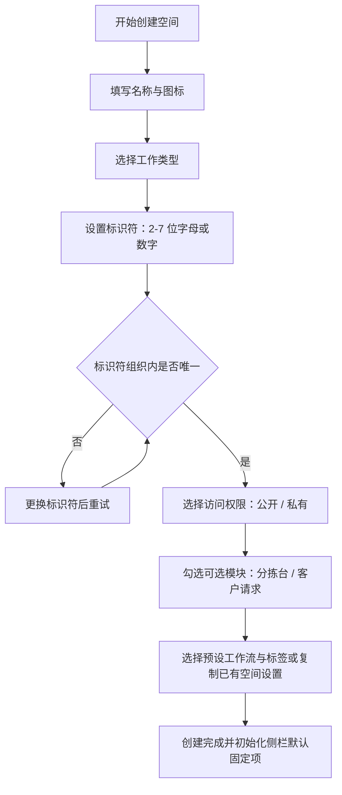
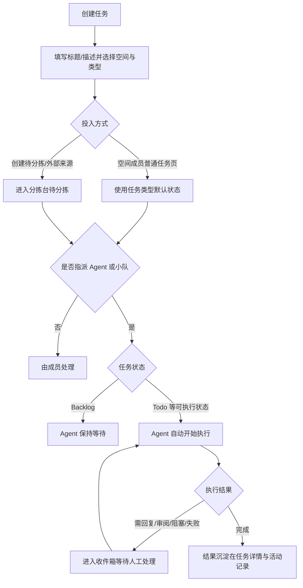
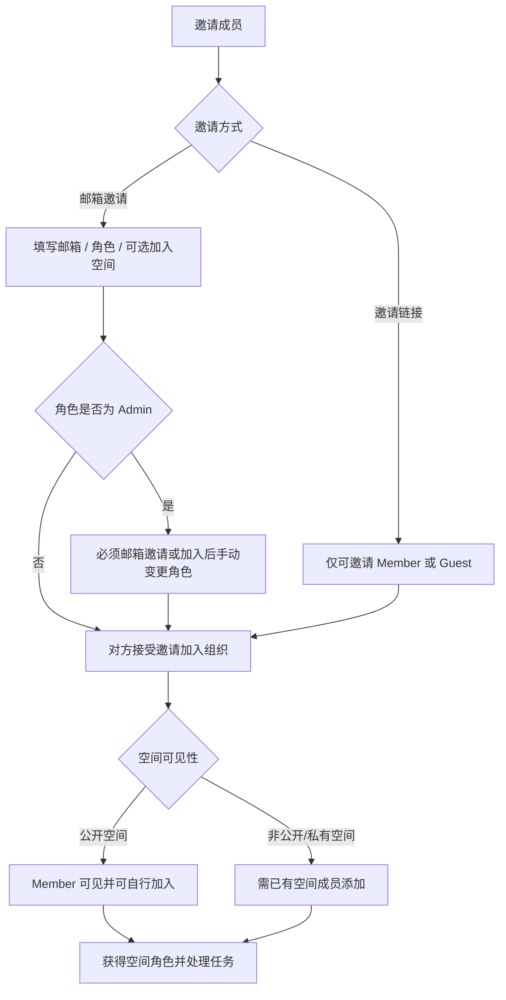
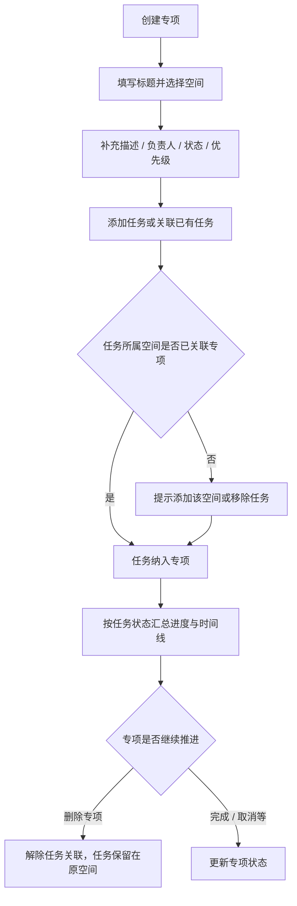
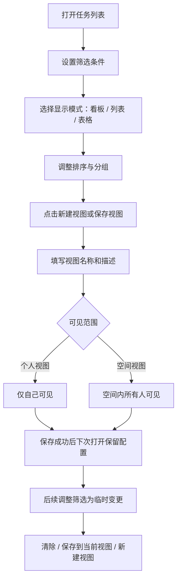
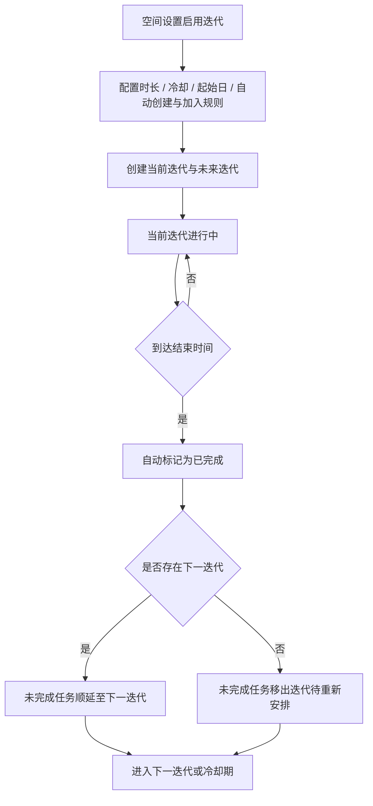
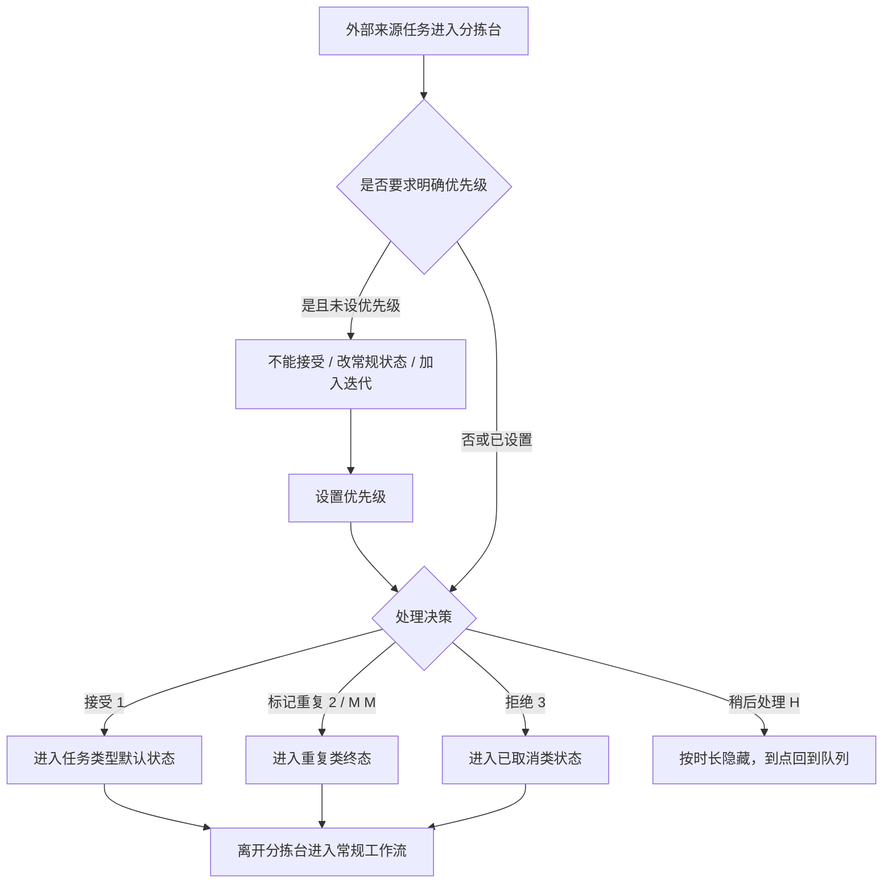
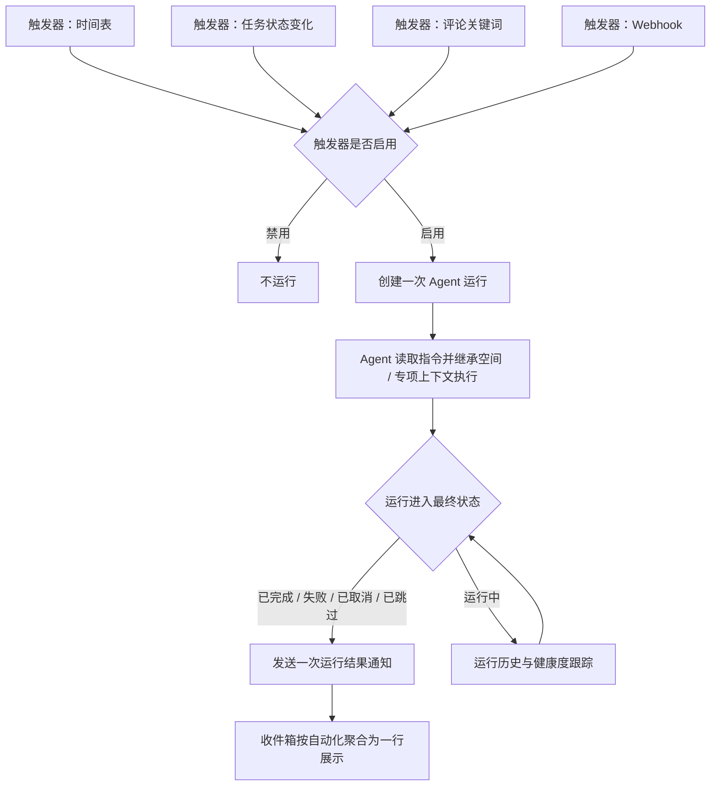

# Crux 产品需求文档（PRD）—— 第3章 项目管理

## 文档信息

| 项目 | 内容 |
| --- | --- |
| 产品名称 | Crux（渐进式 AI native 团队协作平台） |
| 文档章节 | 第3章 项目管理 |
| 文档版本 | V1.0（逆向整理稿） |
| 编制日期 | 2026-10-22 |
| 信息来源 | https://help.crux.com/docs/welcome（官方文档，提取日期 2026-10-22） |
| 整理方式 | 基于官方已上线功能的文档做逆向需求整理，状态均为「已上线-现状整理」 |

## 功能模块总览

| 模块编号 | 功能模块 | 状态 | 一句话说明 |
| --- | --- | --- | --- |
| 3.1 | Crux 空间 | V1.0 · 已上线 | 组织内组织日常工作的范围单元，承载任务、成员、Agent、专项、视图与自动化 |
| 3.2 | 任务 | V1.0 · 已上线 | 跟踪工作的基本单位，可指派给成员、Agent 或小队执行 |
| 3.3 | 成员 | V1.0 · 已上线 | 组织与空间两级成员体系，含角色、邀请与空间访问控制 |
| 3.4 | 专项 | V1.0 · 已上线 | 把一组相关任务组织成一个目标，跟踪整体进度与时间线 |
| 3.5 | 视图 | V1.0 · 已上线 | 任务列表工作台，支持看板/列表/表格与可保存的筛选视图 |
| 3.6 | 迭代 | V1.0 · 已上线 | 空间内固定工作周期，规划任务范围、跟踪进度并处理顺延 |
| 3.7 | 分拣台 | V1.0 · 已上线 | 空间级外部来源任务审核队列，接受、拒绝或分流待分拣任务 |
| 3.8 | 自动化 | V1.0 · 已上线 | 按触发器把规则化工作派给 Agent 或小队执行并跟踪运行结果 |

---

## 3.1 Crux 空间（V1.0 · 已上线-现状整理）

> 来源：https://help.crux.com/docs/space/spaces ｜ 原文标题：空间

### 3.1.1 使用场景描述

**业务目标**：以空间为范围组织日常工作，使任务、成员、Agent、小队、专项、视图、自动化和代码库围绕统一边界协作，保证可见性、工作流与自动化规则的一致性。

**目标用户**：组织 Owner / Admin、空间管理员、需要为团队划定协作范围的负责人。

**触发场景**：
- 组织初始搭建或新团队接入时，为团队、部门、专项、产品线或长期计划建立独立工作区；
- 一组任务需要同一批成员、相近的工作流、固定的视图和自动化规则；
- 权限敏感或工作流完全不同的工作需要彼此隔离。

**User Story**：
- 作为组织管理员，我想要为每个团队创建空间并配置标识符与访问权限，以便于各团队在边界清晰的范围内协作。
- 作为空间管理员，我想要在创建空间时选择工作类型和可选模块，以便于空间具备贴合该团队工作的默认配置。
- 作为团队成员，我想要通过空间侧栏快速进入迭代、视图、专项等功能，以便于按团队习惯组织工作入口。

### 3.1.2 原型图 / UI 示意

[图片占位]

（原文未提供界面截图，建议后续补充原型图。）

### 3.1.3 功能详细说明

| 节点/字段名称 | 交互与业务规则 | 数据来源/关联模块 |
| --- | --- | --- |
| 空间名称 | - 交互：填写让团队一眼知道承载工作的名称，如 `Engineering`、`Marketing`、`Docs` 或某个专项名 - 规则：同一组织内允许存在多个同名空间，通过图标、颜色和标识符区分 | 空间设置 |
| 空间图标 | - 交互：选择容易区分的图标或颜色，用于侧边栏、任务详情、筛选器和空间列表中快速识别空间 | 空间设置 |
| 工作类型 | - 交互：创建空间时选择，用于准备起始任务类型和 Agent 创建默认值 - 联动：选择「软件开发」时，首次在该空间创建 Agent 默认使用「代码开发」；其他工作类型默认使用「日常办公」；之后可按实际工作调整 Agent 类型 | Agent 配置 |
| 标识符 | - 规则：由 2-7 个字母或数字组成，必须在组织内唯一；用于任务 ID 前缀（如 `ENG-123`、`MKT-42`），建议短而稳定（ENG/DOCS/WEB/OPS） - 交互：创建后仍可修改，但已有任务的显示 ID 会随之变化 - 异常：提示标识符被占用但空间已保存成功时，不要再改标识符；以空间是否出现在列表、标识符是否可用为准 | 任务（任务 ID） |
| 访问权限 | - 选项：组织内公开 / 私有 - 公开：组织成员可以找到并加入这个空间 - 私有：仅空间成员可访问任务内容和成员列表；组织 Owner / Admin 可查看空间元数据并管理不依赖空间成员身份的配置，但组织角色不会使其成为空间成员，也不会绕过访问边界 | 成员体系 |
| 多人处理人开关 | - 默认值：关闭（单人） - 交互：空间设置中开启后，该空间里的任务可以有多名人员处理人；开关不改任何历史任务数据 | 任务（处理人） |
| 可选模块 | - 选项：分拣台（默认关闭，勾选后侧边栏该空间下出现入口）、客户请求（按空间开关和管理，不是组织级总开关） - 交互：创建空间时勾选，或之后在空间设置里开关 | 分拣台 |
| 工作流和标签 | - 交互：创建时选择预设工作流（决定任务经过的状态，如 Backlog、Todo、In Progress、Review、Done），标签用于分类（如 `bug`、`docs`、`urgent`、`frontend`）；也可以之后再调整 - 复制设置：从已有空间复制时，复制工作流状态、标签和 Git 仓库配置，但不复制成员 | 任务状态 / 任务标签 |
| 空间侧栏 | - 交互：空间任务模块底部「更多」打开空间任务相关功能（迭代、分拣台、视图、专项）；功能可固定到侧栏，只对自己生效；未启用的功能会引导去开启而不是打开空页；打开未固定功能时名称暂时出现在侧栏，离开后隐藏 - 默认固定项：软件开发空间为迭代（未开启则不固定）和视图；其他类型为视图和专项；具体名称以线上为准 | 视图 / 迭代 / 专项 |
| 停用空间 | - 交互：停用后空间变为只读，历史任务、专项和记录保留，但不再适合作为新的工作入口；停用前需决定未完成任务是取消还是移动到另一个空间 - 联动：之后需要继续使用时可从已停用空间中恢复 | 任务 |

### 3.1.4 业务规则与流程说明

| 序号 | 规则/流程说明 | 备注 / 异常处理 |
| --- | --- | --- |
| 1 | 一个组织可以有多个空间，每个空间可对应一个团队、部门、专项、产品线或长期计划 | 空间决定团队在哪里看任务、如何流转任务、哪些成员和 Agent 可以参与 |
| 2 | 每个任务都属于某个空间；任务 ID 前缀、工作流状态、可见成员、视图、自动化触发和 Agent 理解的任务上下文均来自空间 | 任务放错空间会导致成员、视图、自动化和 Agent 处理方式不符合预期 |
| 3 | 每个 Agent 和小队必须且只属于一个空间；共享 Agent 和小队只对所属空间中有访问权限的成员可见；任务只能指派给同空间的 Agent 或小队；评论提及 Agent、小队队长与 Agent 成员、自动化执行对象均受同一空间约束 | 创建任务时先选对空间 |
| 4 | 公开空间成员通常可自行加入；私有空间需已有空间成员添加新成员 | 组织 Owner / Admin 无空间成员身份时不能访问任务内容或空间成员列表 |
| 5 | 成员看不到某个任务的常见原因：未加入对应空间、空间是私有的、任务属于另一个组织或空间、空间已停用（只能查看历史内容） | 排查指引 |
| 6 | 空间划分建议：从团队真实工作边界出发；临时分类优先用标签、专项或视图；权限不同或工作流完全不同时考虑拆成不同空间 | 最佳实践，非强制 |

### 3.1.5 附件与截图

暂无补充截图。

### 3.1.6 流程图

---

## 3.2 任务（V1.0 · 已上线-现状整理）

> 来源：https://help.crux.com/docs/space/tasks ｜ 原文标题：任务

### 3.2.1 使用场景描述

**业务目标**：以任务为跟踪工作的基本单位，把要做什么、为什么做、谁负责、当前状态、讨论过程、Agent 执行与验收结果沉淀在同一上下文容器中，支持由成员、Agent 或小队处理。

**目标用户**：空间成员（创建与处理任务）、Agent / 小队（执行槽执行任务）、管理者（跟踪进度）。

**触发场景**：
- 修复一个 Bug、实现一个小需求、补充一篇文档、跟进一次客户反馈、排查一次测试失败；
- 让 Agent 修改一处文案、补一条测试、分析一段日志，或先调研并补全任务细节。

**User Story**：
- 作为空间成员，我想要创建包含标题、描述、类型、状态与处理人的任务，以便于工作被明确跟踪和指派。
- 作为任务处理人，我想要把目标明确的任务指派给 Agent 并在其需要确认时收到提醒，以便于自动化推进工作。
- 作为团队协作者，我想要在任务的评论和活动记录中保留讨论与字段变化，以便于任何人接手时理解上下文。

### 3.2.2 原型图 / UI 示意

[图片占位]

（原文未提供界面截图，建议后续补充原型图。）

### 3.2.3 功能详细说明

| 节点/字段名称 | 交互与业务规则 | 数据来源/关联模块 |
| --- | --- | --- |
| 标题 | - 规则：用一句话说明要做什么，应具体、可行动（不推荐 `按钮问题`；推荐 `把任务列表空状态按钮文案从"开始"改为"开始执行"`） - 联动：标题越明确，后续搜索、筛选和指派越容易 | 任务列表 / 视图 |
| 描述 | - 交互：补充背景、目标、范围和验收标准；可先写已知信息（背景、目标、截图、链接、报错日志或相关讨论） - 联动：可写明「请先帮我调研并补全任务细节」，由 Agent 继续细化范围、补充验收标准、拆解子任务并把结论写回任务详情 | Agent 协作 |
| 描述图片预览 | - 交互：打开图片预览后选择「复制图片」，可粘贴到其他支持图片粘贴的应用；按 Esc 只关闭图片预览，不会关掉任务详情 - 异常：设备或浏览器不支持复制或复制失败时，可在预览中使用下载操作保存图片后再使用 | 任务详情 |
| 空间 | - 规则：任务必须属于某个空间，决定任务 ID 前缀、工作流、可见成员、视图与自动化 | Crux 空间 |
| 任务类型 | - 规则：区分普通任务、Bug、需求、内容任务或其他自定义类型；不同类型可有不同字段和工作流（如 Bug 需复现步骤、影响范围、修复版本） | 任务类型 |
| 状态 | - 选项：Backlog（收集规划）/ Todo（可开始）/ In Progress（处理中）/ In Review（等待评审验收）/ Done（完成）/ Blocked（被阻塞）/ Cancelled（不再继续） - 联动：任务指派给 Agent 后，Backlog 时不会立即开始，进入 Todo 后 Agent 才开始执行；不同空间和任务类型可使用不同工作流 | 任务状态 |
| 处理人（人员处理人） | - 默认值：单人 - 规则：空间开启多人处理人后一条任务可有多名人员处理人；集合内人人等价、无主处理人，可追加人员或整组替换 - 联动：任务只有一个全局状态，任一处理人标完成即对所有处理人完成；「我的任务」与按处理人筛选按「集合里包含我」命中 | Crux 空间（多人开关） |
| 处理人（执行槽） | - 规则：Agent 或小队为单独的单选执行槽，不进入人员集合；候选对象按任务所在空间过滤，只有该空间中有权限使用的 Agent 或小队可选择 - 交互：任务处于 Todo、In Progress 等可执行状态时把执行槽改为 Agent 即自动开始执行；任务在 Backlog 时 Agent 保持等待 | Agent / 小队 |
| 创建人 | - 规则：记录谁创建了任务；由 Agent 代你创建时显示「真人 → Agent」；通过飞书、Slack 等渠道让 Agent 建任务时尽量识别吩咐它的人，平台账号未绑定 Crux 时按外部账号显示 - 展示：创建人固定单行，名字过长各自省略，头像和名字悬停可看到卡片 | IM 集成 |
| 优先级 | - 用途：帮助团队判断处理顺序 | 任务筛选 |
| 标签 | - 用途：用于模块、风险、来源或临时分类 | 任务标签 |
| 专项 | - 用途：把任务归入一个更大的目标或交付 | 专项 |
| 评论 | - 交互：补充截图/链接/日志、说明限制条件、@ 成员或 Agent、回复 Agent 提出的问题、记录人工验收结果 | 收件箱 |
| 活动记录 | - 规则：保留任务字段变化（状态变更、处理人变更、标签变更、Agent 执行结果等），供成员快速理解任务发生过什么 | 任务详情 |
| 子任务和关联任务 | - 交互：任务太大或包含多个可独立完成步骤时拆成子任务（父任务表达总体目标）；关联任务表示重复、阻塞、相关或依赖关系 | 任务关联 |

### 3.2.4 业务规则与流程说明

| 序号 | 规则/流程说明 | 备注 / 异常处理 |
| --- | --- | --- |
| 1 | 空间成员在普通任务页新建任务时使用该任务类型的默认状态；要直接投入审核队列需打开分拣台使用「创建待分拣任务」；未加入该空间的组织成员、访客及已接入的外部来源按分拣台规则进入待分拣 | 分拣台模块 |
| 2 | 看板按处理人分组时，多人任务会在每个处理人列里各出现一次；视图顶部总数按任务去重 | 多人处理人展示规则 |
| 3 | 空间多人处理人开关（设置项名称「允许多个处理人」）关闭后，站内不能再给新任务加多人；已是多人的存量任务仍可编辑；从导入或外部同步进来的多人数据不会被截断 | 开关不改历史任务数据 |
| 4 | Slack、飞书等外部卡片可以展示多人，但 Slack 面板里改处理人仍是单选，写入等于整组替换 | 外部集成限制 |
| 5 | 需要人类确认的状态：等人回复（需补充信息/回答/确认）、等人审阅（需 review 结果）、Agent 被阻塞（权限/环境/依赖/信息缺失）、任务失败（需查看原因后重试、补充信息或改派）；此类更新进入收件箱 | 收件箱只保留需要处理、判断或追踪的协作信息 |
| 6 | Agent 在本地任务环境跑起前端或桌面端改动后，会给出同一局域网内可打开的体验地址，可供手机/平板/其他电脑预览，也可让 Agent 把链接发到任务评论里 | 机器没有局域网地址时不产生该链接 |
| 7 | 任务详情头部支持快捷指令：自建「功能名 + 提示词 + Agent」，带着当前任务上下文开跑 | 入口和设置见「与 Agent 对话」 |
| 8 | 指派建议：任务目标明确、上下文充分、执行环境可用且结果可 review 时指派给 Agent；仍需产品判断、权限确认或跨团队沟通时先指派给成员 | 最佳实践 |
| 9 | 常用筛选条件：空间、状态、处理人、创建人、优先级、任务类型、标签、专项、是否指派给 Agent；常用组合可保存成视图 | 视图模块 |

### 3.2.5 附件与截图

暂无补充截图。

### 3.2.6 流程图

---

## 3.3 成员（V1.0 · 已上线-现状整理）

> 来源：https://help.crux.com/docs/space/members ｜ 原文标题：成员

### 3.3.1 使用场景描述

**业务目标**：建立组织与空间两级成员体系，通过组织角色与空间角色控制成员能看到什么、能处理什么，支撑邀请、协作与权限隔离。

**目标用户**：组织 Owner / Admin（邀请与管理者）、空间管理员（空间成员管理）、普通成员与访客（协作者）。

**触发场景**：
- 新成员加入组织并需要参与一个或多个空间的工作；
- 临时协作者、外部客户或供应商需要以访客身份参与少量空间；
- 成员反馈看不到某任务或无法处理任务时的权限排查。

**User Story**：
- 作为组织管理员，我想通过邮箱或邀请链接把成员加入组织并预设角色与空间，以便于对方接受邀请后直接开始协作。
- 作为空间管理员，我想把组织成员加入本空间并赋予空间角色，以便于控制其在本空间内可创建和编辑的内容。
- 作为组织成员，我想了解自己角色对应的可见范围，以便于判断能访问哪些空间和任务。

### 3.3.2 原型图 / UI 示意

[图片占位]

（原文未提供界面截图，建议后续补充原型图。）

### 3.3.3 功能详细说明

| 节点/字段名称 | 交互与业务规则 | 数据来源/关联模块 |
| --- | --- | --- |
| 组织角色 Owner | - 能力：组织负责人，可管理组织中的所有设置、成员和危险操作 | 组织设置 |
| 组织角色 Admin | - 能力：可管理成员、空间和大部分组织设置 | 组织设置 |
| 组织角色 Member | - 能力：可看到组织中的所有公开空间，以及被邀请加入的非公开空间 | Crux 空间 |
| 组织角色 Guest | - 能力：无法看到组织中的公开空间，只能看到被邀请加入的空间 - 适用：临时协作者、外部客户、供应商或只需参与少量空间的人；邀请时需确认空间内任务、评论和代码库上下文是否适合对方查看 | Crux 空间 |
| 邀请成员（邮箱） | - 入口：设置 → 成员 - 填写：邮箱地址、角色、是否顺便加入一个或多个空间 - 规则：已知成员负责哪些空间时，建议邀请时直接选上对应空间 | 空间成员管理 |
| 邀请链接 | - 规则：只能邀请 Member 或 Guest，不能直接邀请 Admin；Admin 必须通过邮箱邀请，或由现有管理员在成员加入后手动变更角色 - 适用：临时扩成员、邀请访客，或让对方先加入组织再决定空间 | 组织设置 |
| 复制链接 | - 交互：邀请链接未开启时「复制链接」不再置灰，点击会先自动开启邀请链接再复制 - 提示：仅复制链接即会打开组织成员入口，不想继续开放需手动回到设置关掉 | 组织设置 |
| 空间加入规则 | - Member：可见并可自行加入公开空间，可见被邀请加入的非公开空间 - Guest：仅可见被邀请加入的空间 - 私有/非公开空间需已有空间成员主动添加；组织 Owner / Admin 角色不会自动取得空间成员身份 - 处理任务需同时具备空间权限 | Crux 空间 |
| 空间角色 Administrator | - 能力：管理空间设置、配置和成员（仅当前空间生效） | 空间设置 |
| 空间角色 Member | - 能力：创建和更新空间内的工作 | 任务 |
| 空间角色 访客 | - 规则：私有空间中默认不能创建或编辑任务，但仍可评论和添加附件；空间开启分拣台后可创建待分拣任务、不能创建其他状态；公开空间中访客不带来同样的任务编辑限制，具体以线上权限为准 | 分拣台 |
| 成员通用能力 | - 查看、创建、评论任务与子任务、接收收件箱提醒、被指派为处理人、review Agent 结果、按权限管理空间/成员/设置；实际范围取决于组织角色、空间权限与任务状态 | 收件箱 / 任务 |

### 3.3.4 业务规则与流程说明

| 序号 | 规则/流程说明 | 备注 / 异常处理 |
| --- | --- | --- |
| 1 | 组织至少需要保留一个 Owner；最后一个 Owner 不能直接降级或离开，必须先把另一个成员设为 Owner | 危险操作保护 |
| 2 | 成员首先属于组织，再按需加入一个或多个空间；未加入任何空间的成员仍属于组织，但看不到空间里的任务 | 组织级决定是否属于团队，空间级决定能看到和处理哪些工作 |
| 3 | 组织角色 Guest 与空间角色「访客」不是同一件事：Guest 决定能否看到公开空间；空间角色「访客」决定在已加入空间里能创建什么任务；空间角色不会替代或修改组织角色 | 查看或处理任务需同时满足组织角色、空间成员关系与任务权限 |
| 4 | 成员看不到某任务通常因为未加入对应空间或空间是私有的；邀请后不能处理任务需确认是否接受邀请、是否加入正确空间、是否有角色权限 | 排查指引 |
| 5 | Agent 不需要像人类成员一样被邀请加入空间，但每个 Agent 必须归属一个空间；只有所属空间的任务可指派给它，成员也只能在当前空间有权限使用时在任务中提及或触发它 | Agent 体系 |
| 6 | 对权限敏感的工作，空间成员范围通常比组织成员范围更重要 | 最佳实践 |

### 3.3.5 附件与截图

暂无补充截图。

### 3.3.6 流程图

---

## 3.4 专项（V1.0 · 已上线-现状整理）

> 来源：https://help.crux.com/docs/space/projects ｜ 原文标题：专项

### 3.4.1 使用场景描述

**业务目标**：把一组相关任务组织成一个目标（如一轮产品迭代、一次客户交付、一个运营活动、一项技术改造），支持汇总任务、跟踪整体进度、标记负责人并按时间线观察排期风险。

**目标用户**：专项负责人（成员或 Agent）、空间管理员、需要围绕共同目标协作的团队。

**触发场景**：
- 一组任务属于同一个目标、需要一起看进度、一起 review，或需要一个负责人持续推进；
- 管理跨团队目标（如一次产品发布同时涉及研发、运营和客户支持）。

**User Story**：
- 作为专项负责人，我想要创建专项并关联任务与空间，以便于跟踪目标整体进度与剩余工作。
- 作为团队成员，我想要在专项详情页看到哪些任务未完成、被阻塞或交给了 Agent，以便于判断是否调整范围或优先级。
- 作为管理者，我想要用时间线观察任务排期与延期风险，以便于更早发现交付、发布或跨团队协作的排期问题。

### 3.4.2 原型图 / UI 示意

[图片占位]

（原文未提供界面截图，建议后续补充原型图。）

### 3.4.3 功能详细说明

| 节点/字段名称 | 交互与业务规则 | 数据来源/关联模块 |
| --- | --- | --- |
| 名称 | - 交互：创建时填写专项标题，建议直接表达目标，如 `新用户上手流程优化`、`官网文档改版`、`客户 A 私有部署交付`、`支付失败率治理` | 专项设置 |
| 描述 | - 交互：可先简单写，后续逐步补充背景、范围、验收标准、相关链接和阶段计划 | 专项详情 |
| 负责人 | - 规则：负责推进专项的人或 Agent；成员负责人负责协调、拆解和验收；Agent 负责人可帮助持续跟进任务、整理进度、发现阻塞或补充计划 - 定位：负责人不必亲自完成所有任务，而是让专项持续向前，具体任务再分配给成员或 Agent | 成员 / Agent |
| 状态 | - 选项：待整理（收集信息或初步规划）/ 计划中（目标明确，拆解任务和排期）/ 进行中 / 已暂停 / 已完成 / 已取消 | 专项详情 |
| 优先级 | - 用途：帮助团队判断专项处理顺序 - 建议：只把真正重要且需尽快推进的专项设为高或紧急，避免全部高优先级 | 专项详情 |
| 空间 | - 规则：可关联一个或多个空间，并可设置主空间（代表专项主要归属，用于团队识别和默认组织） - 异常：把某空间的任务加入专项但专项未关联该空间时，会提示把该空间添加到专项，或把任务从专项中移除 | Crux 空间 |
| 任务 | - 交互：创建专项后可继续添加任务，或把已有任务关联到该专项；专项由任务组成，执行、讨论、Agent 运行和验收仍发生在任务里 | 任务 |
| 进度 | - 规则：专项进度来自任务进度；详情页可回答总任务数、已完成/剩余、无处理人任务、被阻塞任务、交给 Agent 的任务、是否需调整范围或优先级 - 要求：想让专项进度准确，关键是保持专项下任务状态及时更新 | 任务状态 |
| 时间线 | - 交互：任务带开始时间或截止时间时，可按开始时间、截止时间或计划排期查看进展 - 用途：观察任务集中时段、已延期任务、依赖前置工作的任务、专项节奏是否过于拥挤 | 任务 |

### 3.4.4 业务规则与流程说明

| 序号 | 规则/流程说明 | 备注 / 异常处理 |
| --- | --- | --- |
| 1 | 删除专项通常不会删除任务，只会解除任务和专项的关联；任务若仍需处理会继续留在所属空间 | 删除保护 |
| 2 | 专项本身不替代任务；真正的执行、讨论、Agent 运行和验收发生在任务里 | 概念边界 |
| 3 | 专项与视图的区别：专项表示一组任务属于同一个目标；视图表示用某种方式查看任务（筛选、排序、分组或看板）；管理目标用专项，保存查看方式用视图（如「官网改版中指派给 Agent 且未完成的任务」保存成视图） | 概念区分 |
| 4 | Agent 围绕任务执行：可让 Agent 根据专项目标拆解任务、调研任务现状、总结进度和阻塞、补充描述/验收标准/下一步计划、处理具体任务；但真正执行时仍围绕任务工作 | 建议把专项目标写清楚，再拆成任务指派 |
| 5 | 专项负责人与任务处理人区别：负责人推进整个专项，处理人完成具体任务；一个专项下可有很多任务处理人 | 概念区分 |
| 6 | 适合创建专项的时机：一组任务共同服务于一个目标，且需要看整体进度、负责人、状态或时间线 | 最佳实践 |

### 3.4.5 附件与截图

暂无补充截图。

### 3.4.6 流程图

---

## 3.5 视图（V1.0 · 已上线-现状整理）

> 来源：https://help.crux.com/docs/space/views ｜ 原文标题：视图和任务列表

### 3.5.1 使用场景描述

**业务目标**：以任务列表为查看和处理任务的主要工作台，以视图保存常用的筛选、分组、排序与显示设置，让团队把「怎么看任务」的方式固定下来反复使用。

**目标用户**：空间成员（日常工作台）、团队负责人（共享视图与看板管理）、管理员（团队默认显示设置）。

**触发场景**：
- 反复使用同一组筛选、排序或分组方式查看任务（如「本周待 review」「高优先级 Bug」「Agent 阻塞任务」）；
- 站会、流程推进与状态管理需要按状态分组的看板；批量检查数据需要表格。

**User Story**：
- 作为空间成员，我想要把常用筛选保存为个人视图，以便于每次快速进入自己的工作台。
- 作为团队负责人，我想要把团队共同视图保存为空间视图并发布团队默认显示设置，以便于全员按一致方式查看任务。
- 作为看板使用者，我想要调整看板列的顺序与显隐并只对自己生效，以便于按自己的关注点浏览而不影响他人。

### 3.5.2 原型图 / UI 示意

[图片占位]

（原文未提供界面截图，建议后续补充原型图。）

### 3.5.3 功能详细说明

| 节点/字段名称 | 交互与业务规则 | 数据来源/关联模块 |
| --- | --- | --- |
| 任务列表入口 | - 入口：组织全部任务 / 某空间任务 / 专项下任务 / 我的任务 / Agent 相关任务 / 已保存视图；各入口看到的都是任务，仅默认范围不同 | 任务 |
| 筛选器 | - 条件：空间、状态、处理人、小队、创建人、优先级、任务类型、标签、专项、日期、是否指派给 Agent、自定义字段 - 交互：搜索当前列表任务，筛选框搜索支持中文拼音；数据选择器可输入关键词快速定位当前可见范围内的值，也可逐项浏览 - 联动：自定义字段可与状态、优先级、处理人等条件组合（如同时筛选指定修复版本和高优先级任务） | 任务 / 自定义字段 |
| 任务类型筛选 | - 规则：可用于单空间或跨空间列表；跨空间时同名任务类型合并为一个选项，选择后匹配所有空间中名称相同的底层类型 - 逻辑：多个任务类型之间为 OR；任务类型与其他条件之间为 AND；多选以复选框显示；随列表链接保存并可保存在视图中 | 任务类型 |
| 排序 | - 选项：手动排序、任务编号、优先级、状态、开始日期、截止日期、创建时间、更新时间、处理人、专项、标题 | 任务列表 |
| 分组 | - 选项：按状态、处理人、小队、专项、优先级、任务类型、标签分组 - 规则：按处理人分组时，多人任务可能出现在多个处理人列；视图顶部总数仍按任务去重 | 任务 |
| 显示模式 | - 选项：看板 / 列表 / 表格 - 规则：显示模式按视图保存；打开某视图时使用该视图自己的设置而非沿用上一个视图；只有保存成功后才在下次打开时保留 | 视图保存 |
| 看板 | - 用途：按状态或其他字段分组查看任务分布，适合站会、流程推进和状态管理 - 交互：卡片上右键（菜单键或 Shift+F10）打开卡片菜单（打开任务、新标签页打开、复制链接、复制任务编号、修改状态），与视图名称右键菜单不同；列超出可视区域时，鼠标移到列之间空白区按住左右拖动横向浏览，触摸板横向滑动仍可用，拖动空白区域不会移动任务卡片 | 任务 |
| 看板列排序与显隐 | - 入口：看板显示设置 → 分组 → 分组排序 - 交互：拖动列表项调整顺序（支持键盘），调整后即时生效；每列可单独隐藏或重新显示，可恢复默认排序；至少保留一列可见，隐藏最后一列会被拦下并提示 - 规则：隐藏列不丢失、不重复、不归入其他列，重新显示回到原位置，列折叠状态与列内二级分组保持不变；设置按看板保存、只影响自己 - 泳道：支持二级分组成泳道，行排序提供同样的调整、隐藏与恢复默认；切换或取消分组方式时按原分组规则重新计算 | 视图保存 |
| 显示设置记忆 | - 规则：分组方式、分组排序与列显隐、排序、卡片属性等按账号保存，刷新、重进或换设备保持；按空间和看板分别保存，全部任务、各空间看板和保存的视图互不影响 - 生效顺序：个人设置 → 团队默认值 → 系统内置默认值；与默认值不一致时显示设置按钮出现圆点，点重置后消失 - 重置：清掉个人设置回到团队默认值（无团队默认时回系统默认） - 设为所有人的默认：把当前显示设置发布为团队默认值，之后无个人设置者打开即见；空间看板需空间管理员，保存的视图需视图所有者或组织管理员，个人视图不提供；与默认一致时按钮不可用 | 空间管理员 / 视图所有者 |
| 显示待分拣任务 | - 默认值：普通任务列表和看板不显示待分拣任务 - 交互：需要查看时打开显示选项中的「显示待分拣任务」，或让自定义视图显式包含该状态 | 分拣台 |
| 保存视图 | - 流程：打开任务列表 → 设置筛选 → 选择显示方式（看板/列表/表格）→ 调整排序分组 → 新建/保存视图 → 填写名称和描述 → 选择个人或空间共享 - 规则：视图包含筛选条件（含自定义字段）、排序、分组、显示模式、显示字段、名称描述、可见范围；名称应直接表达用途 | 视图 |
| 个人视图 / 空间视图 | - 个人视图：只有自己可见，适合个人工作习惯（如「我创建但还没完成的任务」） - 空间视图：空间内所有人可见，适合团队共同使用（如「待上线任务」「本周待验收」「客户问题跟进」） | 空间成员体系 |
| 临时筛选 | - 规则：打开已保存视图时其筛选条件为基准，新增或调整的筛选只是临时变更，不立即修改视图定义 - 操作：清除（丢弃临时筛选回到保存条件）/ 保存到当前视图（需编辑权限）/ 新建视图（把当前条件与临时筛选作为新视图初始配置） - 提示：只有保存成功后，筛选调整才会在下次打开时保留 | 视图 |
| 全部任务个人顺序与置顶 | - 交互：在「全部任务」中拖动个人视图调整顺序；置顶或取消置顶，置顶视图显示在未置顶之前；屏幕较窄时未显示的视图收进更多菜单，仍可切换和排序 - 范围：仅当前用户在当前空间的任务列表偏好，不修改视图本身、空间共享视图配置或其他成员顺序；置顶与侧边栏「收藏」分开 - 限制：空间配置的任务类型筛选项不属于个人视图，按空间配置顺序显示，不能拖动改变；拖动不自动置顶，需用视图菜单置顶操作 | 视图 |
| 收藏与复制链接 | - 收藏：常用视图可加入收藏，从侧边栏或常用入口快速打开 - 复制链接：发给团队成员，对方打开后看到同一组任务列表配置；其可见任务仍取决于组织角色和空间权限 | 空间权限 |
| 批量操作 | - 交互：选择任务后批量修改状态、处理人、标签、空间、优先级或自定义字段；自定义字段的类型、权限、必填和校验与单条任务编辑一致 | 任务 |

### 3.5.4 业务规则与流程说明

| 序号 | 规则/流程说明 | 备注 / 异常处理 |
| --- | --- | --- |
| 1 | 待分拣任务默认排除在普通任务列表、看板和「我的任务」外；在分拣台处理，或在显示选项打开「显示待分拣任务」，或自定义视图显式包含该状态 | 分拣台模块 |
| 2 | 筛选器候选项的任务数量按当前看板或列表范围内的全部任务统计，不因已生效的其他筛选条件缩小；同字段已选值时仍能看到其他候选项真实数量；实际筛选结果和保存行为不变 | 避免误判候选数量 |
| 3 | 调整视图后如看到未保存更改：自己创建的视图通常可直接保存；别人创建的共享视图可能只能另存为新视图，避免覆盖团队正在使用的配置 | 修改空间共享视图前确认是否被团队日常使用 |
| 4 | 视图不复制任务；删除视图只删除查看配置，任务仍保留在原空间、专项或任务列表中 | 概念边界 |
| 5 | 别人打开同一视图看到的任务可能不同，通常因为空间权限不同；视图保存的是查看方式，不会绕过权限控制 | 权限边界 |
| 6 | 何时创建视图：反复使用同一组筛选、排序或分组方式时；好的视图应能回答一个明确问题，而不是把所有任务复制一遍 | 最佳实践 |
| 7 | 常见视图示例：我的未完成任务、Agent 阻塞任务、本周待 review、高优先级 Bug、某专项下未完成任务、无处理人任务 | 示例参考 |

### 3.5.5 附件与截图

暂无补充截图。

### 3.5.6 流程图

---

## 3.6 迭代（V1.0 · 已上线-现状整理）

> 来源：https://help.crux.com/docs/space/iterations ｜ 原文标题：迭代

### 3.6.1 使用场景描述

**业务目标**：在空间内建立固定工作周期，把一组任务放进同一时间窗口，支持规划本周期范围、跟踪进度与容量、迭代结束后处理未完成工作，实现节奏管理与复盘。

**目标用户**：按周/双周/月度节奏规划的团队、空间管理员（启用与配置迭代）、Scrum 类流程的使用者。

**触发场景**：
- 团队按固定节奏规划工作，需明确当前周期承诺完成的任务；
- 需要查看本迭代范围、已开始、已完成和剩余工作；
- 希望未完成任务在迭代结束后顺延到下一迭代，并用容量和完成率判断范围是否过大。

**User Story**：
- 作为团队负责人，我想要按周或双周创建迭代并配置自动节奏，以便于系统自动推进迭代状态并顺延未完成工作。
- 作为团队成员，我想要把任务加入当前迭代并在迭代详情查看范围与完成率，以便于了解本周期工作量与进度。
- 作为空间管理员，我想要配置自动加入规则减少手动维护，以便于迭代范围随任务状态自动更新。

### 3.6.2 原型图 / UI 示意

[图片占位]

（原文未提供界面截图，建议后续补充原型图。）

### 3.6.3 功能详细说明

| 节点/字段名称 | 交互与业务规则 | 数据来源/关联模块 |
| --- | --- | --- |
| 启用入口 | - 路径：空间设置 → 「迭代」页打开迭代功能；启用后 Crux 创建当前迭代和未来迭代，并按配置自动推进迭代状态 | 空间设置 |
| 迭代时长 | - 规则：每个迭代持续多久，通常是 1 到 8 周 | 迭代配置 |
| 冷却时长 | - 规则：一个迭代结束后、下一个迭代开始前的间隔；冷却期适合收尾、复盘、整理范围或准备下一轮工作 | 迭代配置 |
| 起始日 | - 规则：迭代从哪一天开始 | 迭代配置 |
| 自动创建数量 | - 规则：提前创建多少个未来迭代 | 迭代配置 |
| 自动加入规则 | - 选项：自动加入活跃任务和有截止日期的任务 / 自动加入进行中任务 / 自动加入已完成任务 - 时间范围：依据任务状态在适用时间窗口内的变化判断，不因任务已处于某状态而批量补入历史任务；当前迭代期间或冷却期内，只有对应窗口内变更为匹配状态的任务才可能被加入；启用后可检查当前窗口内已发生的匹配变更，窗口开始前的旧变更不回填 - 冷却期：无进行中迭代但处于冷却期时，符合条件任务可能被加入下一迭代 | 任务状态 |
| 迭代模式 | - 自动节奏：Crux 按设置维护未来迭代、自动开始和完成迭代，并将未完成工作顺延 - 手动模式：团队自行创建、开始和完成迭代，系统不维护自动节奏；可同时有多个进行中迭代，完成其中一个时可将未完成任务移到另一进行中或即将开始的迭代，也可移出迭代 | 迭代配置 |
| 迭代状态 | - 选项：当前（正在进行）/ 即将开始（下一个）/ 已计划（更晚的未来）/ 已完成 / 已取消 | 迭代列表 |
| 任务加入迭代 | - 入口：任务详情中的迭代字段 / 任务列表或表格中的迭代字段 / 迭代详情页新建任务 / 创建任务时按当前上下文自动带入 - 规则：可选择「无迭代」把任务移出；未完成任务通常不能加入已完成迭代，已完成任务可归入过去迭代用于补齐历史记录或统计 | 任务 |
| 进度指标 | - 指标：范围（迭代内任务总数）、已开始（已开始处理或已完成的任务）、已完成、容量（根据历史迭代或空间人数估算的可完成工作量）、完成率（已完成占范围比例）、燃起图（范围和完成量随时间变化） - 展示：空间启用估算时优先用点数展示范围和完成情况，否则按任务数量统计 | 任务 / 估算 |
| 管理操作 | - 操作：编辑迭代名称和描述、调整未开始迭代的开始日期、调整当前或未开始迭代的结束日期、将即将开始的迭代设为今天开始、收藏迭代或迭代视图、复制迭代链接 - 联动：调整日期时尽量保持后续迭代顺序；移动某个未开始迭代的开始时间，后续未开始迭代也可能一起平移 | 迭代列表 |
| 创建迭代日期 | - 默认值：开始日期为当天，结束日期按空间设置的迭代时长计算；也可按计划填写 - 修改：创建后仍可修改未开始迭代的开始日期，以及当前或未开始迭代的结束日期 | 迭代配置 |

### 3.6.4 业务规则与流程说明

| 序号 | 规则/流程说明 | 备注 / 异常处理 |
| --- | --- | --- |
| 1 | 迭代到结束时间后 Crux 自动标记为已完成；未完成、未取消的任务通常进入下一迭代；没有下一迭代时从原迭代中移出，等待重新安排 | 自动顺延 |
| 2 | 手动把即将开始的迭代设为今天开始且当前仍有进行中迭代时，当前迭代先结束，未完成任务移动到新迭代 | 手动切换 |
| 3 | 禁用迭代不会删除历史数据：会完成当前迭代、移除未来未开始迭代，并保留已完成迭代的数据用于报表 | 禁用影响 |
| 4 | 任务可以不属于任何迭代：保持「无迭代」放在 backlog 或通过视图继续管理 | 空状态 |
| 5 | Crux 尽量保留已完成迭代的最终快照，避免历史统计因后续任务移动而大幅漂移 | 历史数据保护 |
| 6 | 迭代、专项、视图的区别：迭代解决「这一段时间要推进哪些任务」，专项解决「一组任务共同服务于哪个目标」，视图解决「用什么方式查看任务」；一个任务可同时属于专项和迭代 | 概念区分 |
| 7 | 迭代详情本身像任务视图：可按状态、处理人、优先级、专项、标签等方式查看和分组任务 | 迭代详情 |
| 8 | 最佳实践：不把迭代当长期专项（横跨多周期的任务放专项再分别安排迭代）；范围要可完成；定期清理未完成任务不无限顺延；用冷却期做复盘和准备 | 最佳实践 |

### 3.6.5 附件与截图

暂无补充截图。

### 3.6.6 流程图

---

## 3.7 分拣台（V1.0 · 已上线-现状整理）

> 来源：https://help.crux.com/docs/space/triage ｜ 原文标题：分拣台

### 3.7.1 使用场景描述

**业务目标**：为空间提供外部来源任务的审核收件箱，任务先在分拣台被查看、设优先级、接受或拒绝，再进入空间常规工作流，避免未经审核的任务直接进入看板。

**目标用户**：空间管理员（开关与规则配置）、分拣台责任人（审核处理）、外部提交方（集成系统、访客、未加入空间的组织成员）。

**触发场景**：
- 外部系统（Jira、TAPD 同步、GitHub Issue）持续向空间创建任务，需先审核再进入看板；
- 未加入该空间的组织成员向该空间提交任务；
- 私有空间访客需要投递任务但不应直接推进工作流；
- 客户请求转成的任务需要先分流再交给对应团队。

**User Story**：
- 作为空间管理员，我想要开启分拣台并配置责任与规则，以便于外部任务统一进入审核队列后再分流。
- 作为分拣台责任人，我想用快捷键对待分拣任务执行接受、标记重复、拒绝或稍后处理，以便于高效完成分拣。
- 作为访客，我想要向私有空间投递任务，以便于把需求传达给团队而不直接改动其工作流。

### 3.7.2 原型图 / UI 示意

[图片占位]

（原文未提供界面截图，建议后续补充原型图。）

### 3.7.3 功能详细说明

| 节点/字段名称 | 交互与业务规则 | 数据来源/关联模块 |
| --- | --- | --- |
| 开启入口 | - 路径：空间设置 → 分拣台 - 权限：只有组织所有者、组织管理员或空间管理员可以更改；其他人可查看设置但不能改 - 默认值：关闭；创建空间时可勾选「分拣台」模块，之后仍可在设置里开关；空间设置是唯一开关，无需账号级内测开关 - 联动：开启后侧边栏该空间下出现「分拣台」入口 | Crux 空间 |
| 要求明确优先级 | - 默认值：不启用 - 规则：启用后，待分拣任务进入常规工作流或加入迭代前必须设置优先级；未设优先级的待分拣任务不能接受、不能改到常规状态、也不能加入迭代 | 迭代 |
| 进入分拣台的来源 | - 进入：分拣台页点「创建待分拣任务」或按 `C`；未加入该空间的组织成员向该空间提交（不能靠自选状态绕过）；已接入的 Jira、TAPD 同步新建任务及关联仓库后新建的 GitHub Issue；客户请求转成的任务；私有空间的空间角色「访客」创建（且只能是待分拣） - 不进入：空间成员在普通任务页新建（用任务类型默认状态）；组织所有者或管理员显式指定其他状态；一次性导入历史数据按状态映射处理不一定进入 | 外部集成 / 成员 |
| 生效前提 | - 规则：只在该空间已开启分拣台、且对应任务类型的工作流里有待分拣状态时生效；空间未开启或类型无待分拣状态时创建仍成功，落到该任务类型自己的默认状态 - 联动：从 Jira、禅道等外部集成导入任务类型后，若空间开启分拣台，这些类型也具备「待分拣」 | 任务状态 |
| 页面布局 | - 规则：左侧为待分拣列表，右侧为当前任务详情；窗口较窄时一次只显示一侧 | 分拣台页面 |
| 待分拣列表能力 | - 操作：查看待分拣数量、使用与任务列表同一套筛选器、按进入分拣台时间升序/降序排序、显示选项打开任务 ID/截止日期/「显示稍后处理」、收藏分拣台入口、顶部查看当前分拣台责任并打开「配置分拣台责任」 | 视图（筛选器） |
| 接受 | - 快捷键：`1` - 结果：离开待分拣，进入该任务类型的默认工作流状态（一般为待办）；可附评论、改处理人、优先级、标签、专项和日期，并可订阅后续更新 | 任务状态 |
| 标记重复 | - 快捷键：`2`，或连续按两次 `M` - 结果：选择一个已有任务作为目标，当前任务进入「重复」类终态；不能跨组织粘贴链接 | 任务关联 |
| 拒绝 | - 快捷键：`3` - 结果：进入「已取消」类状态，可填写拒绝原因 | 任务状态 |
| 稍后处理 | - 快捷键：`H` - 结果：按选定时间从队列中隐藏，到点后回到队列；可用显示选项「显示稍后处理」查看，也可取消稍后处理 | 分拣台 |
| 批量操作 | - 规则：只在全部选中项都是待分拣时出现，包括接受、拒绝和稍后处理；拒绝时可填写同一原因 | 任务列表 |
| 列表快捷键 | - 规则：`J` / `K` 上下移动，`C` 创建待分拣任务；其他快捷键在输入框内不生效 | 分拣台 |
| 分拣台责任 | - 路径：空间设置 → 分拣台 → 分拣台责任，或从分拣台页顶部打开「配置分拣台责任」 - 选项：不执行操作（保持未指派且不通知任何人）/ 通知（进入分拣台时通知所选成员，收件箱类型为「分拣台责任」，文案「此任务需要你分拣」）/ 指派（将新待分拣任务指派给所选成员） | 收件箱 |
| 分拣台规则 | - 路径：空间设置 → 分拣台 → 分拣台规则，用于自动处理和分流待分拣任务（不是自动化助理） - 条件：状态、优先级、处理人、创建人、专项、标签、任务类型、截止日期、创建时间、内容等 - 动作：移动到空间、设状态、指派、打标签、设置专项、设优先级 - 执行：多条规则按顺序执行，后面规则覆盖前面冲突字段，界面标出冲突；可停用、上移、下移或删除；删除立即生效且无法撤销 - 联动：规则把任务改出待分拣后，任务离开分拣台 | 空间设置 |

### 3.7.4 业务规则与流程说明

| 序号 | 规则/流程说明 | 备注 / 异常处理 |
| --- | --- | --- |
| 1 | 概念区分：分拣台是空间模块/侧边栏入口和审核队列；待分拣是状态类别；收件箱是个人通知中心；待规划是常规工作流整理区（关闭分拣台后当前待分拣任务迁到这里） | 入口叫分拣台，状态叫待分拣 |
| 2 | 分拣台责任配置为「通知」时，相关成员两条线都看到：空间分拣台里有这条任务，收件箱出现「分拣台责任」；收件箱的「稍后」处理个人通知，分拣台「稍后处理」处理任务本身 | 双通道提醒 |
| 3 | 关闭分拣台前提示：当前待分拣任务将被移到「待规划」；若某任务类型没有可用的待规划状态，关闭失败 | 关闭保护 |
| 4 | 关闭后：侧边栏入口消失、新的外部提交不再进入分拣台、私有空间的访客不能再创建任务 | 关闭影响 |
| 5 | 待分拣默认排除在常规视图外；接受后任务进入该任务类型默认状态，出现在普通任务列表和看板中 | 视图联动 |
| 6 | 还需要更多信息时，先留在分拣台里评论或稍后处理，不要先接受 | 操作建议 |
| 7 | 组织角色 Guest 和空间角色「访客」不是同一件事；公开空间里空间角色访客的创建限制以线上权限为准 | 成员模块 |
| 8 | 如果空间的任务都由空间成员在任务页直接创建，通常不必开启分拣台 | 适用边界 |

### 3.7.5 附件与截图

暂无补充截图。

### 3.7.6 流程图

---

## 3.8 自动化（V1.0 · 已上线-现状整理）

> 来源：https://help.crux.com/docs/space/automations ｜ 原文标题：自动化

### 3.8.1 使用场景描述

**业务目标**：按规则把重复发生的工作派给一个 Agent 或小队执行，通过时间表、任务状态变化、评论关键词或 Webhook 触发，沉淀指令与运行历史，减少人工反复提醒、筛选和执行同一套步骤的成本。

**目标用户**：空间管理员与自动化创建者（配置规则）、被指定为运行结果通知收件人的成员、Agent / 小队（执行对象）。

**触发场景**：
- 周期性检查：每天总结阻塞任务、每周生成专项进度汇总、定期检查失败测试或未分配任务；
- 工作流节点响应：任务进入 In Review 时做初步检查、进入 Blocked 时总结阻塞原因；
- 半自动触发：评论出现 `/summarize` 等关键词时执行固定流程；
- 外部系统事件：接收 GitHub、GitLab、CI 或监控系统的 Webhook 创建或更新任务。

**User Story**：
- 作为空间成员，我想要把重复明确的检查工作配置成定时自动化，以便于 Agent 定期执行并汇总结果。
- 作为自动化创建者，我想要为自动化配置运行结果通知收件人，以便于运行失败或跳过时及时收到提醒。
- 作为外部系统维护者，我想要通过私密 Webhook URL 触发自动化，以便于让 CI 或监控事件驱动 Crux 内的处理流程。

### 3.8.2 原型图 / UI 示意

[图片占位]

（原文未提供界面截图，建议后续补充原型图。）

### 3.8.3 功能详细说明

| 节点/字段名称 | 交互与业务规则 | 数据来源/关联模块 |
| --- | --- | --- |
| 名称 | - 用途：说明这条自动化要做什么 | 自动化配置 |
| Agent 或小队 | - 规则：负责执行的对象；空间自动化只能选择同一空间的 Agent 或小队作为执行对象 | Agent / 小队 / Crux 空间 |
| 指令（Instruction） | - 内容：目标（要完成什么）、上下文（服务哪个空间、专项或流程）、步骤（按什么顺序检查处理）、输出（创建任务、写评论、总结结果或仅记录运行状态）、约束（哪些不做、哪些需等待人工确认） - 规则：指令越清楚，Agent 每次运行越稳定 | Agent 配置 |
| 触发器：时间表 | - 适用：周期性工作，如每小时、每天、工作日、每周或自定义 cron - 示例：每个工作日上午 9 点生成今日待处理任务；每周一检查专项进度；每小时检查失败任务 | 自动化触发 |
| 触发器：任务状态变化 | - 适用：任务移动到某个状态时触发，围绕工作流节点运行 - 示例：进入 In Review 时让 Agent 做一次检查；进入 Blocked 时总结阻塞原因；进入 Done 时补充验收说明 | 任务状态 |
| 触发器：评论关键词 | - 适用：任务评论出现指定关键词或命令时触发，适合半自动场景（人决定何时触发，Agent 执行固定流程） - 示例：评论 `/summarize` 让 Agent 总结当前任务；`ready for agent` 让 Agent 判断任务是否可开始执行 - 边界：这是自动化助理的关键词触发，不是分拣台 | 任务评论 |
| 触发器：Webhook | - 适用：外部系统（GitHub、GitLab、CI、监控系统或内部服务）向私密 Webhook URL 发送请求触发运行 - 规则：URL 是私密入口，不要公开分享或提交到公开代码仓库；创建成功后出现一次「立即复制此 URL」弹窗（底部为「关闭」和「复制 URL」），关闭后通常再也看不到完整 URL，只能重新生成；创建后应立即复制保存；泄露可重新生成 | 外部集成 |
| 多触发器 | - 规则：一个自动化可包含多个触发器，每个触发器可单独启用或禁用；创建前设置为禁用的触发器在保存和刷新后仍保持禁用，不会因自动化保存而意外启动 | 自动化配置 |
| 专项 | - 用途：为 Agent 运行提供相关专项上下文 | 专项 |
| 状态 | - 选项：启用 / 暂停 / 归档 - 暂停：计划运行停止直到恢复；归档或删除：删除会移除自动化、触发器和运行历史，通常不可撤销 | 自动化配置 |
| 运行状态与健康度 | - 运行状态：运行中（Agent 正在工作）/ 已完成（最近一次运行成功）/ 失败（运行遇到错误）/ 已跳过（本次触发没有执行，通常有跳过原因） - 健康度：帮助判断是否需要关注；上次运行失败时显示需要关注；暂停或归档的自动化不会继续计划运行 | 运行历史 |
| 运行结果通知 | - 收件人：可选择一名或多名空间成员；不选择任何人表示关闭该自动化的运行通知 - 时机：只有运行进入最终状态（已完成、失败、已取消、已跳过）后才发送一次结果通知 - 默认值：创建自动化并添加触发器、或在已有自动化中新增触发器时，默认把自动化创建者加入接收人，可再添加其他成员；编辑已有触发器时不改接收人则保留原值，可改人或清空全部（含创建者） - 级别：通知属于自动化级别，适用于所有触发器，不随单个触发器单独配置 | 收件箱 |
| 收件箱聚合 | - 规则：运行结果进入收件箱并按自动化聚合为一行；最新成功结果通常归入「其他」，最新失败、取消或跳过结果归入「重要」；点开从右侧抽屉打开自动化完整详情，不整页跳走，运行记录仍在历史列表 - 前提：收件人仍需能访问该空间，可选成员以页面显示为准 | 收件箱 |
| 运行归属 | - 规则：触发后直接创建一次 Agent 运行，不为每次运行自动新建任务；「任务状态变化」触发的运行归属该任务的对话记录（在任务对话面板和「对话记录」标签页可见，对话创建人为改动状态的人；自动化运行详情显示任务卡片可点开；Token 消耗计入该任务）；时间表、评论关键词、Webhook 的运行归属保持不变 | 任务 / 收件箱 |

### 3.8.4 业务规则与流程说明

| 序号 | 规则/流程说明 | 备注 / 异常处理 |
| --- | --- | --- |
| 1 | 自动化按空间管理，通常围绕某空间里的任务、成员、专项和 Agent 工作流运行；不同空间可有不同规则；Agent 运行继承对应空间和专项上下文 | Crux 空间 |
| 2 | 任务状态和评论可作为触发源，触发任务作为运行上下文提供给 Agent，但任务本身不会反向控制自动化运行状态 | 单向触发 |
| 3 | 如需产出任务、评论或其他可追踪记录，须在指令中明确要求 Agent 创建或更新这些内容，不依赖隐式创建关联任务 | 输出约定 |
| 4 | 高风险工作建议要求 Agent 先汇报计划或创建待人工确认的任务，再执行不可逆修改；首次创建建议从低风险场景开始 | 安全建议 |
| 5 | 不默认依赖自动重试：失败后先查看运行历史和错误原因，再决定手动运行、修改指令、调整触发器或修复 Agent / 电脑配置 | 失败处理 |
| 6 | 暂停适用：自动化连续失败、指令需调整、相关 Agent 或电脑不可用、团队暂时不需要这条规则 | 暂停时机 |
| 7 | 删除前确认团队是否仍依赖该自动化、是否还有需保留的运行结果 | 删除不可撤销 |

### 3.8.5 附件与截图

暂无补充截图。

### 3.8.6 流程图

---
