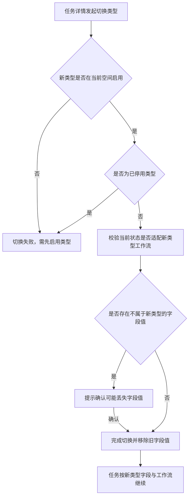
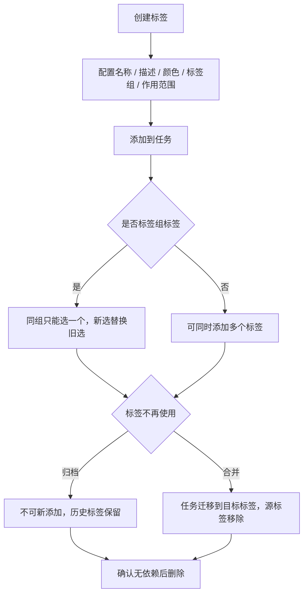
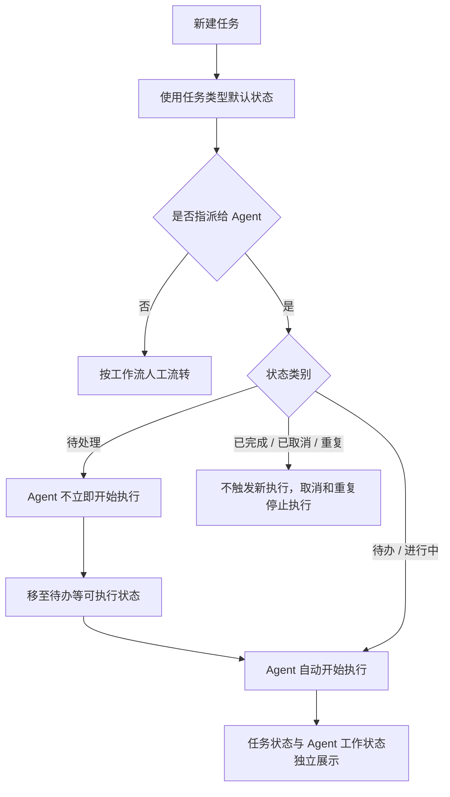
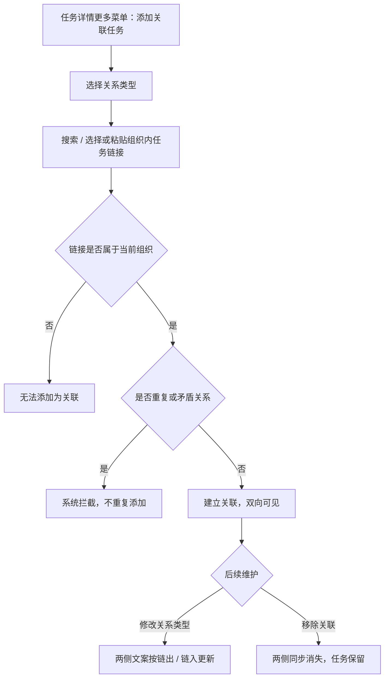

# Crux 产品需求文档（PRD）—— 第4章 任务

## 文档信息

| 项目 | 内容 |
| --- | --- |
| 产品名称 | Crux（渐进式 AI native 团队协作平台） |
| 文档章节 | 第4章 任务 |
| 文档版本 | V1.0（逆向整理稿） |
| 编制日期 | 2026-10-22 |
| 信息来源 | https://help.crux.com/docs/welcome（官方文档，提取日期 2026-10-22） |
| 整理方式 | 基于官方已上线功能的文档做逆向需求整理，状态均为「已上线-现状整理」 |

## 功能模块总览

| 模块编号 | 功能模块 | 状态 | 一句话说明 |
| --- | --- | --- | --- |
| 4.1 | 任务类型 | V1.0 · 已上线 | 区分空间内不同工作对象的类型体系，绑定字段与默认工作流并按空间控制可用性 |
| 4.2 | 关注 | V1.0 · 已上线 | 追踪关心但不负责的任务，按任务聚合接收动态进入收件箱 |
| 4.3 | 任务标签 | V1.0 · 已上线 | 组织/空间两层的彩色轻量分类标记，支持标签组互斥与批量处理 |
| 4.4 | 任务状态 | V1.0 · 已上线 | 由固定状态类别驱动的任务生命周期体系，控制流转、看板与 Agent 执行 |
| 4.5 | 任务关联 | V1.0 · 已上线 | 表达两个独立任务之间阻塞、重复、克隆或相关关系的双向可见机制 |

---

## 4.1 任务类型（V1.0 · 已上线-现状整理）

> 来源：https://help.crux.com/docs/task/task-types ｜ 原文标题：任务类型

### 4.1.1 使用场景描述

**业务目标**：用任务类型区分空间里的不同工作对象（如任务、Bug、需求、请求、内容、活动），使不同类型绑定不同自定义字段与默认工作流，让任务字段贴近实际工作并支撑筛选、统计和自动化。

**目标用户**：组织 Owner / Admin（维护类型定义）、空间管理员（控制空间可用类型）、普通成员（创建与编辑任务时选择类型）。

**触发场景**：
- 研发空间需要任务、Bug、需求；内容空间需要内容任务、活动、素材；客户支持空间需要请求、问题、Bug；
- 一类工作需要固定字段（如 Bug 需复现步骤、影响范围）和固定状态流转，需要与标签等轻量分类区分。

**User Story**：
- 作为组织管理员，我想要定义带图标、颜色、默认工作流和自定义字段的任务类型，以便于不同工作对象有贴合的录入与流转方式。
- 作为空间管理员，我想要控制本空间启用哪些任务类型，以便于团队只看到真正会用到的类型、减少误选。
- 作为普通成员，我想要在创建任务时从当前空间可用类型中选择，以便于任务获得正确的字段与工作流。

### 4.1.2 原型图 / UI 示意

[图片占位]

（原文未提供界面截图，建议后续补充原型图。）

### 4.1.3 功能详细说明

| 节点/字段名称 | 交互与业务规则 | 数据来源/关联模块 |
| --- | --- | --- |
| 空间可用类型控制 | - 规则：每个空间可控制自己可用的任务类型（如研发空间启用任务、Bug、需求）；创建任务时只能选择当前空间启用的类型；每个空间至少保留一个可用任务类型，避免新任务无法创建 | Crux 空间设置 |
| 起始类型 | - 默认值：创建空间时按工作类型提供——选择「软件开发」可使用需求、Bug、任务和用户故事等类型；其他工作类型默认从通用「任务」类型开始<br>- 联动：仅为空间起点，之后可在空间设置中启用、停用或配置类型和工作流 | Crux 空间（工作类型） |
| 默认可用类型 | - 规则：创建任务未手动选择类型时，Crux 从该空间的可用类型中选择一个默认可用类型 | 任务创建 |
| 类型 Tab | - 交互：空间有多个可用任务类型时，全部任务列表提供按类型切换的 Tab；只有一种可用类型时不显示类型 Tab | 视图（任务列表） |
| 名称与描述 | - 名称：如 Bug、需求、请求<br>- 描述：说明这个类型适合什么工作 | 任务类型定义 |
| 图标、颜色与排序 | - 图标和颜色：帮助在任务列表、看板和详情中快速识别<br>- 排序：决定类型在选择菜单中的显示顺序 | 任务类型定义 |
| 默认工作流 | - 规则：决定该类型的任务可以使用哪些状态<br>- 示例：Bug 可能使用 `待复现 → 修复中 → 待验证 → 已完成`；需求可能使用 `待评审 → 设计中 → 开发中 → 验收中 → 已完成`；内容任务可能使用 `待写作 → 待审核 → 待发布 → 已发布` | 任务状态 |
| 自定义字段绑定 | - 类型：文本、数字、单选、多选、布尔值、日期、成员选择器、URL、富文本<br>- 交互：绑定后字段出现在该类型任务的创建和详情页；可设置必填、调整顺序<br>- 示例：Bug 绑复现步骤/影响范围/严重程度/修复版本；需求绑用户价值/验收标准/上线阶段；客户请求绑客户/来源/响应时限/处理结论；内容任务绑发布渠道/素材链接/发布时间 | 自定义字段 |
| 富文本字段 | - 规则：内容与任务描述一样支持 Markdown；有值时以独立区块显示在任务描述下方，字段名吸顶、可直接编辑；没有内容时不显示 | 任务详情 |
| 字段绑定停用 / 解绑 | - 停用绑定：字段从界面隐藏，但已有值保留，适合暂时不显示<br>- 解绑：Crux 会删除该类型任务上对应的字段值，操作前需确认 | 自定义字段 |
| 切换任务类型 | - 入口：任务详情中切换<br>- 规则：新类型必须在当前任务所在空间中启用；新类型不能是已停用类型；新类型可能使用不同自定义字段；不属于新类型的旧字段值可能被移除<br>- 保护：切换前 Crux 提示确认可能丢失的自定义字段值；创建或切换时按空间和类型校验状态是否可用，状态不适配时可能需先调整状态 | 任务状态 |
| 停用 | - 规则：停用后不再出现在新建任务或切换类型的选择菜单中，但已有任务仍保留该类型<br>- 适用：类型暂时不用、不希望团队继续创建、需保留历史任务和统计 | 任务类型定义 |
| 删除 | - 规则：某类型下已有关联任务时通常不能直接删除；更稳妥的做法是先停用，确认历史任务不再依赖后再处理 | 任务类型定义 |
| 权限 | - 定义维护（创建、编辑、停用、恢复、删除、设置默认类型、配置字段）：通常仅组织 owner / admin<br>- 空间可用性配置：由具备该空间管理权限的成员配置<br>- 类型选择：普通成员在创建或编辑任务时选择当前空间可用类型 | 成员（角色体系） |

### 4.1.4 业务规则与流程说明

| 序号 | 规则/流程说明 | 备注 / 异常处理 |
| --- | --- | --- |
| 1 | 任务类型定义「这是什么工作对象」，影响字段和工作流；标签适合轻量分类（模块、来源、风险、临时标记） | 与任务标签的边界 |
| 2 | 在某空间看不到某类型的原因：类型已停用，或该空间未启用；需管理员在任务类型或空间设置中调整 | 排查指引 |
| 3 | 空间可以禁用默认任务类型，只要该空间至少还有一个可用任务类型 | 最低保留约束 |
| 4 | 停用只影响新建和切换选择，已有任务保留原类型且仍可查看 | 历史保护 |
| 5 | 切换类型提示字段值可能丢失，因不同类型可绑定不同自定义字段 | 切换保护 |
| 6 | 最佳实践：按空间控制可用类型减少误选；类型不要太多（越多越难选）；仅当一类工作确实需要不同字段或工作流时才新建类型；模块/来源/风险等级不同更适合用标签或自定义字段；不再使用的类型先停用再删除 | 最佳实践 |

### 4.1.5 附件与截图

暂无补充截图。

### 4.1.6 流程图



---

## 4.2 关注（V1.0 · 已上线-现状整理）

> 来源：https://help.crux.com/docs/task/follow-tasks ｜ 原文标题：关注任务

### 4.2.1 使用场景描述

**业务目标**：让成员追踪关心但不负责的任务：关注后任务出现相关动态时进入收件箱，按任务聚合展示；关注不等于指派，关注者接收动态、参与讨论或按需跟进。

**目标用户**：非处理人的相关方（需求/评审/验收/排查参与者）、受任务影响的模块/专项/客户负责人、临时把任务交给他人或 Agent 但想跟进结果的人。

**触发场景**：
- 不是处理人但需要知道任务进展；
- 参与了需求、评审、验收或排查，想收到后续评论、状态变化和 Agent 结果；
- 临时交出任务但还想跟进结果。

**User Story**：
- 作为相关方，我想要关注影响我负责模块的任务，以便于不动态打扰处理人的情况下掌握进展。
- 作为关注者，我想要相关动态按任务聚合进入收件箱，以便于用一行了解任务最新活动。
- 作为任务负责人，我想要通过「更改关注者」弹窗管理关注者，以便于把需要知会的同事纳入追踪范围。

### 4.2.2 原型图 / UI 示意

[图片占位]

（原文未提供界面截图，建议后续补充原型图。）

### 4.2.3 功能详细说明

| 节点/字段名称 | 交互与业务规则 | 数据来源/关联模块 |
| --- | --- | --- |
| 关注 / 取消关注按钮 | - 入口：任务详情页<br>- 交互：点击「关注」开始追踪，点击「取消关注」停止接收普通动态 | 任务详情 |
| 关注者头像与更改弹窗 | - 展示：任务详情显示关注者头像<br>- 交互：点击关注者区域打开「更改关注者」弹窗，搜索并添加或移除关注者 | 任务详情 |
| 关注者对象类型 | - 选项：成员、Agent、邀请中用户<br>- 规则：只有成员会收到收件箱通知；Agent 作为关注者更多用于任务上下文和协作记录，不会像成员一样打开收件箱 | 成员 / Agent |
| 自动关注规则 | - 触发：任务创建者自动关注；任务处理人自动关注；在任务描述中被 @ 提及的人自动关注；发表评论的人自动关注；从 Jira 导入或同步的处理人、watcher 可能成为关注者；成员选择器自定义字段当前选中的成员自动加入关注者（支持单选和多选，以及创建、修改和替换字段值） | 任务 / 自定义字段 / Jira 集成 |
| 自动关注通知抑制与幂等 | - 规则：自动关注不额外发送「添加你为关注人」通知，避免噪音<br>- 幂等：成员选择器字段通过网页端、CLI 或 API 写入时，自动关注规则一致且幂等——不重复添加同一成员、不重复发送关注通知；清空字段只停止由当前字段值产生的新自动关注，不强制移除成员已有的手动关注 | 收件箱 |
| 手动添加关注者通知 | - 规则：别人手动把你添加为关注者时，你会在收件箱收到一条「添加你为关注人」通知 | 收件箱 |
| 关注通知内容 | - 类型：新评论；状态变化；优先级变化；开始日期或截止日期变化；处理人变化；Agent 请求人工回复或审阅；Agent 执行失败、被阻塞或完成一轮工作 | 任务动态 / Agent |
| 通知聚合 | - 规则：通知按任务聚合；同一任务有多条动态时，收件箱通常只显示一行，并用角标提示还有其他活动 | 收件箱 |
| 收件箱分组规则 | - 其他：普通新评论、状态变化、优先级变化多数进入「其他」<br>- 重要：直接 @ 你、任务指派给你通常进入「重要」；Agent 等人回复、等待审阅、失败或阻塞时，若你是处理人通常进入「重要」<br>- 弱提醒：仅关注者时，同样的 Agent 状态可能以较弱提醒出现在「其他」<br>- 边界：自动关注只表示加入关注者，不代表一定收到每一类通知；普通评论和任务活动按关注关系及通知设置处理；Agent 任务对话的回复和相关交接提醒按对话发起人定向 | 收件箱 |
| 外发通道 | - 规则：关注任务后的状态变更，若成员打开了 Slack 或飞书的对应通知组，也会出现在 Slack / 飞书私信里；外发通道可按组静音，不影响收件箱 | IM 集成 |
| 取消关注后行为 | - 规则：通常不再因该任务普通动态收到收件箱通知；仍可能通知的情形：评论中被 @、任务重新指派给你、再次评论并被自动关注、别人再次手动把你添加为关注者<br>- 保护：取消关注不删除任务，也不删除之前写过的评论 | 收件箱 |
| 关注 / @ 提及 / 处理人区别 | - 关注者：接收任务动态，方便追踪进展<br>- @ 提及：明确请求某人或 Agent 关注某条评论或动作，通常优先级更高<br>- 处理人：负责推进任务；Agent 等待回复、等待审阅、失败或阻塞时提醒更强 | 收件箱 / 任务 |

### 4.2.4 业务规则与流程说明

| 序号 | 规则/流程说明 | 备注 / 异常处理 |
| --- | --- | --- |
| 1 | 关注不等于指派：被指派的人负责推进任务；关注者主要接收动态、参与讨论或按需跟进；关注不会把人设为处理人 | 概念边界 |
| 2 | 需要对任务结果负责时应把自己设为处理人，而不是只关注；需要某人做决定或回复时应在评论中 @ 他；需要某人或 Agent 负责推进时把任务指派给他 | 使用建议 |
| 3 | 发表评论后自动关注；若只是临时补充信息、后续不需要追踪，可在任务处理完后取消关注 | 最佳实践 |
| 4 | 关注者收到的是进展提醒，不一定是待办事项；只有直接 @、任务指派、或作为处理人需处理 Agent 状态时通常才进入「重要」 | 分组语义 |
| 5 | @ 提及是直接通知，不依赖是否关注任务；取消关注后 @ 我的评论仍会通知 | @ 独立性 |

### 4.2.5 附件与截图

暂无补充截图。

### 4.2.6 流程图

```mermaid
flowchart TD
    A[成员关注任务] --> B[任务产生动态]
    B --> C{动态类型}
    C -- 评论 / 状态 / 优先级 / 日期 / 处理人变化 --> D[按任务聚合进入收件箱一行]
    C -- 直接 @ 或任务指派给你 --> E[进入重要]
    C -- Agent 请求回复 / 审阅 / 失败 / 阻塞 --> F{是否任务处理人}
    F -- 是 --> E
    F -- 仅关注者 --> G[较弱提醒进入其他]
    D --> H{后续操作}
    E --> H
    G --> H
    H -- 取消关注 --> I[@ 提及 / 再指派等仍会通知]
```

---

## 4.3 任务标签（V1.0 · 已上线-现状整理）

> 来源：https://help.crux.com/docs/task/task-labels ｜ 原文标题：任务标签

### 4.3.1 使用场景描述

**业务目标**：用彩色标记补充说明任务的主题、来源、模块或临时分类（如 `前端`、`客户反馈`、`高风险`、`Migrated`），支撑筛选、分组、搜索和批量处理；标签不改变任务流程、不决定任务字段。

**目标用户**：组织 Owner / Admin（组织标签与标签组管理）、空间成员（空间标签管理与任务打标）、从 Jira 迁移的团队。

**触发场景**：
- 需要按模块、来源、风险、客户或临时活动对任务做可组合的轻量分类；
- 导入一批任务需要统一标记（如 `Migrated`）后再整理。

**User Story**：
- 作为空间成员，我想要在任务标签选择器中搜索、添加或快速创建标签，以便于轻量标注任务主题。
- 作为组织管理员，我想要维护组织标签和互斥标签组（如规模 S/M/L），以便于跨空间统一分类口径。
- 作为迁移负责人，我想要批量给导入任务添加标签并合并重复标签，以便于迁移后快速筛选和治理。

### 4.3.2 原型图 / UI 示意

[图片占位]

（原文未提供界面截图，建议后续补充原型图。）

### 4.3.3 功能详细说明

| 节点/字段名称 | 交互与业务规则 | 数据来源/关联模块 |
| --- | --- | --- |
| 组织标签 | - 规则：整个组织都可以使用，适合跨空间通用的分类（如 `客户反馈`、`高风险`、`Migrated`）<br>- 权限：组织 owner / admin 可管理组织标签和组织标签组；组织标签在空间设置中通常只能使用，不能直接编辑 | 组织设置 |
| 空间标签 | - 规则：只属于某个空间，适合该团队自己的分类（如研发空间 `前端`、`后端`、`性能`；内容空间 `官网`、`公众号`、`素材`）<br>- 可用范围：某空间的任务通常可使用组织标签和该空间自己的标签<br>- 权限：空间成员可管理自己空间里的空间标签 | Crux 空间 |
| 空间迁移时的标签保留 | - 规则：任务从一个空间移动到另一个空间时，不属于目标空间的空间标签可能被移除；组织标签通常保留 | Crux 空间 |
| 标签属性 | - 名称：标签显示名称，建议短（出现在卡片、列表和筛选器，越短越易扫描）<br>- 描述：说明适合什么任务<br>- 颜色：在列表、看板和任务详情中快速识别<br>- 标签组：可选，把一组互斥标签放在一起<br>- 作用范围：组织标签或空间标签 | 标签设置 |
| 快速创建标签 | - 交互：任务标签选择器中输入不存在的标签名可快速创建；系统自动为新标签选择一个颜色 | 标签选择器 |
| 标签组互斥 | - 规则：同一个任务在同一个标签组里最多只能选择一个标签；在同一标签组选择新标签时会替换原来的标签<br>- 适用：只能选一个的分类，如规模（S/M/L）、来源、客户等级、风险等级 | 标签设置 |
| 任务打标 | - 入口：任务详情或任务列表打开标签选择器<br>- 操作：搜索标签、添加标签、移除标签、在标签组中选择一个标签、快速创建新标签<br>- 规则：标签可同时添加多个；分组标签遵循同组只能选一个 | 任务 |
| 批量处理标签 | - 入口：任务列表选择多个任务<br>- 操作：添加标签、移除标签、替换标签、清除某个标签组下的标签<br>- 适用：整理一批任务，如把导入任务统一标记 `Migrated`、给某模块任务统一添加 `前端` | 视图（任务列表） |
| 归档 | - 规则：归档后标签不再作为新标签被添加到任务上，但已有任务上的历史标签保留<br>- 建议：先归档观察一段时间，确认无人依赖后再删除或合并 | 标签设置 |
| 删除 | - 规则：确认不再需要时可删除标签 | 标签设置 |
| 合并 | - 规则：两个标签含义重复时可合并；合并后源标签上的任务迁移到目标标签，源标签被移除<br>- 示例：`frontend`、`前端`、`FE` 表达同一件事时合并为一个标准标签 | 标签设置 |
| 筛选与视图 | - 交互：用标签只看某模块任务、客户反馈任务、迁移导入任务，创建活动或专项的任务视图，在看板或列表中识别来源和主题<br>- 规则：选择多个标签筛选通常表示任务需同时包含这些标签；常用组合建议保存成视图 | 视图 |
| 与 Jira 导入和同步 | - 规则：Jira labels 导入为 Crux 标签；Jira components 也可能被折叠为标签；导入任务可自动添加 `Migrated` 标签；标签变化可以同步回 Jira labels<br>- 建议：依赖 Jira labels 分类的团队导入后先检查标签是否需要合并、重命名或归档 | Jira 集成 |
| 任务上添加/移除标签权限 | - 规则：普通成员可在有权限的任务上添加或移除可用标签；具体可见和可管理范围取决于组织角色、空间权限和标签作用范围 | 成员（角色体系） |

### 4.3.4 业务规则与流程说明

| 序号 | 规则/流程说明 | 备注 / 异常处理 |
| --- | --- | --- |
| 1 | 任务类型定义工作对象并影响字段和可用状态；标签是补充分类——标签不会改变任务流程，也不会决定任务有哪些字段 | 与任务类型的边界 |
| 2 | 标签本身不会直接触发 Agent，但会进入任务上下文，帮助成员和 Agent 理解任务分类、来源或风险 | Agent 协作 |
| 3 | 标签适合轻量分类且一个任务可加多个；自定义字段适合结构化信息（日期、成员、数字、下拉选项） | 与自定义字段的边界 |
| 4 | 在某空间看不到某标签的原因：它是其他空间的空间标签，或已被归档；组织标签通常在所有空间可用 | 排查指引 |
| 5 | 标签开始承载固定字段或固定流程时，说明它可能应该升级成任务类型 | 治理建议 |

### 4.3.5 附件与截图

暂无补充截图。

### 4.3.6 流程图



---

## 4.4 任务状态（V1.0 · 已上线-现状整理）

> 来源：https://help.crux.com/docs/task/task-statuses ｜ 原文标题：任务状态

### 4.4.1 使用场景描述

**业务目标**：用状态表示任务当前推进到的阶段，并通过固定状态类别驱动系统语义——判断任务是否完成、是否停止执行、看板如何展示、Agent 是否开始工作；支持组织状态库复用与按任务类型装配工作流。

**目标用户**：组织管理员（维护组织状态库）、空间管理员/类型配置者（装配任务类型状态）、普通成员（切换状态）、Agent 使用者。

**触发场景**：
- 团队需要区分待处理、待办、进行中、已完成、已取消等阶段并以看板驱动流转；
- 不同任务类型需要不同状态集合（Bug 与客户请求流转不同）；
- 任务指派给 Agent 后需要通过状态控制是否开始执行。

**User Story**：
- 作为组织管理员，我想要维护组织状态库供各任务类型复用，以便于状态语义统一。
- 作为空间管理员，我想要为某任务类型挑选状态、排序并设置默认状态，以便于该类任务按团队流程流转。
- 作为 Agent 使用者，我想要把任务从待处理移到待办来触发 Agent 开始执行，以便于用状态控制自动化节奏。

### 4.4.2 原型图 / UI 示意

[图片占位]

（原文未提供界面截图，建议后续补充原型图。）

### 4.4.3 功能详细说明

| 节点/字段名称 | 交互与业务规则 | 数据来源/关联模块 |
| --- | --- | --- |
| 类别：待分拣 | - 含义：还未进入常规工作流，默认不出现在普通视图；在分拣台接受后才进入待规划、待办等状态 | 分拣台 |
| 类别：待处理 | - 含义：还不准备开始，适合放 backlog；适合作指派 Agent 前补充需求的整理区 | 任务 |
| 类别：待办 | - 含义：已经准备好，可以开始；任务移到待办后已指派的 Agent 才会开始执行 | Agent |
| 类别：进行中 | - 含义：正在处理；可创建多个同类状态（如「开发中」「测试中」都属于进行中） | 任务 |
| 类别：已完成 | - 含义：已经完成，是终态；可创建「已上线」「已关闭」等同类状态 | 任务 |
| 类别：已取消 | - 含义：不再继续，是终态；会停止任务继续执行 | Agent |
| 类别：重复 | - 含义：被其他任务覆盖，是终态（停止执行）；任务仍可以改到其他可用状态 | 分拣台（标记重复） |
| 同类多状态 | - 规则：可以创建多个同类状态；类别比状态名称更重要——Crux 用类别判断任务是否完成、是否应停止执行、看板如何展示以及 Agent 是否应该开始工作 | 系统语义 |
| 默认状态 | - 规则：每个任务类型都有自己的默认状态；新建任务未手动选择状态时使用当前任务类型的默认状态<br>- 默认值：通常是「待办」，也可以是「待处理」<br>- 限制：默认状态不能设置为已完成、已取消或重复这类终态，避免新建任务一开始就进入完成或取消状态 | 任务类型 |
| 组织状态库 | - 入口：组织的「任务状态」设置，管理员维护可复用的状态定义（如待办、进行中、待验证、已完成）<br>- 模型：组织状态库是「可选状态材料」，任务类型状态从中挑出一组组成实际流转过程 | 组织设置 |
| 任务类型状态配置 | - 入口：空间里任务类型详情的「状态」页<br>- 操作：从组织状态库添加已有状态、新建状态并加入当前类型、移除不再使用的状态、调整状态顺序、设置该类型新任务默认状态<br>- 示例：Bug 用待办→进行中→待验证→已完成；客户请求用待办→等待客户→进行中→已完成；内容任务用待办→进行中→已完成<br>- 限制：某状态已有任务在使用时通常不能直接从任务类型移除，需先把任务移到其他状态 | 任务类型 |
| 列表默认折叠 | - 规则：每个状态可单独设置；打开后该状态的任务在按状态分组的列表里默认收起，仍可手动展开；常见用法是把「已关闭」这类不需关注的状态折叠 | 视图（列表） |
| 删除状态 | - 入口：组织的任务状态设置<br>- 规则：仍被任务或任务类型工作流使用时，需指定迁入的目标状态才能删；不指定目标时删除被拒绝；迁入一并处理该状态下的任务及工作流默认状态等从属关系<br>- 不能删：某类别里的最后一个状态、组织默认状态；具体限制以线上报错为准（如「每个状态类别至少需要一个状态」「删除此状态前，请先选择另一个默认状态」） | 组织状态库 |
| 状态与 Agent 执行 | - 规则：任务在待处理类别中时，即使已指派给 Agent 也不会立即开始；移到待办或进行中等可执行状态后 Agent 才开始；已完成、已取消、重复这类终态不触发新执行；已取消和重复会停止任务继续执行 | Agent |
| 任务状态 vs Agent 工作状态 | - 任务状态表示任务生命周期（待办、进行中、已完成）；Agent 工作状态表示 Agent 当前运行情况（工作中、等人回复、等人审阅、执行异常）；一个任务可处于「进行中」同时显示「等人回复」 | Agent |
| 切换状态 | - 入口：任务详情、列表或看板；看板按状态展示时可把任务拖到其他状态列完成变更<br>- 校验：切换时检查目标状态是否属于当前任务类型的可用状态，不在则不能直接切换<br>- 聚合：跨空间或聚合视图中，多个空间或任务类型使用不同状态时，看板可能按状态名称或状态类别聚合展示 | 视图（看板） |

### 4.4.4 业务规则与流程说明

| 序号 | 规则/流程说明 | 备注 / 异常处理 |
| --- | --- | --- |
| 1 | 用户在任务里能选到哪些状态，不是只看组织状态库，而是看当前任务所在空间中该任务类型配置了哪些状态 | 两层模型 |
| 2 | 不能把任务切到某状态，通常因为该状态不在当前任务类型的可用状态里；需切换任务类型或让管理员调整该类型的状态设置 | 排查指引 |
| 3 | 任务指派给 Agent 后没有开始：先检查任务是否仍在待处理类别；移动到待办或其他可执行状态后才会开始 | Agent 联动 |
| 4 | 已完成任务仍可让 Agent 响应：在评论里 @ Agent 或在任务对话中继续回复仍可能触发后续响应；普通评论不会自动触发处理人 Agent | 终态边界 |
| 5 | 创建自定义状态时要选对类别：如「待发布」通常仍是进行中类别，「已上线」通常是已完成类别 | 语义正确性 |
| 6 | 最佳实践：状态名称表达下一步（「待验证」比「处理中 2」清楚）；不要创建太多状态（拖慢流转、看板难读）；把待处理当整理区 | 最佳实践 |

### 4.4.5 附件与截图

暂无补充截图。

### 4.4.6 流程图



---

## 4.5 任务关联（V1.0 · 已上线-现状整理）

> 来源：https://help.crux.com/docs/task/task-relations ｜ 原文标题：任务关联

### 4.5.1 使用场景描述

**业务目标**：表达两个独立任务之间的关系（阻塞、重复、克隆、相关及自定义关系），不合并任务、不自动改变状态，让团队和 Agent 在任务详情里清楚看到「这件事和哪些任务有关」。

**目标用户**：需要标记依赖关系的成员、处理重复任务的分拣责任人、从 Jira 迁移 issue link 的团队、依赖关联理解上下文的 Agent。

**触发场景**：
- 一个任务被另一个任务阻塞，或两个任务重复/互为克隆；
- 两个任务有上下文关系但不一定有先后顺序；
- Jira 导入或同步的任务保留原 issue link；复杂问题拆成多条任务后需保留影响关系。

**User Story**：
- 作为成员，我想要给任务添加「受阻于」关联并在看板看到阻塞数量与进度，以便于理解任务为何暂时无法推进。
- 作为分拣责任人，我想要用「标记重复」把重复任务关联到保留任务，以便于团队明确应继续跟进哪条。
- 作为组织管理员，我想要自定义关联类型（如导致/由……导致）并配置链出链入文案，以便于表达团队自己的关系语义。

### 4.5.2 原型图 / UI 示意

[图片占位]

（原文未提供界面截图，建议后续补充原型图。）

### 4.5.3 功能详细说明

| 节点/字段名称 | 交互与业务规则 | 数据来源/关联模块 |
| --- | --- | --- |
| 关联任务区域 | - 展示：关系类型（如「受阻于」「阻塞」「重复」「与……存在关联」）、关联任务编号、标题、状态、处理人头像<br>- 交互：点击关联任务行打开对方任务；已完成、取消或重复等终态任务用更弱的视觉状态展示，便于判断依赖是否已结束<br>- 空状态：当前任务没有关联时区域通常不显示 | 任务详情 |
| 添加关联任务 | - 入口：任务详情页更多菜单 →「添加关联任务」<br>- 两步：选择关系类型；搜索、选择或粘贴另一个任务链接<br>- 范围：搜索范围为当前组织内的任务，可跨空间关联（如产品需求空间的需求关联研发空间的 Bug）；可粘贴组织内任务链接由 Crux 解析；链接属于其他组织或任务不存在时不能添加 | 任务 |
| 关联与外部链接区分 | - 规则：粘贴普通外部链接（文档、日志、设计稿）应使用「添加链接」而不是添加关联任务；任务关联连接 Crux 内任务并显示对方编号、标题、状态和处理人 | 任务详情 |
| 从评论创建任务 | - 规则：对某条评论使用「从评论创建任务…」时，新任务自动与来源任务建立「与……存在关联」关系，无需手动添加；「从评论创建子任务…」创建的是来源任务的子任务；创建后可在关联任务区域调整 | 任务评论 |
| 内置关系：受阻于 / 阻塞 | - 含义：一个任务依赖另一个任务完成<br>- 场景：A 必须等 B 修好后才能继续（如 `API 返回分页字段` 阻塞 `前端列表接入分页`） | 任务关联 |
| 内置关系：克隆自 / 被克隆 | - 含义：一个任务从另一个任务复制或派生而来<br>- 场景：从历史任务复制出一个新任务继续处理 | 任务关联 |
| 内置关系：重复 / 被重复 | - 含义：两个任务描述的是同一件事，应保留其中一个<br>- 场景：两个人分别创建了同一个 Bug | 分拣台（标记重复） |
| 内置关系：与……存在关联 | - 含义：两个任务相关，但不限定方向或依赖<br>- 场景：两个需求共享背景、客户或技术上下文；对称关系，两边看到的关系相同 | 任务关联 |
| 方向性文案 | - 规则：有方向的关系在两边显示不同文案——在 A 任务上添加「阻塞 B」，打开 B 任务时看到「受阻于 A」 | 任务关联 |
| 看板阻塞提示 | - 展示：阻塞数量（当前任务正在阻塞的任务数量）、阻塞进度（当前任务的阻塞项中已完成的进度）<br>- 联动：关联任务状态变化时，看板上的数量和进度提示随之更新<br>- 边界：提示只反映关联任务数量和完成情况，不代替任务工作流，也不因建立或解除关联自动改变任务状态 | 视图（看板） |
| 重复关系处理 | - 建议：保留信息更完整、讨论更多或更适合推进的任务；把另一个关联为「重复」；在被关闭任务里补充说明指向保留任务；按团队流程把重复任务移动到「重复」或其他终态<br>- 联动：任务状态里可以有 duplicate 类别；空间工作流配置「Duplicate / 重复」状态时可用它关闭不再推进的重复任务 | 任务状态 |
| 修改或移除关联 | - 入口：关联任务区域某条关联的更多菜单<br>- 操作：修改关系类型（如「相关」改「受阻于」、「重复」改「与……存在关联」）；移除关联（删除两个任务之间的这条关系）<br>- 同步：任务关联双向可见，从任意一边移除，另一边也消失；移除不删除任务、评论、活动记录或外部链接 | 任务详情 |
| 父子任务解除 | - 入口：父子任务在各自更多菜单里解除——子任务一侧「解除父任务关联」；父任务一侧「移除子任务」<br>- 保护：解除后双方任务详情同步更新，不留单边关系；任务本身、其子任务、评论和活动记录都保留 | 任务（子任务） |
| 防重复与防矛盾 | - 规则：避免为同一对任务重复添加完全相同的关系，也避免添加互相矛盾的反向关系（如已存在「受阻于」时不再添加相反方向的「阻塞」形成互相阻塞） | 任务关联 |
| 自定义关联类型 | - 属性：名称（管理和识别这类关系）、链出描述（从发起关联一侧读出的文案）、链入描述（从被关联一侧读出的文案）<br>- 示例：`导致 / 由……导致`、`验证 / 由……验证`、`拆分自 / 拆分为`、`客户反馈来源 / 对应处理任务`<br>- 权限：组织 owner / admin 可新增、编辑和删除；内置关联类型固定，不能编辑或删除；已被现有任务关联使用的自定义类型不能直接删除，避免历史任务失去关系含义 | 组织设置 |
| 与 Jira 的关系 | - 对应：blocks / is blocked by、clones / is cloned by、duplicates / is duplicated by、relates to<br>- 规则：连接 Jira 后，Jira issue links 可能同步为 Crux 任务关联；迁移或同步来的任务建议检查关联是否准确，必要时调整关系类型 | Jira 集成 |

### 4.5.4 业务规则与流程说明

| 序号 | 规则/流程说明 | 备注 / 异常处理 |
| --- | --- | --- |
| 1 | 任务关联不会自动把任务状态改成 Blocked，也不会在被阻塞任务完成后自动切换状态；是否调整状态由成员、Agent 或自动化按团队流程处理 | 只表达关系和保留上下文 |
| 2 | 可以关联不同空间的任务，只要属于同一组织；不能关联其他组织的任务，其他组织的任务链接无法添加 | 组织边界 |
| 3 | 子任务表示层级拆解（父任务是总体目标，子任务是可独立完成的步骤）；任务关联表示两个独立任务之间的关系；一个任务是另一个任务的一部分用子任务，两个任务独立存在只是互相影响或相关用关联 | 概念区分 |
| 4 | 某任务不能再次添加为关联的常见原因：它就是当前任务、已用相同关系关联过、已存在相反方向的冲突关系、链接属于其他组织 | 拦截规则 |
| 5 | 重要阻塞建议同时把任务状态改成 Blocked 或团队约定的阻塞状态，并在评论写清楚缺什么、谁能解除、预计下一步 | 最佳实践 |
| 6 | 只在关系会影响理解或执行时添加关联，过多弱关联会降低可读性；关系复杂时用评论补一句原因，帮助成员和 Agent 读取正确上下文 | 最佳实践 |

### 4.5.5 附件与截图

暂无补充截图。

### 4.5.6 流程图



---
