# HiFox 产品需求文档（PRD）—— 第5章 导入与集成

## 文档信息

| 项目 | 内容 |
| --- | --- |
| 产品名称 | HiFox（渐进式 AI native 团队协作平台） |
| 文档章节 | 第5章 导入与集成 |
| 文档版本 | V1.0（逆向整理稿） |
| 编制日期 | 2026-10-22 |
| 信息来源 | https://help.hifox.com/docs/welcome（官方文档，提取日期 2026-10-22） |
| 整理方式 | 基于官方已上线功能的文档做逆向需求整理，状态均为「已上线-现状整理」 |

## 功能模块总览

| 模块编号 | 功能模块 | 状态 | 一句话说明 |
| --- | --- | --- | --- |
| 5.1 | 导入与同步概念对照（概述） | V1.0 · 已上线 | 定义 Jira / TAPD / 禅道对象到 HiFox 空间、专项、迭代、任务、任务类型的映射与同步覆盖规则 |
| 5.2 | Jira 集成 | V1.0 · 已上线 | 把 Jira issue / Epic 批量导入 HiFox，并可建立 project ↔ Space 的持续单向/双向同步 |
| 5.3 | Jira 兼容 API | V1.0 · 已上线 | 以 Jira REST v2/v3 兼容格式直接读写 HiFox 任务，Jira 生态工具仅需改 Base URL |
| 5.4 | 禅道集成 | V1.0 · 已上线 | 仅国内版：把禅道产品线或项目导入 HiFox Space，并按回调保持同步 |
| 5.5 | TAPD 集成 | V1.0 · 已上线 | 以 API 账号或个人访问令牌接入 TAPD，导入 Story/Bug 并按连接方向持续同步 |
| 5.6 | PingCode 集成 | V1.0 · 已上线 | 按企业 → 项目 → 工作项接入 PingCode，支持导入、定时增量同步与评论/工作项回写 |
| 5.7 | Teambition 集成 | V1.0 · 已上线 | 以企业内部应用 + 个人授权两层凭据接入 Teambition，导入任务并建立同步 |
| 5.8 | GitHub 集成 | V1.0 · 已上线 | 安装 GitHub 应用后实现 PR / Commit 关联、Issue 同步与任务回链 |
| 5.9 | CNB 集成 | V1.0 · 已上线 | 以个人访问令牌 + `.cnb.yml` 流水线片段接入 cnb.cool，关联合并请求、提交与议题 |
| 5.10 | GitLab 集成 | V1.0 · 已上线 | gitlab.com OAuth 与自部署令牌两种连接，支持 Issue 同步、合并请求关联与回链 |
| 5.11 | 飞书集成 | V1.0 · 已上线 | 任务助手、智能体、连接器、组织助手四种能力，在飞书中创建/同步任务并接收通知 |
| 5.12 | 企业微信集成 | V1.0 · 已上线 | 任务助手与 Agent 机器人两种能力，在企业微信中创建任务和与 Agent 对话 |
| 5.13 | 钉钉集成 | V1.0 · 已上线 | 任务助手、Agent 机器人与组织通知 / 任务链接预览三种能力 |
| 5.14 | 微信集成 | V1.0 · 已上线 | 扫码把一个 HiFox Agent 连接到微信对话 |
| 5.15 | Slack 集成 | V1.0 · 已上线 | 组织工作区、任务助手与 Agent 机器人三种连接，含任务创建、回链、预览与通知 |
| 5.16 | Discord 集成 | V1.0 · 已上线 | 以 Discord 机器人令牌连接 Agent 机器人与任务助手 |
| 5.17 | Telegram 集成 | V1.0 · 已上线 | 以 @BotFather 令牌连接 Agent 机器人与任务助手 |

---

## 5.1 导入与同步概念对照（概述）（V1.0 · 已上线-现状整理）

> 来源：https://help.hifox.com/docs/integration/concept-mapping ｜ 原文标题：Jira、TAPD、禅道概念对照

### 5.1.1 使用场景描述

**业务目标**：在执行导入或同步前，明确外部平台对象在 HiFox 中的落点，避免因名称相似造成误解（如 Jira Epic 会成为专项，而 TAPD 中名为「史诗故事」的需求类别仍然是任务类型，禅道 22.x 的业务需求会成为父任务而不是专项）。
**目标用户**：发起导入/同步的组织管理员、空间管理员与普通成员。
**触发场景**：准备把 Jira / TAPD / 禅道数据接入 HiFox，需要选择来源范围并预判各对象的映射结果。

**User Story**：
- 作为组织管理员，我想要一份外部对象与 HiFox 概念的对照表，以便于在导入前判断各对象会落到哪一层。
- 作为空间管理员，我想要明确的范围选择指引，以便于决定选择 Jira project、TAPD 项目还是禅道产品线/项目线。
- 作为成员，我想要知道持续同步时本地修改何时会被覆盖，以便于放心在 HiFox 中协作。

### 5.1.2 原型图 / UI 示意

[图片占位]（原文未提供界面截图，建议后续补充原型图）

### 5.1.3 功能详细说明

（概述类页面，采用「关键概念/映射项 + 说明」两列结构；以当前 API 导入与同步实现为准，CSV / Excel 文件导入按文件向导中的字段映射执行，不在本页范围内。）

HiFox 五个基础概念：

| 关键概念/映射项 | 说明 |
| --- | --- |
| Space（空间） | 团队持续协作和权限管理的范围，承载任务、任务类型、迭代、成员、视图和自动化；每个任务只属于一个 Space，导入或同步时需把外部来源范围绑定到一个目标 Space |
| 专项 | 围绕目标或交付组织一组任务并跟踪负责人、状态、优先级和进度；任务可以不属于专项，专项可关联多个 Space，专项不是时间周期 |
| 迭代 | Space 内的一段工作周期，安排本周期任务范围和进度；迭代只属于一个 Space，任务可同时属于一个专项和一个迭代 |
| 任务 | 实际执行、讨论和验收工作的基本单位；每个任务都有所属 Space 和任务类型，也可关联专项、迭代、父任务和其他任务 |
| 任务类型 | 说明任务是什么工作对象（需求、缺陷、研发任务、研究等）；归属 Space，并决定任务可用的工作流与自定义字段 |

三大平台对照（要点，映射项标注来源平台）：

| 关键概念/映射项 | 说明 |
| --- | --- |
| 【Jira】project | 目标 Space 的来源范围和同步边界；本身不创建同名专项；一个 project 的有效同步链接对应一个 Space，多个 project 可接入同一 Space |
| 【Jira】Epic → 专项 | 标题、描述、状态、优先级、负责人落到专项，标签与组件成为专项标签，其余保存在专项元数据；Epic 不再创建任务，其评论与附件不导入并给出告警 |
| 【Jira】Sprint → 迭代 | 开启导入 Sprint 后成为迭代（无同名迭代时同步期可自动新建）；Jira 清空 Sprint 不清空本地迭代；未开启时 Sprint 名称保留为文本自定义字段 |
| 【Jira】非 Epic issue / Issue Type / Issue Key 数字后缀 | Story、Bug、Task、Sub-task 等成为任务；每种非 Epic Issue Type 匹配或创建任务类型；仅当导入开始时目标 Space 为空才开启编号复用（如 `HF-47` → `<SPACE>-47`），否则由 HiFox 顺序分配编号 |
| 【Jira】原生字段与协作内容 | 标题、描述、状态、优先级、处理人、开始/截止日期、预估落到原生字段；不在映射表内的优先级按「无」导入并保留「原始优先级」；Labels 成为同名标签、Components 成为「Component: 名称」标签、可匹配的 Watchers 成为关注者、评论保留原作者与时间、Issue Links 两端都导入时成为任务关联 |
| 【Jira】自定义字段 | 全部导入：有对应类型按对应类型保存，无对应类型以文本保存；多人选择器只存一人（全部姓名在「字段名（全部）」）；组织内同名字段类型相同则复用，否则新建同名字段 |
| 【TAPD】项目（workspace） | 用于确定读取和同步范围，不创建同名专项 |
| 【TAPD】Story（需求）与需求类别 / Workitem Type | 当前 API 导入只读取 Story 和 Bug；优先级按 TAPD 优先级名称映射，无法识别的按中等导入并保留「优先级（原始值）」；需求、史诗故事、特性、调研和自定义类别成为对应任务类型，即使名为「史诗故事」也仍是任务类型，不创建专项 |
| 【TAPD】Bug（缺陷） | 成为「缺陷」任务类型任务，使用 Bug 自己的状态字典；严重程度成为「严重程度」下拉字段（致命/严重/一般/提示/建议）；关联的需求成为任务关联 |
| 【TAPD】Iteration → 迭代 | 开启导入迭代后只创建或匹配 HiFox 迭代并保留名称、日期、状态、描述、创建人和创建时间；不创建专项、不作为任务导入；同步不新建迭代，TAPD 清空迭代不清空本地 |
| 【TAPD】无原生位置的系统字段 | 开发人员、抄送人、版本、模块、完成工时等全部保存为自定义字段；内部字段（应用 ID、模板 ID、创建渠道、流程、保密相关）不导入 |
| 【禅道】产品线范围（含 ZenTao Project → 专项） | 导入所选产品的需求与缺陷，并沿产品与项目的关联读取交付该产品的项目、执行和任务，使「需求由哪些任务实现」在同一 Space 中闭合；关联的每个禅道项目成为专项，同一禅道项目经多个产品线导入时复用同一专项，PM（可匹配时）成为专项负责人 |
| 【禅道】项目线范围 | 仅 `hasProduct=0` 且未关联任何产品的禅道项目可作为入口；所选项目成为专项，Execution 成为迭代，Task 成为任务，关联 Bug 成为任务；不导入 Story / Epic / Requirement |
| 【禅道】Execution / Task / Bug | Execution 成为迭代（描述、负责人、实际起止、工时与团队成员写入迭代描述）；Task 按类型映射为设计、开发、需求、测试等任务类型，未知类型归入「其他」并保留「禅道原始类型」；Bug 复用稳定来源身份，不重复创建 |
| 【禅道】22.x Epic → Requirement → Story | 三层都成为任务并以父子任务保留层级（业务需求 → 用户需求 → 研发需求）；Epic 和 Requirement 不会成为专项；18.x 只导入 Story 层，按实例实际返回的层级字段判断 |
| 【禅道】对象之间的关系 | 按禅道语义区分：实现、转化、关联缺陷、孪生、重复、普通关联；测试用例关联不建立关系，保存在「关联用例」文本中 |
| 【禅道】持续同步 | 默认只同步任务的标题、状态和处理人；开启「完整入站同步」后需求（含业务/用户需求）和 Bug 也同步；任何情况下都不同步新建对象、任务类型变更、父子关系和专项/迭代归属 |

### 5.1.4 业务规则与流程说明

| 序号 | 规则/流程说明 | 备注 / 异常处理 |
| --- | --- | --- |
| 1 | 本地修改覆盖规则：外部平台上该字段的值变了以外部为准；外部只改了别的字段则保留本地修改 | 适用于不可写回字段（如 TAPD/禅道自定义字段、TAPD 开始日期、禅道需求描述、Jira 任务类型）；升级前已绑定、尚无同步记录的任务第一次同步只补空字段 |
| 2 | Jira 依据每次推送附带的变更记录判断字段是否变化；TAPD 和禅道记住上次同步到的值用于比较 | 能写回的字段仍按写回规则处理；禅道上推送失败且对方之后编辑过的对象以禅道为准 |
| 3 | 多人字段只保存第一个能匹配的成员，全部姓名保存在「字段名（全部）」 | 导入完成页逐条列出降级项 |
| 4 | 组织内已有同名字段时类型相同（单选/多选还要求选项齐全）就复用，否则新建同名字段，类型和选项取自来源平台 | 新建字段在导入完成页单独列出，不计为失败 |
| 5 | 未匹配成员、多人溢出、类型不支持、解析失败、附件跳过等降级，在导入完成页「部分字段或关系未能导入」列表逐条列出 | 持续同步中出现时显示在任务的同步状态提示里 |
| 6 | 私有机（内网代理）连接的 TAPD 同步暂不读取字段字典，自定义字段值不同步并给出告警，发布计划只保留 ID | 见 TAPD 集成页 |

### 5.1.5 附件与截图

暂无补充截图。

### 5.1.6 流程图

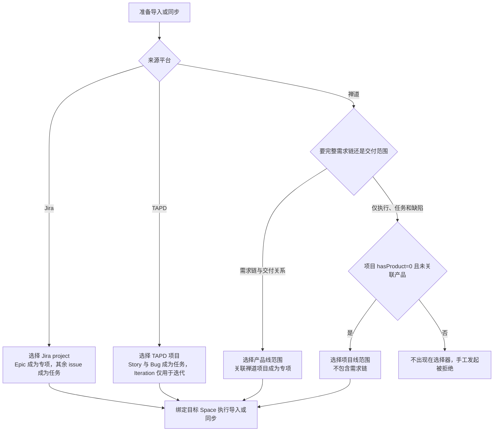

## 5.2 Jira 集成（V1.0 · 已上线-现状整理）

> 来源：https://help.hifox.com/docs/integration/jira ｜ 原文标题：Jira 集成

### 5.2.1 使用场景描述

**业务目标**：把 Jira 里的项目、issue、Epic、状态、评论和附件接入 HiFox，团队可保留 Jira 已有工作流，同时把任务交给 HiFox 里的成员、Agent 或小队执行。
**目标用户**：组织 owner / admin（绑定与同步管理）、空间管理员（导入配置）、普通成员（查看同步状态、绑定个人账号）。
**触发场景**：一次性迁移 Jira 历史数据（导入）；或保留 Jira 作为外部协作入口并持续双向协作（同步）。

**User Story**：
- 作为组织管理员，我想要把 Jira 项目批量导入为 HiFox 任务与专项，以便于把历史工作迁入 HiFox。
- 作为组织管理员，我想要把一个 Jira project 与一个 HiFox Space 绑定并持续同步，以便于两边团队保持更新。
- 作为成员，我想要绑定个人 Jira 账号，以便于写往 Jira 的评论以我自己的身份发布。

### 5.2.2 原型图 / UI 示意

图 5.2.2-1 外部应用集成列表（Jira 集成入口所在页面）

### 5.2.3 功能详细说明

| 节点/字段名称 | 交互与业务规则 | 数据来源/关联模块 |
| --- | --- | --- |
| 导入方式选择 | - 选项 1：API 导入（主机名 + 账号 + token，适合完整迁移，是后续同步的路径） - 选项 2：文件导入（「导入与导出」选 Jira，上传 CSV；需用 Jira「Issues → Export → CSV (all fields)」导出全部字段，映射步骤要求把一列映射为标题） | 导入向导 |
| Jira 主机名与凭据 | - 主机名如 `acme.atlassian.net`；邮箱或用户名 - Jira Cloud 用 Atlassian API token；Server/DC 可选个人访问令牌或用户名 & 密码 - 连接时验证凭据；令牌只提交一次、加密保存，界面仅显示尾号 | 组织凭据管理 |
| project key 与可选 JQL | - project key 确定读取范围；JQL 用于限制导入范围（组件、时间、类型等） - JQL 只影响导入范围，不限制后续同步 Webhook | 导入向导 |
| 使用内网代理 | - 仅私有化 / Server / Data Center 显示；识别为内网地址时导入与绑定走所选代理电脑（选电脑不选 Runtime） - 离线电脑可见但不可选并提示已离线；选定后导入与双向同步都走该电脑 | 电脑体系 |
| 目标 Space 选择器 | - 第一项为「+ 创建新空间」，创建后回到向导并自动设为本次导入目标 | 空间体系 |
| 只读预览 | - 展示将导入的 issue / Epic 数量、发现的状态 / 标签 / 用户 / 任务类型 / 自定义字段数、open 与 closed 数量、目标 Space 已存在同来源情况 - 此步不创建任务 | 导入向导 |
| 导入范围与状态映射 | - 可选导入 open issue / closed·done issue / 两者 - 状态映射按名称与状态分类给默认值，可使用已有状态、新建（显示「新建状态（Jira 原状态名）」）或调整分类与顺序 | 任务状态 / 工作流 |
| 用户映射 | - 选项：映射已有成员 / 邮箱邀请新成员 / 导入为外部账号（未处理用户默认）/ 不导入 - 来源不提供用户列表能力或凭据无读取权限时自动跳过本步并在导入选项中说明；跳过后按邮箱自动关联，其余保留外部账号 | 组织成员 / 外部账号 |
| 导入选项 | - 导入后与 Jira 保持双向同步（用本次账号直接建立绑定） - 导入 Sprint；切换到 Jira Sprint 模式；添加 Migrated 标签（默认勾选）；覆盖导入 | 导入向导 |
| 导入进度与回滚 | - 显示总数、已完成、跳过、失败项；过程中可取消（已创建任务保留） - 导入历史支持在时间窗口内回滚，删除本次导入创建的任务与专项并标记记录为已回滚 | 导入历史 |
| 同步链接 | - 一个 Jira project 只能主动链接一个 Space；多个 project 可链接同一 Space - 行尾灰色「同步配置」从抽屉打开，分同步设置 / 用户映射 / 状态映射三页签，改动需保存，未保存离开时先确认 | 外部应用集成 |
| 同步方向 | - Jira → HiFox：issue 与 Epic 进 HiFox，HiFox 部分更新写回 - 双向：HiFox 新建的任务或专项也可创建到 Jira | 同步引擎 |
| Webhook | - 有管理权限时自动注册；无权限时生成一次性配置包（回调 URL、请求头 `X-HiFox-Webhook-Secret`、查询参数备选、所需事件、项目 JQL），重新生成会使旧令牌失效 - 管理员保存后修改测试 issue，成功处理签名事件才启用链接 | Jira 实例 |
| 个人 Jira 账号 | - 评论优先以个人凭据发布；assignee / reporter / project lead 映射更准；个人凭据失效回退组织集成账号 | 第三方账号绑定 |
| 任务同步状态 | - 已同步 / 待同步 / 同步警告 / 同步错误 / 远端已删除 / 存在冲突；可查看错误说明并重试；管理员可断开单个任务的同步链接 | 任务详情 |

### 5.2.4 业务规则与流程说明

| 序号 | 规则/流程说明 | 备注 / 异常处理 |
| --- | --- | --- |
| 1 | 连接前提：可访问目标 Jira 项目的账号与令牌；自动安装 Webhook 需实例和项目管理权限，缺少时按页面「配置 Webhook」交给管理员 | 绑定成功后弹出引导：优先配置同步数据、其次导入数据；绑定本身不自动完成同步或导入 |
| 2 | 建立同步不会自动回放历史；之后可从 Jira 集成或导入历史入口发起历史导入，复用已保存连接 | 再次导入默认跳过已识别任务且不改编号；仅明确开启「覆盖导入」并确认数量后刷新可变字段，不产生重复任务 |
| 3 | 权限：owner / admin 可绑定、更新凭据、创建或删除同步链接；普通成员可查看同步状态、绑定个人账号；导入用临时凭据任务完成后不作为可读配置展示 | 建议准备权限合适的服务账号并定期轮换 token |
| 4 | 断开 Jira 实例或删除同步链接均不删除 Jira issue / Epic、HiFox 任务 / 专项及已同步的评论附件 | 仅 token 过期时建议更新凭据而非断开集成 |
| 5 | 权限或认证失败（同步警告）：按顺序更新组织级 token → 确认账号可浏览项目并创建/编辑 issue → 评论失败检查发布者个人账号 → 重试 | 分类标题含 `authentication failed` / `permission` / `unauthorized` |
| 6 | 未找到 Jira 条目：对应 issue 已删除、归档或不可访问时，恢复 issue、恢复权限或断开该任务同步链接 | 属同步警告，非权限问题 |
| 7 | Epic 类型不可用：目标 Jira 项目无可用 Epic 类型时，启用 Epic 类型、确认创建权限，或改用单向同步 | — |
| 8 | 必填字段拦截：Jira 有 HiFox 不写入的必填字段时，去掉必填或设项目默认值后重试 | 分类标题含 `Field 'xx' is required` |
| 9 | 工作流或字段约束拦截：`no transition to status "xx"` 时把 HiFox 状态映射到能一步到达的 Jira 状态；`not mapped` 时补映射或设为不同步；`field cannot be set` / `unknown field` 时检查编辑界面与字段上下文 | 最常见的一类提示，按横幅原文处理 |
| 10 | Webhook 或项目范围需检查：确认 project 已与正确 Space 建链、Webhook JQL 覆盖目标范围；导入 JQL 不影响后续同步 Webhook | 项目范围变更过时刷新项目元数据或重建链接 |
| 11 | 评论写回限定：只有通过支持「发布到 Jira」入口的顶层成员评论才写回；普通本地评论、回复和 Agent 评论保留在 HiFox | 附件记录远端 ID，避免重复上传 |
| 12 | 状态未写回通常是映射缺失、Jira 工作流不允许直接切换或必填字段 / workflow rule 拦截 | 先看同步状态错误说明 |
| 13 | 字段写回细节：预估按 Space 口径写 Story Points 或 original estimate（按 Jira 工作日历换算）；截止日期按所选日写回不受时区影响；描述写回 Jira Cloud 保留标题、粗体、列表、代码块、链接和表格；任务类型与自定义字段不写回 | Jira 侧空开始日期不清空本地值；Jira 未改描述时不重写本地描述 |
| 14 | 看不到 Jira project：账号无权限或元数据未刷新 | 在集成页刷新项目列表并确认凭据账号可浏览项目 |

### 5.2.5 附件与截图

暂无补充截图。

### 5.2.6 流程图

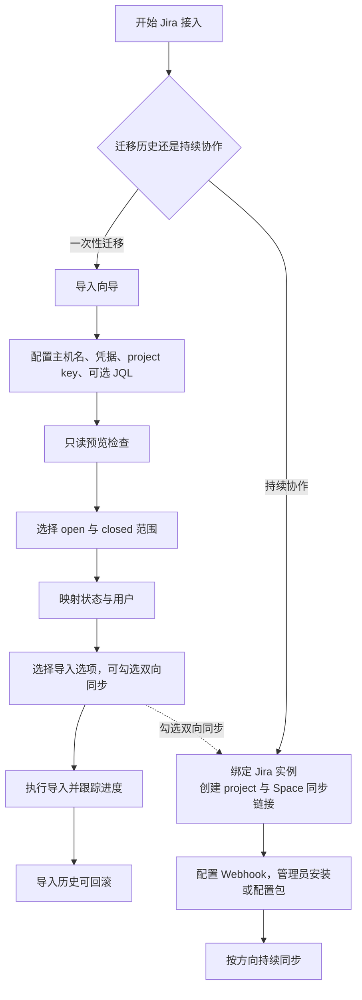

## 5.3 Jira 兼容 API（V1.0 · 已上线-现状整理）

> 来源：https://help.hifox.com/docs/integration/jira-api ｜ 原文标题：Jira 兼容 API

### 5.3.1 使用场景描述

**业务目标**：让为 Jira 编写的工具（命令行、报表、CI 插件、自动化脚本）不改代码逻辑、只改一个地址就能直接读写 HiFox 的任务。
**目标用户**：使用 Jira 生态工具的研发团队、自动化与 CI/CD 维护者。
**触发场景**：已有 Jira REST v2/v3 客户端或脚本需要操作 HiFox 任务、搜索、评论与流转。

**User Story**：
- 作为工程师，我想要把现有 Jira 工具的 Base URL 换成 HiFox 地址即可使用，以便于零成本迁移自动化脚本。
- 作为自动化维护者，我想要用 PAT 以本人身份读写任务，以便于权限与产品内完全一致。
- 作为报表开发者，我想要用 JQL 子集搜索任务并分页，以便于批量拉取数据。

### 5.3.2 原型图 / UI 示意

[图片占位]（原文未提供界面截图，建议后续补充原型图）

### 5.3.3 功能详细说明

| 节点/字段名称 | 交互与业务规则 | 数据来源/关联模块 |
| --- | --- | --- |
| Base URL | - `https://<组织 slug>.jira-api.hifox.com/rest/api/2/...` 或 `/rest/api/3/...` - 组织 slug 取自主页地址标识（如 `https://app.hifox.com/my-team/` 中的 `my-team`） | 组织体系 |
| 认证（PAT） | - 请求头 `Authorization: Bearer hfx_xxx`；令牌属于哪个成员，API 就以哪个成员身份读写 - 能看到哪些空间、能改哪些任务与产品内一致 | 个人访问令牌 |
| 速率限制与可见性 | - 默认每个来源每分钟 600 次请求，超限返回 429 - 非本组织成员的令牌访问返回 404，不暴露组织是否存在 | API 网关 |
| 概念映射 | - project ↔ 空间；issue key（如 `TEAM-42`）↔ 空间标识 + 任务编号；issue ↔ 任务；issuetype ↔ 任务类型；status / statusCategory ↔ 任务状态 / 分类（new / indeterminate / done）；priority ↔ 五级（Highest↔紧急、High↔高、Medium↔中、Low↔低、Lowest↔最低）；assignee / reporter ↔ 处理人 / 创建人；labels ↔ 任务标签（写入不存在的标签自动创建）；comment ↔ 评论（含 Agent 回复）；transition ↔ 状态流转 | 任务体系 |
| 用户与站点端点 | - GET `/myself`（当前令牌用户）、GET `/serverInfo`（站点信息） | API |
| 项目与元数据端点 | - GET `/project`、GET `/project/{projectKey}`（含可用 issue types）、GET `/issue/createmeta`；GET `/priority`、`/resolution`、`/status`、`/issuetype`、`/field`、`/user/search`（`/user/assignable/search` 同义） | API / 元数据 |
| Issue 端点 | - GET `/search?jql=...`；GET / POST / PUT / DELETE `/issue(/{key})`；GET / POST `/issue/{key}/comment`；GET / POST `/issue/{key}/transitions` | 任务体系 |
| 更新与流转 | - PUT 支持修改 summary、description、priority、assignee、duedate、labels、issuetype、parent；显式传 `"assignee": null` 清空处理人，成功返回 204 - transition 的 id 即目标状态，执行流转成功返回 204 | 任务体系 |
| JQL 子集 | - 字段：project、issuetype、status、statusCategory、resolution、priority、assignee、reporter、creator、labels、summary、description、text、created、updated、duedate、key、id - 操作符：`= != > >= < <= ~ !~`、IN / NOT IN、IS [NOT] EMPTY、AND / OR / NOT 与括号；函数 `currentUser()`；时间支持绝对日期与相对偏移（-7d、-2w、-1M、-1y） - ORDER BY 支持 key、created、updated、priority、status、assignee、summary、duedate | 搜索 |
| 分页 | - `startAt` 默认 0；`maxResults` 默认 50、上限 100；传 0 只返回 total | API |
| 与 Jira 的差异 | - 无 webhooks、agile/boards、attachments、worklog、watchers、custom fields 映射（后续按需开放） - `resolution` 从状态推导：终态分类（完成/已取消/重复）视作 Done，否则 Unresolved - v3 的 `/search` 是经典 GET 端点（不含 Jira Cloud 的 POST `/search/jql`） | API |

### 5.3.4 业务规则与流程说明

| 序号 | 规则/流程说明 | 备注 / 异常处理 |
| --- | --- | --- |
| 1 | issue 一律用 key 形式（`TEAM-42`）访问；单独传数字编号会被拒绝并提示改用 key | 任务编号在每个空间内独立计数，不同空间会有相同编号 |
| 2 | 写路径与产品界面完全一致：动态、通知、Agent 分配触发与双向同步回写照常发生 | — |
| 3 | 字段或语法有误时返回 400 和 Jira 格式错误体（`{"errorMessages": [...], "errors": {...}}`） | 错误体格式与 Jira 统一 |
| 4 | v2 返回纯文本描述，v3 返回 ADF 文档 | 响应为 Jira 的 issue / comment / search 形状 |
| 5 | 跨组织不可见：URL 里的组织决定一切，非本组织成员一律 404 | 不能看到别的组织 |

### 5.3.5 附件与截图

暂无补充截图。

### 5.3.6 流程图

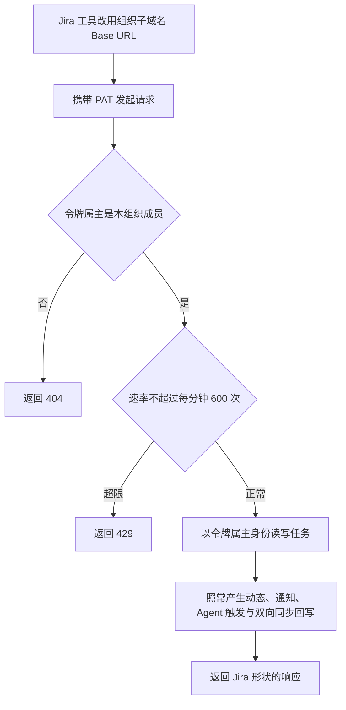

## 5.4 禅道集成（V1.0 · 已上线-现状整理）

> 来源：https://help.hifox.com/docs/integration/zentao ｜ 原文标题：禅道集成

### 5.4.1 使用场景描述

**业务目标**：把禅道产品线或项目中的工作导入 HiFox Space，并按需配置后续同步；禅道仍可作为已有任务来源，导入后在 HiFox 中组织、指派、执行和验收。
**目标用户**：组织 owner / admin（连接与同步管理）、空间管理员（导入配置）、禅道管理员（回调配置）。
**触发场景**：一次性迁移禅道已有工作；或让选定产品线/项目与一个 HiFox Space 持续协作。

**User Story**：
- 作为组织管理员，我想要把禅道产品线的需求链与交付链完整导入一个 Space，以便于在一个空间内闭合需求与实现关系。
- 作为禅道管理员，我想要按页面指引配置回调，以便于禅道变更能实时进入 HiFox。
- 作为空间管理员，我想要先小范围导入验证映射，以便于确认状态与成员映射符合预期后再扩大范围。

### 5.4.2 原型图 / UI 示意

[图片占位]（原文未提供界面截图，建议后续补充原型图）

### 5.4.3 功能详细说明

| 节点/字段名称 | 交互与业务规则 | 数据来源/关联模块 |
| --- | --- | --- |
| 禅道实例地址 | - 填写访问根地址（如 `https://pm.example.com/zentao/`），不填页面地址 - 粘贴页面地址时系统自动去掉页面部分并逐级上溯；只填域名时自动尝试 `{根地址}/zentao/`；仍失败提示「这是页面地址，请填写禅道的访问根地址」 | 外部应用集成 |
| 账号凭据 | - 账号需能访问要导入/同步的产品线、项目及其中的工作；写回需相应创建或编辑权限 - 地址可从执行导入的环境访问 | RESTful API v1 |
| 来源范围 | - 产品线：需求链 + 缺陷 + 交付链 - 项目线：仅 `hasProduct=0` 且未关联产品的项目，一个专项 + 其迭代、任务和缺陷，不含需求链 | 概念对照（5.1） |
| 目标 Space 选择器 | - 第一项「+ 创建新空间」，创建完成后回到向导并将新 Space 设为导入目标 | 空间体系 |
| 只读预览与工作范围 | - 预览显示将导入的工作数量及项目、迭代、工作类型、进行中和已完成范围 - 范围可选：进行中的工作 / 已完成的工作 / 两者都导入 | 导入向导 |
| 状态映射 | - 需求、任务和缺陷可能使用不同状态字典；向导列出识别到的状态并给建议映射 - 可映射已有状态、新建（显示「新建状态（来源平台状态名）」）或调整顺序 | 任务状态 |
| 成员映射 | - 可选步骤：映射到现有成员或导入为外部账号；「不导入」为明确跳过；未处理成员默认外部账号 - 来源不提供用户列表能力或凭据无权限时自动跳过并说明 | 外部账号 |
| 导入选项 | - 导入后保持同步（连接与回调均已就绪时才可用）；导入迭代；为导入任务添加 Migrated 标签（默认不勾选）；覆盖导入 | 导入向导 |
| 同步链接 | - 同步由连接、同步链接和回调三部分组成，仅保存连接不足以接收变更 - 「项目同步」卡片新建同步：配置（绑定、来源、目标 Space、方向，默认双向）→ 映射状态 → 映射用户 → 导入选项 → 确认；详情分同步设置 / 用户映射 / 状态映射三页签 | 外部应用集成 |
| 回调配置 | - 创建连接或同步时即生成固定不变的回调地址和密钥；回调状态记录最近一次收到回调的时间 - 收到过回调即视为配置成功；请用测试变更确认送达 | 禅道实例 |
| 内网代理 | - 只能从内网访问时在连接表单选择代理电脑（基于电脑执行，不依赖 Runtime）；离线电脑不可选 - 没有可用电脑时可在表单上方打开「连接电脑」流程，完成后回到原表单继续 | 电脑体系 |
| 外部账号 | - 无法对应组织成员的用户以「平台 + 实例 + 姓名」外部账号承接，统一在「人员 → 外部账号」管理 | 外部账号 |

### 5.4.4 业务规则与流程说明

| 序号 | 规则/流程说明 | 备注 / 异常处理 |
| --- | --- | --- |
| 1 | 禅道集成目前仅适用于国内版 HiFox | — |
| 2 | 版本要求：通过 RESTful API v1 读写，开源版 ≥ 16.5、企业版 ≥ 6.5、旗舰版 ≥ 3.0；云禅道同样适用 | 版本过低提示「当前禅道版本不支持 REST API，请升级到开源版 16.5 及以上」，重输密码无效 |
| 3 | 权限边界：owner / admin 管理连接、凭据、回调与同步链接；禅道账号访问范围决定可读写来源；Space 成员与权限决定查看处理；连接不自动互授两边权限 | 页面不向其他成员展示可直接使用的敏感凭据 |
| 4 | 默认窄同步只同步任务的标题、状态和处理人；管理员开启「完整入站同步」后需求（含业务/用户需求）和 Bug 也同步，正文、优先级、日期、预估、自定义字段、标签、关注者、评论和附件随禅道更新 | 所有绑定（包括新建的）默认关闭此开关 |
| 5 | 任何情况下都不同步：新建对象、任务类型变更、父子关系、专项 / 迭代归属 | 新增的关联会补上，已有关联不被删除或改类型 |
| 6 | 写回限制：禅道三类工作项的可写字段不同，状态当前不能安全写回；不支持的写回保留在 HiFox 并显示限制说明，重试无效 | 需求类正文、处理人、状态，任务与 Bug 的状态，预估和自定义字段不能写回，只有禅道侧值变了才覆盖本地 |
| 7 | 禅道空值不清空本地内容；尚未推送的本地修改不会被覆盖；禅道上推送失败且之后有人编辑过的对象以禅道为准 | 升级前已同步任务第一次同步只补空字段 |
| 8 | 删除同步链接停止后续同步，不删除已导入或已同步的任务 | 处理前确认团队是否需要保留历史 |
| 9 | 取消导入不会自动判断哪些已创建数据应保留或清理 | 先检查实际导入结果再决定下一步 |
| 10 | 回调地址与连接信息不得复制到公开文档、截图或不受信任的渠道 | — |

### 5.4.5 附件与截图

暂无补充截图。

### 5.4.6 流程图

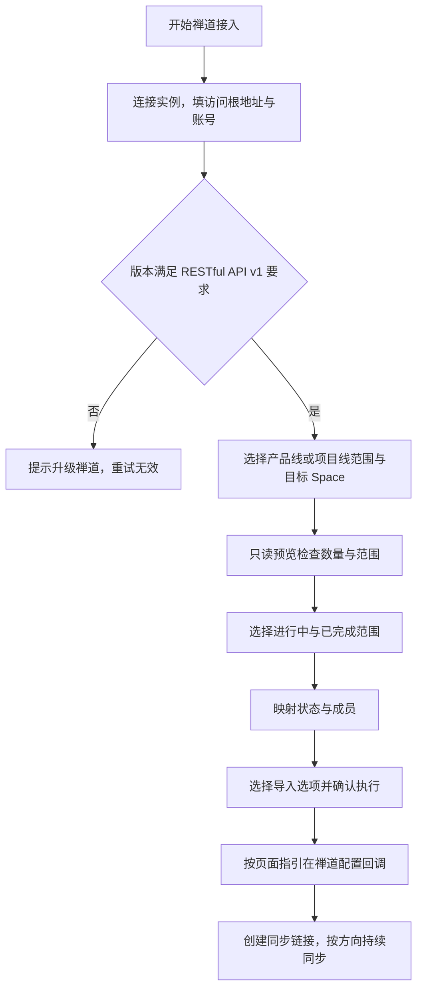

## 5.5 TAPD 集成（V1.0 · 已上线-现状整理）

> 来源：https://help.hifox.com/docs/integration/tapd ｜ 原文标题：TAPD 集成

### 5.5.1 使用场景描述

**业务目标**：把 TAPD 里的项目接入 HiFox：先导入已有条目（Story / Bug），再按连接上的同步设置保持更新。
**目标用户**：组织管理员（绑定实例与同步链接）、使用 TAPD 付费版的公司（API 账号）、免费版公司成员（个人访问令牌）。
**触发场景**：迁移 TAPD 历史需求数据；或让 TAPD 与 HiFox 按连接方向持续同步。

**User Story**：
- 作为 TAPD 付费版公司的管理员，我想要用 API 账号建立双向实时同步，以便于两个平台持续一致。
- 作为免费版公司的成员，我想要用个人访问令牌把 TAPD 条目导入 HiFox，以便于在 HiFox 中继续处理。
- 作为组织管理员，我想要在建立同步后按需补导历史数据，以便于复用已保存凭证。

### 5.5.2 原型图 / UI 示意

[图片占位]（原文未提供界面截图，建议后续补充原型图）

### 5.5.3 功能详细说明

| 节点/字段名称 | 交互与业务规则 | 数据来源/关联模块 |
| --- | --- | --- |
| 凭证类型（二选一） | - API 账号：公司级、付费版；填账号、密码和 company_id；支持双向实时同步 - 个人访问令牌：成员在 TAPD「我的设置 → 个人访问令牌」自建；只填 token；仅支持 HiFox → TAPD 单向实时同步 | TAPD 开放平台 |
| 项目列表 | - 个人令牌列出的是你参与的项目；已结束的 TAPD 项目仍出现，项目名后有「已结束」标签 | TAPD 实例 |
| 导入筛选条件（可选） | - 类似 Jira 导入的 JQL 按字段限定范围；填写后界面预估按字段筛选后的需求与缺陷数量并与全项目数量对比 - 不填等同「不筛选」；通过私有电脑导入时暂不支持按字段筛选 | 导入向导 |
| 目标 Space 与状态映射 | - 目标 Space 选择器第一项「+ 创建新空间」；新建状态显示「新建状态（来源平台状态名）」 | 空间体系 / 任务状态 |
| 用户映射 | - 可映射到现有成员或导入为外部账号；「不导入」为明确跳过；未处理用户默认外部账号 - TAPD 成员可能没有邮箱，无邮箱用户不能被邮箱匹配 | 外部账号 |
| 同步配置 | - 「项目同步」卡片新建同步：配置（绑定、项目、目标 Space、方向，默认双向）→ 映射状态 → 映射用户 → 导入选项 → 确认 - 同步列表行箭头前灰色「同步配置」，抽屉分同步设置 / 用户映射 / 状态映射三页签 | 外部应用集成 |
| 提示条 | - 需要处理时行下方直接出现黄色提示条，写明要做什么并带操作按钮（如重新配置 Webhook 时的「配置 Webhook」） | 同步引擎 |
| Webhook | - 新建连接或同步时即同时创建固定的回调地址和密钥（除非重建配置）；配置后显示回调状态和最近一次收到回调时间 - 收到过自己的回调即视为配置成功，提示条只在从未收到回调时出现 | TAPD 实例 |
| 立即检测 | - 按需增量拉取，不是后台不停轮询；免费公司没有 webhook 时用它补入站更新 - 个人令牌下定时检测按连接合并，同一连接的同步项共用一条提示条（原因、上次与下次检查时间），检测中、完成与失败都显示在提示条上 | 同步引擎 |
| 建立同步后导入历史 | - 单独建立同步不自动回填历史；可从集成页或导入历史入口发起，复用已保存凭证 - 默认跳过已按 TAPD 来源识别的任务；明确开启「覆盖导入」并确认数量后刷新可变字段，不建重复任务 | 导入历史 |
| 限流处理 | - 个人令牌触发 TAPD 限流时导入界面展示原因和预计恢复时间；额度恢复后导入自动继续 | 不算导入失败 |

### 5.5.4 业务规则与流程说明

| 序号 | 规则/流程说明 | 备注 / 异常处理 |
| --- | --- | --- |
| 1 | 只有 TAPD 付费版才能用 API 账号；免费版改用个人访问令牌 | 绑定页以黄字写明 |
| 2 | 个人访问令牌仅支持 HiFox → TAPD 单向实时同步，不支持双向实时同步 | 双向实时同步需要 API 账号 |
| 3 | 自定义字段、开始日期和迭代不会写回 TAPD；只有 TAPD 上该字段的值变了 HiFox 才会被覆盖 | 完整覆盖规则见概念对照页 |
| 4 | 目标空间已开启分拣台时，同步新建的条目先进入待分拣；一次性导入历史仍按状态映射处理 | 同步任务详情的来源与链接展示与 Jira 一致 |
| 5 | 任务上「部分 TAPD 字段以文本方式保存或未写入」是黄色警示而非同步失败；五类原因：成员字段多人、用户未匹配、字典缺失、类型不支持、与已有同名字段类型不同 | 在任务同步提示查看字段清单，调整后下一轮同步提示随成功写入消失 |
| 6 | 导入创建人尽量保留 TAPD 原始创建人；无法匹配成员时界面兜底展示 | 具体文案以线上为准 |
| 7 | 导入标签归属目标 Space；组织已有同名标签时复用组织标签 | 避免影响其他 Space 的标签选择器 |
| 8 | 私有机（内网代理）连接的同步暂不读取字段字典，自定义字段值不同步并告警，发布计划只保留 ID | 见概念对照页 |

### 5.5.5 附件与截图

暂无补充截图。

### 5.5.6 流程图

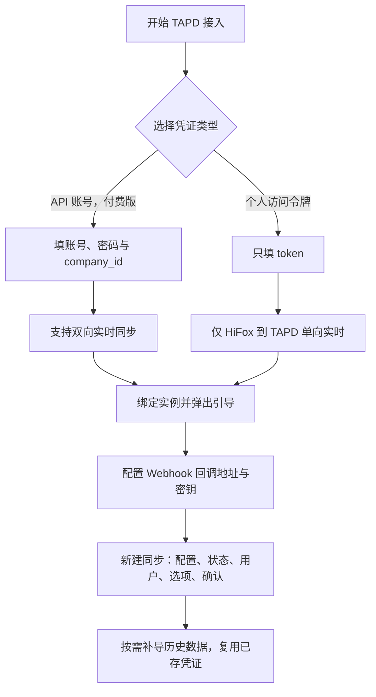

## 5.6 PingCode 集成（V1.0 · 已上线-现状整理）

> 来源：https://help.hifox.com/docs/integration/pingcode ｜ 原文标题：PingCode 集成

### 5.6.1 使用场景描述

**业务目标**：把 PingCode 项目里的工作项接入 HiFox：先导入已有工作项，再按同步设置保持更新；范围按「企业 → 项目 → 工作项」逐级选择。
**目标用户**：组织管理员（连接与凭据管理）、空间管理员（导入与同步配置）、普通成员（绑定个人 PingCode 账号）。
**触发场景**：迁移 PingCode 历史工作项；定时增量保持两边一致；在 HiFox 中把评论写回 PingCode 工作项。

**User Story**：
- 作为组织管理员，我想要一键授权连接 PingCode，以便于组织统一管理凭据。
- 作为空间管理员，我想要按工作项类型映射导入任务，以便于保留 PingCode 的工作项结构。
- 作为成员，我想要在任务评论框选择「发布到 PingCode」，以便于把讨论同步到对应工作项。

### 5.6.2 原型图 / UI 示意

[图片占位]（原文未提供界面截图，建议后续补充原型图）

### 5.6.3 功能详细说明

| 节点/字段名称 | 交互与业务规则 | 数据来源/关联模块 |
| --- | --- | --- |
| 集成页分组 | - 「连接与凭据」管理绑定和凭证健康；「导入与增量同步」负责发现项目、导入和持续同步 | 外部应用集成 |
| 一键授权 | - 在 PingCode 企业后台凭据管理创建「用户授权应用」，把集成页显示的回调地址登记到应用，填入 Client ID 与 Client Secret 后点「前往 PingCode 授权」 - 应用密钥只提交到服务端按官方接口交换令牌，不保存在浏览器本地 | PingCode 开放平台 |
| 手动令牌 | - 直接填 PingCode 个人访问令牌 | 个人访问令牌 |
| 令牌有效期 | - 访问令牌有效期约 30 天，失效后需重新授权，系统不自动续期 | 连接与凭据 |
| 成员授权应用 | - 组织配置后供其他成员绑定自己的 PingCode 账号；成员不接触 Client Secret - 更换 Client ID 后，已通过一键授权绑定的成员需重新授权；手动令牌不受影响 | 第三方账号绑定 |
| 企业 ID 与项目发现 | - 选择已绑定连接并填入 PingCode 企业 ID；系统发现该企业下你有权限的项目，从列表选择或直接粘贴项目 ID | 导入与增量同步 |
| 只读预览 | - 选择项目后先做只读预览，确认工作项数量和内容再继续 | 导入向导 |
| 工作项类型映射 | - 为每种 PingCode 工作项选择导入后对应的 HiFox 任务类型；未映射的类型导入为空间默认任务类型 | 任务类型 |
| 导入执行 | - 导入是幂等的：重复执行按来源识别已有任务并收敛，不创建重复任务 - 完成后显示结果，无法以原生字段保存的值在「字段告警」按字段、原因逐条列出 | 导入历史 |
| 同步与回写 | - 同步是定时拉取 PingCode 改动，不是实时推送；新建同步向导五步：配置 → 映射状态 → 映射用户 → 导入选项 → 确认 - 已连接任务的评论框可勾选「发布到 PingCode」写回对应工作项；回写能力含新建、更新、删除工作项和新建评论 | 同步引擎 |
| 外部账号 | - 无法对应组织成员的用户以外部账号承接，统一管理并支持关联成员 | 外部账号 |

### 5.6.4 业务规则与流程说明

| 序号 | 规则/流程说明 | 备注 / 异常处理 |
| --- | --- | --- |
| 1 | 访问令牌约 30 天过期：一键授权点「重新授权」，手动令牌换新令牌保存 | 集成页会提示凭证问题 |
| 2 | 一键授权和手动令牌可以混用；组织共享连接的方式取决于建立者 | 成员个人绑定不接触 Client Secret |
| 3 | 导入是只读的，PingCode 侧不变化；仅配置同步或在评论框选「发布到 PingCode」后才写回 | — |
| 4 | 字段告警五类原因：成员字段多人（全名在「字段名（全部）」）、用户未匹配、字典缺失、类型不支持、与已有同名字段类型不同 | 能保留的以文本自定义字段保存，不能保留的不写入 |
| 5 | 「发布到 PingCode」入口需任务已建立可发布链路（空间的项目关联与该任务的工作项同步）才显示 | — |
| 6 | 状态映射中选择创建新状态时显示「新建状态（来源平台状态名）」 | 括号内保留 PingCode 原状态名 |
| 7 | 回滚按那次导入的范围撤销，不影响导入之外的任务；重复导入不重复创建 | 需要重新导入时先在导入历史回滚上一次 |
| 8 | 导入开始后可以取消；已完成的导入可在导入历史里回滚 | — |

### 5.6.5 附件与截图

暂无补充截图。

### 5.6.6 流程图

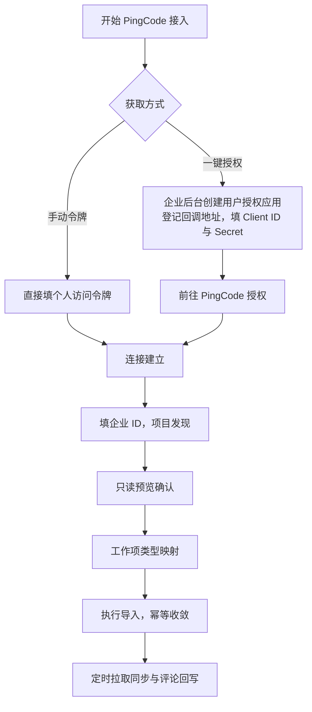

## 5.7 Teambition 集成（V1.0 · 已上线-现状整理）

> 来源：https://help.hifox.com/docs/integration/teambition ｜ 原文标题：Teambition 集成

### 5.7.1 使用场景描述

**业务目标**：把 Teambition 里的项目和任务接入 HiFox：先导入已有条目，再按连接上的同步设置保持更新。
**目标用户**：Teambition 企业管理员（创建企业内部应用）、组织管理员（配置应用凭据）、普通成员（个人授权与使用）。
**触发场景**：迁移 Teambition 项目任务；或让 Teambition 与 HiFox 持续协作（含从 HiFox 创建任务到 Teambition）。

**User Story**：
- 作为组织管理员，我想要用企业内部应用凭据接入 Teambition，以便于以应用身份读取项目数据。
- 作为成员，我想要完成个人授权，以便于项目发现和远端写入都以我的身份进行。
- 作为空间管理员，我想要在 Teambition 仍是唯一修改入口时先用单向同步，以便于稳妥过渡。

### 5.7.2 原型图 / UI 示意

[图片占位]（原文未提供界面截图，建议后续补充原型图）

### 5.7.3 功能详细说明

| 节点/字段名称 | 交互与业务规则 | 数据来源/关联模块 |
| --- | --- | --- |
| 应用凭据（组织管理员） | - App ID / App Secret / 企业 ID；后台读取以应用身份进行，是导入与同步的基础（需 Teambition 企业版） - 创建步骤：开放平台创建企业内部应用并发布 → 开通权限（读取项目、任务、任务分组、项目成员与状态；任务更新与评论写入）→ 复制 App ID 与 App Secret → 在「安全域名」加入本站地址（不带 http/https） | Teambition 开放平台 |
| 企业 ID | - 登录 Teambition 网页版后地址栏 `https://www.teambition.com/organization/` 之后的一串字符 | Teambition |
| 个人授权（每位成员） | - 保存应用配置后在「第三方账号绑定」绑定自己的 Teambition 账号；项目发现读取你加入的项目，所有远端写入以你的身份进行 | 第三方账号绑定 |
| 导入来源 | - API 凭据；或上传任务信息表 CSV（网页版任务列表导出菜单「自定义表头字段导出所有任务」，不依赖 API 凭据） | 导入向导 |
| 导入助手 | - 连接 → 发现与预览 → 状态映射 → 用户映射 → 导入选项 → 确认 → 结果；最后一步之前随时退出都不会导入任何内容，Teambition 侧数据不变化 | 导入向导 |
| 用户映射 | - 映射到本组织成员或导入为外部账号，不映射则跳过 - Teambition 成员不带邮箱，不支持按邮箱邀请 | 外部账号 |
| 任务类型映射 | - 双向同步需要：从 HiFox 创建任务到 Teambition 时，本地任务类型按映射对应；未命中精确类型时使用映射里标记为默认的那一行 | 任务类型 |
| 同步方向 | - Teambition → HiFox：变更同步到 HiFox，本地修改不写回 - 双向：两边互相同步，HiFox 新建任务也可创建到 Teambition | 同步引擎 |
| 入站 Webhook | - Teambition 无自动注册 Webhook 的公开接口，需在应用 Webhook 设置中手动添加页面给出的接收地址 - 任务与评论事件触发已关联项目的数据回读和入站同步；未登记前按轮询兜底 | Teambition 应用 |
| 同步配置详情 | - 分同步设置（持续同步开关、方向、历史数据补导）、用户映射、状态映射三页签；链接行可启用、暂停、立即同步或调整方向，显示最近同步时间 | 外部应用集成 |
| 外部账号 | - 无法对应组织成员的用户以外部账号承接并统一管理 | 外部账号 |

### 5.7.4 业务规则与流程说明

| 序号 | 规则/流程说明 | 备注 / 异常处理 |
| --- | --- | --- |
| 1 | Teambition 正在逐步开放：账号暂未开放时平台列表显示「即将推出」占位 | 入口在「设置 → 导入与导出」平台列表与「外部应用集成」 |
| 2 | 权限变更需要重新发布应用；未加入安全域名时跳转报「不匹配的应用安全域名」 | 安全域名可填域名或 IP，可带端口 |
| 3 | 个人授权失效（例如修改了 Teambition 密码）后需重新完成，恢复后项目发现和远端写入才继续 | 无个人授权时项目发现明确提示并给出绑定入口 |
| 4 | 发现不到项目：确认个人授权已完成且未失效，且你确实加入了该项目；组织级应用凭据不会替你看到未加入的项目 | — |
| 5 | 双向写入在验证通过 Teambition 远端写入能力前保持禁用，只能先用 Teambition → HiFox | 验证通过前不影响导入和入站同步 |
| 6 | 删除事件不会直接删除本地任务 | 仅任务与评论事件触发回读 |
| 7 | 导入开始后可以取消；已导入内容可在「导入与导出」设置里回滚 | — |

### 5.7.5 附件与截图

暂无补充截图。

### 5.7.6 流程图

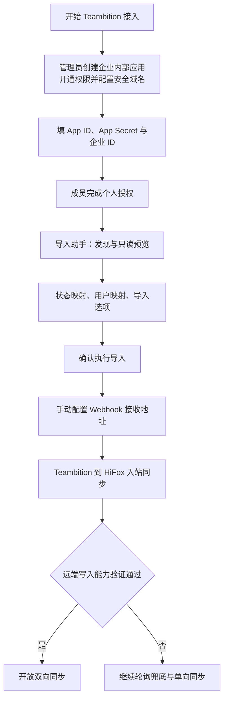

## 5.8 GitHub 集成（V1.0 · 已上线-现状整理）

> 来源：https://help.hifox.com/docs/integration/github ｜ 原文标题：GitHub 集成

### 5.8.1 使用场景描述

**业务目标**：把代码托管和任务流打通：组织连接 GitHub 后实现 PR / Commit 与任务的关联、Issue 同步与任务回链（与 Agent 用的「连接代码库」不是同一件事）。
**目标用户**：组织 owner / admin（安装应用与绑定）、成员（连接个人账号、在 GitHub 创建任务）。
**触发场景**：希望在 GitHub PR 中回链任务、把新建 Issue 同步为任务、并让评论以本人身份发布。

**User Story**：
- 作为组织管理员，我想要安装 GitHub 应用并选择仓库，以便于 PR 关联与 Issue 同步生效。
- 作为开发者，我想要在 PR 标题或分支名里写任务编号即可关联，以便于在 GitHub 上回链任务。
- 作为成员，我想要连接个人 GitHub 账号，以便于同步到 Issue 的评论尽量用我的身份。

### 5.8.2 原型图 / UI 示意

[图片占位]（原文未提供界面截图，建议后续补充原型图）

### 5.8.3 功能详细说明

| 节点/字段名称 | 交互与业务规则 | 数据来源/关联模块 |
| --- | --- | --- |
| 组织 GitHub 连接 | - owner / admin 在「外部应用集成」Git 仓库分组（卡片 GitHub / GitHub Issue）中绑定：安装应用并选择仓库；只有实际管理这次应用安装的人才能完成绑定 - 绑定了组织但未连个人账号时，卡片按「已绑定 GitHub 组织」展示 | 外部应用集成 |
| 个人 GitHub 账号 | - 与组织连接分开绑定；决定同步到 GitHub Issue 的评论尽量用谁的身份，未连时走应用机器人身份 - 关联后你创建的 Issue 和评论尽量归属到你，处理人尽量双向同步；一个 GitHub 账号已关联其他成员时不能再绑 | 第三方账号绑定 |
| PR / Commit 关联开关 | - 设置页「Git PR & Commit 关联到任务」中开关「关联 Pull Request」与「关联 Git Commit」 | 任务设置 |
| 关联触发 | - 任务编号出现在 PR 标题、PR 描述或来源分支名时尝试关联（如「Fixes HF-123」或仅「HF-123」） | 任务编号体系 |
| 任务回链 | - 在关联的 Pull Request 和 GitHub Issue 下评论一条任务链接 - 开关默认值：私有仓库默认开、公开仓库默认关；空间公开还是私有不是回链开关 | GitHub 设置 |
| Issue 同步 | - 仓库关联到空间后，该仓库里**新建**的 Issue 同步为任务；已有 Issue 不会导入 - 目标空间开启分拣台时新建任务先进入待分拣 | 同步引擎 |
| 同步方向 | - 单向：Issue 改动同步到 HiFox，多个仓库可同时关联同一空间 - 双向：Issue 与任务双向同步，一个空间只能有一个双向仓库 - 关闭或重开 Issue 可带动已配对任务状态 | 同步引擎 |
| 评论发布 | - 任务自身评论框是内部讨论；只有「来自 GitHub … 的评论」块的回复框（「发布到 GitHub」）才写到对应 Issue - 仓库为单向同步时回复不会发送到 GitHub | 任务详情 |
| 外部账号 | - Issue 创建人、处理人和评论作者等无法对应成员的用户自动创建外部账号；成员连接个人 GitHub 账号后自动关联 | 外部账号 |

### 5.8.4 业务规则与流程说明

| 序号 | 规则/流程说明 | 备注 / 异常处理 |
| --- | --- | --- |
| 1 | PR 关联没有 `fixes` / `closes` / `skip` 关键字语义；合并 Pull Request 不会改任务状态 | 出现任务编号只尝试关联 |
| 2 | 公开仓库只关联可信作者的 Pull Request：仓库 owner、member 或 collaborator | — |
| 3 | 把私有空间链到公开仓库且方向会把内容写出（如双向）时需明确确认：任务标题、描述和成员评论会同步到 GitHub，任何人可见 | — |
| 4 | 断开 GitHub 组织后该组织的 PR 关联和任务回链停止；移除仓库关联后新 Issue 不再同步；断开单任务同步链接均不删除已有任务或 GitHub 内容 | — |
| 5 | 组织 GitHub 集成不管电脑上的 Git 凭证；Agent clone 代码看电脑上的 SSH key、HTTPS token 或代码托管凭据 | 见「连接代码库」 |
| 6 | 绑定成功后看不到 project 类问题不适用；若看不到仓库相关能力，先确认组织绑定与仓库选择状态 | 卡片显示「已绑定组织」不等于已绑定个人账户 |

### 5.8.5 附件与截图

暂无补充截图。

### 5.8.6 流程图

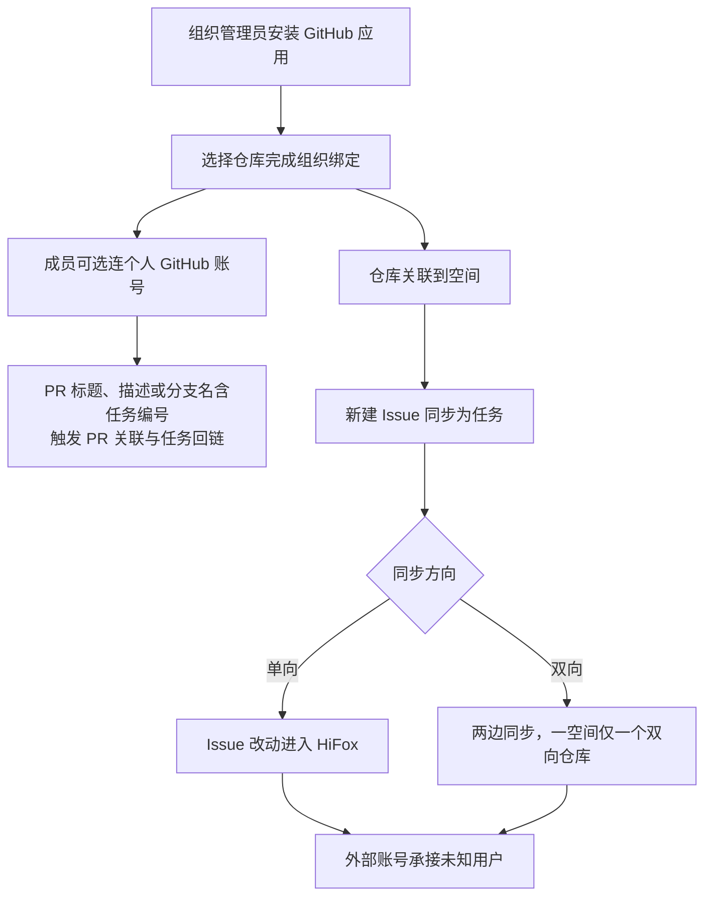

## 5.9 CNB 集成（V1.0 · 已上线-现状整理）

> 来源：https://help.hifox.com/docs/integration/cnb ｜ 原文标题：CNB 集成

### 5.9.1 使用场景描述

**业务目标**：把 cnb.cool 上的合并请求、提交和议题关联到 HiFox 任务，并可在 CNB 上发送任务回链。
**目标用户**：组织管理员（绑定令牌与配对仓库）、使用 CNB 的开发者。
**触发场景**：团队代码托管在 cnb.cool，希望在 MR / 议题中回链 HiFox 任务并自动建立关联。

**User Story**：
- 作为组织管理员，我想要用个人访问令牌绑定 CNB 组，以便于关联合并请求与议题。
- 作为开发者，我想要把任务编号写进 MR 标题或源分支名即可关联，以便于在 CNB 上看到任务回链。
- 作为管理员，我想要按仓库专属签名密钥校验事件，以便于防止伪造。

### 5.9.2 原型图 / UI 示意

[图片占位]（原文未提供界面截图，建议后续补充原型图）

### 5.9.3 功能详细说明

| 节点/字段名称 | 交互与业务规则 | 数据来源/关联模块 |
| --- | --- | --- |
| 令牌绑定 | - 「绑定 CNB 组织」点击「绑定令牌」粘贴 CNB 个人访问令牌；保存前先向 CNB 验证一次，之后加密存储并仅显示遮罩摘要 - 绑定页提示所需权限：`repo-notes:rw`（发送回链评论）、`repo-pr:r`（回查合并请求正文）、`account-engage:r`（以你的身份参与讨论） | 外部应用集成 |
| 配对仓库 | - 「已配对的仓库」中点击「配对仓库」：填仓库路径（仓库链接里的完整路径，可能超过两段）和空间 | 仓库配对 |
| `.cnb.yml` 配置指引 | - 打开「配置指引」，把页面给出的 `.cnb.yml` 片段提交到该仓库的**默认分支**；议题类事件只读取默认分支上的配置 - 片段里带有该仓库专属的签名密钥，不要在别的仓库复用 | CNB 流水线 |
| 事件接收状态 | - 页面显示「有没有收到过事件」：有最近事件表示配置已生效；「尚未收到任何事件」时确认片段在默认分支且流水线确实跑过 | 集成页 |
| 关联触发 | - 任务编号写进合并请求的标题、正文或源分支名——提交信息、议题和评论里同样有效——即尝试关联到该任务 | 任务编号体系 |
| 任务回链 | - 可开关；打开后提到任务的 CNB 合并请求或议题下会回复一条任务链接 | CNB 设置 |
| 令牌维护 | - 令牌失效时回链评论和合并请求正文回查停止；用「更换令牌」或「立即校验」处理 | 凭据管理 |

### 5.9.4 业务规则与流程说明

| 序号 | 规则/流程说明 | 备注 / 异常处理 |
| --- | --- | --- |
| 1 | CNB 没有平台级 webhook，入站靠每个仓库 `.cnb.yml` 里的流水线步骤；片段贴错或没贴到默认分支时 CNB 会静默跳过，HiFox 不报醒目错误 | 先看页面是否收到过事件 |
| 2 | CNB 拒绝令牌时页面展示 CNB 返回的原因原文；按原文补权限或更换令牌，不必猜测内部错误码 | — |
| 3 | 签名密钥泄露时用「重新生成密钥」，再把新片段贴回仓库 | 旧片段随之失效 |
| 4 | 断开连接会停止合并请求关联和回链；仓库配对保留，重新绑定同一组织即可恢复 | 断开或移除都不删除已有任务和 CNB 上的内容 |

### 5.9.5 附件与截图

暂无补充截图。

### 5.9.6 流程图

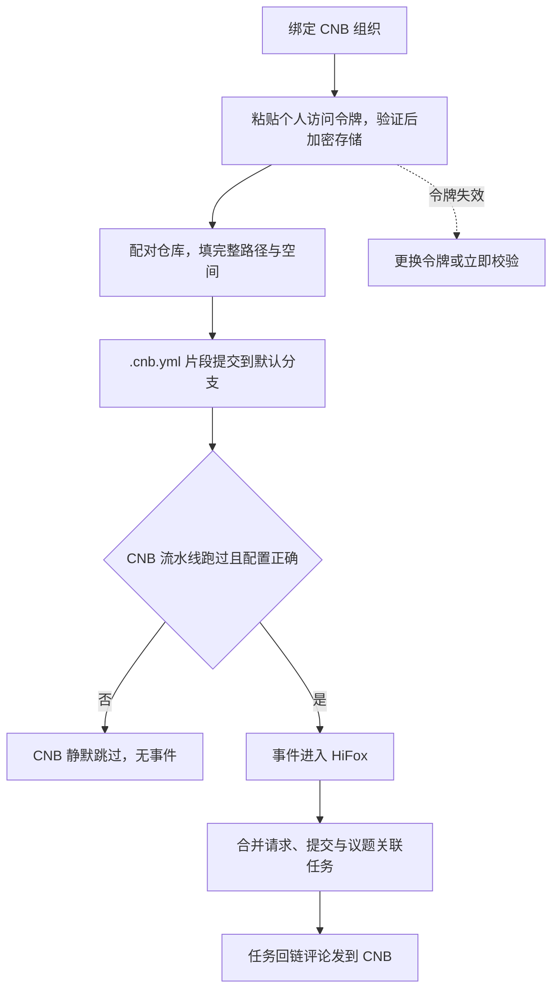

## 5.10 GitLab 集成（V1.0 · 已上线-现状整理）

> 来源：https://help.hifox.com/docs/integration/gitlab ｜ 原文标题：GitLab 集成

### 5.10.1 使用场景描述

**业务目标**：通过 gitlab.com OAuth 连接或自部署实例令牌连接，把 GitLab 合并请求、提交和 Issue 与 HiFox 任务打通：自动关联、自动更新状态、发送任务回链并同步 Issue。
**目标用户**：组织 owner / admin（组织连接）、自部署实例管理员（令牌与代理）、普通成员（个人账号绑定）。
**触发场景**：团队使用 gitlab.com 或自建 GitLab，且实例可能部署在内网需要代理访问。

**User Story**：
- 作为组织管理员，我想要把 gitlab.com 与组织 OAuth 绑定，以便于合并请求自动关联任务。
- 作为自部署实例管理员，我想要用个人访问令牌 + 内网代理电脑连接，以便于云端访问不到的实例也能集成。
- 作为成员，我想要绑定个人 GitLab 账号，以便于评论以本人身份出现在 GitLab 上。

### 5.10.2 原型图 / UI 示意

[图片占位]（原文未提供界面截图，建议后续补充原型图）

### 5.10.3 功能详细说明

| 节点/字段名称 | 交互与业务规则 | 数据来源/关联模块 |
| --- | --- | --- |
| gitlab.com 连接 | - 组织 owner / admin 在集成页用 OAuth 绑定组织；当前部署未配置 GitLab OAuth 凭据时提示管理员先完成配置 - 绑定组织后成员可在同一页面连接自己的 GitLab 账号，用于接收通知和身份匹配 | 外部应用集成 |
| 自部署连接 | - 填 GitLab 根地址（平时打开 GitLab 用的地址，如 `https://gitlab.your-company.com`） - 在 GitLab「个人设置」创建个人访问令牌并勾选 `api` 权限，建议专门机器人账号；令牌所属账号需在要同步的项目中是 Maintainer 或以上，系统用它创建 Webhook、同步 Issue 和发回链评论 | GitLab 实例 |
| 内网代理 | - 实例在内网、云端访问不到时，选择一台能访问它的在线电脑作为代理；之后 HiFox 对 GitLab 的访问都通过该电脑 - 只有在线电脑可选；代理电脑被移除后连接提示重新选择 | 电脑体系 |
| 连接信息 | - 连接成功后显示令牌到期日和所用代理电脑；令牌即将过期或已过期时页面提示尽快更换 | 凭据管理 |
| 个人账号（自部署） | - 成员粘贴自己的个人访问令牌完成绑定：评论以本人身份出现在 GitLab、处理人双向同步 - 个人令牌只影响自己的评论和处理人同步；缺失或过期时评论暂由组织账号代发并提示补填 - 同一时间只能绑定一个 GitLab 实例的个人账号，其他实例的绑定会被替换 | 第三方账号绑定 |
| Issue 同步 | - 把 GitLab 项目关联到空间后，GitLab issue 与任务保持同步，标题、描述、状态和评论一致 - 自部署项目同样可关联，走组织连接选择的线路（含内网代理） | 同步引擎 |
| Webhook 配置 | - 在项目 Settings → Webhooks 添加 HiFox 提供的 URL 和 Secret，事件勾选 Push events 与 Merge request events - 多项目可用群组级 Webhook（仅 Premium / Ultimate）；Free 套餐在每个项目填同一份 URL 和 Secret | GitLab 项目 |
| 外部账号 | - Issue 创建人、处理人和评论作者等无法对应成员的用户自动创建外部账号；成员绑定个人账号后自动关联 | 外部账号 |

### 5.10.4 业务规则与流程说明

| 序号 | 规则/流程说明 | 备注 / 异常处理 |
| --- | --- | --- |
| 1 | 两种连接互相独立，使用哪类就绑定哪类 | 入口都在「外部应用集成」 |
| 2 | 自部署实例的组织连接必须先由管理员用个人访问令牌完成，之后成员才能绑定个人账号 | — |
| 3 | 令牌无效、权限不足、地址跳转或访问不到时，页面按真实原因提示；修正令牌或地址后重试 | — |
| 4 | 所选代理电脑访问不到 GitLab 地址时，确认该电脑所在网络能打开该地址 | — |
| 5 | 断开连接只停止 HiFox 与 GitLab 之间的关联和同步，不删除 GitLab 上的代码、合并请求和 issue | — |

### 5.10.5 附件与截图

暂无补充截图。

### 5.10.6 流程图

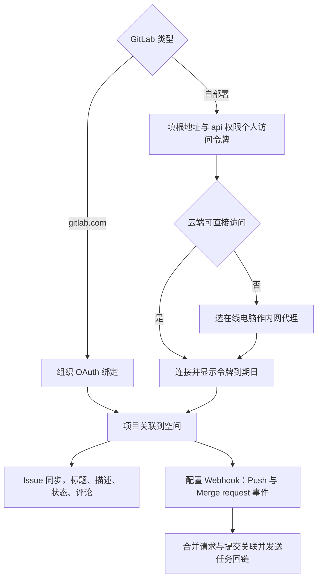

## 5.11 飞书集成（V1.0 · 已上线-现状整理）

> 来源：https://help.hifox.com/docs/integration/feishu ｜ 原文标题：飞书集成

### 5.11.1 使用场景描述

**业务目标**：通过任务助手、智能体、连接器、组织助手四种互相独立的能力，在飞书中创建与同步 HiFox 任务、控制 Agent、访问飞书资源并接收通知。
**目标用户**：组织 owner / admin（组织助手）、空间成员（任务助手）、Agent 拥有者（智能体）、Agent 使用者（连接器）。
**触发场景**：在飞书群内整理需求创建任务；在飞书中向 Agent 下达指令；让 Agent 访问飞书文档；在飞书预览任务与接收通知。

**User Story**：
- 作为空间成员，我想要在飞书群里 @ 任务助手即可根据话题上下文创建任务，以便于把聊天沉淀为工作项。
- 作为 Agent 拥有者，我想要把 Agent 绑定为飞书智能体，以便于在飞书中直接创建任务并同步进度。
- 作为组织管理员，我想要连接组织飞书助手，以便于成员在飞书中预览任务详情并接收通知。

### 5.11.2 原型图 / UI 示意

图 5.11.2-1 外部应用集成列表（飞书集成入口）

### 5.11.3 功能详细说明

| 节点/字段名称 | 交互与业务规则 | 数据来源/关联模块 |
| --- | --- | --- |
| 飞书任务助手 | - 每个空间一个系统助手；在飞书集成页「任务助手」分组选空间 → 绑定飞书 → 选 Runtime → 扫码完成绑定 - 在飞书群里 @ 机器人根据聊天上下文（含代码块）整理需求并创建任务；可查询、修改该空间任务；Agent 发出的文件回到原会话 - 绑定后可编辑 Runtime、补充附加提示词（追加在系统内置提示词后）或解绑、移除 | Runtime / 空间 |
| 飞书智能体 | - 通过二维码把一个 HiFox Agent 绑为飞书智能体（不需填 App ID / App Secret）；可在飞书提问、创建任务并绑定当前话题、同步任务进度、操作有权限资源 - 发送文本、富文本、图片和视频附件；文件回原会话；连接状态：生成中 / 等待授权 / 已连接 / 连接失败 | Agent 体系 |
| 触发方式 | - 默认响应私聊与群里被 @；可按条开关：私聊、群里被 @ 到、群消息 Emoji 表情触发、群消息直接触发（必须指定群，不能对全部群聊生效） - 不同话题保持各自独立上下文 | Agent 集成设置 |
| 表情停止 | - Agent 工作中在触发消息上加 ❌ 表情即终止本次运行，会话里任何人都可点；终止后双侧标记「已停止」；默认叉号可改 | Agent 运行 |
| `/new` 新会话 | - 在已有会话中发送 `/new`（可带首条提示词）开始新的 Agent 会话；不自动创建任务 | 外部会话 |
| 话题绑定同步 | - 创建任务时可绑定当前话题：任务评论与话题消息同步（话题内消息不要求 @）；绑定前历史仅一次受限回填 - 停止同步后绑定关系与评论保留，恢复后停止期间消息不补回；移除绑定才释放话题；从话题同步的评论不再次触发外发通知防循环 - 成员 @ 提及在两个方向转换（单人多人皆可），无法匹配保留可读原文 | 任务评论 |
| 飞书连接器 | - Agent 详情页「连接」选择飞书连接器；向导两次确认并核对验证码；无需预建应用或本机 CLI - 可「绑定已有凭证」（一条凭证可绑多个 Agent）或「授权新账号」；凭证可见范围：个人 / 项目 / 组织 | Agent 连接器 |
| 组织飞书助手 | - owner / admin 连接组织级飞书自建应用并回填 App ID 与 App Secret；成员在飞书粘贴任务链接渲染预览卡片（可直接打开任务并显示创建人） - 通知：已关联个人飞书账号的成员收到收件箱飞书私聊通知 | 通知中心 |
| 预览与通知前提 | - 公开空间不绑定个人账号也可预览；私有空间需授权关联个人账号；飞书通知需助手已连接且账号已关联 - 通知分组：指派、状态变更、评论与回复、提及、Agent 活动 | 通知设置 |
| Lark（国际版） | - Lark 与飞书是两个独立集成入口，授权、机器人、通知渠道和任务助手互不影响，可同时使用；Lark 自建应用在 open.larksuite.com 创建 | 外部应用集成 |

### 5.11.4 业务规则与流程说明

| 序号 | 规则/流程说明 | 备注 / 异常处理 |
| --- | --- | --- |
| 1 | 一个 Agent 同一时间只能绑定一个飞书智能体入口；已绑定的不再出现在可选列表 | 无可选 Agent 时先创建或先断开 |
| 2 | 授权链接与二维码一次性且有时效；过期、取消或会话丢失点「重试」生成新会话 | 扫码后仍「等待授权」需确认完成最后授权步骤 |
| 3 | 普通飞书消息不会自动变成任务；只有创建任务时绑定了话题，后续话题消息才按绑定规则同步到任务评论 | 状态变更是另一条通知，勿与评论同步混淆 |
| 4 | 无法确认身份的历史或外部发送者保留为外部参与者；外部账号在「人员 → 外部账号」统一管理，本人绑定飞书账号后自动关联 | 各平台外部账号行为一致 |
| 5 | 预览生效需飞书侧条件：应用发布正式版本（测试版本不渲染）、回调使用长连接、订阅 `url.preview.get`、登记 URL 规则（一条通配路径如 `app.hifox.com/**` 即可）；应用可用范围为前置条件 | 不在可用范围的人飞书不会发起预览请求 |
| 6 | 关闭某组通知只停对应飞书私聊，收件箱仍记录；关闭收件箱对应分组后两边都停；开启后只投递之后产生的事件，不回放积压通知 | 两边邮箱不一致时需显式关联飞书账号 |
| 7 | 连接器凭证异常（过期/吊销、可见范围缩小、仍有 Agent 使用时解绑或删除、同类凭证身份冲突）会阻止连接或报错；冲突时系统不随机选择身份，先解除冲突 | — |
| 8 | 助手暂时失效时通知开关保留，重连后重新生效；断开组织应用立即停止任务详情预览和飞书通知；断开不删除飞书侧自建应用 | 可用同一套凭证重连 |
| 9 | 二维码与授权链接勿转发给无关人员；不再使用的绑定应及时断开 | — |
| 10 | 仅飞书、Slack、Discord 支持用表情停止 Agent | 钉钉等无表情事件平台不适用 |

### 5.11.5 附件与截图

图 5.11.5-1 在飞书中触发 HiFox Agent 创建任务

图 5.11.5-2 飞书消息在 HiFox 中创建出的对应任务

### 5.11.6 流程图

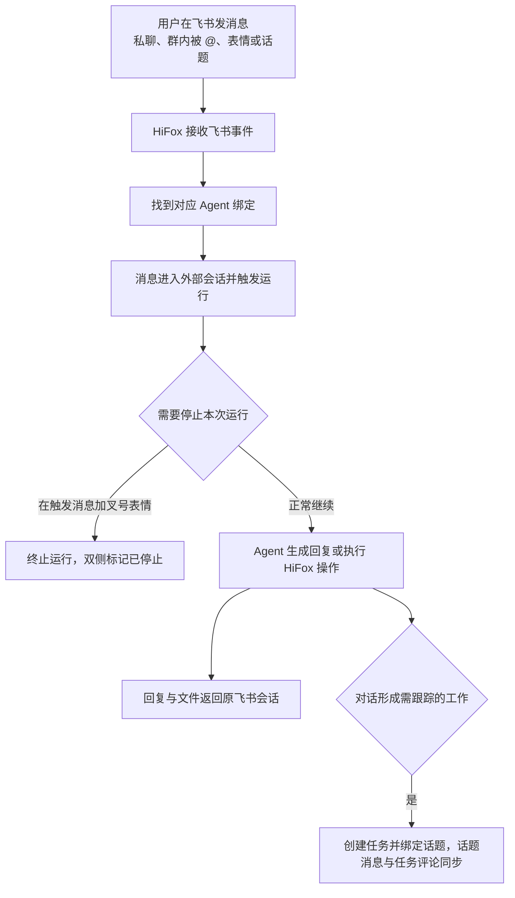

## 5.12 企业微信集成（V1.0 · 已上线-现状整理）

> 来源：https://help.hifox.com/docs/integration/wecom ｜ 原文标题：企业微信集成

### 5.12.1 使用场景描述

**业务目标**：通过任务助手与 Agent 机器人两种互相独立的能力，在企业微信里整理需求创建任务，并与 HiFox Agent 对话。
**目标用户**：空间成员（任务助手）、Agent 拥有者（机器人绑定）、企业微信管理员（创建智能机器人并打开长连接）。
**触发场景**：在企业微信群内把讨论沉淀为任务；在私聊或群里与 Agent 协作。

**User Story**：
- 作为空间成员，我想要在企业微信群里 @ 任务助手创建任务，以便于把聊天上下文整理成工作项。
- 作为 Agent 拥有者，我想要把 Agent 接入企业微信机器人，以便于在私聊和群里与它协作。
- 作为企业微信管理员，我想要用长连接方式接入机器人，以便于无需公网回调即可收发消息。

### 5.12.2 原型图 / UI 示意

[图片占位]（原文未提供界面截图，建议后续补充原型图）

### 5.12.3 功能详细说明

| 节点/字段名称 | 交互与业务规则 | 数据来源/关联模块 |
| --- | --- | --- |
| 任务助手 | - 每个空间一个系统助手；集成页「任务助手」分组找空间 → 绑定企业微信 → 选 Runtime → 填企业微信机器人凭证完成绑定 - 在企业微信群 @ 机器人按话题上下文整理需求创建任务；可查询、修改该空间任务；Agent 发出的文件回到原会话；绑定后可补附加提示词、换 Runtime 或解绑移除 | Runtime / 空间 |
| Agent 机器人 | - 把一个 HiFox Agent 连接为企业微信智能机器人；私聊直接对话、群聊 @ 机器人回复；可分别控制是否响应私聊和群里被 @；文件回原会话；在 HiFox 查看调整或断开绑定 | Agent 体系 |
| 凭据获取 | - 企业微信管理后台：管理工具 → 智能机器人 → 创建机器人 → 设置面板底部「API 模式创建」切换模式 → 选择长连接方式 → 把生成的 BotID 和 Secret 填到 HiFox | 企业微信后台 |
| 连接入口 | - 「外部应用集成」企业微信卡片设置或管理；或 Agent 详情页集成区「绑定企业微信」（直接绑定当前 Agent） | 外部应用集成 |
| `/new` 新会话 | - 在已有私聊或群会话中发送 `/new`（可带首条提示词）开始新的 Agent 会话，不带之前上下文 | 外部会话 |
| 管理与断开 | - 详情页列出已有 Agent 绑定，可查看、刷新状态或断开；断开后停止新消息投递，已有会话与历史不删除；恢复需重新填凭据 | 外部应用集成 |

### 5.12.4 业务规则与流程说明

| 序号 | 规则/流程说明 | 备注 / 异常处理 |
| --- | --- | --- |
| 1 | 准备项：HiFox Agent、企业微信管理权限（创建智能机器人并打开 API 长连接）、BotID 与 Secret | — |
| 2 | 一个 Agent 同一时间只能绑定一个企业微信入口；已绑定的不再出现在可选列表 | — |
| 3 | 企业微信机器人当前没有表情触发、群消息直接触发；触发开关以 Agent 集成页线上为准 | — |
| 4 | 消息进入的是 Agent 外部会话，不会自动变成 HiFox 任务 | 需跟踪的工作在 HiFox 建任务再指派给 Agent |
| 5 | 任务助手不是普通 Agent：不出现在 Agent 列表、处理人选择器和站内私聊里；处理过的任务、评论和活动仍显示为执行者 | — |
| 6 | 收不到消息：先确认绑定仍为已连接，再检查私聊 / 群 @ 触发设置；群聊还需 @ 该机器人 | — |
| 7 | 不要把 BotID、Secret 粘贴到任务评论、聊天消息或公开文档 | — |

### 5.12.5 附件与截图

暂无补充截图。

### 5.12.6 流程图

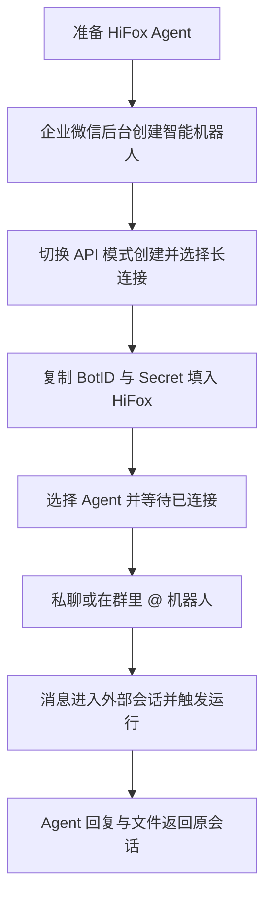

## 5.13 钉钉集成（V1.0 · 已上线-现状整理）

> 来源：https://help.hifox.com/docs/integration/dingtalk ｜ 原文标题：钉钉集成

### 5.13.1 使用场景描述

**业务目标**：通过任务助手、Agent 机器人、组织通知与链接预览三种互相独立的能力，在钉钉中创建任务、与 Agent 对话、接收任务动态通知并展开任务链接预览。
**目标用户**：组织所有者 / 管理员（绑定企业应用）、空间成员（任务助手）、Agent 拥有者（机器人绑定）。
**触发场景**：在钉钉群整理需求；私聊或群 @ 使用 Agent；在钉钉私聊接收任务通知和预览任务链接。

**User Story**：
- 作为组织管理员，我想要绑定钉钉企业内部应用，以便于成员在钉钉收到任务通知并预览任务链接。
- 作为空间成员，我想要在钉钉群里 @ 任务助手创建任务，以便于把讨论整理成工作项。
- 作为成员，我想要关联自己的钉钉账号，以便于收到与我相关的任务动态私聊。

### 5.13.2 原型图 / UI 示意

[图片占位]（原文未提供界面截图，建议后续补充原型图）

### 5.13.3 功能详细说明

| 节点/字段名称 | 交互与业务规则 | 数据来源/关联模块 |
| --- | --- | --- |
| 任务助手 | - 每个空间一个系统助手；集成页「任务助手」分组选空间 → 绑定钉钉 → 选 Runtime → 同一对话框扫码完成绑定 - 在钉钉群 @ 机器人按话题上下文创建任务；可查询修改该空间任务；文件回原会话；可补附加提示词或解绑移除 | Runtime / 空间 |
| Agent 机器人连接 | - 推荐扫码创建：连接钉钉 → 选 Agent → 等待生成注册码 → 钉钉扫码创建应用或「打开链接」→ 授权后凭据自动填入 → 等待已连接 - 扫码创建后应用还在审核、Client Secret 未放出时，等审核通过后从钉钉复制 ClientId 与 ClientSecret 改用「手动填写」 | 钉钉开放平台 |
| 触发方式 | - 私聊、群里被 @；当前没有表情触发、群消息直接触发 | Agent 集成设置 |
| `/new` 新会话 | - 已有私聊或群会话中发送 `/new`（可带首条提示词）新开 Agent 会话 | 外部会话 |
| 绑定钉钉企业应用 | - 管理员按配置指引在钉钉开发者后台创建企业内部应用、添加机器人能力、申请权限、配置回调域名并发布；回填 AppKey（Client ID）与 AppSecret（Client Secret）保存后立即向钉钉校验 - 绑定后可查看连接状态、重新验证、更新凭证或断开 | 钉钉开发者后台 |
| 钉钉通知 | - 任务上与你相关的动态由组织助手以应用私聊发出；成员在「我的钉钉账号」卡片（或设置 → 通知 → 钉钉）授权关联，解除后不再收到 - 卡片标题写明事件，正文含任务编号与标题、状态、评论摘要或状态前后变化，可点「查看详情」打开任务；首次收到通知先自我介绍并附通知设置入口 - 设置 → 通知 → 钉钉可按分组（指派、状态变更、评论与回复、提及、Agent 活动、执行自动化等）开关 | 通知中心 |
| 任务链接预览 | - 钉钉聊天里粘贴任务链接展开卡片：任务编号、标题、类型、状态、优先级、处理人、创建人和描述摘要，可点开任务 - 卡片按每位查看者自己的权限渲染：未关联者见关联引导，无权者只见拒绝提示 | 钉钉应用 |

### 5.13.4 业务规则与流程说明

| 序号 | 规则/流程说明 | 备注 / 异常处理 |
| --- | --- | --- |
| 1 | 只有组织所有者和管理员可以绑定钉钉应用；同一个钉钉应用不能同时绑定第二个组织 | 被占用时先在那边断开或单独创建应用 |
| 2 | 应用被停用或 AppSecret 被重置时，页面给出诊断提示 | 可重新验证 / 更新凭证 / 断开 |
| 3 | 管理员断开组织应用后，链接预览和钉钉通知立即停止；同套凭证重绑即恢复，成员关联与通知开关保留 | — |
| 4 | 收不到通知按序检查：组织已绑定应用 → 本人已授权关联 → 通知分组开启 → 在钉钉应用可见范围内 | 不在可见范围的成员既收不到通知也无法授权关联 |
| 5 | 链接预览需管理员绑定企业应用并完成「链接增强」相关配置；发链接的人也需在应用可见范围内 | 未关联或无权者本就看不到任务内容 |
| 6 | 注册码过期点「重试」生成新的；应用审核中 Client Secret 未放出时先等审核再手动填写 | — |
| 7 | 消息进入 Agent 外部会话，不会自动变成任务 | 需跟踪的工作在 HiFox 建任务 |
| 8 | 不要把 ClientId、ClientSecret 粘贴到任务评论、聊天消息或公开文档 | — |

### 5.13.5 附件与截图

暂无补充截图。

### 5.13.6 流程图

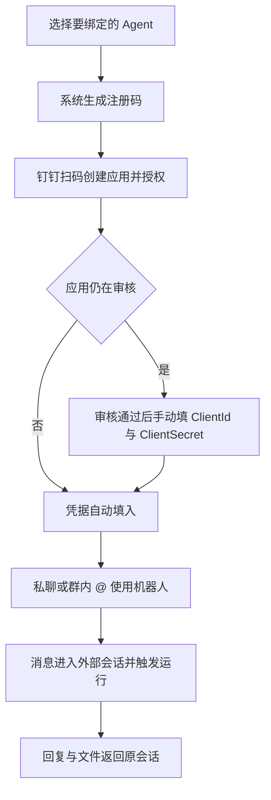

## 5.14 微信集成（V1.0 · 已上线-现状整理）

> 来源：https://help.hifox.com/docs/integration/wechat ｜ 原文标题：微信集成

### 5.14.1 使用场景描述

**业务目标**：通过扫码把一个 HiFox Agent 连接到微信，连接后可在微信中与绑定的 Agent 对话。
**目标用户**：Agent 拥有者与需要在微信使用 Agent 的成员。
**触发场景**：希望在微信里直接向 HiFox Agent 提问或下达指令。

**User Story**：
- 作为成员，我想要扫码把 Agent 连到微信，以便于在微信中直接与它对话。
- 作为成员，我想要用 `/new` 新开会话，以便于开始一个不带历史上下文的新话题。
- 作为成员，我想要 Agent 产出的文件回到微信会话，以便于在手机上直接查看。

### 5.14.2 原型图 / UI 示意

[图片占位]（原文未提供界面截图，建议后续补充原型图）

### 5.14.3 功能详细说明

| 节点/字段名称 | 交互与业务规则 | 数据来源/关联模块 |
| --- | --- | --- |
| 连接入口 | - 在 HiFox 打开微信连接入口 → 选择要连接的 Agent → 微信扫描页面二维码并按线上提示完成连接 → 返回 HiFox 等待状态更新 - 具体入口、二维码流程和页面文案以发布环境为准 | 外部应用集成 |
| 会话使用 | - 连接成功后在微信中与绑定 Agent 对话；Agent 发出的文件回到原来的微信会话 | 外部会话 |
| `/new` 新会话 | - 在会话中发送 `/new` 新开一个会话 | 外部会话 |

### 5.14.4 业务规则与流程说明

| 序号 | 规则/流程说明 | 备注 / 异常处理 |
| --- | --- | --- |
| 1 | 准备项：HiFox Agent（没有时先创建）、可完成扫码和授权流程的微信账号 | — |
| 2 | 一个微信账号同时只能绑定一个 Agent | 重新连接前先确认账号当前绑定的 Agent |
| 3 | 连接失效时按产品显示的状态提示重新连接，或解除当前绑定后再连接 | — |
| 4 | 微信消息进入的是 Agent 的外部会话，不会自动创建为 HiFox 任务 | 需分配、追踪或验收的工作按实际工作流在 HiFox 建任务 |

### 5.14.5 附件与截图

暂无补充截图。

### 5.14.6 流程图

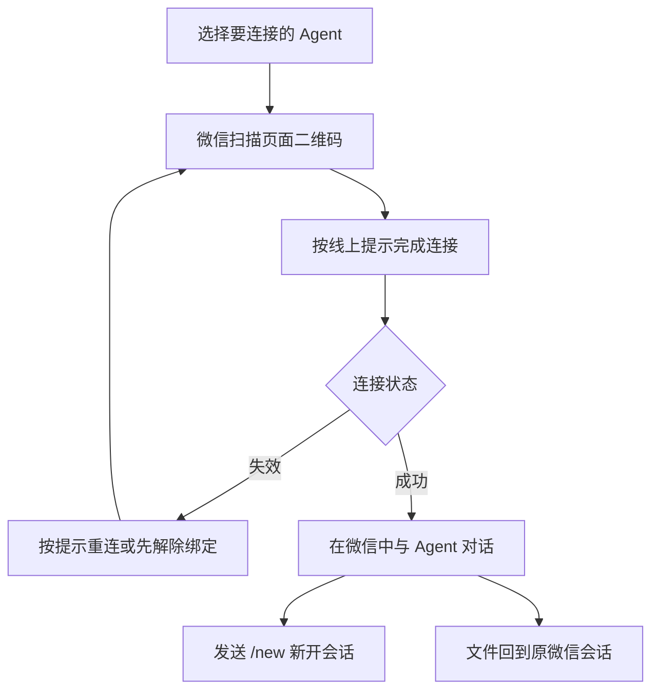

## 5.15 Slack 集成（V1.0 · 已上线-现状整理）

> 来源：https://help.hifox.com/docs/integration/slack ｜ 原文标题：Slack 集成

### 5.15.1 使用场景描述

**业务目标**：通过组织 Slack 工作区、任务助手与 Agent 机器人三种互相独立的连接，在 Slack 里创建任务、发送任务回链、展开链接预览、投递通知，并把 Agent 接入单聊、频道 @ 与线程。
**目标用户**：组织 owner / admin（工作区绑定）、空间成员（任务助手）、Agent 拥有者（机器人）、普通成员（个人账号与通知）。
**触发场景**：用 slash 命令或快捷方式创建任务；在频道 @ Agent 或用表情触发；接收收件箱通知。

**User Story**：
- 作为组织管理员，我想要绑定 Slack 工作区，以便于成员用 slash 命令和快捷方式创建任务并接收通知。
- 作为空间成员，我想要在频道里 @ 任务助手创建该空间任务，以便于把讨论沉淀为工作项。
- 作为 Agent 拥有者，我想要把 Agent 绑成 Slack 机器人，以便于在单聊、频道和线程中与它协作。

### 5.15.2 原型图 / UI 示意

[图片占位]（原文未提供界面截图，建议后续补充原型图）

### 5.15.3 功能详细说明

| 节点/字段名称 | 交互与业务规则 | 数据来源/关联模块 |
| --- | --- | --- |
| 组织工作区绑定 | - owner / admin 在 Slack 详情页「绑定 Slack 工作区」点击绑定，在 Slack 授权窗口选择工作区并完成安装 - 一个 Slack 工作区同时只能绑定一个 HiFox 组织，被占用需先在那边断开 | Slack 授权 |
| 任务创建 | - 用 slash 命令、全局快捷方式或消息快捷方式创建任务；可选当前身份有权访问的空间、任务类型和状态，其他字段按成员权限提供 - 创建时选择的图片、视频等附件随任务带入正文 | 任务体系 |
| 任务回链 / 链接预览 | - 任务回链：消息提到任务编号时 HiFox 在消息串回复任务链接，可在集成页关闭 - 链接预览：分享任务链接展开预览卡片，关闭后所有任务链接只显示普通链接（HiFox 自发的也不例外） | Slack 集成页 |
| 从 Slack 更新任务 | - 在任务卡片或详情面板更新状态、优先级、处理人、标签、开始与截止日期；变更同步回 HiFox，可编辑字段受成员身份和权限约束 | 任务体系 |
| Slack 通知 | - 需组织绑定工作区 + 本人连接个人 Slack 账号（设置 → 通知 → Slack / 第三方账号绑定 / 我的 Slack 账号）；连接成功自动开启通道并发确认私信 - 分组开关：指派、状态变更、评论与回复、提及、Agent 活动；状态变更私信含任务编号、前后状态与操作人 | 通知中心 |
| 任务绑定的话题 | - 从 Slack 让 Agent 创建任务时可绑定当前话题：任务评论与话题消息同步；任务资源区可见绑定并可停止同步；状态变更也可发到该话题（与评论同步是两件事） | 任务评论 |
| Slack 任务助手 | - 每个空间一个系统助手；详情页「任务助手」分组选空间 → 绑定 Slack → 选 Runtime → 同一对话框创建并安装其 Slack 应用 - 在频道 @ 机器人按话题上下文创建任务；可查询修改任务；文件回原会话 | Runtime / 空间 |
| Agent 机器人连接 | - 准备 App Configuration Refresh Token（api.slack.com/apps → Your App Configuration Tokens → 生成并复制）；连接弹窗 → 绑定 Agent → 可选填应用名（默认 Agent 名，最长 35 字符）→ 粘贴令牌 → 创建并安装 → Slack 授权 → 等待已连接 | Slack API 后台 |
| 自动配置内容 | - HiFox 自动创建 Slack App 并配置：应用名与机器人显示名、App Home Messages tab、Slack Assistant View、OAuth redirect URL、Events API Request URL、机器人所需权限、单聊 / 频道提及 / 频道消息 / Assistant 事件订阅 | HiFox 自动化 |
| 触发方式与停止 | - 频道内被 @（默认）、频道内 Emoji 表情触发、频道内消息直接触发（必须指定频道）；已有 Agent 线程内可直接续聊；用 ❌ 表情终止运行（默认叉号可改）；Assistant 面板显示 Thinking 状态 | Agent 集成设置 |
| 外部账号 | - 机器人会话发送者、话题同步评论作者等以外部账号承接；本人连接 Slack 账号后自动关联 | 外部账号 |

### 5.15.4 业务规则与流程说明

| 序号 | 规则/流程说明 | 备注 / 异常处理 |
| --- | --- | --- |
| 1 | 连工作区不会自动创建任务助手或 Agent 机器人；连 Agent 机器人也不打开工作区任务能力；三者可同时使用但需分别配置 | 任务助手不是普通 Agent，不在 Agent 列表 |
| 2 | 一个 Agent 同一时间只能绑定一个 Slack 机器人 | 已绑定的不再出现在可选列表 |
| 3 | App Configuration Refresh Token 只用于创建和安装 Slack App（组织工作区绑定不使用）；只应通过连接弹窗提交，勿粘贴到公开渠道 | HiFox 用它自动配置，无需手动填 URL 与 scope |
| 4 | 凭证加密保存；Slack webhook 请求验证签名，防止伪造事件 | — |
| 5 | 编辑消息、加入频道、修改话题等非普通消息事件不触发 Agent；机器人或应用自己发出的消息被忽略，避免循环回复 | 当前回复以文本消息发送 |
| 6 | 常见状态：安装中（创建 App 或等待授权）、已连接（安装并可用）、失败（检查令牌、权限或授权流程后重试） | 授权后未立即刷新可稍等或重开弹窗 |
| 7 | 个人连接按组织生效，多组织需分别连接；开启通道不回放收件箱已有通知；关掉某组只停 Slack 私信，收件箱仍记录 | 确认私信是通路可用的信号 |
| 8 | 较旧的机器人可能需要在集成页重新连接或新建 App 后才能发文件 | 以线上提示为准 |
| 9 | 断开工作区停止任务创建、回链、预览与通知；断开机器人停止该 Agent 收发消息；均不删除已有任务或 Slack 消息 | — |

### 5.15.5 附件与截图

暂无补充截图。

### 5.15.6 流程图

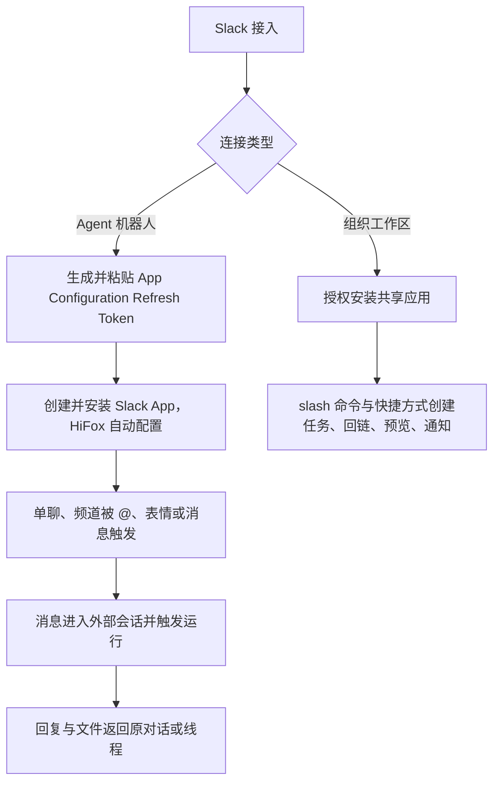

## 5.16 Discord 集成（V1.0 · 已上线-现状整理）

> 来源：https://help.hifox.com/docs/integration/discord ｜ 原文标题：Discord 集成

### 5.16.1 使用场景描述

**业务目标**：通过 Agent 机器人与任务助手两种互相独立的连接，把 HiFox Agent 与空间任务能力接入 Discord 的私信、频道与线程。
**目标用户**：Agent 拥有者（机器人绑定）、空间成员（任务助手）、拥有 Discord 服务器管理权限的管理员。
**触发场景**：在 Discord 私信或频道 @ 与 Agent 协作；把频道讨论整理成任务。

**User Story**：
- 作为 Agent 拥有者，我想要用机器人令牌把 Agent 接入 Discord，以便于在私信和频道里与它协作。
- 作为空间成员，我想要在频道 @ 任务助手创建任务，以便于把讨论整理成工作项并在 Discord 继续跟进。
- 作为管理员，我想要开启 Message Content Intent，以便于表情触发和聊天上下文可用。

### 5.16.2 原型图 / UI 示意

[图片占位]（原文未提供界面截图，建议后续补充原型图）

### 5.16.3 功能详细说明

| 节点/字段名称 | 交互与业务规则 | 数据来源/关联模块 |
| --- | --- | --- |
| 准备项 | - Discord 应用（Developer Portal 创建，进入 Bot 页重置并复制机器人令牌）；Message Content Intent（同一 Bot 页 Privileged Gateway Intents 开启并保存）；把机器人加入服务器需目标服务器管理权限；绑定 Agent 机器人需一个 HiFox Agent | Discord 平台 |
| Agent 机器人连接 | - 连接弹窗 → 选择 Agent → 粘贴机器人令牌 → 点击连接（验证通过弹出 Discord 授权页）→ 选择服务器授权并加入 - 机器人要先加入一个服务器才能收发消息，连私聊也要求你和机器人在同一个服务器；授权完成后集成页显示已加入的服务器 | 外部应用集成 |
| 任务助手绑定 | - 详情页「任务助手」分组找到空间 → 绑定 Discord → 选 Runtime → 粘贴令牌并把机器人加入服务器 - 每个空间只能有一个任务助手；绑定后可补附加提示词、更换 Runtime 或解绑 | Runtime / 空间 |
| 触发方式 | - 频道内被 @（默认，回复带附近消息上下文，线程内 @ 回当前线程）；频道内表情触发（指定表情，带附近上下文）；频道内消息直接触发（指定频道内每条消息触发） - 以上均依赖 Message Content Intent，未开启时只有私信和 @ 可用 | Agent 集成设置 |
| 表情停止与 `/new` | - 在触发消息上加 ❌ 终止本次运行（任何人可点，空闲时无副作用），终止表情默认叉号可改 - 会话中 `/new` 新开 Agent 会话，不带之前上下文 | Agent 运行 |
| 发送文件 | - Agent 回复里的文件回到原 Discord 会话；机器人需「发送文件」权限 | Discord 权限 |
| 管理与断开 | - 集成页查看已连接机器人列表（绑定 Agent、所在服务器、状态），可重试或断开；断开后停止收发，已有会话与历史不删除 | 外部应用集成 |

### 5.16.4 业务规则与流程说明

| 序号 | 规则/流程说明 | 备注 / 异常处理 |
| --- | --- | --- |
| 1 | 未开启 Message Content Intent 时机器人读不到消息内容：频道消息触发、表情触发和聊天上下文都不能用 | 先在 Developer Portal 开启 |
| 2 | 常见状态：令牌被拒绝（重置令牌后重连）、消息处理失败（反复失败被跳过，让发送者再发一次）、无法发文件（用安装链接重新授权）、限流中（自动重试） | — |
| 3 | 若只有某个频道发不出文件，检查该频道的权限覆盖 | 文字回复不受影响 |
| 4 | Agent 机器人不会自动把消息变成任务；整理任务用空间的任务助手（频道 @ 任务助手创建，之后可继续查询修改） | — |
| 5 | 断开机器人只停止收发，Discord 历史消息与 HiFox 会话记录都保留 | — |

### 5.16.5 附件与截图

暂无补充截图。

### 5.16.6 流程图

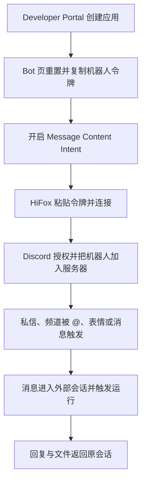

## 5.17 Telegram 集成（V1.0 · 已上线-现状整理）

> 来源：https://help.hifox.com/docs/integration/telegram ｜ 原文标题：Telegram 集成

### 5.17.1 使用场景描述

**业务目标**：通过 Agent 机器人与任务助手两种互相独立的连接，用 @BotFather 创建的机器人令牌把 HiFox Agent 与空间任务能力接入 Telegram 私聊、群组与话题。
**目标用户**：Agent 拥有者（机器人绑定）、空间成员（任务助手）。
**触发场景**：在 Telegram 私聊或群里与 Agent 协作；把群内讨论整理成任务。

**User Story**：
- 作为 Agent 拥有者，我想要用 @BotFather 令牌把 Agent 接入 Telegram，以便于在私聊和群里与它协作。
- 作为空间成员，我想要在群里 @ 任务助手创建任务，以便于把讨论整理成工作项。
- 作为成员，我想要 Agent 回复里的文件回到 Telegram 会话，以便于直接查看。

### 5.17.2 原型图 / UI 示意

[图片占位]（原文未提供界面截图，建议后续补充原型图）

### 5.17.3 功能详细说明

| 节点/字段名称 | 交互与业务规则 | 数据来源/关联模块 |
| --- | --- | --- |
| 机器人创建 | - Telegram 打开 @BotFather 发送 `/newbot`，依次输入显示名和以 bot 结尾的用户名，拿到机器人令牌 | Telegram |
| 可选准备 | - 关闭 Privacy Mode：@BotFather 发送 `/setprivacy`，选中机器人并选 Disable，再把机器人移出群重新拉进来（或改用群管理员方案），用于接收群里未 @ 它的普通消息 - 群管理员身份：Telegram 只把表情事件推送给群管理员身份的机器人 | Telegram |
| Agent 机器人连接 | - 连接弹窗 → 选择 Agent → 粘贴令牌 → 点击连接（验证通过即完成绑定）→ 用设置页「拉进群」把机器人加入群组，或「打开对话」直接私聊 - 绑定后可在 Agent 集成设置里按条开启触发方式 | 外部应用集成 |
| 任务助手绑定 | - 详情页「任务助手」分组找到空间 → 绑定 Telegram → 选 Runtime → 粘贴令牌并把机器人拉进目标群 - 每个空间只能有一个任务助手；可补附加提示词、换 Runtime 或解绑 | Runtime / 空间 |
| 触发方式 | - 群里被 @（默认，回复带附近上下文，话题内 @ 回当前话题） - 群消息 Emoji 表情触发：需先把机器人设为群管理员；机器人只能处理服务启动后收到过的消息（每个聊天最近 100 条、24 小时内），更早的回复读不到 - 群消息直接触发：所选群每条消息触发，需先关闭 Privacy Mode 或设为群管理员；可开启「论坛话题（Topics）里的消息也触发」 | Agent 集成设置 |
| `/new` 与文件 | - 会话中 `/new` 新开 Agent 会话，不带之前上下文 - 文件回到原会话：图片按图片消息发送，其他文件以文件形式发送；单个文件最大 50 MB，一轮回复最多携带 10 个文件，超限在回复里说明 | 外部会话 |
| 管理与断开 | - 集成页查看已连接机器人列表（绑定 Agent、所在群、状态），可重试或断开；断开后停止收发，已有会话与历史不删除 | 外部应用集成 |

### 5.17.4 业务规则与流程说明

| 序号 | 规则/流程说明 | 备注 / 异常处理 |
| --- | --- | --- |
| 1 | Telegram 不支持用表情终止正在工作的 Agent；需要停止时在 HiFox 里点停止 | 仅飞书、Slack、Discord 支持表情停止 |
| 2 | 群列表要把机器人拉进群并在群里发一条消息后才会出现；Telegram 不允许机器人自行列出所在群 | 以消息为线索 |
| 3 | 常见状态：令牌被拒绝（@BotFather 重新生成令牌后重连）、消息处理失败（反复失败被跳过，让发送者再发）、命令菜单发布失败（点「重试」重新发布） | — |
| 4 | 机器人要先进入群组才能收发群消息 | — |
| 5 | Agent 机器人不会自动把消息变成任务；整理任务用空间的任务助手（群里 @ 任务助手创建，之后可查询修改） | — |

### 5.17.5 附件与截图

暂无补充截图。

### 5.17.6 流程图

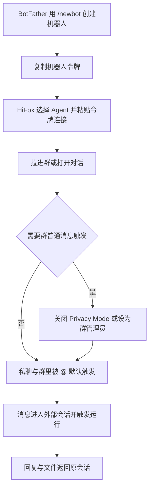
