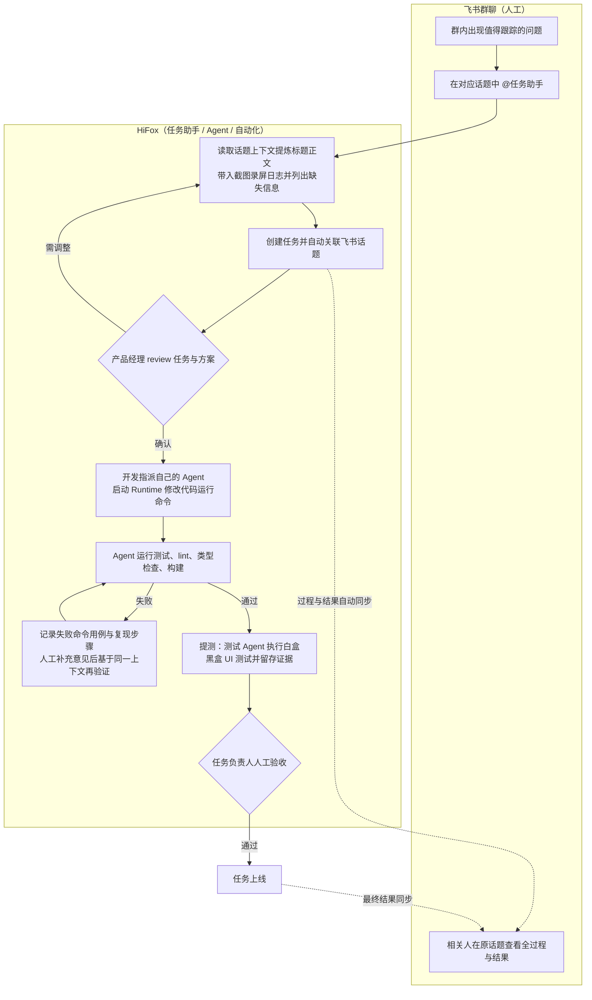
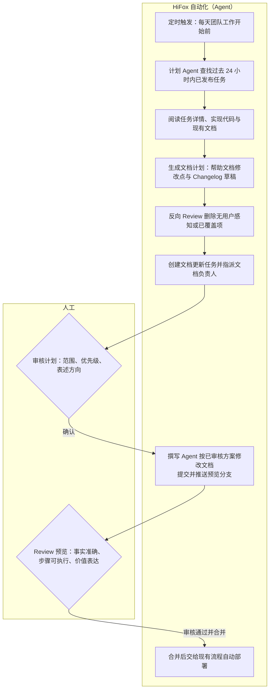
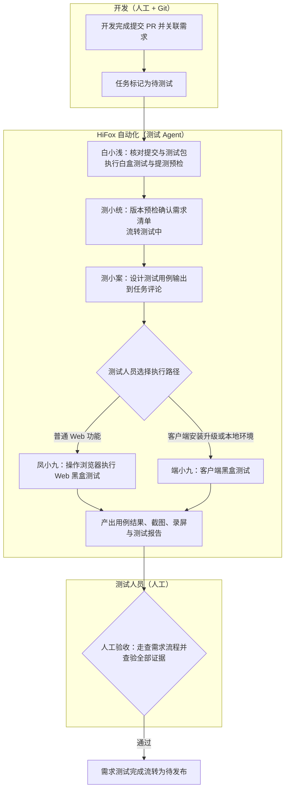
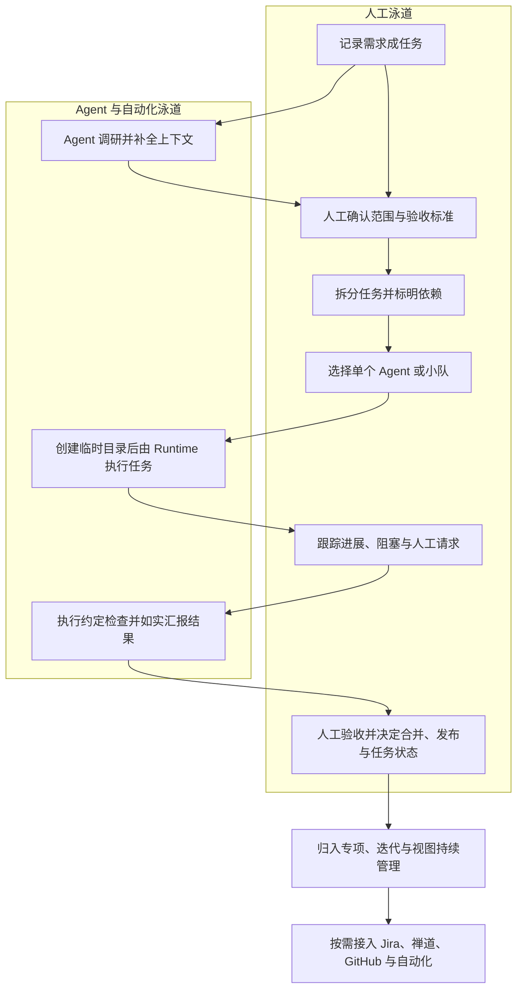

# HiFox 产品需求文档（PRD）—— 第6章 最佳实践

## 文档信息

| 项目 | 内容 |
| --- | --- |
| 产品名称 | HiFox（渐进式 AI native 团队协作平台） |
| 文档章节 | 第6章 最佳实践 |
| 文档版本 | V1.0（逆向整理稿） |
| 编制日期 | 2026-10-22 |
| 信息来源 | https://help.hifox.com/docs/welcome（官方文档，提取日期 2026-10-22） |
| 整理方式 | 基于官方已上线功能的文档做逆向需求整理，状态均为「已上线-现状整理」 |

## 功能模块总览

| 模块编号 | 功能模块 | 状态 | 一句话说明 |
| --- | --- | --- | --- |
| 6.1 | 连接飞书：让群聊里的问题真正被推进下去（实践方案） | V1.0 · 已上线 | 在飞书话题中 @ 任务助手把群聊讨论整理成任务并自动关联话题，Agent 推进开发与测试，过程与结果回流话题 |
| 6.2 | 让文档更新跟着产品发布走：用 HiFox 搭一条自动化文档流水线（实践方案） | V1.0 · 已上线 | 定时扫描已发布任务，计划 Agent 生成文档计划、人工审核后由撰写 Agent 修改文档并推送预览分支，合并后自动部署 |
| 6.3 | 全流程自动化测试：让测试跟上每天的发布节奏（实践方案） | V1.0 · 已上线 | 五个测试 Agent 分工完成提测预检、版本核验、用例设计、黑盒执行与证据留存，测试人员做最终人工验收 |
| 6.4 | 产品研发工作流（实践方案） | V1.0 · 已上线 | 从记录需求到人工验收的十条推荐研发链路，配合专项、迭代、视图与 Jira/禅道/GitHub/自动化按需集成 |

---

## 6.1 连接飞书：让群聊里的问题真正被推进下去（实践方案）（V1.0 · 已上线-现状整理）

> 来源：https://help.hifox.com/docs/best-practices/feishu-group-to-task ｜ 原文标题：连接飞书：让群聊里的问题真正被推进下去

### 6.1.1 使用场景描述

**业务目标**：把从飞书群里一句话开始的零散讨论（报错截图、影响范围补充、历史问题回忆）转化为有背景、有负责人、有对话记录、有测试结果的结构化任务。飞书继续作为团队讨论和反馈的入口，HiFox 负责把讨论整理成任务、交给 Agent 执行，再把过程和结果同步回原话题，让问题不停留在聊天记录里。

**目标用户**：
- 飞书群内提出问题与参与讨论的产品、开发、测试成员；
- 任务负责人（review 方案、验收、决定上线）；
- 飞书任务助手或自建飞书智能体（任务创建 Agent）、开发/测试执行 Agent。

**触发场景**：
- 群里出现值得跟踪的问题时，在对应飞书话题里 @任务助手；
- 任务创建后指派 Agent 开发、执行测试，进入产品-开发-测试-发布流转。

**User Story**：
- 作为飞书群成员，我想在话题里 @ HiFox Agent 把当前讨论整理成一条任务，以便于问题不被聊天记录淹没、无需手动复制粘贴。
- 作为任务负责人，我想让任务进展、测试结果自动同步回原飞书话题，以便于所有相关人不翻聊天记录即可看到进度、阻塞原因与最终结果。
- 作为开发人员，我想把任务交给 Agent 修改代码并运行测试，以便于在同一份任务上下文中持续验证与修复。

### 6.1.2 原型图 / UI 示意

图 6.1.2-1 在飞书话题中由 Agent 整理创建任务

图 6.1.2-2 飞书话题与任务的进度自动关联

### 6.1.3 功能详细说明（实践方案：流程步骤与关键配置项）

| 节点（流程步骤/关键配置项） | 说明（交互与业务规则 / 关联模块） |
| --- | --- |
| 第一步：绑定飞书任务助手 | - 优先使用系统提供的「飞书任务助手」，不必先从 Agent 页新建 - 路径：外部应用集成 → 飞书 → 「任务助手」分组，为当前空间选择 Runtime，再扫码绑定飞书机器人 - 每个空间只能有一个任务助手；它只在飞书里工作，不出现在普通 Agent 列表 - 创建的任务仍进入该助手绑定时选择的空间（外部应用集成 / Runtime） |
| 任务助手附加提示词 | - 绑定后可为空间填写附加提示词，并查看内置提示词 - 需要空间有额外习惯时才填写（Agent 配置） |
| 自建飞书智能体（可选替代） | - 可继续用自己创建的 Agent 处理飞书群任务；职责是把零散讨论整理成可继续推进的工作项，而非简单复制聊天内容 - 指令需包含角色、工作流程（理解需求 → 创建任务 → 处理附件 → 订阅任务发起人）、硬性要求与回复格式（Agent 指令 / HiFox CLI） |
| 电脑与 Runtime 配置 | - 指定 Agent 在哪台电脑运行；飞书任务助手一般需 24 小时运行 - 建议一台 24 小时开机的共享机，安装 HiFox 和 Claude Code、Codex 等 Runtime（电脑管理 / Runtime） |
| Git 仓库配置 | - 把团队代码库配置给 Agent，帮助其正确理解任务与问题 - 可在 HiFox 空间中配置，也可在 Agent 上配置（代码库） |
| 技能、MCP、知识库 | - 视实际需求配置即可（技能 / MCP / 知识库） |
| 第二步：连接飞书 | - 路径：组织设置 → 外部应用集成 → 飞书，绑定刚创建的 Agent - 系统生成二维码，用飞书扫码或打开授权链接，在飞书中完成智能体创建和授权 - 返回 HiFox，等待连接状态变为「已连接」（外部应用集成） |
| 消息响应设置 | - 连接完成后进入 Agent 的飞书集成设置，确认它响应哪些消息 - 研发场景建议先打开「私聊」和「群里被 @」；按需配置表情触发或指定群的普通消息触发（飞书集成设置） |
| 第三步：在飞书中把讨论变成任务 | - 在话题里 @任务助手，Agent 读取当前话题可访问的消息、图片、引用内容和成员信息 - 创建任务时 HiFox 自动关联当前飞书话题，无需手动绑定 - 后续话题新消息进入任务评论，任务过程信息同步回原话题（飞书 IM 集成 / 任务系统） |
| 任务内容整理规则 | - Agent 提炼任务标题和正文，把截图、录屏、日志等资料带入任务，并把缺少的信息列出来（Agent 配置） |
| 第四步：关联个人飞书账号 | - 路径：组织设置 → 外部应用集成 → 飞书 → 「我的飞书账号」 - 绑定后飞书机器人把跟本人相关的任务变动通知到飞书（外部应用集成） |
| Agent 推进开发 | - 任务交给 Agent 后，Agent 读取任务标题、描述、评论、附件、代码库和自己的工作指令 - 在电脑上启动 Claude Code、Codex 等 Runtime，进入代码目录，修改文件并运行命令 - 产品、开发、测试无需把需求复制到不同工具，所有人都可从任务看到进度、对话记录、阻塞原因和最终结果 |
| Agent 自动执行测试 | - 开发完成后可让 Agent 运行项目中的测试、lint、类型检查和构建命令 - 测试失败时 Agent 记录失败命令、具体用例、错误信息和复现步骤；开发人员在原任务补充意见，Agent 基于同一上下文修改和验证 - 可配置自动化：定期检查失败测试，或任务进入待验收状态时执行一轮检查 |

### 6.1.4 业务规则与流程说明

| 序号 | 规则/流程说明 | 备注 / 异常处理 |
| --- | --- | --- |
| 1 | 每个空间只能有一个飞书任务助手，且它只在飞书里工作，不出现在普通 Agent 列表 | 需要不同习惯的任务助手时改用自建飞书智能体 |
| 2 | 附件硬性规则：用户带图片时绝不能遗漏，必须以 Markdown URL 格式嵌入正文；多个视频/图片按编号依次处理，不得遗漏、错序或混淆 | 图片必须使用任务自身的 `attachments[].preview.url`，禁止使用聊天附件原 URL；视频通过 `--attachment` 上传为任务附件 |
| 3 | 自建 Agent 需校验附件数量等于用户提供的附件总数，并校验 taskId、预览状态、附件顺序和 Markdown 图片数量 | 校验不通过按失败处理 |
| 4 | 任一步失败时回复「已创建」但说明失败的步骤；需要重试时不能重复创建，重试都在已创建的任务中执行修改 | 避免产生重复任务 |
| 5 | 按用户描述的任务类型创建/更新：如报 Bug 需先匹配到「缺陷」类型，再用 `--type` 指定创建/更新 | 避免任务类型错误 |
| 6 | 回复格式：任务链接完整地址原样贴出放在最后，后面不接任何文字或标点；不写成 Markdown 链接，也不用尖括号、反引号或括号包裹 | 否则飞书不会展开链接预览 |
| 7 | 如果讨论的是一个已经存在的问题，要告诉 Agent 使用原任务 | 传入 task ID 时 Agent 应完善补充需求，不新建 |
| 8 | 协作习惯一：所有关于本任务的讨论都在同一个飞书话题下展开 | 沟通散落在群里时 Agent 难以区分归属，容易遗漏信息 |
| 9 | 协作习惯二：讨论有初步结果时就创建任务；需调研可先创建任务初稿，让调研 Agent 补充信息 | 不要等到信息完整、所有人达成一致才引入 Agent |
| 10 | 协作习惯三：尽量给出充足上下文，把用户反馈原始对话、使用截图等同步到话题 | 作为后续开发和测试的参考，保证产出质量 |
| 11 | HiFox 主动通知的前提：成员在 HiFox 中关联个人飞书账号 | 未绑定时 HiFox 无权限把任务变动通知到飞书 |

### 6.1.5 附件与截图

图 6.1.5-1 飞书任务助手绑定与配置

图 6.1.5-2 自建 Agent 的电脑、Runtime、代码库等设置

图 6.1.5-3 连接飞书的扫码授权

图 6.1.5-4 飞书消息响应设置

图 6.1.5-5 我的飞书账号关联

图 6.1.5-6 飞书中的任务变动通知

### 6.1.6 流程图

---

## 6.2 让文档更新跟着产品发布走：用 HiFox 搭一条自动化文档流水线（实践方案）（V1.0 · 已上线-现状整理）

> 来源：https://help.hifox.com/docs/best-practices/documentation-automation-pipeline ｜ 原文标题：让文档更新跟着产品发布走：用 HiFox 搭一条自动化文档流水线

### 6.2.1 使用场景描述

**业务目标**：让帮助文档和 Changelog 跟着产品发布自然流动，不再靠人工记忆翻任务、找截图、确认发布时间。重点不是让 Agent 直接改文档，而是把「发现变化」和「决定怎么写」提前自动化，同时保留人工审核。整体链路：扫描已发布任务 → 生成文档计划 → 人工审核 → Agent 撰写与提交 → 人工 Review → 自动部署。

**目标用户**：
- 文档负责人（审核计划、Review 预览、合并发布）；
- 产品与研发（发布任务的来源方）；
- 文档计划 Agent、文档撰写 Agent（自动化执行方）。

**触发场景**：
- 自动化定时触发：每天在团队工作开始前运行一次，扫描过去 24 小时内状态为「已发布」的任务。

**User Story**：
- 作为文档负责人，我想每天自动收到一份收敛后的文档更新计划，以便于不再靠人工记忆跟进每个发布。
- 作为文档负责人，我想把「判断该改什么」与「执行撰写」交给两个不同 Agent，以便于显著降低误改风险。
- 作为团队成员，我想新功能上线后用户能在帮助文档和 Changelog 里及时看到，以便于修复与改进对用户可见。

### 6.2.2 原型图 / UI 示意

图 6.2.2-1 文档计划 Agent 配置

图 6.2.2-2 计划审核、撰写执行与 Review 流程

### 6.2.3 功能详细说明（实践方案：流程步骤与关键配置项）

| 节点（流程步骤/关键配置项） | 说明（交互与业务规则 / 关联模块） |
| --- | --- |
| 创建文档计划 Agent | - 职责不是改文件，而是回答「最近发布的功能里哪些真正需要更新文档」 - 需同时看到三类信息：HiFox 中的发布任务、对应任务的详情和讨论、代码仓库里现有的帮助文档与 Changelog（Agent 配置 / 任务系统 / 代码库） |
| 步骤1：查找已发布任务 | - 从任务列表查找给定时段内状态为「已发布」的任务 - 时间窗口设为过去 24 小时（HiFox 更新速度较快） - 生成计划时所有引用直接链接回原任务，审核人不必手动搜索上下文 |
| 步骤2：阅读代码与现有文档 | - 仅看任务标题难以判断改动是否影响用户；代码帮助 Agent 确认真实行为，现有文档告诉它应新增页面、补充某个步骤还是只修改一段说明 - 关键是把「判断」和「撰写」分开：计划 Agent 只提出修改位置、修改理由和内容方向，不直接写入仓库（Git / 代码库） |
| 帮助文档更新判断标准 | - 重点看「用户怎么做」：发布任务带来新入口、新配置项、操作流程变化、权限变化或使用限制，通常值得更新帮助文档 |
| Changelog 判断标准 | - 重点看「用户感知到什么」：重要的新能力、明显的体验改进、真正影响用户的修复适合作为对外发布记录 - 内部重构、监控调整和没有用户感知的工程改动一般不写 |
| 步骤3：汇总任务并指派 | - 把候选项汇总为一个 HiFox 任务，指派给文档负责人，并加入需要知会的关注人 - 任务正文包含：扫描时间范围、建议修改的文档位置、每项修改原因、对应发布任务链接、可直接使用的 Changelog 草稿（任务系统） |
| 创建前反向 Review | - 创建任务前要求 Agent 逐项检查这些发布任务是否真的值得修改文档，删除仅影响内部实现、没有用户感知或已有文档已覆盖的内容 - 避免为了更新而更新，让人工审核看到收敛后的计划而非未经筛选的清单 |
| 计划 Agent Instruction 要点 | - 7 条：查找已发布任务；阅读任务详情、实现代码和现有文档；判断哪些需更新帮助文档并给出位置、原因、方案；判断哪些适合进入 Changelog 并起草；汇总后再 Review 一次移除不必要的修改；创建「帮助文档更新」任务指派负责人并添加关注人；引用原任务时任务名称必须带有可点击链接 |
| 定时自动化配置 | - Agent 配好后接入 HiFox 自动化：触发方式选择「定时」，每天在团队工作开始前运行一次；执行动作选择文档计划 Agent - 每天运行结束后生成一个新任务并指派给负责人（自动化） |
| 运行前提配置 | - Agent 需拥有对应代码库的读取权限；帮助文档和 Changelog 需与代码一起存放在仓库中，Agent 才能同时理解产品实现、文档结构和历史写法 - 建议准备一台团队共享机，安装并登录 HiFox，持续执行定时 Agent；共享机便于统一维护仓库权限、运行环境和自动化状态（代码库权限 / 电脑管理） |
| 防重复运行配置 | - 在计划任务中记录扫描区间和已覆盖的发布任务，让下一次运行跳过已经引用过的任务 |
| 创建文档撰写 Agent | - 专注执行：读取已审核过的 HiFox 任务，根据其中的修改方案更新帮助文档和 Changelog，不再自行决定「哪些功能值得写」 - Instruction 尽量具体：帮助文档和 Changelog 的仓库目录、Changelog 风格规范、目标预览分支、提交与推送要求、修改范围限制 |
| 撰写 Agent 信息不足规则 | - 「遇到信息不足时，在任务中说明并停止猜测」单独写入 Instruction；可靠的撰写 Agent 应知道什么时候执行，也知道什么时候把问题退回给人 |
| 日常四个动作 | - ① 查看计划 Agent 创建的任务，确认修改范围、优先级和表述方向（Review 重点不是逐字润色，而是判断变化是否值得进入文档及有无遗漏关键用户场景） - ② 计划确认后把任务指派给撰写 Agent，Agent 进入代码仓库更新文件并提交到预览分支 - ③ 人工 Review 预览结果：事实是否准确、操作步骤是否真的可执行、Changelog 是否表达用户能获得的价值而非复述内部实现 - ④ 审核通过并合并后，交给现有流程自动部署 |

### 6.2.4 业务规则与流程说明

| 序号 | 规则/流程说明 | 备注 / 异常处理 |
| --- | --- | --- |
| 1 | 本实践是可控的半自动流水线：自动发现、自动分析、人工确认、自动执行、人工验收、自动部署 | 每一步都有清晰的输入和输出，都能在 HiFox 任务中追溯 |
| 2 | 扫描时间窗口默认为过去 24 小时 | 原文按 HiFox 更新频率设定，未提供自定义说明 |
| 3 | 自动化的目标不是每天机械地产生一条新任务 | 而是在确实有文档变化时，稳定产出一份可审核的计划 |
| 4 | 撰写 Agent 不得扩大任务范围；遇到信息不足时在任务中说明并停止猜测 | 错误说明会直接误导用户，宁可退回给人 |
| 5 | 前提：帮助文档和 Changelog 与代码一起存放在仓库中 | 否则 Agent 无法对照产品实现与文档结构 |
| 6 | 前提：Agent 拥有对应代码库的读取权限 | 保证可阅读实现代码 |
| 7 | 持续执行建议使用团队共享机而非个人电脑 | 更稳定，且便于统一维护仓库权限、运行环境和自动化状态 |
| 8 | 人并未退出流程：人的注意力放在判断哪些变化值得告诉用户、最终内容是否准确 | 任务搜索、代码与文档对照、草稿整理、文件修改和分支提交交给自动化与 Agent |
| 9 | 方案核心价值：把一个人配置好的文档工作流，变成整个团队每天都能重复使用的能力 | 文档成为产品交付的一部分，而非发布后的补作业 |

### 6.2.5 附件与截图

图 6.2.5-1 定时自动化配置

图 6.2.5-2 自动化运行产出的计划任务

图 6.2.5-3 文档撰写 Agent 配置

### 6.2.6 流程图

---

## 6.3 全流程自动化测试：让测试跟上每天的发布节奏（实践方案）（V1.0 · 已上线-现状整理）

> 来源：https://help.hifox.com/docs/best-practices/full-flow-automated-testing ｜ 原文标题：全流程自动化测试：让测试跟上每天的发布节奏

### 6.3.1 使用场景描述

**业务目标**：HiFox 几乎每天都在发布新版本（Changelog 中一天可能十几条更新），用 HiFox 搭建覆盖提测、用例设计、测试执行和结果验收的自动化流程：不同 Agent 分工处理代码检查、测试版本确认、用例生成和实际操作，测试人员负责安排执行、确认疑点和最终验收。Agent 通过 Runtime（运行在某台电脑上的 AI 工具，如 Claude Code 或 Codex）执行工作。

**目标用户**：
- 测试人员（安排执行、确认疑点、人工验收）；
- 开发人员（提测、关联 PR）；
- 五个测试 Agent：白小浅、测小统、测小案、凤小九、端小九。

**触发场景**：
- 开发完成、PR 关联需求、任务被标记为「待测试」时自动化流程开始；
- 版本打包完成后通知飞书群，触发版本预检。

**User Story**：
- 作为测试人员，我想让 Agent 自动完成白盒预检、版本核验、用例设计与黑盒执行，以便于把精力放在验收标准、异常判断和质量把关。
- 作为测试人员，我想让每条用例的执行都留存截图、录屏和报告等证据，以便于复核 Agent 的测试流程并追溯问题。
- 作为团队，我想按任务实际需要选择 Web 或客户端测试路径，以便于不同形态的功能都被正确验证。

### 6.3.2 原型图 / UI 示意

图 6.3.2-1 Agent 自动生成的测试用例

图 6.3.2-2 测试产出的截图与录屏证据

### 6.3.3 功能详细说明（实践方案：角色分工与关键配置项）

| 节点（角色分工/流程步骤/关键配置项） | 说明（交互与业务规则 / 关联模块） |
| --- | --- |
| 白小浅（白盒测试 Agent） | - 阅读需求与代码，执行白盒测试，检查提测条件 - 触发：任务状态变为「待测试」时由自动化自动介入 - 先核对需求对应的提交、合并结果和测试包，确认目标提交已包含改动，再执行相关测试 - 产出：提测预检、测试结果、风险提示；预检指出的黑盒风险（如切换电脑后的工作目录表现）成为用例设计输入 |
| 测小统（版本预检 Agent） | - 核对测试版本与任务批次，维护提测状态 - 单个需求提交后集中到一个版本里测试；版本打包完成后通知飞书群，触发测小统安排测试 - 确认当前提测版本包含哪些需求，可进入测试的把状态流转到「测试中」 - 产出：版本核验结果、测试批次及任务字段（飞书集成 / 任务状态） |
| 测小案（用例设计 Agent） | - 触发：任务进入「测试中」时自动触发 - 将需求与白盒风险转成可执行用例，根据任务描述和评论设计，结果输出到原任务评论 - 产出：测试范围、数据准备、用例表；案例中先设计 7 条，补充要求后扩展到 16 条（自动化 / 任务评论） |
| 凤小九（Web 黑盒 Agent） | - 操作浏览器，执行 Web 黑盒测试；普通 Web 功能交给凤小九 - 产出：用例结果、截图、录屏、测试报告 - 配置了 `electron` 技能（技能 / Runtime） |
| 端小九（客户端黑盒 Agent） | - 执行桌面客户端的黑盒测试以及客户端的安装、升级；涉及客户端安装、升级或本地环境时安排端小九 - 由测试同事手动发起 - 产出：用例结果、截图、录屏、测试报告及环境证据（案例中交付 HTML 报告、71 张截图和 8 段录屏）；Windows 端配置《HiFox Stage 测试流程》技能 |
| Agent 运行环境配置 | - 白盒分析、用例设计和实际执行都需创建为 Agent 并配置指令、连接 Git 等 - 使用本地运行模式，通过绑定的电脑和 Runtime 执行；建议一台 24 小时开机的共享开发机，安装 Claude Code、Codex 等 Runtime - 白盒 Agent 需要仓库与测试依赖；客户端 Agent 需要安装好的测试客户端及可操作的桌面环境 - 提示词定义职责，技能提供具体操作方法（电脑管理 / Runtime / 技能） |
| 自动化规则配置 | - 在「自动化」功能中配置触发条件、执行 Agent、执行指令，把测试接到日常任务流转 - 常用两条：任务状态变为「待测试」→ 白小浅执行需求分析、白盒测试、风险判断和提测预检；任务状态变为「测试中」→ 测小案根据任务描述和评论设计用例并输出到原任务评论 - 自动化详情中可查看提示词和运行记录（自动化） |
| 飞书集成 | - 支持从飞书创建和指派任务、把运行结果推送到飞书（外部应用集成） |
| Git 集成 | - 支持集成 GitHub/GitLab，把任务和代码对应起来，推进自动化测试（Git 集成） |
| 快捷指令 | - 支持随时从任务发起与其他 Agent 的对话，并可配置常用会话内容一键发送给 Agent，特别适合测试场景 |
| 人工验收 | - 验两件事：① 走一遍需求流程，确认没有 Agent 漏掉的问题；② 查验 Agent 在测试中留存的所有证据，确认 Agent 的测试流程正确 - 人工验收通过后需求测试完成，流转为待发布 |

### 6.3.4 业务规则与流程说明（必要准备与边界）

| 序号 | 规则/流程说明 | 备注 / 异常处理 |
| --- | --- | --- |
| 1 | 前后端代码放在同一个仓库，方便 Agent 沿用户操作追踪完整实现（页面入口 → 接口请求 → 业务逻辑 → 数据存储） | 仓库需写清前后端启动方式、测试命令、依赖安装和测试数据库准备方法 |
| 2 | 沉淀可重复执行的单元测试：覆盖权限判断、状态流转、边界条件、数据转换等易错逻辑 | 明显的逻辑问题应在单元测试阶段被拦下，不消耗黑盒用例执行时间 |
| 3 | 单元测试须稳定、结果确定：不依赖外网、特定电脑本地状态、当前日期或随机值，外部服务用替身替代 | 「偶尔失败」的测试会让 Agent 无法判断该信还是该改；运行命令写进仓库，并把测试接进提交门禁 |
| 4 | 按全栈方式交付功能：一个 Feature 有贯穿前后端的负责人，界面交互、接口行为、权限规则和数据变化作为整体交付 | 提测时前后端改动、部署条件和验收规则应已对齐 |
| 5 | 使用 24 小时在线的共享测试机 | 预装浏览器、测试客户端、Runtime 和测试工具；登录专用测试账号及所需组织、空间和角色权限 |
| 6 | 把测试环境准备写成脚本：统一的依赖安装、数据库初始化、服务启动和测试命令 | 环境检查自动化：开测前确认服务可访问、数据库迁移完成、测试机在线、Runtime 可用；失败时直接报告具体原因 |
| 7 | 为测试准备专用账号和数据：管理员、普通成员、只读成员及有权/无权访问指定空间的账号 | 测试数据支持自动创建和清理，减少「缺少环境，无法验证」 |
| 8 | 给每个 Feature 写清验收标准：主流程、权限限制、异常行为和保存后的预期 | 如「支持切换 Runtime」不够，需明确影响范围、运行中能否切换、失败重试用哪个 Runtime |
| 9 | 测试产物（报告、截图、录屏、结果文件）在执行后及时上传，并关联任务、运行编号和用例编号 | Agent 临时工作目录可能被回收；曾出现产物丢失后重新执行测试的情况 |
| 10 | 每个任务按实际需要选择测试路径：普通 Web 功能交给凤小九，涉及客户端安装、升级或本地环境再安排端小九 | — |
| 11 | 起步建议：从一条自动化开始（任务进入「待测试」自动交给 Agent 做白盒检查），跑通后再逐步加入用例设计、浏览器或客户端测试以及人工验收 | 需求、代码、用例和执行证据围绕同一张任务流转 |

### 6.3.5 附件与截图

图 6.3.5-1 任务被标记为待测试

图 6.3.5-2 白小浅的白盒测试与预检结果

图 6.3.5-3 测小统的版本核验结果

图 6.3.5-4 端小九执行的用例结果

图 6.3.5-5 自动化测试相关的 Agent 配置

图 6.3.5-6 自动化详情中的提示词与运行记录

图 6.3.5-7 从任务发起快捷指令

### 6.3.6 流程图

---

## 6.4 产品研发工作流（实践方案）（V1.0 · 已上线-现状整理）

> 来源：https://help.hifox.com/docs/best-practices/product-development-workflow ｜ 原文标题：使用 HiFox 推进产品研发

### 6.4.1 使用场景描述

**业务目标**：把一个产品想法、需求或 Bug 逐步转成可追踪、可指派、可验证的研发工作，关注完整协作流程而非首次安装配置。推荐链路：记录需求 → Agent 调研并补全上下文 → 人工确认范围和验收标准 → 拆分任务并标明依赖 → 选择 Agent 或小队 → 选择「创建临时目录」执行 → 跟踪进展、阻塞和人工请求 → 执行约定检查并人工验收 → 用专项、迭代和视图持续管理 → 按需接入 Jira、禅道、GitHub 和自动化。

**目标用户**：
- 产品经理（记录需求、确认范围与验收标准）；
- 研发与测试（拆分执行、检查验收）；
- 团队负责人（持续管理与集成决策）；执行者为单个 Agent 或小队。

**触发场景**：
- 团队出现产品想法、需求或 Bug，需要进入可追踪的研发流程。

**User Story**：
- 作为产品经理，我想先把原始需求记录成结构化任务并让 Agent 调研补全上下文，以便于后续执行建立在一致的信息之上。
- 作为研发负责人，我想把大型需求拆成可独立指派、独立验证的子任务并标明依赖，以便于安全并行推进。
- 作为团队负责人，我想用专项、迭代和视图管理长周期交付，以便于从目标、时间窗口、执行者或状态多角度查看进展。

### 6.4.2 原型图 / UI 示意

[图片占位]

原文未提供界面截图，建议后续补充原型图。

### 6.4.3 功能详细说明（实践方案：流程步骤与关键配置项）

| 节点（流程步骤/关键配置项） | 说明（交互与业务规则 / 关联模块） |
| --- | --- |
| 开始前的准备 | - 已创建合适的空间并准备好任务类型和任务状态 - 至少有一个职责明确的 Agent；Agent 选择的电脑在线且对应 Runtime 可用 - 代码任务已配置代码库，电脑具备访问仓库的凭据和工具 - 反复使用的研发规范、检查清单和交付格式整理成技能（空间 / Agent / 电脑 / Runtime / 代码库 / 技能） |
| 步骤1：把原始需求记录成任务 | - 从团队都能查看的任务开始，按工作性质选「需求」「Bug」「任务」或自定义类型 - 任务模板：背景 / 目标 / 本次范围 / 不在本次范围 / 验收标准 / 已知限制或待确认问题 / 相关资料 - 标题写明具体目标；稳定背景、范围和验收标准放任务描述；设计稿、截图、日志作为附件或链接；讨论放评论；未准备好的需求先放待处理类别 |
| 步骤2：先让 Agent 调研，不要急着修改 | - 目标模糊时先调研再定范围；没有任务时先与 Agent 对话整理思路，已有任务时优先在任务评论中要求调研 - 有用的调研结果：现状如何、涉及模块接口数据、可选方案与取舍、权限环境兼容性依赖风险、必须人工确认的问题、如何拆分与验证 - 示例指令：先不要修改代码，读取任务描述、评论和代码库，说明现状、方案、风险、待确认问题和可验证的验收标准，每项结论注明依据 |
| 步骤3：人工确认范围和执行条件 | - 确认：明确的用户或业务目标、本次范围与非目标、可判断通过/不通过的验收标准、Agent 能访问的代码资料与环境、合适的执行者、已解决或记录的依赖风险 - 确认后的稳定结论更新到任务描述；未准备好的任务保持在待处理类别 |
| 步骤4：拆分任务并标明依赖 | - 每个子任务能独立指派、独立验证、产出清晰交付结果 - 常见拆分维度：产品或交互确认、前端界面和状态处理、后端接口和数据变更、数据迁移或兼容处理、测试文档和人工验收、发布前检查或后续观察 - 可请 Agent 提供拆解建议、子任务草稿和依赖分析，但正式任务结构由人员确认；父任务表达总体目标，子任务承载执行步骤；阻塞、重复或上下文关系用任务关联表达 - 共同服务大交付目标可加入同一专项；固定时间窗口推进则安排进迭代 |
| 步骤5：选择单个 Agent 或小队 | - 单个 Agent：范围清楚、职责单一、可独立完成和验证；长期职责写在 Agent 指令中，本次要求写进任务 - 小队：需要调研、实现、测试、review 和汇总等多角色协作；小队先启动队长，由队长判断是否指派成员，不会默认同时启动所有成员 - 共同确认：职责与任务匹配、技能和代码库已配置、电脑 Runtime 凭据可用、验收标准和汇报格式已写清、高风险或不可逆操作保留人工确认点 |
| 步骤6：指派任务并选择「创建临时目录」 | - 处理人设为 Agent 或小队并移入可执行状态后，HiFox 尝试启动运行 - 代码任务一般建议选择创建临时目录：每个任务使用独立目录 / Git worktree 执行，减少多任务写入同一工作区互相覆盖或污染本地状态 - 指定已有目录时：任务复用电脑现有代码和工具；同一目录通常一次只能运行一个任务，多任务需等待空闲目录或用不同已配置目录；多个小队成员共用同一目录由队长控制指派顺序 |
| 步骤7：跟踪进展、阻塞和人工请求 | - 从任务详情查看评论、进展、对话记录和必要时的执行转录 - 区分两套状态：任务状态（待处理、待办、进行中、待验收、已完成）与 Agent 工作状态（排队、工作中、等人回复、等人审阅、受阻、失败） - 需人工处理的提醒进入收件箱；要求 Agent 遇到问题时写清：缺什么、谁或哪种权限可解决、是否需要决策、已完成到哪一步、获得答复后如何继续 - 不仅用文件数、代码行数或百分比判断完成，应结合验收标准、运行结果、未解决风险和人工 review 判断 |
| 步骤8：执行约定检查并人工验收 | - 按任务类型把需执行的测试、lint、typecheck、构建、手动页面验证写入：当前任务的验收标准、Agent 的长期指令、团队复用的技能 - 要求 Agent 交付时如实汇报：修改内容与影响范围、实际运行的命令、检查成败、未验证部分及原因、仍存在的限制风险与建议下一步 - 结果不符预期时在原任务评论补充具体反馈，让 Agent 基于同一上下文继续处理 |
| 步骤9：用专项、迭代和视图管理持续交付 | - 专项表示一组任务共同服务的目标；迭代表示固定时间窗口内的任务范围；视图保存任务列表的筛选、分组、排序和显示方式（不复制任务） - 常用视图：待人工确认的需求、Agent 正在执行的任务、Agent 受阻或运行失败的任务、本迭代等待验收的任务、当前专项中仍未完成的任务 - 任务可同时属于专项和迭代；进度来自关联任务的状态或估算数据，需及时更新任务状态 |
| 步骤10：按需接入 Jira、禅道、GitHub 和自动化 | - Jira：issue 可成为任务、epic 可成为专项；一次性导入和持续同步是不同能力；双向同步需显式配置；高度自定义字段并非一比一同步 - 禅道（国内版）：产品线或项目工作导入 Space 并按需配置同步；导入与同步是不同能力；开启同步前需完成连接、同步链接和回调配置；状态和成员映射在首次导入前确认 - GitHub：关联 PR、同步 Issue、建立任务回链；不负责让 Agent 电脑获得仓库 clone 权限；可在 PR 标题、描述或分支中包含任务编号建立关联 - 自动化：按时间、任务状态、评论关键词或 Webhook 触发，调用 Agent 或小队；需团队配置触发器、执行对象、指令和后续动作 |

### 6.4.4 业务规则与流程说明

| 序号 | 规则/流程说明 | 备注 / 异常处理 |
| --- | --- | --- |
| 1 | 这是一套推荐实践，不代表每个环节默认自动发生 | 任务范围、产品取舍、权限授权、最终验收、代码合并和发布仍应由团队明确决定 |
| 2 | 电脑在线只表示本地服务仍在连接 | 只有 Agent 所选 Runtime 可用且代码、目录、凭据和命令都能访问，任务才具备真正执行条件 |
| 3 | GitHub 集成与代码库访问是两件事 | 集成可关联 PR 和 Issue，但执行 clone、读取代码和运行命令的仍是 Agent 所在的电脑 |
| 4 | Agent 不会默认获得团队所有文档、全部历史讨论或任意外部系统的访问权限 | 需要参考的资料应进入它能访问的任务上下文；外部链接还要求电脑和 Runtime 具备相应网络和权限 |
| 5 | 独立 Agent 对话不会自动转成任务；任务内对话与任务评论不是同一套记录 | 需要长期共享的结论，由人员确认后写回任务描述或评论 |
| 6 | 任务被指派给 Agent 并不代表立即运行 | 受任务状态、Runtime、电脑连接、并发和工作目录影响 |
| 7 | 隔离目录不能消除最终集成时的业务冲突、接口冲突、依赖冲突或 Git 合并冲突 | 团队仍需 review 和整合结果 |
| 8 | 实际并行数量受电脑并发、Agent 最大并发、Runtime provider、网络、磁盘和目录可用性限制 | 并行能力应逐步提高，不要把所有任务一次性启动 |
| 9 | 完成 Agent 验证不等于自动合并或发布；PR 合并也不会自动把 HiFox 任务改为完成 | 是否 commit、push、创建或合并 PR、更新任务状态、发布上线及清理工作目录，由人员明确决定或通过已确认流程显式授权 |
| 10 | 任务关联只保留关系和上下文 | 不会自动切换阻塞或完成状态，也不会在前置任务完成后自动启动后续任务；重要依赖配合任务状态和评论说明 |
| 11 | 专项和迭代中的进度指标适合观察范围和流转情况 | 不应被理解为真实研发完成度的精确测量 |
| 12 | 自动化初次启用建议从只读总结、分诊、提醒或状态检查等低风险流程开始 | 代码修改、发布等高风险操作优先创建可追踪任务并保留人工确认 |
| 13 | 验收前可按 12 项检查清单复核：背景/目标/范围/非目标/验收标准已记录、调研结论已写回、产品取舍已人工确认、已拆分并标依赖、已选 Agent 或小队、代码库凭据电脑 Runtime 可用、已选临时目录或接受目录顺序限制、已写明需运行的检查、已查看对话/阻塞/失败/未验证部分、已人工验收再决定合并发布、已归入专项迭代视图、集成只在明确需要时配置 | — |

### 6.4.5 附件与截图

暂无补充截图（原文未提供界面截图，建议后续补充原型图）。

### 6.4.6 流程图

