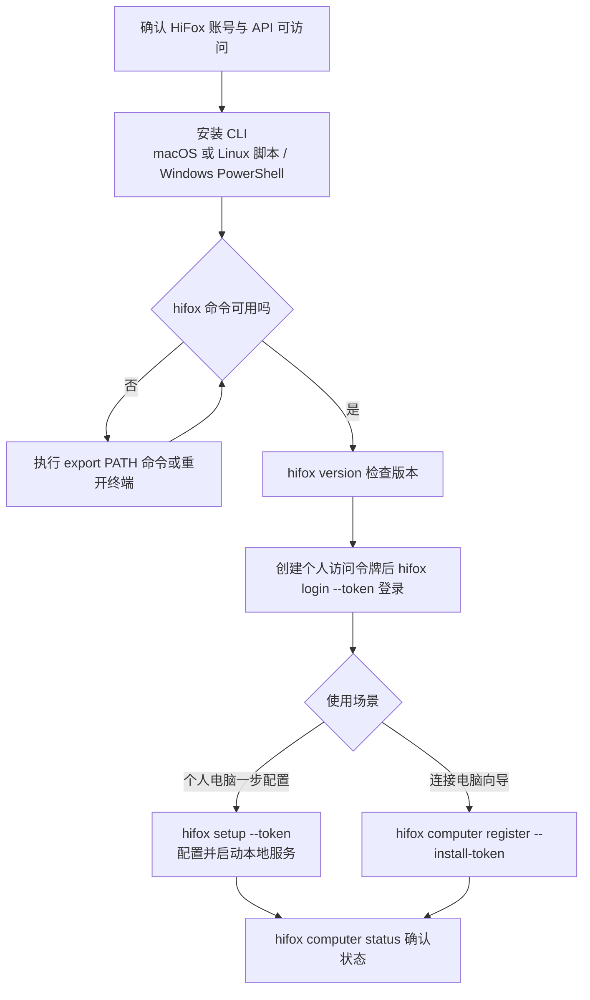
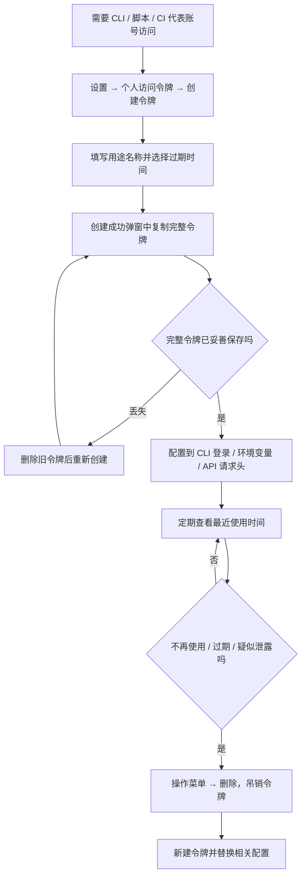

# HiFox 产品需求文档（PRD）—— 第7章 CLI

## 文档信息

| 项目 | 内容 |
| --- | --- |
| 产品名称 | HiFox（渐进式 AI native 团队协作平台） |
| 文档章节 | 第7章 CLI |
| 文档版本 | V1.0（逆向整理稿） |
| 编制日期 | 2026-10-22 |
| 信息来源 | https://help.hifox.com/docs/cli/cli 、https://help.hifox.com/docs/cli/access-tokens（官方文档，提取日期 2026-10-22） |
| 整理方式 | 基于官方已上线功能的文档做逆向需求整理，状态均为「已上线-现状整理」 |

## 功能模块总览

| 模块编号 | 功能模块 | 状态 | 一句话说明 |
| --- | --- | --- | --- |
| 7.1 | HiFox CLI | V1.0 · 已上线 | 在终端使用 HiFox 的命令行工具：跨平台安装与令牌登录、连接电脑与本地服务管理、任务与文档等资源的命令族 |
| 7.2 | 个人访问令牌 | V1.0 · 已上线 | 代表账号身份访问 HiFox 的凭证：按用途创建、设置有效期、查看使用情况与吊销，用于 CLI、脚本、CI 与 API |

---

## 7.1 HiFox CLI（V1.0 · 已上线-现状整理）

> 来源：https://help.hifox.com/docs/cli/cli ｜ 原文标题：HiFox CLI

### 7.1.1 使用场景描述

**业务目标**：提供在终端中使用 HiFox 的命令行工具，它既是人类在命令行里管理 HiFox 的入口，也是 Agent、脚本和自动化流程操作 HiFox 的入口；支持创建任务、修改任务状态、添加评论、指派给成员 / Agent / 小队、查询组织资源，并可在本机或远程电脑上连接本地服务，让 Agent 在这台电脑上执行任务；Agent 执行时，命令行帮助和输出跟随当前界面语言。

**目标用户**：开发者与运维人员（终端管理资源、在远程服务器上连接电脑）、自动化 / CI 脚本作者、需要通过 CLI 写回进展的 Agent、需要排查电脑离线与本地服务问题的用户。

**触发场景**：
- 让 Agent 或脚本创建任务、更新任务状态、添加评论和读取任务上下文；
- 在终端中管理任务、Agent、专项、仓库、技能等资源；在远程服务器上连接一台电脑；
- 检查本机本地服务状态和日志；配置自托管或非默认 HiFox 服务地址；
- 排查电脑离线、本地服务未启动或运行时未检测到的问题；仅日常在网页或桌面端创建任务、查看看板的用户，不一定需要直接使用 CLI。

**User Story**：
- 作为开发者，我想要用一条命令在 macOS / Linux / Windows 上安装并登录 CLI，以便于在终端和远程服务器上操作 HiFox。
- 作为 Agent / 脚本，我想要通过 CLI 以 JSON 输出创建任务、写回评论并读取上下文，以便于在外部流程中稳定解析结果。
- 作为运维人员，我想要查看本地服务状态、日志与磁盘占用并安全清理，以便于定位电脑离线与磁盘问题。

### 7.1.2 原型图 / UI 示意

[图片占位]

图 7.1.2-1 HiFox CLI 命令行界面示意

原文未提供界面截图（命令行工具），建议后续补充终端运行截图。

### 7.1.3 功能详细说明

| 节点/字段名称 | 交互与业务规则 | 数据来源/关联模块 |
| --- | --- | --- |
| 安装（macOS / Linux） | - 方式：下载 install.sh 安装脚本后经管道交给 bash 执行<br>- 默认安装到 `$HOME/.local/bin`，并在需要时把这个目录加入 shell 启动文件；可用 `--dir` 指定安装目录<br>- 安装结束时若当前 shell 尚未包含安装目录，程序输出一条可复制的 `export PATH=...` 命令 | 安装脚本 |
| 安装（Windows） | - 方式：PowerShell 下载并执行 install.ps1<br>- 默认安装到 `%USERPROFILE%\.hifox\bin\hifox.exe`<br>- 安装脚本尝试把安装目录加入用户 PATH，并更新当前 PowerShell 会话的 PATH | 安装脚本 |
| 平台与架构支持 | - macOS / Linux：支持 amd64 / arm64；macOS Intel 使用 universal 包<br>- Windows：支持 Windows AMD64，不支持 Windows ARM64 | — |
| 安装脚本行为 | - 自动识别系统和架构，下载对应包并校验 checksum<br>- 在执行安装逻辑前清理 `BASH_ENV`，复制命令不需要额外的 shell 环境清理参数<br>- 更新：`hifox update`，macOS、Linux 和 Windows 都可以用<br>- 安装后运行 `hifox version` 检查版本；仍找不到命令时用 `command -v hifox` 与默认安装路径排查 | 安装脚本 / CLI 自更新 |
| 登录 | - 命令：`hifox login --token`（CLI 提示粘贴令牌）或 `hifox login --token hfx_...` 直接传入；当前 CLI 不使用浏览器登录流程<br>- 登录后验证令牌、保存到当前 profile，并尝试发现所在组织，当前 profile 无默认组织时自动设置一个<br>- `hifox auth status` 检查当前登录状态；`hifox auth logout` 退出当前 profile 的登录（只移除本机保存的令牌） | 个人访问令牌（7.2）/ CLI 认证 |
| 一步配置启动 | - 命令：`hifox setup --token`，动作：配置 HiFox Cloud 服务地址 → 提示输入个人访问令牌 → 验证账号并保存登录信息 → 发现并设置默认组织 → 启动本地服务；已有服务地址配置时可能会询问是否覆盖<br>- 自托管：`hifox setup self-host --token` 配合 `--server-url` 与 `--app-url`；也可先 `hifox config set serverUrl` / `appUrl` 手动配置地址再登录 | 本地服务（daemon）/ CLI 配置 |
| 连接电脑 | - 网页或桌面端「连接电脑」给出的带安装令牌命令，使用 `hifox computer register --install-token hit_...`（而不是 `login --install-token`）<br>- 连接成功后依次：创建或复用本地电脑身份 → 用安装令牌向 HiFox 交换电脑会话 → 写入电脑会话元数据和密钥 → 保存电脑连接信息 → 尝试启动或重启本地服务让电脑上线 | 电脑连接向导 |
| 本地服务状态与日志 | - `hifox computer status` 查看状态，`--output json` 查看结构化状态；`hifox computer logs` 查看日志，`-n 100` 看最近日志，`-f` 持续跟随<br>- 高级 daemon 命令：`hifox daemon start --foreground`（前台运行）、`stop`（停止）、`restart`（重启）；daemon 指本地服务背后的进程<br>- 磁盘占用：`hifox daemon disk-usage`（`--by-organization` 按组织查看）；清理：`hifox daemon cleanup` 不加 `--confirm` 只预览不删除，`cleanup --confirm` 执行清理<br>- 电脑离线、任务不运行、运行时检测不到时优先查看 status 与 logs | 本地服务（daemon） |
| 配置与 Profile | - `hifox config show` 查看当前配置；`hifox config set` 设置配置项；常见 key 使用 camelCase：`serverUrl`、`appUrl`、`organizationId`；配置保存在 HiFox 的本机配置目录，普通用户不需要手动编辑配置文件<br>- Profile 是 CLI 的本机配置上下文，可保存不同登录信息、服务地址、组织上下文或电脑连接信息<br>- 默认 profile 供 `login --token` / `setup --token` 使用；电脑会话由 `computer register --install-token ...` 创建，本地服务使用隐藏的电脑会话状态，不依赖人工登录的 profile；`--profile` 参数切换，如 `hifox --profile staging auth status` | CLI 配置 |
| 环境变量 | - CLI 优先读取 HiFox 专用环境变量，也兼容部分 `APP_*` 通用变量<br>- 常用变量：`HIFOX_TOKEN`、`HIFOX_SERVER_URL`、`HIFOX_APP_URL`、`HIFOX_ORGANIZATION_ID`、`HIFOX_DAEMON_MAX_CONCURRENT_TASKS`、`HIFOX_AGENT_TIMEOUT`、`HIFOX_DAEMON_DEVICE_NAME`、`HIFOX_AGENT_RUNTIME_NAME`<br>- 对于 token、server URL 和 organization ID，命令行参数或环境变量通常会覆盖 profile 中的配置 | CLI 配置 |
| 任务操作 | - 常用命令：`hifox task list` / `task view` / `task create` / `task edit` / `task comment`<br>- 创建时可指定优先级、处理人（`agent:<agent-id>`、`member:<email-or-id>`）、专项、父任务、截止日期和附件；`--attachment` 支持逗号分隔或重复传入，按输入顺序上传，也可只附加本地文件而不创建评论<br>- 修改时可更新标题、正文、状态、优先级、处理人、专项、父任务和关注状态<br>- 普通任务、缺陷或需求使用 `task create`；`request create` 只用于客户请求，且需要空间已开启客户请求 | 任务工作流 |
| 任务筛选 | - 状态别名：`backlog`、`todo`、`in_progress`、`in_review`、`done`、`blocked`、`cancelled`，实际可用状态取决于组织和空间里的任务工作流配置<br>- 按最近一次进入当前状态的时间筛选：`--status-changed-within 7d`，或 `--status-changed-since` / `--status-changed-before`（RFC 3339 时间戳）<br>- 标签筛选：`--label` 可以是标签 id、名称或 `group/name`，可重复指定<br>- 自定义字段筛选：`--field "字段引用=值"` 可重复指定，多个之间为 AND；筛选在服务端分页之前完成，`--limit` / `--offset` 基于筛选后的结果集 | 任务工作流 / 自定义字段 |
| 评论与上下文 | - 写回执行结果：`hifox task comment <task-id> --body-file ./result.md`；内容来自管道时用 `--body-stdin` 读标准输入<br>- 读取任务评论作为上下文：`hifox task comment list <task-id> --recent 20 --output json`<br>- 很多资源命令支持 `--output json`，JSON 比表格输出更适合 Agent 和脚本解析；自动化场景建议显式传入组织上下文：`hifox --organization-id <org-id> task list ...` | 任务评论 / 组织体系 |
| 讨论 resolve / reopen | - `hifox task comment resolve / reopen <task-id> <any-comment-id> --output json`，可将任务中的讨论标记为已解决或重新打开<br>- `any-comment-id` 必须是完整 UUID，可以是讨论根评论或其任意回复<br>- 默认输出为 PATCH 返回的 JSON 评论对象；使用 `--output text` 时，成功提示写到 stderr | 任务评论 |
| 文档库命令 | - `hifox docs` 管理「我的文档」和空间的文档集，文档操作含 list、tree、search、view、document、file、folder、table、edit、move、link、delete；文档集本身另有 collection 系列命令<br>- 文档操作必须显式指定范围：`--my-docs` 或 `--collection <文档集 ID 或唯一前缀>`，两者互斥且必须恰好给一个；移动时用 `--to-my-docs` 或 `--to-collection` 指定目标范围；文档集命令用 `--space` 并校验归属<br>- 删除、全文覆盖文档、替换文件、修改 CSV、跨范围移动等风险写入支持 `-y/--yes` 免提示确认与 `--dry-run` 只校验并展示影响<br>- `--output` 只决定输出格式（json / table / text）；下载文件的本地目录用 `-o/--output-dir`，默认当前目录，覆盖已有文件需要 `--overwrite` | 文档库 |
| 代码库 worktree | - `hifox repo checkout <url>` 在本地服务管理的缓存里检出一个 worktree 并切到专用分支；`hifox repo push` 把这条分支推回远端，组织代码托管凭据留在 Agent 沙箱之外<br>- 两个命令只对缓存管理的 worktree 有效；在「指定已有目录」或其隔离 worktree 里工作时，直接用 `git push` | 代码库 / Agent 沙箱 |
| 帮助与命令族 | - `hifox --help` 与 `hifox <command> --help` 查看当前版本支持的完整子命令<br>- 常见命令族：task、project、agent、crew、automation、organization、repo、docs、skill、chat、computer、daemon、auth / login | CLI 自身 |

命令行示例（补充说明，供开发与测试对照）：

```bash
# macOS / Linux 安装（默认安装到 $HOME/.local/bin，可用 --dir 指定目录）
curl -fsSL https://file-assets.hifox.com/download/install.sh | bash
hifox version
```

```powershell
# Windows 安装（默认安装到 %USERPROFILE%\.hifox\bin）
powershell -NoProfile -ExecutionPolicy Bypass -Command "`$p = Join-Path `$env:TEMP 'hifox_install.ps1'; Invoke-WebRequest 'https://file-assets.hifox.com/download/install.ps1' -UseBasicParsing -OutFile `$p; & `$p"
```

```bash
# 登录、一步配置与连接电脑
hifox login --token
hifox setup --token
hifox computer register --install-token hit_...
hifox computer status --output json

# 任务与评论示例
hifox task create --title "修复登录页按钮样式" --body "复现步骤和验收标准..."
hifox task comment <task-id> --body "已完成修改，测试通过。"
```

### 7.1.4 业务规则与流程说明

| 序号 | 规则/流程说明 | 备注 / 异常处理 |
| --- | --- | --- |
| 1 | CLI 本身只负责连接和调度；真正读代码、改文件和运行命令，发生在本地服务启动的 Agent 运行时中 | 职责边界 |
| 2 | 安装前建议确认：有 HiFox 账号；电脑可以访问 HiFox API；如要访问代码库，Git 凭证、SSH key、包管理器和内部网络访问已准备好 | 前置条件不满足时相应能力不可用；不要按内部下载地址或 checksum 流程手改安装文件 |
| 3 | 通过管道运行安装脚本时，子进程不能修改启动它的当前 shell；安装结束时输出可复制的 `export PATH=...`，执行该命令或重新打开终端后再运行 `hifox version` | 仍提示找不到 `hifox` 时用 `command -v hifox` 检查；使用 `--dir` 安装时把示例路径换成实际目录 |
| 4 | 安装或重连时目标程序文件被占用：占用者是本产品自己的 CLI / 本地服务时，安装先停掉再替换，替换成功后不会自动再启动服务；占用者是其他程序时，交互式终端询问是否停止，拒绝则安装中止、旧文件保留；非交互式（脚本 / 无终端）提示占用并退出，不结束外部进程、不覆盖旧文件 | Windows、macOS 和 Linux 同一套行为；替换后按页面提示用 `hifox daemon start` 或继续连接向导 |
| 5 | CLI 登录使用个人访问令牌，当前不使用浏览器登录流程 | 浏览器登录不可用属预期行为 |
| 6 | `auth logout` 只移除本机保存的令牌，不吊销服务端的个人访问令牌；也不一定让电脑下线——通过安装令牌连接的电脑使用独立的电脑会话 | 要让令牌彻底失效需到「设置 → 个人访问令牌」删除（见 7.2）；要让电脑下线需停止本地服务或在 HiFox 中删除 / 断开电脑 |
| 7 | 安装令牌通常有有效期，并且只能使用一次；提示无效、过期或已使用时，回到 HiFox 重新生成连接命令 | `hit_` 前缀用于把电脑连接到组织；`hfx_` 前缀代表账号登录 CLI 或访问 API |
| 8 | `daemon cleanup` 不加 `--confirm` 只预览不会真正删除；清理前建议确认没有重要任务仍在运行，不要手动删除不理解的本地服务目录 | 误删风险控制 |
| 9 | 自动清理只会处理已完成 / 已取消等安全候选，不删除进行中、排队、pinned 或仍需排查的运行，也不会自动清理 `~/.claude/worktrees`；`disk-usage` 报告的产物目录名只是候选，自动清理还要求所属仓库通过 Git 忽略该目录，目录中存在已跟踪文件时不删除，`.task-env` 等受保护状态目录始终保留 | 桌面端改清理策略后需重启本地服务生效；CLI 手动清理和界面策略互补，不是互相替代 |
| 10 | `--attachment` 按输入顺序上传；中途失败时已成功上传的附件保留在任务上，命令以非零退出提示结果，不会自动重试或清理 | 脚本需自行处理部分成功场景 |
| 11 | 时间筛选：`--status-changed-since` 是包含下界，`--status-changed-before` 是不包含上界，均接受 RFC 3339 时间戳；`--status-changed-within` 接受正整数加 `m`/`h`/`d`，按服务端 UTC 当前时间计算（`7d` 表示连续 7×24 小时），不能与显式边界同时使用；历史任务无可观测状态变更时间时，JSON 中 `statusChangedAt` 为 `null`，不从创建或更新时间推断，并自然排除在带时间边界的查询之外 | 筛选以状态变更时间为准 |
| 12 | `--field`：字段引用可以是自定义字段 UUID 或字段名称，按名称匹配时只匹配未归档的字段；写字段值时名称匹配到多个字段则优先取当前任务类型已绑定的字段，仍不唯一才失败；名称不唯一、字段不存在或对当前账号不可见时命令失败，请改用 UUID，不会猜测；多个 `--field` 之间为 AND，可与 `--status`、`--assignee`、`--project` 等条件组合；任务没有该字段值时，不匹配相等条件 | 类型感知精确匹配：文本 / URL / 富文本完整字符串相等；数字数值相等；布尔 `true`/`false`；日期 `YYYY-MM-DD`；单选 / 多选用选项 UUID 或组织内唯一选项名；成员与现有 CLI 人员引用一致 |
| 13 | resolve / reopen：CLI 先读取目标任务的 canonical ID，再在该任务范围内找到唯一根评论后发出 PATCH；服务端把 `resolved: true/false` 写到根评论并记下是哪条评论解决了讨论串；跨任务、孤儿、无效或无法上溯的评论 ID 会失败且不发出状态写入；命令是目标状态收敛的，但重复调用仍可能更新审计时间和 activity，网络错误后不要盲目重试，先读取 thread 状态确认；两个命令都不会删除评论 | Agent execution 只能 resolve / reopen 自己 authored 的根评论，其他根由服务端返回 403 |
| 14 | docs 风险操作在脚本或 Agent 这类非交互环境里，缺少 `--yes` 会直接报错，不会停下来等输入 | 脚本需显式带 `-y/--yes` 或先 `--dry-run` 校验 |
| 15 | 当前 profile 的本地服务已在运行时，`daemon start` 不会重复启动；修改 PATH 后本地服务可能没有继承最新环境，需重启本地服务并确认工具可被登录 shell 找到 | 必要时用对应的 `HIFOX_*_PATH` 环境变量指定工具路径；部分 Runtime 需安装 CLI 版本而非桌面应用，Runtime 登录与 `hifox login --token` 是两步 |
| 16 | 不同版本的 CLI 可能会增加或调整命令 | 以 `hifox <command> --help` 输出为准 |
| 17 | 自托管地址：`serverUrl` 是 CLI 和本地服务调用 API 的地址（通常为后端 API 地址）；`appUrl` 是打开网页或认证相关页面时使用的前端地址 | 两个地址用途不同，不可混用 |

### 7.1.5 附件与截图

暂无补充截图。

### 7.1.6 流程图



---

## 7.2 个人访问令牌（V1.0 · 已上线-现状整理）

> 来源：https://help.hifox.com/docs/cli/access-tokens ｜ 原文标题：个人访问令牌

### 7.2.1 使用场景描述

**业务目标**：提供代表账号身份的访问凭证，让 CLI、脚本或外部集成代表用户账号访问 HiFox；其能力与登录后的浏览器会话类似，能做什么取决于账号在组织、空间和资源中的权限。

**目标用户**：需要在远程电脑上登录 HiFox CLI 的开发者；编写脚本调用 HiFox API 的工程师；在 CI、自动化任务或内部工具中访问 HiFox 的用户；配置需代表账号身份运行的外部集成的用户。

**触发场景**：
- 在远程电脑上登录 HiFox CLI；让脚本调用 HiFox API；
- 在 CI、自动化任务或内部工具中访问 HiFox；连接需要代表账号身份运行的外部集成；
- 只是想连接一台新电脑时，优先使用电脑连接向导给出的安装命令或安装令牌；个人访问令牌更适合需要长期保存、手动配置或脚本化访问的场景。

**User Story**：
- 作为脚本作者，我想要为 CI 单独创建一个令牌并设置过期时间，以便于需要停用某用途时只吊销对应令牌。
- 作为 CLI 用户，我想要通过命令或环境变量提供令牌，以便于令牌不留在命令明文历史中。
- 作为账号所有者，我想要查看令牌的最近使用时间并及时吊销，以便于发现并停用不再使用或疑似泄露的令牌。

### 7.2.2 原型图 / UI 示意

[图片占位]

图 7.2.2-1 设置 → 个人访问令牌 页面示意

原文未提供界面截图，建议后续补充原型图。

### 7.2.3 功能详细说明

| 节点/字段名称 | 交互与业务规则 | 数据来源/关联模块 |
| --- | --- | --- |
| 功能入口 | - 打开「设置 → 个人访问令牌」<br>- 页面显示当前账号下仍然有效的令牌，列表不显示完整令牌 | 设置 |
| 令牌列表字段 | - 令牌名称、令牌前缀、创建时间、最近使用时间、过期时间<br>- 来源标签，例如安装创建、浏览器插件<br>- 如果令牌关联电脑，会显示关联电脑名称和状态 | 令牌管理 / 电脑 |
| 完整令牌展示 | - 完整令牌只会在创建成功后显示一次<br>- 忘记复制或丢失了完整令牌，只能创建一个新的令牌 | 令牌管理 |
| 创建令牌流程 | - 打开「设置 → 个人访问令牌」→ 点击「创建令牌」→ 输入容易识别用途的名称 → 选择过期时间 → 点击「创建令牌」→ 在创建成功弹窗中复制完整令牌 → 保存到安全位置（密码管理器、CI Secret 或本机安全配置） | 令牌管理 |
| 令牌名称 | - 建议写清楚用途，例如 `MacBook CLI`、`CI deploy script`、`staging automation`、`browser extension`<br>- 不要创建一个「万能令牌」到处复用；按用途分别创建，需要停用某个用途时只吊销对应令牌 | 令牌管理 |
| 过期时间 | - 创建时可选：30 天、90 天、1 年或永不过期 | 令牌管理 |
| 用于 HiFox CLI | - `hifox auth login --token <token>` 登录，也可省略 token 值让 CLI 提示输入<br>- 登录成功后 CLI 把令牌保存到本机配置，之后 CLI 请求使用这个令牌进行身份验证 | CLI 认证 |
| 环境变量方式 | - HiFox CLI 读取 `HIFOX_TOKEN=<token>`<br>- 部分通用环境中也可以使用兼容的 `APP_TOKEN`；如果两者都存在，优先使用产品自己的环境变量 | CLI 配置 |
| 用于 API / 脚本 | - 脚本调用 HiFox API 时，把令牌放在 HTTP 请求头 `Authorization: Bearer <token>` 中<br>- 不要把令牌直接写进脚本源码；从安全的环境变量、Secret 管理器或运行平台的密钥配置中读取 | HiFox API |
| 查看令牌字段含义 | - 名称：创建时填写的用途名称<br>- 前缀：令牌的一小段展示前缀，用于确认是哪一个令牌<br>- 最近使用：最近一次成功认证的时间，未使用过显示「从未使用」<br>- 过期时间：到期后令牌不能继续使用；永不过期则不会显示固定日期<br>- 关联电脑：如果令牌由电脑安装流程创建，可能会显示对应电脑 | 令牌管理 |
| 吊销操作 | - 打开「设置 → 个人访问令牌」→ 找到要停用的令牌 → 打开操作菜单 → 点击「删除」→ 在确认弹窗中确认<br>- 页面上的「删除」实际含义是吊销令牌；吊销后立刻失效，不能再用于 CLI、API 或外部集成 | 令牌管理 |
| 吊销影响 | - 如果令牌关联了电脑，吊销后对应电脑或 CLI 可能会断开，直到重新登录或重新连接 | 电脑会话 |
| CLI 退出登录与吊销的区别 | - `hifox auth logout` 只移除当前电脑本地保存的登录令牌，不会让服务端令牌失效<br>- 希望令牌彻底失效，必须回到「设置 → 个人访问令牌」删除或吊销对应令牌 | CLI 认证（7.1） |
| 登录状态检查 | - 运行 `hifox auth status`，CLI 检查当前保存的登录信息并显示当前认证状态<br>- 出于安全原因，只会展示令牌的一小段前缀，不会显示完整令牌 | CLI 认证 |

命令行与请求头示例（补充说明）：

```bash
hifox auth login --token <token>   # 或省略值，由 CLI 提示输入
HIFOX_TOKEN=<token>                # 环境变量方式（兼容 APP_TOKEN，产品变量优先）
hifox auth status                  # 查看当前认证状态（仅展示前缀）
```

```http
Authorization: Bearer <token>
```

### 7.2.4 业务规则与流程说明

| 序号 | 规则/流程说明 | 备注 / 异常处理 |
| --- | --- | --- |
| 1 | 令牌代表用户账号，而不是一个独立机器人账号 | 与浏览器会话身份一致 |
| 2 | 当前版本没有创建时可选的 scope，令牌权限取决于账号权限 | 离开组织、空间权限调整或账号权限变化时，令牌能访问的内容也随之变化 |
| 3 | 有效期创建时可选 30 天、90 天、1 年或永不过期 | 建议优先设置明确过期时间，避免长期不过期令牌 |
| 4 | 完整令牌只在创建成功后显示一次；服务端不保存完整明文令牌，后续列表只显示令牌前缀 | 忘记复制时无法再次查看，只能删除旧令牌重建并更新配置 |
| 5 | 令牌应像密码一样保管：不写进代码仓库、任务评论、Agent 对话、公开文档或聊天消息 | 泄露风险控制 |
| 6 | 不要创建「万能令牌」到处复用 | 按用途分别创建；停用某用途时只吊销对应令牌 |
| 7 | 吊销后令牌立刻失效，不能再用于 CLI、API 或外部集成 | 关联电脑的令牌吊销后，对应电脑或 CLI 可能断开，直到重新登录或重新连接 |
| 8 | `hifox auth logout` 只清除当前 profile 的个人令牌，不吊销服务端令牌 | 彻底失效必须在设置页删除 / 吊销 |
| 9 | 删除令牌不会直接退出浏览器会话 | 只让使用该令牌的 CLI、脚本、电脑或外部集成失效 |
| 10 | 令牌过期后：创建新令牌，替换 CLI、脚本、CI Secret 或外部集成中的旧值；确认新令牌可用后再删除旧令牌 | 替换顺序避免中断 |
| 11 | 令牌疑似泄露：先吊销旧令牌，再创建新令牌，并更新所有使用它的脚本、CLI 或集成配置 | 立即处置 |
| 12 | 安全建议：每用途单独令牌；只保存到密码管理器、CI Secret 或受保护的本机配置；不提交到 Git 仓库；不粘贴到任务、评论、Agent 对话、Slack、飞书或公开文档；不让多个成员共享同一个个人令牌；定期检查最近使用时间并删除不再使用的令牌 | 「最近使用」不是实时心跳，只表示最近一次认证成功的时间 |
| 13 | 不建议把个人访问令牌交给 Agent 使用 | 需要让 Agent 访问代码库或服务时，优先使用 HiFox 的代码库、电脑和密钥配置 |
| 14 | 只是连接一台新电脑时，优先使用电脑连接向导给出的安装命令或安装令牌 | 个人访问令牌适合长期保存、手动配置或脚本化访问场景 |

### 7.2.5 附件与截图

暂无补充截图。

### 7.2.6 流程图


