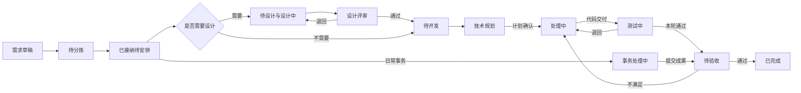
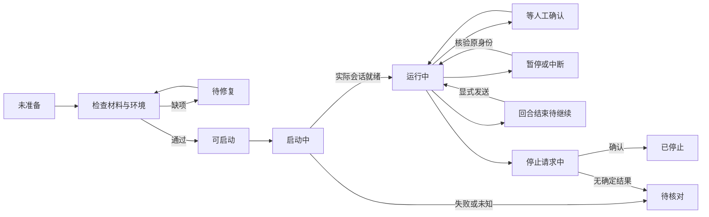
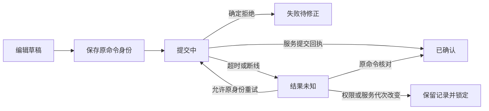
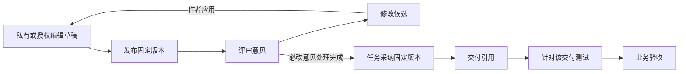
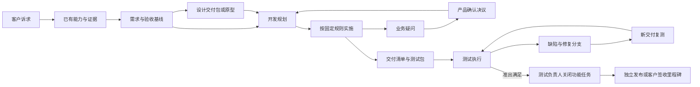
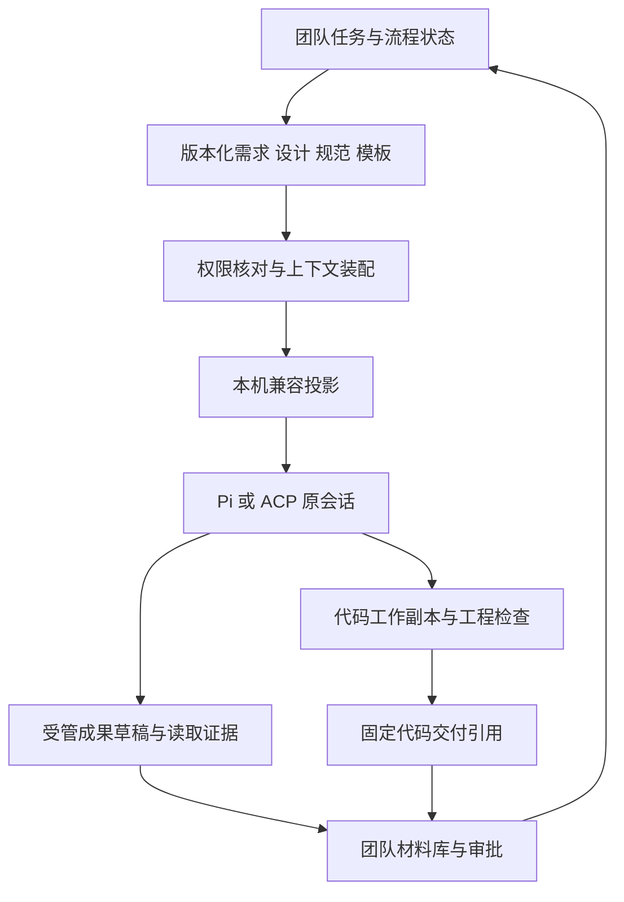
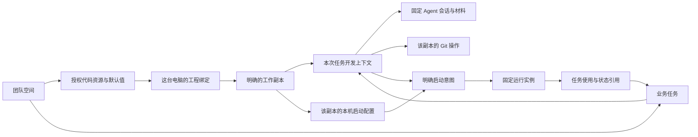
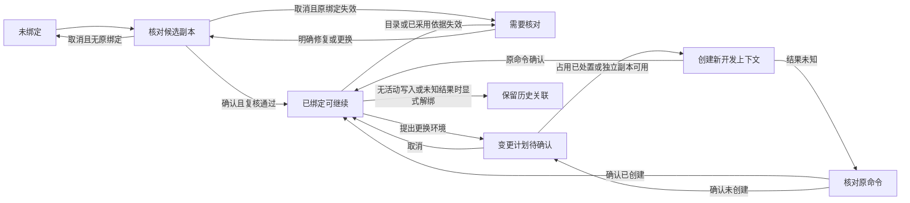
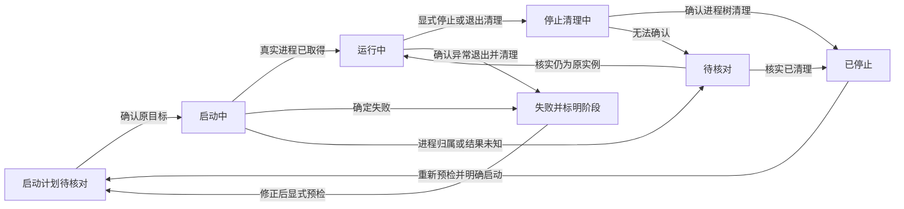

# Trellis Panel 端到端流程与交互重构需求说明书

## 1. 文档信息与版本记录

| 项目 | 内容 |
| --- | --- |
| 版本 | v0.4，MVP-A 与 MVP-B 实施基线 |
| 日期 | 2026-10-30 |
| 现状基线 | 已提交版本 `a17864c`；当前源码中的本地开发衔接增量及缺口见 3.5 |
| 适用范围 | Windows 桌面客户端、自托管团队服务、团队 Web；保留本机独立使用 |
| 评审对象 | 产品、设计、研发、测试及部署负责人 |
| 实施范围 | MVP-A Trellis 团队托管与 MVP-B 本地开发衔接；其余角色工作台及增强能力按后续阶段评审 |

| 版本 | 需求变化 |
| --- | --- |
| v0.1 | 定义任务主线、数据归属、页面关系、恢复规则及分阶段验收 |
| v0.2 | 增加六类角色的使用价值、零开发配置入门、现有能力辅助需求、设计交付、团队托管 Trellis、可执行测试包、项目驾驶舱与运维治理；调整首期范围和测试终结规则 |
| v0.3 | 明确空间、代码资源、任务、本机工作副本、Git、启动配置与运行实例的关系；将安全进入本地开发、切换、并行和服务管理设为与 Trellis 团队化并行的 MVP 工作包 |
| v0.4 | 补齐当前源码的复用边界、绑定与材料换版状态、连续操作示例、Git 写入协调、环境核对及两条 MVP 的交接与联合验收 |

产品定位为团队共用的需求与交付工作台：产品用已有业务能力形成需求，设计交付可引用的原型，开发在透明规范下实施，测试直接拿到操作步骤和数据，项目经理看到交付风险，运维管住运行与费用。主线仍是“我的工作 → 空间任务 → 任务工作区”，新增角色工作台服务各自的高频任务。

团队任务、规范、流程、PRD、设计材料、评审结论与交付版本由团队服务托管，不依赖提交 Git 后才让同事看到。本机保留执行器、代码工作副本、个人设置和必要缓存。成员加入已就绪团队后，使用需求、设计、评审与测试功能不需安装 CLI、配置 MCP、填写 API Key 或克隆代码。

开发者的本机工程继续承载 Git 和启动配置。团队任务通过明确的代码资源与工作副本绑定进入开发；查看位置、执行绑定、Git 操作目标和服务运行实例分别管理。该链路作为 **MVP-B 本地开发与协作衔接**，与 **MVP-A Trellis 团队托管**并行建设，不能等规范平台化全部完成后再处理。

### 1.1 事实依据与阅读口径

3.1–3.4 的现状诊断以已提交版本 `a17864c` 为基线；3.5 单列该基线上的本地开发增量，区分可复用实现与尚未闭环的需求。源码中存在接口或组件，不等于完整客户端、跨进程竞争和真实环境验收已经通过。来源聊天是[基于知识库衍生的架构问题 (2)](thread://01a180fb-f382-7ca3-90d5-d516ee2286f4?hostId=local)，架构沿用 Docker 团队服务、本地执行、轻量进度同步的方向。

| 来源 | 可核对的事实 |
| --- | --- |
| 用户截图 U1–U4 | 个人任务、团队概览、角色、资料页的入口与信息层级 |
| 本机页面走查 | 资料页 → 团队概览 → 已有任务详情 → 交给测试表单 → 取消并返回；当前为本机协作数据，不能据此认定双机同步已通过 |
| [E01 导航与顶栏](../src/renderer/src/my/navigation.ts)、[协作导航](../src/renderer/src/hifox/navigation.ts)、[顶栏](../src/renderer/src/components/TitleBar.tsx) | 模块、范围、两种显示视图 |
| [E02 任务工作区](../src/renderer/src/hifox/TaskWorkspace.tsx)、[概览](../src/renderer/src/hifox/pages/OverviewPage.tsx) | 列表复用、筛选状态、统计与关注任务 |
| [E03 任务业务流程](../src/shared/hifox-domain/workflow.ts)、[交接界面](../src/renderer/src/hifox/TaskWorkflow.tsx) | 正式阶段、可执行动作、权限与验收限制 |
| [E04 草稿](../src/renderer/src/hifox/pages/task-detail/task-drafts.ts)、[会话往返](../src/renderer/src/hifox/task-conversation.ts) | 内存草稿与来源身份保护、返回任务的已有能力 |
| [E05 执行说明](team-task-execution.md)、[进度协议](../src/shared/team-task-progress.ts)、[进度界面](../src/renderer/src/hifox/pages/task-detail/TaskProgressPanel.tsx) | 固定绑定、短摘要、正式阶段与执行状态分开、15 秒进度查询 |
| [E06 团队使用](team-collaboration.md)、[部署](team-deployment.md)、[Web 外壳](../packages/team-web/src/App.tsx) | 账号、邀请、配对、共享工作区及单实例 SQLite 部署 |
| [E07 创作契约](../.trellis/spec/shared/creations.md)、[实体](../src/shared/creations.ts) | 私有草稿、固定发布版本、意见、采纳、任务引用 |
| [E08 知识发送准入](../src/main/services/acp/knowledge-reference-admission.ts)、[外部集成](integration-connectors.md) | 显式资料发送能力开关关闭；本地保存、发布和索引不同步完成 |
| [E09 本机角色](../src/renderer/src/acp/AgentRoleDetails.tsx)、[协作实体](../src/shared/hifox.ts) | 本机角色与空间 Agent 配置分属不同对象 |
| [E10 自动化](../src/renderer/src/hifox/pages/AutomationsPage.tsx)、[计划域](../src/shared/hifox-domain/planning.ts) | 成员通知与等待 Runtime 的边界；版本、专项与自动化规则 |
| [E11 开发工具](developer-tools-workbench.md)、[对话工作流](workflow-conversation.md)、[执行控制](workflow-application.md) | Git、应用运行、托管流程与业务完成的边界 |
| [E12 交互规范](../.trellis/spec/frontend/design-principles.md)、[团队资料交互](../.trellis/spec/frontend/team-collaboration.md) | 既有设计系统、固定版本阅读、授权及未知结果恢复 |
| [E13 Pi 事件与扩展](../src/main/services/pi/engine.ts)、[运行适配](../src/main/services/pi/runtime.ts) | 已有工具扩展、工具事件、权限检查和用量事件；不是完整团队流程编排产品 |
| [E14 规范装配](../src/main/services/agent-rules.ts)、[上下文协议](../src/shared/acp-context.ts) | 已有版本化材料清单及提供状态；不能证明模型理解或每个外部工具的实际读取 |
| [E15 Trellis 权威守卫](../.trellis/scripts/common/task_authority.py)、[团队投影](../src/main/services/hifox/team-task-projection.ts) | 团队任务状态已有服务端权威和本地投影；尚不代表整个规范、流程和材料编辑体系已经平台化 |
| [E16 Pi 用量与模型适配](../src/main/services/pi/engine/storage.ts)、[模型配置](../src/main/services/pi/engine/models.ts) | 有用量记录基础；当前模型适配的 cost 配置为零，不能把它当真实费用为零 |
| [E17 首次工程选择与准备](../src/main/services/hifox/task-workspace.ts)、[本机绑定记录](../src/main/services/hifox/task-workspace-records.ts) | 未有任务绑定时优先采用主进程当前有效 Trellis 工程；绑定记录按来源任务保存路径与材料身份，尚无完整代码资源/工作副本/启动环境关联 |
| [E18 工程切换](../src/renderer/src/store/slices/session.ts)、[工程选择器](../src/renderer/src/my/layout/ProjectSwitcher.tsx)、[本地任务进入](../src/renderer/src/hifox/local-work.ts) | 全局工程切换到 dashboard 并清理部分阅读状态；本地任务准备后可能切换全局工程再进入任务阅读器 |
| [E19 Git 范围与守卫](../src/renderer/src/git-workspace/useGitWorkspace.ts)、[Git 服务](../src/main/services/git-workspace/lib/controller.ts)、[切分支](../src/main/services/git-workspace/procedures/switch-branch.ts) | Git 面板跟随全局工程，已有 expectedRoot/revision 校验及共同 Git 目录串行队列；切分支拒绝脏工作区，但该流程未统一核验任务执行与应用服务占用 |
| [E20 启动配置显示与持久化](../src/renderer/src/applications/useApplications.ts)、[持久化](../src/main/services/app-runtime/lib/persistence.ts)、[配置协议](../src/shared/app-runtime.ts) | 配置按本机规范化工程路径保存；切工程更换列表并清空运行面板标签；没有任务/代码资源/环境身份字段贯通全链 |
| [E21 启动执行与 IPC](../src/main/services/app-runtime/lib/controller.ts)、[IPC 范围](../src/main/ipc/app-runtime.ts)、[应用生命周期](local-app-runtime.md) | 启动校验配置修订/批准/端口；同工程同应用单实例；GUI 接口要求当前工程；退出应用与 Agent 后台驻留不同，不能混为同一生命周期 |
| [E22 任务会话返回](../src/renderer/src/hifox/task-conversation.ts)、[外壳返回逻辑](../src/renderer/src/my/layout/MyApp.tsx) | 原会话继续与任务阅读器进入是两条路径；已有原任务/权限保护，尚未统一工程/Git/运行配置/列表位置的返回合同 |
| [W01 Figma MCP 访问](https://developers.figma.com/docs/figma-mcp-server/rate-limits-access/)、[REST 文件接口](https://developers.figma.com/docs/rest-api/file-endpoints/)、[REST 限流](https://developers.figma.com/docs/rest-api/rate-limits/) | 2026-10-29 核对：MCP 有受限访问额度，文件权限和席位影响使用；REST 能读取文件/节点信息，但同样受权限与限流约束 |
| [W02 ACP 回合与事件](https://agentclientprotocol.com/protocol/v1/prompt-turn)、[工具调用](https://agentclientprotocol.com/protocol/v1/tool-calls) | 客户端可以展示 Agent 上报的回合、计划和工具事件；是否支持与上报完整度须按当前适配器验证 |

未实测的范围：共享服务登录及双账号写入、真实跨设备接管、外部 ACP 厂商执行、Docker 与完整安装包、全量键盘和辅助技术操作。这些能力按代码与契约描述，列入上线验证，不标记为已通过。

### 1.2 术语

| 术语 | 大白话含义 |
| --- | --- |
| 回执 / commandId | 操作结果凭证 / 这一次操作的唯一编号；用于确认有没有保存成功 |
| 基线 | 本次工作明确采用的一版需求和验收点 |
| 固定版本 / digest | 不随继续编辑变化的一份内容 / 用于核对内容是否相同的摘要 |
| 执行绑定 | 这项任务由哪台电脑、哪个目录和哪个会话处理 |
| Runtime | 实际运行 Agent 的环境，不是仅保存了一个 Agent 配置 |
| epoch / generation | 服务数据或执行归属的代次；旧代次不能覆盖新结果 |
| CAS | 只有内容仍是刚才看到的版本才允许保存，避免覆盖他人的修改 |
| manifest | 本次执行实际取得哪些规范与材料的清单 |

## 2. 项目背景、改造目标与成功指标

### 2.1 产品定位

面向需要人和 AI 一起完成工作的团队，提供从需求到交付验收的工作平台。产品、设计、测试通过 Web 或客户端协作；开发者在自己的电脑上使用 Agent、Git、工程规范和运行工具。业务任务不要求先打开代码工程。

本轮以研发团队为首要场景，同时保留日常事务、资料研究和个人本机任务。团队规模及行业覆盖尚无统计依据，不以一个示例空间推断全部用户画像。

吸引成员使用的核心不是“多一个聊天入口”，而是能够复用团队已有产品知识，并把同一份依据持续交到下一位手中。需求与实际功能、设计稿、代码交付、测试结果和缺陷相连，成员不再反复解释、复制文件和重新定位。价值必须用下列场景验证，不能只用文档生成数量证明。

| 角色 | 首次应得到的价值 | 重复使用的理由 | 不合格表现 |
| --- | --- | --- | --- |
| 产品 | 粘贴客户诉求，得到结合已有功能且标注证据/疑问的需求草稿 | 评审、原型、安排、催办和变更影响都沿原需求追踪 | 只润色文字；要求产品先装开发工具 |
| UI 设计师 | 导入设计链接或导出包，直接把画面/状态挂到任务并圈选反馈 | 设计版本固定，开发可读，能比较实现截图并追踪偏差 | 只有外链；无 MCP 席位就无法交付 |
| 开发 | 接手时拿到已确认的输入、规范和真实执行环境 | 能追踪每轮提供/读取的规范，问题可向产品发起确认，交付自动汇总证据 | 只显示注入成功；PRD 仍靠 Git 才共享 |
| 测试 | 打开任务即得到入口、步骤、预期、数据和环境 | 一键定位源需求、报缺陷、复测和批量回归；由测试把住功能关闭 | 只有长 PRD；无法知道测哪个版本 |
| 项目经理 | 一屏看到阻塞、风险、里程碑和等待交接 | 能从风险下钻到对象，比较排期方案并协调人员 | 只有任务总数；用虚假的 AI 完成百分比汇报 |
| 运维 | 看见服务、执行设备、队列、存储和模型费用的健康情况 | 可告警、限额、隔离故障与验证恢复 | 显示未知用量为零；只能重启整个系统 |

### 2.2 要解决的结果问题

用户进入后能判断“轮到谁、该做什么、缺什么”；交接后接收人能直接看到同版材料；中断后能继续原任务；团队看到的状态能区分业务阶段、执行情况和同步结果。已有功能通过任务关系重新组织，不以删功能换取界面简洁。

### 2.3 成功指标

以下是建议验收目标，当前基线待测。试点至少包含产品、开发、测试三类职责；同一人可兼任，但验证需两套独立账号和两台设备。

| 指标 | 计算与验证方法 | P0 目标 | 后续目标 |
| --- | --- | --- | --- |
| 找到下一步 | 5 名代表用户首次进入指定待办场景，计时到指出正确任务与动作 | 至少 4 人在 30 秒内完成，无口头提示 | 扩大样本后复核 |
| 完整任务交接 | 需求创建、规划、执行、提测、退回、复测、验收逐项检查 | 研发与日常事务各一条完整路径通过 | 增加并行任务与版本 |
| 来源准确 | 切换账号、空间、工程后检查命令实际目标 | 验收场景中错误目标写入为 0 | 持续回归 |
| 重试正确 | 双击、丢回执、断网恢复分别重复 20 次 | 重复业务结果为 0 | 扩大压力场景 |
| 返回恢复 | 列表→详情→对话/成果→返回，核对筛选、排序、锚点和草稿 | 声明支持的恢复项全部一致 | 覆盖全部工具 |
| 可见同步延迟 | 从服务端确认到另一在线客户端呈现，采集 100 次 | 95% 不超过 20 秒 | P1 95% 不超过 3 秒，需补轻量订阅或刷新机制 |
| 草稿恢复 | 桌面或在线 Web 输入停止 1 秒并确认保存后关闭/刷新，再登录同一身份 | 核心表单完整恢复；桌面崩溃最多丢失最后 1 秒输入；Web 离线按 10.3 限制 | 扩展管理表单 |
| 通知质量 | 一次交接/待确认事件对同一接收人检查通知 | 一条可行动通知；心跳与重复摘要不发通知 | 逾期聚合与偏好 |
| 开发目标准确 | 错误当前工程、同名配置、A→B→A、目录别名、旧实例操作逐项验证 | R88–R104 场景中错误仓库/环境/实例操作为 0 | 增加多仓/自动 worktree 管理场景 |
| 运行可发现与回返 | 从任务开发返回团队并切换另一工程 | 所有原受管实例可定位；原任务/列表/草稿和开发视图可恢复 | 扩展更多进程托管能力 |

P0 不承诺所有 Agent 自动理解真实完成度，不计算基于聊天回合或计划勾选的完成百分比。

| 新增指标 | 试点验收口径 | 首个可用版本目标 |
| --- | --- | --- |
| 非开发人员首次成功 | 已就绪团队、普通网络，5 位无开发经验成员独立完成邀请登录→输入真实需求→保存草稿 | 至少 4 人在 10 分钟内完成；填写 CLI/MCP/Key 的步骤为 0；模型等待单独记录 |
| 需求依据可核对 | 抽查 10 份生成需求中的“已经有/需要新增”判断 | 每条判断有固定来源或标为待核实，代码存在不能自动视为已上线 |
| 设计可交付 | 未使用付费 MCP 的成员打开固定设计包 | 画面、状态、尺寸说明、素材和意见均可读，缺项提前指出 |
| 材料共享及时性 | 受管 PRD/design 保存后，另一授权账号打开 | 在线已确认保存的最新草稿 P95 5 秒可见；审批版不随草稿改变 |
| 测试准备成本 | 测试人员首次打开一项交付 | 5 分钟内找到环境、操作入口、步骤和可用数据；缺项则退回准备，不到处试找 |
| 变更可解释 | 抽查 10 项开发交付 | 每项列出做了/未做/影响面/验证事实/测试入口，不以 AI 自述代替证据 |
| 预算和资源告警 | 测试租户用模拟额度、受控进程触发阈值 | 一次越界形成一条可处理告警；阈值策略生效且不会误杀无关进程 |

## 3. 现状盘点与核心问题诊断

### 3.1 现有功能与入口

| 页面群 | 当前页面及入口 | 当前关系与能力 |
| --- | --- | --- |
| 个人 | 任务、创作；更多下的概览、本地工作、本地版本、接入、归档、工具 | 任务有团队/本地来源；团队列表复用协作数据，并非另存一份任务 |
| 团队全局 | 协作概览、收件箱、我的任务、全部 Agent、同事 | 概览实际按当前空间统计；“我的任务”跨当前授权工作区内空间 |
| 空间任务 | 列表、看板/表格/时间类布局、分拣、视图、版本、专项、详情、新建 | 同一任务具备阶段交接、讨论、动态、关联与创作引用 |
| 空间配置 | Agent、小队、自动化、技能、类型、状态、标签、空间设置 | 配置存在，但指派 Agent/小队不等于启动运行 |
| 对话 | 本机角色、会话列表、Pi/ACP、托管工作流；通用问答、频道 | 本机角色配置带工程范围；任务会话有固定身份与返回入口 |
| 知识 | 资料、规范、知识库、目录/搜索/阅读、笔记、讨论与保存 | 来源包含当前工程、外部知识、个人资料；显式资料发送仍受能力限制 |
| 创作 | 个人与空间创作、文档/原型、发布版本、评审意见、候选修改、采纳 | 发布、意见确认、任务采纳是独立动作，不推进任务阶段 |
| 开发 | 工程选择、分支、变更与提交、运行配置、应用输出、Trellis 阅读器 | 本机执行；切换协作/开发只改变控件呈现 |
| 设置与接入 | 模型、引擎、外部应用、MCP、偏好、Jira、仓库/通知/WeKnora | 凭据在本机；外部查询、绑定、发布、消息发送各有独立结果 |
| 团队 Web | 登录、团队协作、工作区资料、团队成员、设备与配对、待核对操作 | 可协作和人工更新摘要；不能直接启动本机 Agent |

### 3.2 当前关键路径

| 路径 | 起点 → 当前终点 | 已有支撑 | 仍缺的连续性 |
| --- | --- | --- | --- |
| 开始团队协作 | 连接服务 → 浏览器授权 → 回到共享工作区 | 授权与设备配对 | 多层范围名称、连接完成后的任务落点 |
| 一项研发需求 | 新建 → 分拣 → 设计/规划 → 开发 → 测试 → 验收 | E03 正式状态机 | 当前交付主要依赖说明文字，交付/测试版本关系需补齐 |
| 本机执行 | 任务开始处理 → 准备 Trellis → 固定会话 → 返回任务 | E05 身份绑定、旧 CLI 检查、进度队列 | 下一步入口分散，失败后的统一恢复入口不足 |
| 资料形成成果 | 阅读/检索 → 讨论 → 本地保存/发布 → 关联任务 | E07/E08 各段基础能力 | 显式引用发送关闭；资料和成果归属需要统一展示 |
| 原型被采用 | 创作 → 发布 → 意见 → 候选修改 → 采纳到任务 | E07 固定版本与意见约束 | 普通用户需自行理解多个入口及采用后的去向 |
| 版本交付 | 规划任务 → 执行 → 处理未完成项 → 关闭版本 | E10 版本成员冻结、交付来源 | 版本完成与代码合并容易被误读为同一动作 |

### 3.3 具体问题

每条根因只指向可核对的结构或实现；用户影响是待试点验证的设计判断。

| 编号 | 现状 | 具体问题 | 对用户任务的影响 | 根因 | 改造方向 |
| --- | --- | --- | --- | --- | --- |
| D01 | U1/U2、E01 同屏出现视图、模块、来源、空间/工程 | 多个选择器层级相近，但改变的东西不同 | 新用户先判断系统分类，难以直接开工 | 显示偏好、数据范围与业务导航并列 | R01–R04：固定范围栏和任务入口，显示偏好退至工具控制 |
| D02 | U1 称“团队任务”，同时显示“本机工作区” | 数据模型名称被读成共享状态 | 误以为同事已看到本机内容 | 来源选择与同步状态不是同一轴 | R02：本机/共享显式标识；不得以团队字样表示已同步 |
| D03 | 个人任务与团队我的任务均可进入同一任务 | 重复入口未明确一个是个人视图、一个是空间浏览 | 难判断从哪里继续，配置可能不同 | 复用数据但页面状态分散 | R03：我的工作为统一个人入口，旧入口重定向保留过滤 |
| D04 | U2/E02 概览突出总数与最近动态 | 正常处理中、待我继续的任务不一定进入关注区 | 用户仍需另找自己的下一步 | attention 依据 blocked/in_review，非当前人的可行动队列 | R04：待我处理、待我确认、我的阻塞与继续执行 |
| D05 | U3/E09 空间 Agent 与本机角色都出现类似卡片 | 共享职责与本机引擎配置关系不明确 | 以为配置/指派完就已执行 | 两类对象各自独立，没有统一选择解释 | R23–R25：共用角色选择体验，显式映射到本机执行配置 |
| D06 | U4/E08 有讨论入口，显式资料发送开关为 false | 浏览资料到可靠携带原文之间未闭合 | 可能进入无引用的讨论，结果依据不清 | 跨进程来源切换保护尚未满足准入条件 | R26–R28：发送前验证固定来源；未支持时提前说明并保留草稿 |
| D07 | E04 草稿是最多 32 项的内存 Map | 关闭部分面板可恢复，刷新/重启丢失 | 长描述、交接说明需重填 | 生命周期止于当前进程 | R09：按原身份持久草稿；权限变化时锁定 |
| D08 | E04 返回携带任务/模块/空间；E02 多项列表状态为组件状态 | 缺少统一的筛选、布局、锚点恢复合同 | 处理一项任务后重新找列表位置 | 返回目标与列表快照分离 | R08：统一 ReturnContext |
| D09 | 现场任务详情先展示流程、进度、创作引用，再展示标题 | 用户先看到内部过程，后看到目标；状态含中英文不同层级 | 难快速核对是不是正确任务、下一步依据是什么 | 业务摘要与操作卡片优先级倒置 | R05/R06：标题目标在先，阶段/执行/同步分列 |
| D10 | 现场提测表单只有改动说明与下一处理人，E03 产物是 body 文本 | 没有必填的结构化交付修订和测试环境引用 | 重试、返工后难确认测试针对哪一版 | 工作流事件与可验收交付尚未形成固定关联 | R16–R19：交付、验收基线、测试轮次绑定 |
| D11 | E05 有可靠上报，详情每 15 秒查询 | “实时”期待与实际刷新节奏不一致 | 等待操作反馈时可能手动刷新或重复操作 | 协作快照与执行摘要分开刷新 | R14：显示最后确认时间；P1 优化摘要可见延迟 |
| D12 | E07/E11 已有草稿、发布、采纳、运行结束等多种结果 | 页面间缺少一致的结果词汇 | 将保存当共享、运行结束当完成 | 技术结果分别呈现，没有统一业务词义 | R06/R20/R28/R32：每个动作只确认其真实结果 |
| D13 | E10 自动化可运行，但 Agent 目标等待 Runtime | 缺少从等待到可执行的明确处理入口 | 用户看到记录却不知谁该接手 | 配置与真正执行的能力边界未连到恢复路径 | R30：结果显示等待原因、责任人与可用入口 |
| D14 | E06 Web 与桌面模块/上下文不同 | 同一任务跨端入口和返回关系缺少统一约定 | Web 用户转到桌面需重新查找 | 主机能力与业务导航耦合 | R21：明确能力提示与原任务定位，不自动启动 |
| D15 | 当前模型/引擎设置主要在本机，E13 依赖已配置模型 | 未形成团队邀请后直接可用的非开发入门路径 | 产品和设计要面对开发配置 | 成员体验与管理员部署责任未分开 | R52–R54：团队就绪检查、角色引导、统一内容能力 |
| D16 | 已有知识检索、Git 与材料引用 | 没有一套已核对的“现有产品能力→新需求”工作方法 | AI 生成需求容易重复开发或误读代码 | 缺少功能目录、版本/部署证据和问题决策记录 | R55–R58：证据化需求工作坊 |
| D17 | 有创作/原型和意见，未在相关模块发现完整 Figma 交付适配 | 设计链接、离线素材、组件约束与实现验收未组成交付包 | 仍靠文件转发和口头解释 | 设计来源没有共同版本合同 | R59–R61：设计包、原型评审、视觉对照 |
| D18 | E15 已保护团队任务状态，但规范和上下文文件仍主要来源于工程 | 尚缺平台规范编辑/发布、受管文档持续共享、可视化门禁 | 团队流程仍有本地文件依赖和不可观察部分 | 状态权威改造尚未扩展到全部团队共享内容 | R65–R70/R85：团队控制与执行适配 |
| D19 | 有验收条目和测试流转，缺少完整测试包/数据准备/缺陷批次能力 | 测试仍需自行读长文、找入口、造数据 | 大量时间耗在准备，回归覆盖难判断 | 交付合同只描述结果，没有可执行测试准备 | R71–R75/R86：测试工作台与测试终结 |
| D20 | 有统计和版本，没有完整里程碑风险/容量调度与运维费用面板 | 业务进度与系统健康无法各自下钻 | 负责人难协调，运维难定位 | 缺少可核对的聚合与告警模型 | R62–R64/R76–R80：规划、驾驶舱与运行治理 |
| D21 | E17 首次准备优先使用当前有效工程 | “当前打开”不证明“这个团队任务应该使用” | 首次可能绑定到错误基座，后续身份保护只能保护这次已选目标 | 缺少任务→逻辑代码资源→本机副本的显式映射 | R88–R90：明确资源和首次绑定检查 |
| D22 | E18/E19/E20 使用全局工程；任务会话固定原目录 | 页上查看 B 时会话可能仍属于 A，Git/启动按钮却已换到 B | 用户可能误解操作目标；已有范围守卫不解决意图混淆 | 查看状态与执行身份未分别呈现 | R91/R92：显示实际目标，不由浏览切换重绑定 |
| D23 | E20 切工程清空运行面板标签，E21 服务仍可能存活 | 离开工程后不易看见其服务与占用端口 | 再次启动可能冲突，返回团队时误以为已停止 | 运行列表视图限定当前工程，缺少跨工程受管运行入口 | R94/R95/R99：全局运行摘要与实例定位 |
| D24 | E19 Git 有仓库状态校验，未统一联查 Agent/应用使用情况 | 干净工作树也可能正被执行器、热更新服务或构建读取 | 切分支会改变运行中的输入，不能仅凭“干净”判安全 | Git、会话、应用各有守卫，缺少工作副本级协调 | R96/R97/R104：统一使用登记与原子复核 |
| D25 | E20 配置属于本机路径，cwd 可相对/绝对，环境文件启动时重读 | 工作副本变化、同名配置或环境值变化缺少任务可理解的核对 | 选对仓库仍可能启动错误模块、旧产物或错误后端 | 缺少启动计划与环境身份、运行快照 | R93/R94/R100：核对最终目录、入口、环境和实例 |
| D26 | E17 一个来源任务的本机准备记录复用原根目录，E22 返回信息有限 | 另建副本、并行写、换人和返回需要用户自行拼接 | 同分支/同目录任务混写，接续误认旧进程或旧配置 | 工作副本、尝试、服务引用和返回位置尚未形成完整合同 | R97–R103：显式副本、接续和回收流程 |

### 3.4 应保留的能力

保留任务状态机和验收守卫、任务与会话的固定绑定、可靠补报、来源/代次校验、固定版本阅读、创作发布与采纳、五类任务布局、视图与筛选、版本交付来源、原生 Git 和应用运行能力。统一布局时不得绕过既有权限或未知结果核对，也不得复制第二套任务数据库。

### 3.5 当前源码中可复用的实现与剩余缺口

| 关联环节 | 当前源码可核对的实现 | 尚未形成的产品闭环 | 对应需求 |
| --- | --- | --- | --- |
| 空间/任务选择代码资源 | [资源协议](../src/shared/team-code-resources.ts)、[服务](../packages/team-service/src/code-resources.ts)及[任务资源卡](../src/renderer/src/hifox/code-resources/TaskCodeResources.tsx)已有空间授权、默认候选和任务显式选用；默认候选不等于已保存的任务选择 | 不能据此推断成员电脑上的目录；仍需资源到多个本机副本的映射、选择和失效修复 | R88/R89/R101 |
| 首次绑定与材料准备 | [原生绑定入口](../src/main/ipc/hifox-work.ts)已有目录选择与确认；[目录核对](../src/main/services/hifox/work-project.ts)检查真实目录身份、Git 事实和仓库来源；[准备服务](../src/main/services/hifox/task-workspace.ts)保留原材料和冲突 | [绑定记录](../src/main/services/hifox/task-workspace-records.ts)仍以来源任务的一份记录为中心；缺少完整的副本候选、新旧开发尝试、更换绑定与采纳新材料的交互。`source_changed` 是保护结果，不是用户已经完成换版 | R89/R90/R100/R101 |
| 团队任务进入与返回 | [本地任务进入](../src/renderer/src/hifox/local-work.ts)与[会话往返](../src/renderer/src/hifox/task-conversation.ts)已有原任务/账号/权限保护 | 本地阅读器与继续会话仍是两条路径；[工程切换](../src/renderer/src/store/slices/session.ts)会改变全局页面。尚需统一任务开发上下文、列表位置、草稿、Git 与日志恢复 | R91/R92/R99 |
| 工作副本使用协调 | [使用协议](../src/shared/workcopy-use.ts)、[登记服务](../src/main/services/workcopy-use/registry.ts)、Git 与应用调用方已出现写入、消费、工作树切换等类别及所有者代次 | 必须逐入口核对 GUI、Pi/ACP、CLI 和异常恢复是否使用同一登记；还需面向用户的占用清单、等待/停止/另选副本及未知清理恢复。仅有一处锁不能认定并行任务已安全 | R96/R97/R104 |
| 跨工程运行实例 | [运行中心](../src/renderer/src/applications/ApplicationRunCenter.tsx)、[实例 IPC](../src/main/ipc/app-runtime.ts)及[启动快照](../src/main/services/app-runtime/lib/snapshot.ts)已有跨工程清单、原实例日志/停止/重启和配置修订事实 | [运行事实界面](../src/renderer/src/applications/ApplicationRunFacts.tsx)仍明确显示“独立运行·未登记任务引用”“环境待核实”。还不能按任务展示实际服务、判断兼容复用或把实例作为已验证测试环境 | R93–R95/R103 |
| 启动配置与环境 | [配置保存](../src/main/services/app-runtime/lib/persistence.ts)仍按本机规范化工程路径保存；启动时读取 cwd、环境文件、覆盖项、端口和探针 | 需补齐任务内启动计划、环境选择/实际目标核对和变化失效规则。配置名称、进程存活、探针成功都不能单独证明启动了正确业务环境 | R93/R94/R98/R100 |
| 转交与接续 | 现有团队正式任务和主要进度绑定可作为交接身份；本地目录和原生运行各有独立记录 | 进度接管不等于代码已共享，也不等于原电脑进程已停止；仍需固定代码/材料/环境要求组成接续清单，新成员绑定本人副本 | R99/R102/R103 |

目标是把上述能力接成一条可靠路径。代码资源卡、原生确认、Git 执行器、应用管理器和进度接口继续复用；新增的是它们之间的绑定、交接和恢复合同，不重复建设执行后台。

## 4. 用户角色、核心场景与需求范围

| 角色/职责 | 想完成的任务 | 默认入口 | 完成标志 |
| --- | --- | --- | --- |
| 提需求者/产品 | 描述问题、补全验收、确认结果 | 我的工作、空间新建 | 需求被接纳或明确不采纳；交付验收有依据 |
| 设计/资料作者 | 产出说明或原型，处理反馈 | 任务成果、独立创作 | 指定版本发布并被采用 |
| 开发 | 按确定依据在真实工程实施 | 待办任务→开始处理 | 交付固定修订并交给测试 |
| 测试/验收人 | 按操作包和数据验证，提缺陷、复测并把关功能关闭 | 测试工作台、待我确认 | 本轮测试与验收结论绑定同一交付，由指定测试负责人完成研发任务 |
| 日常事务处理人 | 不依赖代码完成资料或业务工作 | 我的工作 | 成果提交并被验收 |
| 空间管理员 | 分拣、安排、维护成员与规则 | 空间管理 | 工作有人接、权限和配置生效 |
| 运维/部署管理员 | 团队就绪、监控、用量预算、告警、备份恢复 | 运维台、部署操作说明 | 成员可用、费用可解释、故障有责任人且恢复验证通过 |
| 个人使用者 | 本机任务、聊天、资料和开发 | 本机工作区 | 本地成果可恢复，不发生隐式共享 |

这些是职责，不直接增加数据库角色。现有 owner/admin/member 继续控制权限；“测试”“产品”等职位名称不构成授权。

范围覆盖 F01–F28。P0 包含非开发成员直接开工、结合已有能力形成需求、设计包交接、团队托管任务/材料/规范、透明执行、可执行测试包和基本进度/健康看板。高级优化排程、丰富模板市场、通用任意流程设计器、远程无人值守代码调度和数据库替换不进入首期。平台规范编辑/发布与受管 PRD/design 共享属于核心建设；不能继续依赖 Git 提交完成团队同步。

产品可在需求、设计、开发问题确认三个位置介入。研发功能任务默认由指定测试负责人终结，产品确认业务疑问发生在对应阶段；需要客户签收的项目另设可配置外部验收里程碑，不让每个普通任务无条件再排一轮产品审批。角色首页可切换，不能用职业选择自动授予权限。

## 5. 方案对比、推荐结论与整体蓝图

| 维度 | 方案 A：沿用现有模块，补交接与反馈 | 方案 B：围绕任务重组入口，复用现有能力 |
| --- | --- | --- |
| 实现成本 | 较低，主要改现有页面入口和文案；恢复/交付模型仍需开发 | 中等，需要统一页面位置与任务工作区；无需替换执行后端 |
| 开发复杂度 | 局部低，长期需维护多套入口状态 | 首期中高，重点是上下文契约与迁移 |
| 用户体验 | 已熟悉产品者改善明显；新人仍面对多个分类轴 | 下一步、上下游和返回集中表达，学习路径更短 |
| 改造风险 | 单页回归较小；容易继续积累入口不一致 | 导航迁移可能丢历史位置；通过旧入口映射和逐段替换控制 |
| 上线节奏 | 可逐页发布，但容易形成长时间混合体验 | 先做状态/恢复基础，再按完整场景上线 |

推荐 B，分阶段落地。复用现有任务域、团队服务与本机运行后台，增加团队规范/材料控制、内容生成服务与角色工作台。A 可解决部分导航问题，却不足以承载非开发上手、团队 Trellis 和测试准备，因此不能作为完整目标版本。底层不为界面重排另建一套业务权威。

目标场景：产品提出“金额显示调整”→接纳并安排→选择是否需要设计→开发确认材料与工程→本机执行→成果固定为交付 C1→测试退回→修复交付 C2→测试与验收确认 C2。整个过程只有一个业务任务；工作区切换不改变后台执行对象。

## 6. 信息架构、功能地图和页面地图

### 6.1 现状与目标

| 层级 | 现状 | 目标 |
| --- | --- | --- |
| 全局范围 | 连接、本机工作区、空间、工程随页面出现 | 顶栏固定“当前工作区”，标明本机/团队服务；空间在业务上下文中选择 |
| 一级导航 | 个人、团队、对话、知识；另有协作/开发切换 | 我的工作、空间、对话、知识；设置在底部 |
| 我的工作 | 团队任务/本地工作来源切换，概览在更多中 | 待我处理、待我确认、继续工作、我关注；本机任务为明确独立来源 |
| 空间导航 | 每个空间展开任务、版本、专项、创作及多项配置 | 当前空间：概览、任务、版本与专项、成果；管理中放成员、Agent、小队、规则 |
| 任务内容 | 详情弹层嵌套交接弹窗，部分动作跳到对话/阅读器 | 列表快速详情＋可独立定位的任务工作区；交接为同层步骤面板 |
| 工程 | 开发视图顶栏的全局选中工程 | 开发工具显示当前查看工程；任务执行卡始终显示实际绑定环境 |
| 创作/资料 | 多个分散入口 | 成果为任务交付入口；知识为可复用资料入口；同一对象通过引用连接 |

“我的工作”首期聚合当前授权工作区内所有空间。多服务、多账号之间不在 P0 自动混合，切换范围必须可见。服务工作区 `projectId` 是权限边界；空间 `spaceId` 是业务容器；专项也是 `project` 命名的另一类现有对象，界面统一称“专项”，不得按同名自动合并。

### 6.2 目标页面及稳定编号

| 页面 | 内容/入口 | 返回关系 |
| --- | --- | --- |
| P01 连接与工作区 | 登录、加入团队、配对、工作区选择、连接恢复 | 完成后回原任务；无原目标进 P02 |
| P02 我的工作 | 待办、确认、阻塞、继续执行、关注 | 打开 P05/P06 后回原队列 |
| P03 空间概览 | 目标、风险、待分拣、版本与责任人 | 到带过滤条件的 P04/P10 |
| P04 任务列表 | 列表/看板/表格/时间布局、视图、筛选、分拣 | P05 关闭恢复原位置 |
| P05 任务工作区 | 目标、下一步、材料成果、执行、讨论动态 | 原列表/通知/深链接来源 |
| P06 对话与执行 | 原会话、待确认、输入材料、运行/恢复 | 返回原任务或独立会话列表 |
| P07 成果工作区 | 私有草稿、团队成果、文档/原型、意见、版本 | 返回任务的成果位置 |
| P08 知识工作区 | 资料、检索、固定版本阅读、规范入口 | 返回搜索结果或原引用位置 |
| P09 交接与验收 | 安排、补充、设计/计划确认、提测、测试、验收 | 成功回原任务并突出新阶段；取消原状态 |
| P10 版本与专项 | 计划范围、任务、交付来源、未完成处理 | 返回原版本/专项 |
| P11 协作管理 | 成员、Agent、技能、小队、自动化、类型/状态/标签 | 返回触发配置的任务或管理页 |
| P12 本机工作与开发工具 | 旧任务、归档、工程、Git、运行配置与输出 | 原任务/工程位置 |
| P13 设置与接入 | 模型、引擎、MCP、外部集成、偏好、导入 | 配置完成回原操作，需再次显式执行 |
| P14 通知与待核对 | 指派、提及、确认请求、失败/未知结果 | 打开原对象后可返回原通知过滤 |
| P15 需求工作坊 | 客户诉求、已有功能证据、追问、标准需求、确认议题 | 回原任务或需求草稿 |
| P16 设计交付台 | Figma 来源、导出设计包、原型预览、圈选意见、实现对照 | 回任务设计位置 |
| P17 规划台 | 分拣队列、AI 安排建议、容量、依赖、紧急插单、版本计划 | 回原规划快照和任务 |
| P18 流程与规则台 | 团队规则/模板发布、任务流程图、节点材料、每轮规范证据 | 回原执行会话；不复制聊天记录 |
| P19 测试工作台 | 测试包、数据准备、执行批次、缺陷、复测与关闭 | 回具体用例、缺陷或源任务 |
| P20 项目驾驶舱 | 里程碑、风险、成员负载、流动与依赖、大屏模式 | 图表下钻携带原过滤 |
| P21 运维台 | 健康、队列、资源、模型用量、预算、告警、连接和备份 | 回原告警、设备、运行或配置 |

“协作／开发”保留为显示偏好，在“开发工具”展开控制中提供同等能力；不作为业务页面迁移。独立研发工作可固定展开开发工具。Web 展示本机能力说明，不能提供可误解为已执行的启动按钮。

角色工作台从“我的工作”进入，不再增加七八个一级导航。产品默认看到“整理客户需求”，设计默认“待设计/待确认偏差”，开发默认“待接手/继续执行”，测试默认“待测试/待复测”，负责人默认“风险与安排”，运维默认“告警与健康”。同一个任务在各角色页面呈现不同重点，身份、评论和材料仍是同一份。

### 6.3 旧入口去向与功能保留

| 旧入口 | 目标去向 | 影响与理由 |
| --- | --- | --- |
| 个人任务、团队我的任务 | P02，同一任务视图 | 合并个人待办入口，保留来源与过滤，不复制任务 |
| 协作概览 | P03，明确当前空间 | 保留统计，新增可行动内容 |
| 团队收件箱 | P14 | 与未知结果分区呈现，读通知不等于处理任务 |
| 个人创作、空间创作 | P07，保留个人/空间归属 | 共用编辑和评审；归属变更须明确发布 |
| 全部 Agent、空间 Agent、本机角色 | P06 选择角色；P11/P13 配置 | 统一选用入口，保留不同存储与授权 |
| 本地工作/版本/归档/接入 | P12/P13 | 不自动上传或升级；旧任务仍可继续 |
| 项目动态与报告、统计 | P03 的报告或 P12 的工程报告 | 标明统计范围，避免空间报告混入工程日志 |
| 频道、通用问答 | P06 的更多入口 | 保留独立对话能力，不强制每次先建任务 |
| 架构、定制、MCP、集成 | P12/P13 | 保留专业能力，移出日常任务主导航 |

## 7. 核心功能完整生命周期与详细操作流程

本章描述目标行为。团队写入由服务端最终确认；本机独立工作由本地服务确认。表中“草稿”不改变正式对象，“回执”表示原命令的确定结果，“当前”均指权限核对后的原对象。共用异常规则见第 14 章。

### F01 加入团队与进入工作区

目标：让成员进入有权限的工作区，并能找回原任务。触发：首次使用、邀请链接、连接服务或原权限过期。前置：服务可达；管理员已部署服务；成员有独立账号或可注册。终点：工作区身份确认且 P02/原任务可读。

| 步骤编号 | 用户操作 | 系统处理 | 页面反馈 | 数据输入与输出 | 状态变化 | 异常处理 | 下一步 |
| --- | --- | --- | --- | --- | --- | --- | --- |
| F01.1 | 输入服务地址或打开邀请 | 校验地址、服务身份与可用认证方式 | 显示服务名称与连接结果 | 地址→服务元信息；不改业务库 | 未连接→待登录 | 不可达保留地址，可重试 | 登录 |
| F01.2 | 登录并确认邀请 | 校验账号、邀请接收人、团队/工作区权限 | 展示将加入的团队与范围 | 身份→服务端会话/成员授权 | 未授权→已授权 | 错误账号不自动接受；过期邀请显示重新获取入口 | 选择工作区 |
| F01.3 | 桌面用户在浏览器确认设备配对 | 对照配对码、设备与工作区，保存设备授权 | 桌面显示已连接及实际身份 | 配对身份→本机安全凭据与服务设备记录 | 待配对→已连接 | 取消不授权；超时生成新配对，不复用失效码 | 进入 |
| F01.4 | 进入原任务或我的工作 | 重新验证目标权限，载入授权数据 | 固定工作区标识和下一步 | 原目标引用→授权快照 | 加载→就绪 | 任务不可读只显示原因与返回，不换成同名任务 | F02/F03 |

分支：本机独立使用进入本机工作区，明确“仅此电脑”；团队创建仅对具备相应能力者显示。恢复：重启只恢复原服务及目标引用，先核对身份；撤权锁定共享内容与待发命令；不把旧账号队列改投新账号。配对未完成可继续核对或取消，不假设成功。

### F02 收集需求、新建任务与外部接入

目标：将一项需要处理的事记录为可追踪任务。入口：P02/P04 新建、子任务、版本内新建、资料转任务、Jira 接入。前置：有目标空间创建权限；本机任务使用独立本地路径。终点：返回唯一任务编号、实际保存内容与接下来负责分拣的人。

| 步骤编号 | 用户操作 | 系统处理 | 页面反馈 | 数据输入与输出 | 状态变化 | 异常处理 | 下一步 |
| --- | --- | --- | --- | --- | --- | --- | --- |
| F02.1 | 选择新建/导入 | 捕获工作区、空间、来源、父项和版本 | 表单顶部固定目标范围 | 入口上下文→私有草稿 | 无草稿→编辑 | 原范围无权时禁用提交，允许复制自写内容 | 填写 |
| F02.2 | 填标题、描述、工作类型、验收点 | 保存草稿；导入保留原链接与来源快照 | 区分必填与实施前需补全项；提示草稿保存 | 输入→草稿仓；外部身份→来源引用 | 编辑→已存草稿 | 空标题就地提示；超长给限制；中文组合输入不提交 | 预览去向 |
| F02.3 | 选择待分拣或明确安排 | 校验人员与版本；展示下一步说明 | “创建后进入待分拣/交给某人”，不靠隐藏规则猜测 | 草稿→创建命令及唯一命令 ID | 草稿→提交中 | 未选负责人可待分拣；无权安排不显示安排动作 | 提交 |
| F02.4 | 创建 | 服务校验并返回唯一对象；保存来源关系 | 打开任务，显示创建成功与当前责任 | 命令→任务/来源关系/回执 | 提交中→待分拣或已安排 | 丢回执核对原操作；双击不创建两条 | F03 |

分支：独立资料可以先存草稿，不强迫立即建任务；子任务继承目标空间但不自动继承完成状态；未排版本不等于必须持续待分拣，接纳与排期是两件事。恢复：刷新恢复原草稿；外部查询结果过期需重查；同一外部问题再次导入优先打开已有关联，用户明确选择时才能建立不同用途的任务。创建失败不丢草稿，不改变外部问题状态。

### F03 分拣、安排、补充与转交

目标：确定是否做、由谁做、先做哪一步。入口：待分拣/待我处理/任务更多操作。前置：当前处理人、需求发起者适用的分拣权限或空间管理员；接收人须是空间成员。终点：任务有明确阶段与当前处理人，或被明确不采纳。

| 步骤编号 | 用户操作 | 系统处理 | 页面反馈 | 数据输入与输出 | 状态变化 | 异常处理 | 下一步 |
| --- | --- | --- | --- | --- | --- | --- | --- |
| F03.1 | 打开需求 | 读取原文、验收点与关联成果 | 目标先于属性，缺项列在动作旁 | taskId→授权任务及可用动作 | 加载→可判断 | 来源缺失保留现有描述并标记 | 接纳/补充 |
| F03.2 | 请求补充 | 记录待补内容、原阶段与原处理人，交给补充人 | 明确“谁补什么，补完回哪里” | 说明→流程事件、resumeStage/处理人 | 原阶段→待补充 | 未填原因拒绝；提交失败不转交 | 补充 |
| F03.3 | 补齐并提交 | 还原原阶段与约定接收人 | 展示新增内容及回到的阶段 | 补充内容→材料/流程记录 | 待补充→原阶段 | 原接收人失效要求改选；不随意退到起点 | 安排/继续 |
| F03.4 | 接纳并安排 | 选择工作类型、是否设计、人员、可选 Agent/小队、可选版本 | 提交前预览阶段及责任人 | 安排→任务、历史、通知；执行配置单独保存 | 待分拣→待设计/待开发；日常事务→处理中 | 成员/版本变动保留表单并刷新可选项 | F04/F05/F06 |
| F03.5 | 转交或不采纳 | 转交保留阶段；不采纳记录理由与取消结果 | 原/新处理人或不采纳原因 | 命令→责任/历史；旧执行上报绑定失效 | 原阶段保持或取消 | 不采纳仅在允许阶段；未知结果先核对 | 接收人继续/结束 |

分支：只接纳暂不排期，任务进入待安排；小改动可跳过设计，但仍要规划/验收；指派 AI 必须保留人类责任人。恢复：交接草稿绑定原任务与原阶段；别人已推进时，旧草稿只可比较、不能原样提交。转交不保证旧电脑进程停止，需在执行卡显示原运行情况和接续检查点。

### F04 设计、文档和原型成果的评审与采纳

目标：产出团队能读取、能评审、能确定采用版本的成果。入口：任务“添加成果”或独立创作。前置：有个人草稿或空间编辑权限；AI 修改需要可用模型。终点：任务引用固定发布版本，评审意见按要求处理，下一阶段有明确输入。

| 步骤编号 | 用户操作 | 系统处理 | 页面反馈 | 数据输入与输出 | 状态变化 | 异常处理 | 下一步 |
| --- | --- | --- | --- | --- | --- | --- | --- |
| F04.1 | 新建/打开文档或原型 | 确认归属、编辑权、原任务来源 | 显示“仅自己/空间成员可见” | originTaskId＋内容→成果草稿 | 无→草稿 | 保存失败保留编辑，提示未保存 | 编辑 |
| F04.2 | 保存或生成修改候选 | CAS 保存；AI 结果先存候选，不覆盖现稿 | 差异预览、应用/放弃 | 草稿版本＋意见→候选版本 | 编辑→候选待确认 | 模型失败原稿不变；过期候选拒绝覆盖 | 应用/发布 |
| F04.3 | 发布供评审 | 校验权限与范围，生成不可变发布版本 | “已发布 vN”，显示可见范围和链接 | 草稿→revisionId/digest/发布回执 | 草稿→已发布 | 丢回执核对原发布；不得发另一版掩盖未知结果 | 评审 |
| F04.4 | 评论、回复、确认规则或退回 | 绑定明确版本、选区/元素；维护必改意见 | 意见保留锚点，失效锚点标明待定位 | 意见→评审记录/规则 | 待处理→确认/不采纳 | 私有意见不自动共享；新版本不清掉旧必改意见 | 修改/采用 |
| F04.5 | 采用到任务，提交设计 | 固定正文摘要、意见水位和规则；通过独立流程命令提交设计 | 任务展示已采用版本；设计评审待接手 | adoption→任务引用；提交→阶段历史 | 成果被采用；任务进入设计评审 | 采用成功但阶段失败分开显示，可继续原交接 | 批准后 F05 |

分支：先独立创作后关联任务；一份成果可服务多个任务；无需设计的任务不强迫走设计页。恢复：重开读原选定版本；新发布只提示可比较，不替换当前阅读或运行依据；引用对象删除/撤权显示失效原因，禁止用最新版补位。个人草稿被保存不等于已经共享。

P0 的受管任务成果补充 F04.2a：任务明确选定要共享的文档后，本机保存触发有界同步，团队授权成员可读带“草稿”标记的最新已确认内容。输入是任务、文档身份、基线修订和实际内容；本机队列发送，服务按原修订保存共享草稿；提交阶段再固定发布版本。界面区分“本机已保存、共享草稿待同步、共享草稿已更新”。冲突保留两侧内容供比较，断网恢复原命令；个人聊天、未选中文件及整个工程不在扫描/上传范围。正文同步不进入任务进度消息，连续保存合并为最新待发送草稿，已经提交的命令不得换正文复用身份。

### F05 准备工程、规划与本机 Agent 执行

目标：在正确电脑、目录和会话中完成任务，同时让团队看到可信的执行摘要。入口：任务“开始处理/继续执行”。前置：桌面、当前处理权限、明确验收点、可用引擎；代码任务具有兼容的 Trellis 基座。终点：产生可检查成果和本次运行结果，任务仍待交付或测试。

| 步骤编号 | 用户操作 | 系统处理 | 页面反馈 | 数据输入与输出 | 状态变化 | 异常处理 | 下一步 |
| --- | --- | --- | --- | --- | --- | --- | --- |
| F05.1 | 开始处理 | 校验任务来源/阶段、材料、工程绑定与 CLI 能力；优先恢复既有准备 | 一个检查面板列出可用项和阻断项 | 任务/固定材料→准备结果 | 待开发→准备中 | 缺目录/旧 CLI/PRD 冲突不推进阶段；给具体修复入口 | 确认环境 |
| F05.2 | 选择完整工程并确认材料 | 记录本机路径、源版本、Trellis 投影；不覆盖人工编辑 | 展示基座名、分支、引擎、采用材料 | 版本清单→本机受管文件/绑定 | 准备就绪→技术规划 | 取消选目录保留原任务；切换全局工程不改执行目标 | 制定计划 |
| F05.3 | 核对计划并确认 | 团队服务验证计划与验收依据，确认正式阶段 | “计划已确认，可执行” | 计划引用/说明→流程记录 | 技术规划→处理中 | 版本变化需比较再确认；未批准不得提测 | 启动 |
| F05.4 | 选择角色并启动 | 固定 task/cwd/engine/platformSession/nativeSession，装配规则；申请主要上报绑定 | 显示实际启动过程、当前步骤；跳入原会话 | 身份和材料→本机运行；绑定→团队进度 | 未启动→启动中→运行中 | 引擎失败保留准备；已存在运行优先继续，接管须显式确认 | 执行 |
| F05.5 | 查看、回应权限或暂停/停止 | 只响应当前有效请求；更新摘要与阻塞，不推进业务阶段 | 当前步骤、待确认动作、同步时间；停止等待实际确认 | 本机事件→最新进度/待发记录 | 运行→等确认/暂停/中断/待继续 | 断网显示已确认快照；停止未确认不能显示已停止 | 继续/交付 |
| F05.6 | 返回任务或重新进入 | 按原执行身份重连，读取已保存结果，不重发首条提示 | 返回原任务执行卡及成果入口 | session/operation→确定结果 | 运行结束→待交付，业务仍处理中 | 换设备只能新建执行尝试或明确接管，不能伪造恢复旧进程 | F06 |

分支：日常事务不要求 Git 或工程基座，可使用平台准备的任务目录；人工工作可只更新摘要；托管工作流拥有会话时普通输入保持只读并保留草稿。恢复：GUI 关闭不表示运行停止；后台停止后的运行必须显示中断/待核对。新会话需要重新核对原材料与检查点。接管先核对旧绑定代次；旧设备不会因上报权失效而必然停止运行。

### F06 提交交付、测试退回与业务验收

目标：让明确的一版成果得到明确的测试与验收结论。入口：任务“提交交付/交给测试/测试通过/验收”。前置：原任务可写；代码任务技术计划已确认、验收点齐全。终点：业务任务完成且能追到采用的交付与测试结果；不满足时回到同一任务修复。

| 步骤编号 | 用户操作 | 系统处理 | 页面反馈 | 数据输入与输出 | 状态变化 | 异常处理 | 下一步 |
| --- | --- | --- | --- | --- | --- | --- | --- |
| F06.1 | 选择本次交付 | 读取固定成果版本、代码提交/受管补丁和检查说明；确认接收人可访问 | 列出“交付 C1、依据 R1、验证环境”，缺项可直达补齐 | 固定引用→Delivery 草稿 | 执行结束→交付待提交 | 未上传/不可读/只有本机路径不得声称团队可读 | 提交 |
| F06.2 | 提交测试或日常交付 | 先确认交付持久化，再携 deliveryId 发阶段命令 | 成功显示“已交给某人”；两段结果分别显示 | Delivery→服务端固定记录；命令→阶段/通知 | 代码→测试中；日常→待验收 | 成果保存成功而交接失败保留成果，只重试交接 | 测试/验收 |
| F06.3 | 按验收点测试 | 固定 deliveryId、验收基线与环境，逐项记录结果 | 展示全部条目、失败项与证据 | 条目结论→TestRun | 测试中→通过/不通过记录 | 空标准不能通过；被替换交付的测试标为历史 | 通过/退回 |
| F06.4 | 退回并写原因 | 记录未满足条目、预期/实际和复现入口，转交原/指定开发 | 同任务展示返工原因和 C1，保留原版本排期 | TestRun/说明→流程事件 | 测试/验收→处理中 | 原成员离开需选人；交接失败不丢测试记录 | 修复成 C2 |
| F06.5 | 对 C2 复测并交验收 | 校验本轮交付对应的全部条目；旧 C1 通过不自动继承 | “C2 测试通过，待验收” | TestRun(C2)→阶段/通知 | 测试中→待验收 | 需求/交付发生变更需重新选基线 | 验收 |
| F06.6 | 指定测试负责人确认研发验收；日常事务由指定验收人确认 | 校验当前交付、测试、阻断缺陷与业务疑问；提交完成事件 | 显示关闭范围、完成者、时间和交付 | 验收命令→任务完成/历史 | 待验收→完成 | 丢回执保留未知状态；未确认不显示完成 | 查看成果/版本 |

分支：日常事务可不经过代码测试，但必须提交可读成果或明确完成记录，由指定人验收。研发任务由具备任务验收权限的测试负责人终结；产品在业务疑问和变更处审批。低风险自修必须经过代码所有者复核，不能把作者自己的模型检查当独立验收。需要客户签收/发布批准的场景用单独里程碑管理。恢复：测试草稿按交付版本保存；中途离开不把已勾选项当通过；回到原交付继续。缺陷返工与关闭准出详见 F21。

### F07 版本、专项与交付来源

目标：组织计划范围并清楚说明一个版本包含什么。入口：P10、新建任务时关联、任务属性。前置：同空间访问及管理权限；版本关联和专项关联分开。终点：版本范围与未完成处理明确，关闭后固定；专项可回看其目标与任务。

| 步骤编号 | 用户操作 | 系统处理 | 页面反馈 | 数据输入与输出 | 状态变化 | 异常处理 | 下一步 |
| --- | --- | --- | --- | --- | --- | --- | --- |
| F07.1 | 建版本/专项 | 保存目标、负责人、日期；版本可选前序 | 显示空范围和添加任务入口 | 元信息→版本/专项记录 | 无→待开始/进行中 | 日期无效就地纠正 | 规划 |
| F07.2 | 加入/移出任务 | 校验空间及关闭状态，更新显式成员关系 | 预览受影响任务和计划范围 | taskIds→成员关系 | 范围改变，任务阶段不变 | 已关闭版本不允许修改；无权项逐条列出 | 开始/跟踪 |
| F07.3 | 观察进度并处理阻塞 | 按真实成员计算完成数，打开过滤后的任务列表 | 分别显示完成、未完成、取消；不拿 Agent 回合算比例 | 任务事实→只读聚合 | 版本进度更新 | 部分任务无权/未加载时标不完整，不给完整百分比 | 交付来源 |
| F07.4 | 登记其他版本交付来源 | 保存来源版本和固定代码/成果引用 | 明确“引用交付，不移动任务、不执行合并” | 引用→VersionDelivery | 记录增加 | 来源失效保留引用并标记不可验证 | 关闭检查 |
| F07.5 | 关闭版本/结束专项 | 展示未完成任务，要求逐项完成、明确移出或暂不关闭 | 关闭预览和结果；不批量假完成任务 | 决策→范围冻结/状态记录 | 版本→已完成；专项→完成/归档 | 并发变化重查；取消保持原计划 | 回看结果 |

分支：多个版本并行，前序只是明确依赖；同一任务多版本关联沿用既有规则，关闭时逐版本校验，不隐式复制。恢复：草稿保留原版本身份；重新进入按当前成员核对；关闭结果未知先查回执，不能再执行一批迁移。

### F08 独立对话、角色选择与任务会话

目标：快速开始或继续正确的对话，并知道其用途与结果归属。入口：P06、新建对话、任务继续、资料讨论。前置：可用引擎/模型及所需目录；共享任务还需任务授权。终点：回复可回看，成果可显式保存/关联，任务会话能返回原任务。

| 步骤编号 | 用户操作 | 系统处理 | 页面反馈 | 数据输入与输出 | 状态变化 | 异常处理 | 下一步 |
| --- | --- | --- | --- | --- | --- | --- | --- |
| F08.1 | 选择用途与角色 | 区分空间职责配置、本机执行配置；解析能力与范围 | 最近可用角色优先，缺引擎直接给修复入口 | roleId/范围→配置快照 | 未配置→可开始 | 配置不完整不创建假运行 | 建会话 |
| F08.2 | 新建或继续 | 校验任务、目录、原生会话身份；已有绑定优先继续 | 顶部显示归属、实际环境、返回入口 | sessionId/cwd→原会话或新会话 | 未连接→就绪 | 目录不匹配新建明确尝试，不能修改旧会话名冒充迁移 | 输入 |
| F08.3 | 输入并发送 | 保存草稿；预检引用与权限；发往捕获的原会话 | 排队/发送/运行/等确认分别反馈 | prompt/引用→本机历史与运行 | 就绪→忙碌 | 重复点击只发一轮；引用不支持则保留草稿并说明 | 等待/停止 |
| F08.4 | 读取回复、保存成果 | 保留真实会话记录；保存用选定内容和目标 | 回复结束与保存/发布结果分开 | 选中回复→笔记/成果草稿 | 回合结束→待继续 | 保存失败回复仍在；不自动发布私有聊天 | F04/F09/返回 |

分支：无任务的普通对话允许存在；通用 API 问答和频道保留来源标签；把独立对话用于任务时只选取明确材料，不自动上传全文。恢复：优先恢复历史与输入草稿，再核验引擎；不能确认原运行时显示“待核对”，不自动重发提示。角色编辑只影响后续新快照，不悄悄改正在运行的依据。

### F09 资料检索、引用讨论与知识沉淀

目标：找到可信来源，用明确版本讨论，并把可复用结论存回正确位置。入口：P08、任务材料、对话资料选择。前置：有原件权限；外部库已连接且范围已绑定。终点：来源和结论互相可追踪；已发布与已完成索引能分辨。

| 步骤编号 | 用户操作 | 系统处理 | 页面反馈 | 数据输入与输出 | 状态变化 | 异常处理 | 下一步 |
| --- | --- | --- | --- | --- | --- | --- | --- |
| F09.1 | 选范围并搜索/浏览 | 只查已授权的当前范围；分页取目录与正文 | 来源、当前空间/工程、命中数、部分结果标识 | 查询→索引/结果元数据 | 查询中→结果/空 | 空范围不扩大到全部库；部分失败保留可用结果 | 阅读 |
| F09.2 | 打开版本或章节 | 读固定内容及摘要，保留目录/滚动锚点 | 标明全文/摘录/截断/版本与权限 | ref＋version→正文/选区 | 结果→阅读 | 不支持格式说明原因；新版只提示 | 引用 |
| F09.3 | 加入讨论草稿 | 捕获原来源、范围、版本与会话，执行跨进程准入 | 发送前展示引用卡和实际可发送范围 | 固定引用→会话草稿 | 阅读→草稿 | 准入尚未可用时明确“暂不能发送此引用”，不空发或替换来源 | 发送 |
| F09.4 | 发送并讨论 | 交付允许的材料；记录实际提供范围 | 区分已加入、已提供、截断；不宣称模型已理解 | prompt/manifest→原会话 | 草稿→对话 | 来源撤权/变化拒绝原发送，草稿保留供核对 | 保存结论 |
| F09.5 | 保存并选择是否发布 | 保存结论草稿与来源；显式发布固定版本，另查索引状态 | “已保存”“已共享”“索引处理中/可检索” | 选定内容→笔记/共享资料/发布回执 | 结论→私有/共享/已索引 | 发布未知查原操作；索引失败不重复发布同一文档 | 回任务/继续阅读 |

分支：直接阅读不要求启动 Agent；新建笔记可先不发布；回答可作为任务成果而不进通用知识库。恢复：返回原资料版本与选区；缓存被撤权则锁定；重新进入不把“没找到发布回执”当没发布。显式引用链路达到验收前保持关闭，并提供独立无引用讨论选项，由用户明确选择。

### F10 规范与工作流版本的选用

目标：让执行者取得明确依据，并知道依据何时变化。入口：任务准备、普通会话、P08 规范、P11 流程配置。前置：能够读取来源且有发布/选用权限。终点：当前执行使用固定清单，可查看版本与实际提供范围。

| 步骤编号 | 用户操作 | 系统处理 | 页面反馈 | 数据输入与输出 | 状态变化 | 异常处理 | 下一步 |
| --- | --- | --- | --- | --- | --- | --- | --- |
| F10.1 | 查看适用规范/流程 | 区分仓库权威与平台权威；选择任务阶段与工程范围 | 来源、版本、适用范围；不把本机文件叫团队已发布 | 来源配置→清单 | 未选→可选 | 不可读必需项列阻断原因 | 固定版本 |
| F10.2 | 确认采用 | 冻结版本/digest/范围；长内容按已有预算提供索引与正文 | 标明全文、片段、仅索引 | 清单→执行上下文 manifest | 候选→已固定 | 不完整不能宣称已全部注入 | 执行 |
| F10.3 | 收到新版提示 | 比较新旧依据，不改变现有运行 | “有新版，可比较”，当前仍显示旧版 | 新版元信息→变更提示 | 固定版本保持 | 被动刷新不切换正文或批准结果 | 采纳/稍后 |
| F10.4 | 显式采纳新版 | 评估受影响的计划/交付；在允许边界创建新上下文 | 清楚说明后续采用范围与需重审项 | 采纳→新版本关系/新会话或流程修订 | 旧依据→新依据，旧记录保留 | 忙碌/无法安全采纳时延后；不替换运行中材料 | 继续原任务 |

分支：团队流程与编码约定迁移后由平台编辑、评审和发布，本地 spec 为固定版本投影；编译器、lint、构建脚本等随代码运行的配置仍由仓库管理，平台保存对应修订引用。迁移前明确每份规则的权威来源，未迁移内容不能双向自由覆盖。恢复：从固定 manifest 重新读取，内容不一致则阻断并核对。工程执行流程完成不等于团队任务验收；平台托管方案见 10.5，Pi/ACP 能力边界见 10.7。

### F11 通知、评论与待核对操作

目标：让需要行动的人到达正确对象，完成后能确定事项是否已处理。入口：P14、任务讨论、待办确认。前置：接收人与对象权限仍有效。终点：行动被正式记录，或通知仅被标记已读/稍后。

| 步骤编号 | 用户操作 | 系统处理 | 页面反馈 | 数据输入与输出 | 状态变化 | 异常处理 | 下一步 |
| --- | --- | --- | --- | --- | --- | --- | --- |
| F11.1 | 打开通知 | 按接收人、来源事件与目标授权查询 | 待行动、信息、待核对三类明确分区 | eventId→通知元信息 | 未读→可阅读 | 目标撤权不暴露正文 | 打开原对象 |
| F11.2 | 点任务/资料引用 | 携带原对象与固定版本，保存通知返回位置 | 任务对应动作/资料意见定位 | ref→授权目标 | 通知→业务页 | 已删除显示失效；已被处理显示当前结果 | 处理 |
| F11.3 | 评论、提及或完成交接 | 评论写入原任务；提及只通知有权成员；交接独立校验 | 显示发送结果；读过与已处理分别显示 | comment/command→服务记录 | 评论已发送或业务阶段变化 | 双击去重；失败保留编辑 | 返回 |
| F11.4 | 核对未知操作或稍后提醒 | 查原命令回执；稍后只改变通知时间 | 已提交/仍未知/需重试，明确目标 | 原 commandId→回执；通知→snoozedUntil | 未知→确定，或待办延后 | 权限失效锁定重试；不产生替代命令 | 原任务/P14 |

分支：摘要变化和心跳不生成个人通知；自动化给成员的通知必须标出真实来源。恢复：保留通知筛选及原命令身份；读取通知不完成任务；重复点击已处理通知不重复执行动作。

### F12 Agent、技能、小队与自动化配置

目标：配置可复用的协作方式，并清楚知道是否真的执行。入口：P11，任务选择执行者时的配置入口。前置：空间管理权限及依赖成员/角色有效。终点：配置可用，触发结果明确；无人执行时可找到责任人。

| 步骤编号 | 用户操作 | 系统处理 | 页面反馈 | 数据输入与输出 | 状态变化 | 异常处理 | 下一步 |
| --- | --- | --- | --- | --- | --- | --- | --- |
| F12.1 | 建/改角色、技能或小队 | 校验职责、技能引用、队长与成员；区分人和 Agent | 显示共享范围及依赖状态 | 配置→空间对象 | 草稿→已保存 | 失效依赖阻止启用；纯人员小队无需 Agent | 配置触发 |
| F12.2 | 建自动化并预览 | 校验时间/事件、目标、指令、空间 | 展示“何时、交给谁、实际会发生什么” | 规则草稿→校验结果 | 未启用→可启用 | 无目标/不可执行给具体原因 | 启用 |
| F12.3 | 启用或手动触发 | 服务执行已有规则；成员目标通知，Agent/小队登记等待运行环境 | 区分通知已生成、等待执行、跳过；不称任务已完成 | 规则/事件→运行记录/通知/派发意图 | 启用→已触发/等待 | 无 Runtime 给负责人的接续入口；不可自动越权启动电脑 | 查看结果 |
| F12.4 | 暂停、编辑、停用 | 只影响未来触发，已有执行单独处理 | 显示影响引用及现有运行 | 命令→配置状态 | 启用→停用 | 被引用的角色/技能优先停用；删除需影响预览 | 回原任务 |

分支：自动化的定时能力沿用已有服务/本机实现，不新增通用调度平台；本机角色映射须由该设备用户确认，不能共享密钥。恢复：编辑草稿按原空间保存；触发结果未知核对原运行记录；停用规则不冒充停止已启动的 Agent。

### F13 本机旧任务、外部集成与明确发布

目标：保留个人工作，并把外部信息按明确目的引入平台。入口：P12/P13、Jira 接入、仓库关联、知识发布、消息预览。前置：本机权限及目标连接可用。终点：本地结果、外部结果及关联关系分别可查。

| 步骤编号 | 用户操作 | 系统处理 | 页面反馈 | 数据输入与输出 | 状态变化 | 异常处理 | 下一步 |
| --- | --- | --- | --- | --- | --- | --- | --- |
| F13.1 | 打开旧任务/配置连接 | 读取原本机对象；凭据写入本机安全存储 | 明确“仅本机”；连接测试结果单独显示 | 本机文件/连接→授权元信息 | 未连接→可查询 | 连接失败不清空已有配置 | 查询/继续 |
| F13.2 | 查询并选择外部对象 | 按用户查询范围分页读取，校验目标工程/空间 | 来源链接、导入目标、已有绑定 | 外部 ID→只读快照 | 查询→选择 | 过期、分页和部分结果明确 | 导入/关联 |
| F13.3 | 创建/关联本机任务或团队任务 | 显式选择目标；记录来源不改外部状态 | 显示实际创建文件/任务，复用已有绑定 | 来源→任务/关联 | 草稿→已关联 | 本地团队投影不可当独立任务再完成 | F02/F05 |
| F13.4 | 明确发送通知、评论或发布 | 预览目标、内容、可见范围；执行相应外部命令 | 本地保存与外部送达分别反馈 | 用户确认内容→外部回执 | 待发送→已送达/未知 | 超时先核对，不自动补发多条 | 回原任务 |

分支：旧本机任务不自动迁移；后续迁移须预览目标权限、附件及重复映射。Jira、Git 仓库和平台任务状态各自独立，不以平台完成自动更改外部状态。恢复：凭据失效只修复原连接；原外部命令不得因切换工程改投其他仓库/群组。

### F14 Git、应用运行与工程接续

目标：让开发者在真实工程上检查代码和运行应用，结果可用于交付。入口：P12、任务执行卡“开发工具”。前置：目录真实可访问，Git/运行配置与本机能力满足要求。终点：操作结果可查，必要证据显式附到任务。

| 步骤编号 | 用户操作 | 系统处理 | 页面反馈 | 数据输入与输出 | 状态变化 | 异常处理 | 下一步 |
| --- | --- | --- | --- | --- | --- | --- | --- |
| F14.1 | 打开开发工具 | 读取实际目录、分支、变更与进程 | 区分当前查看工程与任务绑定工程 | root→Git/应用快照 | 未读→就绪/不可用 | 非 Git 目录中性提示，不阻断资料工作 | 查看/操作 |
| F14.2 | 检查差异、暂存、提交/推送 | 只处理选中内容；原生确认捕获目标和版本 | 展示真实提交结果及已完成部分 | 选定路径/消息→Git 状态与提交 | 工作树→暂存/提交/推送 | 脏工作区、冲突、超时保留实际状态，先核对再重试 | 附交付 |
| F14.3 | 保存并运行配置 | 保存不启动；启动需显式动作及已有授权检查 | 区分进程存活、服务就绪、失败 | 配置→本机存储；启动→受管进程 | 停止→启动中→运行/失败 | 端口占用只报告，不杀外部进程 | 看输出/停止 |
| F14.4 | 停止或关闭面板 | 停止作用于受管进程；关闭仅改变视图 | 停止请求、已停止、未确认分别显示 | 命令→进程结果 | 运行→停止中→停止/未知 | 后台仍运行时保持可发现入口 | 返回任务 |
| F14.5 | 引用检查/提交结果 | 选择真实输出与提交，形成固定交付证据 | 任务成果卡显示来源与修订 | 明确选择→Delivery 引用 | 工程结果→待交付证据 | 本地日志不默认全量上传 | F06 |

分支：已有架构/定制工具继续存在；需要超出当前安全 Git 能力的操作转用户现有 Git 工具，带回原任务但不伪造结果。恢复：重新进入读取实际 Git/进程状态；不能以窗口恢复推断进程重启，也不自动重复启动配置。

### F15 空间、成员与任务配置管理

目标：让团队清楚谁能参与、任务怎样分类，以及配置变化影响什么。入口：P11 空间设置、成员、任务类型/状态/标签；无空间时的创建/加入入口。前置：服务端确认具备相应管理权限；团队成员与空间成员分别核对。终点：配置生效且受影响任务仍可解释、可交接，历史记录可追踪。

| 步骤编号 | 用户操作 | 系统处理 | 页面反馈 | 数据输入与输出 | 状态变化 | 异常处理 | 下一步 |
| --- | --- | --- | --- | --- | --- | --- | --- |
| F15.1 | 创建/选择空间 | 校验工作区、空间标识、公开/私有、负责人 | 展示实际可见范围及成员入口 | 空间定义→服务空间记录 | 无→可用空间 | 重名/编号冲突保留输入；不按名称覆盖 | 加入成员 |
| F15.2 | 邀请团队成员并安排空间访问 | 复用账号邀请与显式接受；空间授权单独确认 | 展示待接受、已加入、空间可访问状态 | 账号/邀请/空间授权→成员关系 | 待邀请→待接受→有效成员 | 账号不符、过期、已撤销分别提示 | 分工 |
| F15.3 | 调整权限、移出成员 | 先列出其未完成任务与主要执行绑定；明确接手人/待安排处理，再提交权限变更 | 显示任务处理方案、失效权限和未停止的原运行 | 决策→成员授权/任务交接/绑定失效 | 成员有效→变更/移除 | 并发指派重新核对；不可遗留无法识别责任的任务 | 核对结果 |
| F15.4 | 维护类型、状态和标签 | 校验引用、状态类别和工作流必需类别；标签只影响分类 | 预览受影响任务；显示不可删除原因 | 配置→空间规则；受影响任务按明确映射更新 | 草稿→配置有效 | 删除仍被引用状态时阻止或要求显式映射，不直接丢引用 | 继续任务 |
| F15.5 | 停用/恢复空间 | 检查任务与执行，确认后改空间状态 | 停用后历史只读；恢复重新校验成员 | 命令→空间状态及授权结果 | 可用→停用→恢复 | 停用不声称远端进程已停止；失败保持原范围 | 回看/恢复工作 |

分支：公开空间的可发现范围与成员可操作范围分开；浏览到空间元信息不等于能读全部任务。职业名称、任务类型和自定义状态名称不增加权限。恢复：未提交管理草稿保留原范围；权限或引用已变化时必须重查影响；重复邀请返回原有效状态，不重复扩权。账号登录和设备配对仍由 F01 负责。

### F16 非开发成员首次使用

目标：成员只需登录就能做出第一份有用成果。入口：团队邀请链接或安装后加入团队。前置：团队管理员完成服务、模型、权限与默认模板就绪检查；这不是每位成员的责任。终点：成员完成第一份需求/设计意见/测试记录，并知道去哪里继续。

| 步骤编号 | 用户操作 | 系统处理 | 页面反馈 | 数据输入与输出 | 状态变化 | 异常处理 | 下一步 |
| --- | --- | --- | --- | --- | --- | --- | --- |
| F16.1 | 点击邀请并登录 | 确认团队及权限，自动取得团队可用能力 | 团队名、可用功能，不出现工程/Key/CLI 表单 | 邀请→授权工作区与能力清单 | 未加入→已加入 | 邀请错误走 F01，不要求自行部署服务器 | 选工作目标 |
| F16.2 | 选择“整理需求/交设计/开始测试”等 | 选择角色首页与默认模板，允许跳过 | 三步以内的新手路径；角色不授予权限 | 偏好→首页；模板版本→草稿 | 空首页→可开工 | 团队配置未就绪标“管理员待处理”，非成员配置失败 | 输入素材 |
| F16.3 | 粘贴诉求/上传设计导出包/打开分派任务 | 内置团队内容能力处理输入，保存原材料和草稿 | 进度、可取消、已保存；可看示例但示例不混真任务 | 输入→受权材料/AI 作业/草稿 | 就绪→生成/编辑 | 模型不可用保留手工模板；明确 AI 暂不可用，管理员收到健康告警 | 审阅 |
| F16.4 | 核对结果并交给同事 | 说明缺项，选择实际接收人，确认后保存与交接 | “已交给某人”，提供查看原结果 | 草稿→固定版本/任务/通知 | 草稿→可协作成果 | 丢回执按原命令恢复；不要求成员去找工程文件 | 原任务继续 |

分支：首次建团队的管理员走独立的“团队准备向导”，先连模型、授权知识/代码来源、设置默认人员与模板，再发邀请。没有管理员准备好的团队时，提供明确的个人试用/手工模式，不伪装已经拥有团队 AI。恢复：已完成引导步骤与草稿可恢复；接入升级只提示管理员处理，成员不重复配置。

### F17 客户需求到标准需求与业务确认

目标：产出结合当前产品能力、团队能据此实施的需求。入口：P15“整理客户需求”、现有任务补充。前置：有受权产品能力目录或指定资料；代码来源由管理员/开发维护，不要求产品克隆仓库。终点：PRD 固定版、验收点、疑问结论和设计/开发接手人明确。

| 步骤编号 | 用户操作 | 系统处理 | 页面反馈 | 数据输入与输出 | 状态变化 | 异常处理 | 下一步 |
| --- | --- | --- | --- | --- | --- | --- | --- |
| F17.1 | 输入客户原话、附件和业务目标 | 保留原素材，识别涉及功能、业务角色和缺失信息 | “我理解的目标/尚不清楚的点”，不改写成已确认事实 | 原素材→IntakeRecord/需求草稿 | 素材→待澄清 | 解析失败保留原件，可手填摘要 | 对照现状 |
| F17.2 | 点击“结合现有产品分析” | 检索已发布说明、功能目录；必要时只读固定 Git 修订的代码与接口 | 区分已有、需改、新增、无法判断；每项可打开证据 | 查询＋sourceRevision→CapabilityEvidence | 待分析→建议 | 未连接/无权限明确覆盖缺口；不说不存在即未开发 | 回答关键疑问 |
| F17.3 | 回答少量关键问题，核对影响面 | 分轮追问主分支与异常，按团队模板生成业务稿 | 当前已有行为/目标行为并列，缺项待确认 | 证据＋答案→PRD 草稿/验收条目/影响清单 | 草稿逐步完整 | 不编造业务口径；客户原话与推断分开 | 评审/原型 |
| F17.4 | 邀请同事评审或在正文发起异议 | 建立绑定段落/条目/版本的议题，可评论、提及、给方案 | 待谁回答、争议内容、关联任务和截止时间 | 意见→DecisionThread | 待确认→已决议/待补充 | 口头/外部沟通可录入结论并由责任人确认，不自动当审批 | 定稿 |
| F17.5 | 产品确认结论，发布并安排 | 将决议写入新 PRD 草稿，比较后发布；同步失效的下游依据 | 固定 PRD、验收点、原型与下一步包 | PRD/version/决议→批准基线/任务交接 | 需求确认→设计/规划 | 仍有阻断疑问不能假定批准；取消交接已发布稿仍保留 | F18/F19/F20 |

分支：紧急需求可先形成最小范围/验收点和原型，后续事项明确拆出；不是“紧急”就跳过所有确认。对下游不理解的地方，开发一键发起业务确认，带当前语境和候选方案，产品在同任务回复并形成正式决议。恢复：重开保留问题答案及资料版本；新代码版本只提示现状证据可能过期，不能改写原批准稿。

### F18 设计接入、高保真原型与实现对照

目标：不转发散落 HTML，让同事始终知道参考哪个设计、哪个页面状态和哪条意见。入口：P16、需求“制作原型”、任务“交付设计”。前置：设计者对素材有权使用；团队可读目标空间；AI 生成需要团队内容能力。终点：可浏览、可批注、可固定引用的设计交付包。

| 步骤编号 | 用户操作 | 系统处理 | 页面反馈 | 数据输入与输出 | 状态变化 | 异常处理 | 下一步 |
| --- | --- | --- | --- | --- | --- | --- | --- |
| F18.1 | 粘贴 Figma 链接或上传 PNG/SVG/PDF/素材包 | 有授权接口时取选定节点与版本；否则保留链接并导入导出包 | 标明在线连接/离线快照/只有外链，列缺少的尺寸和状态 | 设计源→DesignPackage 草稿 | 未导入→待补齐 | 额度/权限不足转导出包路径，不偷取未授权内容 | 补交互 |
| F18.2 | 选择团队模板、状态与约束 | 复用现有组件与 tokens，补页面路径、尺寸、空/错/加载状态 | 模板预览和适用范围，缺项可编辑 | 页面状态/素材/组件映射→设计规格 | 草稿→可交付候选 | 图片不能反推未给出的交互；未知项待设计确认 | 原型/评审 |
| F18.3 | 需要时生成/修改高保真原型 | 按明确设计与需求生成候选，隔离预览，绑定页面与需求条目 | 可操作预览、改动对比；AI 候选标记未审核 | 固定输入→原型 bundle/候选版本 | 生成→待审核 | 失败保留上一版；禁止声称像素级准确而未比对 | 圈选意见 |
| F18.4 | 圈选元素/页面状态评论并确认设计 | 固定节点/截图锚点与版本；意见转可追踪决议 | 设计者和开发在同一画面讨论，能看到处理结论 | 意见/规则→设计发布版本/任务引用 | 待评审→可采用 | 新版锚点漂移保留旧定位并提示重定位 | 开发 |
| F18.5 | 打开实现链接/截图进行比较 | 用同尺寸、同数据和同状态呈现设计/实现；可选差异叠图 | 差异区域、人工确认/提缺陷；不以单一像素分数判断全部合格 | 实现修订＋设计版→VisualReview/缺陷 | 待对照→通过/返工 | 动态内容、字体/缩放差异可标忽略并记录原因 | F21 |

分支：Figma 继续作为设计源，平台负责交付和评审，不强迫重画；截图路径不等于可编辑组件树。MCP/REST 是增强，不能把购买席位作为基本交付前提。恢复：采用设计 D1 后新版 D2 不自动替换开发依据；意见、素材和旧原型可追踪。资源权限变动时锁定读取，不能凭公开外链推断所有人已获授权。

### F19 批量分拣、智能建议与紧急安排

目标：把大量诉求排成可解释、可执行的团队计划。入口：P17 分拣队列、版本规划、紧急插单。前置：有管理权限；任务优先级、依赖、人员能力/容量尽量完整。终点：确认后的任务安排、版本范围及受影响计划明确。

| 步骤编号 | 用户操作 | 系统处理 | 页面反馈 | 数据输入与输出 | 状态变化 | 异常处理 | 下一步 |
| --- | --- | --- | --- | --- | --- | --- | --- |
| F19.1 | 选择任务批次或粘贴一批需求 | 识别缺字段、相似项、依赖和不完整信息 | 三栏：待处理队列、当前任务、建议安排 | 任务快照→规划输入快照 | 未规划→待整理 | 疑似重复只建议合并，不自动删除 | 建议 |
| F19.2 | 请求“建议顺序/拆分/接手人” | 先套硬约束，再给建议；考虑业务影响、时限、阻塞链与已确认容量 | 理由、依据、置信程度、缺失字段；可修改 | PlanProposal＋原修订，不写任务 | 待整理→建议方案 | 无容量数据不宣称最优排程；模型失败仍可人工批量安排 | 比较 |
| F19.3 | 拖动/批量选择人员和版本 | 检查依赖循环、不可用成员、超容量和权限 | 显示受影响任务及日期；不能只靠颜色提示 | 用户调整→候选计划 | 建议→待确认 | 拖动违反约束恢复原位并解释 | 确认 |
| F19.4 | 确认安排/紧急插单 | 以原快照重验，逐项保存有界批次回执；必要时明确拆批 | 成功、冲突和未安排清单；紧急项列被挤出事项 | 原计划→任务指派/版本/通知/计划记录 | 待确认→已安排/部分成功 | 并发冲突只重算冲突项；不默默覆盖他人安排 | 跟踪 |
| F19.5 | 查看逾期/催办并调整 | 从确认截止时间、阻塞和交接等待生成建议；按团队规则聚合提醒 | 催办对象、原因、频率；一键打开问题 | 业务事件→提醒/调整建议 | 已安排→关注/重新规划 | 无截止时间不虚构逾期；提醒需可暂停与去重 | F22 |

分支：紧急程度决定先后，风险等级描述失败影响，两者分开；未知工作量显示待估，不自动填写工时。对人工已锁定的安排，AI 只能提案。恢复：保留方案版本与原任务修订，断网只编辑草稿；批次部分成功后不整批重发。

### F20 团队托管规则、材料与透明开发流程

目标：让团队规范与开发阶段可管理、可审阅、可接续，材料不依赖 Git 同步。入口：P18、任务开始、开发业务确认。前置：团队模式、兼容适配器、明确数据权威和发布规则。终点：受控流程产出版本化 PRD/design/实施与验证成果，原规范证据可查。

| 步骤编号 | 用户操作 | 系统处理 | 页面反馈 | 数据输入与输出 | 状态变化 | 异常处理 | 下一步 |
| --- | --- | --- | --- | --- | --- | --- | --- |
| F20.1 | 管理员发布规范/工作流/文档模板 | 记录适用模块、优先级、必需/建议、审批人，固定版本 | 草稿、评审、已发布、已停用；影响任务清单 | RulePackage/WorkflowTemplate→团队版本库 | 草稿→发布 | 未知自定义 hook 不覆盖，冲突提案待核对 | 任务采用 |
| F20.2 | 开发接手任务 | 服务确认输入基线，生成受管本地投影及上下文清单 | 流程节点图、当前材料、谁需批准、实际工程 | TaskBundle→本机材料/JSONL 投影 | 待接手→可执行 | 断网用已授权固定材料工作；共享批准和越界执行不得冒充成功 | 开始节点 |
| F20.3 | 在 Pi/ACP 对话中工作 | Pi 通过宿主工具与事件选择/提供/记录规范；ACP 按实际能力接收材料与上报 | 每轮资料卡：来源、版本、原因、已提供范围、观测读取、未观测项 | turnId/manifest/读取事件→有界 EvidenceRecord | 节点运行/等确认 | 规范缺失或冲突在写受影响代码前提示；外部绕行只能标未知 | 材料保存 |
| F20.4 | 保存 PRD/design 或发起业务问题 | 受管文件/工具保存为团队草稿；问题连到段落和节点，由产品答复 | 文档按团队模板渲染；“等待产品确认”分支有明确对象 | 实际正文→MaterialDraft；问题→DecisionThread | 草稿更新/节点等待 | 变更冲突保留两版；其他无依赖工作可继续，受影响节点不能过门禁 | 审批 |
| F20.5 | 产品/设计审阅并批准，开发继续 | 固定批准版本，重新评估下游影响；下一安全边界采用 | 图上显示批准人和版本，当前会话不被偷换输入 | Approval→节点放行/新上下文版本 | 待批准→可继续 | 驳回明确改哪一项；取消不抹掉讨论 | 实施检查 |
| F20.6 | 提交开发成果 | 由差异、产物和实际检查形成交付清单；逐项核对业务承诺 | 做了/未做/影响/测试入口/证据/风险 | 真实结果→DeliveryManifest/TestPackage 候选 | 开发检查→待测试准备 | AI 总结无证据处标未验证；缺必要产物不能仅凭聊天结束放行 | F21 |

分支：Pi 用预设流程节点编排，节点内允许模型选择实现方法；强约束放在工具权限、版本及产物检查，建议规范不做无限卡死。ACP 可以改善展示与材料交接，但不能承诺观察所有原生读文件或内部子代理。恢复：重新打开先取服务端节点及回执，再恢复原会话；本地 JSON 不是第二套团队真相。压缩后重验必要规则清单，不以“以前读过”默认当前仍在上下文中。

### F21 测试准备、执行、缺陷与功能关闭

目标：测试人员能照着做、快速复现和回归，并对研发功能关闭负责。入口：P19 待测任务/批次。前置：固定交付、测试环境、可用测试账号和数据、完整步骤；缺项先退回准备。终点：当前交付被指定测试负责人验收，或明确退回同任务/关联缺陷。

| 步骤编号 | 用户操作 | 系统处理 | 页面反馈 | 数据输入与输出 | 状态变化 | 异常处理 | 下一步 |
| --- | --- | --- | --- | --- | --- | --- | --- |
| F21.1 | 打开待测包 | 从需求条目、设计状态、实际改动生成候选测试步骤，由责任人核对 | 测什么/不测什么、环境链接、菜单路径、账号角色、数据和预期 | 固定基线＋交付→TestPackage | 待提测→待准备/可测 | 环境与部署版本不符显示阻断，不让测试盲找 | 准备数据 |
| F21.2 | 选择已有数据或准备沙箱数据 | 预览数据配方、依赖、影响范围，授权后生成/重置；记录数据集身份 | 就绪检查、可复制样例、测试完成后的清理入口 | Recipe→DatasetInstance/回执 | 未准备→就绪 | 无适配器提供人工步骤并标未执行；不碰生产数据 | 按步执行 |
| F21.3 | 执行用例/回归批次 | 记录步骤进度、预期/实际、截图和实际版本；允许暂停 | 测试工作区左清单、中步骤、右被测页面入口 | case/version/dataset→TestRun/步骤结果 | 未执行→通过/失败/阻塞/跳过 | 网络断开保留记录；跳过不能算通过 | 报问题 |
| F21.4 | 一键报缺陷或关联已有缺陷 | 自动带源任务、交付、用例、环境、步骤及证据；AI 建议严重度和处理人 | 报告预填、相似问题提示；人确认等级与分派 | 失败步骤→Defect/责任/通知 | 失败→已登记/待分派 | 重复只建议关联；私密日志先脱敏；原测试结果保留 | 修复分支 |
| F21.5 | 复测修复或申请小改修复 | 绑定新交付与影响面，重跑必要回归；授权小改走独立分支和评审 | 任务图中显示缺陷分支→修复→复测汇合 | 修复尝试/交付→新测试结果 | 待修复→待复测→通过/退回 | 超出低风险范围转开发；测试自修也不能自证全部通过 | 关闭 |
| F21.6 | 查看准出清单并验收关闭 | 检查当前版必测项、未关闭缺陷、设计偏差、已批准例外与业务疑问 | 测试负责人确认；留下范围和豁免依据 | ClosureDecision→任务完成 | 待验收→完成 | P0/P1 阻断项未解决时禁止普通关闭；发布仍是独立流程 | 版本回归/发布准备 |

分支：AI/脚本自动测试只覆盖有可靠断言的部分，人负责探索、业务判断和例外；跳过必须原因及批准人。低风险小改限隔离分支、可回滚、允许文件/模块且有代码所有者复核；数据库结构、权限、金额等风险点转开发。恢复：按交付与数据集恢复步骤，不把旧版通过移到新版；源任务关闭后发现回归则创建有链接的缺陷任务并评估重新打开范围。

### F22 项目进度、里程碑与视觉协调

目标：负责人一眼看到交付风险，再下钻采取行动。入口：P20、版本/项目总览、大屏模式。前置：已有任务、版本、依赖、目标日期及明确统计范围。终点：风险有责任人，安排被确认，里程碑有证据满足或明确延期。

| 步骤编号 | 用户操作 | 系统处理 | 页面反馈 | 数据输入与输出 | 状态变化 | 异常处理 | 下一步 |
| --- | --- | --- | --- | --- | --- | --- | --- |
| F22.1 | 选择项目/版本/时间范围 | 按授权聚合阶段、流动、等待、缺陷与里程碑 | 每图注明分母、更新时间、未统计项 | 业务事实→聚合快照 | 加载→可看/不完整 | 不完整不显示全量进度；设备掉线不等于成员未工作 | 定位风险 |
| F22.2 | 查看风险卡/依赖图/成员泳道 | 根据明确规则定位阻塞链与超期；估算与事实分开 | 谁在等谁、哪个交付阻塞里程碑；可点到原任务 | 依赖/容量/日期→解释型风险 | 无风险/待核实/存在风险 | 缺工时显示未知，不凭在线时长给绩效结论 | 调度 |
| F22.3 | 拖动里程碑或请求调度建议 | 生成备选方案和受影响任务，不立即发指派 | 当前/候选方案并排、超容量和依赖冲突 | 当前计划→PlanProposal | 现行→候选 | 不允许靠拖动绕过授权或已锁定承诺 | 确认 |
| F22.4 | 确认分工/延期/催办 | 按原修订应用变更并通知相关责任人 | 明确变化、原因与接收结果 | 计划命令→任务/里程碑/通知 | 候选→生效 | 部分失败按对象核对，不刷新成全绿 | 跟踪 |
| F22.5 | 打开只读大屏或周报 | 使用同源聚合和固定过滤；敏感内容按观看角色裁剪 | 大屏稳定刷新、异常突出；可追到生成时快照 | 聚合→只读视图/报告版本 | 持续展示 | 断线显示更新时间与过期，不循环播放假实时动画 | 下钻处理 |

分支：完成任务数、验收覆盖率、里程碑是否达成分开显示；部署健康另属于运维。恢复：刷新恢复原过滤和图表视角；屏幕无人操作时不自动轮播敏感明细。

### F23 运行健康、模型预算与运维处置

目标：保证团队能用、任务不失控、费用和故障可追踪。入口：P21、告警、团队就绪检查。前置：管理权限、受管服务/设备采集已启用，模型费用有可识别来源。终点：告警被认领处置、额度核对、服务恢复并留有结果。

| 步骤编号 | 用户操作 | 系统处理 | 页面反馈 | 数据输入与输出 | 状态变化 | 异常处理 | 下一步 |
| --- | --- | --- | --- | --- | --- | --- | --- |
| F23.1 | 打开健康概览 | 采集服务/数据库/存储/队列/受管进程资源、模型可用性 | 正常/异常/未知分开，显示最后采样与影响任务 | 受控指标→HealthSample | 未知→健康/告警 | 设备离线显示未知；不枚举私人程序内容 | 设置阈值 |
| F23.2 | 设团队/成员/作业预算及并发 | 明确额度周期、供应商、精确/估算口径，保存策略 | 提醒、暂停新请求、审批加额分开 | BudgetPolicy→版本化策略 | 草稿→生效 | 未知费用不填零；不能给不可控 ACP 许诺硬封顶 | 跟踪使用 |
| F23.3 | 作业运行中查看消耗与预警 | 由统一模型入口预留额度、结算实际用量；外部引擎只记录可核对数据 | 本次、今日/周期用量，预估与账单分列 | UsageReceipt/Reservation→聚合/告警 | 可用→预警/禁止新增 | 并发原子预留；取消不假定无费用；迟到用量继续对账 | 处置 |
| F23.4 | 认领告警并查看关联对象 | 聚合同原因，关联设备/作业/任务；提供安全处置建议 | 影响范围、责任人、开始时间和恢复证据 | Alert→Incident/操作记录 | 新告警→已认领/处理中 | 不自动杀无关进程；敏感操作用已有原生/服务授权 | 恢复 |
| F23.5 | 限流/暂停新作业/重连/备份恢复 | 只作用于明确受管范围；保留在途结果和队列，重验恢复代次 | 处置中、已恢复或仍未知，告警不因隐藏消失 | 操作→回执/恢复验证 | 处理中→恢复待观察→关闭 | 恢复失败保留现场；旧操作不可投新服务 | 复盘/规则调整 |

分支：管理员能管理组织权限、连接健康、配额，不因此读取所有私有会话。费用含 input/output/cache 等供应商口径；token 不能直接当金额。恢复：重启仍认得原用量回执与预留，防重复计费；自动释放预留须等请求确定终结或经核对，不把超时当从未发生。

### F24 从团队任务进入本地开发并首次绑定

目标：确保进入的是该任务应使用的真实工程与工作副本。入口：P05“在本机开发/继续本机开发”。前置：任务操作权限、桌面能力、资源映射；代码任务的适配和材料就绪。终点：打开固定开发上下文，原团队任务与返回位置可见；不自动启动 Agent 或应用。

| 步骤编号 | 用户操作 | 系统处理 | 页面反馈 | 数据输入与输出 | 状态变化 | 异常处理 | 下一步 |
| --- | --- | --- | --- | --- | --- | --- | --- |
| F24.1 | 在团队任务点击进入开发 | 捕获原任务/权限/列表位置，解析主要代码资源及原绑定 | 已绑定显示继续；未绑定显示选择环境；当前工程只是候选 | taskId→资源与已有绑定 | 查看→准备 | 无资源说明待配置人；Web 提供原任务桌面定位 | 选副本 |
| F24.2 | 选择资源的本机副本 | 核对真实路径、仓库关系、完整基座、分支/脏状态和占用 | 显示实际仓库/副本，错资源候选不可直接确认 | resourceId＋选择→验证结果 | 未绑定→待核对 | 多 remote/fork/未知关系明确确认；取消不创建本地任务 | 确认绑定 |
| F24.3 | 确认本次开发环境 | 保存版本化绑定，准备/复用原任务材料，不改人工编辑 | 基座、副本、分支、材料版和下一步；未创建的对象不声称成功 | 命令→TaskDevelopmentContext/本地材料 | 待核对→已绑定 | 原准备结果未知先核对；适配失败保留记录 | 进入工作区 |
| F24.4 | 进入任务开发工作区 | 同一上下文供任务材料、会话、Git、运行配置使用 | 标题显示来源任务及实际环境，默认只阅读/准备 | developmentContextId→页面和工具目标 | 已绑定→可开发 | 载入失败保留原任务；不跳另一个工程 dashboard 后失去任务 | 规划/执行 |
| F24.5 | 显式启动 Agent 或选择应用 | 分别按 F05/F27 校验和执行 | 会话与应用各自显示真实启动状态 | 原上下文→执行尝试/启动意图 | 可开发→执行/运行 | 一个启动失败不假设另一个已取消 | F25–F28 |

分支：日常事务不显示必须选代码资源；空间可有多个资源但任务本次执行必须选清。已有原绑定不重新猜测，失效时进入修复。恢复：原命令、绑定代次和材料保留；刷新不能把当前全局工程变成原任务目标。

### F25 查看工程、切换分支与更换任务环境

目标：让用户清楚哪种切换只是浏览，哪种会改变磁盘或任务执行目标。入口：P12 工程选择、Git 分支菜单、任务环境卡。前置：相应本机权限；影响执行的动作需原上下文有效。终点：新查看位置或新绑定明确生效，旧运行和成果可追踪。

| 步骤编号 | 用户操作 | 系统处理 | 页面反馈 | 数据输入与输出 | 状态变化 | 异常处理 | 下一步 |
| --- | --- | --- | --- | --- | --- | --- | --- |
| F25.1 | 只查看另一工程/空间 | 保存原视图，切换读取范围，不改原执行 | “查看 B；A 仍在运行”，可回原环境 | PageLocation→新阅读范围 | 查看 A→查看 B | 切换失败留原页和草稿 | 阅读/回 A |
| F25.2 | 在任务中更换开发环境 | 预览新资源/副本与原改动、会话、服务、待发记录 | 显示原/新目标及影响，不混同于普通切页 | 原绑定＋候选→变更计划 | 已绑定→待确认 | 有未确认写入/清理时阻断，或选择独立副本新尝试 | 处置占用 |
| F25.3 | 停止/等待原执行或选独立副本 | 等真实停止与清理，保留材料/未提交代码；校验新副本 | 每项已保留/仍运行/待处理分别显示 | 原尝试→终结/待核对；新绑定候选 | 原绑定保留→可切换 | 不自动 stash、迁移目录、丢弃变更或停无关进程 | 确认新上下文 |
| F25.4 | 明确采用新环境 | 创建新绑定代次与尝试，固定新的材料/分支依据 | 新环境可操作；原尝试只读可回看 | 变更命令→新上下文 | 旧尝试→历史；新尝试→准备 | 迟到响应留原对象，不能恢复旧操作权 | 继续 |
| F25.5 | 在当前副本切分支 | 同时检查 Git 状态与工作副本使用登记，再执行原目标动作 | 列出阻断者；成功显示真实分支及需重核的环境 | expected workcopy/revision→Git 结果 | 原分支→新分支或保持 | 服务/Agent 占用时阻止；外部变化需重查 | 核对后开发 |

分支：修改空间默认资源不改变既有绑定；修改配置不改变现有运行实例。恢复：切分支结果部分成功按实际 HEAD 核对，不自动回切；更换绑定取消时原绑定保持，不重复准备另一目录。

### F26 并行任务与工作副本隔离

目标：同时推进多个任务而不混写代码、启动配置和服务。入口：当前任务仍运行时打开另一任务。前置：第二任务权限与可用资源；需写入时有可独占的副本。终点：各任务有明确上下文，或明确等待原占用结束。

| 步骤编号 | 用户操作 | 系统处理 | 页面反馈 | 数据输入与输出 | 状态变化 | 异常处理 | 下一步 |
| --- | --- | --- | --- | --- | --- | --- | --- |
| F26.1 | 打开任务 B 准备开发 | 检查与 A 是否同物理工作副本、同仓库引用、同环境 | 列出 A 的写入/服务及可用副本 | B＋本机资源→冲突清单 | 待开发→可选路径 | 路径别名不能绕过占用识别 | 选隔离方式 |
| F26.2 | 选择只读查看、等待或另一副本 | 只读不取得写入权；另一副本独立核验 | 明确每条路径能做什么；不称换分支即隔离 | 选择→观察/等待/新上下文 | 待安排→只读/排队/准备 | 不支持的原生只读能力不能伪装保证；可只用平台阅读器 | 准备 |
| F26.3 | 绑定已存在 clone/worktree | 核对完整基座与适配，独立生成本机配置；秘密不复制 | 副本 B、分支 B、环境和端口冲突预览 | WorkcopyIdentity→B 绑定 | 准备→可执行 | 无可用副本提供准备指引，不自动修改原仓库 | 执行 B |
| F26.4 | 启动 B 的执行或服务 | 原子准入副本写入；复核运行环境/端口/资源 | A/B 的任务与实例分组可见 | B attempt/run→状态登记 | A/B 并行或 B 等待 | 同端口/同外部数据环境不被目录隔离掩盖 | 跟踪 |
| F26.5 | 完成一项任务 | 形成固定交付；按实际运行释放写入占用，服务保留独立管理 | 明确任务结束与仍运行的服务 | 交付/清理事实→占用更新 | 写入结束；服务可能继续 | 停止未知不释放可写占用，不删除副本 | 返回/另一任务 |

分支：同任务可在原上下文继续，MVP 不创建多套主要上报；不同设备各有副本，不能用平台锁声称能控制别人的 Git。恢复：重新进入按物理副本、原尝试与真实进程核对，不以分支同名或 PID 同号重认所有者。

### F27 启动配置与运行中的服务

目标：启动正确模块和环境，明确每个真实实例的生命周期。入口：任务开发工具、P12 运行配置、全局运行中心。前置：当前任务/独立运行目标明确，本机配置与环境可核验。终点：实例真实就绪/失败/停止且能定位，不以页面切换改变归属。

| 步骤编号 | 用户操作 | 系统处理 | 页面反馈 | 数据输入与输出 | 状态变化 | 异常处理 | 下一步 |
| --- | --- | --- | --- | --- | --- | --- | --- |
| F27.1 | 选应用配置或新建/导入 | 仅加载明确副本的配置，解析模块 cwd、环境来源 | 最终路径/入口/环境/端口；保存不运行 | workcopyId＋配置→本机定义 | 草稿→已保存 | 跨副本绝对路径指出真实归属，不因同名自动适用 | 预检 |
| F27.2 | 点击启动 | 核对副本、分支事实、配置修订、环境身份、占用和端口 | 首次/重要变化确认；环境未知明确阻断任务一键启动 | LaunchIntent→预检/批准 | 已保存→待启动 | 原任务/环境变化使意图失效，不改投当前工程 | 启动/复用 |
| F27.3 | 确认新启或复用兼容实例 | 新启生成 runId 与快照；复用只增加明确任务引用 | 新实例/已存在分别反馈，探针独立显示 | runId/snapshot→运行状态与引用 | 启动中→运行；就绪另判 | 端口冲突不自动杀/换；部分失败逐实例显示 | 查看服务 |
| F27.4 | 编辑配置、返回团队或切工程 | 配置新修订仅供下次；运行实例仍固定原目标 | 原实例继续可见，“配置有新版”；全局运行摘要保留 | 新定义/页面位置，不改旧实例 | 视图变更，实例保持 | 不把当前页面环境名套到旧实例 | 日志/停止 |
| F27.5 | 重启或停止指定实例 | 检查原 runId/代次；重启先核对新计划再停旧、等待清理后启动 | 处理中、已停止/新实例或待核对 | 原实例命令→确定回执/新 runId | 运行→停止/新运行/未知 | 旧停止按钮不能命中新实例；复用关系先提示影响 | 继续/返回 |

分支：前后端可先逐个配置/启动，组合执行只在能展示完整计划及部分结果时提供；不默认部署生产。恢复：异常退出后核对所有权与遗留端口，不自动重启；同 ID 新实例不能接收旧操作。关闭标签/返回协作不停止服务，真正退出客户端按实际生命周期提示并等待清理。

### F28 返回团队、换人接续与环境回收

目标：回到同一业务任务且保留开发现场，换人或回收时不损坏成果。入口：返回任务、转交、关闭工程、解除绑定、退出客户端。前置：能核对原任务与本机对象身份。终点：原任务可继续，运行去向明确，解绑/回收结果有依据。

| 步骤编号 | 用户操作 | 系统处理 | 页面反馈 | 数据输入与输出 | 状态变化 | 异常处理 | 下一步 |
| --- | --- | --- | --- | --- | --- | --- | --- |
| F28.1 | 返回团队任务 | 核对原来源身份，恢复任务/列表/草稿；保留后台运行 | 任务显示开发上下文安全摘要与“继续开发”，全局仍有运行计数 | DevReturnContext→原任务位置 | 开发视图→协作视图 | 撤权只返回安全列表，不读取无权正文；本机进程另行核对 | 协作/继续 |
| F28.2 | 再次继续开发 | 读取原工作副本、尝试、分支变化和服务 | 恢复原日志/面板位置；先显示失效项 | 原绑定/实例→当前事实 | 协作→原开发环境 | 目录消失/外部切分支不能偷偷另建 | 核对/执行 |
| F28.3 | 转交另一成员 | 共享固定材料、代码提交/补丁引用、检查与配置要求，不传个人环境秘密 | 新人看到接续清单，原电脑进程是否停止明确 | 交接包→新成员任务；其本机重新映射 | 责任变化；本机尝试各自保留 | 未提交代码不可默认为已共享；上报接管不等于停止旧进程 | 新人 F24 |
| F28.4 | 解除绑定/关闭工程/任务完成 | 分别列未提交代码、待发材料、会话与服务、引用 | 选择离开视图、解除任务关联或停服务；不混成一个删除按钮 | 明确命令→关联/视图/实例变化 | 不同对象各自更新 | 有活动写入或未知结果不得直接清掉绑定记录 | 保留/核对 |
| F28.5 | 真正退出应用或回收副本 | 展示 Agent 后台与本机应用的不同托管状态，按现有生命周期收尾 | 每个对象停止/保留/未知；回收不自动删代码 | 清理事实→状态记录 | 活动→终结/仍托管/待核对 | 清理失败阻止误报完成；目录删除和自动 worktree 回收不在 MVP | 重启恢复 |

分支：本机服务默认只对当前设备可访问，团队只看安全状态摘要；`localhost` 不是同事可用的验收地址，需发布到明确测试环境才能交付。恢复：团队撤权停止新的团队读写/上报，保留受控本机进程的安全停止入口，不自动把原运行改挂另一账号。

## 8. 跨功能串联、数据交接与返回恢复机制

### 8.1 统一交接内容

每次跨功能动作捕获一个 HandoffContext：原服务/账号/工作区/空间、对象 ID、任务创建身份、操作意图、材料固定版本、原页面位置、原对象预期修订。它是定位与防串对象信息，不代替后端权限。接收端重新验证后才使用。

ReturnContext 至少保存：页面编号、模块、对象、视图 ID、搜索词、筛选、排序、分组、布局、分页/游标、滚动锚点和偏移、当前标签、选中的文档版本、草稿 ID、焦点控件。列表数据变化时优先按任务 ID 恢复锚点；原项消失则恢复最近邻并说明。没有有效返回来源时回同范围列表，不把用户带到另一个账号的首页。

### 8.2 上下游责任与失败处理

| 交接 | 条件/入口 | 必带内容 | 上游责任 → 下游责任 | 成功与返回 | 失败/取消及重复进入 |
| --- | --- | --- | --- | --- | --- |
| H01 通知→任务 | 指派/提及/待确认 | 原事件、任务、目标动作、ReturnContext | 通知定位 → 任务校验当前可操作性 | 回通知原分组；已处理显示当前结果 | 不因点击重复推进；撤权锁定目标 |
| H02 列表→任务 | 点击行/卡片 | 完整列表状态、taskId | 列表保存位置 → 详情读取对象 | 关闭回原锚点，后台变化可更新行 | 任务删除保留返回入口，不跳同名任务 |
| H03 任务→成果 | 添加/查看/评审 | taskId、成果 ID、固定 revision、意见锚点 | 任务确定目的 → 成果管理版本和意见 | 返回任务成果标签；采纳后展示固定版本 | 取消创建不加空引用；保存成功不自动交接阶段 |
| H04 设计→规划 | 批准设计/跳过设计 | 需求基线、设计采纳、验收点、接收人 | 设计交可读材料 → 开发确认环境和计划 | 同任务进入下一阶段 | 缺可读材料阻止批准；失败不换处理人 |
| H05 任务→执行 | 开始/继续 | 原任务、工程绑定、会话、规则版本、return | 任务确认业务权限 → 本机确认执行环境 | 原会话打开；返回原任务及列表上下文 | 启动失败保留准备；重复进入复用身份 |
| H06 执行→交付 | 提交结果 | 固定成果/代码修订、检查结果、输入基线 | 本机提供真实结果 → 团队确认共享交付 | 交付卡可读后再提交阶段 | 上传失败不进入待测试；取消不删除已存成果 |
| H07 测试→返工 | 不通过/验收退回 | deliveryId、失败条目、环境、证据、处理人 | 测试记录结论 → 开发按原问题修复 | 同任务新交付 C2，原结果保留 | 不重复创建业务任务；接收人失效需改选 |
| H08 知识→对话 | 引用讨论 | 来源、权限范围、版本、选区、会话意图 | 阅读器捕获所见 → 发送端核验实际交付范围 | 发送前草稿可审；返回原文位置 | 不支持则不发送；重复引用按固定来源去重 |
| H09 对话→保存/发布 | 保存选定结果 | 实际选择内容、来源、目标可见范围 | 对话提供原文 → 成果/知识确认保存 | 返回原会话回合；显示保存/发布不同结果 | 发布失败保留本地结果；未知回执核对原命令 |
| H10 版本→任务 | 查看风险/处理未完成 | iterationId、过滤条件、冻结范围 | 版本确定计划 → 任务处理业务动作 | 回原版本并刷新聚合 | 不因任务完成自动移动版本成员 |
| H11 配置→原操作 | 缺引擎、连接或绑定 | 阻断项与原意图，不携凭据 | 上游保留草稿 → 设置提供能力状态 | 回原检查面板，用户再点击启动/发送 | 保存配置不自动恢复有副作用的原动作 |
| H12 Web→桌面 | 需要本机执行 | 服务实例、工作区、任务，不带授权 token | Web 提供可验证定位 → 桌面重新登录/校验 | 打开原任务准备页，不直接启动 | 未安装给复制定位链接；不丢 Web 列表状态 |
| H13 需求→设计/开发 | PRD 确认或发起异议 | 需求基线、已有能力证据、待确认议题、接收人 | 产品负责业务口径 → 下游核对理解并提议题 | 决议写回新基线；通知原节点继续 | 未决议阻断受影响节点，不能把普通评论当批准 |
| H14 设计→实现对照 | 发布设计包/提交实现 | 设计版、页面状态、组件/素材、实现修订与截图 | 设计提供完整交付 → 开发/测试对照相同状态 | 意见/缺陷回到同设计与源任务 | 外链失效仍可读有权快照；不能以截图代替缺失交互 |
| H15 开发→测试准备 | 提交测试包 | 交付、环境、菜单路径、用例、数据配方、已验证与未验证项 | 开发提供可测性 → 测试确认就绪并执行 | 测试步骤/缺陷留在同交付链 | 环境/数据缺项退回准备，不计测试失败或测试完成 |
| H16 缺陷→修复分支 | 测试失败或视觉偏差 | 源任务、用例、交付、等级、环境、证据 | 测试确认问题 → 指定开发/授权自修产出新交付 | 复测结果汇合回原任务准出 | 修复不能自动关闭缺陷；新交付不能继承旧通过 |
| H17 规划/驾驶舱→安排 | 确认计划或风险处置 | 原计划修订、受影响任务/容量/里程碑 | 负责人确认取舍 → 任务域应用具体变更 | 图表按确认结果刷新 | AI 建议不直接写人/时间；部分结果逐项恢复 |
| H18 运维→执行/费用 | 告警处置/预算触发 | 服务/设备/作业/任务与原回执 | 运维控制受管范围 → 执行器报告实际结果 | 健康恢复、业务影响仍可追踪 | 限流不等于业务取消；资源离线不伪造进度 |
| H19 团队任务→开发工作区 | 在本机开发/继续 | task/source/resource/绑定代次、副本、材料、ReturnContext | 团队页确认业务意图 → 本机核验仓库/副本/环境 | 同一开发上下文供会话、Git、配置使用 | 首次不自动采用当前工程；取消不创建第二份任务 |
| H20 开发工作区→运行实例 | 显式启动/复用 | 副本、appId、配置/环境修订、原操作、runId | 开发区确定目标 → 应用服务核验并报告实际实例 | 服务按原实例可追踪，任务引用不夺取所有者 | 旧停止/日志请求不能转到新实例，部分失败逐项显示 |
| H21 开发→团队→继续开发 | 返回任务/继续 | 原团队位置、开发上下文、面板/日志位置、服务引用 | 各页保留各自位置 → 重进前核对实际环境 | 团队任务不因返回而完成，服务不因隐藏而停止 | 撤权锁正文；本机可安全停止受管实例，不能改挂新账号 |

### 8.3 返回与恢复的硬规则

1. **位置属于用户，执行属于原对象。** 浏览其他空间、切换协作/开发、收起工具不迁移任务、不重绑定会话、不停止进程。
2. **临时编辑与已提交内容分开。** 保存成功只清除本次实际提交的草稿字段，不能清掉提交期间新输入的内容。
3. **重复进入与重复执行分开。** 打开原会话/原资料可重复；创建、交接、发布、启动采用原操作身份核对。
4. **后台更新不抢位置。** 不重置筛选、滚动、正文版本、选区或输入焦点。列表排序会改变时提示更新；显式刷新后重排并保留锚点。
5. **危险操作按影响确认。** 接管、删除、发布到更广范围、推送、改变权限需显示实际对象与影响；普通打开、返回、保存草稿不重复确认。
6. **撤销必须是真实能力。** 收藏、筛选、通知已读可恢复；阶段交接用受控退回动作，已经发送的外部消息不提供虚假撤销。

## 9. 业务流程、页面流程和关键状态机

### 9.1 现状与目标状态归属

| 状态维度 | 现状 | 目标规则 |
| --- | --- | --- |
| 正式任务阶段 | E03 服务端工作流及本机模式领域规则 | 沿用；团队任务只由服务确认；界面优先显示业务阶段名称 |
| 任务状态分类 | statusId 与 backlog/todo/in_progress/in_review 等类别 | 用于分组统计，不能覆盖正式阶段；自定义显示名称不赋予越级动作 |
| 当前执行 | running/waiting_confirmation/paused/interrupted/idle | 单独显示“执行中/等确认/暂停/中断/待继续”，不等于任务完成 |
| 同步 | 当前连接、离线、待发、未知回执等分散呈现 | 每个写操作及对象展示自己的确认结果，连接在线不等于写入成功 |
| 成果 | 私有草稿、发布版本、评审、采纳已有独立模型 | 保留；交付与测试增补固定引用，不把发布当验收 |

### 9.2 研发与日常事务主流程

待补充是可恢复分支，记录进入前阶段与处理人；补齐后返回原阶段。转交改变处理人不重置阶段。拒绝需求沿现有允许动作执行，展示为已取消/不采纳；当前实现用终结阶段配 cancelled 类别，界面不能统称为成功完成。处理中不新增无条件取消按钮，取消策略需专门定义。

### 9.3 执行与同步状态机

停止请求中、启动中和待核对是本机操作状态，不直接扩充团队进度枚举。团队只显示已确认执行事实及“正在核对”。`idle` 不能显示“开发完成”。

### 9.4 成果与页面流程

页面路径：P02/P03/P14 → P04/P05 → P07/P08/P06 → P05 → P09 → P05 → 原列表。长时间处理可将 P05 展开为独立工作区；快速浏览仍用侧面详情。交接 P09 采用同一工作区内的聚焦步骤面板，避免任务弹窗再叠交接弹窗。任一页的“返回任务”均携带第 8 章上下文。

### 9.5 面向角色的分支与汇合

需求重大变更重新确认基线，只使受影响的计划、设计和测试失效；不重置无关节点。修复分支仍关联源任务与失败用例，不能产生无人负责的独立待办。任意分支必须显示进入原因、等待谁、恢复条件及输出版本。

### 9.6 团队控制与本机执行

任务/材料同步经过团队接口与回执，不经过 Git 提交。代码变更及代码依赖配置仍使用 Git。模型可以在节点内探索实现，跨节点要满足批准材料、权限和产物检查。

### 9.7 团队任务与本地开发的关系图

图中的关联不等于启动或权限授予。“选择工程”只改变查看；“确认绑定”建立任务开发关系；“切分支”改变该副本的文件；“启动应用”产生实际运行实例，分别由不同动作完成。

### 9.8 开发绑定与服务的独立状态机

“已绑定可继续”仅表示本机关系有效；任务阶段、材料批准、引擎准入与应用启动仍分别检查。准备绑定不自动推进团队阶段。更换计划确认前，原绑定保持；新上下文生效后，原尝试及其文件作为历史保留，不改名冒充新尝试。材料新草稿或尚未采纳的新版只产生提示，不自动使当前固定输入换版。

运行中再分别显示“探针未配置/检查中/就绪/失败”和“环境待核实/已核对/已变化”。探针失败不一定代表进程退出；进程存活不等于探针就绪；两者都不等于业务验收通过。编辑配置与切换页面不触发上述实例状态变化。重启结束旧 runId，再经新计划生成新 runId；不能把旧实例的日志、就绪结果或环境核对沿用给新实例。

## 10. 数据实体、数据流转与埋点需求

### 10.1 现有实体与需要补齐的关联

| 实体 | 关键字段/关系 | 来源与权威 | 更新时机与目标 |
| --- | --- | --- | --- |
| 账号/设备/团队 | account、device、team、role、授权修订 | 团队服务；密钥仅本机安全存储 | 登录、邀请、配对、撤权时更新；每次动作重验 |
| 服务工作区/空间 | service instance、epoch、projectId、spaceId、成员 | 团队服务 | 业务容器与权限边界分开；不按名称合并 |
| Task | id、createdAt、spaceId、workKind、handler、status、workflow、criteria | 共享模式为服务；本机模式为本地领域存储 | 正式命令成功后更新；前端仅缓存 |
| TaskWorkflowEvent | action、from/to、actor、handler、body、at | 服务或本机领域存储 | 沿用追加历史；新增基线/交付引用，旧记录仍可读 |
| TaskProgress | generation、binding、seq、state、step、blockingReason、updatedAt | 团队服务保存最新确认值 | 摘要覆盖前值，清除阻塞必须写空值；不存 token 流 |
| ExecutionBinding | task、原生/平台 session、engine、device、本机 cwd、材料版本 | 本机执行后台；团队只存安全摘要身份 | 启动/恢复/接管校验；完整路径不上传团队进度 |
| Creation | creationId、home、owner、space、draft、revision、comments、adoption | 现有创作域 | 草稿编辑、固定发布、意见确认、采纳各自独立 |
| MaterialReference | sourceId、sourceKind、version、digest、范围、权限、取得时间 | 原来源权威；平台保存受控快照/引用 | 固定阅读、引用、发布时更新；不静默取最新替代 |
| RequirementBaseline（新增） | baselineId、任务、验收条目稳定 ID、材料引用、digest | 团队服务 | 计划确认固定；实质变更产生新基线并列受影响交付 |
| Delivery（新增关联） | deliveryId、taskId、baselineId、成果版本/代码修订、环境说明、作者、时间 | 团队服务与已有不可变材料存储 | 提测/提交成果前固定；复用已有存储，不再建正文副本库 |
| TestRun（新增） | testRunId、deliveryId、baselineId、条目结果、环境、证据、测试人 | 团队服务 | 提交测试结论；旧结果不套用新交付 |
| Iteration/专项 | taskIds、前序、目标、状态；VersionDelivery 独立关联 | 现有计划域 | 调整范围/关闭时确认；引用其他交付不改变任务成员 |
| OperationReceipt/Outbox | commandId、目标身份、payloadDigest、状态、结果 | 服务端回执；本地待发队列 | 发起前保留原身份，未知结果核对原命令 |
| DraftRecord（新增持久范围） | draftId、ownerKey、对象、baseRevision、字段、updatedAt、schemaVersion | 桌面本机持久仓；Web 经授权的本人草稿存储方案 | 输入后 1 秒保存；跨账号隔离；成功只清已提交字段 |
| PageLocation/ReturnContext（新增统一合同） | route、scope、view、filters、anchor、tab、draftRef、origin | 前端有界偏好存储，不保存业务正文 | 导航前保存；刷新后核验授权再恢复 |
| Role/Skill/Crew/Automation | 空间角色、技能引用、队长/成员、触发和结果 | 团队配置域；本机角色/引擎映射在设备侧 | 配置版本/停用显式更新，不自动启动 |

新增实体是逻辑要求，不预先限定为独立 SQL 表。实施设计应复用现有材料、命令回执和创作发布域。所有新字段采用兼容迁移，旧任务显示“历史记录未关联固定交付”，不得自动补造通过证据。

### 10.2 系统职责与调用关系

| 层 | 当前基础 | 目标职责 |
| --- | --- | --- |
| Renderer/团队 Web | React、Zustand、共享任务组件 | 渲染确认状态，管理页面位置与草稿，发送用户意图；不决定授权或业务完成 |
| Desktop main/IPC | 本机路径、原生授权、团队 API 适配 | 验证原作用域、解析真实目录、保存凭据、受控文件访问 |
| 独立本机运行服务 | Pi/ACP 生命周期、进度发送与队列 | GUI 退出后继续已授权执行；恢复原运行，处理实际停止结果 |
| Team service | HTTP、长轮询、领域状态机、授权、SQLite/材料存储 | 确认共享任务阶段、交付/测试关系、权限、幂等与通知 |
| Pi/ACP 与工程工具 | 本机执行与有限可观察信号 | 提供实际运行/结果；不根据自然语言回复代替业务验收 |
| 外部 Jira/仓库/WeKnora/通知 | 独立连接与回执 | 保持外部事实来源；显式导入、引用或发布；失败不回写虚假成功 |

阶段命令路径：页面意图 → 主进程/浏览器适配 → 团队授权校验 → 原命令去重与预期版本校验 → 事务写入任务/关联/通知 → 返回回执 → 页面更新。进度路径：本机运行事实 → 本地持久待发 → HTTP 命令 → 进度记录 → 客户端读取。二者不互相代替，也不要求引入 WebSocket。

### 10.3 状态管理与草稿安全

| 状态类别 | 保存内容 | 生命周期 |
| --- | --- | --- |
| 全局身份 | 原服务、账号、授权工作区、主机能力 | 身份改变立即使旧交互失效；不携带旧写权限 |
| 服务端业务缓存 | 任务、版本、进度、成果元信息与确认修订 | 重新核对/长轮询更新；不能把缓存当有效授权 |
| 页面状态 | 筛选、排序、布局、展开项、滚动和固定阅读版本 | 按原身份/页面/范围隔离；有界保存，原项消失有降级位置 |
| 编辑草稿 | 用户尚未提交的字段、原基线、保存结果 | 可持久恢复；冲突时同时保留草稿和当前值，明确选择后提交 |
| 执行状态 | 原运行、会话、停止/启动结果、待发命令 | 归本机后台；切页面不能清除或重建 |

桌面草稿应使用现有安全存储与来源隔离模式。Web 不把共享正文和凭据塞入 localStorage：优先保存到服务端本人私有草稿；离线时仅承诺当前页保留，并明确“离线草稿尚未安全保存，关闭可能丢失”。若要求 Web 离线重启恢复，须先确认第 16 章缓存策略并实现受控存储。权限撤销后锁定含共享内容草稿；允许的本人文本导出必须排除无权原文。

### 10.4 最小埋点

埋点用于验证流程，和团队业务历史分开。自托管默认不外发产品分析；试点经管理员启用后，在自有服务保存脱敏事件。建议保留 30 天可配置，不保存 prompt、正文、绝对路径、token 流或工具日志。

| 事件 | 必要字段 | 回答的问题 |
| --- | --- | --- |
| work_home_view / next_action_open | 脱敏用户、角色类别、范围类型、目标类型、耗时 | 能否找到下一步 |
| task_create_result | 命令关联摘要、入口、结果码、耗时 | 创建与重复提交是否正确 |
| handoff_result | 动作、from/to、结果、失败原因类别 | 任务卡在哪里，是否真正交接 |
| execution_prepare_result / session_resume | 引擎类别、能力结果、是否复用身份 | 环境准备与恢复成功率 |
| progress_observed | 事件关联摘要、服务确认时间、客户端观察时间 | 跨端同步延迟 |
| artifact_publish / delivery_submit / test_submit | 对象关联摘要、版本一致性、结果 | 交付是否可读且可验收 |
| navigation_return / draft_recover | 页面类型、恢复项位图、丢失项类别 | 返回和草稿是否完整 |
| operation_reconcile | 原命令摘要、最终结果、重复应用标记 | 丢回执是否造成重复或卡住 |

失败率以实际尝试为分母；关闭窗口、用户主动取消、权限拒绝与系统失败分别统计。匿名化关联字段仍需按账号授权隔离。

### 10.5 Trellis 从本地资料中心升级为团队控制中心

现有重构已使团队任务正式状态不依赖 Git 同步；不能把当前版本描述成“必须提交 task.json 才同步状态”。缺口是团队规范/模板的管理权、PRD/design 的连续共享、审批与逐轮证据尚未全部接入。目标不是简单把整个 `.trellis` 目录上传，而是按用途确定权威、发布与本机投影。

| 内容 | 团队权威与操作 | 本机保留什么 | Git 的职责 |
| --- | --- | --- | --- |
| 任务、阶段、分工、节点审批 | 团队命令与数据库；每次变更校验权限/修订 | 带团队身份的 task.json 投影、会话指针 | 不作为团队状态同步通道 |
| PRD、design、implement 与交付说明 | 平台模板编辑/受管保存、共享草稿、固定批准版本 | 对应 Markdown 工作副本及待发缓存 | 按需导出，不要求提交才共享 |
| 团队流程模板 | 平台定义节点、输入、产物、门禁、允许分支和责任人 | 当前采用版本与 hook/适配器解释入口 | 不从随意改本地流程自动修改全队模板 |
| 团队业务规则与编码约定 | 平台创建、评审、发布，适用到模块/文件范围 | `.trellis/spec` 与上下文清单的固定版本投影 | 可选审阅导出；每份规则只允许一个权威来源 |
| lint/formatter/构建与测试脚本 | 仓库跟随代码修订；平台引用、检查并展示结果 | 原工程文件 | 继续版本管理，不能为了“全上云”与代码脱节 |
| hooks、CLI 与引擎适配器 | 平台发布兼容性和版本要求；实际执行在受管本机 | 可执行脚本及原生工具 | 必要工程适配仍可跟仓库；禁止偷改自定义 hook |
| 个人模型登录、路径、偏好、原生历史 | 本人设备；共享模型凭据另由团队服务保管 | 个人设置、私有对话、代码工作树、工具缓存 | 不默认提交或分享 |

因此“只留个人配置在本地”应理解为**团队共享事实不再以本地文件为唯一来源**。代码、运行进程、离线缓存和适配器仍必须在本机，删除它们并不能实现协作。

目标调用：团队任务/节点 → 团队材料包与规则版本 → 本机适配器 → Pi/ACP 执行 → 受管成果保存/执行摘要 → 团队审批或测试。团队模式下 CLI 的创建、节点提交、材料保存应调用统一团队适配接口；旧命令不支持时拒绝并提示，不能靠一个失败也继续的 hook 作为唯一同步保证。

本地投影字段至少带服务实例、空间/任务/节点、内容版本、digest、原权限代次和是否未同步。JSONL 表达本次采用的规则/资料引用，不承载另一套审批状态。用户直接改受管 Markdown 可形成草稿提案；直接改状态 JSON 不能推进服务。文件监听只是发现变更，文件内容必须经过绑定核验、稳定读取、大小限制和 CAS 保存。

迁移次序：逐类清点→预览目标和访问范围→导入为草稿→负责人核对发布→固定 task/规则/文档映射→生成本机投影→暂停旧写入口。迁移需能中断接续并按原 identity 去重；未知自定义脚本暂停迁移，保留原目录。回退恢复已备份本机适配，不撤销已被团队确认的正式结果。受管运行文件不自动加入 Git；对于已跟踪文件，给出审阅后的仓库迁移建议，不自动删文件或改全局 Git 配置。

实施落点如下，新增组件名是职责建议，不表示已有完整实现：

| 落点 | 现有基础 | 目标改造 |
| --- | --- | --- |
| Trellis 团队数据适配 | `.trellis/scripts/task.py`、`common/task_authority.py` | 将读任务、取材料、保存材料、请求节点推进分成 local/team 后端；团队命令通过受权本机桥调服务，不直接连数据库、不借 hook 失败后继续假成功 |
| 团队控制与材料服务 | `packages/team-service` 的任务/材料/命令回执 | 新增规则/模板发布、节点审批、共享草稿与固定版本关系；任务阶段与节点门禁有唯一服务端状态 |
| 本机投影与同步 | `services/hifox/task-workspace*`、`team-task-projection.ts`、待发队列 | 安装兼容适配、按包生成 JSON/JSONL/Markdown、监听明确受管文件、逐项确认与冲突比较 |
| 上下文选择与证据 | `services/agent-rules.ts`、Pi/ACP 适配及知识桥 | 从团队已固定材料和本机所需规则装配，记录实际提供/读取证据；不能用本机任意内容冒充团队发布版本 |
| 流程执行 | `workflow-control`、`workflow-application`、`workflow-runtime` 与 Pi SDK | 本地记录原运行尝试/停止/恢复事实，团队记录共享节点及审批；在允许节点启动本机执行，原有本地流程独立使用仍保留 |
| 页面与阅读 | `acp/workflow`、原文阅读器、创作与任务工作区 | 复用原会话/文档身份，新增团队节点/材料/证据视图；不为流程图创建另一份聊天或重复任务 |

团队流程实例至少关联 taskId、templateVersion、nodeId、attemptId、输入版本、输出版本、当前责任和审批回执。服务端节点“通过”要求实际产物满足门禁；本机运行结束只是执行事实。本机停止/重启不回滚已批准节点，服务批准也不虚构本机已经执行成功。先把现有本机控制服务适配为执行端，再逐步迁移共享节点状态，避免同时启动两套调度所有者。

### 10.6 非开发成员可用的团队内容能力

新增团队内容服务负责需求整理、受控检索、原型候选与测试包草拟；通过统一模型网关访问管理员配置的供应商。Web/桌面成员使用同一授权接口，不接触供应商 Key。内容服务不拥有任意 shell、代码部署或数据库写权限；代码实施仍在本机 Pi/ACP。服务端只读代码连接也只读管理员授权仓库与固定修订，不运行仓库脚本。

团队管理员一次完成：选择模型与预算、设置资料/仓库范围、发布模板、指定角色与默认责任、验证样例作业。成员只选择工作目标。管理员就绪检查没通过时，显示具体未就绪能力和负责入口；手工模式保留真实功能，但不能把它宣传成完整 AI 开箱体验。团队模型不可用不静默转到成员私人付费账号。

代码辅助需求至少保存仓库身份、commit、文件/符号、取得时间和授权来源。功能目录还应关联已发布说明、设计、上线/测试证据。代码存在只能证明该修订包含相关实现；已部署、可用和满足业务需独立证据。无代码访问权限时提供经授权发布的能力说明，不能因成员能看任务就扩展为能看全部源代码。

### 10.7 Pi 与 ACP 的控制和观察边界

| 能力 | 现有基础 | Pi 目标 | ACP 目标与限制 |
| --- | --- | --- | --- |
| 任务与目录绑定 | 已有 | 继续宿主核验 | 继续显式 cwd/session 身份，不凭名称匹配 |
| 提供规则 | 已有版本清单/文本预算 | 按阶段和实际范围装配；压缩后重验 | 通过支持的资源/文本/工具入口提供；逐适配器验收 |
| 工具读取可见性 | Pi 已有工具事件；ACP 有可上报事件 | 记录宿主工具实际返回的规则范围与版本 | 展示收到的工具事件；未上报的原生读取显示未观测 |
| 写入前必需规范检查 | 有权限入口，未完成完整规则门禁产品 | 对受管 write/edit 等可知目标检查；shell 等宽能力另做变更检查 | 只对平台可控入口检查，不能承诺限制所有外部工具 |
| 流程编排 | 已有托管工作流控制与材料基础 | 预设节点、分支、审批、产物要求；节点内模型自主实现 | 编排宿主可确认的节点边界，不控制内部每一次推理/工具 |
| 知识内容渲染 | 已有知识桥与工具结果基础 | 结果渲染来源卡、摘要、正文范围、关联任务与保存动作 | 使用已收到且可验证的内容；没有字段时显示普通事件，不虚构卡片内容 |
| 费用与资源 | 有 Pi 用量/进程基础 | 受控模型入口可配预算、用量归集和受管进程监控 | 供应商/引擎未提供则未知；外部私人直连不保证硬封顶 |

ACP 协议允许客户端展示上报的计划、工具和会话更新，不能由此推断当前固定版适配器具备所有最新协议字段。按引擎公布已验收能力表，区分支持、部分支持、未知和不支持；不为一个“统一体验”隐藏差异。依据见 W02。

### 10.8 每轮规范证据与合理检索

| 证据状态 | 只能说明什么 | 显示内容 |
| --- | --- | --- |
| 被选为适用 | 规则匹配阶段/模块/文件或人工选择 | 规则、版本、选择理由、必需/建议 |
| 已提供 | 宿主实际向该回合提供了正文/片段/索引 | turnId、发送时间、内容范围、截断与缺失 |
| 观察到读取 | 受控工具返回了这版正文，或外部引擎上报可验证的读取事件 | 工具事件、读取时间、来源与实际范围；标注观测来源 |
| 模型声明采用 | 回复显式引用该规则 | 引用位置，不能自动变为遵守证明 |
| 通过检查 | 真实静态检查/测试/人工评审针对相关交付通过 | 检查范围、代码修订、结果和未覆盖项 |

不能把“已发送”“MCP 可用”“模型说遵守了”渲染为全部规范已阅读/已遵守，更不能声称知道模型内部思考过程。每轮有证据卡，默认折叠；点击可看实际版本、读取记录和缺项，不把所有工具日志推送到团队进度。

提高规范使用可靠性的机制：

1. 建立规则目录，标清业务域、代码路径、阶段、优先级、有效版本及何时不适用。团队强制项、任务明确采用项优先，相关模块规则其次，其他资料按需检索；同层冲突提请负责人处理。
2. 开始节点时提供短的必需约束和索引。检索用任务意图＋已有功能＋预计修改范围；引用返回固定版本及理由，不能单凭关键词把整库塞入。
3. 当修改范围扩大到新模块时补读该模块必需规则。Pi 在可识别目标的受管写工具前检查缺项；复杂 shell 写入无法可靠逐文件预检时，必须在差异检查和节点提交时验证范围，不能声称无法绕过。
4. 压缩、重连、换节点检查最小必需清单是否重新提供；长正文按预算补读，未提供部分明确可见。不无限重复塞入同一正文。
5. 提交产物时执行 formatter/lint/类型/约定检查，业务语义用验收案例和人工评审验证。无法机械验证的风格规则作为审查项，不假装全部强制保证。
6. 评估真实适用率、错误引用、过期引用、强制项缺失与最终检查结果；不以读取次数越多越好，也不奖励模型自报“已读”。

团队共享默认只保留必要的来源 ID、版本、范围、时间与证据类型；完整工具正文/原生聊天保持私有，除非明确选中为交付证据。保留期限和分页有上限，重放事件按原 turn/tool/event 去重。共享规则证据、费用计量和最新进度是三条独立数据通道，防止把细节全塞进进度消息。

### 10.9 新增协作实体与产物合同

| 实体 | 核心字段 | 谁负责/何时写入 |
| --- | --- | --- |
| TeamReadiness/CapabilityProfile | 模型、连接、模板、角色、能力与诊断时间 | 管理员确认；成员只读可用能力 |
| IntakeRecord/CapabilityEvidence | 客户原素材、已有功能、代码/资料修订、证据和待核实项 | 产品工作坊生成候选，产品确认需求依据 |
| DecisionThread | 原任务/节点/段落/版本、问题、备选、责任人、截止、结论、批准人 | 任何有权成员提问；责任人批准，产生新材料版本 |
| DesignPackage/PrototypeBundle | 来源链接、版本/节点、画面/状态、素材、tokens、交互、组件映射、权限 | 设计发布；任务固定采用；素材不能仅依赖将过期的远端图片 URL |
| RulePackage/WorkflowTemplate | 版本、适用范围、节点、输入、产物、门禁、分支、审批角色 | 管理员/规则负责人发布；执行固定采用 |
| RuleEvidence | task/run/turn、规则版本、选择/提供/读取/声明/验证、时间与范围 | 宿主或可验证适配事件写入；模型声明独立标识 |
| DeliveryManifest | 需求条目→变更/未做项/设计状态/代码修订/检查/环境/迁移/风险 | 开发提交前核对，记录每项证据与缺口 |
| TestPackage/TestCase/DataRecipe | 需求条目、前置、账号角色、入口、操作、预期、数据、清理、版本 | AI 草拟，开发/测试确认；实际准备另记回执 |
| Defect/FixAttempt | 源任务、交付、用例、严重度、优先级、处理人、证据、修复和复测 | 测试提交，接收人接手；修复不能替测试关闭 |
| PlanProposal/Milestone | 来源快照、容量/依赖、候选分派/日期、理由、锁定项、准出证据 | AI 提案，负责人确认；有界批次记录结果 |
| HealthSample/Alert/Incident | 对象、指标、来源时间、阈值、影响、责任、处置和恢复证据 | 受控采集与告警服务；运维认领 |
| UsageReceipt/BudgetReservation | 原请求、供应商/模型、量纲、精确/估计、金额/币种/费率版本、预留及结算 | 模型网关/可验证引擎事件，按原请求去重，不双计累计值 |

PRD 默认包含目标用户、现状证据、业务流程、字段/规则、页面状态、异常、验收和未决议题；design 包含方案、界面状态与数据/API 影响；交付说明包含做了什么、未做什么、在哪里体验、如何验证及剩余风险。模板可由团队配置必需章节和结构化字段，编辑器同时提供“业务阅读”“技术细节”“原文”视图；视图改变不改原稿，AI 摘要标为派生内容并链接原文。

设计/原型素材需新增受控资产包适配，现有自包含 HTML 与正文大小限制不能假定容纳全部设计素材。上传时校验 manifest、文件大小/类型、资源引用、权限与 digest，完整资源就绪后才可发布；预览仍用隔离沙箱，禁止任意外网脚本/表单/本机读取。大资源使用受权 blob 引用而非塞入任务快照。来源许可和字体缺失必须在交付前显示。

### 10.10 测试与用量治理的边界

测试数据默认合成、脱敏、可重置，并绑定隔离环境和执行权限。配方包含业务前置、依赖、字段约束、样例、预期、清理和回滚方式；生成成功不等于实际执行成功。平台没有适配器时提供详细人工步骤，不能把 SQL/脚本草稿渲染为“数据已准备”。禁止把真实生产库当默认测试环境。

受控模型网关在发请求前按团队/成员/作业预留额度，结束后按供应商口径结算，取消和超时继续核对在途消费。input/output/cache 等计量维度独立；价格缺失则费用未知。外部 ACP 的累计用量需按会话检查点计算增量，不能把累计数每次相加；未提供消费时不填零。外部私人直连模型只能提示预算风险，硬限制只能约束平台实际控制的新请求/运行入口。阈值不能直接无确认杀掉无关进程或删除成果。

### 10.11 团队任务与本地开发环境的关系

#### 10.11.1 对象职责与关联

| 对象 | 大白话含义 | 关系与存储规则 |
| --- | --- | --- |
| 团队服务工作区 | 账号能在哪个范围协作 | 现有 projectId 权限范围；不是本机目录，不等于专项 |
| 团队空间 | 哪块业务的成员、任务与计划 | 一个空间关联零到多个授权代码资源，可设默认；多个空间复用资源必须分别授权 |
| 代码资源 | 团队认定的一套工程基座 | 团队保存 resourceId、用途、授权仓库来源及模块说明；`honsky-governance` 的前后端作为完整基座，不要求切成两个业务工程 |
| 任务 | 这次需要交付什么 | 非代码任务可无代码资源；MVP 每项代码执行选择一个主要资源；跨仓任务显式拆执行范围/子任务，不能随意挑一个仓库代替 |
| 本机工程绑定 | 这台电脑上的路径对应哪个团队代码资源 | 按原服务/账号授权、设备、resourceId 绑定；路径、凭据、环境秘密仅在本机，不复制同事绝对路径 |
| 工作副本 | 可实际读写的一份代码目录 | 原 clone、独立 clone 或已存在的 Git worktree；用真实目录及 Git 工作树身份识别，同一仓库可有多个副本 |
| 任务开发上下文 | 此任务本次在何处、用何版本工作 | taskId＋绑定代次＋工作副本＋基线/当前分支＋输入版本；一次执行尝试固定该上下文，换目标新建明确尝试 |
| Git 仓库/工作树 | 真实代码、分支、暂存区与提交 | 分支名是可变状态，不是工作副本身份；linked worktree 共享 Git common-dir，引用写操作仍需协调 |
| 本机启动配置 | 在哪个副本、哪个模块，用什么入口和环境启动 | MVP 保留“本机工作副本＋应用 ID”归属；配置修订、环境身份、相对目录明确；同名配置不是同一对象 |
| 运行实例 | 这次实际启动的一个进程树 | 固定实例 ID、工作副本、最终 cwd、配置修订、环境身份、启动时源码/产物事实和端口；切任务/空间不改变它 |
| 任务对服务的使用关系 | 此任务用到了哪些已启动实例 | 可创建新实例或明确复用兼容实例；一个实例可被多个任务引用，但不因后加入的任务改变归属或自动停止 |

示例：Honsky 空间关联 `honsky-governance`；开发甲将其绑定到自己的完整基座目录，开发乙绑定到另一条本机路径。任务 A 使用甲的副本 A，任务 B 使用甲的副本 B；两个副本有各自分支与本机运行配置。前端与后端可在同一副本下分别配置子目录及端口，它们仍服务同一个业务任务。

工程根、实际 Git 根与应用 cwd 可以不同，界面和后端都要保存其明确关系。进入同一仓库的子目录不能被算成一个隔离副本。若完整基座含多个独立 Git 仓库，MVP 明确选定本次主要仓库及执行范围，其他仓库另建有归属的执行/子任务；不把基座目录假装成一个 Git 根。非 Git 目录仍可用于独立资料或既有本机工作，显示 Git 不可用，不提供假的分支/提交按钮。

任务可以记录历史多次开发尝试；MVP 同一任务/设备只有一个当前主要开发上下文和主要上报绑定。切查看视图不激活另一上下文；继续原会话必须恢复其原上下文。换人接手创建接收人的本机映射，不让一个本机路径变成全队共享的“当前工程”。

#### 10.11.2 四种上下文分别管理

| 上下文 | 谁改变它 | 不能带来的隐式效果 |
| --- | --- | --- |
| 团队查看范围 | 用户浏览空间/任务 | 不重绑工程、不切分支、不启停服务 |
| 当前查看的本机工作副本 | 用户选择工程或定位某个执行环境 | 不改变已启动会话、任务材料和服务实例 |
| 任务本次执行上下文 | 明确绑定/接续/更换开发环境，后台核验后确认 | 不被“最近工程”、角色默认 cwd 或同名仓库覆盖 |
| 本次操作目标 | 点击 Git、启动、停止、保存等动作时捕获，提交时复核 | 不随随后导航或迟到响应改投其他任务/目录/实例 |

有任务上下文的开发工作区内，Git 和启动操作使用该上下文的工作副本。用户主动查看另一个工程时，显示“当前查看 B；任务 A 仍在副本 A”，退出任务内开发工具模式，避免同一栏混放 A 的任务名与 B 的运行按钮。可用“回到任务 A 的开发环境”一次定位。独立工程开发显示“未关联团队任务”，允许原有工具，但提交结果关联任务需另行选择并核验。

后端不得仅信任前端传入的目录。现有 expectedRoot、revision、原生确认和代次守卫继续保留；新工作区/运行中心需要以后台解析的本机绑定或运行实例作为授权目标，不能为了跨工程操作移除 `inCurrentProject` 校验而直接接受任意路径。

#### 10.11.3 首次绑定与修改绑定

首次从任务进入开发：任务→允许的代码资源→该资源在本机的已核对副本。默认资源可以预选，但首次绑定必须显示仓库来源、完整路径、工作树/分支和使用场景，用户确认后才创建本地任务材料。当前已打开工程只可列为候选，不能因为有效 Trellis 标记就直接认定属于任务。

校验包括：真实目录/路径别名、Trellis 兼容能力、Git 根与实际工作树、授权资源的仓库来源、当前分支/HEAD/脏状态、占用、所需运行配置。目录名、分支名和 remote 字符串单独都不能当仓库身份；多 remote、fork、无 remote 或独立目录需要显式映射说明及有权确认，不能自动关联同名资源。仓库授权仍由其实际凭据和服务权限决定。

“修改空间默认代码资源”只影响后续未绑定任务；“修改此设备默认副本”只影响下次选择；“更换当前任务开发环境”生成新绑定代次和执行尝试。第三个动作要列出原会话、未提交改动、材料、待发命令、服务实例与任务引用；不能把它实现为改一个 projectRoot 字段。既有文件和未确认结果保留；涉及可写执行时先等待/停止并核对，或者使用独立副本继续，不静默搬文件或覆盖。

| 进入时遇到的情况 | 用户能做什么 | 确认后的数据结果 |
| --- | --- | --- |
| 没有任务资源 | 有权者选择空间允许的资源；其他成员查看配置责任人 | 只保存团队逻辑资源选择，不接收产品/同事填来的本机路径 |
| 资源已选，本机未绑定 | 选择该资源已有副本，或通过原生目录选择器绑定已有工程 | 保存本人设备映射及这次任务的固定上下文，不把最近工程直接登记进去 |
| 原绑定有效 | 继续原会话或进入原开发位置；可展开核对实际目标 | 使用原副本、原尝试、原输入；不重复创建本地任务或发送首条指令 |
| 想换副本、仓库来源或采用新输入 | 先看差异和受影响项，再选择保留现场、延后或创建新尝试 | 新的绑定/输入版本产生新代次；原文件、回执和运行记录保留 |
| 目录移动、同名目录替换或结果未知 | 修复原绑定或核对原命令 | 先确认原对象是否仍存在；不通过清空绑定、再次点开始来规避原结果 |

团队材料的“保存草稿”“批准版本”“任务采用为本次输入”是三个不同动作。A 发布新的 PRD/design 或规则版本后，B 提示可比较；只有显式采纳，或原批准被正式撤回要求重审，才改变后续执行准入。采纳时比较旧输入、新版本和本机编辑，明确保留/合并内容；有运行中写入先等到安全边界，不覆盖该会话正在使用的文件。确认新输入后创建新尝试并保留旧输入。准备成功但正式阶段命令失败时，保留已准备结果并核对原阶段命令，不重建工程材料。

#### 10.11.4 Git、并行任务与使用登记

新增本机工作副本使用登记，统一协调任务写入、Git 切换和应用启动，复用现有 Git common-dir 队列及引擎生命周期守卫。登记不是操作系统沙箱，不控制用户在外部 IDE/终端中的任意操作。

| 场景 | MVP 行为 |
| --- | --- |
| 两个任务同时看同一副本 | 可以读取；正在变更的内容标为当前工作树，不能当固定交付证据 |
| 两个不同任务同时写同一副本 | 默认拒绝第二个写入任务，提供等待、继续原任务、选择另一副本；不因文件夹相同或分支不同就声称隔离 |
| 不同副本分别执行任务 | 可以并行；分别核对目录、材料、配置、端口、CPU/内存和外部环境，不自动继承批准与秘密 |
| Agent 在副本运行时切该副本分支 | 阻止并列出占用；等待原尝试安全结束/停止并确认，或选另一个副本 |
| 应用/热更新服务仍使用该副本时切分支 | MVP 保守阻止；明确停止受影响实例后再核对，或使用另一个副本。干净工作树也不能豁免 |
| 同任务 Agent 写入与人工暂存/提交/推送 | 先等当前写入与工具调用结束，在同一协调入口取得 Git 操作资格后重读差异；“同任务”不能用前端传来的 taskId 自证 |
| 同任务开发与热更新服务并用 | 允许服务读取同任务的变化代码，显示输入可能变化；这不授予第二个任务写入权，也不代表代码已经被编译或加载 |
| 已有 linked worktree 操作共同引用 | 工作树文件占用按真实副本区分；共同 Git 引用写入仍经同一仓库协调。副本 B 的正常读取不因副本 A 的页面打开而被锁住 |
| 返回团队或查看其他工程 | 可以；只改视图，不改磁盘和后台所有者，不因切换强停 |
| 原生 Git 提交/推送 | 仍核对真实工作树/暂存区/HEAD/目标；有竞争写入时先协调。提交成功和设置 upstream 失败分开显示 |
| 外部工具改分支/目录 | 检测后标“环境已变化”，拒绝旧的写入/启动/提交意图并提示核对；不宣称平台能阻止外部操作或自动回滚 |

分支切换的最终核验与新执行/服务的准入必须共用可串行的使用登记，避免“检查时空闲，启动后又被切分支”的竞争。停止请求或进程根退出不能提前释放占用；不确定的后台工具/子进程保留待核对状态。MVP 默认一份副本一个主要写入任务，不实现任意多 Agent 跨任务共同改同一工作树。

用户所见的占用至少包含任务/独立运行、设备内的副本名称、执行器或应用、使用类型、最近核对时间和可用处置。平台阅读器只读取，不取得写入权；Agent 进入权限等待或一轮对话结束不自动证明其后台工具已清理。只有运行所有者确认结束，或恢复流程确认原进程和操作均已清理，才释放相应占用。等待期间不得把一个新的 taskId 或同名会话当作继续原所有者。

应用或脚本若会改写受管源码/配置，其对应操作同样按写入协调；不能仅因名为“热更新服务”就当成只读消费者。平台无法判断的外部脚本不承诺文件隔离，需明确能力边界与核对路径。

支持绑定已存在的 clone/worktree，完整基座内多包不拆业务工程。自动创建、迁移、删除 worktree 与自动克隆属于后续增强；MVP 给出如何选择现有副本和补齐适配的入口。linked worktree 的分支占用、共同 Git 引用和运行环境仍需检查；分开代码目录不等于端口、数据库和队列也已经隔离。

#### 10.11.5 启动配置、环境与实际运行

保留本机启动配置的现有归属。团队可在后续发布无密钥的推荐模板；每台电脑采纳后生成本机配置，绝对路径、JDK/Node 位置、环境文件与密钥需本机解析并重新核对。MVP 不默认共享或复制这些内容。

每次启动预览至少包含：来源任务/独立运行、资源与工作副本、分支/HEAD/未提交标记、应用名/ID、最终 cwd、实际入口及是否先构建、配置修订、环境身份（本地/测试/其他）、已知的脱敏目标、环境文件来源、监听端口和就绪探针。任务配置偏好只预选，不自动启动。

相对目录必须针对当前绑定副本解析，不能在新 worktree 中继续启动主目录的旧绝对路径。确需使用副本外的目录或依赖时，显示真实归属并显式核对；不能因命名为“前端开发”就认可。任务内一键启动只在这些检查满足后启用。

环境身份不是一个可随便填写的标签。对已支持的配置类型核对实际配置文件与已知环境选择项/目标；秘密值不展示。密码轮换不必逐次重新审批，但环境文件的运行环境选择、实际依赖目标或启动语义改变必须重新核对。无法可靠解析的动态脚本、配置中心或间接启动，显示“环境待核实”并要求有权人员完成检查，不能许诺自动证明不会连生产。生产环境不作为本地开发默认目标。

环境核对记录至少说明核对人/适配器、配置修订、环境选择和可检查的脱敏目标、时间与适用副本。它不代替应用自身的访问控制。环境文件或配置改变后重新解析；实际 cwd、环境选择、依赖目标、启动语义变化，或无法确认只是秘密轮换时，旧核对失效。团队摘要不保存环境变量值，也不保存可用于猜测秘密值的摘要。

保留原有独立工程启动能力：无法核实环境时，经已有原生确认仍可独立运行，但实例持续标为待核实，不自动关联任务、不计作可交付测试环境。任务内“一键启动/复用”必须满足本节核对条件；需要转为任务服务时补齐核对与显式引用，不把既有独立实例改挂任务名就算完成。

运行实例固定启动时的配置/环境和可验证源码/产物信息。修改配置只影响下一次显式启动/重启，旧实例显示旧版本及“有配置变更”；不能用新配置名称掩盖旧进程。重启重读实际环境、等待旧实例清理、复核目标/端口后产生新 runId；失败保留具体阶段。

对于 Java 已有 JAR 等入口，显示“运行现有产物，不自动编译”，可核对产物时间/digest（能取得时）；不能凭当前分支判断进程已经运行其最新代码。热更新服务在文件变化后显示当前源码可能变化，但不等于变更已经编译、加载或通过业务验证。进程存活、探针就绪、业务环境正确分别表示。

同一副本/应用已经运行时，展示原实例、环境与引用任务。只有兼容当前任务意图才允许显式复用；不兼容则选择隔离副本/配置或先处置原实例，不创建一个看似新启动的成功提示。同端口冲突需说明占用者是本平台实例还是外部进程；不自动杀进程、改端口或切数据库。多应用组合先展示计划，部分失败时只对本次新启动的实例提供处置选择，不停止原先复用的实例。

#### 10.11.6 新增关联字段及边界

| 逻辑记录 | 关键字段 | 权威与可见性 |
| --- | --- | --- |
| CodeResource / SpaceResourceLink | resourceId、授权仓库标识、完整基座说明、空间关联/默认、允许范围 | 团队服务；共享元信息不含 clone 凭据 |
| MachineProjectBinding | 原服务/账号/设备、resourceId、本机工程 ID、核对版本 | 本机绑定；服务最多保存设备与安全显示名 |
| WorkcopyIdentity | 本机副本 ID、canonicalRoot、repoRoot、worktreeGitDir、gitCommonDir、物理身份/核对代次 | 本机服务；路径和底层文件身份不广播到团队 |
| TaskDevelopmentContext | 来源任务/createdAt、bindingGeneration、resourceId、workcopyId、预期分支/基线、材料版、尝试/原会话 | 团队逻辑关联＋本机物理映射；旧尝试不可改目标 |
| WorkcopyUse | workcopyId、所有者任务/运行、read/write/consume 类别、生命周期状态、失效/未知标记 | 本机统一协调；以真实运行清理结果释放 |
| LaunchIntent / RunSnapshot | workcopyId、appId、configRevision、environmentId/revision、有效目录/入口、原操作 ID、runId、启动事实 | 本机持久；秘密只在安全存储，不保存到共享摘要 |
| TaskServiceUse / DevReturnContext | taskId、runId、创建/复用、原任务/空间/列表快照、开发视图/日志游标 | 原账号隔离；服务生命周期独立于视图引用 |

Git 写命令核对工作副本、期望修订与使用登记；应用启动核对配置与环境代次；停止/日志读取以原 runId＋实例代次定位，不能在旧按钮点击后操作同 appId 的新实例。任何跨进程操作都保留原操作身份，超时不改投当前工程。

实现上扩展现有任务绑定、Git/应用服务和运行事实索引，不另建第二个 Git 执行器或启动进程管理器。全局运行中心的读/停止能力通过受权实例句柄访问已登记对象，仍需原生授权、进程归属和实例代次检查；仅修改页面标题不能解决当前 GUI IPC 跟随全局工程的约束。

GUI、`tpanel`、Agent 工具与后台恢复入口都必须进入同一使用登记和实例核验，不能只在按钮上限制。旧接口缺少新上下文或实例前置条件时，保留其已支持的独立工程用途，但不得降级承接需要固定任务/实例的操作；提供能力不足的明确结果。两条 MVP 共享这些字段和兼容版本，不各自维护一套“当前工程”。

## 11. 关键页面布局及详细交互规格

### 11.1 统一外壳

顶栏只承担当前工作区、搜索和窗口控制。当前空间放在业务内容顶部；工程/分支属于开发工具及具体执行卡。保留现有品牌、图标、字体、颜色和间距令牌，不新增一套视觉系统。

一级模块有可发现的文字名称；收起时保留可访问名称和悬浮提示。上下文导航默认只展开当前空间，避免每个空间重复铺开所有配置。屏幕较窄时收起次级导航，任务目标与主要动作保持可见。建议评审宽度为 1440、1280、1024 CSS 像素，并覆盖 Windows 125%/150% 缩放。

### 11.2 P02 我的工作

首屏顺序：需要我确认 → 我的阻塞 → 我负责的待处理 → 继续最近工作。每项只显示任务名、空间、当前阶段、下一步、责任人/等待对象与最后确认时间。没有需要确认时该组收起；全部为空时显示“当前没有待处理事项”，提供“查看空间任务/新建任务”，不伪造推荐任务。

组内优先级：明确逾期（存在截止日期时）→紧急程度→等待时间，同级稳定排序。后台刷新不自动把正在点击的行移走。个人收藏/关注是次要入口；统计不占第一屏主位。列表行主按钮由实际可执行动作决定，没有权限时显示负责的人和等待事项。

### 11.3 P04 列表与分拣

页面标题显示范围和结果数；“我负责/我发起/我参与/我关注”是关系筛选，“本机/共享”是数据来源，不能用同一组开关混合。查询、筛选、显示设置和布局选择分别分组；非默认条件有可移除标签与“清除筛选”。

分拣是任务的工作视图，保留专门入口和批量浏览能力。状态分组标题展示数量，零结果区分“没有任务”和“当前筛选无结果”。行级快捷操作与详情走同一工作流命令；拖到新列若需补充交接内容则打开同一交接面板，未成功前保留原位置。批量写入只允许系统已有且语义明确的操作，部分失败列出具体任务，不能只给一个成功提示。

### 11.4 P05 任务工作区

信息优先级与布局：

| 区域 | 必须内容 | 操作与反馈 |
| --- | --- | --- |
| 标题区 | 返回来源、任务编号、标题、工作类型、当前空间 | 编辑标题为次要；长标题换行，不挤掉主要动作 |
| 目标区 | 问题描述、验收点及当前基线 | 缺项显示就地补充入口，不只禁用后让用户猜 |
| 下一步区 | 业务阶段、当前处理人、应做动作、缺少条件 | 一个主动作；退回/补充/转交放次要操作，危险操作在更多中 |
| 材料与成果 | 当前采用的需求/设计/计划、交付、测试及历史版本 | 固定版本打开；过期/不可读明确标记 |
| 执行卡 | 当前步骤、执行状态、阻塞、最后同步；本机原会话 | 继续、更新摘要、检查环境；接管等敏感动作单独确认 |
| 讨论与活动 | 评论、可行动提及、阶段变更历史 | 最新未读定位；原文不因状态更新丢失 |
| 属性区 | 人员、版本、专项、优先级、类型、标签、父子/关联 | 次要信息折叠；编辑即时反馈且可恢复草稿 |

快速详情与独立任务页共享同一数据、草稿和动作组件。独立页不创建第二个任务。关闭详情回原列表，刷新独立页按稳定对象身份恢复。P0 先在现有详情内落实信息顺序和动作合同，P1 再扩成完整独立工作区。

### 11.5 P06 对话与执行

顶栏显示会话用途和所属任务；开发细节展开后显示实际绑定目录、引擎与会话，不跟随全局工程选择改写。输入区上方提供当前材料版本和执行状态。未发送引用卡可以移除；已经发送的引用在该回合保留实际提供范围。

开始执行前的检查采用可修复清单：材料、权限、引擎、环境、运行冲突。选用角色与配置引擎分开，不要求每次从“创建角色”开始。待授权请求出现在原会话，跨页面仅提示“有待确认事项”，不复制可执行授权按钮。托管流程运行期间显示所属阶段，普通输入保持原草稿并只读，实际支持边界反馈后才提供相应动作。

### 11.6 P07/P08 成果与知识

成果以“我正在编辑、待我评审、任务已采用”组织；知识以“空间资料、工程资料、个人资料、外部知识”明确来源。目录、搜索结果和正文最多两层并排；进入讨论时收起目录而不是叠出第四列，关闭后恢复。新笔记的归属选择在保存前可见。

正文顶部固定标题、来源、版本、可见范围；主要动作随场景为“加入讨论”“提交评审”或“采用到任务”，不能全部同权重。发布弹窗展示版本和读者范围；采用弹窗展示任务及尚未处理的必改意见。讨论入口不可用时在触发位置解释，并提供保留所选资料/返回阅读，不能跳转后才让用户发现未携带内容。

### 11.7 P09 交接与验收

单一聚焦面板内展示：当前任务 → 将发生的阶段变化 → 接收人 → 必要材料/验收条目 → 确认动作。主要按钮用“交给测试”“确认验收”等结果动词；普通保存不用“确认”泛称。提交期间按钮显示处理中，关闭面板不取消已经提交的服务命令。

提测必须选择固定交付、需求基线、验证环境和接收人；测试逐条显示预期、结果和证据，不提供绕过未通过条目的“一键通过”。退回必须给失败条目和原因，可附复现链接。取消只退出未提交编辑，已保存草稿仍可找回；“放弃草稿”是另一个明确动作。

### 11.8 其他关键页合同

| 页面 | 主要任务与主操作 | 次要操作 | 必须反馈 |
| --- | --- | --- | --- |
| P01 连接 | 完成登录/配对并进入原目标 | 取消、切换工作区 | 真实服务、账号、设备、授权与连接阶段 |
| P03 空间概览 | 处理风险/分拣，进入对应任务组 | 统计、成员、报告 | 当前空间及每个数字的范围；点击数值带同口径筛选 |
| P10 版本专项 | 管理范围，查看交付与未完成项 | 目标、成员、历史 | 关闭前的未完成清单；来源交付不冒充合并 |
| P11 管理 | 保存并启用配置 | 复制、停用、影响检查 | 配置已保存、已触发、等待执行分别表达 |
| P12 本机开发 | 继续本机任务/查看差异/运行应用 | 分支、归档、架构、定制 | 实际目录、分支、进程与就绪状态 |
| P13 设置 | 修复当前缺少的能力 | 连接测试、偏好修改 | 保存/连通/可执行分别验证，完成后回原意图 |
| P14 通知 | 处理原事项或核对原命令 | 已读、稍后、筛选 | 未读与待处理分开；未知结果持续可见 |

### 11.9 通用交互规则

| 控件/行为 | 规则 |
| --- | --- |
| 按钮 | 每个任务区一个主动作；不可用操作说明阻断条件；有权限但能力缺失时给修复入口；仅仅没有权限不提供误导的可点按钮 |
| 表单 | 必填项前置；错误在字段旁并聚焦首错；保留有效输入；Enter 不在中文组合输入期间提交；多行正文默认 Enter 换行 |
| 自动保存 | 显示保存中/已保存/未保存；不把持久草稿称正式提交；失败提示留在编辑区 |
| 弹窗/抽屉 | 阅读用侧面详情，单次确认用弹窗；长流程用工作区；不连续嵌套模态；关闭后焦点回触发控件 |
| 提示 | 普通成功就地反馈或短提示；阻断错误、未知结果持续显示；不用自动消失提示承载唯一恢复入口 |
| 确认/撤销 | 根据实际影响说明对象、范围和后果；能撤销才提供撤销；跨阶段回退走业务动作 |
| 页面切换 | 已有内容保持至新内容可显示；新加载不清旧页草稿；失败保留可读旧快照并注明时间 |
| 动效 | 只解释展开、收起、位置与状态变化；沿用现有令牌并支持减少动态效果；不等待动画结束才确认业务成功 |
| 搜索 | 明示范围、输入防抖、取消过时查询；跨范围搜索需显式选择；结果不可读显示原因，不能绕过权限 |
| 时间 | 近期显示相对时间，展开可见绝对时间和时区；过期摘要不显示成在线实时值 |

### 11.10 完整页面状态

| 状态 | 展示 | 可行动入口 | 不允许的行为 |
| --- | --- | --- | --- |
| 默认 | 当前范围、真实内容、下一步 | 当前权限内主动作 | 以示例内容混入真实任务 |
| 空 | 区分未创建/未加入/筛选无结果 | 新建、加入或清除筛选 | 用“加载失败”替代零结果 |
| 首次加载 | 保持外壳，内容骨架或明确加载项 | 可取消的读取 | 先闪空状态再加载 |
| 后台加载 | 保留正文、列表位置与编辑 | 刷新状态局部显示 | 重置焦点/滚动/当前版本 |
| 成功 | 明确对象及实际完成动作 | 查看结果、下一步、返回 | 只说“成功”不说明保存/共享/完成哪一步 |
| 失败 | 原内容、原因类别、恢复动作 | 重试/修正/配置 | 自动重试不幂等副作用 |
| 无权限 | 锁定内容和写入口；保留安全目标标识 | 返回、登录/联系管理员 | 用离线缓存绕过明确撤权 |
| 部分数据 | 标记加载覆盖范围和失败来源 | 补加载/重试对应来源 | 把部分数量当全量统计 |
| 超长内容 | 标题换行、正文滚动、列表截断可查看全文 | 展开/复制/搜索定位 | 挤出主按钮或强制横向滚整个应用 |
| 结果未知/冲突 | 显示原操作或原基线、当前值 | 核对、比较、明确重新提交 | 猜成功、猜失败、静默覆盖 |

### 11.11 小白引导与产品需求工作坊

首次打开默认展示“加入团队”和有边界的个人试用。邀请自动带工作区；已加入者不再看到“先选择工程”。工作目标选择可跳过，不将六种角色变成六次配置向导。成功加入后，用真实待办或一个清晰主按钮开始；引导只提示当前一步，不覆盖整个页面强制点完教程。

P15 布局：左侧客户素材与来源，中间标准需求正文，右侧“已有功能/待确认/评审意见”。首次只有一个输入框和“结合现有产品整理”；来源选择默认团队授权范围，可以展开查看。生成中的草稿可读并标未完成；追问按阻断程度一轮不超过 3 个，答案直接写回相关章节。正式提交前展示缺失验收项、无证据推断、未决议题和下一处理人。

正文每个需要确认的段落有“提问/不同意/给建议”；议题卡包含问题、备选、负责人、当前结论和“写回需求”入口。评论发送只是交流，点击“确认此结论并形成新版”才影响基线。急单主按钮为“建立最小范围并安排”，同时显示尚未纳入事项，不能一键跳过业务确认。

### 11.12 设计交付与原型体验

P16 默认打开团队已采用的设计版本，而非任意最新稿。顶部为任务、来源、版本和页面/状态选择；中间预览；右侧为选区意见、交互说明和开发约束。支持“看设计/看原型/对照实现”三种视图。设计画面保持原比例，可缩放；批注锚点必须带页面状态和版本。

导入选择“连接 Figma”或“上传导出包”。前者先核对账号权限和实际额度；后者无需 MCP，接收画面、素材、tokens/尺寸说明和状态清单。仅有外链时显示“链接已关联，尚无可用设计快照”，不能宣称内容已导入。团队内读已授权快照不要求每名开发购买 Figma 席位，但不扩展原素材许可。

高保真原型流程：选团队设计模板/参考→填写主要任务与状态→生成候选→实际预览→圈选修改→发布 vN→指定任务采用。页面之间的跳转和空/错误/加载状态必须可演示；缺后端的地方标示模拟数据。HTML 不经微信散发为默认交付方式，而作为有版本的原型资产在平台阅读；导出保留给离线使用。

实现对照同时显示设计和真实实现截图的 viewport、缩放、状态、数据集与代码修订，可叠加查看；忽略区域必须留理由。视觉差异形成缺陷或认可的偏差，不能仅用百分比判为高保真。模板库优先团队组件/已验证页面模式，外部模板要标来源、许可、适用栈和缺项；模板不能自动覆盖当前产品规范。

### 11.13 规划台与项目驾驶舱

P17 三栏分拣适合连续处理：左侧可多选队列，中间需求与来源，右侧建议责任人/紧急度/版本/依赖。快捷键可在任务间移动，单键动作只修改待确认方案。批量建议必须预览，再确认实际变更。紧急任务置顶时一并呈现“会挤出哪项承诺、谁超负荷”，避免视觉置顶掩盖资源冲突。

P20 默认视觉布局：

| 区域 | 图形/信息 | 点击与判读规则 |
| --- | --- | --- |
| 顶部 | 项目/版本/时间范围、更新时间、未同步提示 | 所有图共用同一过滤；缺数据时显示不完整 |
| 第一行 | 阻塞事项、等待交接、待测/缺陷、里程碑风险四张卡 | 数字下方显示口径；点击进入同口径列表 |
| 中部主区 | 里程碑时间线与依赖箭头 | 目标/预测分开；拖动仅生成方案，不直接改承诺 |
| 中部侧区 | 风险队列：事件、影响、等待谁、下一动作 | 只突出可行动风险；状态有文字/图标，非只靠红绿 |
| 下部 | 成员泳道、在制任务、队列等待时间、容量占用 | “处理中”显示真实步骤与更新时刻；无容量数据为待估 |
| 趋势标签 | 累积流、吞吐、周期/等待、缺陷趋势 | 样本数/时间窗可见；样本不足不给稳定预测 |

“任务完成率”是固定范围内完成任务数/明确分母，取消和移出单列；“测试通过率”只对实际执行用例；里程碑是否达成由准出条件判定，三者不合成一个虚假总体百分比。预测必须显示依据/区间/置信程度，不能使用 Agent 消息数、token 或在线时长推断个人绩效。

大屏模式只读，默认适配 1920×1080 并保留 1366×768 的简化布局；保留项目、风险、里程碑和关键负载，隐藏详细个人信息和密钥/日志。稳定布局局部刷新，过期标识常驻，不用炫动效掩盖延迟。需要公开展示时另建有授权范围的观看入口，不将管理员页面直接投屏。

### 11.14 流程透明与材料阅读

P18 顶部为任务及所用流程/规范版本；主区显示阶段节点，节点内只放“责任人、状态、当前产物、下一步”。选择节点后右侧显示输入材料、输出版本、批准记录、阻断理由和执行证据。正常、等待业务确认、等待环境、失败、已取消分别用形状/图标和文字，不靠颜色识别。

节点可打开原 PRD/design/implement；产品默认业务阅读，开发可看技术细节，始终可读原文。管理员配置模板章节、字段、展示顺序和审批要求，不让用户编辑 JSONL 来调整阅读方式。新模板只影响明确采用的新版本，旧执行材料仍按原模板版本展示。

P06 每轮回复上方提供折叠的“本轮依据”卡：选择原因、规则/知识版本、已提供范围、观察到的读取、未提供/未观测。知识工具结果可渲染来源预览与正文，不渲染任意来自工具的 HTML 脚本。每条结论可回到来源；“声明采用”和“检查通过”样式不同。

Pi 默认提供“小改动”和“标准研发”两个可配置预设：确认需求→可选设计→技术计划→实施→检查→测试准备。节点边界可暂停、重试、提问、退回；内部模型仍选择工具和实现方法。仅有高级管理员可发布模板变更，任务成员不能通过拖线越过审批门禁。

### 11.15 测试工作台

P19 首屏为“现在可测、准备受阻、待复测、待验收”四个队列，不把全部任务堆在一页。选择任务后，顶部固定交付版本、环境和就绪状态；左侧为功能点/用例树；中间逐步操作、输入数据、预期与记录；右侧提供被测入口、设计参考和证据。测试人员无需翻完整 PRD 才找到页面入口。

每个步骤给“打开入口/复制数据/记录结果/报问题”；前两个只有具备实际适配才自动执行，没有适配时显示明确人工步骤。报告缺陷预填源任务、交付、失败步骤和环境，用户补充实际结果并确认等级；可录截图/短视频，但记录前明示范围，避免采集无关窗口或敏感字段。

批次视图可按环境、模块、版本、风险和执行人分组；按变更影响推荐回归集，但显示未选覆盖与理由。未执行、跳过、阻塞不计通过。重新打开回到上次步骤；新版本到来提示需要更新依据，不重置旧记录。

任务图中“测试失败→缺陷→修复→复测”是一条可见分支，复测通过才汇合。自修入口只在低风险且有授权时显示，提示需要代码复核和独立验收依据。准出面板集中展示本轮覆盖、未关闭缺陷、例外和业务疑问，指定测试负责人执行“验收并关闭”；若底层需先测试通过再验收，两步回执分别保留并可恢复，不显示一半成功为已完成。

### 11.16 运维台

P21 第一屏将“业务服务、执行设备、模型与费用、存储与备份”分区。CPU/内存曲线标具体受管进程、采样时间与阈值；token 曲线标供应商、模型、输入/输出/缓存、精确/估算、统计覆盖；不能用总 token 直接填费用。成员预算表只显示授权管理范围，不顺带开放私有会话正文。

告警列表按影响与持续时间排序，提供认领、静默到期、关联任务、处置记录和恢复证据。建议初始策略可为预算 80% 预警、100% 禁止新受控请求；内存策略由实际设备和进程基线配置，不能全机通用一个固定阈值。重复样本合并为同一告警，恢复后进入观察再关闭。

运行暂停、停止、额度增加和恢复备份按影响显示确认。预算超限先保全已生成成果，停止接收新作业；在途请求是否可取消按真实能力执行。界面明确“限制新请求”与“已停止进程”的区别。普通成员只看到与自己有关的资源/额度提示。

### 11.17 本地开发与协作衔接的交互规格

#### 11.17.1 一条连续使用路径

以下以“开发正在做任务 A，临时又要处理任务 B”为例；具体仓库、路径和端口在 Q2 试点中确认。

| 顺序 | 用户看到和执行的动作 | 必须得到的结果 |
| --- | --- | --- |
| 1 | 在团队任务 A 看目标、验收点、当前采用材料和处理人，点击“选择本机开发环境” | 团队任务是起点；不要求产品或同事替开发填写本机目录，也不先跳到独立工程首页 |
| 2 | 选择任务的代码资源，再选择此电脑的已有副本 | 即使当前打开另一套有效工程，也必须核对实际仓库、目录、分支、改动和占用；取消不创建本地任务 |
| 3 | 确认绑定后进入任务开发区 | 顶部一直能核对“在做 A、在哪份代码、依据哪版材料”；Git、材料和启动区指向同一副本。准备与正式开始处理分别给出结果 |
| 4 | 明确启动 Agent；按需要选择前端/后端启动配置 | Agent 和应用分别启动。界面逐个显示真实目录、入口、环境、端口与就绪；不因准备成功就自动开启全部服务 |
| 5 | 打开紧急任务 B | 先查看 B 不影响 A；B 要写代码时，若选中 A 正在使用的同一副本，提供“等待 A”“选择另一副本”，不替用户切分支 |
| 6 | 为 B 绑定另一份已有 clone/worktree，并启动所需服务 | B 独立核对适配、目录、端口和依赖环境；A 的服务仍在全局运行中心。不能因为副本已分开，就默认数据库和端口也分开 |
| 7 | 点击“返回团队任务”，讨论问题、查看计划或继续 A | 回到原账号的原任务及列表位置；A/B 实际运行各自保留。点 A 的“继续开发”恢复 A 的原副本、会话及日志位置 |
| 8 | 提交交付或交给另一成员 | 团队拿到固定材料、可取得的代码版本、检查结果和环境要求；测试不接收不可访问的 localhost 作为验收地址，新成员重新选择本人副本 |

#### 11.17.2 按状态给出下一步

| 任务环境状态 | 主操作 | 必须说明的内容 |
| --- | --- | --- |
| Web 或此客户端无本机开发能力 | 在桌面打开此任务；不支持可靠定位时提供原团队/任务标识 | 先核对桌面账号与任务权限；跳转不自动启动，不能只打开最近工程 |
| 尚未选择代码资源 | 选择代码资源；无权者显示配置责任人 | 资源属于团队，目录属于此设备；非代码任务不显示强制配置 |
| 资源已有，本机没有副本 | 绑定已有工程 | 明确所需完整基座及兼容检查，不把自动 clone/worktree 创建伪装成 MVP 已有能力 |
| 绑定有效且无阻断项 | 继续开发 | 使用原副本/尝试；展开信息可查核对时间、原材料与服务，不重复准备和发送首条指令 |
| 新版材料可用但未采纳 | 继续当前版本；次操作为比较新版 | 当前依据仍是原固定版本；只有正式撤回批准等阻断条件才改变准入 |
| 已采用依据或资源发生变化 | 核对差异并准备新尝试 | 显示原版、新版、本机改动及影响；不只显示一条错误后让用户反复点开始 |
| 副本被其他写入或服务占用 | 查看占用 | 列出对象、影响和等待/停止/另选副本；只读查看仍可用 |
| 原目录失效 | 修复绑定 | 显示原资源及安全目录信息，保留原材料与改动；新选同名目录也需重核 |
| 原准备、切换或停止结果未知 | 核对原操作 | 保留原目标与操作身份，不能通过再次创建绑定或重启规避未知结果 |

这些状态可能并存。无权访问时锁定团队内容；原结果未知时优先核对，再处理材料/资源、目录与占用，最后才提供可执行入口。本机原实例的受控安全停止入口独立保留。加载失败显示重试和最后确认时间，不能降级显示为“尚未绑定”。

#### 11.17.3 页面控件与作用范围

**任务环境卡。** P05 显示“代码资源、本机副本安全名称、分支状态、主要执行、关联服务、最后核对时间”。未绑定主按钮为“选择本机开发环境”，已核对且有效为“继续开发”，失效为“核对开发环境”。服务器端视图只显示安全摘要与设备，不显示本机密钥/完整路径，也不表示能远程停止某台电脑。

**首次绑定面板。** 顺序为任务来源 → 代码资源 → 此设备副本 → Git/适配/占用检查 → 确认。当前工程若与资源不符显著标出，不作为默认选中项；没有可证明关联时要求核对。显示“确认绑定并进入”，不要写成“启动”或顺便开启应用。绑定可复用，后续正常继续不每次重复确认；仓库/环境实质变化才重审。

**开发上下文条。** P12 的任务开发工作区保留一条可见的上下文：`来源空间 / 任务编号｜代码资源 · 副本名称｜实际分支｜环境概况`。Git 与启动控件在这条上下文内，共用同一副本。未核对环境时明确显示；多个服务连向不同环境时显示“混合环境”并逐项展开，不能用一个绿色标签盖住差异。绝对路径、配置/环境修订、HEAD 和绑定代次在展开详情中可查，不要求日常用户理解这些内部编号。进入独立工程查看时去掉任务执行暗示，显示“独立查看”，并留原任务继续入口。

**工程选择器。** 分为“当前任务的已绑定环境”“本机其他副本”“最近查看工程”；任务绑定与最近访问不是同一列表语义。选中其他副本先确定是查看还是更换任务环境，默认仅查看。空间默认资源和本机默认副本在管理位置配置，不能通过拖动最近工程顺序改动正式绑定。

**Git 区。** 操作标题带明确副本/分支；切分支前展示正在使用该副本的 Agent、服务与未知清理记录。脏工作树、冲突、占用分别给下一步：处理改动、等待/停止原执行、选择另一副本。普通读差异不弹危险确认；提交/推送保留已有原生核对。执行期间切页只让旧交互失效，不将其结果写到新页；实际已发生变更以原对象记录。

**启动区。** 名称下方常驻短环境标签与副本名；同名“backend”必须能区分环境/副本。应用详情能看到最终 cwd、入口、是否构建、环境文件名/优先级、脱敏环境目标、端口与探针。保存、启动、重启分别表达；有旧实例时先显示它的配置/环境事实，不能把“新版配置已保存”当成“旧实例已更新”。

**全局运行中心。** 不论协作/开发视图，都保留“本机运行 N 项”入口。列表按副本分组，每行显示应用、环境、来源任务/独立运行、进程与就绪、端口和时间；点入后读取原实例日志，可定位原开发环境或停止该实例。当前工程之外的服务可见，不因切页丢标签。没有任务引用的独立服务也保留。停止共享实例前列出受影响任务；取消只关确认，不删运行关系。

**返回与退出。** “返回团队任务”“关闭开发面板”“关闭工程”“停止此服务”“解除任务绑定”“退出客户端”使用不同名称和作用范围。返回原任务恢复列表过滤、滚动和编辑，开发面板位置留到下次继续；返回团队不要求先停止所有服务。真正退出显示 Agent 后台与本机应用的实际托管差异及逐项结果，不把所有进程统一描述为“继续后台运行”。

| 用户动作 | 团队任务 | 本机副本/Git | Agent 与应用 | 页面反馈 |
| --- | --- | --- | --- | --- |
| 浏览另一空间/任务 | 不变 | 不变 | 原运行不变 | 显示新查看范围，运行中心保留原项 |
| 查看另一工程 | 原任务不变 | 只切读取范围 | 原运行目标不变 | 明确独立查看 B、可回任务 A |
| 更换任务环境 | 任务身份不变 | 显式新绑定/尝试 | 原运行先处置或隔离，不改 cwd 冒充迁移 | 新旧上下文并列与影响清单 |
| 切换副本分支 | 阶段不变 | 有条件改变文件/HEAD | 占用时阻止；不静默中断 | 原因和可选处置 |
| 保存启动配置 | 不推进 | 原副本配置新修订 | 旧实例不变 | 已保存、旧实例仍用旧配置 |
| 启动/复用服务 | 可增加明确引用，不推进阶段 | 不自动切仓/分支 | 新实例或兼容原实例 | 进程、探针、环境分别反馈 |
| 返回团队协作 | 回原业务位置 | 保留开发上下文 | 不自动停止 | 任务继续入口＋本机运行计数 |
| 任务完成/转交 | 按正式命令改变 | 保留实际成果与历史 | 不自动停止别人正在复用的服务 | 提醒仍运行项，新成员重新绑定 |
| 真正退出应用 | 不自动完成 | 保留未提交文件 | 按实际生命周期停止/保留并核对 | 清理失败/未知持续可见 |

## 12. 功能需求清单与 Given/When/Then 验收标准

“Given/When/Then”分别表示前置条件、触发动作和必须观察到的结果。下表每一行是独立需求；通用异常按第 14 章与对应流程一起验收。

| 编号/优先级 | 需求 | 页面/流程/规则 | Given / When / Then |
| --- | --- | --- | --- |
| R01 P0 | 固定上下文身份 | 全局/F01/8.1 | Given 正在任务 A 编辑；When 切到工作区 B 后原请求返回；Then 不更新 B、不向 B 提交 A，原结果保留原身份 |
| R02 P0 | 明示本机与共享 | P01/P02/F01/6.1 | Given 未连接团队服务；When 查看协作数据；Then 显示仅此电脑，不显示已与团队同步 |
| R03 P1 | 合并个人任务入口 | P02/P04/F02/6.3 | Given 从两个旧个人任务入口打开相同范围；When 进入新导航；Then 指向同一视图和唯一任务，原过滤可恢复 |
| R04 P0 | 给出可行动下一步 | P02/P03/F03/11.2 | Given 当前人有待处理/待确认事项；When 打开我的工作；Then 每项显示实际可执行动作及缺项，可直接进入原任务 |
| R05 P0 | 任务目标和操作聚合 | P05/F03–F06/11.4 | Given 打开任务；When 首屏显示；Then 标题、目标、阶段、处理人先于技术细节，存在一个明确主动作 |
| R06 P0 | 区分三类状态 | P04–P06/F05/9.1 | Given Agent 空闲但任务待测试且进度待同步；When 查看任务；Then 同时呈现对应事实，不显示任务已完成 |
| R07 P0 | 明确创建去向 | P04/P05/F02/7.F02 | Given 新建未排版本任务；When 提交前检查；Then 明示进入分拣或安排的结果，成功返回唯一任务编号 |
| R08 P0 | 统一返回恢复 | P04–P09/F04–F09/8.1 | Given 已设筛选/排序/布局并滚至任务 A；When 到对话或成果后返回；Then 恢复全部条件和 A 锚点，不改变原编辑 |
| R09 P0 | 核心草稿持久恢复 | P04/P05/P09/F02/F06/10.3 | Given 桌面或在线 Web 核心表单已确认保存草稿；When 刷新/重启并核对原身份；Then 恢复原字段，基线变化先比较；Web 离线未保存明确提示 |
| R10 P0 | 去重与未知结果核对 | P04/P09/P14/F02/F11/9.3 | Given 创建/交接请求丢回执；When 双击或重试；Then 原 commandId 只应用一次，结果未确定前不新建替代操作 |
| R11 P0 | 沿用正式交接守卫 | P09/F03/9.2 | Given 待补充任务；When 补充完成或转交；Then 回原阶段/保持阶段，并校验接收人及当前权限 |
| R12 P0 | 执行准备可修复 | P05/P12/F05/7.F05 | Given 目录缺失、旧 CLI 或材料冲突；When 开始处理；Then 不启动、不越级推进，显示各阻断项及修复入口 |
| R13 P0 | 固定执行身份 | P06/F05/8.3 | Given 任务 A 已绑定目录和会话；When 全局切到工程 B 再继续；Then 仍使用 A 的原目录与原生会话，不能用最近聊天代替 |
| R14 P0 | 轻量进度真实呈现 | P05/F05/2.3/10.1 | Given 收到步骤或清除阻塞上报；When 服务确认并刷新；Then 展示最新值/空阻塞及时间，正式阶段不变，不生成心跳通知 |
| R15 P0 | 中断与接管可解释 | P05/P06/F05/9.3 | Given 原会话未知或其他设备占用；When 恢复/接管；Then 核对原代次，说明旧进程可能仍运行，未确认停止不显示已停止 |
| R16 P0 | 固定交付可共享读取 | P05/P07/P09/F06/10.1 | Given 已有成果或代码修订；When 提交交付；Then 生成固定交付与需求基线关联，接收人可读；单一本机路径不能通过 |
| R17 P0 | 测试对应本轮交付 | P09/F06/7.F06 | Given 交付 C2 与基线 R1；When 提交测试通过；Then 全部验收条目针对 C2 确认并保存环境/测试人，不复用 C1 的通过 |
| R18 P0 | 退回同任务并保留证据 | P05/P09/F06/8.H07 | Given 当前交付不通过；When 退回；Then 原任务、版本、失败条目和交付保留，修复生成新交付关联 |
| R19 P0 | 正式验收后完成 | P09/F06/9.2 | Given 代码交付本轮测试有效；When 指定且有权限的测试负责人确认验收；Then 记录完成者/交付/时间；单独回合结束不得触发 |
| R20 P1 | 成果评审采用连续 | P07/P05/F04/9.4 | Given 已发布版本有必改意见；When 发布新版并采用到任务；Then 旧必改意见未处理不能绕过，任务引用固定版本 |
| R21 P1 | 跨端定位 | P01/P05/F01/F05/8.H12 | Given Web 任务需要本机执行；When 打开桌面定位；Then 桌面验证同一服务任务后打开准备页，不能自动启动或默认另一个任务 |
| R22 P1 | 版本关闭及来源清楚 | P10/F07/7.F07 | Given 版本有未完成项且引用其他版本交付；When 关闭；Then 逐项处理未完成项，引用不移动来源任务、不假装 Git 合并 |
| R23 P1 | 角色统一选用 | P06/P11/P13/F08/11.5 | Given 空间有角色且设备未配置引擎；When 选择该角色；Then 显示职责与本机缺项，完成映射后可回原启动意图 |
| R24 P0 | 私有与共享配置隔离 | P06/P11/F08/10.1 | Given 本机角色含私有指令/凭据；When 任务关联空间 Agent；Then 不自动上传本机配置，运行仍用明确快照 |
| R25 P0 | 配置不冒充执行 | P05/P11/F12/9.1 | Given Agent 或小队被指派；When 尚无实际运行；Then 显示等待执行/所缺能力，不显示运行中或已完成 |
| R26 P1 | 知识范围与部分结果 | P08/F09/11.10 | Given 只绑定库 A 且部分查询失败；When 搜索；Then 不查未授权库 B，保留 A 的可用结果并标明覆盖范围 |
| R27 P1 | 显式引用可靠交付 | P08/P06/F09/8.H08 | Given 选中资料版本 V1 后切换工程；When 尝试发送；Then 核验原来源，不能发送新工程内容；能力关闭时在发送前阻断 |
| R28 P1 | 保存发布索引分开 | P07/P08/F09/9.4 | Given 结论已本地保存但外部发布未知；When 重开；Then 保留原结果和发布身份，不显示已共享/可检索，不重复发布 |
| R29 P0 | 固定规范与显式采纳 | P06/P08/F10/10.1 | Given 运行使用规范 S1，服务出现 S2；When 被动刷新；Then 仍用 S1；明确比较并采纳后仅后续允许边界使用 S2 |
| R30 P1 | 自动化结果与接续 | P11/P14/F12/7.F12 | Given 规则触发 Agent 目标且无 Runtime；When 查看运行；Then 显示等待及责任人/接续入口，不把派发记录当实际完成 |
| R31 P1 | 配置依赖和停用 | P11/F12/7.F12 | Given 技能/角色被小队或任务引用；When 停用或删除；Then 预览影响，旧记录可读，未来指派按有效状态校验 |
| R32 P0 | 托管流程不竞争输入 | P06/F05/F10/11.5 | Given 托管流程拥有会话；When 打开普通输入或原授权历史；Then 草稿保留但不能竞争发送，历史权限行不可再次授权 |
| R33 P0 | 行动通知去重 | P14/F11/10.4 | Given 同一交接事件重投；When 接收人查询通知；Then 只有一条对应行动通知，阅读不等于任务处理完成 |
| R34 P1 | 评论定位与授权 | P05/P07/P14/F11/8.H01 | Given 原评论或资料意见可读；When 打开提及；Then 定位对应任务/版本，失效目标明确显示，不展开无权原文 |
| R35 P1 | 外部动作明确目标 | P13/F13/8.H11 | Given 外部通知/评论准备就绪；When 明确发送；Then 展示并固定目标和内容，失败/未知独立反馈，切工程不改投 |
| R36 P0 | 本机旧任务继续可用 | P12/F13/6.3 | Given 存在独立本机任务和团队投影；When 打开/完成；Then 独立任务沿原流程，团队投影不能通过本地归档完成团队任务 |
| R37 P1 | Git 结果可核对 | P12/F14/7.F14 | Given 用户选择部分文件提交；When 确认；Then 仅操作已核对内容，超时/部分完成先检查真实状态，不自动扩大操作 |
| R38 P1 | 运行与面板生命周期 | P12/F14/7.F14 | Given 应用正在运行；When 收起面板；Then 进程不停止；明确停止后按真实结果显示，存活不等于就绪 |
| R39 P0 | 撤权后立即失效 | 全部/F01/10.3 | Given 收到账号/设备/空间撤权；When 旧请求完成或重试；Then 内容及写动作被锁定，迟到回执不能恢复权限 |
| R40 P0 | 全状态错误可恢复 | 全部/各流程/11.10/14 | Given 空、部分失败、超长、冲突或未知结果；When 页面呈现；Then 区分状态并给对应动作，保留有效输入和返回路径 |
| R41 P1 | 统一键盘与焦点 | 全部/各流程/11.9 | Given 键盘或中文输入用户；When 打开关闭面板/提交表单；Then 焦点正确返回、组合输入不误提交，主要动作不依赖 hover |
| R42 P1 | 快速可见进度 | P02/P05/F05/2.3 | Given 指定试点负载与网络；When 采样 100 次已确认进度；Then 95% 在 3 秒内可见，无全量正文重复拉取 |
| R43 P1 | 最小流程指标 | 管理/各流程/10.4 | Given 管理员启用本地分析；When 发生流程事件；Then 仅记录允许字段，能计算指标，不收正文/凭据/运行日志 |
| R44 P0 | 兼容旧入口与数据 | 全部/F13/6.3/15 | Given 原任务和旧导航偏好；When 升级；Then 原对象可读、旧入口可映射，缺固定交付的历史记录不被伪造补齐 |
| R45 P0 | 并发和陈旧事件隔离 | 全部/F03/F05/8.1 | Given A→B→A 切换或处理人已变；When 旧请求/上报返回；Then 旧代次不能覆盖新状态，冲突保留原草稿 |
| R46 P0 | 团队部署与恢复可用 | P01/F01/13/15 | Given 独立服务器与两台客户端；When 重启/恢复服务后核对；Then 共享任务和固定成果一致，旧 epoch 命令不直接重放 |
| R47 P1 | 设置后回原任务 | P13/P05/F05/F08/8.H11 | Given 启动因引擎缺失受阻；When 配置完成；Then 回原检查面板并保留草稿，需显式再启动 |
| R48 P0 | 危险操作与删除引用 | P05/P07/P11/各流程/11.9 | Given 对象被任务或交付引用；When 删除；Then 显示影响并按权限阻止破坏有效证据，停用/移除引用与物理删除明确区分 |
| R49 P0 | 受管任务成果共享草稿 | P05/P07/F04.2a/10.1 | Given 用户已指定受管任务文档；When 本机连续保存后同步；Then 团队读取最新确认草稿且标记非定稿，未选文件不上传，正式交付固定版本不变 |
| R50 P1 | 成员与空间变更有交接 | P11/F15/7.F15 | Given 成员有未完成任务或执行绑定；When 移出成员/停用空间；Then 明示任务处置与权限影响，旧绑定失效但不假报进程停止 |
| R51 P1 | 任务配置保护流程 | P11/F15/9.1 | Given 状态被已有任务引用或属于流程必需类别；When 删除/修改；Then 要求有效映射或阻止操作，任务历史不丢失、名称不改变授权 |
| R52 P0 | 非开发成员直接开工 | P01/P02/P15/F16/11.11 | Given 已就绪团队邀请；When 产品/设计成员首次登录；Then 不要求 CLI、工程、MCP 或 Key，能直接创建需求或设计交付草稿 |
| R53 P0 | 管理员就绪检查 | P01/P21/F16/10.6 | Given 团队模型或模板不可用；When 普通成员进入；Then 明确不可用能力及管理员责任，保留手工工作，不把配置负担交给成员 |
| R54 P0 | 统一团队内容服务 | P15/P16/P19/F16/10.6 | Given 成员获相应范围授权；When 发起生成；Then 使用团队受控模型入口、预算与来源，不下发供应商密钥或静默用私人账号 |
| R55 P0 | 已有能力辅助需求 | P15/F17/10.6 | Given 产品诉求与授权资料/代码修订；When 分析现状；Then 每条已有/需改判断带证据或待核实，代码存在不等于已上线 |
| R56 P0 | 标准需求和验收模板 | P15/P18/F17/10.9 | Given 原始客户诉求；When 生成和提交；Then 按团队模板呈现现状、目标、主/异常流程、验收和疑问，缺必需项不能伪称已确认 |
| R57 P0 | 异议形成可流转决议 | P05/P15/P18/F17/F20/8.H13 | Given 开发对需求某段不认同；When 发起业务确认；Then 带原版本与候选方案指向产品，批准结论生成新版并明确下游影响 |
| R58 P1 | 能力目录持续更新 | P15/P08/F17/10.6 | Given 已有代码/发布证据更新；When 目录重建；Then 标注修订与覆盖范围，旧需求依据保留且收到影响提示，不自动改已批准内容 |
| R59 P0 | 不依赖 MCP 的设计交付 | P16/F18/11.12 | Given 无付费 MCP 席位但有可使用导出包；When 导入发布；Then 同事可看固定画面、状态、素材和意见，外链与导入快照区分 |
| R60 P0 | 高保真原型候选与采用 | P16/P05/F18/11.12 | Given 已确认需求和设计约束；When 生成并审核原型；Then 可实际演示主路径和关键状态，发布版本后任务固定采用，失败不覆盖旧版 |
| R61 P1 | 实现视觉对照 | P16/P19/F18/11.12 | Given 同状态、数据与 viewport 的设计和实现；When 对照；Then 可定位差异并转缺陷，人工认可的偏差留原因，不只靠像素分数判通过 |
| R62 P0 | 大批分拣与可解释建议 | P17/F19/11.13 | Given 一批未安排任务；When 请求排序/人员/拆分建议；Then 给依据、缺项和候选方案，确认前不改变真实任务，疑似重复不自动删 |
| R63 P1 | 约束下的智能排期 | P17/P20/F19/F22/11.13 | Given 依赖、容量和锁定承诺；When 建议排程；Then 检查循环/超容量并比较方案，无工时数据不宣称最优或虚构日期 |
| R64 P0 | 急单影响与催办 | P17/P20/P14/F19/11.13 | Given 插入紧急任务；When 确认安排；Then 明示被影响任务与接收人，催办按明确期限聚合去重，不把紧急度当风险等级 |
| R65 P0 | 团队托管 Trellis 共享事实 | P18/F20/10.5 | Given 团队任务、规则和材料已迁移；When 成员编辑/推进；Then 团队服务持有权威，另一成员无需等待 Git 提交即可读取确认状态与材料 |
| R66 P0 | PRD/design 持续共享与批准版本 | P15/P18/F20/10.5 | Given 受管文档已指定共享范围；When 本机或平台保存；Then 同步可读草稿，冲突保留两版；审批固定原正文，后续草稿不覆盖批准版 |
| R67 P0 | 可配置文档与流程模板 | P18/F20/10.9/11.14 | Given 管理员发布模板；When 新任务采用；Then 展示所用版本、必需产物、责任与门禁，能切业务/技术/原文视图，不改旧任务依据 |
| R68 P0 | 逐轮规范证据诚实化 | P06/P18/F20/10.8 | Given Pi 或 ACP 一轮对话；When 查看本轮依据；Then 分别显示选用/提供/观测读取/声明/检查，无观测不显示已读或已遵守 |
| R69 P0 | Pi 预设流程编排 | P06/P18/F20/11.14 | Given 任务采用小改动或标准流程；When 执行节点；Then 保持原会话归属、展示真实节点、等待审批/返工分支与恢复条件，节点内实现可自主选择 |
| R70 P0 | 相关规则补读与检查 | P06/P18/F20/10.8 | Given 修改范围扩大或上下文压缩；When 进入受影响实施；Then 补核必需规则、标明缺失并运行对应检查，不以模型自述替代验证，不无限重复全文 |
| R71 P0 | 可理解的开发交付包 | P05/P19/F20/10.9 | Given 开发声明完成；When 提交；Then 逐项给做了/未做/入口/变化/验证/风险及证据；无法证实项标未验证，只有代码提交不能自动通过交付门禁 |
| R72 P0 | 可执行测试包 | P19/F21/11.15 | Given 固定交付；When 测试打开；Then 有功能点、环境、账号角色、菜单/URL、步骤、预期和数据，缺项进入待准备而非盲目测试 |
| R73 P0 | 测试数据安全准备 | P19/F21/10.10 | Given 隔离环境和已授权配方；When 准备数据；Then 展示影响、实际执行回执及清理方式；无适配器只给人工步骤，不写生产或称已就绪 |
| R74 P0 | 缺陷追踪与风险确认 | P19/P05/F21/8.H16 | Given 某步骤失败；When 报缺陷；Then 自动关联任务/交付/用例/环境和证据，严重度与优先级分别确认，分派可追踪 |
| R75 P1 | 测试授权小改修复 | P19/P06/F21/7.F21 | Given 低风险且满足授权范围；When 测试发起自修；Then 在隔离分支产出新交付，经过代码所有者复核及复测；超范围转开发，不能直接改生产或自证通过 |
| R76 P0 | 测试负责人终结研发任务 | P19/P09/F21/11.15 | Given 本轮准出清单满足；When 指定测试负责人验收；Then 完成研发任务，产品未决疑问先解决，发布/客户签收按独立里程碑，不无条件追加产品终审 |
| R77 P0 | 可下钻的项目可视化 | P20/F22/11.13 | Given 授权项目范围；When 看里程碑/泳道/风险；Then 数字有分母和时间，可下钻同口径任务，未知项与取消项不冒充完成 |
| R78 P1 | 调度方案与大屏 | P20/F22/11.13 | Given 当前计划；When 拖动时间线/查看大屏；Then 变更先成候选，显示容量/依赖影响；大屏只读、局部刷新、断线标过期 |
| R79 P0 | 运维健康与告警闭合 | P21/F23/11.16 | Given 受管指标触发阈值；When 发告警并处置；Then 同原因聚合、可认领、关联影响任务并验证恢复，不把离线数据填零或误杀无关进程 |
| R80 P0 | 可核对用量与预算 | P21/F23/10.10 | Given 并发模型请求和额度；When 准入/结束/取消；Then 原子预留、按真实口径结算和去重，费用未知明确显示；不可控 ACP 不许诺硬封顶 |
| R81 P0 | 受管投影迁移和回退 | P18/P12/F20/10.5 | Given 旧 `.trellis` 内容和自定义脚本；When 迁移；Then 先预览备份和权威映射，不覆盖未知修改，不以本地 JSON 改动推进团队，不依赖 Git 同步材料 |
| R82 P1 | 批量回归与风险选集 | P19/F21/11.15 | Given 多任务交付与影响面；When 生成回归批次；Then 展示选入/未选覆盖和原因，失败能回源任务，未执行/阻塞/跳过不计通过 |
| R83 P0 | 真实质量门禁 | P18/P19/F20/10.8 | Given 模型声称规范符合；When 节点提交；Then 依据实际代码修订运行声明检查，缺失/失败阻止对应门禁通过，语义项仍需业务评审 |
| R84 P1 | 团队设计与需求模板复用 | P15/P16/P18/F17/F18/10.9 | Given 已发布模板及组件规范；When 选用；Then 显示版本、来源、适用条件与缺项，候选设计沿用产品体系，不把外部模板默认当现行规范 |
| R85 P0 | 证据、进度、费用分流 | P05/P18/P21/F20/F23/10.8 | Given 产生大量工具与用量事件；When 同步；Then 团队进度只保留最新摘要，来源证据有界存储，费用按原请求计量，私有聊天和日志不默认广播 |
| R86 P0 | 产品可介入开发疑问 | P15/P18/P19/F20/F21/8.H13 | Given 开发遇到未确定业务含义；When 请求确认；Then 产品可直接读对应 PRD/design、批注批准，受影响节点等待，决议明确传给开发及测试 |
| R87 P0 | 设计与交付资源包可读 | P07/P16/P19/F18/F21/10.9 | Given 设计/原型包含受管静态素材；When 发布给团队；Then 完整资源校验就绪、权限一致且固定版本，沙箱不获取任意外网/本机资源，超限显示具体缺项 |
| R88 P0 | 空间资源与本机映射 | P05/P11/P12/F24/10.11.1 | Given 同一空间资源在两台电脑路径不同；When 成员开始开发；Then 分别使用本人设备的核对绑定，不传用同事路径；非代码任务不强制绑定 |
| R89 P0 | 首次绑定不得猜当前工程 | P05/P12/F24/10.11.3 | Given 当前打开有效工程 B，任务要求资源 A；When 首次开始处理；Then 不自动采用 B，展示 A 的可用副本并确认后才准备材料 |
| R90 P0 | 复用与更换绑定有区别 | P05/P12/F24/F25/9.8/10.11.3 | Given 原任务已有副本、会话与固定输入；When 继续或提出更换环境/采用新输入；Then 继续使用原身份；更换先比较影响再产生新代次/尝试，取消保留原绑定，旧记录和改动保留；未采纳的新材料只提示 |
| R91 P0 | 任务开发工具使用同一上下文 | P06/P12/F24/F25/11.17 | Given 任务 A 在副本 A 执行；When 查看副本 B；Then 明示独立查看 B，Git/启动不披 A 的任务名，原会话仍归 A |
| R92 P0 | 操作目标不随浏览改投 | P12/F25/F27/10.11.2 | Given 已打开 A 的提交/启动表单；When A→B→A 切换或权限变化后旧请求返回；Then 旧代次不能重获权限、写入 B 或清 B 草稿；未发出的旧操作失效，已发出的结果按 A 核对，不因切页假定已撤销 |
| R93 P0 | 配置与环境先核对 | P12/P13/F27/10.11.5 | Given 副本 B 的配置指向副本 A、目标变化或环境不可核实；When 任务内启动/复用；Then 显示实际目标并阻断未经核对的一键操作；原有独立运行保留待核实标识，不自动成为任务服务或测试环境 |
| R94 P0 | 实例绑定启动快照 | P12/F27/10.11.5 | Given 应用按配置 v1 已运行；When 保存 v2；Then 原 runId 仍显示 v1/原环境，显式重启重验并生成新实例；旧产物不冒充最新代码 |
| R95 P0 | 离开工程仍看得到服务 | 全局/P12/F27/F28/11.17 | Given A 的服务仍运行；When 切 B 或返回协作；Then 全局运行中心仍显示 A 的原实例、真实环境核对状态和端口，可定位原日志与安全停止；无任务引用的实例保持独立运行标识 |
| R96 P0 | Git 操作核对运行占用 | P12/F25/10.11.4 | Given 干净副本仍有 Agent/服务使用；When 切分支；Then 列占用并阻止切换，提供等待/停止/另选副本，清理后重核 Git；When 同任务人工暂存/提交/推送；Then 等写入结束并进入共同协调入口，不与 Agent 竞争修改 |
| R97 P0 | 同副本跨任务写入隔离 | P05/P12/F26/10.11.4 | Given A 已取得副本主要写入权；When B 尝试写同物理副本；Then B 等待或选择其他副本，路径别名和分支名不能绕过 |
| R98 P0 | 并行副本不复制运行风险 | P12/F26/F27/10.11.4 | Given A/B 是两个 clone/worktree；When 启动 B；Then 独立核对适配、配置、秘密、端口与依赖环境，不把目录隔离当环境隔离 |
| R99 P0 | 返回与退出按对象恢复 | P05/P12/F28/11.17 | Given 从列表进入开发并运行服务；When 返回再继续；Then 原筛选/锚点/草稿/开发位置可恢复，返回不停止；真正退出显示实际应用与 Agent 托管差异 |
| R100 P0 | 检测外部环境变化 | P12/F25/F27/10.11.5 | Given 外部 IDE 改分支、目录或环境目标；When 再次执行写入/启动/交付操作；Then 重验并标变化，不用旧批准静默启动或宣称平台阻止了外部修改 |
| R101 P0 | 目录移动与解绑可恢复 | P05/P12/F28/10.11.3 | Given 原目录移动或被替换；When 继续/修复；Then 原绑定标失效并保存记录，核对真实资源与副本后显式重绑，不自动创建同名目录代替 |
| R102 P0 | 换人接续不迁移私人环境 | P05/P09/P12/F28/7.F28 | Given 任务交给另一成员；When 接手；Then 取得固定材料/代码交付/环境要求并选择本人副本，不默认共享未提交代码、密钥或 localhost 地址 |
| R103 P0 | 引用服务与回收独立 | P05/P12/F27/F28/10.11.1 | Given A/B 均引用同一兼容实例；When A 完成或解绑；Then 不自动停止 B 正使用的服务，不删除副本；显式停止前显示影响任务 |
| R104 P0 | 跨服务准入与实例代次 | P12/F25–F28/9.8/10.11.6 | Given GUI、CLI、Pi/ACP 的切分支与执行/应用启动竞争，或旧 stop 按钮迟到；When 请求进入后台；Then 所有已支持入口共用登记原子复核，无法满足前置条件的旧入口明确拒绝，旧 runId 不得停止同 appId 新实例；未知清理不提前释放占用 |
| R105 P0 | 双 MVP 并行与联合准出 | P05/P12/P18/F20/F24–F28/15.2.1 | Given MVP-A 与 MVP-B 分别交付；When 独立及联合验收；Then 共用任务/材料/绑定合同，B 基于当前任务服务验证本地链，A 无需本机仓库即可验证共享材料；联合通过两任务两副本、固定输入换版及服务恢复后，才称团队研发链可用 |

## 13. 非功能、权限、安全与兼容性要求

### 13.1 权限与安全

| 编号 | 要求 | 验证条件 |
| --- | --- | --- |
| N01 | 服务端验证账号、设备、团队/工作区、空间、对象、当前角色与处理责任；页面禁用只是提示 | 绕过页面直接提交无权命令仍拒绝；私有空间不通过数量/标题泄露内容 |
| N02 | 共享记录不包含凭据、完整本机路径或默认私有聊天；日志与埋点按白名单 | 检查共享 DTO、错误信息、出站请求和埋点样本 |
| N03 | 选取工程与文件仍须真实路径、安全边界和原生授权检查 | 目录切换、别名、失效绑定不能改投；不能为交互简化移除安全准入 |
| N04 | 原型继续使用隔离预览，远程 Markdown 不执行任意 HTML 或静默读取本机图片 | 保留当前沙箱、来源/nonce 检查与内容清理 |
| N05 | 明确撤权立即锁定共享读取和待发；普通断网可读已验证缓存并标时间 | 撤权与离线分别验证；新账号不能重试旧队列 |
| N06 | 重要共享操作保留操作者、原对象、动作、时间、版本与回执；不记录模型内部思维过程 | 能从验收追到交付与基线，不要求上传每条工具日志 |

### 13.2 性能与稳定性

建议试点负载：一个授权工作区、20 个空间、5,000 个任务、10 个同时在线客户端；具体服务器和目标电脑由试点记录，不视为产品容量承诺。列表首批 50 条为建议分页量，完整正文按需取；实际适配既有 API 的分页与授权机制。

| 编号 | 建议验收目标 | 条件 |
| --- | --- | --- |
| N07 | 点击后 100ms 内出现本地可见反馈；暖缓存任务详情 P95 1 秒内可操作 | 指定试点设备，正文/外部大资源可后加载，不阻塞主操作 |
| N08 | 冷启动共享任务首屏 P95 3 秒内出现可用首批；超过 3 秒显示仍在加载及恢复动作 | 内网往返不超过 100ms；应记录实际硬件与数据量 |
| N09 | 进度延迟满足 2.3；刷新不全量拉取成果正文，不因心跳递增全部业务修订 | 实际服务与双客户端测量；性能失败不得通过隐藏刷新掩盖 |
| N10 | 操作有界，超过接口期限进入明确失败/未知状态；后台队列重启可读 | 不无限 spinner；不能用页面超时判定服务未提交 |
| N11 | 草稿与返回缓存有数量/大小上限及清理策略；未提交的重要草稿不静默淘汰 | 建议 100 份核心草稿、每份不超过对应表单限额；达到上限提示管理，不自动删未提交项 |

### 13.3 兼容与可访问性

保留现有生产守卫及 `check:acpx`、`check:ui`、`typecheck`、`build`、`postinstall`。新协议必须声明能力版本，旧客户端不理解的动作明确只读或要求升级，不能忽略字段继续提交。SQLite 与材料存储先沿现有单实例方式部署，不承诺当前支持 MySQL/PostgreSQL/多副本写入。

键盘可完成主流程；Tab 顺序与视觉顺序一致，焦点可见，弹窗内限制焦点并在关闭后恢复；图标按钮有可访问名称；颜色不是唯一状态标识。覆盖中文输入法、系统缩放、长标题、减少动态效果和深浅主题。截图只能提示风险，完整验收须包含真实键盘操作与辅助技术抽查。

## 14. 异常处理清单

| 编号/触发 | 页面反馈 | 数据与状态处理 | 恢复路径 |
| --- | --- | --- | --- |
| X01 必填/格式错误 | 字段旁原因，聚焦首错 | 不发业务命令，保存合法草稿 | 原表单修正 |
| X02 关闭/取消编辑 | 说明草稿保存结果 | 未提交不改变对象；已提交不因关闭自动撤销 | 原对象找回草稿 |
| X03 双击/重复进入 | 保持一个处理中动作 | 复用原命令/原运行身份 | 查原结果 |
| X04 网络断开 | 离线、最后确认时间、待同步项 | 业务阶段不乐观认定完成；后台摘要可保留待发 | 重连后重验原权限与身份 |
| X05 请求超时/丢回执 | 结果未知和核对入口持续可见 | 保留 commandId、目标和内容摘要；不创建替代写入 | 查回执/允许时原身份重试 |
| X06 成员/设备撤权 | 内容锁定，安全返回 | 待发命令封存，不移给新账号 | 重新授权后核对，不能自动回放 |
| X07 他人先改阶段/内容 | 显示当前值与原草稿差异 | 拒绝陈旧命令，不覆盖他人成果 | 明确采纳当前基线后重新提交 |
| X08 任务/空间删除或停用 | 原目标不可用/只读 | 保留历史引用，禁止新业务变更 | 返回原列表/管理员恢复 |
| X09 空数据/筛选无结果 | 分别提示未创建或无匹配 | 不生成假数据，不清已有筛选 | 新建/清除条件 |
| X10 部分列表/外部库失败 | 标明哪些来源失败与已加载范围 | 已有结果保留，统计标不完整 | 分来源重试/继续分页 |
| X11 工程丢失/移动 | 显示原环境与待重绑定 | 不以当前全局工程替代 | 用户明确选择并重新核验 |
| X12 旧 CLI/不兼容适配器 | 兼容性错误和安装说明 | 不准备共享任务投影、不静默覆盖脚本 | 预览升级、备份、应用、复验 |
| X13 材料版本变化/本地 PRD 被改 | 对比旧源、新源和本地编辑 | 保留人工编辑，阻止无依据覆盖 | 比较后采用/保留并重新规划 |
| X14 引擎未装/未登录/不支持 | 明确缺少能力 | 不创建假执行；准备材料保留 | 配置完成回原检查页 |
| X15 会话创建或停止未知 | 待核对，显示原运行身份 | 不重发首 prompt、不假报已停止 | 查询后台/原引擎，必要时人工处理 |
| X16 两设备同时接管 | 新归属/冲突说明 | 以服务代次确认；旧摘要不能覆盖新值 | 刷新归属再决定，不无限抢占 |
| X17 进度长时间未更新 | 显示摘要时间与“待负责人更新” | 不推断失败或完成 | 人工更新/查看原执行 |
| X18 成果同步成功而阶段失败 | 分别显示已保存与未交接 | 保留固定成果；不删除或重复上传 | 只补阶段命令 |
| X19 新交付或需求变化 | 当前测试依据已变化 | 旧测试保留为历史，不继承通过结论 | 选择新基线/交付重测 |
| X20 引用发送关闭/来源失效 | 发送前提示不可用，保留草稿 | 不空发、不改投最新版或其他工程 | 回阅读/修复准入/明确无引用讨论 |
| X21 发布已提交但索引失败 | 已发布、索引未完成 | 保留远端文档 ID，不重复创建 | 重查/重试索引支持能力 |
| X22 服务备份恢复/epoch 改变 | 原操作需核对、重新连接 | 旧命令保持原来源并锁定，不带到新代次 | 管理员核对后建立新授权 |
| X23 草稿存储失败/容量满 | 未保存，明确关闭风险 | 保留当前输入，不静默淘汰未提交草稿 | 清理已完成草稿/安全导出本人文本 |
| X24 Git/运行部分成功 | 具体列出已完成和未完成 | 按真实状态记录，不全回滚或假全成功 | 核对提交/远端/进程后继续 |
| X25 超长/不支持内容 | 限额、截断位置或格式原因 | 不保存截断正文冒充完整稿 | 选择附件/分段/受支持格式 |
| X26 自动化无执行环境 | 等待执行、责任人及原因 | 已触发记录保留，正式任务不完成 | 由有权成员在本机接续 |
| X27 团队内容能力未就绪 | 指明模型/模板/权限缺项和管理员 | 不向成员索取 Key，不偷用私人配置；手工草稿可用 | 管理员完成就绪检查后继续原作业 |
| X28 已有功能证据不完整或过期 | 已实现/已部署/待核实分别显示 | 旧需求依据保留，推断标明覆盖范围 | 产品核对发布证据或请求开发只读调查 |
| X29 Figma 权限/额度/资源 URL 失效 | 连接原因、原链接、导出包入口 | 只保留有权取得的固定快照，未读内容不补造 | 恢复授权/等待额度/上传可使用的导出包 |
| X30 设计缺状态/素材/字体 | 交付缺项清单 | 不把图片当完整交互规格，不发布损坏资源包 | 设计补齐或记录认可的差异 |
| X31 智能安排缺容量或有循环 | 指出缺失输入与冲突边 | 只保留候选，不写虚构工时或指派 | 人工补齐/拆依赖/确认较小批次 |
| X32 批量安排部分成功 | 成功、冲突、未处理逐项可见 | 保存每项回执，不整批重复创建通知 | 只核对原失败/未知项 |
| X33 团队规则冲突/版本变化 | 两份来源、优先级与影响范围 | 阻断受影响必需门禁，保留原执行输入 | 规则负责人决议后新版本采纳 |
| X34 本机受管文件直接改状态 | 解释状态由团队管理 | 不回传伪造阶段；材料修改仅成草稿提案 | 用正式节点/交接动作 |
| X35 测试环境/数据未就绪 | 待准备而非测试失败 | 不计完成/通过，保留交付与请求 | 环境负责人补齐并重验部署/数据版本 |
| X36 AI 测试建议或等级不准确 | 候选标记与可编辑理由 | 人工确认后才成为正式用例/严重度 | 修正并更新后续测试计划 |
| X37 自修超出允许风险范围 | 说明触及模块/操作及需要的角色 | 不启动越权修改，不直接改生产 | 转开发并保留原缺陷分支 |
| X38 token/费用字段未知或累计重复 | 显示计量来源、覆盖与未知 | 不填零，不把累计重复相加；取消仍核对在途消费 | 供应商账单/引擎回执对账 |
| X39 资源超限/告警风暴 | 聚合原因、持续时间和影响对象 | 优先限制受控新作业，保留已有成果，不杀无关进程 | 运维认领、核对原运行、处置和恢复观察 |
| X40 首次任务与当前工程不匹配 | 显示任务代码资源与当前工程差异 | 未确认不准备本地材料，不套最近工程 | 选择已核对副本或配置资源关联 |
| X41 查看位置与执行环境不同 | 独立查看 B、A 的原运行提示 | 任务绑定保持；旧操作不改投 | 回 A 的开发环境或明确为 B 发起新操作 |
| X42 干净仓库仍有执行/服务占用 | 列占用者与影响 | 不切分支、不假定暂停即已清理 | 等待/显式停止并核对，或另选副本 |
| X43 不同任务写同一物理副本 | 给出当前写入任务与等待入口 | 拒绝第二个写入所有者；别名不另算目录 | 等待或绑定另一个已有副本 |
| X44 worktree 误用旧绝对路径配置 | 展示最终 cwd 和资源来源 | 不自动继承旧批准/密钥 | 将相对目录针对新副本解析并重新核对 |
| X45 环境目标/脚本/产物来源不确定 | 环境待核实、旧产物或目标变化 | 不宣称开发环境已安全/代码已加载 | 明确预检、构建或人工核对后再启动 |
| X46 旧实例操作命中新实例风险 | 原实例已变化/停止 | runId 与实例代次不符则拒绝，不能按 appId 回退 | 打开实际新实例后重新操作 |
| X47 端口冲突或多任务复用服务 | 区分平台实例、外部进程、受影响任务 | 不自动杀占用者、不自动换端口或数据库；失败组合不停止复用实例 | 明确复用兼容实例/隔离/停止目标实例 |
| X48 原目录失效或转交后旧身份失效 | 绑定待修复/原团队不可写 | 保留改动/回执，锁旧团队操作；本机安全停止仍可用 | 有权用户核对后重绑，新成员独立映射 |
| X49 真正退出或解绑时仍有未知运行 | 逐对象展示仍运行/待清理/未知 | 不删副本、待发记录或绑定证据，不误报全部停止 | 核对原进程归属与清理结果再退出/回收 |

## 15. 优先级、实施阶段、依赖、风险与上线验证

### 15.1 产品可用的最低范围

P0 是首个团队可用版本的准出要求，包含新增价值和必须保留的基础能力，不等于要同时重做所有页面。P1 提升效率和规模，P2 负责验证后才值得扩大投入的能力。不得以完成导航外观替代业务可用。

首个团队版必须通过一条跨六角色的真实路径：管理员准备团队 → 非开发产品加入并整理客户诉求 → 对照已有功能 → 形成带验收的 PRD → 设计交付/必要原型 → 批量安排与明确下一责任 → 开发采用团队规则和材料 → 遇疑问由产品确认 → 实施并共享交付/测试包 → 测试准备数据、发现问题、跟踪修复和复测 → 测试负责人关闭功能任务 → 负责人核对里程碑，运维可查看资源/消费与故障。研发任务与日常事务都保留各自简化路径。

| 角色 | P0 必备 | P1/P2 后续增强 |
| --- | --- | --- |
| 产品 | 邀请后直接开工、基于受权现状证据的 PRD、议题确认、原型/设计交接、批量安排与基本催办 | P1 自动更新能力目录、复杂排期建议；P2 跨业务线预测 |
| 设计 | 导出设计包不依赖 MCP、固定版本/状态/素材、批注、可操作原型候选 | P1 Figma 授权连接/额度降级、视觉差异辅助、团队模板库扩展 |
| 开发 | 平台托管规则/模板/PRD/design、材料持续共享、Pi 预设编排、ACP 能力披露、逐轮依据、真实交付清单 | P1 更精细的规则匹配；P2 任意流程设计器和无人值守复杂调度 |
| 测试 | 详细用例/入口/预期、数据配方及一条实际沙箱准备链、缺陷关联、复测、测试终结 | P1 批量智能回归、授权自修；P2 更广业务数据适配器 |
| 项目经理 | 范围准确的阶段/风险/成员泳道、基本里程碑、任务下钻 | P1 大屏、容量方案对比和依赖预测；P2 多项目组合优化 |
| 运维 | 团队就绪、基本健康/队列/存储、受管资源、用量来源、预算准入、告警认领和恢复 | P1 费用对账扩展/趋势与细分策略；P2 多站点容量优化 |

非开发“零开发配置”以团队管理员已完成就绪准备为条件。不能把管理员配置完全消除，也不能用未准备的个人试用替代团队成员的验收。自动化数据准备先验证一个真实业务沙箱；对其他环境明确展示人工步骤，不伪造自动覆盖。

### 15.2 建设阶段与退出条件

下表是总体产品里程碑，不表示 MVP-A 与 MVP-B 顺序开发。S0 固定共同合同后，S1 起同步推进团队托管与本地开发衔接；S3 对两者做联合准出。MVP-B 的独立切片和边界见 15.2.1。

| 阶段 | 主要交付 | 依赖/复用 | 退出条件 |
| --- | --- | --- | --- |
| S0 基线与契约 | 决定团队模型/资料边界、代码与设计试点来源、测试环境；固定角色价值和数据权威 | 当前任务状态机、共享材料、运行后台 | 业务样例、权限、主机、模型来源、测试数据和准出标准明确 |
| S1 团队底座 | 团队内容服务与预算、规则/模板发布、材料草稿/批准版本、本机适配与幂等迁移、基本健康 | 复用团队服务/SQLite/材料 blobs/队列，不换数据库 | 两账号无需 Git 提交即可读到同任务材料；旧本机工作不被破坏，权限/回执正确 |
| S2 产品与设计试点 | 小白引导、需求工作坊、已有能力证据、异议决议、设计导出包、原型、批量分拣 | S1；受权只读仓库或已发布功能资料 | 非开发成员 10 分钟首次成功；设计包可被无 MCP 成员读取；交接有产物和责任 |
| S3 研发测试与团队可用 | Pi 两个预设流程、ACP 兼容边界、逐轮依据、产品介入、交付/测试包、真实数据准备、缺陷/复测/测试终结、基本项目与运维面板 | S1/S2；固定源码/测试环境、已有执行和质量检查 | 跨六角色完整路径通过；加入断网、重启、换人、返工、超额、权限撤销；达到 P0 目标 |
| S4 效率增强 | Figma 授权连接、视觉对照、容量建议、大屏、批量回归、自修、模板扩展、进度 3 秒目标及更精细运维 | 已有试点数据与场景验证 | 每项 P1 按对应 GWT 验收；不能把预测、推荐或估算冒充事实 |
| S5 规模与扩展 | 多项目预测、更多测试数据适配、通用流程设计器、规范高级治理 | 使用价值与成本收益证据 | 单独明确新增范围、数据安全和退出条件，不自动纳入首期 |

S1/S2 可交付内部试用，不称为六角色产品已经完成。S3 结束才达到本需求的首个团队版。P0 的 R29/R49 已提升到团队底座，不再后置；任意拖拽流程设计器与全自动排程仍不提前建设。

#### 15.2.1 两条并行 MVP

MVP-A 负责 Trellis 的团队状态、规范/模板、材料与审批；MVP-B 负责团队任务如何安全落到本机副本，以及 Git、启动配置、服务与返回协作的交互。两者在 S0 后并行，B 不排在 S4 体验增强中，也不等 A 的规范编辑器和完整编排做完。

| 协同节点 | MVP-A Trellis 团队托管 | MVP-B 本地开发与协作衔接 | 共同验收 |
| --- | --- | --- | --- |
| 共同合同 | 任务/空间/材料身份、授权代次、审批回执 | 代码资源、物理副本、绑定代次、执行/服务实例身份 | 原服务/账号/任务不串；任何 UI 当前选择都不是授权来源 |
| 首个独立切片 | 受管材料草稿与固定版本、规则/模板发布 | F24 首次绑定与继续，任务开发上下文统一 Git/配置显示 | 用当前正式任务 API 即可验证 B，不新增第二套业务状态 |
| 第二个独立切片 | Pi 节点/材料证据及业务确认 | F25/F26 使用登记、切分支门禁、并行副本、配置环境核对 | 规则和材料始终交给原上下文，分支/配置变化不能改投 |
| 第三个独立切片 | 交付清单/测试包与审批链 | F27/F28 全局运行中心、实例操作、返回/换人/退出恢复 | 从同任务进入真实工程执行，带固定结果返回团队并可接续 |
| 联合准出 | 共享材料/规则/审批一致 | 仓库/环境/运行/返回一致 | 两任务两副本、运行服务、断网/切页/外部变化/旧回执全部核对 |

B 的 MVP 包含 R88–R105：现有资源与副本映射、首次确认、同副本跨任务写入限制、已存在 clone/worktree 绑定、Git 与应用的共同使用登记、环境预检、原实例日志/停止、返回与退出。自动克隆/worktree 创建回收、自动变更端口/数据库、把本机服务远程部署和多仓联动调度不在该 MVP；可在目标清楚后另立增强需求。

共同字段由单一版本契约定义。A 写团队业务节点与材料，B 写环境绑定与运行事实；双方不得通过修改对方的投影文件推进状态。B 可复用当前团队任务、权限、材料引用与进度接口并增加代码资源映射，不能为了独立交付绕过已有 CLI 能力检查或改回本地任务权威。

两条 MVP 的目标交接合同如下；这是一组共享边界，不要求先建完整编排平台。

| 交接内容 | 权威与方向 | 最低要求及失败处理 |
| --- | --- | --- |
| 原任务及操作权限 | 现有团队服务 → A/B | 包含原服务/账号/设备、空间、taskId/创建身份、阶段与权限代次。B 每次准入复核，不能把本机绑定或旧成功回执当成当前权限 |
| 当前采用的输入 | A → B；B 回传实际使用引用 | 固定文档/规则/模板版本与正文摘要，区分草稿、批准和任务采纳。正文缺失、digest 不符或批准被撤回时保留原输入并给核对入口，不用“最新内容”替代 |
| 代码资源及本机环境 | 团队资源选择 → B 的设备映射 | B 维护主要资源选择、本机副本与开发尝试；团队只取得安全摘要。A 不发送同事本机路径，也不靠改材料触发切仓库/分支 |
| 执行及服务事实 | B → 现有进度接口/任务引用 | 当前步骤、阻塞、原执行/服务引用和确认时间与正式阶段分列；本机路径、密钥、完整日志不默认上传。失联显示最后确认事实，不能虚构已停止 |
| 成果与阶段交接 | B 的固定交付 → A 的审批/测试链 | 带实际采用输入、可共享代码版本、检查结果与可访问环境要求；由团队正式命令推进阶段。材料保存、运行结束、Git 提交各自成功不等于业务交接成功 |

B 独立验收可使用当前正式任务和现有可固定的材料接口，不等 A 的规范编辑器与通用流程设计器；缺少的新能力必须明确标识，不模拟审批通过。A 的共享编辑、批准和权限可由两位成员在 Web/桌面验收，不要求他们先克隆仓库或安装开发引擎。联合验收再使用真实固定输入和本机执行链，不能用分别通过的模拟调用替代。

| B 独立/联合验收场景 | 必须观察到的结果 | 需求 |
| --- | --- | --- |
| 打开错误的有效工程 B，再从资源 A 的任务开始；分别取消、确认 | 不静默绑定 B；取消不准备本地材料，确认正确副本后才建立关系 | R88/R89 |
| 任务 A 运行时查看工程 B，保留 A 的旧提交/启动表单后 A→B→A | 原会话/服务不改目标；未提交旧意图失效，已发送结果只按原 A 核对；B 草稿不被清理 | R91/R92/R99 |
| 干净副本有热更新服务/Agent 时切分支，并同时发起新执行/应用启动 | 占用可见，原子准入只允许兼容操作；不能只检查 Git clean，也不能先放行后补锁 | R96/R104 |
| 同一任务 Agent 写入时人工暂存/提交/推送 | 进入同一协调入口等待当前写入完成，重新读取实际差异/暂存区，不截取模型尚未完成的混合改动 | R96/R104 |
| 两任务选择同一目录、目录别名和两个独立 clone/worktree | 同物理副本拒绝竞争写入；只读查看可用；独立副本可并行但仍检查端口、适配与外部环境 | R97/R98 |
| 工作树 B 的同名配置指向 A 的绝对 cwd，或前后端选择不同环境 | 展示逐应用真实目标与混合/待核实状态；未核对不能任务一键启动，不靠名称或目录隔离放行 | R93/R98/R100 |
| 配置 v1 正运行时保存 v2，随后重启并触发旧停止请求 | 原实例显示 v1；重启新建 runId，旧按钮不能停止新实例，日志与探针也不串实例 | R94/R104 |
| 当前分支已更新，但启动入口仍是旧 JAR/其他现有产物 | 明确展示现有产物与可取得的来源事实；不能以当前分支推断运行了最新代码 | R94/R100 |
| 切工程/返回团队后，从全局运行中心查原日志并停止；A/B 复用同一实例后完成 A | 可定位原副本与实例；任务完成不自动停 B 使用的服务，显式停止先列影响 | R95/R99/R103 |
| A 保存新草稿、发布新版，B 分别选择稍后与正式采纳 | 未采纳不替换正在使用的输入；采纳先比较和处置占用，再生成新尝试；原人工编辑和旧输入保留 | R90/R105 |
| 转交任务、撤权、目录移动/同名替换、停止结果未知 | 锁定失效操作并保留材料、代码与原命令；新成员绑定本人副本，上报接管不表示旧进程已停止 | R100–R102/R104 |
| 真正退出并重启客户端 | 按应用与 Agent 实际托管方式逐项核对；未知进程不误认、不自动重启、不提前释放使用占用 | R99/R104 |
| A/B 联合：同任务从批准输入到真实开发，再带结果返回团队交接 | 输入、代码、执行目标、服务环境和交付相互可追溯；正式阶段仍由团队确认，跨账号不得复用私人路径 | R88/R102/R105 |

估算前将每项需求标为复用、适配或新增，按共享合同、A/B 独立切片和联合准出拆包；不把已存在的团队状态、补报、Git 守卫和应用管理重复计为重建。S0 后用实际团队人数估人日及并行安排，本需求不虚构上线日期。

### 15.3 主要风险与约束

| 风险 | 控制 |
| --- | --- |
| 用 AI 生成更多内容，却没有可靠的业务依据 | 所有现状判断附来源/修订，未知明确标注；产品确认业务口径 |
| 把成员零配置误做成隐式共享密钥 | 管理员维护模型网关与范围，成员凭平台权限使用，不拿到供应商 Key |
| 本地和平台同时成为规范/状态主控 | 按对象指定唯一权威；未迁移内容只读引用，迁移后本地是投影 |
| 更强编排限制模型探索，或不可靠地承诺风格合规 | 只在节点与实际工具边界设门禁；机械检查与人工语义评审分开 |
| 试图补全外部 ACP 不可见信息 | 按实际能力显示支持/未知；不把新协议文档当当前适配器已支持 |
| Figma 限流或无席位阻断设计交付 | 导出包为基础通路；接口连接可降级；不绕过文件授权/许可 |
| 测试数据生成触及真实业务 | 沙箱、配方预览、专用凭据/权限、隔离数据集与清理回执 |
| 任务急导致智能指派随意抢人 | AI 只提方案；容量/依赖/已锁定承诺必须参与，确认才写入 |
| 工程/Git/启动只按各自页面改，仍没有统一目标 | B 统一任务开发上下文与物理副本使用登记，保留现有后端守卫，并发切换联合验证 |
| 把所有后台进程当成同一种生命周期 | 明确 Agent 后台与本机应用所有者；返回、关闭面板、退出分开；未知清理不误报成功 |
| 摘要、规范证据、token 明细全部广播 | 三条数据通道，短摘要覆盖、证据有界、费用去重，权限按需 |
| 费用为零配置/未知指标误导运维 | 数据来源和覆盖必显；费用未知不填零，当前 Pi cost=0 不当成实际免费 |
| 新平台模型过大，一次推翻现有产品 | S1–S3 按完整场景递进，保留旧入口映射和唯一任务域 |

### 15.4 上线验证与回退

1. **生产检查。** 对实际产品改动执行根目录 `check:acpx`、`check:ui`、`typecheck`、`build`，并执行涉及团队服务/Web 的相应包检查；保留现有 dev/build/packaging 生命周期守卫。
2. **六角色试点。** 使用实际产品、设计、开发、测试、负责人、运维职责完成 15.1 路径；可兼任但至少两个独立账号和两台电脑。记录非开发人员首次成功、交接缺项、数据准备与回归耗时。
3. **真实素材与引擎。** 至少一个真实工程的受权固定修订、一份设计导出包、一份可演示原型、一条沙箱测试数据配方。Pi 与每个 ACP 适配器分开验收；代码事实、模型输出、工具观测和人工批准分别留证。
4. **异常与对账。** 覆盖来源切换、并发、断网、丢回执、重启、撤权、材料冲突、设计缺资源、测试环境错版、预算竞争、费用未知和告警恢复；临时验证脚本/夹具/截图/报告在系统 TEMP，不进入提交。
5. **渐进启用。** 规则/材料权威及旧入口映射先于隐藏旧页面。每阶段使用同一业务库，不通过复制一套“新任务”做灰度。能力未验收时保留明确不可用提示和已支持路径。
6. **回退。** 导航和新入口可回退，已确认任务/材料/命令保持唯一权威。迁移采用兼容字段，旧客户端只读不理解的新记录；恢复服务按新 epoch 重新授权，不能自动重投旧操作。跨身份写入、重复副作用、错误关闭或素材越权触发暂停扩大试点。

## 16. 待确认问题及需求追踪矩阵

### 16.1 实施前需补齐的环境与策略

六角色价值、成员无需开发配置、团队托管材料、测试负责人终结研发任务作为目标要求。下列信息影响接入与试点方式，不阻止完成需求设计，也不视为已批准实施。

| 编号 | 待确认问题 | 建议默认值 | 影响 |
| --- | --- | --- | --- |
| Q1 | 团队使用哪些模型，哪些客户资料/代码可以发送给模型服务？ | 管理员统一模型与预算，按空间配置允许范围；未知权限不发送 | 内容服务、成本与数据边界 |
| Q2 | 首批基座是一仓多包还是多仓，现有 clone/worktree 如何准备；前后端入口、JDK/Node、端口、环境文件及可检查的后端/数据库目标是什么？谁负责核对环境？ | 以一套完整基座的一个主要 Git 仓库、两份已有副本及本地/隔离测试环境试点；保留本机配置，逐应用核对 Git 根/cwd/入口/目标，由环境负责人确认，自动副本管理后置 | 能力目录、并行 MVP-B 的绑定与启动适配、环境核对及联合验收；不改变本需求的本地/团队职责边界 |
| Q3 | 设计交付首先覆盖哪些格式，是否已有可授权 Figma API 连接？ | PNG/SVG/PDF＋素材/状态说明为基础，Figma 连接增强 | 导出包解析与视觉对照 |
| Q4 | 测试是否有隔离环境、数据准备权限，以及需要客户签收的特别项目？ | 一条可重置沙箱链；研发功能由测试关闭，客户签收另设里程碑 | 数据适配、测试准出与发布边界 |
| Q5 | 试点成员/并发/费用预算和离线使用要求是什么？ | 先验证 13.2 负载；Web 在线安全保存，离线未保存明确提示 | 容量、预算阈值、草稿策略与估算 |

### 16.2 问题到需求与验证的追踪

| 问题 | 流程 | 页面 | 规则 | 需求 | 验证结果应说明 |
| --- | --- | --- | --- | --- | --- |
| D01 多轴导航 | F01/F03/F05 | P01–P06/P12 | 6.1、8.1 | R01/R03/R05/R21 | 新用户定位与旧入口映射 |
| D02 本机/共享混淆 | F01/F02 | P01/P02/P05 | 6.1、9.1 | R02/R06/R39 | 本机、在线、离线、撤权不同状态 |
| D03 重复任务入口 | F02/F03 | P02/P04 | 6.3、8.H02 | R03/R07/R44 | 同一任务身份、过滤和返回一致 |
| D04 不知下一步 | F03/F06/F11 | P02/P03/P14 | 11.2 | R04/R11/R33 | 30 秒找到正确任务与动作 |
| D05 角色与执行割裂 | F05/F08/F12 | P06/P11/P13 | 10.1、11.5 | R23–R25/R31/R47 | 可选职责、实际引擎与原任务接续 |
| D06 资料引用未闭合 | F09/F10 | P08/P06 | 8.H08、7.F09 | R26–R29 | 原文版本准确、禁用时不空发 |
| D07 草稿易丢 | F02/F03/F06 | P04/P05/P09 | 10.3 | R09/R40/R45 | 刷新恢复、冲突、撤权和容量异常 |
| D08 返回丢位置 | F04–F11 | P04–P10/P14 | 8.1–8.3 | R08/R21/R34/R47 | 筛选/布局/锚点/版本/草稿逐项核对 |
| D09 任务目标靠后 | F03/F05/F06 | P05 | 11.4 | R05/R06/R41 | 首屏层级、状态含义和键盘路径 |
| D10 交付与测试缺关联 | F04/F06/F07 | P05/P07/P09/P10 | 9.4、10.1 | R16–R20/R22/R48 | C1 退回后 C2 不能继承旧通过 |
| D11 实时性预期不符 | F05/F11 | P05/P14 | 2.3、9.3 | R10/R14/R15/R42 | 真实确认延迟及未知结果恢复 |
| D12 结果语义混淆 | F04–F10/F14 | P05–P12 | 9.1、11.10 | R06/R19/R20/R28/R32/R37/R38/R49 | 保存/共享/采用/运行/验收独立 |
| D13 自动化缺接续 | F12 | P11/P14 | 7.F12 | R25/R30/R31 | 等待 Runtime 时责任与入口明确 |
| D14 跨端工作不连续 | F01/F05/F13 | P01/P05/P12/P13 | 8.H11/H12 | R12/R21/R35/R36/R46 | Web 定位到原任务，桌面再确认执行 |
| D15 小白无法直接开始 | F16 | P01/P15/P21 | 10.6、11.11 | R52–R54 | 零 CLI/Key 配置完成首次成果 |
| D16 需求缺现有产品依据 | F17 | P15/P18 | 10.6、10.9 | R55–R58/R86 | 现状有证据，异议形成决议并流转 |
| D17 设计交付断裂 | F18 | P16/P19 | 10.9、11.12 | R59–R61/R84/R87 | 无 MCP 的设计包也能交付和引用 |
| D18 Trellis 未全面团队化 | F20 | P18/P06 | 10.5–10.8 | R65–R70/R81/R83/R85 | 未提交 Git 仍共享材料；逐轮证据真实 |
| D19 测试准备与缺陷脱节 | F21 | P19/P09 | 10.10、11.15 | R71–R76/R82/R86 | 能照步骤测、用数据、报问题、复测和关闭 |
| D20 进度和运维缺行动视图 | F19/F22/F23 | P17/P20/P21 | 11.13、11.16 | R62–R64/R77–R80 | 计划有依据，风险可下钻，告警可处置 |
| D21 首次工程猜测 | F24 | P05/P12 | 3.5、9.8、10.11.1–10.11.3 | R88–R90 | 当前错误工程不得成为任务执行目标；已有原生确认继续复用 |
| D22 查看与操作目标混淆 | F24/F25 | P06/P12 | 10.11.2、11.17 | R91/R92 | 任务、Git、启动目标可核对且不改投；A→B→A 不恢复旧操作权 |
| D23 运行服务离开后不可见 | F27/F28 | 全局/P12 | 3.5、9.8、10.11.5、11.17 | R94/R95/R99 | 复用现有运行中心，补齐任务引用与环境核对，能定位原实例 |
| D24 Git 与运行占用未联查 | F25/F26 | P12 | 3.5、10.11.4、15.2.1 | R96/R97/R104 | 所有支持入口的占用、Git 写入及竞争准入均可核对 |
| D25 配置/环境未固定 | F27 | P12/P13 | 10.11.5–10.11.6、11.17 | R93/R94/R98/R100 | 新副本不用旧 cwd；旧实例不假装用新配置，待核实不冒充已验证 |
| D26 并行与接续关系不完整 | F26/F28 | P05/P12 | 9.8、10.11、11.17、15.2.1 | R90/R97–R105 | 两任务两副本、材料换版、返回/换人与两条 MVP 联合通过 |

### 16.3 功能覆盖与实施边界

| 核心流程 | 起点→结果 | 需求覆盖 | 首期边界 |
| --- | --- | --- | --- |
| F01 接入 | 地址/邀请→授权工作区 | R01/R02/R21/R39/R46 | P0 真实双机，不自动迁本机数据 |
| F02 新建 | 输入/外部来源→唯一任务 | R07/R09/R10/R35/R36 | P0 原生创建；外部扩展 P1 |
| F03 安排 | 待分拣→明确责任和阶段 | R04/R11/R45 | P0，保留既有设计可选分支 |
| F04 成果 | 草稿→评审采用版本 | R16/R20/R48/R49 | P0 发布与受管草稿共享；评审体验深化 P1 |
| F05 执行 | 准备→可检查的运行成果 | R12–R15/R24/R25/R32 | P0 验证一条真实引擎链，其他按能力开放 |
| F06 验收 | 交付→测试/返工→完成 | R16–R19 | P0，代码与日常事务都通过 |
| F07 计划 | 版本/专项→范围明确的结果 | R22 | 现有能力保留，连续性 P1 |
| F08 对话 | 角色/原会话→可保存结果 | R13/R23–R25/R32/R47 | P0 任务原会话；统一角色入口 P1 |
| F09 知识 | 检索→引用→结论沉淀 | R26–R28 | P1，准入未通过前不启用发送 |
| F10 规则 | 可用规范→固定执行依据 | R29/R32 | P0 团队规范发布/模板与固定清单；通用流程设计器后置 |
| F11 通知 | 行动事件→原事项处理 | R10/R33/R34 | P0 交接通知与未知结果，评论深化 P1 |
| F12 配置 | 角色/规则→真实触发结果 | R25/R30/R31 | 保留已有等待 Runtime 边界 |
| F13 本机/外部 | 原数据→明确关联或外部回执 | R35/R36/R44 | P0 不破坏旧任务；集成统一 P1 |
| F14 开发工具 | 工程→真实 Git/运行结果 | R37/R38 | 保留已有能力；任务证据衔接 P1 |
| F15 空间与成员 | 管理意图→有效权限和配置 | R39/R45/R48/R50/R51 | 既有管理可用；影响预览与交接整合 P1 |
| F16 成员入门 | 邀请→第一份可协作成果 | R52–R54 | P0 已就绪团队成员无需开发配置 |
| F17 需求工作坊 | 客户原话→有依据 PRD/决议/接手 | R55–R58/R84/R86 | P0 固定来源与业务确认，持续目录更新 P1 |
| F18 设计交付 | Figma/导出包→原型/固定设计/实现意见 | R59–R61/R84/R87 | P0 离线包与可操作候选，接口/对照深化 P1 |
| F19 规划分拣 | 批量诉求→确认安排/急单影响 | R62–R64 | P0 批量人工与解释型建议，复杂容量排程 P1 |
| F20 团队开发 | 团队规则/材料→透明执行/交付包 | R65–R71/R81/R83/R85/R86 | P0 团队控制＋Pi 预设，ACP 据实展示 |
| F21 测试与缺陷 | 测试包→数据/执行/缺陷/复测/关闭 | R71–R76/R82/R86 | P0 一条真实测试数据链，小改自修与批量选集 P1 |
| F22 负责人 | 进度→风险下钻/里程碑协调 | R63/R64/R77/R78 | P0 基本看板，方案对比和大屏 P1 |
| F23 运维治理 | 健康/用量→预警/处置/恢复 | R53/R54/R79/R80/R85 | P0 受管范围监控与预算，未知明确 |
| F24 团队进入本机 | 原任务→明确资源/副本/开发上下文 | R88–R92 | 并行 MVP-B，首次不猜当前工程 |
| F25 工程与分支切换 | 查看/更换意图→受核验的新目标 | R90–R93/R96/R100 | 只查看不迁移，改变文件需核对占用 |
| F26 并行任务 | 多任务→独立副本或明确等待 | R97/R98/R104 | 同副本串行写，已有副本可并行 |
| F27 配置与服务 | 明确计划→固定实例/就绪/停止 | R93–R95/R100/R103/R104 | 保留本机配置，环境与实例独立核对 |
| F28 返回与接续 | 开发现场→原任务/换人/安全退出 | R99/R101–R103/R105 | 视图、任务、服务和文件各自生命周期 |

全局要求 R01/R06/R08–R10/R39–R45/R48 适用于每条流程；R46 是团队试点前提，R43 的分析关闭不影响业务运行。每条新增功能必须同时交付对应异常和恢复路径，不能以正常路径通过替代完整验收。

### 16.4 六角色场景逐项覆盖

| 用户提出的场景 | v0.2 的处理 | 定位 |
| --- | --- | --- |
| 产品没有开发技能，安装后快速开始 | 管理员一次准备，成员邀请登录；默认内容服务与模板 | F16、R52–R54 |
| 标准需求不只是润色，结合已有功能和 Git | 现有能力证据＋固定代码修订＋已部署区别；缺口追问 | F17、10.6、R55/R56 |
| 需求快速移交，下游不理解/不同意 | 正文议题、提及、决议、版本写回、受影响节点等待 | F17/F20、R57/R86 |
| 急需高保真原型，不再发微信 HTML | 平台原型候选、实际预览、意见、固定发布与任务采用 | F18、11.12、R60/R87 |
| 大量任务分拣、紧急程度、智能分析安排 | 三栏批量分拣、硬约束优先、带理由的方案，确认才应用 | F19、R62–R64 |
| 督促任务、迭代版本与每个人进度 | 阶段/步骤/等待明确，版本范围、风险催办和成员泳道 | F07/F22、R14/R22/R64/R77 |
| UI 使用 Figma，无 MCP 付费依赖 | 授权连接增强；导出包为基础，任务引用固定设计与状态 | F18、W01、R59 |
| 如何帮助开发高保真实现 | 设计状态/尺寸/tokens/素材/组件约束＋同状态实现对照 | 11.12、R61/R87 |
| 给设计参考模板或帮助生成 | 团队模板与现有设计体系优先，AI 候选由设计审核 | F18、R60/R84 |
| Trellis 团队规范/任务/状态/PRD/design 不等 Git | 团队控制中心、受管文档共享、本机投影与渐进迁移 | 10.5、R65–R67/R81 |
| 哪些规范何时读取，怎样提高引用质量 | 逐轮证据、模块匹配/补读、压缩重验、真实检查 | 10.7/10.8、R68/R70/R83 |
| ACP 能否改善，Pi 能否编排/渲染知识 | 按适配器披露 ACP 观测；Pi 宿主节点和工具结果卡 | F20、11.14、R68/R69 |
| PRD/design 按团队习惯展示，产品介入批准 | 发布模板、业务/技术/原文视图、产品问题分支和固定审批版 | 10.9、R67/R86 |
| 开发后不知道完成了什么 | 需求条目到代码/页面/验证的交付清单，明确未做和未验证项 | F20、R71 |
| 测试要具体入口/步骤/数据 | 测试包、环境就绪、数据配方与实际准备回执 | F21、R72/R73 |
| 缺陷快速反馈到源任务、人员和风险 | 预填缺陷链路，严重度与优先级分开，人工确认分派 | F21、R74 |
| 小问题测试自修及可视化分支 | 隔离分支、范围限制、代码复核、复测汇合 | 9.5、R75 |
| 测试把控生命周期及大量回归 | 指定测试负责人准出关闭，批次按风险选集且未执行不算通过 | F21、R76/R82 |
| 项目经理大屏、里程碑、调度 | 图表布局/口径/下钻/只读大屏、计划方案和依赖影响 | F22、11.13、R77/R78 |
| 运维内存、token、成员预算和预警 | 受管资源与费用来源、权限/预算、告警认领/处置/恢复 | F15/F23、11.16、R79/R80 |
| 团队任务与本地工程、Git、启动配置的关系 | 资源映射/副本身份/操作目标分离，运行实例固定；首次绑定、切换、并行、返回与退出贯通 | F24–F28、10.11、11.17、R88–R105 |
| 与 Trellis 重构并联的 MVP | A 管团队状态/材料/规则，B 管本机环境/代码/服务；共用合同、分别切片、联合准出 | 15.2.1 |

覆盖表示需求已明确，不表示对应功能已经实现或通过验收。每个场景都需按所列需求在实际主机、素材和业务环境中验证。

