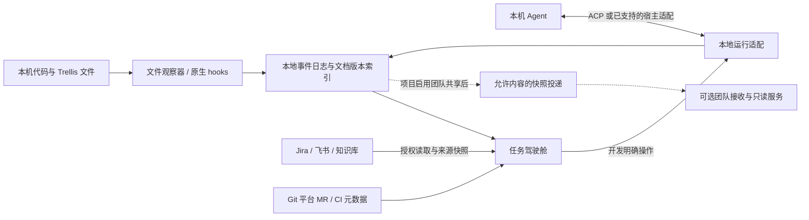

# 03 · 工程契约与可实现边界

## 1. 首发的最小组成

本地首发：现有 Electron + React，抽离 Trellis 文件能力与事件适配，不先迁移整个项目。Node 伴随程序/浏览器工作台随后独立验证。团队服务是同步协作能力，不是服务器执行代码的环境。

## 2. 最小数据模型

| 对象 | 核心内容 | 不承担什么 |
| --- | --- | --- |
| WorkItem | 本地稳定任务 ID、原 Trellis 路径、repo/worktree 身份、Jira 关联 | 不替代 Jira 排期与业务字段 |
| SourceBundle | Jira 快照、飞书指定章节、来源版本/hash、人工确认范围 | 不要求 PM 重写一份 Brief |
| ArtifactRevision | 文档类型、源路径、内容 hash、修订关系、草稿/确认态 | 不从文件保存推断人工批准 |
| ContextReceipt | 目标执行、原文件与发送片段摘要、选择理由、裁剪/缺失、证据级别 | 不证明模型理解和遵守 |
| RunEvent | eventId、taskId、runId、可得的 session/parentRunId、来源、序列与时间 | 不把同项目所有事件都归给当前任务 |
| Clarification | 来源段落、问题、回复、采用结论与时间 | 不远程修改员工工作区 |
| TaskRelation | parent/follow-up/fixes/supersedes/blocks | 不把所有关系都当父子 |
| ChangeRequest | 平台、仓库 ID、MR/PR ID、head SHA、目标分支、状态与回执 | 不只用分支名字代表交付版本 |
| KnowledgeTrace | 查询、命中、选入、传递、引用和失败记录 | 不把命中率当正确率 |
| SharePolicy | 项目、受众、共享白名单、排除、异常处理、策略版本 | 不授予远程执行权限 |

保持未知 Trellis 字段和自定义阶段，尽量把面板映射保存在伴随索引。原有目录变化/归档后通过稳定 ID 与别名关系定位，不能把目录名永久当身份。

## 3. 统一证据词汇与类型

| 显示 | 能证明 | 证据来源 |
| --- | --- | --- |
| 已选入 | 此文件/知识将进入候选上下文 | 任务清单、用户钉入、检索筛选 |
| 已组装 | 确定版本的文本已形成，知道裁剪结果 | 真正的上下文组装器 |
| 已交给宿主 | hook 输出或适配器提交动作成功完成 | hook/适配器回执 |
| 宿主接收已确认 | 支持的宿主确实确认该载荷 | 原生接收/适配事件，缺则不显示 |
| 检查有结果 | 某个明确版本的检查命令/人工评审给出结果 | 退出码、报告、CI 或人工记录 |

词汇表与字段由 contracts 层统一维护，F2/F3/F4 共用；“已选入”是材料选择状态。上下文的 assembled/submitted/host_ack 与 check_result 是不同类型的事实，不能把检查结果当成证明注入成功的最高等级。

最小公共字段：schemaVersion、eventId、subjectType、taskId/runId、producer、可得的目标 session、occurredAt、artifact/payload 摘要、证据类型及可用性。检查另绑定代码 SHA/材料修订与检查范围。不存在的宿主确认不补造；UI 不使用“已注入模型”的绝对措辞。

不能用 hash 文件名、读文件日志或 Agent 自述直接生成“规范已遵守”。测试通过也只覆盖测试实际证明的行为。若上下文压缩/恢复后缺乏保留证据，则显示上次回执和时间，不宣称仍全部在模型上下文里。

回执记录原文件 hash 与实际发送文本 hash；两者不能混用。数量使用真实字节数，token 只能在可靠计量时显示；裁剪、文件不存在、读取失败、总预算不足、旧版本冲突分别记录。

首发优先组装与交付回执。接收确认、压缩/驱逐只有可观察时才增加。性能遵循“有界遥测、失败不拖垮上下文交付”：hook 不等待网络、不重新扫全仓库；短生命周期进程不能用未等待的异步写冒充已持久化。多生产者经收集器或独立片段汇合为一个逻辑日志出口，保留丢失诊断。具体预算与试验见第 06 章。

遥测降级不适用于控制记录。批准、来源版本保存、受管写操作的必要记录若保存失败，应提示并停止依赖该记录的动作，不能借“观测不阻塞”假报批准已落盘或继续受管实施。

## 4. 信号源与适配能力

| 能力 | ACP 受管 Agent | 外部宿主+兼容 hooks | 仅文件观察 |
| --- | --- | --- | --- |
| 文档阅读与变化 | 可 | 可 | 可 |
| 上下文组装/提交回执 | 需 Trellis 适配，非 ACP 自动提供 | hooks 可提供 | 无 |
| 所有内部子 Agent 树 | 不保证，按具体实现 | 不保证，可接原生/channel 事件 | 无 |
| 工具状态/权限操作 | 按 Agent 暴露能力 | 按原生桥接能力，可能需回原工具 | 无 |
| 会话恢复/运行中补充 | 协商并实测，不支持时新会话交接 | 依宿主 | 只交接材料 |
| 阶段缺项检测 | 受支持的观察配置+实际事件 | 同样适用 | 只显示已知文件事实 |

不将“舱内满血”作为能力承诺。每个组合记录 Agent、宿主、版本和验证日期；首发完整验证一个真实组合，再按收益扩大，不把两种适配同时完成作为阅读首发前置。其他组合保留已验证的 hooks/文件能力，缺失原因可见；一个 ACP 适配失败不连带删除仍然可靠的原生回执。

## 5. 工作流观察配置

原生 workflow.md 继续决定工作规范。驾驶舱为已支持的工作流版本维护观察配置：阶段、可选步骤、触发条件、对应事件、对应产物、何时检查缺项。配置记录来源 workflow 版本/hash，不成为第二套写入状态机。

例：只在项目声明需要类型检查且工程声称进入完成检查阶段时，提示未观察到 typecheck 结果；轻量纯文档任务不被错误提醒必须有后端子 Agent。

不支持的 workflow 只能显示文档结构与观察时间线。AI 可以建议映射，但人未确认前不据此判定违规。升级 Trellis 后，配置不匹配显示“待重新验证”。

## 6. 受管确认与权限操作

驾驶舱确认记录绑定计划修订、需求材料版本和需要批准的范围。受管入口启动实施前检查该记录；相关内容发生实质变化时重新评估批准是否仍有效。

记录保存为任务内有命名空间的扩展文件，例如 `.panel/approvals.jsonl`，包含稳定任务 ID、路径提示、材料 hash、SourceBundle ID、身份来源与时间，可随任务归档携带。它不是新的 task.json 状态，也不是不可伪造的企业签名；本机身份与公司验证身份如实区分。

当前 task.py start 无此校验，必须作为新增能力实现；不能只在 UI 加一个按钮就声称已强制门禁。外部未经受管入口的操作仅能被观察和提示，不假装已阻止。

权限卡只显示 Agent 本次提供的选项及实际语义。不凭空把会话级 allow-always 解释成永久“允许本项目”。本机高权限操作由开发处理，PM 的文档确认不是终端操作授权。

## 7. 材料准备与知识检索

### Jira / 飞书

导入优先稳定 issueId/siteId；Jira 显示 key 可变。飞书优先精确章节/块 ID，再按标题提供候选；歧义由人选，不把匹配准确率写死。

SourceBundle 保存来源 URL、可得的远端修订、抓取时间、选定范围、正文 hash、附件可用性。没有远端修订号就明确以抓取时间/hash 管理。失败或权限不足不回退为空白“成功”，提供人工导入。

章节正文固化到项目允许的资料路径后，才作为本次上下文引用。import 不自动认可文档里的指令、权限请求或任意代码执行。

### 知识轨迹

任务准备期可执行一次有目的的检索；必须展示查询意图与实际结果。命中、选入、实际注入清单是三个集合。将确认选择的资料固化为本地引用，不能只保存一个以后会变化的搜索结果地址。

运行中的工具轨迹优先由本地 MCP 客户端/网关或受支持 Agent 事件记录；ACP 事件中没有详细检索结果时只显示它实际暴露的部分。不得用推断补出不存在的调用。

## 8. 隔期接续

先用确定的任务关系构建前情：确认的材料、已解决问题、遗留项、采用规范、MR/commit、归档来源。每项都可点击回源，标明旧代码版本；超预算裁剪可见。

RAG 用来补充“可能相关”，不自动建立确定血缘。用户确认的关联才进入 TaskRelation。归档任务的历史事实保留，新任务重新分析当前代码，不继承“已完成”或旧工具授权。

工作区日志可作为补充线索；日志内容与作者/任务的真实关联、访问权限应可核对，不能凭日期近就关联到当前任务。

## 9. 自动团队快照

默认产品建议：项目启用一次预置共享策略后，PRD/design/implement.md、经过字段筛选的 task 元数据、归档摘要自动产生只读快照。白名单与排除联合生效；workspace 全文、私有会话、原始检查/终端日志、源码、绝对路径和凭据默认排除。任务级检查/回执摘要可按项目策略单独选择，详细回执默认服务开发本人，不生成员工行为排名。

正常内容更新不弹反复确认。疑似敏感内容隔离该修订，保留上个正常快照并显示阻塞原因；检测不能承诺完全识别所有敏感信息。团队阅读身份需要与项目范围匹配，客户端路径限制之外服务端也验证对象权限。

隔离向开发收件箱显示原因与项目允许的处理入口，不静默丢弃。共享配置提供默认模板；“五分钟配置”只能作为已有身份/授权准备好的可用性目标，不能替代组织审批。

仓库/静态站优先复用公司 Git ACL，并验证实际发布站点的访问控制。实时面优先已有 SSO；若采用能力令牌，限定材料范围、只读、有效期与撤销，不把无限期群共享密钥当作用户身份。设备上传使用独立写入凭据；澄清回复要来自可验证身份并校验任务范围。新增组织账号系统由真实身份需求触发，不按“第二个非开发用户”自动引入。

文件写入稳定后做 hash 去重与合理节流。每个快照有 taskId、artifactRevisionId、observedAt、receivedAt、策略版本和草稿/已确认标志。静态提交视图同时显示 commit/构建时间，实时视图显示最近成功同步时间。

本地日志即最小待发送队列：落盘、按 eventId 去重、确认游标、重试。首版每任务一台受管执行设备，不做自动跨设备接管；电脑更换走显式停止/交接。团队服务落地后再加入复杂任期机制。

## 10. MR/CI、IM 与归档

MR 关联以仓库+稳定 MR ID 保存，读取 head SHA 和合并状态。CI 需关联该提交、所要求流水线类型及目标项目；旧 SHA 的成功不算当前交付通过。手工确认只能作为带作者、时间和原因的补充证据。

澄清/项目既有验收提醒/持续失败可通过现有消息工具触达。飞书通知、文档读取和回复回填分别定档：被允许的群 webhook 可先做出站通知；读文档和处理身份化回复另需相应授权与接口验证。长连接可减少公网入站部署需求，仍须核对具体 SDK/事件支持。没有权限时复制问题/授权链接或人工导入，不声称已送达/已读取。

不为“平台内验收”新建独立流程引擎。首版遵循 Jira/MR 与项目既有完成条件，保存来自这些系统或有来源的人工确认记录；不假设专职测试存在，也不假设不存在。

归档、基座文档提交、推送、MR 合并、Jira 回写分别有状态与失败回执。自动化只在项目已经明确配置的范围内执行。导出包包含批准的任务文档与索引；不使用全仓库暂存来“省事”。

## 11. 技术与服务引入时机

| 时机 | 引入内容 | 延后内容 |
| --- | --- | --- |
| 本地首发 | 现有 React/Electron、阅读/文件解析、最小日志、一个已验证回执组合 | 全量 ACP 适配、新账号后台、复杂队列、多设备调度 |
| 数据源闭环 | 复用 Jira/GitLab/WeKnora，验证飞书官方接口 | 全量飞书镜像、重建 RAG、统一所有模型 |
| 低成本团队验证 | 既有私有文档站或限定导出、明确读者、现有消息入口 | 全新团队后台与员工客户端强制安装 |
| 确需实时且有维护承诺时 | 小型 Node 服务、现有身份接入、限定快照/澄清、必要上传和回执 | 新验收引擎、大型审批系统、多租户 SaaS、云 IDE |
| 出现明确需求后 | PostgreSQL/pg-boss、细化权限/审计、复杂工作流 | 没有需求依据的分布式平台 |

服务器存储选择：已有 PostgreSQL 环境就复用；极小的单进程试点可以先用 SQLite，但对象 ID、快照与同步意图接口保持可迁移。不以减少一个组件为理由放弃备份和版本管理。模型网关继续优先复用现有配置，BYOK 与成本仅对可观测路径承诺。
