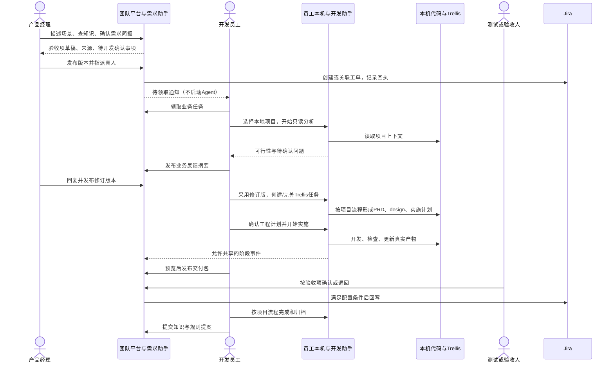
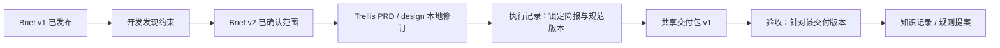

# 02 · 工作流程与文档分层

## 1. 先把三类材料分开

| 材料 | 形成者与时间 | 保存在哪里 | 谁能修改 |
| --- | --- | --- | --- |
| 需求简报 Brief | 产品与需求助手澄清业务时 | 团队平台；关联 Jira | 获授权作者编辑草稿，发布形成不可变版本 |
| 工程材料 | 开发本机分析项目后，按 Trellis 流程形成 | 仓库 `.trellis/tasks/...` | 开发与其本机 Agent；按项目协作方式管理 |
| 共享成果 Publication | 开发从工程材料整理、审阅后发布 | 平台保存选定版本副本 | 新发布版本替代展示，不反写本地原文 |

需求简报可以很完整，但它不冒充工程 PRD。Trellis task create 若会立即生成空的 `prd.md`，那只是本地任务骨架：在项目分析与开发确认前，界面不得标成“已完成工程规划”。

## 2. 主流程泳道

## 3. 场景：退款失败后支持重试

### A. 产品讨论：代码尚不可见

小林描述客服重试退款的需求。助手从公司知识库找出业务规则，提出“处理中能否重试、是否支持历史订单、是否允许重复退款”三个问题。小林确认业务目标，保留“历史订单可行性待开发确认”，发布 Brief v1 给小周。

页面显示“已发布，待开发评估”。没有 Agent 选择框、没有本地目录、没有假生成的 Trellis design。

### B. 开发接单：将业务需求绑定真实项目

小周领取任务，在本地工作台选择已有仓库。工作台核对项目标识、分支、Trellis 是否存在以及已有绑定。只读分析发现历史订单缺少必要字段，小周把问题改写成业务摘要提交给小林；具体文件、SQL 和原始日志仍留本机。

小林把范围改为“只支持新退款单”，发布 Brief v2。小周明确采用 v2，再开始项目的 Trellis 规划。PRD 引用 Brief v2 的固定版本和验收项，design 记录项目现状及方案。

### C. 实施：开发掌握执行

工程计划由开发按项目流程确认。工作台展示本次上下文清单、版本、加载回执；小周选择已配置的本机 Agent。平台接收的公开摘要是“已进入实施、正在补充回归检查”，不是终端全文或所有代码变更。

### D. 验收：共享经选择的结果

小周在“发布预览”中选择业务摘要、验收覆盖和必要截图，查看目标受众。完整 design 默认不勾选；其中如含实现细节可留本机。发布后，小陈按验收项检查。代码审查继续在团队现有 Git 平台进行。

业务验收通过不等于上线完成。项目预设的完成条件可以是“验收通过+合并确认”，或另加部署确认。满足条件后再推进 Jira。Trellis 归档仍由开发侧真实操作并上报。

## 4. 三条状态线分别记录

| 维度 | 建议状态 | 谁推进 |
| --- | --- | --- |
| 业务需求 | 草稿→已发布→开发评估→开发中→待验收→已验收；可退回/撤销 | 人的业务动作与受控回执 |
| 本地工程 | 未绑定、分析中、待澄清、规划中、实施中、检查中、完成、归档 | 原生 Trellis 与本地事件，保留自定义状态 |
| 同步 | 未关联、待同步、已同步、冲突、失败 | 连接服务的真实请求结果 |

设备在线情况是第四个独立属性。设备离线不等于任务失败；聊天结束不等于工程完成；文件新增不等于规划通过。平台业务状态不是对 `task.json.status` 的替代写入口。

## 5. 文档生命周期与版本关系

- 已发布 Brief 不原地覆盖；修订生成新版本，可查看差异和回应的问题。
- 本地文档保持 Markdown 与项目原生目录，平台映射记录放本地伴随程序数据库；不强迫所有 Trellis 版本增加同样字段。
- 共享成果记录来源文档修订、发布者、受众、内容摘要校验值。若全文内容未上传，服务端不能假装能定位其任意段落。
- 评论锚定共享版本与段落；新版本无法可靠匹配时标记“需要重新定位”，不删除评论。
- 对共享成果的修改建议回到开发收件箱，不直接覆盖本地 Markdown。

## 6. 不同任务的合理变体

**简单文案或明确的小修复**：开发仍确认项目与范围；若项目 Trellis 工作流允许轻量任务，可只保留必要 PRD/检查记录，省略 design。不能由产品助手因为“看起来简单”绕过项目上下文检查。

**紧急缺陷**：开发可从本地发起，关联已有 Jira 或提交待关联摘要；按项目应急流程处理，保留授权人、影响范围和补验收记录。不是所有事件都必须先等产品新建简报。

**跨仓库需求**：一个业务需求关联多个“工程绑定”，分别由真人领取。产品先拆业务能力，具体模块与仓库拆分由开发评估后确定；父需求汇总阻塞与验收，不自动合并代码。

**多人接力**：未提交代码不能靠平台同步迁移。原开发用团队 Git/补丁流程交接；新开发在自己的电脑重新绑定，以已共享材料和可获得的分支继续。原绑定不再获得新发布权。

## 7. 异常与回退

| 情况 | 用户看到什么 | 下一步 |
| --- | --- | --- |
| 需求缺信息 | 明确待答问题，仍可发布为“待评估” | 产品回答，开发决定是否具备实施条件 |
| 本地无 Trellis | “项目未初始化” | 开发决定初始化或先在编辑器评估；不自动改仓库 |
| 已有工程任务 | 显示候选和对应项目/worktree | 由开发关联，不重复创建 |
| 需求 v3 在实施时发布 | “当前执行 v2，新版 v3 待评估” | 开发选择暂停评估或完成当前安全步骤；下一阶段前处理差异 |
| 两个设备同时启动同一绑定 | 显示占用者与旧回执 | 在线租约限制受管执行；离线旧执行不被假装已终止，新发布需校验任期 |
| Agent 不支持恢复 | 已存材料、未完成项仍可见 | 开发开启新会话接续，不自动重跑有副作用步骤 |
| 公司库离线 | 显示来源不可用、已缓存版本 | 允许继续已获准步骤；不能声称查到了最新资料 |
| 设备离线 | 最近收到的状态与时间 | 本地继续既有获准执行，事件稍后补传；不接收新的远程启动 |
| Jira 回写失败 | 交付已通过 / Jira 待同步 | 重试连接，不重复做任务 |
| 验收退回 | 绑定交付版本、失败验收项与原因 | 开发自行决定修复和再次发布 |

## 8. 平台价值的实际检查

从业务简报点击一个验收项，应能定位已共享交付证据；开发在本机则还能看到关联工程材料与检查结果。两种视角的差异是权限和工作职责的差异，而不是两套互不相干的任务。
