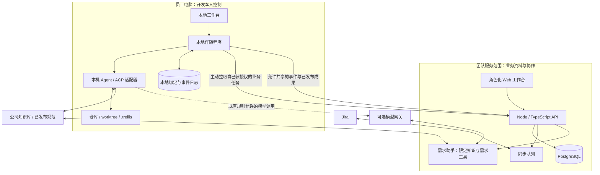

# 04 · 架构与数据设计

## 1. 建议架构

首版采用模块清晰的单体团队服务，部署在公司可访问的环境；不在这里运行源码分析或编码 Agent。现有 Electron 保留为员工本机工作台，逐步抽出可独立运行的伴随程序。



图中的公司模型网关是可选调用路径。个人登录型 Agent 不必绕过自身认证接到同一个网关；不能因此承诺统计全部费用。

## 2. 三个执行边界

**团队需求助手**：仅挂接授权的知识检索、需求读写建议与 Jira 查询。写入发布动作仍由人触发。没有本机文件、终端、Git 克隆、远程启动 Agent 工具。

**本地工程能力**：读取文件、运行命令、处理 Agent 权限、修改 Trellis 文档都留在员工电脑。ACP 是本地进程交互接口，不能单独充当沙箱；实际限制由 Agent 配置和 OS 权限实现。

**共享边界**：团队后端保存业务简报、成员、反馈、发布副本、状态回执；不保存本地全量索引、完整会话、源码或工作区镜像。开发未来需要分享技术材料时按项目权限发布，不能把“路径在 .trellis 下”当成无敏感信息的证明。

## 3. 身份与设备

优先接公司已有登录系统；若没有，可用现成身份库提供成员与组织基础。业务接口仍按项目和对象授权，身份组件不会自动提供文档权限。

开发在本机登录同一组织，设备登记后获得可撤销的设备身份。设备只能拉取该用户当前可访问的需求和提交相应绑定的回执。员工离职或设备撤销后拒绝新同步与新受管操作；离线设备上的已存在进程不可能被服务器立即保证终止，界面应如实显示未知。

服务器不向设备发送 shell 命令。设备收到的最多是“某需求有新版本/待查看”的通知。`start_local_plan`、`start_local_run`、`resume` 必须由本机前台用户操作产生；恢复网络不执行积压启动请求。

## 4. 从网页去本机

1. 网页申请短时、一次性 handoff 引用，绑定用户、组织、任务版本和目标服务。
2. 深链只携带不透明引用，不携带凭据、绝对路径或可执行命令。
3. 本地客户端核验账户与服务来源，拉取业务材料，显示任务信息。
4. 用户选择本地仓库，核对分支与既有工程任务，再开始分析。

初版优先使用现有 Electron 深链与本地界面。先避免让公司 HTTPS 网页直接跨域访问 localhost，以免把浏览器本地网络限制、CORS、Origin 校验和账户绑定一次混进首轮改造。后续若做浏览器本地工作台，使用独立环回页面和配对会话，另行验证。

## 5. 领域对象

| 对象 | 关键字段 | 保存位置与意义 |
| --- | --- | --- |
| Project | id、团队、Jira 范围、共享策略版本 | 服务端，不含员工本机路径 |
| Requirement | id、项目、真人指派、业务阶段、最新发布版本 | 服务端业务对象 |
| BriefRevision | id、requirementId、序号、内容、验收项、待确认项、作者 | 服务端不可变发布版本 |
| Clarification | id、简报版本、问题摘要、回复、解决记录 | 服务端；原始代码证据不上送 |
| Device | id、userId、状态、最后联系时间 | 服务端，只存必要设备标识 |
| EngineeringBinding | id、requirementId、repoId、ownerId、deviceId、共享策略、任期 | 服务端记录关联；本地另存路径/worktree/taskDir |
| LocalRun | id、bindingId、briefRevision、规范清单、Agent 能力快照 | 本地完整；服务端仅接收允许字段 |
| Publication | id、requirementId、runId、版本、范围、内容、摘要校验值、发布人 | 服务端可读的发布副本 |
| Acceptance | publicationId、criterionId、结论、确认人、证据版本 | 服务端；不等于代码审查 |
| ExternalLink | provider、站点ID、issueId、可变显示key、requirementId | 服务端；稳定ID查重，显示编号可更新 |
| SyncIntent | id、对象、操作、payloadHash、预期状态、结果 | 服务端持久化副作用意图 |
| RuleProposal / RuleRelease | 来源、适用范围、版本、维护人、状态 | 服务端共享规范；本地引入另有回执 |

一个需求可有多个工程绑定；一个绑定可有多次执行。执行 ID 不用会话标题、目录名或 Jira key 代替。

## 6. 数据的最终依据

| 数据 | 最终依据 | 冲突处理 |
| --- | --- | --- |
| 需求简报 | 平台已发布版本 | 草稿基于 revision 保存，过期则比较差异 |
| Jira 优先级/冲刺/正式指派 | Jira；平台动作通过连接器确认 | 显示远端值与未确认意图，不静默覆盖 |
| 本地 PRD/design/spec | 当前仓库与明确 worktree 的文件 | 本地 hash/mtime 校验，外部改动先重读 |
| 工程阶段 | Trellis 原始记录+有来源的回执 | 保留原始状态，无法识别时显示原值 |
| 平台交付正文 | Publication 的特定版本 | 新发布产生新版本，不覆盖历史验收证据 |
| 规范发布版本 | 指定团队规范来源 | 引入本地后记录采用版本，不热替换正在执行的上下文 |

## 7. 事件与断线恢复

建议事件信封（设计示例，尚未实现）：

```json
{
  "eventId": "uuid",
  "bindingId": "uuid",
  "runId": "uuid",
  "deviceId": "uuid",
  "bindingEpoch": 4,
  "sequence": 23,
  "occurredAt": "2026-10-11T02:24:00Z",
  "kind": "engineering.phase_changed",
  "source": "trellis-hook",
  "briefRevisionId": "uuid",
  "sharePolicyVersion": 1,
  "payload": { "rawPhase": "check", "summary": "进入检查阶段" }
}
```

本地先在事务日志/SQLite outbox 落盘，再提交；服务端对 eventId 去重，按绑定任期和序列校验。重传已确认事件返回原回执；旧任期不能推进当前共享状态。显示发生时间和接收时间，晚到事件可补历史，但不把新状态倒退。

离线已获准运行可继续，本地保留事件。重新连接先核对任务撤销、简报版本和绑定任期，再补传。对已撤销权限的数据不继续上传。不要用“最后一条消息时间”冒充 Agent 是否存活。

同一工程绑定只允许一个受管写入执行；更换设备或 Agent 前尽量要求旧端停写回执。旧端不可达时，平台标记未确认停止并冻结旧端发布权，由开发处理代码交接。租约只能约束平台承认的执行，无法阻止员工另开的外部编辑器修改本地文件。

## 8. 接口草案

| 接口 | 目的与权限 | 重要结果 |
| --- | --- | --- |
| POST /requirements/:id/revisions | 产品发布简报，If-Match 检查草稿基线 | revisionId，不触发本地执行 |
| POST /requirements/:id/claim | 被指派开发领取 | 指派冲突时 409，不双重领取 |
| POST /handoffs | 本人准备去本机查看 | 单次短时引用 |
| POST /bindings | 已登录设备建立本人本地关联 | 不接受任意远程路径或命令 |
| POST /clarifications | 开发发布审阅后的业务问题 | 绑定简报版本 |
| POST /device-events/batch | 设备提交共享范围内事件 | 逐项回执、去重、断点 |
| POST /publications | 开发发布选定成果 | 内容版本与受众 |
| POST /acceptances | 验收者确认特定成果 | 过期成果返回版本冲突 |
| POST /sync-intents/:id/retry | 授权用户重试原意图 | 不产生新评论意图 |

服务端不提供供产品调用的 `/devices/:id/exec`。本地 API 继续环回绑定、令牌认证与路径校验；当前 TPAP 可参考，但不得直接暴露到局域网作为团队后端。

## 9. 上下文与真实回执

本地 Run 保存 brief revision、workflow 版本、Trellis 版本、包/层、规范路径与 hash、选入理由、可用工具、Agent/适配器版本。仅平台获准的公开标题与回执摘要可同步。

来源等级：配置引用→已传递→运行环境确认加载→可执行检查通过。没有对应事件时停在已知等级；文件被读取、Agent 自述遵守、LLM 推断都不能提升为测试通过。

不为所有 Agent 承诺完整权限控制、会话恢复或相同 MCP 传输支持。注册能力并在接入验证中测试；能力不足时使用复制交接材料与现有编辑器继续。

## 10. 运行与演进

首版部署：一个 Web/API 服务、PostgreSQL、一个后台同步 worker；知识库和模型网关复用现有服务，确有需要再部署。文件附件可先使用有备份的服务端文件存储，接口抽象后迁入公司对象存储，不先引入大规模微服务。

员工本地端与服务器通过版本化 JSON 契约协作，可独立升级。要求可导出简报、发布成果、规则、关联关系与回执；换身份组件、模型网关、知识库或桌面壳不应迁移业务 ID。
