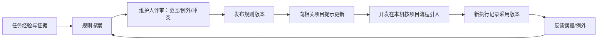

# 06 · Jira、知识库与规范沉淀

## 1. Jira 接入的职责

Jira 继续管理正式工单、优先级、冲刺、业务负责人和项目工作流。平台新增需求澄清、工程绑定、共享材料与交付关联。产品在平台发起的新需求可以先草稿澄清，发布后创建或关联 Jira；已有工单按范围导入，保持稳定关联。

产品在平台指派的是人或团队。其账号无权限修改 Jira assignee 时显示失败或提请有权限者处理，不绕过 Jira 以服务账号假装代办成功。

## 2. 字段与状态所有权

| 内容 | 入站 | 出站 |
| --- | --- | --- |
| 标题、业务描述 | Jira 导入原始快照 | 平台仅在明确发布映射时更新；简报全文可用链接保留 |
| 优先级、冲刺、正式负责人 | Jira 为准 | 平台发操作意图，读取成功回执后显示已确认 |
| 工程阶段 | 不从 Jira 状态直接覆盖 | 仅作为选定摘要/映射条件，不逐文件推状态 |
| 评论 | 按账号可见范围读取 | 发布里程碑摘要，避免每个工具调用刷评论 |
| 完成 | Jira 当前状态与流转条件 | 达到项目配置门槛，再调用合法 transition |

业务验收、代码合并、部署确认、Trellis 完成、归档和 Jira 同步分别记录。归档移动目录不天然说明业务工单可关闭。

## 3. Cloud 与 Data Center 分适配

当前项目 Jira 客户端主要使用 `/rest/api/2/...` 与 Basic 认证。不能仅换 baseUrl 就宣称覆盖所有版本。Cloud 与 Data Center 在认证、搜索接口、用户标识、富文本、webhook 管理和网络条件上分别验证。

Cloud 官方旧搜索接口已处于移除流程，应使用目标版本支持的增强搜索并正确分页；不照搬当前 `maxResults=50` 的单页实现。[官方搜索 API](https://developer.atlassian.com/cloud/jira/platform/rest/v3/api-group-issue-search/)

使用 Jira Cloud 时可参考 Paperclip 的托管 MCP 连接；其指南不覆盖 Data Center。[适用范围](https://docs.paperclip.ing/connectors/jira/) 自建工具入口可评估 [MCP Atlassian](https://github.com/sooperset/mcp-atlassian)；确定性同步仍由连接服务负责。

## 4. 可靠同步设计

1. 稳定标识使用 provider+站点ID+issueId；Jira key 仅用于显示，跨项目移动后可变化。
2. webhook 验证来源和权限，先持久化再处理；定期按授权项目范围补查，处理漏发与乱序。
3. SyncIntent 保存唯一操作 ID、请求内容摘要、预期远端条件和执行结果。worker 重启不会丢失待办。
4. 流转前获取目标工单允许的 transitions 与必填信息，条件已变化则进入冲突处理。
5. 评论使用可识别的发布标记/远端属性与远端 ID；如果超时发生在 Jira 已接受之后，先查证再重发。不能宣称远端接口天然支持 exactly-once。
6. 请求遇到限流和暂时故障做有上限的退避；权限失败、字段错误进入用户可见队列。
7. 本平台写回引起的 webhook 按关联 ID 和已知快照识别，避免环形同步。
8. 多个员工客户端不各自对同一工单自动回写。团队连接服务是自动同步唯一写入口，本地仅提交意图。

Jira Cloud 官方说明 webhook 存在重试，事件标识可用于重复识别；本设计因此不按“一次通知只来一次”实现。[Webhooks](https://developer.atlassian.com/cloud/jira/platform/webhooks/)

## 5. 知识来源的两个范围

**团队范围**：业务知识、已发布规则、项目能力卡、经批准的历史交付摘要。供需求助手与有权限成员使用。

**本机范围**：本项目代码、未发布 PRD/design、内部实施笔记、私有会话。供开发助手使用，不进入产品侧搜索。

本地检索仍复用现有倒排索引；公司知识库继续使用自建 MCP/WeKnora。平台不再重做文档解析、embedding 和向量检索。检索结果带来源、版本、发布日期、维护人和权限范围；AI 引用不提升来源本身的可信等级。

## 6. 权限传递与来源新鲜度

- 请求按用户/项目选择获准端点；若下游只能提供服务账号，至少按项目隔离端点和知识库范围，不能把全公司管理员凭据交给所有 Agent。
- 仅在当前请求权限内检索。缓存键包含主体、项目和策略版本，避免跨用户复用越权命中。
- 来源权限撤回后，停止新的检索和共享读取；对已发布派生内容制定保留/撤回策略，不能声称缓存和历史副本会自动全部消失。
- 项目能力卡有维护人与有效期；过期时提示“待开发确认”，不冒充实时仓库事实。
- 知识库故障时保留本地能力，并明确缺失来源。

[WeKnora 的 MCP 文档](https://github.com/Tencent/WeKnora/blob/main/website-docs/03-features/08-mcp.md)描述了端点令牌、知识范围和工具范围。公司部署版本是否具备这些能力要实测，不以最新主干文档替代环境事实。

## 7. 规则生命周期

规则记录包含：稳定 ID、来源任务、正文版本、适用业务/包/层、维护人、例外、发布日期、替代关系、状态（草稿/已发布/弃用）。先把本项目规则与公司指导规则区分；二者冲突时交给项目维护人决定，不采用“最新一条自然覆盖”的逻辑。

发布共享规则后不静默修改员工 `.trellis/spec/`。开发看到差异，按仓库正常 review/commit 流程引入。进行中的 Run 锁定原版本；更新只触发影响提示，是否重跑检查按实际变更判断。

## 8. BYOK、公司额度与可见性

需求助手使用公司允许的模型路径。开发可使用公司额度、个人 API Key 或现有 Agent 登录；管理员可限制支持范围，但产品经理不能替员工选择个人账户。

用户已确认沿用现有模型使用方式，平台不额外上传仓库。开发 Agent 按既有规则向模型传递必要上下文，与平台集中保存仓库是不同的数据流；此方案允许前者，不新增后者。公司网关属于可选接入，不构成员工继续使用已有配置的前置条件。

个人凭据保留本机凭据存储；公司上游密钥保存在公司网关/现有密钥系统，开发端得到受限凭据。任何密钥不写入 Git、简报或共享 Agent 日志。公司网关默认不因计费需要记录完整源码 prompt。

用量按能证明的来源展示：网关计量、Agent 上报或未知。订阅账户额度不是标准 API 余额，不把缺失值显示成 0 元。公司预算仅能对受管路径强制执行，不能保证截断员工绕开的私人 Agent 调用。

## 9. 当前自动上传行为需要重做

现有 WeKnora 联动文档描述了归档自动沉淀、spec 变更同步。团队化后必须改成明确的项目共享模板与发布行为：普通文件变动只影响本地索引；允许发布的摘要和规则版本才进入公司库。保留已有功能代码经验，不延续隐含的共享范围。
