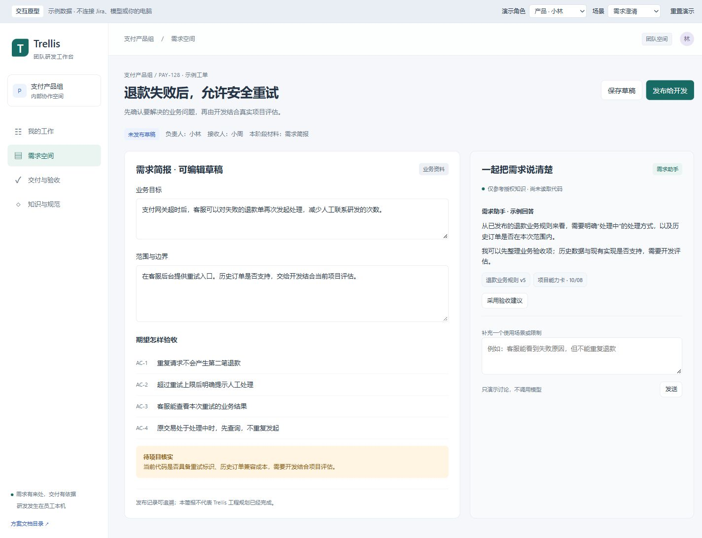
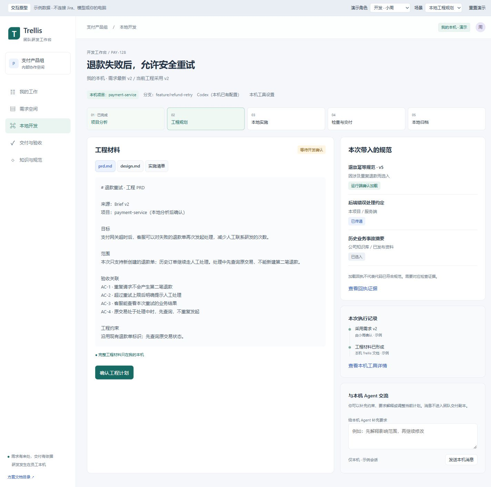
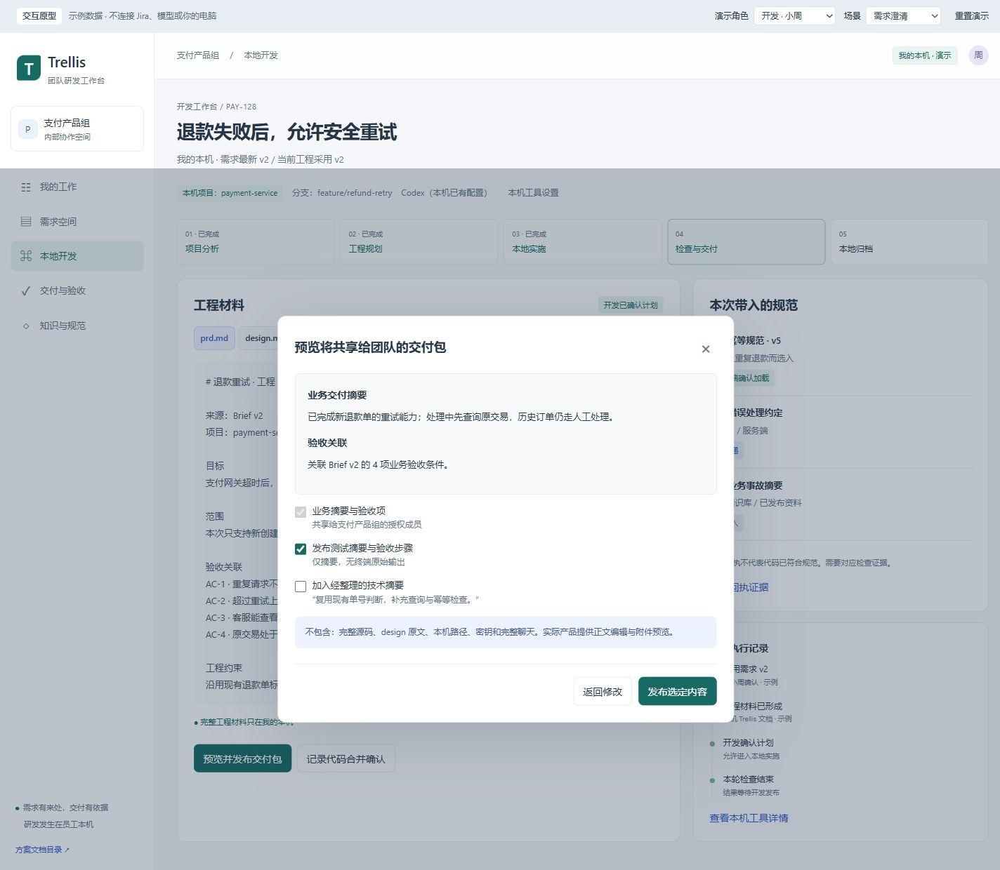
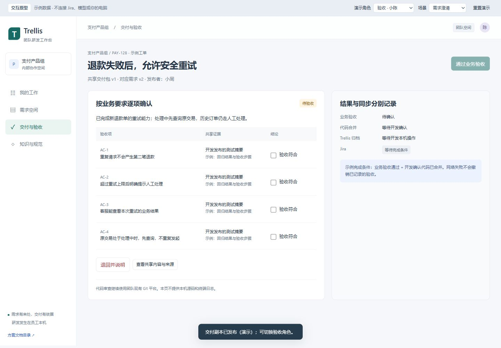
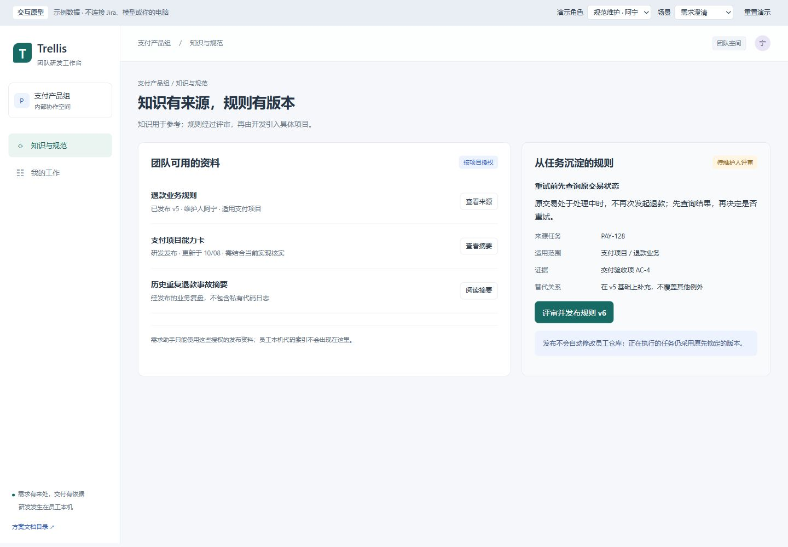
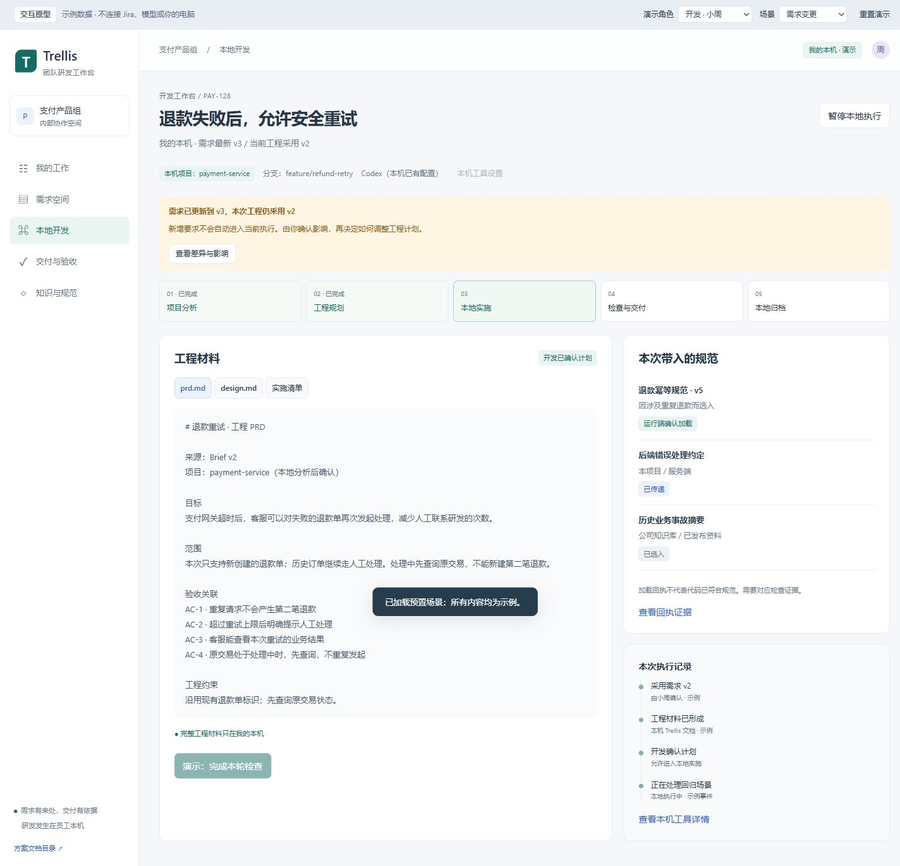
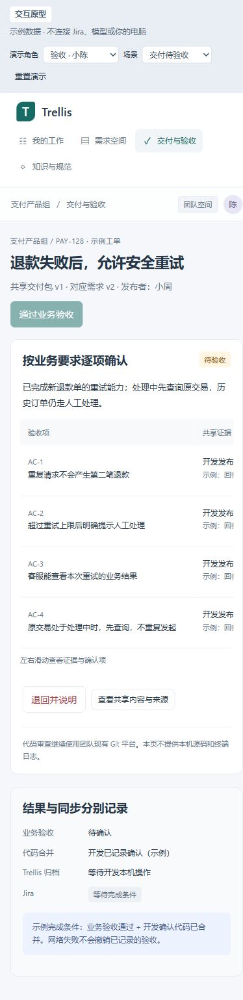

# 09 · 原型评审与检查记录

## 1. 打开方式

[打开原型](prototype/index.html)。它是独立的静态 HTML，可交给支持本地文件的浏览器打开，无需 npm 安装、构建或外网资源。页面用本机浏览器保存示例状态；“重置演示”只清除此原型自己的存储键。本轮内置浏览器的 URL 策略拒绝 `file://`，没有绕过该限制；实际交互验证通过先前启动的本地 HTTP 预览完成，未验证直接文件打开。

如果浏览器对本地文件存储有限制，页面仍可在当前会话演示。也可在此方案目录运行 `python -m http.server 47832 --bind 127.0.0.1`，打开 `/prototype/`。这只是文档预览，不启动产品后端。

## 2. 演示边界

页面顶部始终标记“交互原型 / 示例数据”。角色选择器是供评审跨角色观察的工具；正式产品不会让用户通过下拉菜单获得权限。

所有生成、运行、同步、发布和验收都为浏览器内的确定性模拟，不调用 Jira、模型、MCP、文件系统或本地进程。初版不验证真实身份、隔离、协议或同步可靠性。截图也来自本原型，不是已实现产品的截图。

## 3. 推荐走查

### 场景一：从业务说明走到工程规划

1. 选择“需求澄清”，角色为产品；编辑简报，查看知识来源，采用验收建议，发布需求。
2. 切换开发，领取任务。确认没有自动分析；点击本地项目绑定，再开始项目分析。
3. 看到历史订单限制，发布业务反馈；切回产品，回复为“本次仅支持新退款单”，发布修订。
4. 切回开发，采用最新版本后创建工程规划；检查 PRD/design 此时才出现，产品页面不显示它们的完整内容。

### 场景二：开发、共享与验收

1. 选择“本地工程规划”，检查规范列表和加载证据。
2. 开发确认工程计划，再开始实施；查看示例执行回执，完成检查。
3. 打开交付发布预览，确认共享范围；发布后切到验收角色。
4. 逐项确认并通过验收；查看 Jira 独立回执；切回开发执行归档。

### 场景三：实施中需求变化

选择“需求变更”；产品发布了新版，开发运行仍锁定旧版。开发查看影响，选择采用新版并重新确认工程计划，或暂保留当前安全步骤并记录决定。不能由产品侧直接恢复 Agent。

### 场景四：离线与同步失败

选择“设备离线”，检查平台保留最后收到的状态，重新连接不会新开 Agent。选择“交付待验收”，通过后可模拟 Jira 回写失败，重试仅改变同步回执。

### 场景五：规范沉淀

开发从任务提出规则建议；规范维护人看到来源、适用范围和草稿差异，发布规则。开发端仍需明确引入，不能自动更新员工仓库。

## 4. 评审时关注的问题

- 产品是否可以独立形成有价值的简报，而不会误以为已分析代码？
- 开发是否清楚领取、分析、规划、实施各需自己做什么？
- 产品新增要求后，开发是否知道自己仍采用哪个版本？
- 测试看到的材料是否足以验收，同时没有暴露完整本地记录？
- 规则从提案到发布再到本地引入是否清楚？

## 5. 检查记录

2026-10-11 已通过的检查：

- `node --check prototype/app.js`：JavaScript 语法通过。
- [产物检查记录](checks/results.json)：章节本地链接、静态资源存在性、静态 HTML ID 和 JavaScript 语法。
- 在 Codex 浏览器走通：发布需求→开发领取→本机绑定→只读分析→发布业务反馈→产品确认范围并发 v2→开发采用 v2→工程规划→开发确认→本地实施示例→检查→共享预览→发布→验收。
- 验收全部勾选前，“通过”不可用；验收通过但尚无合并确认时，Jira 仍显示等待条件。
- 合并确认后模拟 Jira 失败，验收记录保留；重试后恢复已确认状态。
- 开发归档→提出规则→维护人发布 v6→开发明确引入，流程可操作。
- 在实施中收到 v3 时，本机仍采用 v2；采用新版后回到待确认规划，未自动恢复执行。
- 离线场景可完成既有检查，交付发布不可用；恢复连接后允许发布，没有新开 Agent。
- 开发私有会话消息可输入并保留；切到产品角色后，页面不呈现该消息，也没有本地开发入口。这仅验证原型呈现，不是生产权限测试。
- 桌面 1440px、窄屏 390px 与 320px 检查；窄屏验收表格在自身区域横向滚动，页面本身没有水平溢出。
- 主流程检查期间浏览器未记录 warn/error。未运行正式产品构建与测试，因为没有改其源码或依赖。

走查修正：本地示例路径的反斜杠显示、开发编辑后的反馈保存、运行中 Agent 配置入口、窄屏表格挤成单字列、页面切换滚动位置和静态资源缓存。

未验证：真实 Jira、ACP Agent、模型、MCP、身份与设备权限、真实文件同步、离线恢复可靠性、许可证兼容与生产负载。原型中的所有服务结果均为模拟。

## 6. 保存的原型图

以下图片来自本地原型的浏览器截图，可用于初版评审。

### 产品：需求简报与需求助手

### 开发：本机工程材料与规范回执

### 开发：交付共享前的内容预览

### 测试：按业务要求验收

### 维护人：规则来源与发布范围

### 开发：在途任务收到新需求

### 窄屏：验收页面

