# Hifox 登录后产品与 UI/UX 实测审查（v0.5.1）

2026-10-17 UTC。研究对象为用户本机 Chrome extension「维」配置中已有的登录网页会话，浏览器 ID 1、标签 754833790。原生 HiFox 窗口因 native APIs disabled 未被操作；本报告不能代表桌面专属能力。网页构建版本未在本次范围内确认。当前组织仅一个所有者可见，以下是单账号、少量示例数据的定性研究。

本轮完成19张可交付截图的逐张目检、25条观察记录（含6条仅结构观察），覆盖U01–U22的部分检查点。**22行有记录不等于22项全路径验证**。多数空间为空；没有执行真实任务、付费AI、发布、付款、删除、发消息、邀请、连接/授权、修改真实记录或创建资源。没有制造生产错误。查看的是既有失败记录，未重试。表单只打开空白态；未填写或提交。临时网页视口覆盖已重置，并返回收件箱、还原展开的侧栏区域。

## 1 方法、证据等级与局限

- **U-视觉+结构**：保存原始屏幕JPEG并打开核验，附文件、视口、时间、路径模板与SHA256；所见文字/布局只适用于该检查点。
- **U-结构**：读取当前可访问性结构，截图未取得或不宜安全交付；不能据此断言视觉问题。UI05、UI07、UI08、UI23、UI24、UI25属于此类。
- **H/PH声明**：官方文档；**UI声明**：页面的功能介绍或按钮标签，均不证明后端能力、权限、幂等或可靠性。
- **L**：本地实现静态核对；**D**：Trellis设计建议。证据→建议需要产品判断，不能视为照搬许可或已通过验收。

隐私策略：仅保留通用示例、空态和必要控件；裁切掉私人对话正文、主机名、所有者、私有Agent卡片与个人成员行。未打开PAT/账号绑定/凭据或原始任务数据。无效或状态不一致的截图拒收，不随包交付；截图/工具超时只记录取证限制，不记为Hifox性能缺陷。技术记录中的路由已模板化。未进行用户访谈、量化可用性实验、跨设备和角色对照，不能推导效率或转化提升比例。

## 2 覆盖矩阵

下表同时列出成功观察与未验证部分。`observed_partial`表示至少一个可视检查点，`structure_only`仅结构。机器可读版本见 [JSON](evidence/ui-coverage.json) 与 [CSV](evidence/ui-coverage.csv)。

| 编号 | 页面 | 核查范围 | 结论与边界 | 证据 |
| --- | --- | --- | --- | --- |
| U01 | 启动、登录后首页、组织/空间切换 | 版本、身份范围、无空间、离线 | 已登录网页首屏；未测登录、组织切换、无空间、离线和原生启动版本。 | UI01-inbox-empty, UI19-document-library-empty |
| U02 | 全部任务/空间列表 | 列表、看板、搜索、筛选、零结果 | 仅示例看板与类型过滤入口；列表模式、复杂筛选、大数据量未验证。 | UI09-task-board |
| U03 | 已有任务详情 | 标题、人员、状态、材料、历史、返回位置 | 仅已有示例任务结构和历史失败；材料返回位置、完整视觉未验证。 | UI07-existing-run-failure, UI08-task-discussion-structure |
| U04 | 新建任务表单 | 必填提示、取消、未保存草稿 | 空标题禁用、类型菜单、关闭已观察；未提交，不证明服务端幂等与保存。 | UI10-new-workitem-form, UI11-workitem-type-menu |
| U05 | 类型、标签、关系 | 菜单分类、循环依赖/重复解释 | 类型入口与属性结构已观察；标签编辑、循环依赖与重复合并未验证。 | UI08-task-discussion-structure, UI09-task-board, UI10-new-workitem-form, UI11-workitem-type-menu |
| U06 | 任务评论与回复 | 锚点、已解决、@ 真人/Agent 语义 | 评论/回复结构已观察；未发送，不证明通知、锚点、解决和@语义。 | UI08-task-discussion-structure |
| U07 | 对话模块 | 发起者归属、等你/等人、行定位、未读 | 独立会话控件已观察；等你/等人、未读、发起者、并发未验证。 | UI06-conversation-controls |
| U08 | 任务对话 | 历史、多会话、布局和返回 | structure_only：仅任务对话结构和历史执行观察，没有可交付的任务对话截图。UI06仅为独立Agent会话入口参考，不计任务对话视觉覆盖；新运行、继续、取消、真实交接和布局恢复未验证。 | UI07-existing-run-failure, UI08-task-discussion-structure |
| U09 | 收件箱 | 聚合、重要、已读/稍后与对话分工 | 个人通知空态；无真实通知，不证明聚合、已读或稍后副作用。 | UI01-inbox-empty, UI16-triage-empty |
| U10 | Agent 列表与详情 | 无 Agent、禁用、职责、runtime | 列表、搜索零结果实测；创建表单结构观察；禁用/详情/保存未验证。 | UI02-agents-overview, UI03-agent-search-empty, UI04-narrow-search-expanded, UI05-agent-create-form, UI25-agent-settings-form |
| U11 | 电脑与 runtime | 在线/离线、连接/安装/登录区分 | 电脑页本地桥接提示已观察；私有可用徽标仅结构观察；安装、认证、真正执行未验证。 | UI05-agent-create-form, UI06-conversation-controls, UI07-existing-run-failure, UI22-computer-local-bridge-unavailable |
| U12 | 工作目录/仓库 | 目录来源、锁、worktree 策略和权限 | 只看到会话目录入口与创建表单Git工作方式；未打开目录选择、锁和worktree策略。 | UI05-agent-create-form, UI06-conversation-controls |
| U13 | 技能与小队 | 依赖、空态、队长与成员职责 | 技能空态与Agent/小队Tab入口已观察；小队详情、依赖、队长、执行均未验证。 | UI02-agents-overview, UI18-skills-empty, UI19-document-library-empty |
| U14 | 成员与空间权限 | 可见、无权、角色范围和邀请副作用 | 组织成员角色/空间列结构可见；只有所有者，普通成员、访客和拒绝场景未验证。 | UI23-members-role-scope, UI25-agent-settings-form |
| U15 | 专项/交付目标 | 范围、负责人、进度和空态 | 专项解释与空态；无实际目标，负责人、进度、结束路径未验证。 | UI14-task-navigation-more, UI15-delivery-goals-empty |
| U16 | 保存视图 | 私有/共享、临时更改、重置、窄屏 | 保存视图空态；未创建、保存、共享或重置，权限未知。 | UI09-task-board, UI13-saved-views-empty |
| U17 | 迭代 | 当前/历史/无迭代、结转语义 | 迭代空态与过滤入口；无历史，不验证结束和结转。 | UI12-iterations-empty |
| U18 | 分拣台 | 接受/重复/拒绝/暂缓菜单及空态 | 分拣入口与空态；未分拣、配置或接收外部记录。 | UI14-task-navigation-more, UI16-triage-empty |
| U19 | 自动化 | 触发、范围、历史、失败原因 | 自动化空态与用途说明；未启用、运行、检查历史或补偿。 | UI17-automation-empty |
| U20 | Jira/Git/IM 集成 | 只读连接状态、字段方向、失效授权 | 目录分类和UI文案；没有连接、同步、回写或失效授权测试。 | UI20-integration-directory, UI21-git-and-collaboration-integrations |
| U21 | 设置/CLI/PAT | 能力说明、掩码、撤销提示 | 设置导航、成员/集成/快捷键说明；未打开PAT、CLI、账号绑定或凭据页。 | UI20-integration-directory, UI23-members-role-scope, UI24-keyboard-preferences |
| U22 | 键盘/缩放/主题/窄屏 | 焦点、读序、状态非色彩表达 | 1000×900与1440×900网页视口、搜索展开和Esc关闭菜单；无原生/读屏/完整键盘/主题测试。 | UI03-agent-search-empty, UI04-narrow-search-expanded, UI24-keyboard-preferences |

## 3 任务路径与取证步骤

| 路径 | 目的与实际动作 | 已看到的结果 | 停止点与未验证 |
| --- | --- | --- | --- |
| A 首页→收件箱 | 观察个人通知、重要性和处理分类 | 当前无通知；已读/清理与重要性是两组控件 | 不点全标已读、清理、稍后；无法验证聚合/交接 |
| B 全部Agent→搜索→窄视口 | 搜索不存在词；1000px宽展开搜索并清除 | 无匹配项；展开后查询仍保留、可清除 | 不发消息；不证明后台检索和并发 |
| C 会话→已有示例任务 | 查看控件和既有执行结果，避开私人正文 | 模式/runtime/目录入口；业务待开始、历史执行结束且失败 | 不切模式、不发送、不重试、不复制原始错误；详情仅结构 |
| D 空间任务→新建→类型菜单→关闭 | 检查最小创建路径与必填反馈 | 看板类型；空标题不可创建；三种类型与管理入口 | 不提交、不上传、不变更字段；不证明服务端规则 |
| E 更多→迭代/视图/专项/分拣 | 核对计划和接收用途 | 均无对应业务记录，导航/用途/空态可见 | 不创建、保存、结转、接收、配置或固定导航 |
| F 自动化/技能/文档 | 分辨自动执行、能力与知识范围 | 自动化/技能空态；我的文档与团队区域分开 | 不导入、安装、发布、上传或运行 |
| G 集成→电脑→成员/快捷键 | 查看分类与能力提示 | 集成目录、本地桥接错误；所有者、角色/空间列；快捷键说明 | 不授权、测试连接、邀请、改设置；PAT/CLI未打开 |

没有把未提交表单当作创建成功；没有把空态当作完整业务路径通过。收件箱与分拣台虽然都“接收”，在实际导航中服务不同目的。任务评论与Agent执行也不能因同处任务页而混为同一授权动作。

## 4 发现与迁移判断

严重度是对Trellis设计的预防优先级：高表示会影响结果真实性或共享边界，中表示任务理解/恢复成本，低表示效率与一致性；不是Hifox漏洞评级。标题与风险不超出证据范围。

### UX01 业务、执行和环境是三种事实（高）

证据：UI07-existing-run-failure；UI22-computer-local-bridge-unavailable。

观察：已有示例任务仍待开始，但执行记录显示结束且右侧为失败；电脑页桥接不可用而私有电脑行有可用徽标。历史结果为结构观察，桥接提示有截图。

影响：一个完成/可用绿点会使用户误把回合结束当交付通过，或误把设备存在当runtime可执行。

Trellis建议：保留业务状态权威；执行状态、输入版本、环境观测时间分栏。重试先说明目标与副作用，再预检，不自动新建run。

追溯：FR-004/027/030/035；R0/R3/R4；UXAC01/02。

### UX02 收件箱、分拣台和对话用途不同（中）

证据：UI01-inbox-empty；UI16-triage-empty；UI06-conversation-controls。

观察：个人收件箱空态有稍后/已清理与重要性过滤；分拣台是反馈入口；独立会话有模式和runtime控件。

影响：把通知、外部接收和正式交接合成同一计数会产生误处理。

Trellis建议：ActionItem作为正式交接权威，多入口投影；通知已读只改变阅读状态；分拣不强制覆盖内部创建。

追溯：FR-012/013/022/023；R1/R2；UXAC03。

### UX03 空态可以说明功能目的，但原因仍需细分（中）

证据：UI12-iterations-empty；UI13-saved-views-empty；UI15-delivery-goals-empty；UI19-document-library-empty。

观察：多个空态给出用途和创建入口；当前工作区确实没有对应数据。

影响：无记录、筛选零结果、无权、加载和服务不可用若同文案，会引导用户误创建。

Trellis建议：空态包含对象/作用域、原因、保留数据与恢复动作；无权场景不能泄漏对象；无桥不阻挡真人阅读。

追溯：FR-004/017/020/021；R0/R1/R2；UXAC04。

### UX04 窄视口搜索条件暂时不可见（中）

证据：UI03-agent-search-empty；UI04-narrow-search-expanded。

观察：1000px宽零结果页面搜索折为图标；点击后才看到仍存在的查询及清除按钮。

影响：用户可能以为空列表为空库，忘记当前筛选。

Trellis建议：折叠后保留查询/条件数量标记、明确零结果原因及一键清除；键盘焦点可回到触发器。

追溯：FR-017/020；NFR-10；R1/R2；UXAC05。

### UX05 创建任务逐步暴露分类，空标题禁用（中）

证据：UI10-new-workitem-form；UI11-workitem-type-menu。

观察：空白新建需求先显示标题/正文和常用属性，类型菜单有需求/缺陷/任务与管理入口；空标题提示且创建禁用。

影响：禁用按钮若没有原因或取消丢草稿会阻断初次使用；分类管理可能超出操作人权限。

Trellis建议：普通本地任务先最少字段，不要求Agent；解释必填与创建结果；关闭/切项目保留或明确放弃草稿。

追溯：FR-004/010/018；R0/R1/R2；UXAC06。

### UX06 私人、空间和组织共享必须可解释（高）

证据：UI18-skills-empty；UI19-document-library-empty；UI23-members-role-scope；UI25-agent-settings-form。

观察：文档区分我的与团队；技能页处于空间上下文却写组织每个Agent可用；成员表区分角色与空间；两个创建Agent入口默认可见性结构观察不同。

影响：范围文案可能造成分享误判；当前证据不证明越权漏洞或实际默认策略。

Trellis建议：展示来源、拥有者、当前可见范围、发布目标和动作授权；私有到共享是独立预览动作，入口默认策略必须写明并测试。

追溯：FR-011/017/025/033；NFR-06；R1/R3；UXAC07。

### UX07 集成按工作目标分组比厂商罗列更清楚（中）

证据：UI20-integration-directory；UI21-git-and-collaboration-integrations。

观察：任务系统、Git仓库和协作工具分组；部分卡片标即将推出。Git问题与代码托管不是同一用途。

影响：设置按钮容易被误解为已连接；方向或自动更新文案可能掩盖外写。

Trellis建议：分开可配置/已授权/已绑定/最近同步状态；连接→项目→对象三级，逐动作方向与预览。只做实际Jira/Git平台。

追溯：FR-007/036/038/039；R1/R4；UXAC08。

### UX08 专项与迭代是不同计划维度（中）

证据：UI12-iterations-empty；UI15-delivery-goals-empty。

观察：迭代有列表/规划入口；专项说明有限起止日期和聚合目的。只有空态。

影响：把专项直接称项目会与工程root混淆；无实例不能推断汇总和结转实现。

Trellis建议：Trellis Project仍是工程身份；DeliveryGoal聚合成果，Iteration是时间容器；不复制竞品建议时长为交付承诺。

追溯：FR-001/021/024；R0/R2；UXAC09。

### UX09 自主自动化和技能不是轻量展示开关（中）

证据：UI17-automation-empty；UI18-skills-empty。

观察：自动化空态解释任务事件联动Agent/第三方；技能入口支持创建、URL导入或从电脑复制。

影响：浏览页面不能证明规则安全、幂等、预算或技能依赖；复制/导入可能带来运行权限。

Trellis建议：浏览与运行授权分开；R5只在手动样本稳定后启用，技能固定版本和依赖，不直接自动安装。

追溯：FR-025/041/042；R3/R5；UXAC10。

### UX10 可收起导航与辅助信息支持连续工作（低）

证据：UI09-task-board；UI14-task-navigation-more；UI06-conversation-controls。

观察：任务子导航可展开，更多中可见迭代/分拣/视图/专项及固定项；会话控件就地可达。

影响：固定项、展示模式和权限容易被混为一个设置；过多侧栏会挤压正文。

Trellis建议：沿用当前Trellis顶层项目与窄模块栏，辅助区按需抽屉；工作视图只改呈现，保留任务/版本定位。

追溯：FR-001/020/032/048；R0/R2/R3；UXAC11。

### UX11 错误恢复需说明核实对象，不能只放重试（中）

证据：UI07-existing-run-failure；UI22-computer-local-bridge-unavailable。

观察：既有失败记录有重试/帮助/复制错误入口；电脑页给出重启/更新提示。没有触发恢复。

影响：原始错误可能暴露路径/凭据；未知结果盲重试可重复执行。

Trellis建议：错误摘要说明受影响范围、已保留成果、责任人、下一安全动作；未知先核对operation/run，复制默认脱敏。

追溯：FR-016/027/030/047；R1/R3/R4；UXAC12。

### UX12 权限和可访问性证据不足（待复核）

证据：UI23-members-role-scope；UI24-keyboard-preferences；UI03-agent-search-empty。

观察：只有所有者和两个网页视口；快捷键说明可见，但未改偏好、未全键盘走查或使用读屏。

影响：不能从菜单可见或截图直接宣布角色隔离和标准符合性。

Trellis建议：按09角色模型建立正负权限夹具；原生输入、读屏、缩放、两主题分别补测；不声称合规。

追溯：FR-011/016；NFR-06/10/11；R0/R1/R3；SEC01–08；NF10/11。

## 5 可借鉴的视觉与交互模式

| 模式 | 屏幕证据 | 适用性与Trellis规格 | 限制 |
| --- | --- | --- | --- |
| 区域层次 | UI09/12/19 | 浅色背景区分导航/主体/面板，强调色留给当前项和主要动作；Trellis沿用L12现有绿色令牌 | 未做竞品像素取色或对比度测量，不硬编码其颜色 |
| 渐进披露 | UI10/11/14 | 常用字段先露出，高级属性/导航按需展开；分类管理与普通创建分开鉴权 | 低频入口不能完全失去可发现性，搜索条件须常显 |
| 空态说明用途 | UI12/13/15/19 | 对象用途→原因→可做什么；创建仅在适用且有权时出现 | 错误、过滤、无权不能共享“尚无记录”文案 |
| 就地上下文 | UI06/09 | 任务材料阅读不中断；会话展开保留任务、版本、当前执行上下文 | 1000px以下辅助区用抽屉；不让主正文无法阅读 |
| 分组不是权限 | UI19/21/23 | 我的/团队、任务/Git/IM、角色/空间分开表达；当前授权范围仍单独列示 | 菜单名称和区域位置不能代替服务端检查 |
| 文本状态 | UI03/22 | 用明确文字和图标说明空、失败、不可用，颜色仅辅助 | 未完成色觉/读屏/键盘全路径测试 |

竞品功能的广度并不决定Trellis的实施顺序。R0修可信本地工作区，R1先固定版本/真人决定/持久交付，R2再管理视图与迭代，R3接入成熟运行层，R4治理外部事实，R5最后自动化；本轮UI证据不使任何阶段自动通过。

## 6 截图与结构记录索引

以下图片是本次实际网页截图。尺寸可能是原视口或为隐私而裁切的区域，不表示原生窗口尺寸。所有图片可由 `evidence/ui-evidence.json` 校验SHA256。全部视觉结论均已打开保存文件检查；无效素材不打包。

### UI01-inbox-empty — 首页与收件箱

操作：从现有已登录Inbox开始；收起对话摘要和进阶指引。

观察：收件箱/稍后/已清理和全部/重要/其他分层；主区暂无通知；组织与空间导航分开。

边界：未点击标已读/全部清理；没有真实通知，未验证通知聚合与处理副作用。

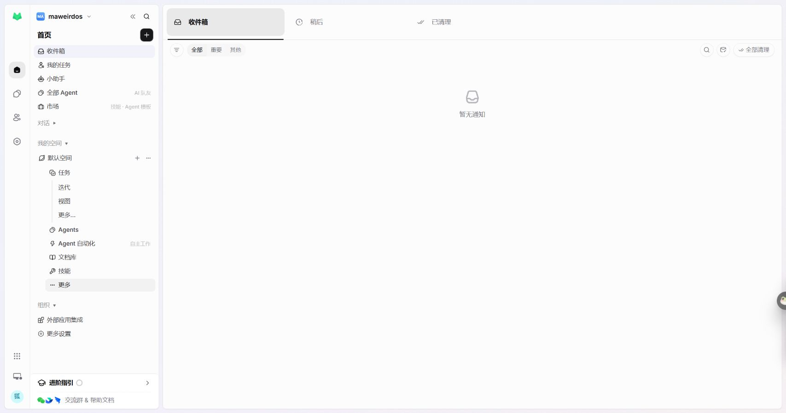

### UI02-agents-overview — 全部Agent和小队

操作：从首页进入全部Agent。

观察：全部/Agent/小队/我的四种筛选；搜索；按空间分组计数；存在单条私有Agent，卡片区分runtime与所有者。

边界：没有执行对话、收藏或行操作；名称和所有者不进入交付截图。

### UI03-agent-search-empty — 窄屏Agent搜索零结果

操作：输入不存在关键词后在1000×900查看。

观察：显示无匹配项；搜索框变为图标，关键词和清除入口暂不在主面板显示。

边界：未证明后端检索完整性；早先更新前或无效尺寸截图均已拒用。

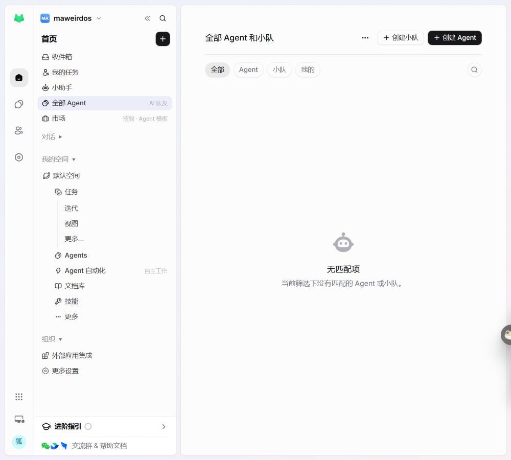

### UI04-narrow-search-expanded — 窄屏搜索恢复

操作：点击搜索图标展开输入。

观察：原搜索词与清除搜索按钮可见。

边界：不进行键盘读屏合规判断。

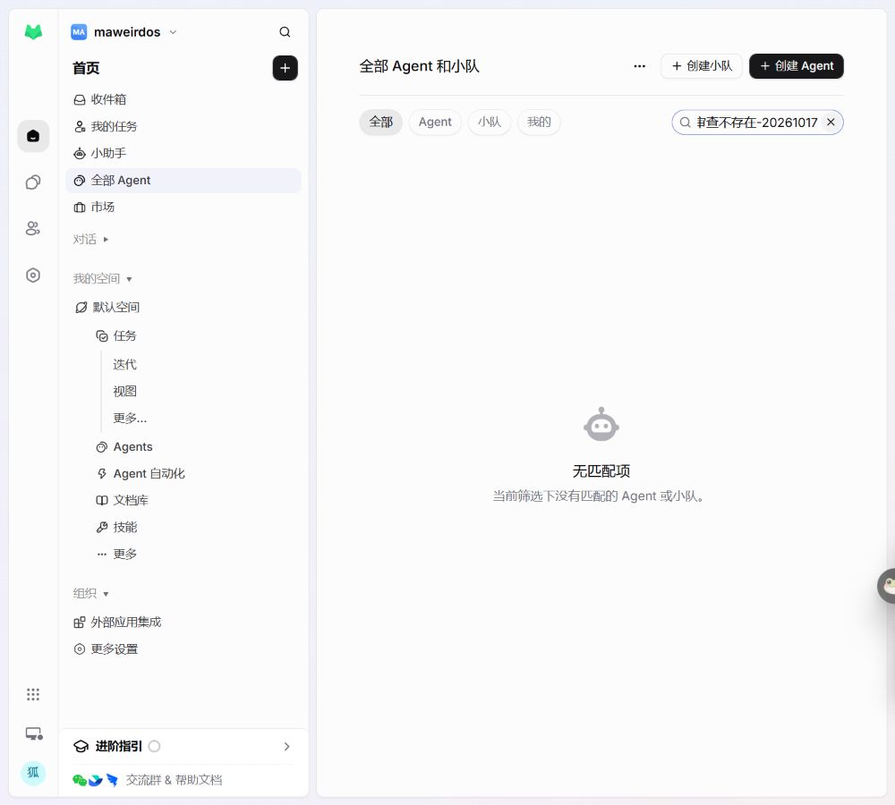

### UI05-agent-create-form — 创建Agent未提交表单

操作：只打开创建表单。

观察：区分代码开发/日常办公；设计创意禁用；名称与职位、所属空间、私有默认、Runtime、工作方式和Git仓库分别配置。

边界：未填写、未提交或安装；不验证默认值保存后的语义; visual capture did not show the dialog; no visual finding claimed。

**仅结构记录；没有可交付截图，不作视觉判断。**

### UI06-conversation-controls — 对话工作台输入与模式控件

操作：只读打开已有对话，不发送。

观察：底部提供微信/Slack/多会话视图控件；composer显示远程Runtime、工作目录控件、单对话模型与空输入禁用发送。

边界：未切换模式、未新建会话、未发送；未测并发、重试或恢复。

### UI07-existing-run-failure — 已有示例任务的历史失败

操作：只读打开既有示例任务对话。

观察：任务业务状态为待开始；动态出现执行完成1次；右侧为执行失败，环境准备18秒，模型本轮无输出；提供重试和帮助入口。

边界：历史记录，不证明当前服务仍失败；未重试或打开原始数据；截图Page.captureScreenshot在5秒超时，视觉未验证。

**仅结构记录；没有可交付截图，不作视觉判断。**

### UI08-task-discussion-structure — 任务与讨论结构

操作：只读查看已有示例任务。

观察：任务详情可见业务状态、优先级、专项、标签、更多属性、动态与对话记录页签；普通评论、回复、对话面板有不同输入；空输入提交按钮禁用。

边界：未更改任何字段、评论、反应、关注或任务关系；相关菜单和提交路径未验证；未获得完整可交付截图。

**仅结构记录；没有可交付截图，不作视觉判断。**

### UI09-task-board — 默认空间任务看板

操作：只读打开任务列表。

观察：任务按待开始/待分拣/待规划/进行中/已完成分组；需求/缺陷/任务筛选；显示设置、视图搜索与新建视图独立；仅一条示例任务。

边界：未拖拽、未改状态、未保存视图；只有示例数据不能验证大数据量和复杂层级。

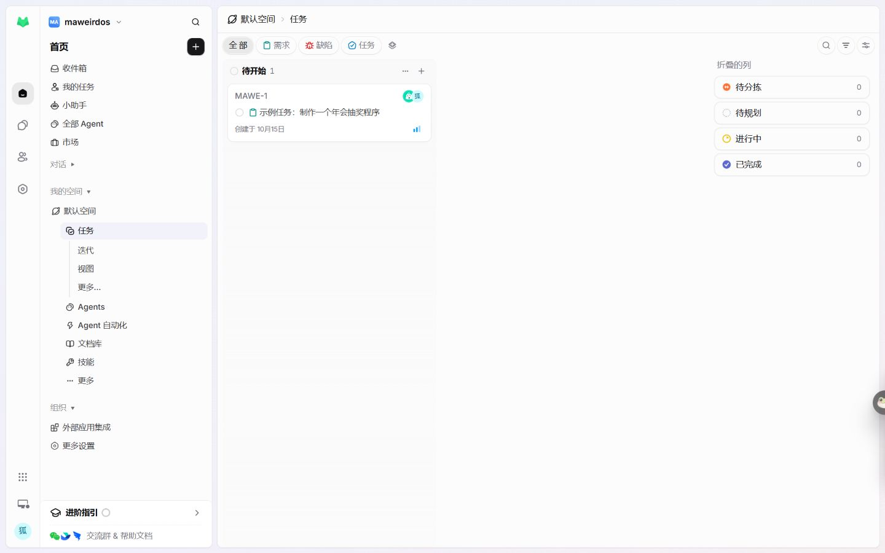

### UI10-new-workitem-form — 空间新建需求未提交表单

操作：打开空间加号，不填写或提交。

观察：当前类型为需求；标题和描述分开；处理人、业务状态、优先级、专项、标签独立；标题为空显示请先填写标题且创建禁用。

边界：未更改类型或属性、未提交、未上传附件；不验证服务端必填校验。

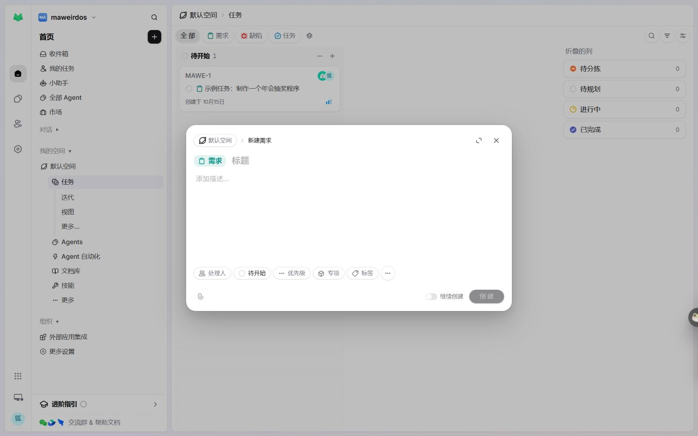

### UI11-workitem-type-menu — 工作项类型菜单

操作：只展开类型菜单，不选择。

观察：需求/缺陷/任务与管理任务类型入口分开。

边界：未切换类型或进入管理；未验证角色差异和字段迁移。

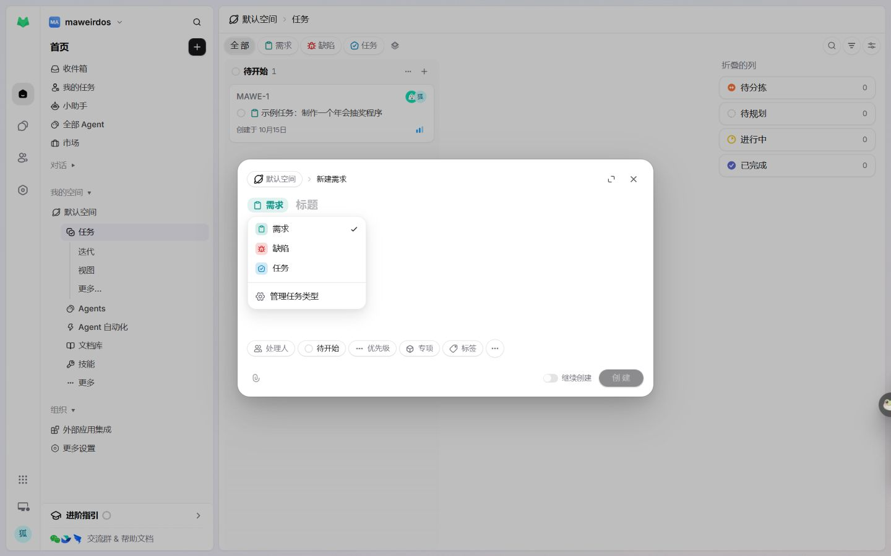

### UI12-iterations-empty — 迭代列表空态

操作：打开默认空间迭代，等实际空态出现。

观察：迭代列表/规划迭代分开；可按状态筛选；还没有迭代明确引导创建第一轮。

边界：当前无真实迭代，无法验证结束、结转、历史和跨周期统计。

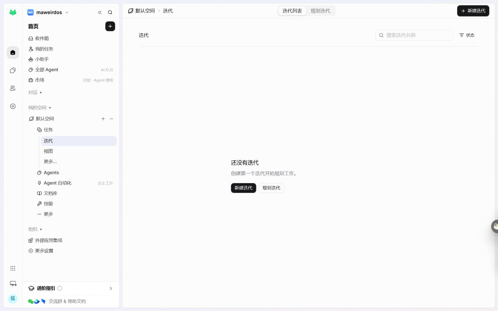

### UI13-saved-views-empty — 保存视图空态

操作：只读打开视图页面。

观察：空态说明视图保存常用任务筛选和展示方式，可按处理人、状态、专项创建；新建与帮助入口并列。

边界：未创建或保存视图，不证明多人共享与权限边界。

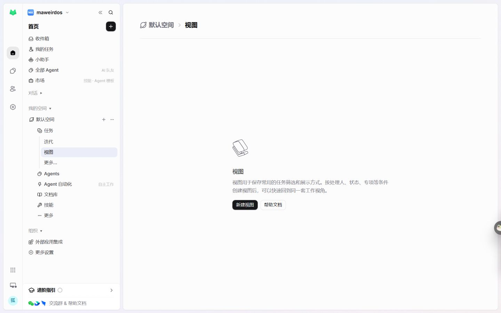

### UI14-task-navigation-more — 任务子导航扩展

操作：只展开更多导航。

观察：迭代、分拣台、视图、专项在同一任务导航扩展；各入口的固定/移除控件独立。

边界：未更改固定项或拖动导航。

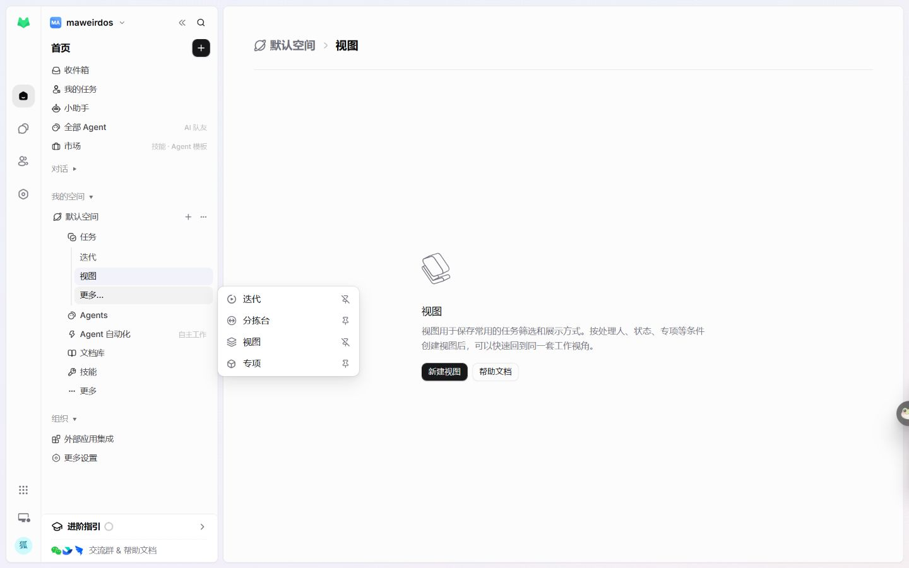

### UI15-delivery-goals-empty — 专项空态

操作：只读打开专项。

观察：将专项解释为有限起止时间的攻坚目标，对应Epic；提供创建与帮助。

边界：当前无专项；期限、负责人、进度汇总和跨任务交付未验证。

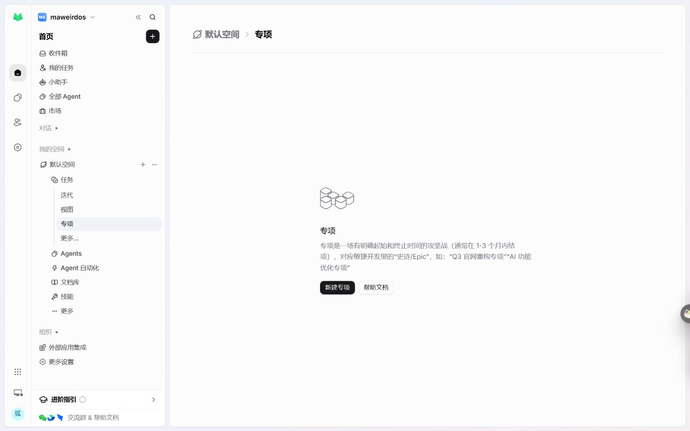

### UI16-triage-empty — 分拣台空态

操作：只读打开分拣台。

观察：待分拣任务计数为0；列表与详情双区；说明外部集成/访客任务先审核、定优先级，再接受或拒绝；责任配置单列。

边界：无待分拣记录；未配置、创建、接受、拒绝、去重或暂缓。

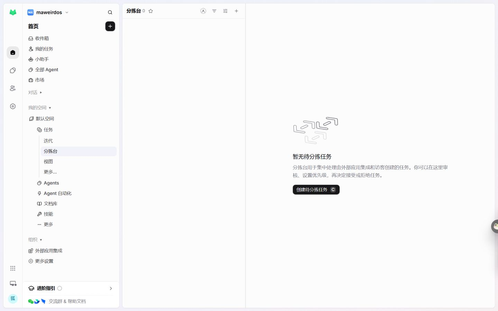

### UI17-automation-empty — 自动化空态

操作：只读打开自动化列表。

观察：说明由任务事件触发任务操作，并可组合Agent和第三方集成；仅新建入口，当前无规则记录。

边界：未新建、启用、触发或测试规则；运行历史和失败补偿未验证。

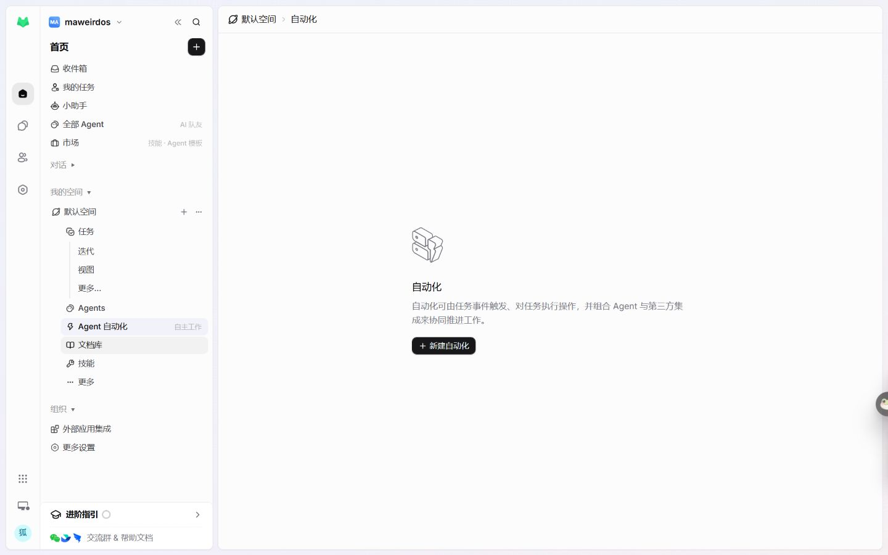

### UI18-skills-empty — 空间技能空态

操作：只读打开技能页。

观察：添加来源包括创建、URL导入和已连接电脑复制；页面处在空间上下文，空态文案同时提到组织中每个Agent可用。

边界：未导入、复制、安装或发布技能；实际可见性与执行权限未验证。

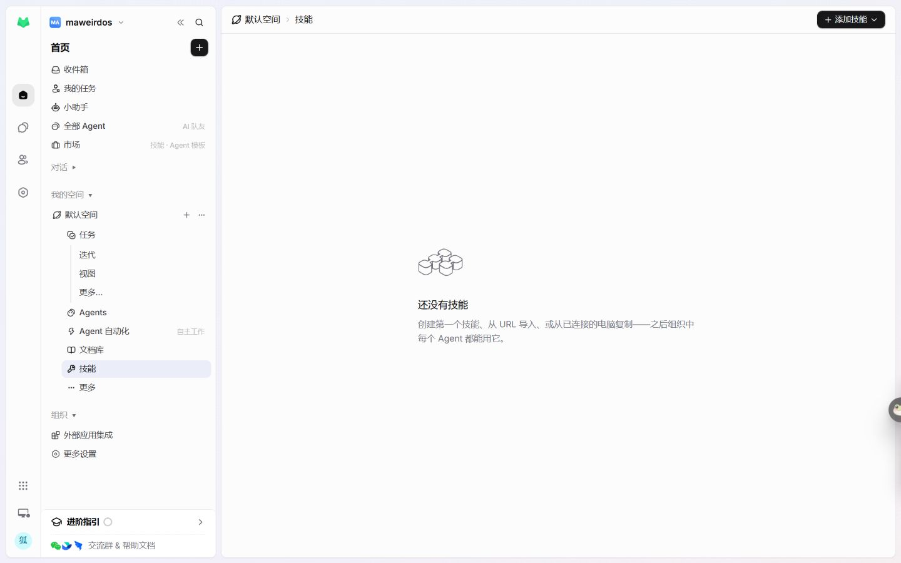

### UI19-document-library-empty — 文档库私有与团队范围

操作：打开文档库并等待正在加载消失。

观察：我的文档与团队文档分列；我的文档空态明确只属于自己；文档集、快速添加、上传文件为独立入口。

边界：未新建、上传、共享或搜索真实文档；跨设备访问和Agent实际读取未验证。

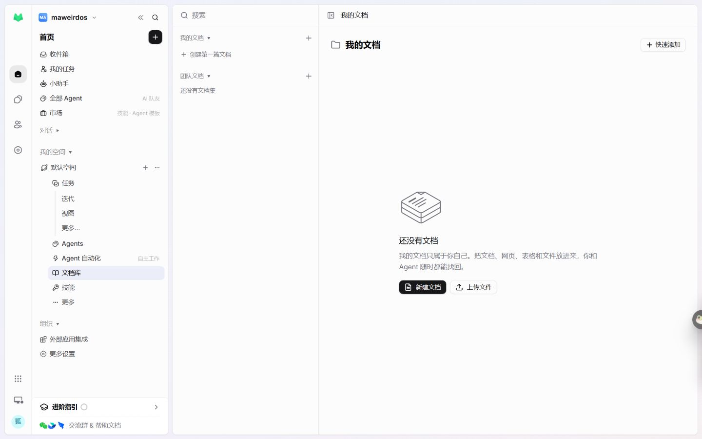

### UI20-integration-directory — 外部应用集成目录

操作：只读打开目录，不设置连接。

观察：任务管理、Git仓库、协作工具分组；入口区分设置与即将推出；部分文案描述双向更新、回链或消息发送。

边界：未打开凭据、授权、测试连接或发起同步；所有方向/范围能力仅是界面声明。

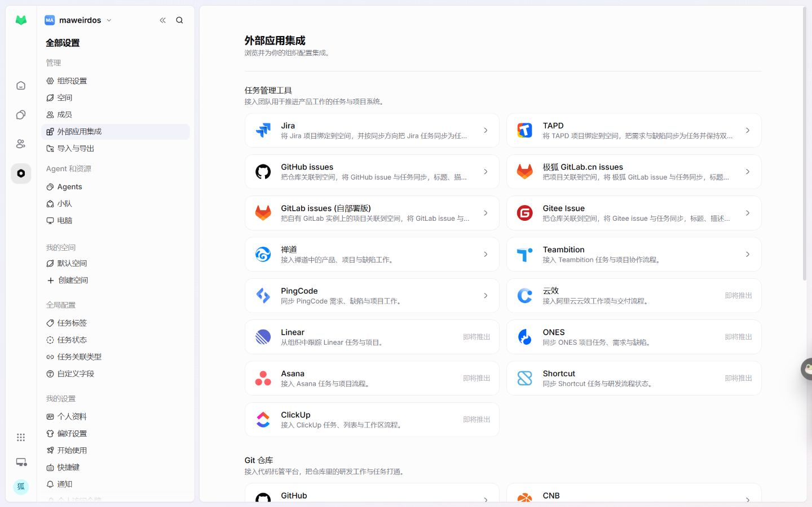

### UI21-git-and-collaboration-integrations — Git与协作工具集成分类

操作：只滚动目录到Git和协作分类。

观察：Git仓库与Git issues单独分类；协作平台与任务平台不同职责；部分未来平台显式即将推出。

边界：未连接厂商、获取凭据、发消息或执行回写；当前只有目录声明。

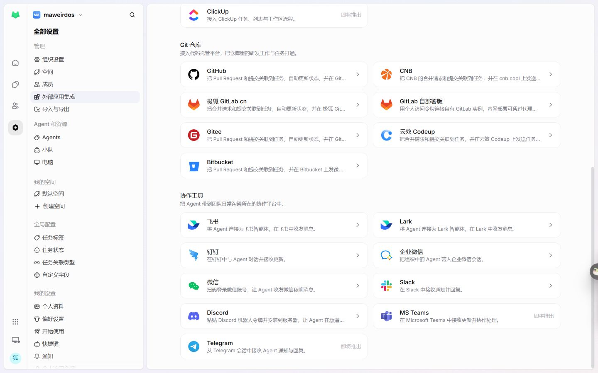

### UI22-computer-local-bridge-unavailable — 电脑与运行资源

操作：只读电脑列表，不连接或启动。

观察：本地桌面桥接能力在当前Chrome扩展访问环境中不可用，页面给出重启/更新说明；共享远程电脑为空；私有电脑列表显示可用徽标及多个Runtime图标。

边界：未启动/刷新服务，未连接新电脑，未点击电脑详情、检查凭据或执行任何Runtime；主机名与所有者不交付。

### UI23-members-role-scope — 组织成员页

操作：只读成员页，不打开邀请或操作菜单。

观察：成员与外部账号分Tab，表头分别列角色、空间、加入时间；当前只有一个所有者。。

边界：未邀请、复制链接、查看个人详情、修改角色或验证无权场景；裁切截图超时，视觉未验证。

**仅结构记录；没有可交付截图，不作视觉判断。**

### UI24-keyboard-preferences — 快捷键说明

操作：只读说明，不更改选项、不录制快捷键。

观察：发送快捷键适用于对话、评论和回复；命令菜单、移动任务和当前视图查找分别提供快捷键说明。。

边界：未修改偏好、未发送内容、未做读屏和全键盘审查；没有交付截图。

**仅结构记录；没有可交付截图，不作视觉判断。**

### UI25-agent-settings-form — 组织设置创建Agent

操作：打开未提交表单，无填写或选择；截屏后表单已不可见。

观察：空白表单将名称、职位/角色、所属空间、可见性、Runtime和工作方式分开；代码开发与日常办公可选，设计创意禁用。本次可见性显示共享，与UI05结构观察私有不同。。

边界：未创建或修改；截图超时且复查时弹层已消失，不能归因于产品；不交付视觉结论。主机名、所有者和Agent名称不交付。

**仅结构记录；没有可交付截图，不作视觉判断。**

## 7 后续最小补证

1. 以明确授权的隔离测试空间准备真实但非生产的任务、迭代、分拣和规则；覆盖创建→评论→交接→结束/失败，保留每一步回执。现阶段不执行这些写操作。
2. 第二账号分别为普通成员/访客，对同一材料做读、搜索、评论、决定、撤权与缓存恢复负例；不能仅用所有者界面推断。
3. 对选定runtime分别验证安装、认证、目录访问、排队/取消、pause不支持、断线unknown和租约保持。桌面桥接错误需在原生入口恢复后复核，不能要求真人共享先修runtime。
4. 对Jira/Git按字段和动作验证查询、导入、同步、停用、授权失效和未知回执；没有回写需求时保持不启用。
5. 使用真实原生输入、全键盘、屏幕阅读器与缩放/主题夹具补测；本次只建立目标与用例，不作标准符合性声明。

责任角色及阶段门槛见11/12；本轮没有假造人员、日期或通过记录。
