# Hifox 登录后产品与 UI/UX 实测审查（v0.5.1）

2026-10-17 UTC。研究对象为用户本机 Chrome extension「维」配置中已有的登录网页会话，浏览器 ID 1、标签 754833790。原生 HiFox 窗口因 native APIs disabled 未被操作；本报告不能代表桌面专属能力。网页构建版本未在本次范围内确认。当前组织仅一个所有者可见，以下是单账号、少量示例数据的定性研究。

本轮完成19张可交付截图的逐张目检、25条观察记录（含6条仅结构观察），覆盖U01–U22的部分检查点。**22行有记录不等于22项全路径验证**。多数空间为空；没有执行真实任务、付费AI、发布、付款、删除、发消息、邀请、连接/授权、修改真实记录或创建资源。没有制造生产错误。查看的是既有失败记录，未重试。表单只打开空白态；未填写或提交。临时网页视口覆盖已重置，并返回收件箱、还原展开的侧栏区域。

## 1 方法、证据等级与局限

- **U-视觉+结构**：保存原始屏幕JPEG并打开核验，附文件、视口、时间、路径模板与SHA256；所见文字/布局只适用于该检查点。
- **U-结构**：读取当前可访问性结构，截图未取得或不宜安全交付；不能据此断言视觉问题。UI05、UI07、UI08、UI23、UI24、UI25属于此类。
- **H/PH声明**：官方文档；**UI声明**：页面的功能介绍或按钮标签，均不证明后端能力、权限、幂等或可靠性。
- **L**：本地实现静态核对；**D**：Trellis设计建议。证据→建议需要产品判断，不能视为照搬许可或已通过验收。

隐私策略：仅保留通用示例、空态和必要控件；裁切掉私人对话正文、主机名、所有者、私有Agent卡片与个人成员行。未打开PAT/账号绑定/凭据或原始任务数据。无效或状态不一致的截图拒收，不随包交付；截图/工具超时只记录取证限制，不记为Hifox性能缺陷。技术记录中的路由已模板化。未进行用户访谈、量化可用性实验、跨设备和角色对照，不能推导效率或转化提升比例。

## 2 覆盖矩阵

下表同时列出成功观察与未验证部分。`observed_partial`表示至少一个可视检查点，`structure_only`仅结构。机器可读版本见 [JSON](evidence/ui-coverage.json) 与 [CSV](evidence/ui-coverage.csv)。

| 编号 | 页面 | 核查范围 | 结论与边界 | 证据 |
| --- | --- | --- | --- | --- |
| U01 | 启动、登录后首页、组织/空间切换 | 版本、身份范围、无空间、离线 | 已登录网页首屏；未测登录、组织切换、无空间、离线和原生启动版本。 | UI01-inbox-empty, UI19-document-library-empty |
| U02 | 全部任务/空间列表 | 列表、看板、搜索、筛选、零结果 | 仅示例看板与类型过滤入口；列表模式、复杂筛选、大数据量未验证。 | UI09-task-board |
| U03 | 已有任务详情 | 标题、人员、状态、材料、历史、返回位置 | 仅已有示例任务结构和历史失败；材料返回位置、完整视觉未验证。 | UI07-existing-run-failure, UI08-task-discussion-structure |
| U04 | 新建任务表单 | 必填提示、取消、未保存草稿 | 空标题禁用、类型菜单、关闭已观察；未提交，不证明服务端幂等与保存。 | UI10-new-workitem-form, UI11-workitem-type-menu |
| U05 | 类型、标签、关系 | 菜单分类、循环依赖/重复解释 | 类型入口与属性结构已观察；标签编辑、循环依赖与重复合并未验证。 | UI08-task-discussion-structure, UI09-task-board, UI10-new-workitem-form, UI11-workitem-type-menu |
| U06 | 任务评论与回复 | 锚点、已解决、@ 真人/Agent 语义 | 评论/回复结构已观察；未发送，不证明通知、锚点、解决和@语义。 | UI08-task-discussion-structure |
| U07 | 对话模块 | 发起者归属、等你/等人、行定位、未读 | 独立会话控件已观察；等你/等人、未读、发起者、并发未验证。 | UI06-conversation-controls |
| U08 | 任务对话 | 历史、多会话、布局和返回 | structure_only：仅任务对话结构和历史执行观察，没有可交付的任务对话截图。UI06仅为独立Agent会话入口参考，不计任务对话视觉覆盖；新运行、继续、取消、真实交接和布局恢复未验证。 | UI07-existing-run-failure, UI08-task-discussion-structure |
| U09 | 收件箱 | 聚合、重要、已读/稍后与对话分工 | 个人通知空态；无真实通知，不证明聚合、已读或稍后副作用。 | UI01-inbox-empty, UI16-triage-empty |
| U10 | Agent 列表与详情 | 无 Agent、禁用、职责、runtime | 列表、搜索零结果实测；创建表单结构观察；禁用/详情/保存未验证。 | UI02-agents-overview, UI03-agent-search-empty, UI04-narrow-search-expanded, UI05-agent-create-form, UI25-agent-settings-form |
| U11 | 电脑与 runtime | 在线/离线、连接/安装/登录区分 | 电脑页本地桥接提示已观察；私有可用徽标仅结构观察；安装、认证、真正执行未验证。 | UI05-agent-create-form, UI06-conversation-controls, UI07-existing-run-failure, UI22-computer-local-bridge-unavailable |
| U12 | 工作目录/仓库 | 目录来源、锁、worktree 策略和权限 | 只看到会话目录入口与创建表单Git工作方式；未打开目录选择、锁和worktree策略。 | UI05-agent-create-form, UI06-conversation-controls |
| U13 | 技能与小队 | 依赖、空态、队长与成员职责 | 技能空态与Agent/小队Tab入口已观察；小队详情、依赖、队长、执行均未验证。 | UI02-agents-overview, UI18-skills-empty, UI19-document-library-empty |
| U14 | 成员与空间权限 | 可见、无权、角色范围和邀请副作用 | 组织成员角色/空间列结构可见；只有所有者，普通成员、访客和拒绝场景未验证。 | UI23-members-role-scope, UI25-agent-settings-form |
| U15 | 专项/交付目标 | 范围、负责人、进度和空态 | 专项解释与空态；无实际目标，负责人、进度、结束路径未验证。 | UI14-task-navigation-more, UI15-delivery-goals-empty |
| U16 | 保存视图 | 私有/共享、临时更改、重置、窄屏 | 保存视图空态；未创建、保存、共享或重置，权限未知。 | UI09-task-board, UI13-saved-views-empty |
| U17 | 迭代 | 当前/历史/无迭代、结转语义 | 迭代空态与过滤入口；无历史，不验证结束和结转。 | UI12-iterations-empty |
| U18 | 分拣台 | 接受/重复/拒绝/暂缓菜单及空态 | 分拣入口与空态；未分拣、配置或接收外部记录。 | UI14-task-navigation-more, UI16-triage-empty |
| U19 | 自动化 | 触发、范围、历史、失败原因 | 自动化空态与用途说明；未启用、运行、检查历史或补偿。 | UI17-automation-empty |
| U20 | Jira/Git/IM 集成 | 只读连接状态、字段方向、失效授权 | 目录分类和UI文案；没有连接、同步、回写或失效授权测试。 | UI20-integration-directory, UI21-git-and-collaboration-integrations |
| U21 | 设置/CLI/PAT | 能力说明、掩码、撤销提示 | 设置导航、成员/集成/快捷键说明；未打开PAT、CLI、账号绑定或凭据页。 | UI20-integration-directory, UI23-members-role-scope, UI24-keyboard-preferences |
| U22 | 键盘/缩放/主题/窄屏 | 焦点、读序、状态非色彩表达 | 1000×900与1440×900网页视口、搜索展开和Esc关闭菜单；无原生/读屏/完整键盘/主题测试。 | UI03-agent-search-empty, UI04-narrow-search-expanded, UI24-keyboard-preferences |

## 3 任务路径与取证步骤

| 路径 | 目的与实际动作 | 已看到的结果 | 停止点与未验证 |
| --- | --- | --- | --- |
| A 首页→收件箱 | 观察个人通知、重要性和处理分类 | 当前无通知；已读/清理与重要性是两组控件 | 不点全标已读、清理、稍后；无法验证聚合/交接 |
| B 全部Agent→搜索→窄视口 | 搜索不存在词；1000px宽展开搜索并清除 | 无匹配项；展开后查询仍保留、可清除 | 不发消息；不证明后台检索和并发 |
| C 会话→已有示例任务 | 查看控件和既有执行结果，避开私人正文 | 模式/runtime/目录入口；业务待开始、历史执行结束且失败 | 不切模式、不发送、不重试、不复制原始错误；详情仅结构 |
| D 空间任务→新建→类型菜单→关闭 | 检查最小创建路径与必填反馈 | 看板类型；空标题不可创建；三种类型与管理入口 | 不提交、不上传、不变更字段；不证明服务端规则 |
| E 更多→迭代/视图/专项/分拣 | 核对计划和接收用途 | 均无对应业务记录，导航/用途/空态可见 | 不创建、保存、结转、接收、配置或固定导航 |
| F 自动化/技能/文档 | 分辨自动执行、能力与知识范围 | 自动化/技能空态；我的文档与团队区域分开 | 不导入、安装、发布、上传或运行 |
| G 集成→电脑→成员/快捷键 | 查看分类与能力提示 | 集成目录、本地桥接错误；所有者、角色/空间列；快捷键说明 | 不授权、测试连接、邀请、改设置；PAT/CLI未打开 |

没有把未提交表单当作创建成功；没有把空态当作完整业务路径通过。收件箱与分拣台虽然都“接收”，在实际导航中服务不同目的。任务评论与Agent执行也不能因同处任务页而混为同一授权动作。

## 4 发现与迁移判断

严重度是对Trellis设计的预防优先级：高表示会影响结果真实性或共享边界，中表示任务理解/恢复成本，低表示效率与一致性；不是Hifox漏洞评级。标题与风险不超出证据范围。

### UX01 业务、执行和环境是三种事实（高）

证据：UI07-existing-run-failure；UI22-computer-local-bridge-unavailable。

观察：已有示例任务仍待开始，但执行记录显示结束且右侧为失败；电脑页桥接不可用而私有电脑行有可用徽标。历史结果为结构观察，桥接提示有截图。

影响：一个完成/可用绿点会使用户误把回合结束当交付通过，或误把设备存在当runtime可执行。

Trellis建议：保留业务状态权威；执行状态、输入版本、环境观测时间分栏。重试先说明目标与副作用，再预检，不自动新建run。

追溯：FR-004/027/030/035；R0/R3/R4；UXAC01/02。

### UX02 收件箱、分拣台和对话用途不同（中）

证据：UI01-inbox-empty；UI16-triage-empty；UI06-conversation-controls。

观察：个人收件箱空态有稍后/已清理与重要性过滤；分拣台是反馈入口；独立会话有模式和runtime控件。

影响：把通知、外部接收和正式交接合成同一计数会产生误处理。

Trellis建议：ActionItem作为正式交接权威，多入口投影；通知已读只改变阅读状态；分拣不强制覆盖内部创建。

追溯：FR-012/013/022/023；R1/R2；UXAC03。

### UX03 空态可以说明功能目的，但原因仍需细分（中）

证据：UI12-iterations-empty；UI13-saved-views-empty；UI15-delivery-goals-empty；UI19-document-library-empty。

观察：多个空态给出用途和创建入口；当前工作区确实没有对应数据。

影响：无记录、筛选零结果、无权、加载和服务不可用若同文案，会引导用户误创建。

Trellis建议：空态包含对象/作用域、原因、保留数据与恢复动作；无权场景不能泄漏对象；无桥不阻挡真人阅读。

追溯：FR-004/017/020/021；R0/R1/R2；UXAC04。

### UX04 窄视口搜索条件暂时不可见（中）

证据：UI03-agent-search-empty；UI04-narrow-search-expanded。

观察：1000px宽零结果页面搜索折为图标；点击后才看到仍存在的查询及清除按钮。

影响：用户可能以为空列表为空库，忘记当前筛选。

Trellis建议：折叠后保留查询/条件数量标记、明确零结果原因及一键清除；键盘焦点可回到触发器。

追溯：FR-017/020；NFR-10；R1/R2；UXAC05。

### UX05 创建任务逐步暴露分类，空标题禁用（中）

证据：UI10-new-workitem-form；UI11-workitem-type-menu。

观察：空白新建需求先显示标题/正文和常用属性，类型菜单有需求/缺陷/任务与管理入口；空标题提示且创建禁用。

影响：禁用按钮若没有原因或取消丢草稿会阻断初次使用；分类管理可能超出操作人权限。

Trellis建议：普通本地任务先最少字段，不要求Agent；解释必填与创建结果；关闭/切项目保留或明确放弃草稿。

追溯：FR-004/010/018；R0/R1/R2；UXAC06。

### UX06 私人、空间和组织共享必须可解释（高）

证据：UI18-skills-empty；UI19-document-library-empty；UI23-members-role-scope；UI25-agent-settings-form。

观察：文档区分我的与团队；技能页处于空间上下文却写组织每个Agent可用；成员表区分角色与空间；两个创建Agent入口默认可见性结构观察不同。

影响：范围文案可能造成分享误判；当前证据不证明越权漏洞或实际默认策略。

Trellis建议：展示来源、拥有者、当前可见范围、发布目标和动作授权；私有到共享是独立预览动作，入口默认策略必须写明并测试。

追溯：FR-011/017/025/033；NFR-06；R1/R3；UXAC07。

### UX07 集成按工作目标分组比厂商罗列更清楚（中）

证据：UI20-integration-directory；UI21-git-and-collaboration-integrations。

观察：任务系统、Git仓库和协作工具分组；部分卡片标即将推出。Git问题与代码托管不是同一用途。

影响：设置按钮容易被误解为已连接；方向或自动更新文案可能掩盖外写。

Trellis建议：分开可配置/已授权/已绑定/最近同步状态；连接→项目→对象三级，逐动作方向与预览。只做实际Jira/Git平台。

追溯：FR-007/036/038/039；R1/R4；UXAC08。

### UX08 专项与迭代是不同计划维度（中）

证据：UI12-iterations-empty；UI15-delivery-goals-empty。

观察：迭代有列表/规划入口；专项说明有限起止日期和聚合目的。只有空态。

影响：把专项直接称项目会与工程root混淆；无实例不能推断汇总和结转实现。

Trellis建议：Trellis Project仍是工程身份；DeliveryGoal聚合成果，Iteration是时间容器；不复制竞品建议时长为交付承诺。

追溯：FR-001/021/024；R0/R2；UXAC09。

### UX09 自主自动化和技能不是轻量展示开关（中）

证据：UI17-automation-empty；UI18-skills-empty。

观察：自动化空态解释任务事件联动Agent/第三方；技能入口支持创建、URL导入或从电脑复制。

影响：浏览页面不能证明规则安全、幂等、预算或技能依赖；复制/导入可能带来运行权限。

Trellis建议：浏览与运行授权分开；R5只在手动样本稳定后启用，技能固定版本和依赖，不直接自动安装。

追溯：FR-025/041/042；R3/R5；UXAC10。

### UX10 可收起导航与辅助信息支持连续工作（低）

证据：UI09-task-board；UI14-task-navigation-more；UI06-conversation-controls。

观察：任务子导航可展开，更多中可见迭代/分拣/视图/专项及固定项；会话控件就地可达。

影响：固定项、展示模式和权限容易被混为一个设置；过多侧栏会挤压正文。

Trellis建议：沿用当前Trellis顶层项目与窄模块栏，辅助区按需抽屉；工作视图只改呈现，保留任务/版本定位。

追溯：FR-001/020/032/048；R0/R2/R3；UXAC11。

### UX11 错误恢复需说明核实对象，不能只放重试（中）

证据：UI07-existing-run-failure；UI22-computer-local-bridge-unavailable。

观察：既有失败记录有重试/帮助/复制错误入口；电脑页给出重启/更新提示。没有触发恢复。

影响：原始错误可能暴露路径/凭据；未知结果盲重试可重复执行。

Trellis建议：错误摘要说明受影响范围、已保留成果、责任人、下一安全动作；未知先核对operation/run，复制默认脱敏。

追溯：FR-016/027/030/047；R1/R3/R4；UXAC12。

### UX12 权限和可访问性证据不足（待复核）

证据：UI23-members-role-scope；UI24-keyboard-preferences；UI03-agent-search-empty。

观察：只有所有者和两个网页视口；快捷键说明可见，但未改偏好、未全键盘走查或使用读屏。

影响：不能从菜单可见或截图直接宣布角色隔离和标准符合性。

Trellis建议：按09角色模型建立正负权限夹具；原生输入、读屏、缩放、两主题分别补测；不声称合规。

追溯：FR-011/016；NFR-06/10/11；R0/R1/R3；SEC01–08；NF10/11。

## 5 可借鉴的视觉与交互模式

| 模式 | 屏幕证据 | 适用性与Trellis规格 | 限制 |
| --- | --- | --- | --- |
| 区域层次 | UI09/12/19 | 浅色背景区分导航/主体/面板，强调色留给当前项和主要动作；Trellis沿用L12现有绿色令牌 | 未做竞品像素取色或对比度测量，不硬编码其颜色 |
| 渐进披露 | UI10/11/14 | 常用字段先露出，高级属性/导航按需展开；分类管理与普通创建分开鉴权 | 低频入口不能完全失去可发现性，搜索条件须常显 |
| 空态说明用途 | UI12/13/15/19 | 对象用途→原因→可做什么；创建仅在适用且有权时出现 | 错误、过滤、无权不能共享“尚无记录”文案 |
| 就地上下文 | UI06/09 | 任务材料阅读不中断；会话展开保留任务、版本、当前执行上下文 | 1000px以下辅助区用抽屉；不让主正文无法阅读 |
| 分组不是权限 | UI19/21/23 | 我的/团队、任务/Git/IM、角色/空间分开表达；当前授权范围仍单独列示 | 菜单名称和区域位置不能代替服务端检查 |
| 文本状态 | UI03/22 | 用明确文字和图标说明空、失败、不可用，颜色仅辅助 | 未完成色觉/读屏/键盘全路径测试 |

竞品功能的广度并不决定Trellis的实施顺序。R0修可信本地工作区，R1先固定版本/真人决定/持久交付，R2再管理视图与迭代，R3接入成熟运行层，R4治理外部事实，R5最后自动化；本轮UI证据不使任何阶段自动通过。

## 6 截图与结构记录索引

以下图片是本次实际网页截图。尺寸可能是原视口或为隐私而裁切的区域，不表示原生窗口尺寸。所有图片可由 `evidence/ui-evidence.json` 校验SHA256。全部视觉结论均已打开保存文件检查；无效素材不打包。

### UI01-inbox-empty — 首页与收件箱

操作：从现有已登录Inbox开始；收起对话摘要和进阶指引。

观察：收件箱/稍后/已清理和全部/重要/其他分层；主区暂无通知；组织与空间导航分开。

边界：未点击标已读/全部清理；没有真实通知，未验证通知聚合与处理副作用。

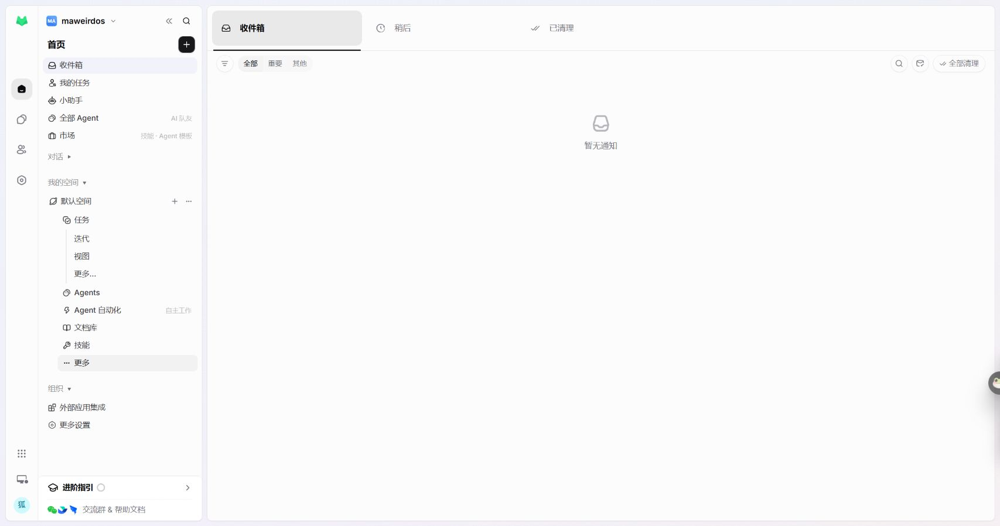

### UI02-agents-overview — 全部Agent和小队

操作：从首页进入全部Agent。

观察：全部/Agent/小队/我的四种筛选；搜索；按空间分组计数；存在单条私有Agent，卡片区分runtime与所有者。

边界：没有执行对话、收藏或行操作；名称和所有者不进入交付截图。

### UI03-agent-search-empty — 窄屏Agent搜索零结果

操作：输入不存在关键词后在1000×900查看。

观察：显示无匹配项；搜索框变为图标，关键词和清除入口暂不在主面板显示。

边界：未证明后端检索完整性；早先更新前或无效尺寸截图均已拒用。

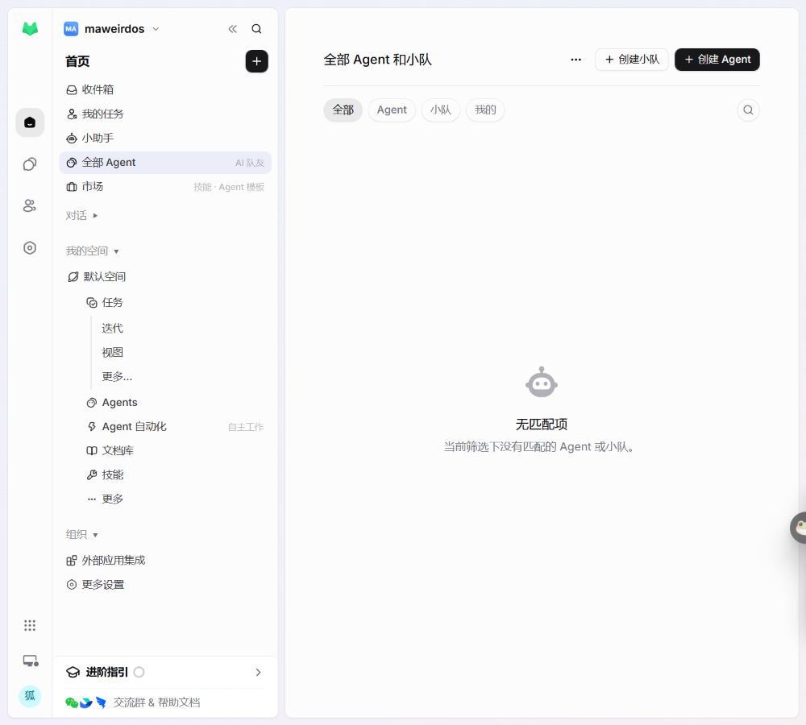

### UI04-narrow-search-expanded — 窄屏搜索恢复

操作：点击搜索图标展开输入。

观察：原搜索词与清除搜索按钮可见。

边界：不进行键盘读屏合规判断。

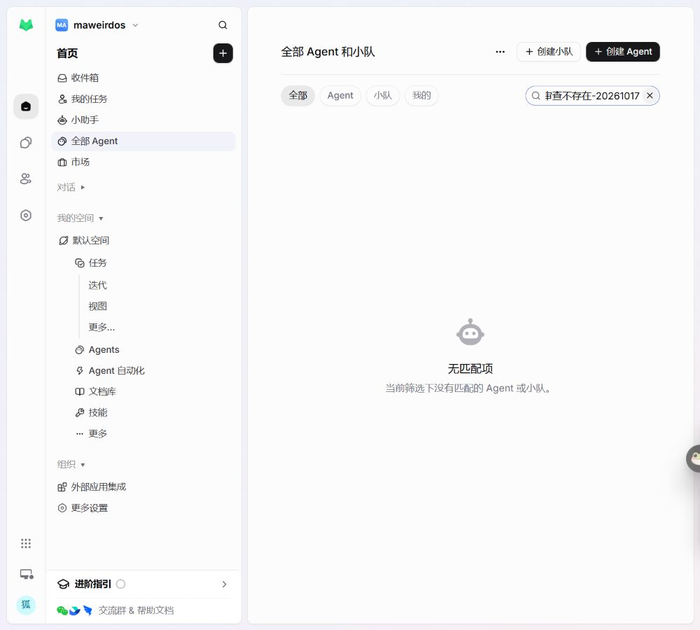

### UI05-agent-create-form — 创建Agent未提交表单

操作：只打开创建表单。

观察：区分代码开发/日常办公；设计创意禁用；名称与职位、所属空间、私有默认、Runtime、工作方式和Git仓库分别配置。

边界：未填写、未提交或安装；不验证默认值保存后的语义; visual capture did not show the dialog; no visual finding claimed。

**仅结构记录；没有可交付截图，不作视觉判断。**

### UI06-conversation-controls — 对话工作台输入与模式控件

操作：只读打开已有对话，不发送。

观察：底部提供微信/Slack/多会话视图控件；composer显示远程Runtime、工作目录控件、单对话模型与空输入禁用发送。

边界：未切换模式、未新建会话、未发送；未测并发、重试或恢复。

### UI07-existing-run-failure — 已有示例任务的历史失败

操作：只读打开既有示例任务对话。

观察：任务业务状态为待开始；动态出现执行完成1次；右侧为执行失败，环境准备18秒，模型本轮无输出；提供重试和帮助入口。

边界：历史记录，不证明当前服务仍失败；未重试或打开原始数据；截图Page.captureScreenshot在5秒超时，视觉未验证。

**仅结构记录；没有可交付截图，不作视觉判断。**

### UI08-task-discussion-structure — 任务与讨论结构

操作：只读查看已有示例任务。

观察：任务详情可见业务状态、优先级、专项、标签、更多属性、动态与对话记录页签；普通评论、回复、对话面板有不同输入；空输入提交按钮禁用。

边界：未更改任何字段、评论、反应、关注或任务关系；相关菜单和提交路径未验证；未获得完整可交付截图。

**仅结构记录；没有可交付截图，不作视觉判断。**

### UI09-task-board — 默认空间任务看板

操作：只读打开任务列表。

观察：任务按待开始/待分拣/待规划/进行中/已完成分组；需求/缺陷/任务筛选；显示设置、视图搜索与新建视图独立；仅一条示例任务。

边界：未拖拽、未改状态、未保存视图；只有示例数据不能验证大数据量和复杂层级。

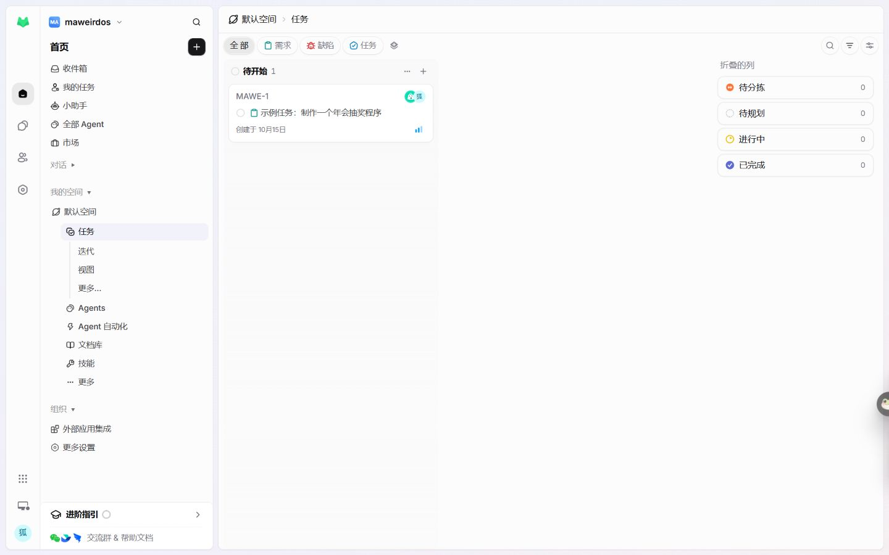

### UI10-new-workitem-form — 空间新建需求未提交表单

操作：打开空间加号，不填写或提交。

观察：当前类型为需求；标题和描述分开；处理人、业务状态、优先级、专项、标签独立；标题为空显示请先填写标题且创建禁用。

边界：未更改类型或属性、未提交、未上传附件；不验证服务端必填校验。

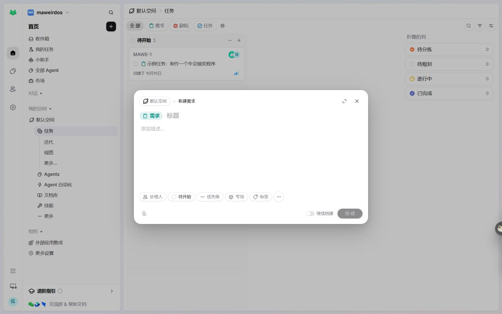

### UI11-workitem-type-menu — 工作项类型菜单

操作：只展开类型菜单，不选择。

观察：需求/缺陷/任务与管理任务类型入口分开。

边界：未切换类型或进入管理；未验证角色差异和字段迁移。

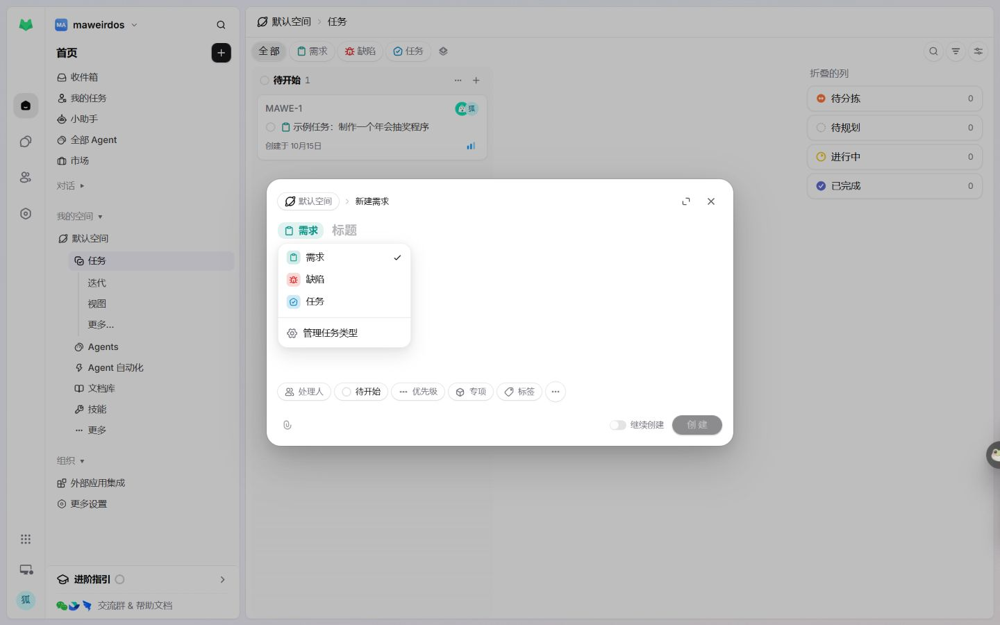

### UI12-iterations-empty — 迭代列表空态

操作：打开默认空间迭代，等实际空态出现。

观察：迭代列表/规划迭代分开；可按状态筛选；还没有迭代明确引导创建第一轮。

边界：当前无真实迭代，无法验证结束、结转、历史和跨周期统计。

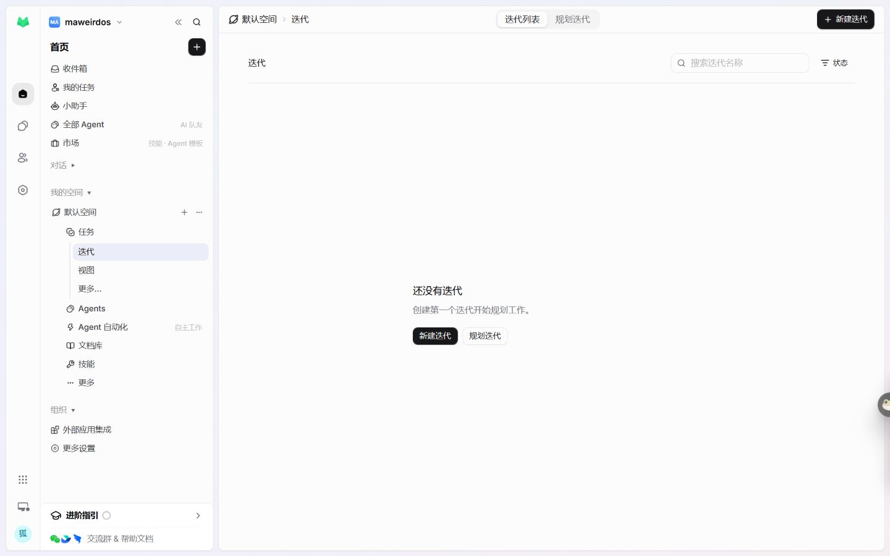

### UI13-saved-views-empty — 保存视图空态

操作：只读打开视图页面。

观察：空态说明视图保存常用任务筛选和展示方式，可按处理人、状态、专项创建；新建与帮助入口并列。

边界：未创建或保存视图，不证明多人共享与权限边界。

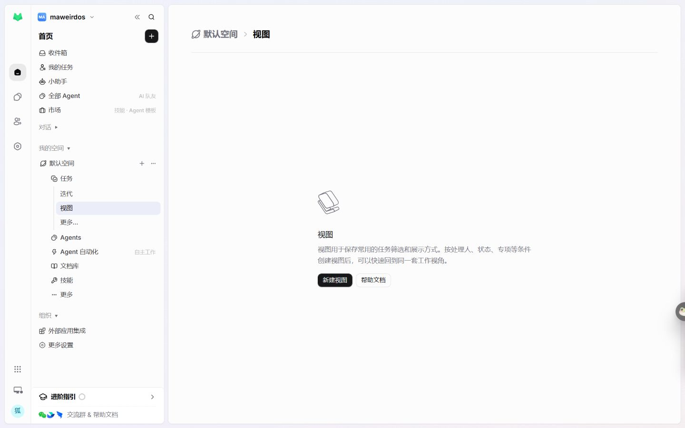

### UI14-task-navigation-more — 任务子导航扩展

操作：只展开更多导航。

观察：迭代、分拣台、视图、专项在同一任务导航扩展；各入口的固定/移除控件独立。

边界：未更改固定项或拖动导航。

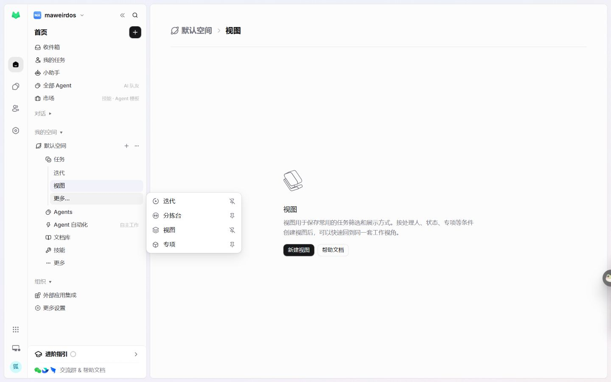

### UI15-delivery-goals-empty — 专项空态

操作：只读打开专项。

观察：将专项解释为有限起止时间的攻坚目标，对应Epic；提供创建与帮助。

边界：当前无专项；期限、负责人、进度汇总和跨任务交付未验证。

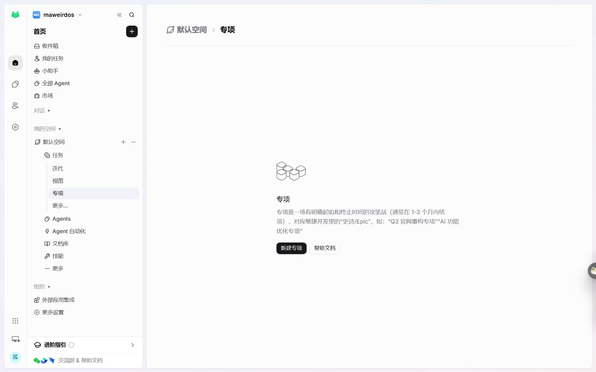

### UI16-triage-empty — 分拣台空态

操作：只读打开分拣台。

观察：待分拣任务计数为0；列表与详情双区；说明外部集成/访客任务先审核、定优先级，再接受或拒绝；责任配置单列。

边界：无待分拣记录；未配置、创建、接受、拒绝、去重或暂缓。

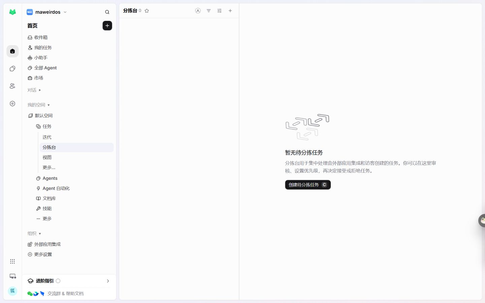

### UI17-automation-empty — 自动化空态

操作：只读打开自动化列表。

观察：说明由任务事件触发任务操作，并可组合Agent和第三方集成；仅新建入口，当前无规则记录。

边界：未新建、启用、触发或测试规则；运行历史和失败补偿未验证。

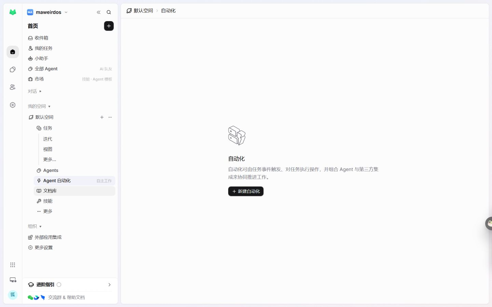

### UI18-skills-empty — 空间技能空态

操作：只读打开技能页。

观察：添加来源包括创建、URL导入和已连接电脑复制；页面处在空间上下文，空态文案同时提到组织中每个Agent可用。

边界：未导入、复制、安装或发布技能；实际可见性与执行权限未验证。

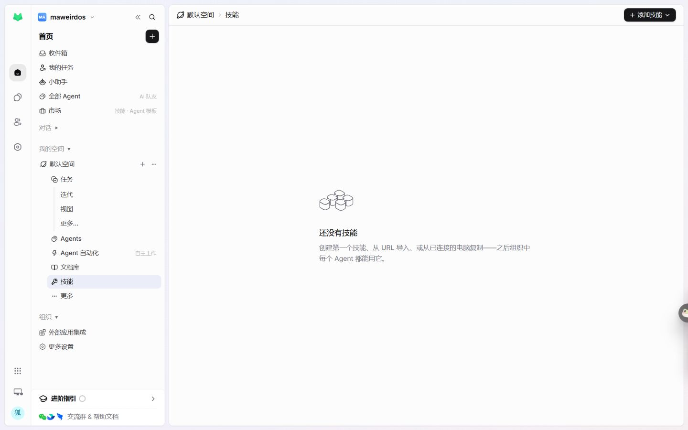

### UI19-document-library-empty — 文档库私有与团队范围

操作：打开文档库并等待正在加载消失。

观察：我的文档与团队文档分列；我的文档空态明确只属于自己；文档集、快速添加、上传文件为独立入口。

边界：未新建、上传、共享或搜索真实文档；跨设备访问和Agent实际读取未验证。

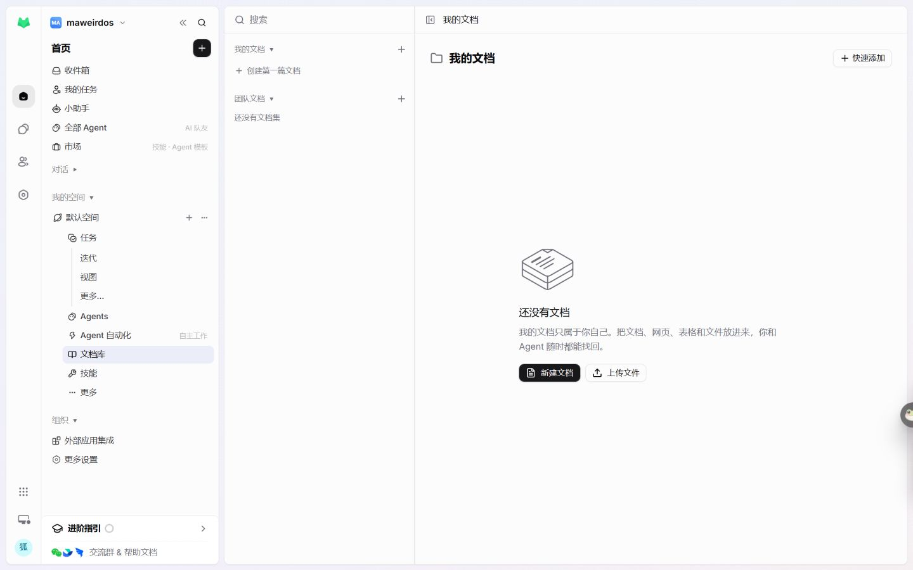

### UI20-integration-directory — 外部应用集成目录

操作：只读打开目录，不设置连接。

观察：任务管理、Git仓库、协作工具分组；入口区分设置与即将推出；部分文案描述双向更新、回链或消息发送。

边界：未打开凭据、授权、测试连接或发起同步；所有方向/范围能力仅是界面声明。

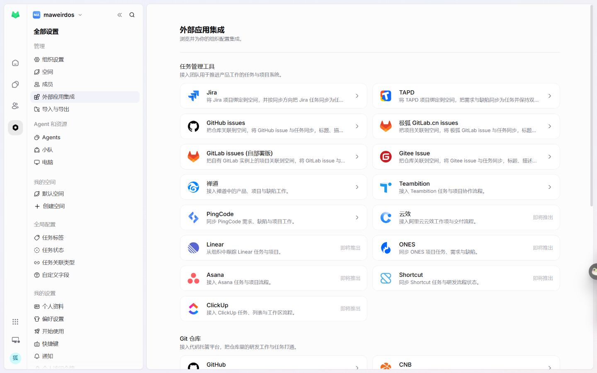

### UI21-git-and-collaboration-integrations — Git与协作工具集成分类

操作：只滚动目录到Git和协作分类。

观察：Git仓库与Git issues单独分类；协作平台与任务平台不同职责；部分未来平台显式即将推出。

边界：未连接厂商、获取凭据、发消息或执行回写；当前只有目录声明。

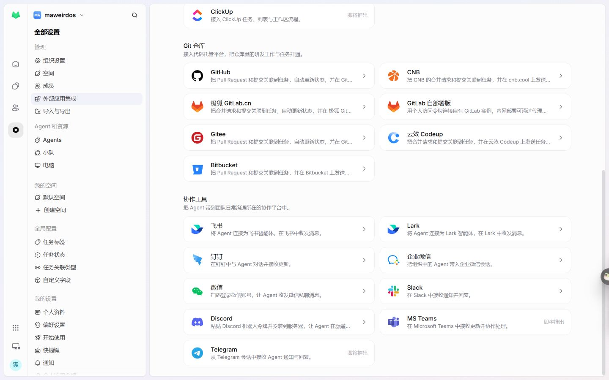

### UI22-computer-local-bridge-unavailable — 电脑与运行资源

操作：只读电脑列表，不连接或启动。

观察：本地桌面桥接能力在当前Chrome扩展访问环境中不可用，页面给出重启/更新说明；共享远程电脑为空；私有电脑列表显示可用徽标及多个Runtime图标。

边界：未启动/刷新服务，未连接新电脑，未点击电脑详情、检查凭据或执行任何Runtime；主机名与所有者不交付。

### UI23-members-role-scope — 组织成员页

操作：只读成员页，不打开邀请或操作菜单。

观察：成员与外部账号分Tab，表头分别列角色、空间、加入时间；当前只有一个所有者。。

边界：未邀请、复制链接、查看个人详情、修改角色或验证无权场景；裁切截图超时，视觉未验证。

**仅结构记录；没有可交付截图，不作视觉判断。**

### UI24-keyboard-preferences — 快捷键说明

操作：只读说明，不更改选项、不录制快捷键。

观察：发送快捷键适用于对话、评论和回复；命令菜单、移动任务和当前视图查找分别提供快捷键说明。。

边界：未修改偏好、未发送内容、未做读屏和全键盘审查；没有交付截图。

**仅结构记录；没有可交付截图，不作视觉判断。**

### UI25-agent-settings-form — 组织设置创建Agent

操作：打开未提交表单，无填写或选择；截屏后表单已不可见。

观察：空白表单将名称、职位/角色、所属空间、可见性、Runtime和工作方式分开；代码开发与日常办公可选，设计创意禁用。本次可见性显示共享，与UI05结构观察私有不同。。

边界：未创建或修改；截图超时且复查时弹层已消失，不能归因于产品；不交付视觉结论。主机名、所有者和Agent名称不交付。

**仅结构记录；没有可交付截图，不作视觉判断。**

## 7 后续最小补证

1. 以明确授权的隔离测试空间准备真实但非生产的任务、迭代、分拣和规则；覆盖创建→评论→交接→结束/失败，保留每一步回执。现阶段不执行这些写操作。
2. 第二账号分别为普通成员/访客，对同一材料做读、搜索、评论、决定、撤权与缓存恢复负例；不能仅用所有者界面推断。
3. 对选定runtime分别验证安装、认证、目录访问、排队/取消、pause不支持、断线unknown和租约保持。桌面桥接错误需在原生入口恢复后复核，不能要求真人共享先修runtime。
4. 对Jira/Git按字段和动作验证查询、导入、同步、停用、授权失效和未知回执；没有回写需求时保持不启用。
5. 使用真实原生输入、全键盘、屏幕阅读器与缩放/主题夹具补测；本次只建立目标与用例，不作标准符合性声明。

责任角色及阶段门槛见11/12；本轮没有假造人员、日期或通过记录。

---

# 实测证据到Trellis设计与验收合同（v0.5.1）

本文为D设计建议，不声称Hifox或Trellis已经具备以下行为。沿用48条FR、15项NFR、244条既有产品用例及R0–R5，不重编号、不以竞品菜单扩张实施范围。新增12条UX验收补充均为not_run；Hifox观察记录不是Trellis测试结果。09中的状态、权限、租约和版本合同仍是权威，尤其保留v0.4.1停止确认与unknown恢复修订。

## 1 信息架构与对象边界

主项目窗口继续采用：唯一项目顶栏→固定窄模块栏→可收起对象上下文→中央材料工作区→按需辅助抽屉。Hifox有组织/空间，Trellis本轮不因此引入同构层级。组织身份/共享载体由D01决定；工程root仍唯一，本机目录不是团队共享边界。

| 区域/实体 | 服务的目的 | 进入/离开规则 | 与其他实体的边界 |
| --- | --- | --- | --- |
| Project | 定位唯一工程及已有Trellis权威 | 切换校验草稿和迟到响应归属 | 不用交付目标覆盖真实root |
| WorkItem | 需求/任务全过程对象 | 列表/来源/通知均打开同一ID | 会话和材料不复制任务 |
| Notification | 告知变化 | 过滤、已读、稍后 | 已读不等于ActionItem完成 |
| ActionItem | 需要特定人对固定版本采取动作 | 指向确切对象、接收人和过期条件 | 待你与待别人分别计数 |
| Intake | 可选外部反馈接收 | 接受/重复/拒绝/暂缓 | 内部普通创建不必先进分拣 |
| Session/Run | 对话容器/一次执行 | 浏览不启动；显式预检后运行 | 业务完成与run终态独立 |
| EnvironmentObservation | 时点化环境观测投影 | 包含层级、结果、检查时间/有效期/诊断 | 建议投影字段，不新增第二环境权威；09运行资源仍为事实源 |
| Material/Revision/Publication | 草稿、固定版、共享动作 | 来源/拥有者/可见范围始终可查 | 我的、团队和Agent可见不是同义词 |
| DeliveryGoal/Iteration | 成果聚合/时间窗口 | 与工程身份独立；保留范围变化历史 | 不复制任务，不改变批准与交付结论 |

新增图 [08信息架构](diagrams/08-ui-informed-ia.svg) 是建议IA，非Hifox全站地图；[09状态投影](diagrams/09-status-projections.svg) 是逻辑读模型，不是新增任务状态机。

## 2 关键页面规格补充

### W01任务工作区：状态和责任条

头部顺序为项目/任务→真人owner与下一行动人→业务状态→固定需求/方案/交付版本。右侧执行栏用独立组展示Session/Run、终态、输入manifest、runtime/机器/目录和观测时间。无运行显示“尚未运行”，环境未检查显示“未知”；不填“正常”。历史失败提示“该次执行失败”，不写“任务失败”。验收technical/business各自列结论和证据，未运行/被阻塞保持not_run/blocked。R0尚无运行能力时不放可点击启动假入口。

恢复动作根据事实选择：缺本地桥→诊断；无权→申请对应权限；unknown→核对原动作；已核实失败→预览重试；需要新输入→新run且旧run先按ST15–19证实停止。不能用同一“继续”掩盖原地恢复和新运行。

### W03启动预检：独立层级与时效

顺序：输入manifest/方案→真人owner与适用授权→机器连接/本地服务→runtime安装/认证/能力→目录存在/写权/租约→预算/超时→动作预览。每行结果值为已验证/不满足/未知/不适用（附理由），带checkedAt与有效期。任一必需项未知或过期禁用开始，保留检查与修复入口。通过预检只允许显式“开始本次执行”，不自动执行。Runtime图标只表类型。

### W04个人工作台：交接与通知

正式待处理优先按回答/确认/审阅/解除阻塞分组；行中项目、对象、修订、发起人、等待时长与具体动词可见。通知独立页签保留未读标记，批量已读不改变业务结果。外部接收为项目内可选队列。没有正式身份服务时显示本地推导来源，不能假造团队审批人或在线状态。

### W07列表搜索与空态：新增可编辑布局概念

见 [W07线框](diagrams/W07-filter-empty.svg)。1000px和960px目标宽度中，搜索可折叠，但非空词或条件数必须留在主栏；零结果明确“当前筛选无匹配项”并给清除动作。空库解释用途；无权不泄漏标题；加载失败保留缓存及时间；本地服务不可用不得阻挡材料阅读。表格模式与看板共用筛选定义。暂存条件不自动覆盖共享默认，保存动作显示个人或团队范围。

规格建议：正文最小宽度560px；宽度不足优先收辅助区、再收上下文栏；主标题/状态条可换行，关闭/返回/清除保持可达；避免把状态文字压成只剩颜色的图标。字体、圆角和绿色强调复用现有L12令牌，具体断点必须原生实测确认。线框是设计示意，不能当交互原型或可用性通过证据。

### W08分享与资源作用域

个人材料显示“仅我/本机草稿”；共享入口预览固定版、接收范围、附件和排除项；团队列表标题同时显示真实载体（由D01选定）。技能/角色选择区显示来源、版本与适用范围；可读角色不自动获得机器或运行权限。默认可见性在各创建入口使用同一政策或明确解释继承来源，变为更宽范围需要明确发布动作。实际能力表由后端鉴权投影；不能靠侧栏区位判断权限。

### W05集成目录与回写预览

目录按任务来源/代码构建/消息渠道分组，卡片标可配置、待授权、已授权未绑定、已绑定、失效或未知。每个状态附最近核验时间。Jira Issue导入和Git PR/构建关联分开；“同步到本地”不承诺零回写。写评论、更新字段、创建任务、发送IM为独立动作，各有目的地、身份、授权与回执。未知优先核对，不一键重发整个包。

## 3 主流程和异常流程补充

| 场景 | 正常路径 | 异常、取消或恢复 | 责任和门槛 |
| --- | --- | --- | --- |
| 普通本地创建 | 项目内新建→标题/正文→受控创建→未分配草稿→真人接手 | 空标题说明；切项目隔离草稿；双击同operationId；无桥仍可读 | R0维护者；正式确认前FR-010 |
| 接收通知和交接 | Notification打开固定对象→定位ActionItem→适用动作→独立回执 | 过期显示新版本；已读不完成；无权不展示正文 | R1协作者；适用授权与版本 |
| 共享个人材料 | 选固定修订→检查范围→预览排除项→发布→接收者另机核验 | 取消无发布；无回执保留本地；撤权阻新动作，已下载副本边界明示 | R1共享维护者；D01/D05 |
| 预检执行 | 选runtime/机器/目录→层级观测→显式开始→运行事件 | 本地桥不可用不装作机器全离线；未知先查；停止未确认保留旧lease | R3机器/运行负责人；ST与SEC |
| 错版交付 | 核对manifest/方案/代码构建/环境→测试→双验收 | 标识未知或错配为blocked；交付负责人更换正确包，保留失败引用 | R1手工闭环，R4自动核验增量 |

## 4 可测量验收补充与追溯

所有用例均为拟议的Trellis产品测试，status=not_run。执行环境、数据、操作者与结果将来逐次记录，不能以本次截图代替通过。机器可读数据见 [ux-acceptance.json](ux-acceptance.json)。

| ID/版本 | 需求 | 输入/动作 | 可观测期望 | 方法/证据 |
| --- | --- | --- | --- | --- |
| UXAC01 R3/R4 | FR-035, FR-030 | 业务任务待开始、既有run失败，打开任务 | 业务状态不改变；执行区显示该run失败、时间和输入版本；验收保持未验证；回合结束不得显示交付通过。 | R0仅静态展示回归；R3实际Run事件/输入基线与业务状态对照；R4测试/验收事实投影验证及无写入断言；静态夹具不得关闭整项；UI07-existing-run-failure |
| UXAC02 R0/R1/R3 | FR-004, FR-027 | 本地桥接不可用但有私有电脑在线缓存，打开预检 | 电脑连接、本地服务、安装/认证、目录、预算分别显示时间与未知；开始本次执行禁用且说明缺项；材料/真人协作可继续。 | R0提示与导航夹具；R1真人共享权限；R3实际预检故障/时效与开始门槛；静态图不代替就绪；UI22-computer-local-bridge-unavailable |
| UXAC03 R1/R2 | FR-012, FR-013, FR-022, FR-023 | 同一对象有通知、正式ActionItem与外部接收记录，标通知已读 | 仅通知readAt改变；ActionItem未完成；接收记录不自动接受；任何普通评论和打开页面均无run。 | 三对象差分和run计数检查；UI01-inbox-empty, UI16-triage-empty |
| UXAC04 R0/R1/R2 | FR-004, FR-017, FR-020 | 分别加载无记录、筛选零结果、无权、离线缓存和加载失败 | 五种状态有各自原因/恢复；不把旧缓存清空；无权不显示对象标题；创建按钮只在可创建空库出现。 | 状态夹具逐屏和权限负例；UI12-iterations-empty, UI13-saved-views-empty, UI19-document-library-empty |
| UXAC05 R1/R2 | FR-017, FR-020 | 视口1000和960px，已有搜索词及两项筛选，收起搜索 | 仍显示非空查询或条件数、零结果原因与可达清除；展开恢复原值；清除后列表恢复且不保存共享视图。 | 响应式截图、键盘清除和网络写入断言；UI03-agent-search-empty, UI04-narrow-search-expanded |
| UXAC06 R0/R1/R2 | FR-004, FR-010, FR-018 | 打开普通创建空表单，标题为空；输入后关闭/切项目 | 空标题禁用并有可感知原因；可留未分配草稿；返回恢复或明确放弃；确认一次只创建一个稳定任务，无Agent启动。 | 草稿恢复/幂等和run计数；提交只在测试空间；UI10-new-workitem-form, UI11-workitem-type-menu |
| UXAC07 R1/R3 | FR-011, FR-017, FR-025, FR-033 | 从个人材料或私有角色请求发布至团队/Agent | 预览来源、固定修订、接收范围、附件及排除项；取消无共享；发布后接收者另机同指纹读取；不能因角色共享而获取机器/执行权。 | 双账号/两设备和ApplicableChecks负例；UI18-skills-empty, UI19-document-library-empty, UI25-agent-settings-form |
| UXAC08 R1/R4 | FR-007, FR-036, FR-038, FR-039 | 连接器已授权但未绑定项目，打开对象集成 | 分别显示已授权/未绑定/未同步；每个外写动作列目的地/字段/身份；未知回执先核对，不能一键盲重试。 | 假连接器与回执故障夹具；UI20-integration-directory, UI21-git-and-collaboration-integrations |
| UXAC09 R0/R2 | FR-001, FR-021, FR-024 | 工程root A含跨两迭代交付目标，切迭代并查看目标 | 工程身份不变；目标和时间窗口为独立实体；移出/结转记录保留，计数注明分母且不复制任务。 | 关系与范围变更夹具；UI12-iterations-empty, UI15-delivery-goals-empty |
| UXAC10 R3/R5 | FR-025, FR-041, FR-042 | 打开技能/自动化页面，再预览已配置规则 | 浏览不安装或执行；预览展示固定版本、身份、权限、预算、人工等待；重复事件/重启不重复外写；未授权规则不能启用。 | 隔离规则沙箱与重复事件断言；UI17-automation-empty, UI18-skills-empty |
| UXAC11 R0/R2/R3 | FR-001, FR-020, FR-032, FR-048 | 在960/1440px阅读版本材料，开关辅助会话和工作视图 | 任务、修订、阅读锚点和草稿保持；窄屏辅助抽屉不盖住关闭/主要操作；呈现切换不改权限、不启动进程。 | 视口截图、焦点与状态差分；UI06-conversation-controls, UI09-task-board, UI14-task-navigation-more |
| UXAC12 R1/R3/R4 | FR-016, FR-027, FR-030, FR-047 | 外部动作发送后断线导致unknown，点击恢复入口 | 说明已保留结果、待核对象、责任人与安全下一步；核对先于重发；停止确认前旧lease保留；复制诊断默认不含令牌、私人路径或正文。 | operation/run故障注入和脱敏检查；UI07-existing-run-failure, UI22-computer-local-bridge-unavailable |

## 5 实施顺序与估算影响

本轮不新增阶段或功能主编号。W00/W01只承接下表可独立成立的R0静态展示、本地空态与基础行为子断言；不能据此将跨阶段UXAC整项判为通过。**完整UXAC01必须在R3/R4以实际Run及验收投影核验，禁止用R0静态夹具提前关闭。** 其余用例也按子断言的适用阶段分别留证，尚未到达或未实施的子断言继续not_run；整项只有全部适用断言通过才可关闭。

| 用例 | R0可承接的子断言 | 后续阶段、依赖和工作包 | 整项关闭边界 |
| --- | --- | --- | --- |
| UXAC01 | R0 W00/W01：仅业务/执行/验收标签分组的静态展示 | R3 W12/W13：实际Run、输入版本、业务状态独立；R4 W15：测试/验收事实投影和联动 | R3/R4真实Run及验收投影；R0静态夹具不得关闭完整用例 |
| UXAC02 | R0 W01：本地桥缺失提示、未知文案与材料仍可读 | R1 W04/W05：真人共享无需运行权；R3 W12：实时分层预检、时效、禁用开始及修复入口 | 适用R1/R3子断言完成后；静态在线/错误图不等于runtime就绪 |
| UXAC04 | R0 W01：本地无记录、加载失败、缓存保留的静态/本地断言 | R1 W04：无权/共享离线缓存；R2 W10：真实视图筛选零结果及不泄漏对象 | 按各场景真实数据/权限验证，R2覆盖完整组合；不能只跑空态夹具 |
| UXAC06 | R0 W01：本地标题必填、草稿、受控创建与重复提交 | R1 W05：正式分配/真人门槛；R2 W10：任务类型和管理权限（启用分类时） | 各适用阶段分别保留结果；R0不关闭R1正式门槛或R2分类行为 |
| UXAC11 | R0 W01：项目/材料定位、草稿、辅助区收起与正文可读 | R2 W10：共享视图临时呈现不覆盖；R3 W14：真实Session/Run、权限和进程无隐式变化 | 到R3真实会话/运行断言核验；静态线框或无后端夹具不得提前关闭 |

R1承担UXAC03/07/12适用的手工交接、共享作用域与回执；UXAC12中的实际运行、停止和租约断言仍依赖R3。W10承担视图/计划细化；W12–14承担环境/执行；W15–17承担集成；W18–19承担自动化。不得让自动化先于共享身份、版本决定、停止确认和外部账本。本轮所有244条原产品用例及12条UX补充均not_run，文档一致性检查与静态夹具都不是产品阶段退出证据。

19张截图减少入口、空态和信息层次的不确定性，未降低双账号/两设备、runtime差异和集成故障的工程成本。W00现有2/3/5人日范围中复核本轮证据，后续估算前先扣除当前项目任务已经完成的实现，若作用域/预检后端合同缺失则重新估算W04/W12；不擅自调整总人日或承诺日期。2开发+兼职产品/测试和外部审批不计入的假设仍成立。

## 6 新增开放决策与关闭证据

| 决策 | 推荐与取舍 | 决策角色/最晚门槛 | 关闭证据 |
| --- | --- | --- | --- |
| D10 资源范围与默认发布策略 | 个人草稿默认最小范围；团队发布显式；入口继承必须解释 | 产品＋共享维护者，R1共享实现前；角色资源R3前 | 两入口同政策/可解释继承、双账号、取消无扩权 |
| D11 预检观测有效期 | 各层独立时间/过期；执行前必需项重新核实；不统一一个可用点 | 运行维护者，R3预检实现前 | 本地桥缺失/认证失效/目录改动/离线缓存夹具 |
| D12 响应式与错误文案词汇 | 960/1000/1440px先验证，正文优先；空、零结果、无权、失败分词 | 桌面维护者＋质量，R0出口/对应R2出口前 | 原生输入、两主题、缩放与完整键盘截图/记录 |

D09仅部分缩小：收件箱/分拣/独立会话入口和空态已观察；并行、任务完成联动、真实交接和原生行为仍开放。D01–D08、历史AC9 blocked_external/AC10 not_run均没有因此关闭。

---

# v0.4 独立审查修复对照

> 本文保留v0.4/v0.4.1审查历史；当时UI未实测的描述已由v0.5第15/16章更新。原合同修订继续有效。

v0.3是有实质内容的评审稿，但其中模型/阶段/图示不足以直接实施。v0.4保持48条FR，不以增加数量代替修复；本版仍是待产品/技术确认的需求合同，不启动实施。以下逐条说明改动、实际检核对象与剩余限制。

| 审查问题 | 本版实质修复 | 同步文件/图表/测试 | 本轮验证边界 |
| --- | --- | --- | --- |
| 1 P0局部/整版批准矛盾 | 稳定Requirement ID与不可变逐项修订；包manifest冻结映射；依赖/覆盖闭包；owner整理、产品/技术指定评审确认影响；部分批准/聚合/过时/撤回/并发规则 | 07 FR-003/008/009/014；08 US04/W02/US13；09§2；AP01–08；model-contracts | 定义和引用一致性核验；未实施审批服务 |
| 2 P0基数/owner矛盾 | 草稿/未分配例外与正式门槛；SourceRefs数组；Session可空任务而Run必属Session；手工Evidence允许空originRun；验收证据只用多对多join；补需求测试/方案/授权记录 | 09§3/4/6；ER05/05b；FR-010/031/040；T010/T031/T040/SEC；model-contracts | 关系JSON、ER与字典逐项对照，未做物理库迁移 |
| 3 P0执行状态缺出口 | ST01–21列事件、操作者、守卫、副作用、lease/恢复；覆盖排队/预检/启动/等待取消、拒绝/过期、断连unknown、核对恢复与晚到终态；controlHold、支持pause才paused、不支持则stop | 09§5；06/06b；FR-028–030；T029/T030/ST01–21 | 图分两张保证可读，转移表是完整权威；运行故障测试均not_run |
| 4 P1图表语义 | 实现/方案/需求/环境失败分流；可无外部写回的手工交付；开发工具移为无R4必需边的可选支线；DFD补共享发布与读取决定响应及全部外部方向 | 业务01、上下文02、分层03、路线07；09§7；11 | 上下文/分层外部方向清单核对及渲染目检，不声称进程拓扑已实现 |
| 5 P1 R1/R4边界 | R1手工manifest/方案/实际包hash/适用代码构建/环境/测试/双验收/证据/恢复owner；持久回执和接收者跨设备核对；R4只增强连接器与治理 | 11§1/2；FR-014/015/034/035/040；T015/T034；阶段门槛 | R1出口不引用R4测试代替手工验收；实际跨人仍需试点 |
| 6 P1缺人工流程 | 普通本地创建、Trellis适配不支持时降级；方案修订/评审/覆盖拆解/驳回；重开/取消；owner离开和成员撤权重分配；并发冲突处理 | 08 US09–13；09§4；FR-004/005/010/012/014/019；相应T测试 | 保留Trellis权威，不凭文档为适配器宣称新能力 |
| 7 P1验收不够 | FR每条有4个独立义务及具体输入/动作/期望；交叉AP/ST/SEC/NF；JSON/CSV与13完整案例，FR→O→测试→来源→阶段明确；NFR强制/条件门槛落11 | 07/10/11/13；requirements/test-cases/state-transitions JSON | 产品测试全部not_run；结构/语义检查通过不等于产品通过 |
| 8 P2权限/估算 | ApplicableChecks先确定再求交；读/评论无需机器权；离线只读/草稿、重连撤权校验与已下载副本边界；22个工作包列M/C/O、依赖、责任角色和最晚阶段门槛 | 09§6；11§2/3；SEC01–08；NFR；12补充 | 未编造日历/姓名，不承诺即时收回离线独立副本 |

## 未解除的事实限制

U01–U22业务页面仍未实测。桌面原生查看入口不可用；Chrome官方网页端已到登录页，等待用户自行登录现有账号，未操作认证。WEB-01帮助站/WEB-02登录门槛不是业务流程截图。W01/W02是布局概念，未构成完整视觉原型、交互或可访问性验证。

现有源码和历史报告L、官方H/PH、设计D与未实测U继续分开。共享/身份/字段权威/runtime支持等决策仍需在对应阶段门槛关闭。没有产品代码、任务状态、Git提交/推送操作。

## 检查方法

除文档结构/链接/图像/指纹外，本版增加语义一致性检查：稳定修订与聚合定义、nullable基数及join、owner门槛、取消/unknown/hold转移、可选依赖、DFD方向平衡、R1手工/R4增量、FR义务到具体测试、NFR阶段门槛。结果与视觉复核保存在checks。本页不是外部审查者已批准v0.4的声明，父任务可继续独立核验。

## v0.4.1 精确安全修正

父任务独立复核认可v0.4八项修复，本补丁只关闭两个剩余运行控制缺口，其他产品需求、阶段与估算不变。

1. ST15与06b将输入变更的paused→stopped改为paused→stopping。发出stop不代表已停止；ST19匹配当前run/generation的可信停止确认，或ST18可信终态与副作用核对，才允许释放旧租约并预检关联新run。停止确认超时进入unknown，旧租约保留，不能直接标stopped。
2. ST16明确纳入hold_requested，记录暂停/停止请求与确认丢失。ST17核对同一进程：证实暂停才paused并保留hold；仍活动且有hold则回hold_requested处理安全pause或stop；无法确定保持unknown。过期或旧generation回执不得解除hold或释放租约。

对应ST15/ST16/ST17/ST19的状态表、测试输入与结果、JSON/CSV、06b可编辑源和渲染已同步；244条产品用例仍全部not_run。验证结果为文档合同与图表检查，不是运行时实测。Hifox业务UI限制不变。

## v0.5.1独立复核最小修正（2026-10-17 UTC）

1. UI03真实视口为1000×900；纠正损坏的元数据。所有19张已接受JPEG新增从SOF解析的image_size，独立记录viewport、单位与viewport/viewport_crop；图像字节和SHA256完全不变。校验脚本检查尺寸合理性、图片尺寸与元数据一致及裁切/全视口分类。
2. U08任务对话降为structure_only，仅UI07/UI08是直接证据。UI06为独立Agent会话，只留related_entry_references，不填补任务对话视觉覆盖；JSON、CSV及06/15同步。
3. 16第5节按子断言细分阶段；W00/W01只承接R0静态/本地基础，完整UXAC01必须在R3/R4实际Run和验收投影核验。其余跨共享、视图和运行的子断言留在对应阶段。静态夹具不能提前关闭整项，全部产品用例仍not_run。

没有新增调研或截图，不改变48条FR、15项NFR、15张图源、R0–R5及v0.4.1可靠执行合同。

---

# Trellis Panel 深入调研与证据边界

版本 v0.5.1。当前网页实测见15/16及本章第5节；第2节和第9/10节保留v0.4.1以前的工具/登录历史。核对时间 2026-10-16 UTC；Windows 本地日期可能为 10 月 17 日。面向产品、开发、测试与实施评审者。建议继续既有 R0–R5 顺序，但把 R1 的版本确认和跨人共享作为产品闭环的硬出口，把运行控制及自动化放在各自依赖成立之后。

## 1 范围与研究方法

本次读取真实项目、适用 AGENTS、Trellis 工作流与 brainstorm/before-dev 技能、相关源码和当前任务记录；按 Product Design audit 技能核查截图能力。进行文件读取、官方资料核对以及登录网页的低风险导航和截图；没有提交业务写入或运行Agent，没有执行 AI 作业、Jira 写回、邀请、令牌创建、删除、付款或发布。

证据标签统一为 **L 本地文件核对**、**H 官方文档声明**、**WEB 帮助站界面截图**、**U 本机应用实测**、**D 设计建议**、**P 待验证命题**。L 证明该检查点的代码或记录存在，不证明界面可用；H 证明公开说明，不证明当前客户端行为；D 不表示实施授权。v0.5已有19张经目检网页截图、25条观察记录；U01–U22各有部分观察或结构记录，仍未完成全路径验证。原生桌面专属行为没有实测。

历史 `source-manifest.json` 的 47 页和 S01–S47 编号保持原样，是前次研究元数据，不冒充本次重新抓取。新 H01–H14 为本轮实际打开的关键官方页面；H14 的 scope 结论由已物化父研究 PH46 补充核实。未进行目标用户访谈，画像和需求价值是基于已有团队流程的假设，需在试点验证。

## 2 本机与工具预检

项目位于 `D:\my_demo\trellis-panel`；现有 roadmap 位于本目录，工程历史位于 `docs/roadmap.md`。HiFox 进程可见，安装入口 `D:\my_soft_install\HiFox\HiFox.exe`。进程存在不能证明窗口、版本、登录或组织权限可用。

| 工具 | 实际结果 | 对研究的影响 |
| --- | --- | --- |
| PowerShell 文件和进程读取 | 可用；`rg` 不存在，改用原生检索 | 完成静态基线，不做 UI 自动化 |
| CUA inventory | apps=[]；有 Chrome 扩展及帮助站标签页 | 可以观察帮助站；没有返回可选的本机 Hifox 窗口 |
| CUA 原生控制 | 工具说明明确 native APIs disabled | 不调用原生鼠标/键盘、截图或 launch 绕过限制 |
| Windows Computer Use 技能 | 要求 node_repl + @oai/sky；当前工具集无 node_repl | 不以 shell、私有协议或自制自动化替代 |
| 工作区依赖加载 | 返回 only supported for local threads | DOCX 专用托管构建/渲染环境未取得；交付原生 Markdown、HTML 和可编辑图源 |
| 父任务普通消息接口 | 两次返回 thread not found | 阶段发现以正常进度输出供父任务读取 |

Product Design user-context 预检结果为 missing，无保存偏好可引用。没有读取凭据、用户业务数据库、Hifox 静态包或私人聊天。仓库有大量 staged/unstaged 改动；本轮仅在既有文档目录增补，不改产品代码、任务状态、索引或提交。

## 3 本地证据索引

| ID | 文件与定位 | 本轮确认 | 不可推断 |
| --- | --- | --- | --- |
| L01 | `src/shared/types.ts:36` TaskRecord | 有状态、负责人、分支、材料等字段；无正式版本审批实体 | 不能把负责人文本视为登录身份 |
| L02 | `src/main/services/scan.ts:107`、`:443` | 解析失败返回诊断；面板元数据编辑白名单排除 status/completedAt | 面板不能绕过 Trellis 生命周期权威 |
| L03 | `src/main/services/handoff.ts:29` | 确定性材料索引，列真实文件与已知缺失 | 交接包被复制不证明 Agent 已读取或遵守 |
| L04 | `src/main/services/acp.ts:137`、`:163`、`:211` | 会话按 root 过滤；恢复依赖能力声明；权限关联 generation/turn | 不保证所有 runtime 无损恢复或跨机迁移 |
| L05 | `src/shared/types.ts:1677` | ACP 有 starting/ready/busy/awaiting_permission 等运行状态 | 不是业务任务状态机 |
| L06 | `src/renderer/src/my/navigation.ts:17`、`:60` | 八个并列模块，区分项目/应用/本机/混合范围 | 导航标签不等于权限隔离 |
| L07 | `src/renderer/src/my/adapter.ts:118`、`:127` | comments 为空，成员从 creator/assignee 派生 | 不是正式团队讨论、成员授权或在线状态 |
| L08 | `src/main/services/flow-run.ts:40` | 本地流程记录通过临时文件更名保存 | 不证明跨机等待、重启续跑与外部补偿成熟 |
| L09 | `.trellis/tasks/10-11-cockpit-s0-glass-box/validation/ac-matrix.md` | 历史 AC9 blocked_external，AC10 not_run | 本轮未重跑，不能关闭旧缺口 |
| L10 | `.trellis/tasks/10-16-project-workspace-uiux/prd.md` | 项目窗口、窄模块栏、中央材料工作区正在推进 | 不能宣称视觉或原生窗口验收通过 |
| L11 | `.trellis/tasks/10-16-acp-runtime-foundation/task.json` | 最新记录有打包验证报告，原生输入/草稿/视觉项仍待补 | 旧版“只有 mock”的描述需更新；本轮未复现报告 |
| L12 | `src/renderer/src/my/my.css:1` | 现有绿色强调、Inter/微软雅黑回退、4/6/8/12 圆角和语义令牌 | 不允许仅为竞品对齐重做风格 |

精确基线指纹与采集文件清单见 `checks/baseline-hashes.json` 和 `checks/local-evidence.json`。行号是研究检查点，后续代码变化应以内容符号重新定位。

## 4 官方资料索引

以下为原创概括；引用点保持可追溯，不把整站正文复制入仓库。

| ID | 来源 | 本轮用途 |
| --- | --- | --- |
| H01 | [产品定位与渐进式采用](https://help.hifox.com/docs/welcome) | 编排既有编码工具；团队流程和任务上下文连续。 |
| H02 | [执行与任务](https://help.hifox.com/docs/agent-and-computer/agent-task-execution) | 运行、排队与业务状态需要分开阅读。 |
| H03 | [电脑](https://help.hifox.com/docs/agent-and-computer/computers) | 连接与 runtime 就绪是不同条件。 |
| H04 | [工作目录](https://help.hifox.com/docs/agent-and-computer/working-directory) | 并行 worktree 与共享目录串行是不同策略。 |
| H05 | [任务](https://help.hifox.com/docs/space/tasks) | 任务承载业务内容、负责人及协作关联。 |
| H06 | [收件箱](https://help.hifox.com/docs/agent-and-computer/inbox) | 通知聚合、已读和处理分开；新文档把对话交接移至对话模块。 |
| H07 | [Agent 对话](https://help.hifox.com/docs/agent-and-computer/chat-with-agent) | 独立与任务对话分开；任务会话归属、发起人和交接对象需明确。 |
| H08 | [Jira](https://help.hifox.com/docs/integration/jira) | 导入和同步不同；方向标签不能证明严格只读。 |
| H09 | [自动化](https://help.hifox.com/docs/space/automations) | 触发、执行身份、范围和运行记录是独立配置。 |
| H10 | [成员](https://help.hifox.com/docs/space/members) | 组织角色、空间成员和空间角色不能混为一项权限。 |
| H11 | [视图](https://help.hifox.com/docs/space/views) | 个人呈现、共享定义和任务本体分离。 |
| H12 | [迭代](https://help.hifox.com/docs/space/iterations) | 时间窗口和未完成范围需要明确处理。 |
| H13 | [分拣](https://help.hifox.com/docs/space/triage) | 外部反馈可先判断接收与重复，不能代替个人待办。 |
| H14 | [个人访问令牌](https://help.hifox.com/docs/cli/access-tokens) | 父任务提示细粒度 scope 缺口；不能据此接受无范围授权。 |

## 5 Hifox 应用覆盖矩阵（v0.5当前）

现有登录网页可访问，来源是Chrome extension、配置「维」、已有标签754833790；不是原生窗口。19张实际截图均已目检；25条记录中6条仅结构。完整步骤/图片和局限见[15实测审查](15-hifox-uiux-audit.md)，设计与验收见[16增补合同](16-ui-derived-design-contracts.md)。没有一行被标为全路径通过。

| 编号 | 页面 | 核查范围 | 结论与边界 | 证据 |
| --- | --- | --- | --- | --- |
| U01 | 启动、登录后首页、组织/空间切换 | 版本、身份范围、无空间、离线 | 已登录网页首屏；未测登录、组织切换、无空间、离线和原生启动版本。 | UI01-inbox-empty, UI19-document-library-empty |
| U02 | 全部任务/空间列表 | 列表、看板、搜索、筛选、零结果 | 仅示例看板与类型过滤入口；列表模式、复杂筛选、大数据量未验证。 | UI09-task-board |
| U03 | 已有任务详情 | 标题、人员、状态、材料、历史、返回位置 | 仅已有示例任务结构和历史失败；材料返回位置、完整视觉未验证。 | UI07-existing-run-failure, UI08-task-discussion-structure |
| U04 | 新建任务表单 | 必填提示、取消、未保存草稿 | 空标题禁用、类型菜单、关闭已观察；未提交，不证明服务端幂等与保存。 | UI10-new-workitem-form, UI11-workitem-type-menu |
| U05 | 类型、标签、关系 | 菜单分类、循环依赖/重复解释 | 类型入口与属性结构已观察；标签编辑、循环依赖与重复合并未验证。 | UI08-task-discussion-structure, UI09-task-board, UI10-new-workitem-form, UI11-workitem-type-menu |
| U06 | 任务评论与回复 | 锚点、已解决、@ 真人/Agent 语义 | 评论/回复结构已观察；未发送，不证明通知、锚点、解决和@语义。 | UI08-task-discussion-structure |
| U07 | 对话模块 | 发起者归属、等你/等人、行定位、未读 | 独立会话控件已观察；等你/等人、未读、发起者、并发未验证。 | UI06-conversation-controls |
| U08 | 任务对话 | 历史、多会话、布局和返回 | structure_only：仅任务对话结构和历史执行观察，没有可交付的任务对话截图。UI06仅为独立Agent会话入口参考，不计任务对话视觉覆盖；新运行、继续、取消、真实交接和布局恢复未验证。 | UI07-existing-run-failure, UI08-task-discussion-structure |
| U09 | 收件箱 | 聚合、重要、已读/稍后与对话分工 | 个人通知空态；无真实通知，不证明聚合、已读或稍后副作用。 | UI01-inbox-empty, UI16-triage-empty |
| U10 | Agent 列表与详情 | 无 Agent、禁用、职责、runtime | 列表、搜索零结果实测；创建表单结构观察；禁用/详情/保存未验证。 | UI02-agents-overview, UI03-agent-search-empty, UI04-narrow-search-expanded, UI05-agent-create-form, UI25-agent-settings-form |
| U11 | 电脑与 runtime | 在线/离线、连接/安装/登录区分 | 电脑页本地桥接提示已观察；私有可用徽标仅结构观察；安装、认证、真正执行未验证。 | UI05-agent-create-form, UI06-conversation-controls, UI07-existing-run-failure, UI22-computer-local-bridge-unavailable |
| U12 | 工作目录/仓库 | 目录来源、锁、worktree 策略和权限 | 只看到会话目录入口与创建表单Git工作方式；未打开目录选择、锁和worktree策略。 | UI05-agent-create-form, UI06-conversation-controls |
| U13 | 技能与小队 | 依赖、空态、队长与成员职责 | 技能空态与Agent/小队Tab入口已观察；小队详情、依赖、队长、执行均未验证。 | UI02-agents-overview, UI18-skills-empty, UI19-document-library-empty |
| U14 | 成员与空间权限 | 可见、无权、角色范围和邀请副作用 | 组织成员角色/空间列结构可见；只有所有者，普通成员、访客和拒绝场景未验证。 | UI23-members-role-scope, UI25-agent-settings-form |
| U15 | 专项/交付目标 | 范围、负责人、进度和空态 | 专项解释与空态；无实际目标，负责人、进度、结束路径未验证。 | UI14-task-navigation-more, UI15-delivery-goals-empty |
| U16 | 保存视图 | 私有/共享、临时更改、重置、窄屏 | 保存视图空态；未创建、保存、共享或重置，权限未知。 | UI09-task-board, UI13-saved-views-empty |
| U17 | 迭代 | 当前/历史/无迭代、结转语义 | 迭代空态与过滤入口；无历史，不验证结束和结转。 | UI12-iterations-empty |
| U18 | 分拣台 | 接受/重复/拒绝/暂缓菜单及空态 | 分拣入口与空态；未分拣、配置或接收外部记录。 | UI14-task-navigation-more, UI16-triage-empty |
| U19 | 自动化 | 触发、范围、历史、失败原因 | 自动化空态与用途说明；未启用、运行、检查历史或补偿。 | UI17-automation-empty |
| U20 | Jira/Git/IM 集成 | 只读连接状态、字段方向、失效授权 | 目录分类和UI文案；没有连接、同步、回写或失效授权测试。 | UI20-integration-directory, UI21-git-and-collaboration-integrations |
| U21 | 设置/CLI/PAT | 能力说明、掩码、撤销提示 | 设置导航、成员/集成/快捷键说明；未打开PAT、CLI、账号绑定或凭据页。 | UI20-integration-directory, UI23-members-role-scope, UI24-keyboard-preferences |
| U22 | 键盘/缩放/主题/窄屏 | 焦点、读序、状态非色彩表达 | 1000×900与1440×900网页视口、搜索展开和Esc关闭菜单；无原生/读屏/完整键盘/主题测试。 | UI03-agent-search-empty, UI04-narrow-search-expanded, UI24-keyboard-preferences |

## 6 竞品分析与设计含义

| 产品层面 | HiFox 官方说明 H | Trellis 现状 L | 可借鉴建议 D |
| --- | --- | --- | --- |
| 核心工作对象 | 任务承载人和 Agent 的协作 | 真正任务来源是 `.trellis` 和 Jira 绑定 | 同一个任务串联需求、版本、执行、证据，避免新造任务库 |
| 入口 | 任务与对话同时可达，文档描述仍在演化 | 模块已并列，API 问答另有本机范围 | 一个会话多个入口，打开精确任务和会话，不生成副本 |
| 交接 | 对话显示等你/等人，通知另聚合 | 正式审批与多人权限尚未成立 | 以 ActionItem 记录谁对哪个版本做什么；界面是投影 |
| 执行信任 | 机器、runtime、目录、队列分开 | ACP root、generation、turn 已有基础 | 分别显示业务/执行/交接/环境状态，不用一个绿点概括 |
| 计划 | 视图、专项、迭代用途不同 | 周迭代在推进，业务“项目”已明确 | 交付目标避免再叫项目；共享视图不复制数据或提升权限 |
| 集成 | 多任务系统、Git 和 IM | 已有 Jira/GitLab 服务，持续同步未全面证明 | 先满足实际 Jira 实例、逐字段授权，不复制全部厂商清单 |
| 自动化 | 事件、计划、小队等组合 | 本地 flow 基础存在 | 先手动闭环与持久证据，后小范围自动化；保留人工节点 |

本轮未实测 Plane、IDEA、Paseo 等产品；沿用前版“候选参考”而非新增竞品事实或最终选型。它们的版本、许可和可用性需另做技术试验。

视觉与交互可借鉴的模式是明确当前对象、可收起辅助信息、同一任务的就地会话、区分待办对象和通知、渐进展示环境配置。本轮只对已保存网页截图作定性布局观察，不测绘竞品像素值；Trellis 继续现有绿色强调与语义令牌。帮助站的三栏导航不作为桌面产品布局依据。

## 7 矛盾与风险登记

| ID | 问题 | 本轮处理与验证方式 |
| --- | --- | --- |
| P01 | 同一 Agent 并行会话的旧新说法不同 | 不推断并发保证；R3 对选定 runtime 的会话、目录与并发限制分别测 |
| P02 | 旧评论/关注页指向 Inbox，新对话专页移至 Conversations | U07控件与U09空态部分观察，真实交接未验证；Trellis 采用一份 ActionItem 多入口投影，入口名称待 UI 补证 |
| P03 | Jira → HiFox 标签不保证零写回 | 只读研究不触发；FR-038 要求逐字段与动作预览 |
| P04 | 任务对话标记完成可能联动任务完成 H07 | 不照搬；Trellis 生命周期仍归既有工作流，关闭会话不完成任务 |
| P05 | PAT scopes、worktree 与安全边界 | 不复制无细粒度授权；worktree 不阻挡进程访问其他文件/网络 |
| P06 | 复制邀请链接可能隐含开启邀请 H10 | 不执行；Trellis 复制与开放访问必须是两个显式动作 |

v0.5已补网页UI事实；权限、写入、真实执行与原生能力仍需后续受控补证。本文仍可作为可执行需求建议稿，但**不是最终产品验收通过的证明**。

## 8 父任务官方全量研究合并

父任务补充文件通过Library `libfile_2f5d6feeb3388191aa1552c17c710809` 的签名下载物化到本机，大小33164字节，SHA256为7732a92652ae8ee461b2f47ee664320bb2b44919fcc9ec434961da5044cfcec3；已实际读取。文件保存在 `research/parent-official-research.md`，为父任务本轮原创英文研究。其H01–H47在本稿引用时记为 **PH01–PH47**，与本地关键页面H01–H14不是同一编号。该文件报告47项功能能力及对应来源，另涉及服务/隐私说明，不计为客户端实测。

合并结论：运行发起身份与Agent所有者权限之间存在边界；外部/系统触发更需单独建模。仓库平台授权不等于执行机clone凭据；内部评论与外部回复是不同目的地；公开快照为显式导出；导入不等于持续同步，停用/回滚/删除各自独立。以上落实到FR-010/016/025–030/036–042和NFR-06–09/13。PH46支持PAT当前无创建时细粒度scope的声明；本稿把它作为参考风险而不复制该限制。

父研究同时引用ISO/IEC/IEEE 29148官方简介和NASA需求工程材料，用于“需求应可验证、可追溯、区分假设”的写作原则。本文没有执行认证评估，也不宣称符合该标准。精确来源与研究歧义见原研究末节；当时U01–U22未验证；v0.5的当前覆盖以第5节和15为准。

## 9 历史：v0.4.1之前网页端登录门槛

官方[快速上手](https://help.hifox.com/docs/quickstart)明确存在网页端。公开官方搜索结果提供 `https://app.hifox.com/` 入口；当前Chrome原有标签中没有已登录的HiFox业务网页。打开该入口后重定向至 `https://app.hifox.com/login`，可见邮箱登录、微信扫码和协议链接，未见业务导航。没有输入邮箱、扫码、提交认证、接受协议或创建账号。

`evidence/WEB-02-login-gate.png` 保存登录阻塞的裁剪截图，仅含标题、空邮箱框与继续按钮，主动排除二维码区域，不含凭据。它证明本次网页端登录门槛，不证明桌面登录状态，也不证明两端所有功能等价。已保存并打开核验。U01–U22的业务页面正常/空态/异常检查继续保持未实测，新增阻塞原因是网页端没有现成登录会话。此阻塞已在v0.5通过用户提供的现成登录Chrome会话解除；WEB-02保留为历史，不代表当前登录状态。

## 10 历史：v0.4修订边界

本版根据独立内容审查校正内部合同；没有新增Hifox业务UI实测证据。Chrome官方登录页保留供用户完成已有账号登录，尚未收到“已登录”确认，未输入认证数据。v0.4的48条FR、逐义务测试与模型定义是可审查建议，不能以结构检查分数宣称已实现。可编辑线框仍只作布局概念。

## 11 v0.5新增的事实边界

网页研究不替代原生验收，不证明登录/组织切换、双账号权限、跨设备材料、runtime执行、目录租约、Jira同步或自动化可靠性。已观察的本地桥接提示只适用于当前浏览器上下文；历史失败记录不证明服务目前仍失败。两个Agent创建入口可见性差异仅为结构观察，必须复核而非宣布漏洞。244条既有产品用例和12条UX增补均not_run。

---

# Trellis Panel 产品需求规格

版本 v0.5.1（基于v0.4.1合同增补UI证据）。状态为需求与路线图建议稿，未批准实施。产品目标是让产品、开发、测试在同一条可追溯工作链上，从 Jira 粗需求推进到被确认的具体需求、技术计划、实现、双重验收和交付。Agent 是可选执行能力，不能代替真人责任与业务判断。

## 1 目标用户与问题定义

| 用户 | 关键任务 | 当前问题假设 | 成功表现 |
| --- | --- | --- | --- |
| 产品/业务协作者 | 说明规则、确认范围、验收结果 | 需求散在 Jira/文档/讨论，难定位确认版本 | 打开任务即知道要确认哪一版、哪里变了、结果对应哪个构建 |
| 开发/维护者 | 澄清、规划、实现、接手 | 重复复制上下文，真实目录/运行状态难辨 | 接手不依赖原作者口头解释；一次启动有明确对象和范围 |
| 测试/质量人员 | 核验版本、设计用例、验证交付 | 测试包与需求/提交脱节，失败原因混杂 | 能说明覆盖了什么、没测什么、为什么及证据在哪 |
| 负责人/环境维护者 | 排优先级、解除阻塞、配置范围 | 状态与真正等待对象混淆，环境问题反复问 | 待办到实际责任人；查看机器在线与 runtime 就绪不混淆 |

上述画像来自已有团队流程和资料，未进行用户访谈；不用其证明规模化市场需求。

## 2 定位、目标与非目标

定位为面向本机工程工作流的协作控制台，保留 Trellis 文件权威和 Jira 来源，逐步补真人共享、版本决定与证据，再接成熟 runtime。原有 API 问答、ACP 以及知识能力复用，不默认继续自建通用编码 Agent。

目标：项目身份清楚；同一版本可共享与确认；任务负责人、下一行动人及执行者明确；异常可恢复；结果与需求/代码/构建能对上；关键动作可核实。

非目标：本轮不实施代码、不改 Trellis 生命周期权威、不自行选择共享数据库/云厂商、不替代完整 IDE、不默认启用远程电脑或自动执行、不建设所有集成厂商、不解锁语音/i18n/图片生成等冻结项。不作 WCAG、ISO、等保等合规声明。

## 3 产品不变量与范围准则

1. `.trellis` 工程任务和既有生命周期保持权威；未来有共享服务时必须建立明确映射/冲突规则，而非双主写入。
2. 指派、打开页面、切工作视图、收到普通评论都不能隐式启动 Agent。
3. 业务完成、运行回合结束、待办处理、已读、归档、发布彼此独立。
4. 确认和验收绑定固定输入版本；新需求修订不能继承旧批准；不变的同一修订按09影响评估规则决定是否继续计入。
5. 未知就是未知；请求是否执行不确定时先核实，禁止自动重发具有副作用的动作。
6. 真人协作不依赖成员安装 runtime；Agent 运行授权不等于材料共享权限。
7. 本轮需求编号为 FR-001–FR-048；原 C01–C64 保留能力层编号，NFR 为跨版本约束。P0/P1/P2 表示版本内重要性，不等于已承诺日历日期。

## 4 完整功能需求

FR编号保持48条；修订解决模型与流程矛盾。每项分解为可测试独立义务O1–O4；T编号记录输入/动作/可观测结果，不表示测试已执行。AP/ST/SEC/NF为交叉合同测试；详细案例见13、test-cases.json。07描述行为，09定义其版本、基数、状态和权限权威规则，11定义阶段适用范围。

### FR-001 唯一项目上下文

建议阶段 R0；P0；能力 C01, C55；状态 proposed。

窗口顶栏显示唯一项目，模块和材料沿用该上下文；切项目时草稿、订阅和迟到响应按真实 root 隔离。

| 独立义务 | 行为范围 | 验证案例 |
| --- | --- | --- |
| FR-001.O1 | 项目入口唯一 | T001-01 |
| FR-001.O2 | 迟到事件隔离 | T001-02 |
| FR-001.O3 | 阅读与草稿连续 | T001-03 |
| FR-001.O4 | 窗口范围真实 | T001-04 |

跨项合同：按适用NFR门槛。来源：L06, L10。

UI增补：UI09-task-board, UI14-task-navigation-more；UXAC09, UXAC11。观察边界见15，设计合同见16；不改变09权威规则。

### FR-002 真实材料阅读

建议阶段 R0；P0；能力 C09；状态 proposed。

复用 PRD/设计/JSON/JSONL 阅读器；未知字段、解析失败和来源原值可见，文件分组不等于批准。

| 独立义务 | 行为范围 | 验证案例 |
| --- | --- | --- |
| FR-002.O1 | 格式与原值阅读 | T002-01 |
| FR-002.O2 | 损坏材料诊断 | T002-02 |
| FR-002.O3 | 分组不批准 | T002-03 |
| FR-002.O4 | 版本连续 | T002-04 |

跨项合同：按适用NFR门槛。来源：L01, L02, L03。

### FR-003 逐需求修订、发布版与发送证据

建议阶段 R0；P0；能力 C08；状态 proposed。

稳定需求ID与不可变RequirementRevision、包manifest分别表达；修改后的修订不得继承旧决定。不变的同一修订是否继续计入由09的影响评估和聚合规则决定。assembled/emitted/宿主确认分别记录。

| 独立义务 | 行为范围 | 验证案例 |
| --- | --- | --- |
| FR-003.O1 | 逐义务身份 | T003-01 |
| FR-003.O2 | 发布与草稿分离 | T003-02 |
| FR-003.O3 | 发送证据分层 | T003-03 |
| FR-003.O4 | 包版不转移批准 | T003-04 |

跨项合同：AP01, AP02, AP03, AP04, AP05, AP06, AP07, AP08。来源：L03, L09。

### FR-004 普通本地创建、空态与上手

建议阶段 R0；P0；能力 C47；状态 proposed。

普通任务通过既有Trellis创建适配保留稳定ID，可留未分配草稿，不自动启动。真实空态/示例/无桥/离线分别说明。正式确认/执行受owner与版本门槛约束，真人协作不需要runtime。

| 独立义务 | 行为范围 | 验证案例 |
| --- | --- | --- |
| FR-004.O1 | 普通本地创建 | T004-01 |
| FR-004.O2 | 草稿未分配 | T004-02 |
| FR-004.O3 | 空态区分 | T004-03 |
| FR-004.O4 | 真人不依赖runtime | T004-04 |

跨项合同：按适用NFR门槛。来源：L06, L10, H01。

UI增补：UI10-new-workitem-form, UI11-workitem-type-menu, UI22-computer-local-bridge-unavailable；UXAC02, UXAC04, UXAC06。观察边界见15，设计合同见16；不改变09权威规则。

### FR-005 兼容、冲突、取消与重开

建议阶段 R0；P1；能力 C51；状态 proposed。

未知字段和历史语义保留，迁移有恢复副本。取消/重开经过既有Trellis权威适配，能力不明时留申请和诊断；取消先hold并核实run，重开保留旧交付并建立新轮次。不直接在面板写status/completedAt。

| 独立义务 | 行为范围 | 验证案例 |
| --- | --- | --- |
| FR-005.O1 | 未知字段兼容 | T005-01 |
| FR-005.O2 | 迁移失败恢复 | T005-02 |
| FR-005.O3 | 取消遵循权威 | T005-03 |
| FR-005.O4 | 重开新轮次 | T005-04 |

跨项合同：按适用NFR门槛。来源：L01, L02。

### FR-006 导出与恢复

建议阶段 R0；P1；能力 C53；状态 proposed。

导出任务材料、版本、决定和证据索引；备份同时验证附件可读性与指纹；敏感项明确排除。

| 独立义务 | 行为范围 | 验证案例 |
| --- | --- | --- |
| FR-006.O1 | 完整导出 | T006-01 |
| FR-006.O2 | 证据恢复 | T006-02 |
| FR-006.O3 | 权限再校验 | T006-03 |
| FR-006.O4 | 指纹核验 | T006-04 |

跨项合同：按适用NFR门槛。来源：L03, L09。

### FR-007 Jira 来源与幂等导入

建议阶段 R1；P0；能力 C02, C36；状态 proposed。

来源主键包含实例、稳定 issueId 或受控 key 退化；重复操作定位现有任务，外部身份和未匹配值保留。

| 独立义务 | 行为范围 | 验证案例 |
| --- | --- | --- |
| FR-007.O1 | 同源幂等 | T007-01 |
| FR-007.O2 | 跨实例隔离 | T007-02 |
| FR-007.O3 | 外部身份保留 | T007-03 |
| FR-007.O4 | 分页与失败样本 | T007-04 |

跨项合同：按适用NFR门槛。来源：H08, L09。

UI增补：UI20-integration-directory；UXAC08。观察边界见15，设计合同见16；不改变09权威规则。

### FR-008 具体需求、稳定修订与影响分析

建议阶段 R1；P0；能力 C07；状态 proposed。

原始调研和开发整理分开；具体义务有稳定ID/修订和依赖。缺项有真实责任人与阻塞范围。真人owner整理影响闭包，指定产品和技术评审确认影响；undecided不自动放行。

| 独立义务 | 行为范围 | 验证案例 |
| --- | --- | --- |
| FR-008.O1 | 原始与具体需求分开 | T008-01 |
| FR-008.O2 | 缺项与责任 | T008-02 |
| FR-008.O3 | 依赖影响 | T008-03 |
| FR-008.O4 | 影响责任分工 | T008-04 |

跨项合同：AP01, AP02, AP03, AP04, AP05, AP06, AP07, AP08。来源：L10, H05。

### FR-009 逐项产品决定与整版批准

建议阶段 R1；P0；能力 C07, C08；状态 proposed。

批准绑定精确需求修订与范围，支持部分批准、追加撤回和并发冲突；整版按09聚合。变更旧修订不再批准新修订；同一不变修订仅在原决定有效且unaffected经确认时继续计入。

| 独立义务 | 行为范围 | 验证案例 |
| --- | --- | --- |
| FR-009.O1 | 逐项决定与聚合 | T009-01 |
| FR-009.O2 | 并发批准 | T009-02 |
| FR-009.O3 | 撤回批准 | T009-03 |
| FR-009.O4 | 不变修订保留条件 | T009-04 |

跨项合同：AP01, AP02, AP03, AP04, AP05, AP06, AP07, AP08。来源：L01, L09。

### FR-010 真人分配门槛与执行槽

建议阶段 R1；P0；能力 C04, C10；状态 proposed。

草稿/未分配接入项允许ownerId=null并明确标示；进入正式需求确认、方案批准、工程实施或Agent执行前必须有有效真人owner并接受分配。Agent/小队执行槽独立且指派不启动。负责人离开须阻新动作并由维护者重分配、重新核验。

| 独立义务 | 行为范围 | 验证案例 |
| --- | --- | --- |
| FR-010.O1 | 草稿分诊例外 | T010-01 |
| FR-010.O2 | 正式分配门槛 | T010-02 |
| FR-010.O3 | 执行槽独立 | T010-03 |
| FR-010.O4 | 负责人离开接手 | T010-04 |

跨项合同：SEC01, SEC02, SEC03, SEC04, SEC05, SEC06, SEC07, SEC08。来源：H02, H05, L01。

UI增补：UI10-new-workitem-form, UI23-members-role-scope；UXAC06。观察边界见15，设计合同见16；不改变09权威规则。

### FR-011 最小跨人共享和访问恢复

建议阶段 R1；P0；能力 C11；状态 proposed。

R1必须有显式发布的固定版、持久回执、另一设备同指纹读取及正式决定记录。读/评论者不要求机器权。离线默认只读缓存/本地草稿，不新增共享批准或执行；重连先校验撤权和版本。已下载独立副本不能保证远程收回。

| 独立义务 | 行为范围 | 验证案例 |
| --- | --- | --- |
| FR-011.O1 | 跨设备同版 | T011-01 |
| FR-011.O2 | 发布失败 | T011-02 |
| FR-011.O3 | 撤权和离线 | T011-03 |
| FR-011.O4 | 已下载副本边界 | T011-04 |

跨项合同：SEC01, SEC02, SEC03, SEC04, SEC05, SEC06, SEC07, SEC08。来源：L09, H10。

UI增补：UI19-document-library-empty, UI23-members-role-scope；UXAC07。观察边界见15，设计合同见16；不改变09权威规则。

### FR-012 讨论修订、稳定锚点和并发

建议阶段 R1；P0；能力 C12；状态 proposed。

评论/问题关联任务、原材料版、需求ID和引用指纹；编辑保留修订并比较rowVersion。锚点漂移标stale且可看原文。解决讨论不批准需求，@真人和普通评论不调用Agent。

| 独立义务 | 行为范围 | 验证案例 |
| --- | --- | --- |
| FR-012.O1 | 评论修订与解决 | T012-01 |
| FR-012.O2 | 锚点漂移 | T012-02 |
| FR-012.O3 | 并发编辑 | T012-03 |
| FR-012.O4 | 真人与Agent语义 | T012-04 |

跨项合同：按适用NFR门槛。来源：H07, L07。

UI增补：UI08-task-discussion-structure；UXAC03。观察边界见15，设计合同见16；不改变09权威规则。

### FR-013 待办交接

建议阶段 R1；P0；能力 C13；状态 proposed。

ActionItem 包含对象、所需动作、收件人、版本、状态与截止；只对实际接手人显示等你，旁观者显示等人。

| 独立义务 | 行为范围 | 验证案例 |
| --- | --- | --- |
| FR-013.O1 | 精确待办对象 | T013-01 |
| FR-013.O2 | 通知不完成 | T013-02 |
| FR-013.O3 | 重复与过时 | T013-03 |
| FR-013.O4 | 等你与等人 | T013-04 |

跨项合同：按适用NFR门槛。来源：H06, H07, L07。

UI增补：UI01-inbox-empty；UXAC03。观察边界见15，设计合同见16；不改变09权威规则。

### FR-014 方案评审、覆盖分解与双验收

建议阶段 R1；P0；能力 C29；状态 proposed。

需求确认manifest关联不可变PlanRevision，技术评审决定作用于确切方案版；驳回回方案，分解核对需求覆盖。变更触发受影响方案复核。手工technical/business验收分别记录，不用代码检查或Agent终态替代业务结论。

| 独立义务 | 行为范围 | 验证案例 |
| --- | --- | --- |
| FR-014.O1 | 方案版本与门槛 | T014-01 |
| FR-014.O2 | 方案驳回与拆解 | T014-02 |
| FR-014.O3 | 双验收独立 | T014-03 |
| FR-014.O4 | 需求影响方案 | T014-04 |

跨项合同：AP01, AP02, AP03, AP04, AP05, AP06, AP07, AP08。来源：L09, H05。

### FR-015 R1手工交付最小合同

建议阶段 R1；P0；能力 C32, C52；状态 proposed。

R1手工记录需求manifest、批准方案、实际交付hash/适用代码构建标识或N/A理由、环境、用例执行、双验收、证据、已知问题与恢复责任；持久存储及另一设备访问/指纹必须验证。可完全不向外部写回。版本未知/错配/证据失联阻该项通过；R4只增加连接器核验和治理。

| 独立义务 | 行为范围 | 验证案例 |
| --- | --- | --- |
| FR-015.O1 | R1手工最小交付 | T015-01 |
| FR-015.O2 | 跨机证据持久 | T015-02 |
| FR-015.O3 | 错版/未知 | T015-03 |
| FR-015.O4 | 恢复责任 | T015-04 |

跨项合同：按适用NFR门槛。来源：L09, H05。

### FR-016 动作账本、授权与并发恢复

建议阶段 R1；P0；能力 C48；状态 proposed。

意图/operationId/预期版本/适用授权判断先持久化再发送。confirmed/partial/unknown分别记录，未知先核实，不盲重发；只补失败动作。重试前再鉴权/预览，评论/资料/决定冲突保留双方而非最后写入获胜。

| 独立义务 | 行为范围 | 验证案例 |
| --- | --- | --- |
| FR-016.O1 | 意图与回执 | T016-01 |
| FR-016.O2 | 部分成功 | T016-02 |
| FR-016.O3 | 权限变化再试 | T016-03 |
| FR-016.O4 | 冲突与审计 | T016-04 |

跨项合同：SEC01, SEC02, SEC03, SEC04, SEC05, SEC06, SEC07, SEC08。来源：H08, L04。

UI增补：UI07-existing-run-failure；UXAC12。观察边界见15，设计合同见16；不改变09权威规则。

### FR-017 材料组织与搜索

建议阶段 R1；P1；能力 C33；状态 proposed。

需求决策、计划执行、验证交付是浏览视角；统一索引本地与发布资料，来源/权限/版本可见。

| 独立义务 | 行为范围 | 验证案例 |
| --- | --- | --- |
| FR-017.O1 | 来源准确检索 | T017-01 |
| FR-017.O2 | 远端降级 | T017-02 |
| FR-017.O3 | 搜索泄漏 | T017-03 |
| FR-017.O4 | 失效索引 | T017-04 |

跨项合同：SEC01, SEC02, SEC03, SEC04, SEC05, SEC06, SEC07, SEC08。来源：L03, L10。

UI增补：UI03-agent-search-empty, UI04-narrow-search-expanded, UI19-document-library-empty；UXAC04, UXAC05, UXAC07。观察边界见15，设计合同见16；不改变09权威规则。

### FR-018 任务类型与分类

建议阶段 R2；P1；能力 C03, C05；状态 proposed。

先保留最小需求/缺陷/任务；类型规则、标签和历史停用可解释；高级自定义字段等待真实需求。

| 独立义务 | 行为范围 | 验证案例 |
| --- | --- | --- |
| FR-018.O1 | 最小类型规则 | T018-01 |
| FR-018.O2 | 批量一致 | T018-02 |
| FR-018.O3 | 停用历史 | T018-03 |
| FR-018.O4 | 破坏迁移 | T018-04 |

跨项合同：按适用NFR门槛。来源：H05, L01。

UI增补：UI11-workitem-type-menu；UXAC06。观察边界见15，设计合同见16；不改变09权威规则。

### FR-019 任务关系

建议阶段 R2；P1；能力 C06；状态 proposed。

子任务表示拆解，依赖表示顺序，重复指向保留项，相关不产生状态副作用；依赖环需阻止或诊断。

| 独立义务 | 行为范围 | 验证案例 |
| --- | --- | --- |
| FR-019.O1 | 关系语义 | T019-01 |
| FR-019.O2 | 依赖循环 | T019-02 |
| FR-019.O3 | 分解覆盖 | T019-03 |
| FR-019.O4 | 无权关系 | T019-04 |

跨项合同：按适用NFR门槛。来源：H05, L01。

### FR-020 个人与共享视图

建议阶段 R2；P1；能力 C14；状态 proposed。

筛选、排序、分组、列和显示模式组成视图定义；临时更改、个人偏好与共享默认分别保存。

| 独立义务 | 行为范围 | 验证案例 |
| --- | --- | --- |
| FR-020.O1 | 共享与私有定义 | T020-01 |
| FR-020.O2 | 临时筛选 | T020-02 |
| FR-020.O3 | 隐藏不删除 | T020-03 |
| FR-020.O4 | 视图权限 | T020-04 |

跨项合同：按适用NFR门槛。来源：H11, L06。

UI增补：UI13-saved-views-empty, UI03-agent-search-empty；UXAC04, UXAC05, UXAC11。观察边界见15，设计合同见16；不改变09权威规则。

### FR-021 迭代与交付目标

建议阶段 R2；P1；能力 C15, C16；状态 proposed。

迭代记录时间范围、加入/移出、未完成原因和结转；目标跨迭代聚合业务成果，不再称第二项目。

| 独立义务 | 行为范围 | 验证案例 |
| --- | --- | --- |
| FR-021.O1 | 迭代历史 | T021-01 |
| FR-021.O2 | 范围变动 | T021-02 |
| FR-021.O3 | 目标与项目分开 | T021-03 |
| FR-021.O4 | 撤销或失败 | T021-04 |

跨项合同：按适用NFR门槛。来源：H12, L10。

UI增补：UI12-iterations-empty, UI15-delivery-goals-empty；UXAC09。观察边界见15，设计合同见16；不改变09权威规则。

### FR-022 可选接收队列

建议阶段 R2；P2；能力 C17；状态 proposed。

来源反馈按接受、重复、拒绝、暂缓处理；记录原因/保留任务；普通内部任务不强制先分拣。

| 独立义务 | 行为范围 | 验证案例 |
| --- | --- | --- |
| FR-022.O1 | 可选接入 | T022-01 |
| FR-022.O2 | 重复与拒绝 | T022-02 |
| FR-022.O3 | 暂缓到期 | T022-03 |
| FR-022.O4 | 配置停用 | T022-04 |

跨项合同：按适用NFR门槛。来源：H13, H08。

UI增补：UI16-triage-empty；UXAC03。观察边界见15，设计合同见16；不改变09权威规则。

### FR-023 通知与权限路由

建议阶段 R2；P1；能力 C18；状态 proposed。

关注、提及、负责人和交接对象分开；站内先行，外发渠道独立授权；通知不含无权对象标题或正文。

| 独立义务 | 行为范围 | 验证案例 |
| --- | --- | --- |
| FR-023.O1 | 通知去重 | T023-01 |
| FR-023.O2 | 权限过滤 | T023-02 |
| FR-023.O3 | 外发独立授权 | T023-03 |
| FR-023.O4 | 关注与责任 | T023-04 |

跨项合同：SEC01, SEC02, SEC03, SEC04, SEC05, SEC06, SEC07, SEC08。来源：H06, H10。

UI增补：UI01-inbox-empty；UXAC03。观察边界见15，设计合同见16；不改变09权威规则。

### FR-024 流程度量

建议阶段 R2；P2；能力 C49；状态 proposed。

记录等待、阻塞、重复录入、返工与维护负担；区分任务量、工作量和运行用量，缺数据不补零。

| 独立义务 | 行为范围 | 验证案例 |
| --- | --- | --- |
| FR-024.O1 | 指标可回查 | T024-01 |
| FR-024.O2 | 无样本 | T024-02 |
| FR-024.O3 | 跨项去重 | T024-03 |
| FR-024.O4 | 用途约束 | T024-04 |

跨项合同：按适用NFR门槛。来源：L09, H12。

### FR-025 执行角色与资源

建议阶段 R3；P1；能力 C19, C20；状态 proposed。

角色职责/技能/spec/工具版本可复用，本次目标留任务；共享前验证资源范围与依赖，停用保留历史。

| 独立义务 | 行为范围 | 验证案例 |
| --- | --- | --- |
| FR-025.O1 | 配置固定版本 | T025-01 |
| FR-025.O2 | 依赖缺失 | T025-02 |
| FR-025.O3 | 角色不授权限 | T025-03 |
| FR-025.O4 | 停用历史 | T025-04 |

跨项合同：SEC01, SEC02, SEC03, SEC04, SEC05, SEC06, SEC07, SEC08。来源：L03, L04, H01。

UI增补：UI18-skills-empty, UI25-agent-settings-form；UXAC07, UXAC10。观察边界见15，设计合同见16；不改变09权威规则。

### FR-026 复用成熟运行层

建议阶段 R3；P1；能力 C21；状态 proposed。

保留既有 ACP/acpx 底座，逐 runtime 验证安装、登录、模型、权限和恢复能力；不继续自建通用编码循环。

| 独立义务 | 行为范围 | 验证案例 |
| --- | --- | --- |
| FR-026.O1 | 实际支持矩阵 | T026-01 |
| FR-026.O2 | 有效配置优先级 | T026-02 |
| FR-026.O3 | 恢复能力 | T026-03 |
| FR-026.O4 | 底座复用 | T026-04 |

跨项合同：按适用NFR门槛。来源：L04, L05, L11。

UI增补：UI06-conversation-controls；沿用既有T用例。观察边界见15，设计合同见16；不改变09权威规则。

### FR-027 分层环境预检

建议阶段 R3；P1；能力 C22；状态 proposed。

分别观测电脑连接、本地服务、runtime 安装/登录、目录存在/可写、资源限额和支持能力，并注明检查时间。

| 独立义务 | 行为范围 | 验证案例 |
| --- | --- | --- |
| FR-027.O1 | 分层就绪 | T027-01 |
| FR-027.O2 | 观测过期 | T027-02 |
| FR-027.O3 | 本机与远程范围 | T027-03 |
| FR-027.O4 | 上手边界 | T027-04 |

跨项合同：SEC01, SEC02, SEC03, SEC04, SEC05, SEC06, SEC07, SEC08。来源：H03, L04。

UI增补：UI22-computer-local-bridge-unavailable；UXAC02, UXAC12。观察边界见15，设计合同见16；不改变09权威规则。

### FR-028 机器目录租约与并发

建议阶段 R3；P1；能力 C23, C24；状态 proposed。

lease按machineId+canonicalPath定位并绑定run/generation/process；共享目录串行，隔离并行按实际能力。断连/过期不证明停止，无fencing时必须核实旧进程已停才解除。worktree只降低改动冲突，不是安全沙箱。

| 独立义务 | 行为范围 | 验证案例 |
| --- | --- | --- |
| FR-028.O1 | 共享目录串行 | T028-01 |
| FR-028.O2 | 失联租约 | T028-02 |
| FR-028.O3 | 隔离真实范围 | T028-03 |
| FR-028.O4 | 跨机同名路径 | T028-04 |

跨项合同：ST01, ST02, ST03, ST04, ST05, ST06, ST07, ST08, ST09, ST10, ST11, ST12, ST13, ST14, ST15, ST16, ST17, ST18, ST19, ST20, ST21。来源：H04, L04。

### FR-029 明确启动和发送防重

建议阶段 R3；P1；能力 C25；状态 proposed。

显式开始前展示输入manifest/方案、owner/执行身份、有效runtime/模型、机器/目录/动作范围。按ST01–08检查/排队/启动/取消；双击或未知结果不得再次发送。

| 独立义务 | 行为范围 | 验证案例 |
| --- | --- | --- |
| FR-029.O1 | 显式发起 | T029-01 |
| FR-029.O2 | 启动防重 | T029-02 |
| FR-029.O3 | 输入门槛 | T029-03 |
| FR-029.O4 | 启动中取消 | T029-04 |

跨项合同：ST01, ST02, ST03, ST04, ST05, ST06, ST07, ST08, ST09, ST10, ST11, ST12, ST13, ST14, ST15, ST16, ST17, ST18, ST19, ST20, ST21。来源：L04, H02。

### FR-030 取消、hold、权限与unknown恢复

建议阶段 R3；P1；能力 C25；状态 proposed。

ST04–21定义preflight/queued/starting/waiting取消、权限拒绝/过期、运行断连、核查恢复和晚到事件。需求/批准/权限变化先controlHold阻新动作；只有实测支持pause且有回执才paused，否则安全停止并固化继续包。无可信停止事实保持unknown/lease保护。

| 独立义务 | 行为范围 | 验证案例 |
| --- | --- | --- |
| FR-030.O1 | 等待拒绝与过期 | T030-01 |
| FR-030.O2 | 所有取消入口 | T030-02 |
| FR-030.O3 | 变更hold与退路 | T030-03 |
| FR-030.O4 | 晚到与恢复 | T030-04 |

跨项合同：ST01, ST02, ST03, ST04, ST05, ST06, ST07, ST08, ST09, ST10, ST11, ST12, ST13, ST14, ST15, ST16, ST17, ST18, ST19, ST20, ST21。来源：L04, L05。

UI增补：UI07-existing-run-failure；UXAC01, UXAC12。观察边界见15，设计合同见16；不改变09权威规则。

### FR-031 Session归属与会话隐私

建议阶段 R3；P1；能力 C26；状态 proposed。

Session恰属Project、可关联0..1任务；Run恰属Session，workItemId为与Session相同的可空快照。首轮后不改挂任务，用新会话/来源链接交接。多个入口打开同一精确记录，私人转录不默认团队共享，关会话不完成任务。

| 独立义务 | 行为范围 | 验证案例 |
| --- | --- | --- |
| FR-031.O1 | 可空任务归属 | T031-01 |
| FR-031.O2 | 精确打开 | T031-02 |
| FR-031.O3 | 首轮后归属冻结 | T031-03 |
| FR-031.O4 | 私有与公开结论 | T031-04 |

跨项合同：SEC01, SEC02, SEC03, SEC04, SEC05, SEC06, SEC07, SEC08。来源：H07, L04。

### FR-032 跨 runtime 继续包

建议阶段 R3；P2；能力 C27, C63；状态 proposed。

携带已确认材料、代码基线、变更、证据、风险和待办；切工具创建关联运行，原生历史能力另查。

| 独立义务 | 行为范围 | 验证案例 |
| --- | --- | --- |
| FR-032.O1 | 继续包内容 | T032-01 |
| FR-032.O2 | 恢复前差异 | T032-02 |
| FR-032.O3 | 原生历史限制 | T032-03 |
| FR-032.O4 | 敏感内容 | T032-04 |

跨项合同：按适用NFR门槛。来源：L03, L04。

UI增补：UI06-conversation-controls；UXAC11。观察边界见15，设计合同见16；不改变09权威规则。

### FR-033 快捷指令

建议阶段 R3；P2；能力 C28；状态 proposed。

模板只是预填本次目标/允许动作，复用已有会话；发送前可审阅参数、版本和成本范围。

| 独立义务 | 行为范围 | 验证案例 |
| --- | --- | --- |
| FR-033.O1 | 预填不发送 | T033-01 |
| FR-033.O2 | 版本与成本范围 | T033-02 |
| FR-033.O3 | 重入不重发 | T033-03 |
| FR-033.O4 | 收藏与模板 | T033-04 |

跨项合同：按适用NFR门槛。来源：H07, L04。

UI增补：UI06-conversation-controls, UI19-document-library-empty；UXAC07。观察边界见15，设计合同见16；不改变09权威规则。

### FR-034 R4版本集成核验与手动测试增强

建议阶段 R4；P1；能力 C30, C31, C61；状态 proposed。

基于R1手工合同，R4从平台核验需求/方案/commit/构建/环境，补可访问预览与用例版本关联。错版/环境阻塞/实现失败/需求变化分流给对应责任人，不统一退回需求编写。

| 独立义务 | 行为范围 | 验证案例 |
| --- | --- | --- |
| FR-034.O1 | R4版本自动核验 | T034-01 |
| FR-034.O2 | 预览真实可达 | T034-02 |
| FR-034.O3 | 用例与需求关联 | T034-03 |
| FR-034.O4 | 未跑与环境阻塞 | T034-04 |

跨项合同：按适用NFR门槛。来源：L09, H05。

### FR-035 交付与发布分离

建议阶段 R4；P1；能力 C32；状态 proposed。

合并、CI 通过、业务通过和发布为不同事实；发布记录来源、版本、操作者与已知问题。

| 独立义务 | 行为范围 | 验证案例 |
| --- | --- | --- |
| FR-035.O1 | 事实分离 | T035-01 |
| FR-035.O2 | 发布与回滚 | T035-02 |
| FR-035.O3 | 范围核实 | T035-03 |
| FR-035.O4 | 手动交付保留 | T035-04 |

跨项合同：按适用NFR门槛。来源：L09, H05。

UI增补：UI07-existing-run-failure；UXAC01。观察边界见15，设计合同见16；不改变09权威规则。

### FR-036 统一外部应用契约

建议阶段 R4；P1；能力 C54, C56；状态 proposed。

连接身份、项目绑定、对象引用、查看/写入/事件能力分层；断开后旧来源仍可追溯。

| 独立义务 | 行为范围 | 验证案例 |
| --- | --- | --- |
| FR-036.O1 | 三层能力 | T036-01 |
| FR-036.O2 | 断开历史 | T036-02 |
| FR-036.O3 | 连接身份差异 | T036-03 |
| FR-036.O4 | 事件归属 | T036-04 |

跨项合同：SEC01, SEC02, SEC03, SEC04, SEC05, SEC06, SEC07, SEC08。来源：H08, L06。

UI增补：UI20-integration-directory, UI21-git-and-collaboration-integrations；UXAC08。观察边界见15，设计合同见16；不改变09权威规则。

### FR-037 CLI API 与访问身份

建议阶段 R4；P2；能力 C34；状态 proposed。

扩展 TPAP 时明确身份、项目范围、动作、有效期和撤销；不把 PAT/电脑连接/运行凭证混用。

| 独立义务 | 行为范围 | 验证案例 |
| --- | --- | --- |
| FR-037.O1 | 访问身份边界 | T037-01 |
| FR-037.O2 | 撤销后重试 | T037-02 |
| FR-037.O3 | 凭据区分 | T037-03 |
| FR-037.O4 | 既有TPAP兼容 | T037-04 |

跨项合同：SEC01, SEC02, SEC03, SEC04, SEC05, SEC06, SEC07, SEC08。来源：L04, H14。

### FR-038 逐字段同步与冲突

建议阶段 R4；P1；能力 C35；状态 proposed。

导入、刷新、手动回写、持续同步分别启用；字段归属、空值/删除、映射、基线和冲突可审阅。

| 独立义务 | 行为范围 | 验证案例 |
| --- | --- | --- |
| FR-038.O1 | 字段权威 | T038-01 |
| FR-038.O2 | 空值与删除 | T038-02 |
| FR-038.O3 | 分步恢复 | T038-03 |
| FR-038.O4 | 方向授权 | T038-04 |

跨项合同：SEC01, SEC02, SEC03, SEC04, SEC05, SEC06, SEC07, SEC08。来源：H08, L09。

UI增补：UI21-git-and-collaboration-integrations；UXAC08。观察边界见15，设计合同见16；不改变09权威规则。

### FR-039 按需平台接入

建议阶段 R4；P2；能力 C37, C38, C39, C40, C50；状态 proposed。

Jira/GitLab 优先；IM 通知/群转任务/机器人/资源工具独立开通；其他平台和 Jira 兼容 API 保留候选。

| 独立义务 | 行为范围 | 验证案例 |
| --- | --- | --- |
| FR-039.O1 | 接入需实际需求 | T039-01 |
| FR-039.O2 | IM四种目的 | T039-02 |
| FR-039.O3 | 平台特异失败 | T039-03 |
| FR-039.O4 | 外发边界 | T039-04 |

跨项合同：按适用NFR门槛。来源：H08, H06。

UI增补：UI20-integration-directory；UXAC08。观察边界见15，设计合同见16；不改变09权威规则。

### FR-040 独立证据、验收关联和保留

建议阶段 R4；P2；能力 C52, C53；状态 proposed。

Evidence允许手工创建且originRunId可空；与Acceptance只通过多对多AcceptanceEvidence关联。R1已要求持久/可读/指纹，R4深化容量、扫描、保留、清理和恢复；撤权阻新访问但不承诺收回独立下载副本。

| 独立义务 | 行为范围 | 验证案例 |
| --- | --- | --- |
| FR-040.O1 | 证据独立基数 | T040-01 |
| FR-040.O2 | 治理与扫描 | T040-02 |
| FR-040.O3 | 保留与引用 | T040-03 |
| FR-040.O4 | 撤权链接和恢复 | T040-04 |

跨项合同：SEC01, SEC02, SEC03, SEC04, SEC05, SEC06, SEC07, SEC08。来源：L03, H10。

### FR-041 受控小队

建议阶段 R5；P2；能力 C41；状态 proposed。

队长委派明确子目标、输入版本和预算；成员结果回原任务，人工等待持久化；不自动启动全员。

| 独立义务 | 行为范围 | 验证案例 |
| --- | --- | --- |
| FR-041.O1 | 受控委派 | T041-01 |
| FR-041.O2 | 成员失败 | T041-02 |
| FR-041.O3 | 权限缩减 | T041-03 |
| FR-041.O4 | 队长故障恢复 | T041-04 |

跨项合同：按适用NFR门槛。来源：H02, H09。

UI增补：UI17-automation-empty；UXAC10。观察边界见15，设计合同见16；不改变09权威规则。

### FR-042 自动化与补偿

建议阶段 R5；P2；能力 C42, C45；状态 proposed。

规则含事件/计划、条件、身份、输入范围、预算/并发/重试上限、人工节点、暂停；重复事件幂等。

| 独立义务 | 行为范围 | 验证案例 |
| --- | --- | --- |
| FR-042.O1 | 事件幂等与回声 | T042-01 |
| FR-042.O2 | 持久等待 | T042-02 |
| FR-042.O3 | 取消/撤权/预算 | T042-03 |
| FR-042.O4 | 启停和重试 | T042-04 |

跨项合同：SEC01, SEC02, SEC03, SEC04, SEC05, SEC06, SEC07, SEC08。来源：H09, L08。

UI增补：UI17-automation-empty；UXAC10。观察边界见15，设计合同见16；不改变09权威规则。

### FR-043 测试自动化

建议阶段 R5；P2；能力 C43；状态 proposed。

只把稳定手动测试链自动串接；版本核验、环境和账号准备完成后运行，最终业务判断仍由人。

| 独立义务 | 行为范围 | 验证案例 |
| --- | --- | --- |
| FR-043.O1 | 稳定手动前置 | T043-01 |
| FR-043.O2 | 版本与环境门槛 | T043-02 |
| FR-043.O3 | 用例重试关联 | T043-03 |
| FR-043.O4 | 最终判断 | T043-04 |

跨项合同：按适用NFR门槛。来源：H09, L09。

### FR-044 文档流水线

建议阶段 R5；P2；能力 C44；状态 proposed。

发布变化先生成去重修改计划，人确认范围，再生成草稿与预览，由人复核发布。

| 独立义务 | 行为范围 | 验证案例 |
| --- | --- | --- |
| FR-044.O1 | 变化去重计划 | T044-01 |
| FR-044.O2 | 先审后写 | T044-02 |
| FR-044.O3 | 范围变化复核 | T044-03 |
| FR-044.O4 | 发布独立 | T044-04 |

跨项合同：按适用NFR门槛。来源：H09, H01。

### FR-045 扩展场景边界

建议阶段 R5；P3；能力 C46；状态 proposed。

支持/内容等非研发用途和高级自定义平台独立立项；不把竞品菜单全部列成默认实施义务。

| 独立义务 | 行为范围 | 验证案例 |
| --- | --- | --- |
| FR-045.O1 | 候选立项门槛 | T045-01 |
| FR-045.O2 | 冻结项 | T045-02 |
| FR-045.O3 | 未验证声明 | T045-03 |
| FR-045.O4 | 需求变更控制 | T045-04 |

跨项合同：按适用NFR门槛。来源：H01, L10。

### FR-046 工程运行与跨项目总览

建议阶段 R3-R4；P2；能力 C58, C62, C64；状态 proposed。

共享无密钥运行配方与个人参数分开；服务组按依赖启动，明确进程归属、就绪和停止策略。

| 独立义务 | 行为范围 | 验证案例 |
| --- | --- | --- |
| FR-046.O1 | 配方与本机覆盖 | T046-01 |
| FR-046.O2 | 进程归属 | T046-02 |
| FR-046.O3 | 依赖就绪 | T046-03 |
| FR-046.O4 | 生命周期 | T046-04 |

跨项合同：按适用NFR门槛。来源：L10。

### FR-047 基础日志

建议阶段 R3-R4；P2；能力 C59；状态 proposed。

显示来源/时间，支持跟随/暂停/过滤/错误上下文；容量有上限，原始输出不伪造结构级别，默认本机保存。

| 独立义务 | 行为范围 | 验证案例 |
| --- | --- | --- |
| FR-047.O1 | 来源与跟随 | T047-01 |
| FR-047.O2 | 容量截断 | T047-02 |
| FR-047.O3 | 共享脱敏 | T047-03 |
| FR-047.O4 | 非结构化语义 | T047-04 |

跨项合同：按适用NFR门槛。来源：L10, L12。

### FR-048 只读 Git 与工作视图

建议阶段 R3-R4；P2；能力 C57, C60；状态 proposed。

按仓库显示分支、暂存/未暂存、Diff、历史；业务/开发/测试视图只改变呈现，不改权限或启动进程。

| 独立义务 | 行为范围 | 验证案例 |
| --- | --- | --- |
| FR-048.O1 | 只读Git | T048-01 |
| FR-048.O2 | 旧脏改动归因 | T048-02 |
| FR-048.O3 | 工作视图不是权限 | T048-03 |
| FR-048.O4 | 支线可选 | T048-04 |

跨项合同：按适用NFR门槛。来源：L10, L12。

UI增补：UI09-task-board；UXAC11。观察边界见15，设计合同见16；不改变09权威规则。

## 5 实施入口与范围变更

所有条目为拟议合同。实施前要确认阶段的共享/身份/来源/runtime等决策和本项目Trellis适配能力；仍有阻塞就不宣称可直接实施。原始H/L证据不等于新能力已完成，U01–U22改为逐检查点的部分观察/结构记录，未验证的行为仍保留。重大范围变化更新manifest、影响图、测试覆盖与阶段门槛；不自动改现行任务状态、不自行提交产品代码。

---

# 用户旅程与界面规格

所有页面与线框均为 D 设计建议。遵循项目已确认的窗口顶层项目、固定窄模块栏、可收起上下文栏、中央工作区和按需辅助区，参照15中实际网页观察的模式，但不复制竞品组织层级或视觉皮肤。

## 1 用户故事与端到端场景

| 故事 | 用户意图 | 主流程 | 异常与恢复 | 需求 |
| --- | --- | --- | --- | --- |
| US01 | 产品把模糊需求交给开发澄清 | 接入 Jira→去重→开发整理规则/待问→指向产品→确认固定版本 | 无 issueId 用受控 key；缺关键答复保持待澄清；允许未分配接入但正式确认/执行前须有效真人owner；重复导入打开原任务 | FR-007–013 |
| US02 | 开发按确认范围开始并让同事接手 | 读确认版→技术计划→选机器/runtime/目录→显式启动→记录证据→接手 | 未登录/目录锁等待；授权失效由本人处理；换工具固化继续包，不伪造原生恢复 | FR-025–033 |
| US03 | 测试核实实现与业务要求一致 | 核对需求/提交/构建→设计用例→执行→技术复核→业务确认→R1手工交付；R4追加连接器核验 | 测试包错版则未验证，由交付负责人核对/更换；环境问题交环境维护者；实现失败回方案/实现；需求变化回影响评估；部分通过不得全绿 | FR-014–016、034–035 |
| US04 | 产品改变已确认规则 | 新增修订→列受影响 FR/用例/未完成运行→评估→重确认→续做 | 运行中范围变化先暂停受影响动作；未变更的同一需求修订只有经指定确认人认可unaffected且原决定有效才继续计入；受影响闭包重新决定，见09 AP01–AP06 | FR-003、009、016 |
| US05 | 负责人结束一轮迭代 | 查看范围变化→标注未完成原因→结转或退回待规划→保留历史 | 重复结转不复制任务；撤销需保留调整记录；取消不等于完成 | FR-020–024 |
| US06 | 开发同时维护两个工程 | 选明确运行组→预检依赖/端口→启动→按项目看就绪/日志→停止自己的服务 | 部分服务失败显示具体工程；不杀外部进程；关闭窗口选择保留/停止 | FR-046–048 |
| US07 | 运行成功但回写失败 | 保存本地结果→动作账本记待同步→查远端成功项→补失败项→人员验收 | 网络超时标未知；权限撤销后不可重试写入；人工导出仍可交付 | FR-015–016、038 |
| US08 | 维护者把稳定步骤自动化 | 手动样本通过→选触发与范围→预览计划→审批→启用→监控/暂停 | 重复事件去重；跨重启等待；预算耗尽停止新节点；权限变化重鉴权 | FR-041–044 |

## 2 信息架构与页面清单

| 页面 | 对象与主动作 | 上下文 | 空态/错误与恢复 | 权限 |
| --- | --- | --- | --- | --- |
| 全局项目大厅 | 打开最近项目、查看跨项目待办 | 跨项目，操作必须指向目标 | 未开项目引导；路径丢失保留历史并重定位 | 本机可访问路径/项目成员 |
| 项目概览 | 处理我负责、待我确认、受阻工作 | 顶栏唯一项目 | 无待办说明已清空；无样本指标留空 | 项目成员，列表再过滤 |
| 需求接入 | 来源、导入预览、接收队列 | 目标项目常驻 | 无来源说明；查询失败不清空本地成果 | 来源查询与导入分别鉴权 |
| 工作项列表/看板 | 查找、筛选、打开任务 | 视图/归档在上下文栏 | 零结果清筛选；坏记录保留诊断入口 | 项目读权；写权独立 |
| 中央任务工作区 | 阅读/澄清/确认/验收 | 来源、版本、待办和会话就地可达 | 材料缺失列缺项；新版到达保留阅读基线 | 对象读权+动作权限 |
| 迭代与交付目标 | 安排范围、查看结转历史 | 迭代时间与目标语义分开 | 无当前迭代可看历史；不强制创建 | 计划编辑角色 |
| 知识 | 搜索、读取、引用原材料 | 本地/公司来源标签和版本 | 远端失败保留本地；无 revision 如实注明 | 来源权限单独检查 |
| 会话 | 独立/任务会话、交接筛选 | 精确 session/run/task 关联 | 无 Agent 可继续真人流程；旧记录只读 | 私有/共享/执行权分开 |
| 团队 | 责任人、分配、未匹配来源身份 | 不虚构在线或审批状态 | 无正式身份体系标示本地派生 | 未来共享服务鉴权 |
| 统计 | 等待/交付/质量/负担 | 样本、窗口、定义可查 | 无样本不补零，异常数据可追溯 | 按可见对象聚合 |
| 外部应用 | 已连接能力、项目绑定、对象关系 | 连接→项目→对象三层 | 失效授权只禁对应动作，保留历史 | 连接所有者与操作者双检查 |
| 运行/日志/Git 工具区 | 工程状态、输出、只读 Diff | 默认收起，目标项目/服务常驻 | 断流保留已收集日志；错误可复制脱敏信息 | 本机执行与只读仓库分别授权 |
| 设置/诊断 | 个人偏好、项目绑定、runtime、自检 | 项目/应用/本机范围标签 | 保存失败保留编辑；密钥始终掩码 | 设置项独立权限 |

## 3 关键页面视觉规格

W01 任务工作区：顶栏 48px 是规格建议，沿用现有主题。固定模块栏建议 64–72px；上下文栏 220–260px 可收起；中央正文建议最小 560px；右辅助区 300–360px 按需展开。960px 窗口优先收起上下文与辅助栏，辅助信息转抽屉，不挤坏正文。独立文档窗继续单独模式。该尺寸需后续真机验证，不能当作已实现或强制复刻值。

中央顺序：任务编号/标题→负责人和业务状态→当前固定版本与确认状态→“需要谁做什么”条→需求/计划/验证材料→相关决定。右侧有来源、证据、执行详情；会话展开时与正文分享空间，窄宽度为抽屉。显示本次执行 runtime、机器和目录，业务状态、执行状态、交接状态用不同标签组。

W02 确认差异：左旧版、右新版或统一差异视图；顶部固定 v1/v2 指纹短码、变更数、受影响要求/用例。逐项显示稳定需求ID、旧/新修订、影响判定和有效决定；部分批准不显示整版批准。确认按钮描述具体修订范围；expectedManifest过期时禁用并解释，撤回即时重算聚合。意见锚定版本/段落；窄屏切旧/新页签但保留定位。必须查看完整变更才能避免误解，不强制假装用户已读。

W03 启动预检：按任务/材料→身份与角色→runtime/模型→机器/目录→允许动作→预算与超时显示，缺项旁有明确修复入口。最后按钮是显式“开始本次执行”；检查通过不自动开始。排队显示目录锁/机器离线/并发额度等具体原因；不承诺队列 ETA。

W04 我的待处理：按回答/版本确认/审阅/解除阻塞分组，行内显示项目、任务、当前版本、交接人、等待时长和明确动作。通知未读点与未处理数量分开；旁观者的“等人回复”不计入我的强待办。批量已读不触发批量批准。

W05 集成回写预览：每一行字段显示来源值、本地值、上次同步值、归属、方向、将执行操作及冲突。标题/评论/附件分步结果独立；未知结果提供“核对远端”，失败项提供“仅重试失败动作”。不能靠一个同步开关隐藏写权限。

W06 运行总览：项目→工程→服务分层，状态列区分启动中/进程存活/服务就绪/失败/停止。日志切换保留来源标题，暂停跟随有明显标识。Git 显示仓库、基线、暂存/未暂存；不展示默认可执行的提交/推送/重置按钮。

以下两张是布局概念线框，未构成完整视觉原型或产品交互验证。可编辑线框见 `diagrams/W01-task-workspace.svg` 和 `W02-review.svg`；图中使用虚构任务，不含真实业务记录。它们仅说明结构，精细视觉须按现有令牌与实际截图确认。

## 4 交互和可访问性目标

沿用 L12 的字体、绿色强调、圆角与语义表面。亮色以区域背景和文字主次区分模块/上下文/正文/浮层；状态除颜色外有文字/图形。主操作用真实动词，危险或外发动作显示对象与范围。悬停、选中、键盘焦点、禁用不混淆。

建议正文和主要导航对比度目标至少 4.5:1；键盘可到达主导航、列表、菜单、差异、确认和错误恢复，焦点有可见边框。弹层有名称/读序、合理初始焦点、关闭后回触发点；Esc 逐层关闭，不丢草稿。加载提供结构和状态文字，错误说明能保留什么、如何继续。用屏幕阅读器与原生键盘实测后才能做可访问性结论，本文不宣称符合特定标准。

消息流默认不强制跳到新内容；用户已上翻时显示新消息入口。长列表和日志限制渲染和缓冲；筛选计数、截断、分页不完整都应显式说明。关闭项目/窗口时如有草稿或本机服务，展示实际影响，不把“关闭界面”当“停止运行”。

## 5 补齐的最小人工闭环

| 故事 | 主路径与门槛 | 异常/取消/恢复 | 需求和测试 |
| --- | --- | --- | --- |
| US09 普通本地任务 | 当前项目新建草稿→Trellis受控创建→指定真人owner→澄清/确认 | 未分配可留草稿；重复提交防重；无创建适配则明确待处理，不伪造task.json阶段 | FR-004/005/010；T004、T005、T010 |
| US10 技术方案评审 | 固定需求manifest→PlanRevision→技术评审→覆盖/拆解→Trellis实施入口 | 驳回回方案；需求改动先影响评估；方案变更重新评审受影响范围，不自动重写需求 | FR-014/019；T014、T019、AP02 |
| US11 重开或取消 | 提出申请→显示受影响执行/决定/外部动作→按Trellis支持的适配执行 | 先hold/停止并核实租约；重开保留原交付，新轮次重评；不支持时留明确申请待办 | FR-005/016/030；T005、ST04/08/11/19 |
| US12 成员或负责人离开 | 撤权立即阻断新动作→标负责人无效→维护者重分配→新人接受→复核输入/授权 | 运行中先hold/stop；不能把维护者临时当owner或沿用离职者权限；已下载副本边界见09 | FR-010/011/016/023；T010、SEC05/06 |
| US13 并发编辑/锚点漂移 | 提交expectedRevision→冲突展示双方→合并或新修订→原评论继续可查 | 过期锚点标stale，不黏到错误段落；旧批准不改挂新版；决定撤回使整版重算 | FR-009/012；AP04/05、T012 |

需求变更导致“暂停动作”不是瞬时暂停进程承诺：UI立即显示hold_requested、责任人和受影响范围，阻止新动作；支持安全pause且有回执才显示paused，否则请求停止并提示在途动作需要核对。处于unknown时提供核查对象/证据入口，不能把“恢复”按钮等同再次启动。

## 6 v0.5基于实际网页观察的补充

[16设计合同](16-ui-derived-design-contracts.md)补充状态与责任条、分层预检、个人待处理、W07搜索/空态、分享范围和集成预览。新增W07为可编辑布局概念，与W01/W02一同保留；12条UXAC仅为拟议验收，未实施。既有W03–W06仍为文字页面规格。材料/会话/视图切换不触发运行；所有新交互必须服从09的版本、权限、停止确认与unknown规则。

---

# 业务数据与控制模型

v0.4.1 逻辑合同。所有新增行为为 D 设计建议，未实施。此文是本稿审批、基数、状态和权限的权威定义；07/08/10/11及图表引用同一规则。现有 Trellis 文件/工作流继续管理工程任务生命周期，未来扩展不直接替换 TaskRecord 或 ACP 枚举。

## 1 权威数据与边界

本地 `.trellis` 的 task.json/PRD/设计/实施计划是工程源；共享系统只保存显式发布的不可变版本、决定、待办和成果索引。源与发布版不是两个可自由互盖的主库。Jira 原始字段由来源实例负责，本地具体需求和确认另有权威；字段回写逐项开通。runtime、Git、CI、构建与发布平台各自提供执行事实。没有回执的事实不得由界面猜测。

全局身份/连接以 scopeRef 表达；项目记录以 projectId 表达。记录通用字段为 id、schemaVersion、createdAt/By、updatedAt、rowVersion；时间为 UTC RFC3339。内容指纹是 SHA-256，mtime 仅是观测/冲突提示。未知枚举/字段原样保留。下列为逻辑实体与约束，不指定物理数据库或进程拓扑。

## 2 稳定需求、局部决定与整版聚合

### 2.1 对象与身份

Requirement 有不可复用的 requirementId（例如项目内 REQ-017）；它代表长期业务义务，不因重命名、移动段落或发布文档而变化。RequirementRevision 是该义务的不可变修订，包含 revisionId、规范化内容指纹、验收约束和来源。内容、验收或适用范围改变即生成新修订；仅排版变化可产生新文档版，但不产生需求修订，必须通过规范化差异和影响复核证明。删除用 retired 修订表达，不能抹掉历史。

ArtifactRevision 是发布包/文档版本，包含 manifest：requirementId→精确 requirementRevisionId，以及 planRevisionId、附件引用和需求依赖快照。同一不变修订可被 v1、v2 两个包引用；这是复用同一个已决定对象，不是把旧批准复制给新内容。段落锚点关联独立 Anchor，不用段落序号充当需求身份。

RequirementDependency 记录 requires/conflicts/refines/acceptance_depends_on、有向端点、版本约束与理由；需求→计划→子任务→测试用例的 CoverageLink 记录精确修订关联。依赖图必须检查环，影响评估不能只看文本有无变化。

### 2.2 影响判定与批准规则

ImpactAssessment 固定 from/to manifest、图快照和变更集合。系统建议计算“已变更/删除/新增义务＋依赖传递闭包＋相关计划/测试/运行”；**任务真人负责人**负责整理影响，**指定产品确认人**确认业务影响，技术评审人确认计划/实现影响。二者有分歧时标 undecided，不能自动当 unaffected。新增未知依赖一律加入待判定集合。每项写 affected/unaffected/undecided、理由和确认人。

ApprovalDecision 只作用于确切 RequirementRevision 和决定范围，结论为 approve/changes_requested/reject；后续撤回是追加 Withdrawal 事件，不能编辑历史。可逐项部分批准。同包中的一个决定只覆盖明确列出的修订，不能用“已看差异”当作整版批准。

包级 approvalStatus 为派生结果，不能直接手填：

1. 每个必需需求修订都有仍有效的批准；没有未解决的 required 问题、undecided 影响项或相互冲突决定。
2. 变更闭包中的项已逐项处理；被判 unaffected 的不变修订只有在原决定仍有效、授权有效且适用范围未变化时继续计入，并保留评估引用。
3. 任一项缺批准是 partial/pending；任一有效拒绝是 changes_requested；全部满足才是 approved。任一引用的批准被撤回，聚合立即重算；历史包保留原批准当时的事实，当前可执行状态改为 approval_revoked。
4. 变更的旧修订被 superseded，旧决定仍对旧修订成立但不批准新修订。批准人权限被撤销后，不自动伪造“历史从未批准”；新动作需重新鉴权，当前待执行包进入待复核，按项目政策由有权者复核/重新确认。

提交决定必须携带 expectedManifestRevision 和 rowVersion。并发期间若目标 manifest 改变，拒绝旧聚合提交并重新呈现影响；已保存的单项决定仍归原修订，不能转挂新修订。撤回/需求变化会查找受影响计划、用例、运行和交付；未开始执行阻断，进行中的处理见状态合同；已发布交付只标“后续变更/批准撤回”，不能改写过去发布事实。

### 2.3 必须验证的审批例子

| 案例 | 输入和事件 | 必须结果 | 测试 |
| --- | --- | --- | --- |
| 局部变更 | v1含A1/B1且已批；v2改A2，B1无依赖且影响被确认unaffected | B1原决定继续适用于B1；A2未批时v2=partial；批A2后才可聚合approved | AP01 |
| 依赖影响 | B1内容未改但其验收依赖A2 | B1进入affected；旧批准不自动计入v2，需复核并追加决定 | AP02 |
| 部分批准 | A2批准，B2要求修改 | 包为changes_requested，界面列覆盖集合；不能执行整个包 | AP03 |
| 并发修改 | 评审者打开v2，作者发布v3后评审者提交v2聚合批准 | expectedManifest冲突，提示v3差异；不批准v3；v2单项历史不丢 | AP04 |
| 撤回 | v2 approved后撤回A2批准，执行正在进行 | 新动作先hold；负责人处理受影响运行；聚合不再approved，旧记录保留 | AP05 |
| 范围/依赖未知 | 文本未改，但适用用户/依赖范围未判定 | undecided阻断包批准和启动；不得默认无影响 | AP06 |

## 3 权威基数与逻辑数据字典

### 3.1 必须一致的基数

- 一个 WorkItem 有 **0..N SourceRef**，字段为 sourceRefs: SourceRefId[]；一个 SourceRef 只绑定一个本地 WorkItem。连接＋稳定外部ID在本地绑定中唯一。没有来源的普通本地任务合法。一个交付可聚合多个任务，通过 DeliveryWorkItem 关联。
- 一个 Session 恰属一个 Project，可关联 **0..1 WorkItem**；一个任务可有0..N Session。独立探索会话的 workItemId=null。一个 Run 恰属一个 Session；Run.workItemId 只是不可变的可空归属快照，必须等于 Session.workItemId，禁止形成第二权威。首轮后会话不可改挂任务；探索结论通过显式新任务/新会话及来源链接交接。
- Evidence 是独立持久成果，一个证据可有 **0..1 originRunId**；手工上传/引用证据的 originRunId=null，必须有创建人、来源和指纹。Run有0..N证据；不要求所有证据来自Run。
- Acceptance 与 Evidence 是**多对多**，仅用 AcceptanceEvidence(acceptanceId,evidenceId,purpose) 关联，唯一约束二元组/用途；Evidence 不再含单值 acceptanceId。TestExecution 可引用证据，同一证据无需复制。
- RequirementRevision 与 TestCaseRevision 是多对多 CoverageLink的requirement_test子集（ER名RequirementTestCoverage）；Acceptance 固定 manifest、计划修订、实际代码/构建/环境引用、测试执行集合。手工验证也创建 TestExecution，不要求先有 Agent Run。
- AuthorizationGrant 可授权某项目/对象/动作/连接/机器，AuthorizationDecision 是一次动作校验结果。历史授权记录不等于当前有效授权，外部副作用重试前必须重新校验。

### 3.2 字段和约束

| 实体 | 关键字段类型 | 约束与权威 | 安全和历史 |
| --- | --- | --- | --- |
| Project | id:string，name，sourceRoots:ref[] | 一个业务项目可多仓库；路径在LocalBinding | 关闭项目不暗停服务 |
| Principal/Membership | principalId，kind:human/agent/service；projectId，role，validUntil?，revokedAt? | 身份不等于名字；成员资格不推出机器/连接权限 | 撤权保留历史署名并阻止新动作 |
| WorkItem | id，projectId，ownerId:string?，intakeState，trellisRef，sourceRefs:ref[] | owner可空仅限草稿/未分配接入；门槛见4；业务阶段仍由Trellis管理 | 不直接写status/completedAt |
| SourceRef | id，workItemId，connectionId，externalId，externalKey，baselineHash，observedAt | 0..N/任务；实例＋稳定ID防重，key可改名保留别名 | 外链不是授权 |
| Requirement | id，workItemId，stableKey，retiredAt? | ID永久稳定，不用文档路径/段落号替代 | 不复用已删除ID |
| RequirementRevision | id，requirementId，contentHash，rules，acceptanceConstraints，scope | 不可变；新内容/范围/验收产生新修订 | 旧决定不转挂 |
| RequirementDependency | id，fromRequirementId，toRequirementId，kind，revisionConstraints，reason | 有向关系/依赖图版本；环检查 | 不静默丢依赖 |
| Artifact/ArtifactRevision | artifactId，kind，visibility；revisionId，hash，manifest:map，storageRef | 文档版/包版与逐需求修订分开；manifest固定精确修订 | 发布写入与源文件编辑分别授权 |
| ImpactAssessment/Item | id，fromManifest，toManifest，graphRevision；requirementId，verdict，reason，assessedBy，reviewedBy | affected/unaffected/undecided；负责人＋指定评审确认 | 保存影响闭包与理由 |
| ApprovalDecision/Withdrawal | decisionId，requirementRevisionId，actorId，verdict，scope，authorizationDecisionId；withdrawalId，decisionId，reason | 不可变追加决定；撤回事件派生有效性 | 不能编辑旧批准假造历史 |
| Anchor/DiscussionRevision | anchorId，artifactRevisionId，requirementId?，quoteHash，position；threadId，bodyRevision，authorId，rowVersion | 锚点失配为stale；编辑并发比较行版本 | 原评论/原锚点仍可定位 |
| PlanRevision/PlanReview | id，workItemId，requirementManifest，hash，risks；reviewId，planRevisionId，verdict，reviewerId | 方案需明确需求覆盖、分解、检查与回退；批准只作用于该版 | 需求变更触发影响复核 |
| WorkBreakdown/CoverageLink | parentWorkItemId，childWorkItemId，planRevisionId，requirementRevisionIds；fromRef，toRef，kind | 拆解不替代依赖；需求/计划/任务/用例版本关联；kind=requirement_test时为RequirementTestCoverage(requirementRevisionId,testCaseRevisionId)，二者唯一 | 范围遗漏和环必须诊断 |
| ActionItem | id，targetHumanId，workItemId，manifestRef?，actionType，state，dueAt? | 同一逻辑事项多入口投影；ack/read不等于resolved | 版本变更可superseded |
| Session | id，projectId，workItemId?，visibility，initiatorId，runtimeBinding | 独立/任务会话0..1任务；首轮后归属冻结 | 私人转录与团队结论分开 |
| Run | id，sessionId，workItemId?，operationId，inputManifest，planRevisionId?，runtimeProfileRevision，state，generation，turnId，executionOutcome，resultDeliveryState | workItemId等于Session快照；一轮运行不是业务完成 | 过期事件/决定不可跨回合使用 |
| RunEvent | id，runId，seq，generation，turnId，sourceAt，observedAt，kind，payloadHash | run＋事件ID去重，乱序可缓冲/核对 | 晚到终态不直接复活运行 |
| RuntimeProfile/Machine/LocalBinding | profileRevision，capabilities；machineId，ownerId，lastSeen；bindingId，canonicalPath，repoRef，strategy | 能力声明需实测；在线/登录/路径/权限分开 | 本机路径默认不分享 |
| DirectoryLease | id，machineId，canonicalPath，ownerRunId，generation，leaseUntil，processRef | 共享目录写执行串行；未核实停止不释放 | worktree不是安全沙箱 |
| AuthorizationGrant | id，subjectId，scopeKind，resourceRef，actions[]，issuerId，expiresAt?，revokedAt?，policyRevision | grant不是密钥；显式人/服务身份和范围 | 撤销/过期立即对新动作生效 |
| AuthorizationDecision | id，operationId，actorId，action，resourceRefs，applicableChecks，grantRefs，policyRevision，verdict，checkedAt | 保存该动作实际适用的检查及理由；不盲目求所有权限交集 | 不包含原始凭据；重试再校验 |
| ExternalOperation | id，idempotencyKey，actorId，targetRef，expectedVersion，stepResults，receipt，state，authorizationDecisionId | planned/sent/confirmed/partial/unknown/failed；未知先核实 | 权限/范围变化重新预览 |
| TestCase/TestCaseRevision | caseId，stableKey；revisionId，steps，expected，requirementRevisionRefs | 测试身份稳定，变化新修订；requirementRevisionRefs仅由RequirementTestCoverage派生，不双写 | 不只凭标题猜覆盖 |
| TestExecution | id，caseRevisionId，manifestRef，planRef，codeRef?，buildRef?，environmentRef，executorId，verdict，originRunId?，evidenceRefs | pass/fail/blocked/not_run；允许手工执行，无构建时说明交付类别 | 版本未知不得判通过 |
| Acceptance/AcceptanceEvidence | id，kind:technical/business，manifestRef，planRef，codeRef?，buildRef?，environmentRef，reviewerId，verdict；acceptanceId，evidenceId，purpose | 技术与业务结论分开；证据多对多；批准≠验收 | 变更/撤回触发当前适用性复核 |
| Evidence | id，originRunId?，createdBy，sourceRef，storageRef，sha256，mime，bytes，visibility，retentionUntil? | 证据独立；无单值acceptanceId；手工证据合法 | 临时路径不是唯一存储地址 |
| Delivery/DeliveryWorkItem | deliveryId，manifestRefs，planRefs，artifactRefs，codeRef?，buildRef?，acceptanceRefs，knownIssues，recoveryOwnerId；deliveryId，workItemId | R1允许手工填写/上传且可复核；R4增加连接器核验 | 未发布不写已上线；回滚保留旧事实 |
| ViewDefinition/CycleMembership | query/layout/scope/owner/revision；cycleId，workItemId，joined/removed，carryoverFrom，reason | 视图不复制任务；结转保留原轮次 | 查询/计数仍鉴权 |
| AutomationRule | revision，trigger，identityRef，allowedActions，inputScope，budget，retryPolicy | 事件去重、循环抑制、人工等待持久化 | 暂停/撤权阻断后续动作 |

## 4 负责人、方案和工程任务生命周期

草稿、未分配导入/分诊项可没有owner，必须显示“未分配”；接收队列有队列维护责任人，但维护责任人不冒充每条任务owner。进入正式需求确认、方案批准、工程实施或Agent执行前必须有**当前有效的真人owner**，并通过成员资格和分配接受检查。Agent/小队仅是执行槽。独立探索会话的责任人是发起真人，转为工程任务时重新经过分配门槛。

普通本地任务创建：录入标题/目标/初始描述→选择当前项目与真人负责人或留草稿→通过既有Trellis创建适配→保存稳定标识及来源为空→进入澄清；创建不启动实施或Agent。重复提交用operationId去重。不能因面板创建成功就绕过Trellis planning/start审查门槛。

技术方案：确认需求manifest→提交不可变PlanRevision（约束、方案取舍、依赖、分解、测试、回退、覆盖表）→指定技术评审→approve/changes_requested/reject→按批准方案分解子任务并核对每条需求覆盖→通过现有Trellis实施入口。方案变更或需求影响使当前批准过时，受影响子项先hold；驳回回到方案修订，不强行回写需求。产品需求批准不能代替技术方案评审。

重开/取消只经项目已支持的Trellis命令/生命周期适配；实施前须验证其能力，未知时保留“申请重开/取消”待办与诊断，不能在面板伪造新状态。重开创建新工作轮次/新计划评审，保留原验收/交付；取消先阻止新动作，核实终止受影响运行、处理目录租约与外部已发生动作，再按权威工作流记录结论，不能以关会话代替取消。

负责人离开/停用：立即标assignment_invalid，阻断新执行和批准聚合；项目维护者指定新真人owner并记录其接受，重评当前授权、未决待办和方案。成员撤权：服务端/主进程阻止下一读取/写入/运行节点；不把旧登录/授权快照当永久通行证。已在执行的工作按下一节hold/stop处理。并发资料/评论/决定冲突均保留双方版本，由有权维护者选择合并或另发修订，不自动最后写入获胜。

## 5 执行状态与事件转移合同

逻辑状态是Run的控制模型，当前ACP starting/ready/busy/awaiting_permission/cancelling/disconnected/legacy/error/closed通过适配投影，不直接改枚举。任务业务阶段、Run状态、交接待办、环境观测、lease分别独立。

取消是操作者意图；停止是进程事实。需要暂停动作时先持久化 controlHold={reason,affectedManifest,requestedBy,at}，立即拒绝新工具/外部动作与排队启动。若runtime支持且实测可安全暂停，发pause并等待回执后标paused；如果不支持，走stop，不保留虚假的paused。无法在工具边界阻断正在发生的动作时，标出在途风险并核对副作用，不能承诺硬隔离。真人owner负责范围/需求判断，机器所有者处理本机停止与目录核验，集成授权者核对外部动作；未核实前hold/unknown保持。

| ST | 原状态→目标 | 事件和操作者 | 守卫 | 副作用、租约与恢复 |
| --- | --- | --- | --- | --- |
| ST01 | planned→preflight | 真人明确开始 | 任务owner或独立会话发起真人有效；需求/方案门槛按任务类型成立；适用授权有效 | 固定输入/operationId；未满足时返回诊断，不启动 |
| ST02 | preflight→queued | 预检发现暂时资源不足 | 不含永久拒绝；排队范围仍有效 | 显示机器/目录/额度原因；不预占写lease |
| ST03 | queued→preflight | 调度器收到资源变化 | 未取消/hold；重新鉴权和校验版本 | 重新预检，不用入队时旧批准 |
| ST04 | preflight/queued→cancelled | 有权发起人/owner取消 | 尚未发送runtime启动；取消CAS成功 | 撤队列和待发意图，无进程可停；释放仅自身临时预留 |
| ST05 | preflight→starting | 启动器获得可写lease | 输入/授权/owner仍有效；lease generation匹配 | 持久send-intent再发启动；lease绑定run |
| ST06 | preflight→failed | 确定性配置错误/权限拒绝 | 已知未启动 | 记录具体原因；释放临时预留，不自动重试 |
| ST07 | starting→running | 当前generation的启动回执 | receipt对应operationId/环境 | 固定processRef；开始事件序列，不完成任务 |
| ST08 | starting→stopping或cancelled | 有权人取消启动 | 已知未发送可cancelled；已发/是否执行未知只能stopping/unknown | 向当前请求取消；确认停止前保留lease |
| ST09 | running→waiting | runtime请求补答/权限 | 请求绑定run/turn/generation和expiresAt | 持久请求；lease按会话策略保留，不让其他写执行抢占 |
| ST10 | waiting→running | 目标真人答复/允许一次 | 未过期、同turn/generation、授权当前有效且无hold | 只提交当前请求，权限不升级为其他运行授权 |
| ST11 | waiting→stopping | 有权人取消，或拒绝/请求过期 | 请求仍pending；本稿默认拒绝/过期后停止该轮 | 请求作废并记denied/expired原因；runtime确认停止后释放lease；若runtime明确已安全终止可直接failed/cancelled并存回执 |
| ST12 | running/waiting→stopping | 有权人停止 | 对象、机器和执行控制权匹配 | 设置hold，发停止，拒绝新动作；不是已停止 |
| ST13 | running/waiting→hold_requested | 需求/批准撤回、owner失效或权限变化 | 受影响闭包/授权范围已识别 | 阻新动作；owner建立影响待办；lease保留 |
| ST14 | hold_requested→paused或stopping | 运行控制器 | 已验证pause支持并有回执才paused；其他情况stopping | 不支持暂停则停止并固化继续包；不可盲发新启动 |
| ST15 | paused→preflight或stopping | owner请求继续或变更输入 | 原输入继续须hold原因解决、manifest/计划及适用授权有效且runtime支持已核实的resume；输入改变由有权控制者先请求停止旧run，不以新输入已批准作为停止前置 | 原输入executionIntent=resume_existing经重新鉴权/预检后仅调用已核实的resume，不重新start或改历史输入；输入变化先stopping并发送有归属的stop，停止确认前保留旧lease且不执行关联新run；仅ST19可信停止确认或ST18可信终态及副作用核对后释放旧lease、让关联新run进入预检；停止超时按ST16进入unknown，不直接标stopped |
| ST16 | running/starting/waiting/stopping/paused/hold_requested→unknown | 连接丢失、停止或暂停确认超时/丢失 | 无可信终态、暂停请求未获匹配回执或无法证明进程事实 | 记lastKnownState、requestedControl及原run/generation，保留controlHold和旧lease；阻重发/目录双写，过租期也不自动释放；暂停确认丢失先核查同一进程，证实paused才按ST17投影paused且hold保留；仍活动且有hold则回hold_requested，安全pause能力不能证实则请求stopping；状态仍不明保持unknown，不盲resume或start |
| ST17 | unknown→running/waiting/paused或hold_requested | 核对器取得仍存活状态 | 相同operationId、processRef、generation；无较新终态；同时核对持久controlHold与最后控制请求 | 无hold才恢复正常活动投影；有hold且证实暂停则paused，仍活动则hold_requested并继续安全暂停/停止控制；旧turn权限请求失效/重申请；核对未证明停止前保留旧lease，不启动关联新run |
| ST18 | unknown→succeeded/failed/stopped/cancelled | 核对器/机器所有者确认结果 | 可信回执或进程检查＋副作用核对，且与当前run一致 | 保存证据，释放已确认不写的lease；unknown没有“超时自动失败并重跑” |
| ST19 | stopping→stopped/cancelled；超时→unknown | runtime停止确认；控制器监测停止超时 | 终态必须匹配当前run/generation且可核实副作用；超时不构成停止证明 | 仅可信停止确认后记录stopped/cancelled并释放旧lease，保留结果/取消原因；若停止超时或确认丢失按ST16进入unknown，保留controlHold和旧lease并核查，禁止直接stopped或启动关联新run |
| ST20 | running→succeeded/failed | runtime当前终态回执 | 事件匹配当前generation且终态摘要已持久化 | runtime失败与附件回写失败分开；后者resultDeliveryState=pending/failed，仅补保存、不重跑；终态摘要未持久则unknown；成功产待审阅而非业务完成 |
| ST21 | 任意→原状态或核对事项 | 迟到/重复/矛盾终态事件 | 同事件ID去重；旧generation/turn不改当前；当前终态相互矛盾时触发核对 | 追加审计而不复活已关闭run，不释放其他run lease；若可信终态先于停止回执，按真实终态收敛并记录取消太晚 |

unknown人工核对不能仅点“我认为成功”覆盖；必须记录核对者、查询对象、时间和证据。机器离线且无法核查时保持unknown；旧lease即使到期也不能允许无fencing的第二个写执行。若runtime/系统不能强制fencing，则由机器所有者确认旧进程已停止后手动解除，作为能力限制记录。

## 6 按动作适用的权限模型与离线边界

授权不是每次都求项目/对象/动作/连接/机器全部交集。先由动作定义 ApplicableChecks，再对**适用项**求交；不适用项记N/A，不视为缺权限。所有判断在服务端/主进程执行，视图只呈现。

| 动作 | 必需检查 | 不适用/特殊规则 |
| --- | --- | --- |
| 读任务/共享材料/搜索计数 | 身份、项目成员、对象读、材料版本范围 | 不要求机器或集成写权；外部原始内容实时拉取才加连接读权 |
| 评论/编辑共享材料 | 上项＋对应comment/edit动作；rowVersion | 不要求执行机；纯评论不启动Agent |
| 发布/下载共享版 | 身份、项目/对象、publish/download动作、目标可见范围 | 发布不能扩大原资料许可；复制链接不启用访问 |
| 需求确认/方案评审/验收 | 身份、对象读、指定职责和当前动作授权、精确版本 | 业务确认人不必有开发电脑权 |
| 外部读取/回写/外发 | 项目/对象、目标动作、连接身份/范围、外部目标策略 | 不使用电脑代理时机器权N/A；本机代理必须另有代理资源授权 |
| Agent/工程启动/停止/目录浏览 | 项目/任务或独立会话、执行控制动作、指定机器/目录、runtime资源；用到外部资源再查连接 | 角色模板不提供这些权限；停止可有单独紧急控制权但不能读私人转录 |
| 自动化节点 | 规则服务身份、输入/对象范围、当前节点动作以及其使用的连接/机器 | 不继承作者全部权限；每节点重鉴权与预算检查 |

离线缓存只对已授权下载的对象提供明确标识的本机缓存读取；本稿R1默认**离线不能新增共享决定、批准、运行或外部写入**，可保存私人草稿。恢复在线必须重新鉴权并拉取撤权/版本信息，再尝试同步草稿；冲突不静默覆盖。需要强撤权的敏感材料不得启用普通离线缓存；可配置短期加密缓存、密钥与过期策略，但其安全保证须实测。

在线撤权立即使新请求/链接失效，并停止后续授权动作；客户端收到撤销后清理受管缓存/索引并留不含正文的审计。已下载且合法导出的独立文件、截图或用户复制内容无法由本产品保证远程收回；界面和共享政策须说明这一边界。不能承诺离线设备能即时收到撤销。搜索、建议、计数、通知摘要、导出、备份恢复均按相同对象权限过滤，防止标题和关联泄漏。

## 7 共享发布与DFD平衡

上下文图外部实体为真人、工程源、共享身份/材料服务、runtime/电脑、模型服务、Jira与Git/CI平台。分层图03和03b通过命名端口A联合保持平衡，必须保存这些方向：真人输入/响应；工程源读取与受控元数据写入；发布内容/决定写共享服务；读取版本/权限/决定回执；runtime指令与事件；runtime到模型请求/输出；外部查询/逐动作写入与回执。D1是本地工程边界，D2是通过共享服务返回的授权缓存/引用，不能因写D1就冒充共享成功。

发布：作者选择固定manifest→校验源许可/目标可见范围→写共享内容与指纹→收到持久存储回执→另一设备授权读取并核验→才显示已发布可协作。决定：评审读取确切manifest→提交带expectedVersion的决定→共享端鉴权/冲突判断→持久决定→响应聚合状态与待办。发布失败、权限拒绝、回执未知和部分成功分别显示，本地源文件不因共享失败丢失。R1手工交付的访问与恢复最小合同见11。

实体图分为[任务、会话与证据](diagrams/05-core-entities.svg)和[需求审批与测试](diagrams/05b-approval-testing.svg)，两图中的同名对象表示同一实体；完整约束以本节字典为准。

## v0.5 UI投影说明（不修改权威合同）

UI07已有任务结构与UI22电脑页说明需要分离业务、运行与环境投影；它们不作为状态机正确性的证据。本轮不改model-contracts.json、state-transitions.json和ST01–21，保留v0.4.1暂停改输入后先stopping、停止确认前旧lease不释放、hold失联进入unknown等规则。可视投影见diagrams/09-status-projections，字段细化见16；环境观测checkedAt/有效期只是建议读模型，具体存储由D11决定，不新增双主。

---

# 验收追溯与非功能门槛

v0.4。规范性行为测试和交付物结构检查分开。现有代码/公开文档只支持基线与动机，不证明拟议行为通过。本矩阵给出FR→独立义务→具体测试→来源→阶段；全部用例的输入与期望见13与JSON/CSV。

## 1 非功能与隐私安全

| ID | 质量属性与建议目标 | 验证方法 | 阶段 |
| --- | --- | --- | --- |
| NFR-01 | 可靠性：副作用动作有持久 operationId；重复请求/事件不产生重复业务结果；unknown 可查询 | 至少覆盖双击、超时、断线、重启、重复 webhook、部分成功各 1 例，业务重复数为 0 | R1+ |
| NFR-02 | 版本一致性：审批输入不可变；并发更新不静默覆盖 | 两客户端基于v1同改，后保存者收到冲突；旧确认不批准变更后的新修订，不变修订按09的unaffected评估和原决定有效性计入聚合 | R1+ |
| NFR-03 | 本地性能：参考 Windows 11/16GB/SSD、1000 个任务和 10000 条索引；热列表筛选 p95≤500ms，打开已有本地材料 p95≤1s | 固定夹具和测量点，至少 30 次；记录冷/热、设备、是否含 IO；超预算先定位瓶颈 | R0+ |
| NFR-04 | 交互反馈：本机用户动作 100ms 内有接收反馈；长耗时≥2s 显示阶段；外部服务等待不假报完成 | 注入 2/10/30s 延迟，确认可取消/重试且草稿保留；计时不包括不可控远端完成时长 | R0+ |
| NFR-05 | 长流与容量：日志缓冲/留存可配置，建议每流默认10MB环形缓冲；每附件上限由部署确定并在上传前显示 | 100MB 输出压测无持续无界增长；截断提示；大附件不会只在末端失败 | R3+ |
| NFR-06 | 身份与访问：默认最小范围，读写、共享、机器运行、连接授权独立；服务端/主进程再鉴权 | 项目越权、猜 ID、撤销成员、旧链接、后台重试五类负向测试全部拒绝且不泄漏标题 | R1+ |
| NFR-07 | 凭据：用平台安全存储可用时保护，失效时明确降级/拒绝策略；UI、导出、日志和截图不含明文密钥 | 假 token 标记扫描；错误链掩码；安全存储不可用不静默明文持久化；不读取真实密钥作测试 | R0+ |
| NFR-08 | 不可信内容：第三方需求/日志/网页/附件是数据，不能改变授权；渲染消毒与路径围栏覆盖所有入口 | 带脚本 Markdown、外链协议、压缩包穿越、指令注入夹具；无脚本执行或越界访问 | R0+ |
| NFR-09 | 可观测性：事件带 correlation/run/operation、阶段、结果、原因和脱敏诊断；保留原始来源与观测时间 | 从失败 UI 定位账本与上游回执；乱序/迟到事件不会改错项目或回合 | R1+ |
| NFR-10 | 可访问性：建议正文/导航对比度≥4.5:1，纯键盘完成关键阅读/筛选/确认路径；焦点/读序/缩放可用 | 浅/深色、960/1280/1920宽、125%/200%缩放及屏幕阅读器抽样；截图不足以证明符合标准 | R0+ |
| NFR-11 | 兼容：保留现有17个路由、独立窗/胶囊/速记模式、原始未知字段及项目 root 隔离 | 旧格式夹具、跨项目并发事件、无 Git、无 IPC、无网络；兼容失败给诊断不静默丢数据 | R0+ |
| NFR-12 | 备份恢复：建议试点共享服务 RPO≤24h、RTO≤4h；未提交草稿尽量本地恢复；实际承诺依部署评审 | 断电/损坏备份演练，核验材料和附件指纹及授权；不可恢复项如实列出 | R1/R4 |
| NFR-13 | 数据最小化：只采必要诊断；转录、路径、日志默认本机/私有；上传或共享显示范围和目的 | 导出清单复核，敏感字段脱敏；遥测开关与正文上传分开；不默认共享完整终端记录 | 全阶段 |
| NFR-14 | 留存与删除：保留期按业务/部署决定，建议试点普通运行日志30天，决定/交付另定；有引用不自动清理唯一证据 | 模拟到期、撤销、导出/清理；说明备份残留策略；删除/撤权不靠隐藏 UI | R4 |
| NFR-15 | 成本控制：显示已知 runtime/模型和预算范围；未知费用明确未知，预算上限适用于可控调用 | mock 计费与限额，达到阈值停止新节点；不擅自换模型/供应商/付费方案 | R3/R5 |

隐私威胁重点：外部网页/需求中的指令注入；共享目录跨任务读写；混用个人/服务账号；日志泄露凭据；公开回链泄露私有任务；停用身份后重试仍执行；缓存/计数透露无权对象；临时路径交付失效。控制分别落在输入数据边界、最小授权、动作预览、事件鉴权、导出与保留策略。worktree 仅降低意外改动冲突，不阻止进程读其他文件、联网或访问凭据。真正隔离需另行评估 OS/容器/执行策略并实证。

## 2 FR到测试追溯

| FR | 独立义务与直接测试 | 交叉合同 | 来源 | 阶段 |
| --- | --- | --- | --- | --- |
| FR-001 唯一项目上下文 | O1→T001-01；O2→T001-02；O3→T001-03；O4→T001-04 | 适用NF见11 | L06, L10 | R0 |
| FR-002 真实材料阅读 | O1→T002-01；O2→T002-02；O3→T002-03；O4→T002-04 | 适用NF见11 | L01, L02, L03 | R0 |
| FR-003 逐需求修订、发布版与发送证据 | O1→T003-01；O2→T003-02；O3→T003-03；O4→T003-04 | AP01, AP02, AP03, AP04, AP05, AP06, AP07, AP08 | L03, L09 | R0 |
| FR-004 普通本地创建、空态与上手 | O1→T004-01；O2→T004-02；O3→T004-03；O4→T004-04 | 适用NF见11 | L06, L10, H01 | R0 |
| FR-005 兼容、冲突、取消与重开 | O1→T005-01；O2→T005-02；O3→T005-03；O4→T005-04 | 适用NF见11 | L01, L02 | R0 |
| FR-006 导出与恢复 | O1→T006-01；O2→T006-02；O3→T006-03；O4→T006-04 | 适用NF见11 | L03, L09 | R0 |
| FR-007 Jira 来源与幂等导入 | O1→T007-01；O2→T007-02；O3→T007-03；O4→T007-04 | 适用NF见11 | H08, L09 | R1 |
| FR-008 具体需求、稳定修订与影响分析 | O1→T008-01；O2→T008-02；O3→T008-03；O4→T008-04 | AP01, AP02, AP03, AP04, AP05, AP06, AP07, AP08 | L10, H05 | R1 |
| FR-009 逐项产品决定与整版批准 | O1→T009-01；O2→T009-02；O3→T009-03；O4→T009-04 | AP01, AP02, AP03, AP04, AP05, AP06, AP07, AP08 | L01, L09 | R1 |
| FR-010 真人分配门槛与执行槽 | O1→T010-01；O2→T010-02；O3→T010-03；O4→T010-04 | SEC01, SEC02, SEC03, SEC04, SEC05, SEC06, SEC07, SEC08 | H02, H05, L01 | R1 |
| FR-011 最小跨人共享和访问恢复 | O1→T011-01；O2→T011-02；O3→T011-03；O4→T011-04 | SEC01, SEC02, SEC03, SEC04, SEC05, SEC06, SEC07, SEC08 | L09, H10 | R1 |
| FR-012 讨论修订、稳定锚点和并发 | O1→T012-01；O2→T012-02；O3→T012-03；O4→T012-04 | 适用NF见11 | H07, L07 | R1 |
| FR-013 待办交接 | O1→T013-01；O2→T013-02；O3→T013-03；O4→T013-04 | 适用NF见11 | H06, H07, L07 | R1 |
| FR-014 方案评审、覆盖分解与双验收 | O1→T014-01；O2→T014-02；O3→T014-03；O4→T014-04 | AP01, AP02, AP03, AP04, AP05, AP06, AP07, AP08 | L09, H05 | R1 |
| FR-015 R1手工交付最小合同 | O1→T015-01；O2→T015-02；O3→T015-03；O4→T015-04 | 适用NF见11 | L09, H05 | R1 |
| FR-016 动作账本、授权与并发恢复 | O1→T016-01；O2→T016-02；O3→T016-03；O4→T016-04 | SEC01, SEC02, SEC03, SEC04, SEC05, SEC06, SEC07, SEC08 | H08, L04 | R1 |
| FR-017 材料组织与搜索 | O1→T017-01；O2→T017-02；O3→T017-03；O4→T017-04 | SEC01, SEC02, SEC03, SEC04, SEC05, SEC06, SEC07, SEC08 | L03, L10 | R1 |
| FR-018 任务类型与分类 | O1→T018-01；O2→T018-02；O3→T018-03；O4→T018-04 | 适用NF见11 | H05, L01 | R2 |
| FR-019 任务关系 | O1→T019-01；O2→T019-02；O3→T019-03；O4→T019-04 | 适用NF见11 | H05, L01 | R2 |
| FR-020 个人与共享视图 | O1→T020-01；O2→T020-02；O3→T020-03；O4→T020-04 | 适用NF见11 | H11, L06 | R2 |
| FR-021 迭代与交付目标 | O1→T021-01；O2→T021-02；O3→T021-03；O4→T021-04 | 适用NF见11 | H12, L10 | R2 |
| FR-022 可选接收队列 | O1→T022-01；O2→T022-02；O3→T022-03；O4→T022-04 | 适用NF见11 | H13, H08 | R2 |
| FR-023 通知与权限路由 | O1→T023-01；O2→T023-02；O3→T023-03；O4→T023-04 | SEC01, SEC02, SEC03, SEC04, SEC05, SEC06, SEC07, SEC08 | H06, H10 | R2 |
| FR-024 流程度量 | O1→T024-01；O2→T024-02；O3→T024-03；O4→T024-04 | 适用NF见11 | L09, H12 | R2 |
| FR-025 执行角色与资源 | O1→T025-01；O2→T025-02；O3→T025-03；O4→T025-04 | SEC01, SEC02, SEC03, SEC04, SEC05, SEC06, SEC07, SEC08 | L03, L04, H01 | R3 |
| FR-026 复用成熟运行层 | O1→T026-01；O2→T026-02；O3→T026-03；O4→T026-04 | 适用NF见11 | L04, L05, L11 | R3 |
| FR-027 分层环境预检 | O1→T027-01；O2→T027-02；O3→T027-03；O4→T027-04 | SEC01, SEC02, SEC03, SEC04, SEC05, SEC06, SEC07, SEC08 | H03, L04 | R3 |
| FR-028 机器目录租约与并发 | O1→T028-01；O2→T028-02；O3→T028-03；O4→T028-04 | ST01, ST02, ST03, ST04, ST05, ST06, ST07, ST08, ST09, ST10, ST11, ST12, ST13, ST14, ST15, ST16, ST17, ST18, ST19, ST20, ST21 | H04, L04 | R3 |
| FR-029 明确启动和发送防重 | O1→T029-01；O2→T029-02；O3→T029-03；O4→T029-04 | ST01, ST02, ST03, ST04, ST05, ST06, ST07, ST08, ST09, ST10, ST11, ST12, ST13, ST14, ST15, ST16, ST17, ST18, ST19, ST20, ST21 | L04, H02 | R3 |
| FR-030 取消、hold、权限与unknown恢复 | O1→T030-01；O2→T030-02；O3→T030-03；O4→T030-04 | ST01, ST02, ST03, ST04, ST05, ST06, ST07, ST08, ST09, ST10, ST11, ST12, ST13, ST14, ST15, ST16, ST17, ST18, ST19, ST20, ST21 | L04, L05 | R3 |
| FR-031 Session归属与会话隐私 | O1→T031-01；O2→T031-02；O3→T031-03；O4→T031-04 | SEC01, SEC02, SEC03, SEC04, SEC05, SEC06, SEC07, SEC08 | H07, L04 | R3 |
| FR-032 跨 runtime 继续包 | O1→T032-01；O2→T032-02；O3→T032-03；O4→T032-04 | 适用NF见11 | L03, L04 | R3 |
| FR-033 快捷指令 | O1→T033-01；O2→T033-02；O3→T033-03；O4→T033-04 | 适用NF见11 | H07, L04 | R3 |
| FR-034 R4版本集成核验与手动测试增强 | O1→T034-01；O2→T034-02；O3→T034-03；O4→T034-04 | 适用NF见11 | L09, H05 | R4 |
| FR-035 交付与发布分离 | O1→T035-01；O2→T035-02；O3→T035-03；O4→T035-04 | 适用NF见11 | L09, H05 | R4 |
| FR-036 统一外部应用契约 | O1→T036-01；O2→T036-02；O3→T036-03；O4→T036-04 | SEC01, SEC02, SEC03, SEC04, SEC05, SEC06, SEC07, SEC08 | H08, L06 | R4 |
| FR-037 CLI API 与访问身份 | O1→T037-01；O2→T037-02；O3→T037-03；O4→T037-04 | SEC01, SEC02, SEC03, SEC04, SEC05, SEC06, SEC07, SEC08 | L04, H14 | R4 |
| FR-038 逐字段同步与冲突 | O1→T038-01；O2→T038-02；O3→T038-03；O4→T038-04 | SEC01, SEC02, SEC03, SEC04, SEC05, SEC06, SEC07, SEC08 | H08, L09 | R4 |
| FR-039 按需平台接入 | O1→T039-01；O2→T039-02；O3→T039-03；O4→T039-04 | 适用NF见11 | H08, H06 | R4 |
| FR-040 独立证据、验收关联和保留 | O1→T040-01；O2→T040-02；O3→T040-03；O4→T040-04 | SEC01, SEC02, SEC03, SEC04, SEC05, SEC06, SEC07, SEC08 | L03, H10 | R4 |
| FR-041 受控小队 | O1→T041-01；O2→T041-02；O3→T041-03；O4→T041-04 | 适用NF见11 | H02, H09 | R5 |
| FR-042 自动化与补偿 | O1→T042-01；O2→T042-02；O3→T042-03；O4→T042-04 | SEC01, SEC02, SEC03, SEC04, SEC05, SEC06, SEC07, SEC08 | H09, L08 | R5 |
| FR-043 测试自动化 | O1→T043-01；O2→T043-02；O3→T043-03；O4→T043-04 | 适用NF见11 | H09, L09 | R5 |
| FR-044 文档流水线 | O1→T044-01；O2→T044-02；O3→T044-03；O4→T044-04 | 适用NF见11 | H09, H01 | R5 |
| FR-045 扩展场景边界 | O1→T045-01；O2→T045-02；O3→T045-03；O4→T045-04 | 适用NF见11 | H01, L10 | R5 |
| FR-046 工程运行与跨项目总览 | O1→T046-01；O2→T046-02；O3→T046-03；O4→T046-04 | 适用NF见11 | L10 | R3-R4 |
| FR-047 基础日志 | O1→T047-01；O2→T047-02；O3→T047-03；O4→T047-04 | 适用NF见11 | L10, L12 | R3-R4 |
| FR-048 只读 Git 与工作视图 | O1→T048-01；O2→T048-02；O3→T048-03；O4→T048-04 | 适用NF见11 | L10, L12 | R3-R4 |

## 3 原能力与官方证据覆盖

| 原能力 | 本版需求 |
| --- | --- |
| C01 | FR-001 |
| C02 | FR-007 |
| C03 | FR-018 |
| C04 | FR-010 |
| C05 | FR-018 |
| C06 | FR-019 |
| C07 | FR-008, FR-009 |
| C08 | FR-003, FR-009 |
| C09 | FR-002 |
| C10 | FR-010 |
| C11 | FR-011 |
| C12 | FR-012 |
| C13 | FR-013 |
| C14 | FR-020 |
| C15 | FR-021 |
| C16 | FR-021 |
| C17 | FR-022 |
| C18 | FR-023 |
| C19 | FR-025 |
| C20 | FR-025 |
| C21 | FR-026 |
| C22 | FR-027 |
| C23 | FR-028 |
| C24 | FR-028 |
| C25 | FR-029, FR-030 |
| C26 | FR-031 |
| C27 | FR-032 |
| C28 | FR-033 |
| C29 | FR-014 |
| C30 | FR-034 |
| C31 | FR-034 |
| C32 | FR-015, FR-035 |
| C33 | FR-017 |
| C34 | FR-037 |
| C35 | FR-038 |
| C36 | FR-007 |
| C37 | FR-039 |
| C38 | FR-039 |
| C39 | FR-039 |
| C40 | FR-039 |
| C41 | FR-041 |
| C42 | FR-042 |
| C43 | FR-043 |
| C44 | FR-044 |
| C45 | FR-042 |
| C46 | FR-045 |
| C47 | FR-004 |
| C48 | FR-016 |
| C49 | FR-024 |
| C50 | FR-039 |
| C51 | FR-005 |
| C52 | FR-015, FR-040 |
| C53 | FR-006, FR-040 |
| C54 | FR-036 |
| C55 | FR-001 |
| C56 | FR-036 |
| C57 | FR-048 |
| C58 | FR-046 |
| C59 | FR-047 |
| C60 | FR-048 |
| C61 | FR-034 |
| C62 | FR-046 |
| C63 | FR-032 |
| C64 | FR-046 |

## 4 父任务官方能力到需求

PH为父研究独立编号命名空间，原文和精确来源见research/parent-official-research.md。其他平台映射至候选FR-039，不构成全部实施承诺。

| 父研究能力 | 本地需求去向 |
| --- | --- |
| PH01 | FR-004, FR-027 |
| PH02 | FR-025, FR-026 |
| PH03 | FR-010, FR-027, FR-028, FR-029, FR-030 |
| PH04 | FR-028 |
| PH05 | FR-027, FR-028, FR-036 |
| PH06 | FR-012, FR-023, FR-040 |
| PH07 | FR-013, FR-023 |
| PH08 | FR-031, FR-032, FR-033 |
| PH09 | FR-026, FR-027, FR-046 |
| PH10 | FR-025 |
| PH11 | FR-041 |
| PH12 | FR-001, FR-005, FR-011 |
| PH13 | FR-008, FR-010, FR-018 |
| PH14 | FR-011, FR-023 |
| PH15 | FR-021 |
| PH16 | FR-020 |
| PH17 | FR-021, FR-024 |
| PH18 | FR-022 |
| PH19 | FR-042 |
| PH20 | FR-018 |
| PH21 | FR-023 |
| PH22 | FR-018 |
| PH23 | FR-010, FR-019 |
| PH24 | FR-019 |
| PH25 | FR-007, FR-038 |
| PH26 | FR-007, FR-016, FR-038 |
| PH27 | FR-037, FR-039 |
| PH28 | FR-039 |
| PH29 | FR-039 |
| PH30 | FR-039 |
| PH31 | FR-039 |
| PH32 | FR-034, FR-035, FR-036 |
| PH33 | FR-036, FR-039 |
| PH34 | FR-034, FR-036, FR-039 |
| PH35 | FR-023, FR-036, FR-039 |
| PH36 | FR-039 |
| PH37 | FR-039 |
| PH38 | FR-039 |
| PH39 | FR-023, FR-039 |
| PH40 | FR-039 |
| PH41 | FR-022, FR-039 |
| PH42 | FR-044 |
| PH43 | FR-034, FR-043 |
| PH44 | FR-008, FR-014, FR-015 |
| PH45 | FR-037 |
| PH46 | FR-037 |
| PH47 | FR-040 |

## 5 非功能阶段适用性与测试证据

NFR-01–15分别对应NF01–15；11按阶段列强制/条件/可选门槛。NF结果必须记录采用的目标值、负载/设备、原始测量、样本数、失败与修复；未执行记not_run。读/评论不要求机器权等负向权限用SEC01–08覆盖，执行变化/取消/失联用ST01–21覆盖，局部批准/并发/撤回用AP01–08覆盖。新义务若没有测试ID，版本结构核验失败；新风险路径必须补案例并重新审查，不能仅增加一个空编号。

技术/产品/测试责任角色分别维护实现证据、业务决定与用例结果。代码作者不能单方关闭跨人共享、外部权限、业务验收；实际人选在对应阶段门槛前确定。所有实施工作通过现有Trellis流程立项和批准，本稿不启动执行。

## 6 v0.5 UI证据→需求→版本→验收增补

UI记录是Hifox网页观察，不是Trellis产品通过结果。每项证据等级、截图与局限见15和evidence/ui-evidence.json；每条需求保留原H/L证据并新增ui_evidence/ux_acceptance_ids；244条原测试与12条UX增补均not_run。

| 发现 | UI证据 | FR/NFR | 版本 | 验收 |
| --- | --- | --- | --- | --- |
| UX01 | UI07-existing-run-failure；UI22-computer-local-bridge-unavailable | FR-004/027/030/035 | R0/R3/R4 | UXAC01/02 |
| UX02 | UI01-inbox-empty；UI16-triage-empty；UI06-conversation-controls | FR-012/013/022/023 | R1/R2 | UXAC03 |
| UX03 | UI12-iterations-empty；UI13-saved-views-empty；UI15-delivery-goals-empty；UI19-document-library-empty | FR-004/017/020/021 | R0/R1/R2 | UXAC04 |
| UX04 | UI03-agent-search-empty；UI04-narrow-search-expanded | FR-017/020；NFR-10 | R1/R2 | UXAC05 |
| UX05 | UI10-new-workitem-form；UI11-workitem-type-menu | FR-004/010/018 | R0/R1/R2 | UXAC06 |
| UX06 | UI18-skills-empty；UI19-document-library-empty；UI23-members-role-scope；UI25-agent-settings-form | FR-011/017/025/033；NFR-06 | R1/R3 | UXAC07 |
| UX07 | UI20-integration-directory；UI21-git-and-collaboration-integrations | FR-007/036/038/039 | R1/R4 | UXAC08 |
| UX08 | UI12-iterations-empty；UI15-delivery-goals-empty | FR-001/021/024 | R0/R2 | UXAC09 |
| UX09 | UI17-automation-empty；UI18-skills-empty | FR-025/041/042 | R3/R5 | UXAC10 |
| UX10 | UI09-task-board；UI14-task-navigation-more；UI06-conversation-controls | FR-001/020/032/048 | R0/R2/R3 | UXAC11 |
| UX11 | UI07-existing-run-failure；UI22-computer-local-bridge-unavailable | FR-016/027/030/047 | R1/R3/R4 | UXAC12 |
| UX12 | UI23-members-role-scope；UI24-keyboard-preferences；UI03-agent-search-empty | FR-011/016；NFR-06/10/11 | R0/R1/R3 | SEC01–08；NF10/11 |

---

# 分阶段交付计划与门槛

v0.5.1，保留R0–R5和v0.4.1恢复合同。R1实现可跨设备使用的**手工协作与交付合同**，R4才深化平台读取、自动核验和同步。开发者工具是明确可选支线，不能成为R4主链必需前置。需求、方案、数据/状态的规范见07/09；所有产品测试目前not_run。

## 1 R1最小可用交付与R4增强边界

| 范围 | R1必须具备的手工能力 | R4新增能力与独立验收 |
| --- | --- | --- |
| 需求/方案基线 | 手工发布固定需求manifest及经评审PlanRevision；逐项有效决定可聚合 | 从Git/CI/来源平台自动解析和核验关联；错误映射可回退 |
| 实际交付标识 | 交付负责人填写类别、版本、代码commit或文件SHA、构建标识/哈希（适用时）、环境标识/时间；非代码交付填不适用及理由 | 连接器拉取可信commit/构建元数据并比对；动态环境健康观测 |
| 验收记录 | 手工用例/执行记录、technical/business两种结论、确认人/时间、未覆盖项；版本未知或不匹配=blocked/not_run | 自动发现用例/执行、CI结果归一化、测试包版本预检和可控辅助执行 |
| 证据与共享存储 | 至少一处已选定且有访问控制的持久存储；上传/选择后核验指纹；另一设备实际读取；不能只留临时路径 | 附件容量/保留/扫描/多来源治理、自动证据采集、批量备份与恢复策略 |
| 错版与恢复 | 交付负责人核对标识并更换正确包/重跑；存储维护者恢复失联证据；系统保留原失败和新替代引用 | 连接器自动诊断部分成功/未知、可核对回执并只补缺项 |
| 外部回写 | 可完全不写外部系统：手工交付记录和共享证据即构成闭环；需要回写时另授权/预览，不是R1硬门槛 | 按实际Jira/Git平台逐字段映射、冲突、回写、幂等与补偿测试 |

R1 Delivery最小字段：deliveryId、workItemRefs、requirementManifest、planRevision、交付类别、实际artifact/hash、codeRef/buildRef的适用值或N/A理由、environmentRef、手工testExecutionRefs、technical/business acceptanceRefs、evidenceRefs、owner/recoveryOwner、已知问题和下一动作。保存成功必须有持久回执；“可交付”须由接收者自己的设备验证能读且指纹相符。标识未知、证据失联、无权、包不匹配均阻断该项验收通过，保留本地成果和恢复待办。

## 2 阶段门槛与测试组

Tnnn为FR独立义务测试组；AP/ST/SEC为跨需求合同测试；NF为非功能测试。完整输入/动作/期望见13与test-cases.json，不以“见同编号”替代覆盖。门槛中M=强制，C=条件适用，O=可选；不适用必须有理由和评审人，不能随意跳过。

| 阶段 | 功能门槛 | 非功能门槛 | 必需决策/真实环境 | 退出证据 |
| --- | --- | --- | --- | --- |
| R0 | M T001–006；可信本地读写/创建降级；后续业务门槛不冒充已实现 | M NF03/04/07/08/10/11/13；NF06本地边界子集 | 当前UI/阅读基线；性能设备/夹具 | 正常/坏数据/无桥/无Git/并发/主题与原生输入分开记录 |
| R1 | M T007–017，AP01–08，SEC01–06；方案/分配/手工双验收/持久交付 | M NF01/02/06/09/12/13；前阶段目标不得回退 | D01共享身份与存储、D02导入范围、D03真实2开发+1协作者 | 至少一条需求从本地/Jira到跨设备确认/方案/实现/手工双验收/交付；不要求R4连接器 |
| R2 | M T018–021/023–024；C T022分拣，仅确有外部反馈需求时 | M NF01/02/06/09/10；数据量目标NF03 | D07最小状态/分类，真实迭代 | 结束一轮仍保留范围/结转，已读/已处理/完成分离 |
| R3 | M T025–033、ST01–21、SEC07/08；条件满足才执行 | M NF01/06–09/11/13/15；NF05日志子集适用 | D04选定runtime矩阵与本机权限；R1责任/输入合同 | 当前支持矩阵逐项检验成功/拒绝/取消/断线/未知/晚到事件/不支持pause安全退路 |
| R4 | M T034–038/040；C T039逐实际平台；R1手工字段升级不删除 | M NF01/02/05–09/12–15；保留/恢复演练 | D02字段权威、D05保留与存储、实际Git/Jira/构建来源 | 错版/断连/部分成功/撤权/恢复有可核对回执，不要求开发者工具支线 |
| R5 | C T041–044，只有批准的流程进入本阶段；T045候选边界M | M NF01/06/09/12/13/15；ST/SEC回归 | D06稳定手动样本、预算和运维 | 选定流程重复事件/重启/撤权/人工等待/取消全部有证据 |
| 开发工具支线 | O T046–048，单独启用/交付，不阻断R4 | M NF05/06/07/09/10/13，执行适用NF15 | D08运行定义/进程归属 | 不杀外部进程、不写Git、不串日志；可独立关闭 |

NFR目标数值均为建议，阶段开始由产品/技术/质量确认负载、设备与阈值；没有确认不能把“快速/可靠”写为达标。共享服务RPO/RTO在D05确定并演练，R1最小存储不得因“R4才治理”而无恢复责任。

## 3 可估算工作包

低/中/高为人日，不是日历排期或预算承诺。假设2名熟悉项目的开发，产品/测试兼职；不含外部审批/采购/迁移清洗和未确认平台。活动任务成果先复核，重复工作扣除。M/C/O含义同上；同目录/同模块并行受限，不能简单人日除人数。

| WP | 包与输出 | 低/中/高 | 前置依赖 | 决策责任角色与最晚门槛 | 条件 |
| --- | --- | --- | --- | --- | --- |
| W00 | 现行UI/阅读/ACP差距及回归基线 | 2/3/5 | 当前源码与验收记录 | 实施负责人，R0开始前 | M |
| W01 | 项目隔离、创建/诊断/兼容入口 | 3/5/8 | W00 | 桌面维护者，R0出口前 | M |
| W02 | 稳定需求修订、manifest和影响图 | 4/7/11 | W00 | 产品＋技术负责人，R1实现前 | M |
| W03 | 逐项决定、撤回、聚合与并发 | 4/7/12 | W02 | 指定产品确认人，审批试点前 | M |
| W04 | 共享身份、发布/读取/权限与撤销 | 5/9/15 | D01、W02 | 身份/存储维护者，R1跨设备前 | M |
| W05 | 真人owner门槛、离开重分配和待办 | 3/5/8 | W04 | 项目维护者，正式确认/执行前 | M |
| W06 | 方案版本、评审、分解与覆盖 | 3/5/8 | W02/03 | 技术评审负责人，实施入口前 | M |
| W07 | Jira幂等导入与外部身份 | 3/5/9 | D02、W01 | 集成维护者，真实导入前 | C Jira来源必需时；本地任务仍M |
| W08 | R1手工测试/双验收/证据/交付恢复 | 4/7/11 | W03–06、D05最小项 | 质量＋交付负责人，R1出口前 | M |
| W09 | R1跨设备试点与故障修复 | 3/5/9 | W01–08适用项、D03 | 产品负责人，R1通过前 | M |
| W10 | 关系/视图/迭代补差及日常通知 | 6/11/18 | R1、weekly-cycles核验、D07 | 产品协作负责人，R2出口前 | M |
| W11 | 可选分拣与分类高级配置 | 3/6/10 | W10、真实反馈样本 | 产品负责人，启用前 | C/O |
| W12 | runtime能力与环境预检/授权 | 4/7/12 | 最新ACP底座、D04、W05 | 运行层维护者，R3首跑前 | M于R3 |
| W13 | 执行事件、取消/hold/unknown/租约 | 5/9/15 | W12、动作账本 | 机器所有者＋运行负责人，R3出口前 | M于R3 |
| W14 | 会话/继续包/快捷指令与私有边界 | 3/6/10 | W12/13、W02 | 运行层负责人，R3出口前 | M于R3 |
| W15 | Git/CI/构建版本自动核验 | 5/9/15 | R1手工合同、D02实际Git平台 | 交付负责人，R4自动判定前 | M于R4 |
| W16 | Jira字段冲突、断开、部分回写补偿 | 6/10/17 | W07、账本、D02字段表 | 集成授权者，写入启用前 | C于实际回写 |
| W17 | 附件治理、API权限与备份恢复深化 | 5/9/14 | D05、W04/08 | 安全/存储维护者，R4出口前 | M于R4；其他连接C |
| W18 | 单一自动化规则/队列/持久人工等待 | 5/9/15 | 手动稳定、D06、W13 | 自动化运维负责人，R5启用前 | C |
| W19 | 选定测试或文档流程小队试点 | 5/9/16 | W18、限定预算/权限 | 产品＋质量/文档负责人，扩面前 | C/O |
| W20 | 多工程配方/进程归属/跨项目总览 | 5/9/15 | D08、W12/13 | 本机环境维护者，支线启用前 | O |
| W21 | 基础日志与只读Git | 5/9/15 | W20日志适用；Git可独立 | 开发工具维护者，支线出口前 | O |

工作包间共享开发/测试活动，区间不直接相加作承诺；每次阶段出口更新实际投入与未解依赖。D01–D09的日历日期未知，只给上述决策门槛，不编造姓名或日期。

## 4 风险与试点度量

主要风险仍为Hifox仅单账号/多空态网页观察、共享选型/身份、现行并发改动、外部字段双主写入、runtime差异、租约失效、自动化授权/成本漂移和样本偏少。每项由对应WP责任角色维护；触发时冻结相关动作/阶段，不自动扩大范围。U01–U22均有部分观察或结构记录，权限、执行、写入和原生能力仍未验证；三张线框仅布局概念。

先记录两周基线，再安排一轮2–4周试点，实际节奏由参与人确定。样本至少含普通本地任务、Jira导入（适用时）、规则变更、审批撤回、方案驳回、接手/撤权、版本错配、证据恢复和外部失败（适用时）。记录找原作者次数、重复录入、确认等待、交接动作、返工原因、失联证据、重复执行/外写及维护耗时，附分母/样本数；未测不补零。建议硬门槛：错误输入版本被执行=0、重复副作用=0、无法解释的验收通过=0。没有样本不承诺效率提升百分比。

## 5 v0.5证据对路线图的影响

新增19张网页截图与25条记录，缩小导航、搜索、空态和资源分组的不确定性，没有关闭任何产品阶段门槛。UXAC与W包映射、估算假设、D10–12见16。W00先对本轮证据复核，W01落实状态/空态和草稿，W04落实作用域，W10落实视图计划，W12–14落实分层预检与状态投影；停止确认、unknown、租约及ST合同保持不变。R1跨人同版与持久证据仍须实际两设备演示，R3/R4/R5仍须隔离环境执行。

---

# 开放决策与补证计划

本轮需求建议可以供评审，但以下决定必须在对应阶段实施前解决；它们不阻止文档交付，不被默认为已批准。

| 决策 | 所属阶段 | 待决定问题与推荐方向 | 可选方案与取舍 | 关闭证据 |
| --- | --- | --- | --- | --- |
| D01 | R1前 | 共享材料/决定的承载与身份来源；推荐先最小可信共享，不先搭完整组织平台 | 现有服务接入：集成成本；轻量自托管：运维；显式包/链接：仅人工试点 | 两设备同版本/撤权/并发冲突演示与责任人 |
| D02 | R1/R4前 | 真实Jira/Git平台、字段权威与回写范围；推荐先只读导入，写入逐动作开 | 批量导入 vs 持续同步；用户身份 vs 集成身份须可见 | 实例版本、字段映射、权限和故障验收 |
| D03 | R1前 | 试点参与者、产品确认人与业务验收人；推荐2开发+1协作者 | 同人多职责可行但记录职责；同机试点不代表跨人 | 实际名单由用户确定，不写假名；试点日程 |
| D04 | R3前 | 哪两个runtime/模型/OS和恢复能力在支持范围 | 复用ACP/acpx优先；候选框架以小试验决定，不全部叠加 | 成功/授权/停止/恢复/离线能力矩阵 |
| D05 | R1/R4前 | 数据分类、附件保留期、备份与共享链接政策 | 本机/自托管/云的访问、运维与成本取舍 | 风险责任人批准及恢复演练 |
| D06 | R5前 | 首条自动化、预算、人工节点和持续运行维护者 | 先阻塞摘要/计划草稿；变更/合并/发布后置 | 稳定手动样本、成本与运维演练 |
| D07 | R2前 | 最小任务类型/状态和高级配置是否真有需求 | 优先保留当前阶段，业务澄清标记独立；避免引入第二状态权威 | 团队实际任务样本与迁移表 |
| D08 | R3–R4前 | 多工程运行定义、停止策略和跨设备预览方式 | 复用现有脚本，无密钥配方；不默认导入所有IDE配置 | 端口/进程归属及协作者预览可达 |
| D09 | UI补证后 | Hifox并行会话、Inbox/Conversations实际分工与任务完成联动 | 按P01–P06验证，不复制不明行为 | 本次原生应用版本/角色/截图与操作记录 |

## 1 Hifox 补证执行单

v0.5已完成低风险网页审查；后续在隔离测试空间或支持的原生入口中，针对当前未验证检查点记录版本、登录组织/空间与可见角色。先观察后导航，每次状态变化保存并检查截图，文件名对应 U 编号和顺序。主导航、列表、详情、只读配置、空态和已有失败记录可检查；不制造生产错误来取证。

不发送首条Agent消息、不运行快捷指令、不测试Jira写回、不复制可能启用邀请的链接、不创建PAT、不连接电脑、不安装/启用技能或自动化。需要这些动作才能验证时，标记权限/副作用阻塞并记录最小待验证问题。截图若含凭据、真实业务或私人消息，先选择无敏感演示对象；无法安全记录则只保存脱敏文字缺口，不外传原图。

审查每步输出：步骤号、用户目的、进入路径、截图ID、可见事实、操作结果、正常/空态/错误态、优点、UX风险、可访问性风险和局限。不能从截图推断屏幕阅读器/键盘完整合规；需分别实测。

## 2 发布文档的边界

本稿保存并扩展既有 roadmap，新增详细需求与可编辑图源；不替代所有历史讨论，不改变既有冻结事项，不关闭历史AC9/AC10，不认为当前UI/ACP任务已通过原生验收。Hifox单账号网页观察之外的权限、执行与原生实测仍为重要缺口，最终评审应明确接受此限制或安排补证后再定精细交互。

研究交付和产品实施是两个批准边界；用户本轮授权文档工作，不表示所有建议已获实施许可。

## v0.4 决策门槛补充

D01在R1共享实现前由产品/技术/身份维护者确认最小身份与持久存储，发布/读取/决定响应、撤权和恢复责任不可缺。D02在首次真实导入前确认来源实例，回写启用前由集成授权者逐字段定归属；无回写的R1交付可独立验收。D03由产品负责人在R1跨设备试点前指定真实人选。D04由运行负责人在R3首跑前确认pause/stop/fencing/恢复能力；不支持时采用已定义安全退路。D05的最小存储/恢复责任在R1出口前确定，R4前再深化保留和RPO/RTO。D06在启用R5前确认稳定手动样本、预算和运维。D07在R2配置前确定最小状态/分类；D08仅在可选支线启用前确定。D09已获得登录网页部分观察，真实交接、并行和原生行为仍待补证。

稳定需求ID、逐修订批准、影响负责人和聚合规则已在09形成明确建议合同，不再作为空泛开放问题；实施前由指定产品/技术评审确认具体政策和授权角色。M/C/O依赖及最晚门槛见11工作包，不编造日历日期。

## v0.5部分关闭与新增决策

入口/空态覆盖以15为当前权威，D09只关闭“是否有现成网页入口”的阻塞，不关闭并行、真实交接、任务完成联动。D10资源范围默认政策、D11预检时效、D12响应式/状态词汇见16，分别在R1/R3/R0与R2对应实现前由产品、共享/运行/桌面维护者和质量确认。全部权限与高副作用补测维持受控环境要求；不会为完成研究而调用真实Agent或写业务记录。

---

# 独立义务与测试案例目录

v0.4.1。所有案例状态均为 **not_run**，不是“文档检查通过即产品通过”。T用例覆盖每FR的独立义务，AP覆盖逐需求审批，ST覆盖转移合同，SEC覆盖条件权限与撤权，NF覆盖非功能门槛。交付实施时补实际版本/夹具/人员/时间/结果和证据链接；跳过需给明确适用性理由和评审人。原TC01–16仅保留历史初筛，不作为本版完整验收矩阵。

## 1 每项独立义务

| 测试 | 需求义务 | 输入与动作 | 可观测期望 | 方法 |
| --- | --- | --- | --- | --- |
| T001-01 | FR-001.O1 项目入口唯一 | 打开已有A项目并切换所有主模块 | 每个模块沿用同一root且只一个项目选择器 | UI |
| T001-02 | FR-001.O2 迟到事件隔离 | 切A到B后注入A快照/会话事件 | B对象不变，事件保留A归属 | integration |
| T001-03 | FR-001.O3 阅读与草稿连续 | A编辑草稿并读至中段，切B再返回 | A草稿、筛选、滚动和当前版本保持 | UI |
| T001-04 | FR-001.O4 窗口范围真实 | 无项目、独立文档窗和主窗口分别打开 | 主窗空态真实；独立模式不被强制重复bootstrap | UI |
| T002-01 | FR-002.O1 格式与原值阅读 | 依次打开Markdown/JSON/JSONL及未知枚举夹具 | 原文和来源可读，未知值不改写 | integration |
| T002-02 | FR-002.O2 损坏材料诊断 | 打开坏JSON及缺失引用文件 | 诊断对应文件，仍可看原文/缺项，不显示正常通过 | UI |
| T002-03 | FR-002.O3 分组不批准 | 仅创建名称为验证通过的材料并重新扫描 | 分组只组织材料，不生成批准/验收 | integration |
| T002-04 | FR-002.O4 版本连续 | 外部写新版时用户正读旧版 | 旧正文不跳，新版提示可达，切版有基线 | UI |
| T003-01 | FR-003.O1 逐义务身份 | 同一需求移动段落/改标题后发布 | requirementId不变；内容改变才生成新需求修订 | model |
| T003-02 | FR-003.O2 发布与草稿分离 | 编辑源文件后尚未显式发布 | 共享manifest与已确认指纹不被替换 | integration |
| T003-03 | FR-003.O3 发送证据分层 | 组装成功但输出失败，随后只有emitted无宿主确认 | 前者无emitted；后者读取/遵守仍未知 | integration |
| T003-04 | FR-003.O4 包版不转移批准 | A1已批，发布包改为引用A2 | A2待批，原决定仍只指A1；聚合按AP规则 | model |
| T004-01 | FR-004.O1 普通本地创建 | 当前项目输入标题/目标并双击创建 | 一个operationId对应一任务，sourceRefs为空，不启动Agent | integration |
| T004-02 | FR-004.O2 草稿未分配 | 新建时无owner并保存草稿后请求正式确认 | 草稿可存；正式确认被分配门槛阻断 | UI |
| T004-03 | FR-004.O3 空态区分 | 无项目/无数据/筛选零结果/无IPC/离线夹具 | 分别说明范围与恢复方式，不把示例当实数据 | UI |
| T004-04 | FR-004.O4 真人不依赖runtime | 未安装runtime成员打开/评论有权任务 | 阅读评论正常，不要求机器权限或工具登录 | security |
| T005-01 | FR-005.O1 未知字段兼容 | 含额外字段旧task读写一项元数据 | 额外字段与未知状态保留，不改生命周期 | integration |
| T005-02 | FR-005.O2 迁移失败恢复 | 迁移在写临时文件后注入失败 | 原文件可恢复，错误可定位，不展示迁移成功 | fault |
| T005-03 | FR-005.O3 取消遵循权威 | 请求取消正在执行任务，Trellis适配不支持 | 先hold并处理run；只生成申请/诊断，不伪造task状态 | integration |
| T005-04 | FR-005.O4 重开新轮次 | 已验收交付任务经有效Trellis适配重开 | 保留旧验收/交付，新轮次重新规划/评审，不继承执行授权 | integration |
| T006-01 | FR-006.O1 完整导出 | 导出含版本/决定/手工证据的任务到干净目录 | 清单含精确指纹/关系，排除密钥和无权数据 | integration |
| T006-02 | FR-006.O2 证据恢复 | 恢复备份但删除其中一个附件 | 报告缺项，未将该交付标恢复完整 | fault |
| T006-03 | FR-006.O3 权限再校验 | 撤回用户访问后尝试导出/恢复共享对象 | 拒绝正文与标题泄漏，恢复不提高权限 | security |
| T006-04 | FR-006.O4 指纹核验 | 还原一份内容被改动的证据文件 | 报告指纹不匹配，不覆盖唯一正确副本 | integration |
| T007-01 | FR-007.O1 同源幂等 | 同实例同issueId重复/超时重入导入 | 只一WorkItem和绑定，返回原对象 | fault |
| T007-02 | FR-007.O2 跨实例隔离 | 不同实例相同key、同实例key改名 | 跨实例不合并；稳定ID仍命中并保存别名 | integration |
| T007-03 | FR-007.O3 外部身份保留 | 导入尚无本地成员的作者/负责人 | 保留SourceIdentity，不伪造成员或自动获得权限 | integration |
| T007-04 | FR-007.O4 分页与失败样本 | 分页中断/字段映射缺失后预览导入 | 显示取回/失败/跳过范围，未误报完整同步 | fault |
| T008-01 | FR-008.O1 原始与具体需求分开 | Jira描述被开发整理具体流程 | 原始快照可查；具体需求用稳定ID和修订表达 | integration |
| T008-02 | FR-008.O2 缺项与责任 | 关键业务规则未答复且尝试提交确认 | 显示问题、实际目标人和阻塞范围，不当作已确认 | UI |
| T008-03 | FR-008.O3 依赖影响 | 修改A并存在依赖A的B及相关用例 | 影响闭包包含B/计划/测试；未判定项阻断包批准 | model |
| T008-04 | FR-008.O4 影响责任分工 | 负责人判断无影响但产品/技术评审有分歧 | 保留undecided和双方理由，不默认unaffected | model |
| T009-01 | FR-009.O1 逐项决定与聚合 | 只批准manifest的一部分需求修订 | 记录覆盖集合，包保持partial/changes_requested | model |
| T009-02 | FR-009.O2 并发批准 | 打开v2后作者发v3，旧界面提交聚合批准 | expectedManifest冲突，不批准v3；旧单项历史不丢 | fault |
| T009-03 | FR-009.O3 撤回批准 | 当前包批准后撤回关键项决定 | 有效性重算并阻新执行，影响当前run与交付适用性 | integration |
| T009-04 | FR-009.O4 不变修订保留条件 | B1未变但适用范围/依赖尚未确认 | 旧决定不自动计入新包；AP01/02条件满足才可保留 | model |
| T010-01 | FR-010.O1 草稿分诊例外 | 普通草稿或刚导入项ownerId为空 | 显示未分配，可入接收队列但不可正式确认/执行 | integration |
| T010-02 | FR-010.O2 正式分配门槛 | 无效/停用owner请求确认、方案批准或开始 | 阻断并给维护者重分配待办，不指定假owner | security |
| T010-03 | FR-010.O3 执行槽独立 | 由真人改派Agent/小队再改回 | 真人owner不丢，指派不生成run | integration |
| T010-04 | FR-010.O4 负责人离开接手 | owner离开后新owner接受分配 | 阻新动作直至接受与权限/输入复核；旧署名保留 | integration |
| T011-01 | FR-011.O1 跨设备同版 | 两开发一协作者分别下载同发布manifest | 指纹一致，彼此能读决定/待办，存储有回执 | manual |
| T011-02 | FR-011.O2 发布失败 | 上传中断、目标无权或回执丢失 | 分别失败/拒绝/未知；源材料保留，不显示已共享 | fault |
| T011-03 | FR-011.O3 撤权和离线 | 成员离线持受管缓存，在线撤权后重连 | 重连先鉴权清理受管索引，离线不得提交批准/运行 | security |
| T011-04 | FR-011.O4 已下载副本边界 | 撤权前已合法导出独立文件 | 说明不能保证远程收回；不宣称所有副本已删除 | manual |
| T012-01 | FR-012.O1 评论修订与解决 | 评论被编辑并解决但需求未批准 | 保留评论修订，解决不生成需求批准 | integration |
| T012-02 | FR-012.O2 锚点漂移 | 原段落移动/改写/删除后打开讨论 | 精确需求ID可继续关联；quote失配标stale并可看原版 | UI |
| T012-03 | FR-012.O3 并发编辑 | 两个成员基于同rowVersion改同评论 | 后提交看到双方差异，不静默覆盖 | fault |
| T012-04 | FR-012.O4 真人与Agent语义 | @真人或普通评论，随后显式调用Agent | 前两者不启动；只有明确动作通过授权才创建执行 | integration |
| T013-01 | FR-013.O1 精确待办对象 | 任务与个人列表打开同一交接事项 | 定位同task/manifest/actionId和目标人 | UI |
| T013-02 | FR-013.O2 通知不完成 | 已读/稍后/ack后查看任务与待办 | 任务阶段不变；待办未resolved仍可处理 | integration |
| T013-03 | FR-013.O3 重复与过时 | 重复事件后输入版本被替换 | 不重复建待办，旧事项superseded并指向替代对象 | fault |
| T013-04 | FR-013.O4 等你与等人 | 目标人和关注者分别打开同事项 | 只目标人计入我的强待办，旁观者看等人 | security |
| T014-01 | FR-014.O1 方案版本与门槛 | 对确认manifest提交PlanRevision并技术评审 | 批准绑定方案版；未批不得经面板启动实施 | model |
| T014-02 | FR-014.O2 方案驳回与拆解 | 方案被退回后仍有已建议子任务 | 回方案修订；不改需求批准；正式分解需覆盖核对 | integration |
| T014-03 | FR-014.O3 双验收独立 | 技术通过但业务失败/未跑 | 两结论独立，不能展示整体业务通过 | UI |
| T014-04 | FR-014.O4 需求影响方案 | 批准需求修订被撤回或替换 | 受影响方案/子项待复核，不能仅因文件存在视为可实施 | model |
| T015-01 | FR-015.O1 R1手工最小交付 | 填写manifest/plan/交付hash/环境/手工测试和双验收 | 可无连接器/外部写回保存交付；适用字段与N/A理由齐全 | manual |
| T015-02 | FR-015.O2 跨机证据持久 | 清理临时目录后接收人在另一设备读证据 | 有权可读且sha匹配，才显示可交付 | manual |
| T015-03 | FR-015.O3 错版/未知 | 交付包标识与记录不匹配或缺失 | 该项blocked/not_run，交付owner负责核对/替换并留原记录 | integration |
| T015-04 | FR-015.O4 恢复责任 | 存储链接失效后维护者恢复替代证据 | 原失败、恢复人、正确指纹和新引用均可追查 | fault |
| T016-01 | FR-016.O1 意图与回执 | 具有副作用动作发送前/后分别断电 | 意图可恢复，状态为未发/未知且不盲重放 | fault |
| T016-02 | FR-016.O2 部分成功 | 外部标题成功而附件失败 | 成功回执保留，只补附件；不重复评论 | fault |
| T016-03 | FR-016.O3 权限变化再试 | 动作部分成功后成员/连接被撤权 | 停止新补偿写入，保留成果并要求新授权/预览 | security |
| T016-04 | FR-016.O4 冲突与审计 | 修改expectedVersion不同的共享记录 | 拒绝冲突，保留双方值、操作者、operation和核对原因 | integration |
| T017-01 | FR-017.O1 来源准确检索 | 本地/公司/发布版各有同名材料 | 结果标来源/版本，打开精确对象不复制权威 | UI |
| T017-02 | FR-017.O2 远端降级 | 公司库失败，本地查询成功 | 本地结果可用并显示远端缺口 | fault |
| T017-03 | FR-017.O3 搜索泄漏 | 无权任务标题命中搜索/建议/计数 | 结果、计数、摘要、缓存均不透露该对象 | security |
| T017-04 | FR-017.O4 失效索引 | 材料删除/迁移或权限撤销后重查 | 失效项不误开其他对象，提示缺失并清理受管索引 | integration |
| T018-01 | FR-018.O1 最小类型规则 | 用需求/缺陷/任务及必填校验创建 | 按已配置规则，未定义高级字段不强迫填表 | UI |
| T018-02 | FR-018.O2 批量一致 | 同一非法字段值经单条/批量提交 | 均拒绝且定位项，不因批量绕过校验 | integration |
| T018-03 | FR-018.O3 停用历史 | 停用已有标签/类型后打开旧任务 | 保留原值与含义，不能导致历史消失 | integration |
| T018-04 | FR-018.O4 破坏迁移 | 更换类型造成字段丢失 | 先展示影响/备份/确认范围，不静默清空值 | manual |
| T019-01 | FR-019.O1 关系语义 | 分别建立子项/依赖/重复/相关 | 语义与方向明确，不自动改阶段或启动 | integration |
| T019-02 | FR-019.O2 依赖循环 | A依赖B后提交B依赖A | 拒绝并显示环路径，原关系不破坏 | model |
| T019-03 | FR-019.O3 分解覆盖 | 按PlanRevision分解时漏一必需需求 | 覆盖诊断阻正式实施；空子项不算覆盖 | model |
| T019-04 | FR-019.O4 无权关系 | 有权A关联无权B并查看反向引用 | 拒绝或脱敏，不泄漏B标题/内容 | security |
| T020-01 | FR-020.O1 共享与私有定义 | A改个人列序/收藏，B打开共享视图 | 共享定义及B偏好不变，配置层次可查 | integration |
| T020-02 | FR-020.O2 临时筛选 | 修改共享视图筛选但未保存后离开 | 显示未保存；不静默改定义，无权仅可另存 | UI |
| T020-03 | FR-020.O3 隐藏不删除 | 隐藏列/多负责人分组再恢复 | 任务不丢，计数去重；保留至少一可见列 | integration |
| T020-04 | FR-020.O4 视图权限 | 共享视图含无权对象，换用户打开 | 同query按对象权限过滤，视图不授予读权 | security |
| T021-01 | FR-021.O1 迭代历史 | 结转未完成项后再次执行同结转 | 不复制任务，原范围/原因保留且去重 | integration |
| T021-02 | FR-021.O2 范围变动 | 中途加/移任务后查看历史统计 | 能区分原范围和后续变更，不将未完报完成 | integration |
| T021-03 | FR-021.O3 目标与项目分开 | 跨迭代交付目标含多个工作项 | 目标不成为第二项目/权限容器，进度有明确分母 | UI |
| T021-04 | FR-021.O4 撤销或失败 | 结转中部分成功后重入/撤销 | 仅处理缺项，有历史调整记录，不丢原成员关系 | fault |
| T022-01 | FR-022.O1 可选接入 | 未启用分拣创建普通内部任务 | 正常进入既有流程，不被强制送分拣 | integration |
| T022-02 | FR-022.O2 重复与拒绝 | 反馈标重复或拒绝 | 保留来源/理由，重复可定位保留任务，不删除证据 | integration |
| T022-03 | FR-022.O3 暂缓到期 | 暂缓项到期/恢复且事件重复 | 只重现一条，不自动派发执行 | fault |
| T022-04 | FR-022.O4 配置停用 | 待分拣项仍存在时关闭模块 | 必须明确迁移目标；缺有效目标拒绝停用 | integration |
| T023-01 | FR-023.O1 通知去重 | 一评论同时提及并触发关注通知 | 一条强提醒，完整活动不丢，收件人正确 | integration |
| T023-02 | FR-023.O2 权限过滤 | 撤权用户通过通知深链/角标访问 | 无标题/正文/数量侧漏，不绕过对象权限 | security |
| T023-03 | FR-023.O3 外发独立授权 | 仅开站内提醒，产生新评论 | 不向IM发送；外发须明确目的地和独立授权 | integration |
| T023-04 | FR-023.O4 关注与责任 | 取消关注、改派或评论后回看owner | 关注不等于负责人，退订不撤销待办责任 | integration |
| T024-01 | FR-024.O1 指标可回查 | 按时间窗计算等待/交付/负担 | 每项有事件分母/样本数，能回查原记录 | integration |
| T024-02 | FR-024.O2 无样本 | 无完成任务或部分数据不可见 | 显示无样本/范围限制，不补0天 | UI |
| T024-03 | FR-024.O3 跨项去重 | 多负责人/多迭代同任务参与聚合 | 按既定口径去重，任务量不等于工作量/费用 | model |
| T024-04 | FR-024.O4 用途约束 | 导出成员负担报表 | 仅有权样本与定义，不凭运行次数声称效率或绩效 | manual |
| T025-01 | FR-025.O1 配置固定版本 | 运行引用角色/技能/spec/工具版本 | 清单可追溯，本次目标留在任务/运行输入 | integration |
| T025-02 | FR-025.O2 依赖缺失 | 共享角色引用不可访问技能/工具 | 预检阻断/明确降级由人决定，不暗换资源 | security |
| T025-03 | FR-025.O3 角色不授权限 | 给Agent设置开发角色后访问未授权目录 | 拒绝，角色说明不扩大机器/文件权限 | security |
| T025-04 | FR-025.O4 停用历史 | 停用被历史run引用的角色/技能 | 旧配置可按权限只读查看，新执行不可再引用 | integration |
| T026-01 | FR-026.O1 实际支持矩阵 | 选定两runtime执行安装/登录/模型/权限/恢复测试 | 逐项记录supported/unsupported/blocked，不能一项通过泛化 | manual |
| T026-02 | FR-026.O2 有效配置优先级 | 模板默认模型与用户显式模型不同 | 显示实际生效值，不悄悄切模型/厂商 | integration |
| T026-03 | FR-026.O3 恢复能力 | runtime不支持loadSession却点继续 | 提示限制并提供关联继续包，不伪造原生恢复 | fault |
| T026-04 | FR-026.O4 底座复用 | 核对最新ACP任务和适配能力 | 复用已有接口和回执，不因旧mock报告重复自建循环 | manual |
| T027-01 | FR-027.O1 分层就绪 | 机器在线但runtime未登录/目录不可写 | 各项具体失败，不能显示可运行 | integration |
| T027-02 | FR-027.O2 观测过期 | 预检后授权/目录变化再开始 | 执行前再校验，陈旧绿灯不能放行 | fault |
| T027-03 | FR-027.O3 本机与远程范围 | 浏览目录时用户仅有项目读权 | 必须另外有机器/目录浏览权，不能枚举任意路径 | security |
| T027-04 | FR-027.O4 上手边界 | 无电脑/runtime成员用人工流程 | 不阻断其阅读/确认职责，配置引导按需出现 | UI |
| T028-01 | FR-028.O1 共享目录串行 | 同规范化目录并发两个写run | 仅一run拿lease，另一队列显示原因 | fault |
| T028-02 | FR-028.O2 失联租约 | 写run断线且lease到期后第二run申请 | 无fencing/进程核查不得双写，保持unknown/人工核查 | fault |
| T028-03 | FR-028.O3 隔离真实范围 | worktree模式执行并检查路径/分支 | 独立目录和基线可查，不声称限制文件/网络/凭据访问 | manual |
| T028-04 | FR-028.O4 跨机同名路径 | 两机器都有同路径字符串 | lease按machine+canonicalPath区分，不错误互锁或串写 | integration |
| T029-01 | FR-029.O1 显式发起 | 指派Agent/开页/切视图后不点开始 | 无run；明确开始才生成operationId和固定输入 | integration |
| T029-02 | FR-029.O2 启动防重 | 双击开始、刷新、发送后超时重入 | 同请求一运行；不确定先核实，不二次启动 | fault |
| T029-03 | FR-029.O3 输入门槛 | 需求/方案/owner或适用授权不成立 | preflight拒绝并说明具体项，不获取写执行权 | security |
| T029-04 | FR-029.O4 启动中取消 | 启动已发而无回执时取消 | 按ST08进入stopping/unknown，不能当作未执行释放lease | fault |
| T030-01 | FR-030.O1 等待拒绝与过期 | 当前权限请求被拒绝或过期 | 按ST11停止该轮/失效请求，不能自动允许继续 | security |
| T030-02 | FR-030.O2 所有取消入口 | preflight/queued/starting/waiting分别取消 | 逐ST04/08/11核实，无盲启动或假停止 | fault |
| T030-03 | FR-030.O3 变更hold与退路 | 需求撤回时runtime不支持pause | 阻新动作，走stop并保存继续包；无停止回执=unknown | fault |
| T030-04 | FR-030.O4 晚到与恢复 | 断线核实旧run结果后收到旧generation终态 | 按ST16–21收敛；不复活当前run或释放别人的lease | fault |
| T031-01 | FR-031.O1 可空任务归属 | 创建独立session及任务session，各跑一次 | Run属于Session，workItemId快照与Session一致，独立为null | model |
| T031-02 | FR-031.O2 精确打开 | 点第3条历史会话并从任务再次打开 | 同session/run对象，不跳第1条或复制会话 | UI |
| T031-03 | FR-031.O3 首轮后归属冻结 | 独立会话首轮后尝试改挂任务 | 拒绝改挂，用新任务/新会话及来源链接交接 | integration |
| T031-04 | FR-031.O4 私有与公开结论 | 团队成员能看任务但无私人会话权 | 只能看显式共享结论，归档会话不完成任务 | security |
| T032-01 | FR-032.O1 继续包内容 | 把任务从runtimeA交给B | 固定需求/方案/代码基线/变更/证据/待办齐全，有新关联run | manual |
| T032-02 | FR-032.O2 恢复前差异 | 继续包后分支/材料发生改动 | 先显示差异和门槛，不直接执行旧授权 | fault |
| T032-03 | FR-032.O3 原生历史限制 | A/B历史格式不可互读 | 明确只交接材料，不声称无损迁移内存/会话 | manual |
| T032-04 | FR-032.O4 敏感内容 | 继续包含私人路径/转录/令牌标记 | 默认排除密钥和无权内容，显式选择共享片段 | security |
| T033-01 | FR-033.O1 预填不发送 | 点快捷分析指令再取消 | 只预填并可审范围；不创建run/收费作业 | UI |
| T033-02 | FR-033.O2 版本与成本范围 | 模板更新后发起已有草稿 | 展示实际模板版本/参数/runtime/已知预算，不暗换 | integration |
| T033-03 | FR-033.O3 重入不重发 | 发送后刷新并重新打开任务 | 复用operation/run回执，不自动发送第二次 | fault |
| T033-04 | FR-033.O4 收藏与模板 | 改个人收藏而同事用共享指令 | 不改共享模板/同事偏好，写权限独立 | integration |
| T034-01 | FR-034.O1 R4版本自动核验 | 连接器回报commit/构建与手填记录不符 | 显示来源差异，阻自动通过，保留R1手工历史 | integration |
| T034-02 | FR-034.O2 预览真实可达 | 协作者另一设备打开任务测试预览 | 授权可达且版本对应；localhost不能假称团队可达 | manual |
| T034-03 | FR-034.O3 用例与需求关联 | 用例修订关联不同需求修订后执行 | CoverageLink精确；执行记录固定case/manifest/build/env | model |
| T034-04 | FR-034.O4 未跑与环境阻塞 | 测试环境失效或某用例未执行 | 分别blocked/not_run；环境责任人恢复，不全退需求编写 | fault |
| T035-01 | FR-035.O1 事实分离 | 仅收到MR合并/CI成功事件 | 不自动宣告业务验收或已发布 | integration |
| T035-02 | FR-035.O2 发布与回滚 | 已发布后回滚/替代发布 | 追加新事实和关联，旧发布/验收不被删除 | integration |
| T035-03 | FR-035.O3 范围核实 | 发布包含多任务但一项验收失效 | 显示对应缺口，范围与确认人逐项可追查 | model |
| T035-04 | FR-035.O4 手动交付保留 | 平台集成断开后查看旧手工交付 | 仍按保存权限可读，远端现状标不可核验 | fault |
| T036-01 | FR-036.O1 三层能力 | 连接只有读，项目启用该应用并关联对象 | UI只开放读能力，项目绑定不增加写权 | security |
| T036-02 | FR-036.O2 断开历史 | 断开集成后查SourceRef/回执 | 保留历史，禁新外部请求，不删除任务或资料 | integration |
| T036-03 | FR-036.O3 连接身份差异 | 授权者账号和实际操作者不同 | 展示生效身份/目标范围，不隐式fallback全权账号 | security |
| T036-04 | FR-036.O4 事件归属 | 相同外部对象通过两个项目接入 | 按绑定/来源去重，事件不写错项目 | fault |
| T037-01 | FR-037.O1 访问身份边界 | 只读token请求写/过期token请求读 | 拒绝并记脱敏审计，不继承账号全部动作 | security |
| T037-02 | FR-037.O2 撤销后重试 | 撤销身份后旧客户端重放请求 | 重新鉴权拒绝，不能用旧AuthorizationDecision放行 | security |
| T037-03 | FR-037.O3 凭据区分 | CLI/电脑连接/runtime凭据混入请求 | 只接受正确用途/目标身份，密钥不入输出和导出 | security |
| T037-04 | FR-037.O4 既有TPAP兼容 | 扩展受控接口后执行只读旧客户端 | 旧受支持契约保持；无支持项明确unsupported | integration |
| T038-01 | FR-038.O1 字段权威 | 两端同时改描述且基线不同 | 展示三方差异/归属，不能默认双向覆盖 | integration |
| T038-02 | FR-038.O2 空值与删除 | 外部字段清空或对象删除，策略未确认 | 暂停对应传播并解释，不静默清空/删本地 | fault |
| T038-03 | FR-038.O3 分步恢复 | 标题/状态成功附件失败或回执未知 | 逐项confirmed/partial/unknown，核实后只补缺项 | fault |
| T038-04 | FR-038.O4 方向授权 | 标为导入方向但某动作尝试回写 | 按具体字段/动作许可检查，无许可不发送 | security |
| T039-01 | FR-039.O1 接入需实际需求 | 没有TAPD/IM/兼容API客户需求 | 留候选和门槛，不计首发必交 | manual |
| T039-02 | FR-039.O2 IM四种目的 | 仅配置通知后收到群聊@或资源调用 | 不隐含启用机器人/群转任务/资源工具 | security |
| T039-03 | FR-039.O3 平台特异失败 | 平台无写能力/限流/token到期 | 分别unsupported/wait/auth_failed，不用重试伪装成功 | fault |
| T039-04 | FR-039.O4 外发边界 | 内部评论与外部回复composer分别提交 | 目的地预览明确，仅授权的外发动作发送 | integration |
| T040-01 | FR-040.O1 证据独立基数 | 上传手工证据并被两次验收引用 | originRunId=null合法；AcceptanceEvidence多对多不复制文件 | model |
| T040-02 | FR-040.O2 治理与扫描 | 超过大小/危险附件/扫描失败 | 前置提示或隔离，不给不可安全读取文件标可交付 | integration |
| T040-03 | FR-040.O3 保留与引用 | 到期清理仍是交付唯一证据的文件 | 先展示引用/恢复策略，不静默破坏有效交付 | fault |
| T040-04 | FR-040.O4 撤权链接和恢复 | 成员撤权后用旧链接/备份恢复 | 新访问拒绝；恢复沿用对象权限；已下载副本限制说明 | security |
| T041-01 | FR-041.O1 受控委派 | 队长分派一个限定子目标给成员 | 输入/预算/权限明确，不启动全员 | integration |
| T041-02 | FR-041.O2 成员失败 | 一成员失败或等待人时队长汇总 | 显示未完成/受阻范围，不伪造全成功 | fault |
| T041-03 | FR-041.O3 权限缩减 | 执行中移除成员资源访问 | 后续节点重鉴权且hold/stop，历史结果按权限保留 | security |
| T041-04 | FR-041.O4 队长故障恢复 | 队长重启后读取持久子任务状态 | 继续原协调对象，不重复派发，等待人仍存在 | fault |
| T042-01 | FR-042.O1 事件幂等与回声 | 同eventId投递10次且回写事件回流 | 一个逻辑结果，回声不递归触发 | fault |
| T042-02 | FR-042.O2 持久等待 | 自动化等人时重启服务 | 恢复同节点与输入版，不重跑已确认副作用 | fault |
| T042-03 | FR-042.O3 取消/撤权/预算 | 规则任务取消或权限/预算失效 | 阻止新节点，执行中按ST处理，不能旧授权续跑 | security |
| T042-04 | FR-042.O4 启停和重试 | 暂停规则后重复事件/失败动作到来 | 不建新运行；未知先核查，重试耗尽有原因和责任人 | fault |
| T043-01 | FR-043.O1 稳定手动前置 | 无可信手动样本要求开测试自动链 | 门槛不成立，不启用；不编造收益 | manual |
| T043-02 | FR-043.O2 版本与环境门槛 | 自动测试拿到错构建/失效账号 | 停止后续并记blocked，指定环境/交付责任人 | fault |
| T043-03 | FR-043.O3 用例重试关联 | 失败用例人工批准重跑原构建 | 新执行关联原caseRevision/输入，不覆盖第一次结果 | integration |
| T043-04 | FR-043.O4 最终判断 | 所有Agent检查完成但业务未验收 | 仍待业务判断，未跑项不算通过 | UI |
| T044-01 | FR-044.O1 变化去重计划 | 同一发布变化每日触发三次 | 一份逻辑修改计划，保留发现记录 | fault |
| T044-02 | FR-044.O2 先审后写 | 计划尚未获批即触发文档修改节点 | 阻断该节点，保留可审计划 | security |
| T044-03 | FR-044.O3 范围变化复核 | 批准后需求/发布范围变化 | 受影响计划待重新评审，不用旧范围自动写 | integration |
| T044-04 | FR-044.O4 发布独立 | 草稿和预览已生成但未人工发布 | 显示待复核，不能默认公开发布 | integration |
| T045-01 | FR-045.O1 候选立项门槛 | 提出非研发场景或新平台 | 需真实用户/价值/权限/验收及成本决策后承诺 | manual |
| T045-02 | FR-045.O2 冻结项 | 竞品出现语音/i18n/图生等能力 | 不自动解锁项目冻结项 | manual |
| T045-03 | FR-045.O3 未验证声明 | 将参考文档能力写为当前实现 | 审查能识别H/L/D/U；无U证据不得称已实测 | manual |
| T045-04 | FR-045.O4 需求变更控制 | 候选纳入下一版 | 记录版本/原因/影响与批准，不静默扩大实施 | manual |
| T046-01 | FR-046.O1 配方与本机覆盖 | 共享运行配方和成员本机参数组合启动 | 密钥不共享，实际机器/目录/命令版本可见 | integration |
| T046-02 | FR-046.O2 进程归属 | A/B工程并行且一个端口由外部占用 | 仅对应工程失败，不杀外部进程或停别的项目 | fault |
| T046-03 | FR-046.O3 依赖就绪 | 组内后端未就绪前前端依赖检查 | 区分进程存活/服务就绪/失败，不假全绿 | integration |
| T046-04 | FR-046.O4 生命周期 | 切页面/关窗口/改配方 | 切页不停；关窗明确影响；改配方不自动重启当前服务 | UI |
| T047-01 | FR-047.O1 来源与跟随 | A/B日志切换，暂停后有新输出 | 来源/时间可查，不串流，暂停不强滚动 | UI |
| T047-02 | FR-047.O2 容量截断 | 连续100MB原始输出进入10MB默认环形缓冲 | 内存不无界增长，提示截断/保存策略 | performance |
| T047-03 | FR-047.O3 共享脱敏 | 选取含假token的日志片段共享 | 只传所选范围并掩码，默认不上传全终端 | security |
| T047-04 | FR-047.O4 非结构化语义 | 原始行没有level/时间但含error单词 | 保留原文/解析标识，不伪造真实告警级别 | integration |
| T048-01 | FR-048.O1 只读Git | 查看多仓库分支/暂存/未暂存/Diff/历史 | 前后仓库状态一致，数据标仓库与基线 | integration |
| T048-02 | FR-048.O2 旧脏改动归因 | 打开任务前已有未提交修改 | 不自动归因当前任务，不提供默认提交/推送动作 | UI |
| T048-03 | FR-048.O3 工作视图不是权限 | 业务/开发/测试视图互切 | 只改呈现，不增权限/启动进程/丢草稿 | security |
| T048-04 | FR-048.O4 支线可选 | 关闭开发工具支线后推进R4交付主链 | 主链可完成；无强制依赖或假按钮 | integration |

## 2 跨项合同与非功能

| 测试 | 范围 | 输入与动作 | 可观测期望 | 方法 |
| --- | --- | --- | --- | --- |
| AP01 | 逐修订决定与聚合 | A1/B1已批，v2仅改A2且B1无依赖，owner/评审明确B1 unaffected | B1原决定只继续作用B1；A2批准前partial，批准后才聚合approved | model |
| AP02 | 逐修订决定与聚合 | B1文本未变但验收依赖A2 | B1进入affected并待复核，旧批准不能无条件计入新包 | model |
| AP03 | 逐修订决定与聚合 | A2已批而B2 changes_requested | 包不是approved，明确部分覆盖和退回对象 | model |
| AP04 | 逐修订决定与聚合 | v2评审期间发布v3后提交v2聚合决定 | expectedManifest冲突；v3未批准；v2决定历史不丢 | model |
| AP05 | 逐修订决定与聚合 | 撤回A2批准且受影响run正在运行 | 聚合approval_revoked，controlHold后按ST处理，保留历史 | model |
| AP06 | 逐修订决定与聚合 | 未变文本但适用范围/依赖影响undecided | 阻整版批准/新执行，指定owner及评审补判定 | model |
| AP07 | 逐修订决定与聚合 | 批准人撤权后已有历史批准，新执行尚未开始 | 保留当时历史；当前包/授权待复核，不用旧授权放行 | model |
| AP08 | 逐修订决定与聚合 | 仅重排文档段落且规范化需求修订指纹不变 | 保留相同需求修订引用；影响确认完成后可复用同对象决定，不生成虚假新批准 | model |
| SEC01 | 按动作适用的权限 | 有对象读权但无机器权限，读取/评论共享任务 | 读取/有comment许可时评论成功；机器检查N/A，不误拒 | security |
| SEC02 | 按动作适用的权限 | 有项目成员资格但无对象读权，搜索/计数/通知/导出 | 均无正文、标题、计数侧漏；链接猜ID不绕权 | security |
| SEC03 | 按动作适用的权限 | 有读任务权和机器权但无指定业务确认职责 | 不能批准需求/业务验收；角色展示不授动作权 | security |
| SEC04 | 按动作适用的权限 | 有集成读授权但请求评论/回写，或改为未授权目标 | 拒绝具体写动作；不借方向标签或集成账号fallback放行 | security |
| SEC05 | 按动作适用的权限 | 用户离线期间被撤权，返回在线后提交草稿/批准 | 先重新鉴权；草稿保留本机，不同步批准/运行；受管索引清理 | security |
| SEC06 | 按动作适用的权限 | 撤权前已合法下载独立文件，撤权后使用受管链接 | 链接新请求拒绝；明确无法保证收回独立副本，不报全部清除 | security |
| SEC07 | 按动作适用的权限 | 运行资源权限在人工等待/补答前撤销 | 旧权限卡失效；按ST11/13–18hold/停止/核对，不能旧授权继续 | security |
| SEC08 | 按动作适用的权限 | 自动化服务身份的权限小于作者，规则节点要求更广资源 | 按当前服务身份/节点适用检查拒绝，不继承作者全权 | security |
| ST01 | planned→preflight | 真人明确开始；夹具守卫：任务owner或独立会话发起真人有效；需求/方案门槛按任务类型成立；适用授权有效 | 固定输入/operationId；未满足时返回诊断，不启动 | fault |
| ST02 | preflight→queued | 预检发现暂时资源不足；夹具守卫：不含永久拒绝；排队范围仍有效 | 显示机器/目录/额度原因；不预占写lease | fault |
| ST03 | queued→preflight | 调度器收到资源变化；夹具守卫：未取消/hold；重新鉴权和校验版本 | 重新预检，不用入队时旧批准 | fault |
| ST04 | preflight/queued→cancelled | 有权发起人/owner取消；夹具守卫：尚未发送runtime启动；取消CAS成功 | 撤队列和待发意图，无进程可停；释放仅自身临时预留 | fault |
| ST05 | preflight→starting | 启动器获得可写lease；夹具守卫：输入/授权/owner仍有效；lease generation匹配 | 持久send-intent再发启动；lease绑定run | fault |
| ST06 | preflight→failed | 确定性配置错误/权限拒绝；夹具守卫：已知未启动 | 记录具体原因；释放临时预留，不自动重试 | fault |
| ST07 | starting→running | 当前generation的启动回执；夹具守卫：receipt对应operationId/环境 | 固定processRef；开始事件序列，不完成任务 | fault |
| ST08 | starting→stopping或cancelled | 有权人取消启动；夹具守卫：已知未发送可cancelled；已发/是否执行未知只能stopping/unknown | 向当前请求取消；确认停止前保留lease | fault |
| ST09 | running→waiting | runtime请求补答/权限；夹具守卫：请求绑定run/turn/generation和expiresAt | 持久请求；lease按会话策略保留，不让其他写执行抢占 | fault |
| ST10 | waiting→running | 目标真人答复/允许一次；夹具守卫：未过期、同turn/generation、授权当前有效且无hold | 只提交当前请求，权限不升级为其他运行授权 | fault |
| ST11 | waiting→stopping | 有权人取消，或拒绝/请求过期；夹具守卫：请求仍pending；本稿默认拒绝/过期后停止该轮 | 请求作废并记denied/expired原因；runtime确认停止后释放lease；若runtime明确已安全终止可直接failed/cancelled并存回执 | fault |
| ST12 | running/waiting→stopping | 有权人停止；夹具守卫：对象、机器和执行控制权匹配 | 设置hold，发停止，拒绝新动作；不是已停止 | fault |
| ST13 | running/waiting→hold_requested | 需求/批准撤回、owner失效或权限变化；夹具守卫：受影响闭包/授权范围已识别 | 阻新动作；owner建立影响待办；lease保留 | fault |
| ST14 | hold_requested→paused或stopping | 运行控制器；夹具守卫：已验证pause支持并有回执才paused；其他情况stopping | 不支持暂停则停止并固化继续包；不可盲发新启动 | fault |
| ST15 | paused→preflight或stopping | 夹具A：paused且原输入获准，要求继续；夹具B：paused后需求输入变化，stop已发送但确认丢失；夹具C：随后收到匹配停止确认；守卫：原输入继续须hold原因解决、manifest/计划及适用授权有效且runtime支持已核实的resume；输入改变由有权控制者先请求停止旧run，不以新输入已批准作为停止前置 | 原输入executionIntent=resume_existing经重新鉴权/预检后仅调用已核实的resume，不重新start或改历史输入；输入变化先stopping并发送有归属的stop，停止确认前保留旧lease且不执行关联新run；仅ST19可信停止确认或ST18可信终态及副作用核对后释放旧lease、让关联新run进入预检；停止超时按ST16进入unknown，不直接标stopped | fault |
| ST16 | running/starting/waiting/stopping/paused/hold_requested→unknown | hold_requested发出pause后断连或确认超时；依次查询得到已暂停、仍运行、无法确定三个独立夹具，另注入旧generation的暂停回执；守卫：无可信终态、暂停请求未获匹配回执或无法证明进程事实 | 记lastKnownState、requestedControl及原run/generation，保留controlHold和旧lease；阻重发/目录双写，过租期也不自动释放；暂停确认丢失先核查同一进程，证实paused才按ST17投影paused且hold保留；仍活动且有hold则回hold_requested，安全pause能力不能证实则请求stopping；状态仍不明保持unknown，不盲resume或start | fault |
| ST17 | unknown→running/waiting/paused或hold_requested | 从hold_requested超时进入unknown后，用相同run/process/generation查询：分别证明paused或仍活动；持久controlHold仍有效；守卫：相同operationId、processRef、generation；无较新终态；同时核对持久controlHold与最后控制请求 | 无hold才恢复正常活动投影；有hold且证实暂停则paused，仍活动则hold_requested并继续安全暂停/停止控制；旧turn权限请求失效/重申请；核对未证明停止前保留旧lease，不启动关联新run | fault |
| ST18 | unknown→succeeded/failed/stopped/cancelled | 核对器/机器所有者确认结果；夹具守卫：可信回执或进程检查＋副作用核对，且与当前run一致 | 保存证据，释放已确认不写的lease；unknown没有“超时自动失败并重跑” | fault |
| ST19 | stopping→stopped/cancelled；超时→unknown | stopping时先注入停止超时/丢失确认，再分别注入错误generation和匹配当前run的可信停止确认，核查副作用与租约归属；守卫：终态必须匹配当前run/generation且可核实副作用；超时不构成停止证明 | 仅可信停止确认后记录stopped/cancelled并释放旧lease，保留结果/取消原因；若停止超时或确认丢失按ST16进入unknown，保留controlHold和旧lease并核查，禁止直接stopped或启动关联新run | fault |
| ST20 | running→succeeded/failed | runtime当前终态回执；夹具守卫：事件匹配当前generation且终态摘要已持久化 | runtime失败与附件回写失败分开；后者resultDeliveryState=pending/failed，仅补保存、不重跑；终态摘要未持久则unknown；成功产待审阅而非业务完成 | fault |
| ST21 | 任意→原状态或核对事项 | 迟到/重复/矛盾终态事件；夹具守卫：同事件ID去重；旧generation/turn不改当前；当前终态相互矛盾时触发核对 | 追加审计而不复活已关闭run，不释放其他run lease；若可信终态先于停止回执，按真实终态收敛并记录取消太晚 | fault |
| NF01 | 可靠性：副作用动作有持久 operationId；重复请求/事件不产生重复业务结果；unknown 可查询 | 至少覆盖双击、超时、断线、重启、重复 webhook、部分成功各 1 例，业务重复数为 0 | 达到经阶段评审确认的该目标；记录原始结果/设备/样本与例外，不以结构校验代替实测 | nonfunctional |
| NF02 | 版本一致性：审批输入不可变；并发更新不静默覆盖 | 两客户端基于v1同改，后保存者收到冲突；旧确认不批准变更后的新修订，不变修订按09的unaffected评估和原决定有效性计入聚合 | 达到经阶段评审确认的该目标；记录原始结果/设备/样本与例外，不以结构校验代替实测 | nonfunctional |
| NF03 | 本地性能：参考 Windows 11/16GB/SSD、1000 个任务和 10000 条索引；热列表筛选 p95≤500ms，打开已有本地材料 p95≤1s | 固定夹具和测量点，至少 30 次；记录冷/热、设备、是否含 IO；超预算先定位瓶颈 | 达到经阶段评审确认的该目标；记录原始结果/设备/样本与例外，不以结构校验代替实测 | nonfunctional |
| NF04 | 交互反馈：本机用户动作 100ms 内有接收反馈；长耗时≥2s 显示阶段；外部服务等待不假报完成 | 注入 2/10/30s 延迟，确认可取消/重试且草稿保留；计时不包括不可控远端完成时长 | 达到经阶段评审确认的该目标；记录原始结果/设备/样本与例外，不以结构校验代替实测 | nonfunctional |
| NF05 | 长流与容量：日志缓冲/留存可配置，建议每流默认10MB环形缓冲；每附件上限由部署确定并在上传前显示 | 100MB 输出压测无持续无界增长；截断提示；大附件不会只在末端失败 | 达到经阶段评审确认的该目标；记录原始结果/设备/样本与例外，不以结构校验代替实测 | nonfunctional |
| NF06 | 身份与访问：默认最小范围，读写、共享、机器运行、连接授权独立；服务端/主进程再鉴权 | 项目越权、猜 ID、撤销成员、旧链接、后台重试五类负向测试全部拒绝且不泄漏标题 | 达到经阶段评审确认的该目标；记录原始结果/设备/样本与例外，不以结构校验代替实测 | nonfunctional |
| NF07 | 凭据：用平台安全存储可用时保护，失效时明确降级/拒绝策略；UI、导出、日志和截图不含明文密钥 | 假 token 标记扫描；错误链掩码；安全存储不可用不静默明文持久化；不读取真实密钥作测试 | 达到经阶段评审确认的该目标；记录原始结果/设备/样本与例外，不以结构校验代替实测 | nonfunctional |
| NF08 | 不可信内容：第三方需求/日志/网页/附件是数据，不能改变授权；渲染消毒与路径围栏覆盖所有入口 | 带脚本 Markdown、外链协议、压缩包穿越、指令注入夹具；无脚本执行或越界访问 | 达到经阶段评审确认的该目标；记录原始结果/设备/样本与例外，不以结构校验代替实测 | nonfunctional |
| NF09 | 可观测性：事件带 correlation/run/operation、阶段、结果、原因和脱敏诊断；保留原始来源与观测时间 | 从失败 UI 定位账本与上游回执；乱序/迟到事件不会改错项目或回合 | 达到经阶段评审确认的该目标；记录原始结果/设备/样本与例外，不以结构校验代替实测 | nonfunctional |
| NF10 | 可访问性：建议正文/导航对比度≥4.5:1，纯键盘完成关键阅读/筛选/确认路径；焦点/读序/缩放可用 | 浅/深色、960/1280/1920宽、125%/200%缩放及屏幕阅读器抽样；截图不足以证明符合标准 | 达到经阶段评审确认的该目标；记录原始结果/设备/样本与例外，不以结构校验代替实测 | nonfunctional |
| NF11 | 兼容：保留现有17个路由、独立窗/胶囊/速记模式、原始未知字段及项目 root 隔离 | 旧格式夹具、跨项目并发事件、无 Git、无 IPC、无网络；兼容失败给诊断不静默丢数据 | 达到经阶段评审确认的该目标；记录原始结果/设备/样本与例外，不以结构校验代替实测 | nonfunctional |
| NF12 | 备份恢复：建议试点共享服务 RPO≤24h、RTO≤4h；未提交草稿尽量本地恢复；实际承诺依部署评审 | 断电/损坏备份演练，核验材料和附件指纹及授权；不可恢复项如实列出 | 达到经阶段评审确认的该目标；记录原始结果/设备/样本与例外，不以结构校验代替实测 | nonfunctional |
| NF13 | 数据最小化：只采必要诊断；转录、路径、日志默认本机/私有；上传或共享显示范围和目的 | 导出清单复核，敏感字段脱敏；遥测开关与正文上传分开；不默认共享完整终端记录 | 达到经阶段评审确认的该目标；记录原始结果/设备/样本与例外，不以结构校验代替实测 | nonfunctional |
| NF14 | 留存与删除：保留期按业务/部署决定，建议试点普通运行日志30天，决定/交付另定；有引用不自动清理唯一证据 | 模拟到期、撤销、导出/清理；说明备份残留策略；删除/撤权不靠隐藏 UI | 达到经阶段评审确认的该目标；记录原始结果/设备/样本与例外，不以结构校验代替实测 | nonfunctional |
| NF15 | 成本控制：显示已知 runtime/模型和预算范围；未知费用明确未知，预算上限适用于可控调用 | mock 计费与限额，达到阈值停止新节点；不擅自换模型/供应商/付费方案 | 达到经阶段评审确认的该目标；记录原始结果/设备/样本与例外，不以结构校验代替实测 | nonfunctional |

---

# 产品 Roadmap

> **当前评审版 v0.5.1（2026-10-17 UTC）**：保留v0.4.1完整模型与恢复合同，新增19张经目检Hifox登录网页截图、25条观察记录、U01–U22部分覆盖矩阵、12条UX验收补充、信息架构/状态投影及第三张线框。详见[15实测审查](15-hifox-uiux-audit.md)与[16设计合同](16-ui-derived-design-contracts.md)。未实施代码；244+12条产品用例均not_run；原生、权限与执行路径仍未验证。

> v0.2 · 2026-10-16 · 产品规划建议稿。阶段表示建设顺序，不表示日期或已批准实施。已补充项目窗口、外部应用拓展口及开发者运行工具范围。

## 1. 产品要连起来的工作

Trellis 的目标是让一条需求从 Jira 进入实际项目后，需求材料、人员讨论、本机执行、检查证据和交付结论持续对应同一件事。团队先由真人推进；Agent 加入后替换其中的执行步骤，继续沿用任务和评审材料。

实际主链如下：

产品确认后若没有新问题，不增加第二次全量确认。后续补充只确认发生变化的范围、规则或验收标准。需求变更、实现返工和发布失败分别记录，不能用一个“进行中”掩盖所有原因。

参考来源：[HiFox 欢迎](https://help.hifox.com/docs/welcome)、[产品研发工作流](https://help.hifox.com/docs/best-practices/product-development-workflow)。上图的前半段按本团队实际工作方式调整。

## 2. 产品结构保持一致

**项目提升为窗口的根上下文，窗口头部常驻一个项目选择器。** 需求接收、工作项、迭代、知识/文档、会话、团队、统计与已启用外部应用在当前项目下并列。页面切换只改变模块和对象，不要求反复选择当前项目。

个人聚合、项目大厅和多项目运行总览属于明确的全局范围。跨项目对象和操作分别带目标项目。项目、代码仓库、本机目录和服务是不同概念，不因为有多个工程或 worktree 就复制业务项目。

同一会话或文档可以从任务和项目目录访问，保持同一身份与版本。个人提醒点击后进入原项目和工作项，不形成另一套任务系统。“专项”继续称为交付目标，与项目和迭代分别表达。

Jira、GitLab 等应用通过统一外部集成方式接入：连接授权、项目启用、任务关联分层。当前只明确拓展口与能力边界，不实现新的应用接入框架。

开发者工具路线限定为多项目/多工程启动、基础日志、只读 Git 查看；业务/产品视图默认不展示开发控制。代码编辑、断点调试及 Git 写操作不作为这条路线的默认范围。具体布局、角色、状态和补充灵感见 [项目工作区与开发者工具拓展](05-project-workspace-and-integrations.md)。

参考来源：[空间](https://help.hifox.com/docs/space/spaces)、[专项](https://help.hifox.com/docs/space/projects)、[视图](https://help.hifox.com/docs/space/views)。

## 3. 六个阶段及依赖

| 阶段 | 团队能获得什么 | 核心范围 | 阶段出口 |
| --- | --- | --- | --- |
| **R0 可信的项目工作台** | 清楚知道当前项目、任务和材料是什么 | 归属、导航收敛、阅读稳定、来源与版本、真实能力提示 | 切换项目、阅读材料、识别更新均不串线；已有证据的适用范围清楚 |
| **R1 真人完成一条需求** | 产品、开发、测试可把一条 Jira 需求推到交付 | 最小共享、粗需求转具体需求、产品确认、讨论、检查和交付记录 | 不依赖某个人口头补全背景，也能完成一次真实跨人交接 |
| **R2 团队持续使用** | 每个人知道下一步该做什么，负责人能看到哪里卡住 | 个人待处理、共享视图、关系、类型、状态、迭代、交付目标、权限治理 | 连续一轮工作中，评审、阻塞和延期能被正确找到并处理 |
| **R3 手动调用成熟 Agent** | 开发在自己的机器上使用熟悉工具，结果回到原任务 | 开源运行层复用、角色配置、机器与目录、显式执行、恢复、结果审阅 | 一项真实工作可启动、等待、停止、恢复、复核；不确定状态不重复派发 |
| **R4 交付、测试与知识连通** | 做完的代码能对应实际测试版本、发布结果和文档 | PR/MR/CI、测试证据、发布记录、Jira 深化、文档库、按需外部入口 | 从需求能追到真实交付版本，从失败能追到责任动作和证据 |
| **R5 受控自动档** | 稳定重复步骤可以按规则交给 Agent | 小队、事件与定时触发、持久等待、运行治理、测试和文档流水线 | 自动步骤可暂停、复核、恢复并追溯；人工决策点仍然有效 |

主依赖是 R0 → R1 → R2 → R3 → R4 → R5。R3 的开源可行性研究可以提前做，最小调用试点也可与 R2 并行；进入团队使用前，必须已有明确任务归属、负责人与结果去向。R4 中的人工检查和交付记录从 R1 就要有，R4 深化的是证据关联与工具连接。

优先级含义：P0 为当前可信基础；P1 为下一轮核心价值；P2 为核心跑通后的深化；P3 为未来或有真实接入需求才启动。具体条目见 [能力地图](02-capability-map.md)。

### R0：先让工作台可信

**场景：**开发从 Jira 打开一条任务，随后读 PRD、切换到设计文档，再返回任务。项目和任务归属始终明确；外部文件更新时能比较版本，阅读位置不会无故重置。

建设范围：

1. 收敛重复的项目语义和会话入口，保持当前项目上下文。
2. 任务、文档、会话、Jira 来源有明确关联；归档和业务状态分别表达。
3. Markdown、JSON、JSONL 等材料可读；正文来源、版本、未知字段和错误均如实呈现。
4. 区分准备给 Agent 的材料、已发送的材料、宿主实际确认的回执。不把“发送过”写成“模型遵守了”。
5. 环境缺失、浏览器预览、空数据、离线状态都提示真实情况。新成员能理解从哪里开始。

**出口：**完成跨项目和跨任务阅读走查；存在的缺口有明确记录；历史局部验证不被泛化为全平台保证。全局样式统一继续由既有任务承接，本路线图只补产品结构和可信行为。

### R1：让真人协作跑通一次

**场景：**产品将调研结论录入 Jira，开发领取后发现异常路径不完整。开发补具体流程、待问问题和验收草稿，产品对这个版本确认。开发完成技术规划与实现，技术复核和业务验收各留下结论，最后更新交付结果。

最小范围：

1. Jira 任务进入当前项目，有稳定来源标识，重复导入打开已有任务。
2. 原始调研与开发整理的具体需求可分别查阅；未确认内容保持待澄清，不能直接当成开发要求。
3. 指定推进负责人、评审人和当前待办动作；Agent 尚未接入也可完整使用。
4. 产品意见落在明确材料版本和具体段落上；开发回复后记录采纳、待答或有分歧。产品只重新确认受影响内容。
5. 技术规划、实现、检查、业务验收和交付分别留结果；代码检查通过不能代替产品验收。
6. 手动更新 Jira 前能看见将要写入的内容；失败保留本地成果和待处理项。

**跨人共享是本阶段的必要能力。**产品和开发在不同机器上，需要能访问同一份明确版本的材料及确认记录。具体通过什么产品承载、怎样存储，留到实现设计讨论。过渡试点若只用显式发布的材料包或链接，必须标记为人工交接试点，不能宣称已实现实时团队协作；只有本机可见的数据不能关闭本阶段的团队验收。

**出口：**建议用真实的 2 名开发和 1 名协作者试点，实际人选待确定。完整走完一条需求，记录重复录入、找背景、等待确认和交接失败。任一关键资料需要靠“问原作者才知道”，都要继续改进。

参考来源：[任务](https://help.hifox.com/docs/space/tasks)、[评论](https://help.hifox.com/docs/agent-and-computer/comments-and-replies)、[Jira](https://help.hifox.com/docs/integration/jira)。

### R2：让团队日常推进更省心

**场景：**站会上负责人不用问每个人“你进展如何”。打开“本周交付”看范围，打开“等产品确认”看待评审，点进受阻任务能看到缺什么、找谁、关联哪件事。

建设范围：

1. 个人待处理按任务聚合，优先显示需要我回复、评审、解除阻塞的事项。已读、已处理、任务完成分别表示。
2. 保存视图只改变查看方式。私有偏好、团队共享定义和个人收藏分别管理，不复制任务。
3. 最小任务类型与状态流程先服务真实工作，再逐步开放字段和流程配置；配置变更保留历史含义。
4. 子任务表达拆解，依赖表达先后，重复关系指向保留任务；建立关系不暗中改状态或启动工作。
5. 交付目标看“要完成什么”；迭代看“这段时间做什么”。跨迭代未完成项重新安排，保留原轮次记录。
6. 按实际需要补成员可见范围、评审权限、外部来源身份、关注和通知设置。
7. 持续外部反馈确有分流需要时启用接收队列，支持接受、重复、拒绝、暂缓；不要求所有普通任务都先分拣。

**出口：**持续使用一轮后，待评审和受阻事项不会被普通动态淹没；团队共享视图与个人偏好互不覆盖；迭代结束不会将未完成工作误报为完成。

参考来源：[收件箱](https://help.hifox.com/docs/agent-and-computer/inbox)、[视图](https://help.hifox.com/docs/space/views)、[迭代](https://help.hifox.com/docs/space/iterations)、[分拣台](https://help.hifox.com/docs/space/triage)、[任务状态](https://help.hifox.com/docs/task/task-statuses)。

### R3：手动档接上成熟 Agent 能力

**场景：**开发读完定稿需求，点“分析影响”或“按计划实现”，确认使用的 Agent、Runtime、电脑和代码目录后开始。中途缺凭证时，任务仍是开发中，执行显示等待本人处理。恢复后继续原工作，结果交给人复核。

建设范围：

1. 复用开源运行和会话控制方案，先验证团队实际使用的工具。Trellis 负责任务、材料、执行控制与结果联系，编码执行由现有工具承担。
2. 角色模板说明职责，技能说明可复用方法，本次目标留在任务里。绑定工具和知识资源有明确范围。
3. 一次执行明确显示：任务、真人负责人、执行角色、Runtime、机器、仓库/目录、材料版本。
4. 机器在线、工具已安装、已登录、目录可用分别检查。共享机器先由实际需求驱动，个人机器仍是主要执行地点。
5. 运行提供启动、停止、回答问题、查看结果、恢复入口。排队显示是等目录、并发额度、授权还是电脑上线。
6. 串行使用共享目录，或通过隔离目录并行；不悄悄换机器、换目录、换 Runtime。
7. 任务详情提供就地对话；项目 AI 对话收录同一条会话。常用操作可保存成快捷指令，不再另造聊天入口。
8. 跨 Runtime 首先交接已确认需求、当前分支、改动、证据、待办与风险；能否原生恢复历史由运行层实际能力决定。

开源候选的分工见 [能力地图的复用边界](02-capability-map.md#开源方案在路线图中的位置)。Paseo、OpenCode、OpenHands 等是后续验证对象，本轮不做最终选择。Agent Taskboard 主要参考任务派发、执行归属和结果回写的工程处理方式。

**出口：**对真实任务验证成功、缺授权、离线、中止、恢复和结果写回失败。看不清一次请求是否已执行时，先显示待核实，不能自动重发。Agent 完成一轮后进入待审阅，是否验收和发布由流程中的人决定。

参考来源：[Agent](https://help.hifox.com/docs/agent-and-computer/agents)、[任务执行](https://help.hifox.com/docs/agent-and-computer/agent-task-execution)、[电脑](https://help.hifox.com/docs/agent-and-computer/computers)、[工作目录](https://help.hifox.com/docs/agent-and-computer/working-directory)、[Agent Taskboard](https://github.com/moeacgx/agent-taskboard)。

### R4：让交付证据连得上

**场景：**一条任务已经开发完成，但测试拿到的安装包还不包含对应提交。系统应能明确说明版本不匹配，保留未验证结论，而不是因为一次测试通过就允许该需求发布。

建设范围：

1. 关联实际使用的 Git 平台、PR/MR、提交和 CI；合并、检查通过、业务验收、已发布分开表达。
2. 提测前核对需求版本、改动版本和测试环境，再设计用例、执行检查并由人验收。前期均可手动触发 Agent 辅助。
3. 测试报告、截图、录屏、日志与任务、运行、用例和测试版本关联；临时目录清理后仍能复核成果。
4. 交付记录包含范围、验收结论、发布版本、已知问题和后续工作；失败时知道是实现、环境、同步还是发布问题。
5. 深化 Jira：状态/成员/类型/附件映射、字段归属、同步冲突、部分成功、补偿和回退。未确定字段归属前不启用笼统双向同步。
6. 文档从本机工程材料延展到团队交付材料、文档集与搜索。共享资料和私人草稿范围明确，仍保留与真实版本的联系。
7. 按团队实际入口逐项连接 IM、接口工具和其他任务系统。通知、群聊转任务、Agent 机器人、资源授权分别开通，避免把接一个平台变成四项隐含授权。
8. 有脚本、CI 或外部工具需要时提供受身份和权限约束的 CLI/API；导入导出、凭证撤销、备份恢复同时考虑。

**出口：**能从一项交付反查具体需求、提交、测试版本、证据和确认人。一次外部写入部分成功后，只补未完成动作，不再创建重复任务或评论。

参考来源：[全流程测试](https://help.hifox.com/docs/best-practices/full-flow-automated-testing)、[GitHub](https://help.hifox.com/docs/integration/github)、[GitLab](https://help.hifox.com/docs/integration/gitlab)、[概念对照](https://help.hifox.com/docs/integration/concept-mapping)、[CLI](https://help.hifox.com/docs/cli/cli)。

### R5：将已经跑顺的步骤接成自动档

**场景：**团队已经反复使用“提测预检”，才将其设成状态变化触发。预检通过后产出用例草稿；测试人员安排执行，产品继续负责最终业务验收。中间有人离线或机器重启，流程能等待并恢复。

开放顺序建议：

1. 先做低影响输出：阻塞汇总、需求缺项建议、文档修改计划、用例草稿。先按需手动运行，确认有用再定时或按事件触发。
2. 再做受范围约束的执行：指定任务、指定材料版本、指定工具和目录，留下可审查成果。
3. 最后串联多角色：需求分析、实现、检查、测试、文档等角色协作。队长汇总，真人负责有业务判断的节点。

自动化必须具备触发范围、执行身份、结果归属、预算与并发限制、运行历史、失败原因、暂停和恢复。重试区分执行失败与结果回写失败；人员等待能够跨重启保留；任务取消或范围变化后不能继续使用旧授权执行。

优先候选流程：

- 提测版本核验 → 白盒检查 → 用例设计 → 人安排黑盒执行 → 人验收。
- 已发布变化清单 → 文档修改计划 → 人审核 → 文档草稿或变更 → 人复核并发布。
- 外部反馈 → 去重与缺项建议 → 人接收和分派 → 原任务推进 → 原话题回报。
- 固定时间汇总风险和阻塞 → 提醒实际责任人 → 人决定是否调整计划。

合并、发布、Jira 回写等动作采用明确配置的权限与人工节点。自动档是逐步启用的能力，手动入口继续可用。

**入口条件：**已有稳定手动流程、可信运行记录、共享权限与可持久保存的结果。没有这些条件，保留概念和候选范围，不提前搭建通用编排平台。

**出口：**真实失败、重启、重复事件、权限变化和人工退回均能处理。效率收益有记录，维护成本可接受，再扩大范围。

参考来源：[小队](https://help.hifox.com/docs/agent-and-computer/crews)、[自动化](https://help.hifox.com/docs/space/automations)、[文档流水线](https://help.hifox.com/docs/best-practices/documentation-automation-pipeline)。

## 4. 用完整场景审查，而不是只看功能名

下表是路线图的产品验收场景，不代表这些能力已经实现。

| 场景 | 从触发到结果的链路 | 主要阶段 |
| --- | --- | --- |
| Jira 只有大致想法 | 导入粗需求 → 开发整理真实流程与待问问题 → 产品确认版本 → 技术规划 → 实现与双重复核 → 交付回写 | R1 |
| 需求确认后改规则 | 产品补规则 → 显示受影响材料与未完成工作 → 开发评估影响 → 只确认变化 → 新版本继续执行 → 保留旧结论 | R1–R3 |
| 同一 Jira 被导入两次 | 根据来源找到原任务 → 展示外部与本地变化 → 选择更新范围 → 保留讨论和确认记录 → 打开原任务 | R0–R1 |
| 产品忙，开发等回复 | 开发提出具体问题并指定产品 → 产品个人待处理出现该任务 → 回答与材料版本关联 → 开发收到继续动作 | R1–R2 |
| 周五没做完，周一继续 | 本轮保留范围与结果 → 未完成项给出原因 → 下轮重新安排或放回待规划 → 目标进度持续可见 | R2 |
| 开发请假后同事接手 | 查看需求版本、产品意见、技术方案、分支、证据和剩余问题 → 新负责人确认执行目录 → 继续同一任务 | R1–R3 |
| 急修与计划冲突 | 记录紧急原因和责任人 → 安排最小修复范围 → 保留必要复核 → 单独交付 → 明确哪些迭代工作被挤出 | R2–R4 |
| Agent 在线却启动失败 | 检查机器连接、工具登录和目录 → 显示具体原因 → 本人处理 → 恢复原请求 → 结果回原任务 | R3 |
| 两个 Agent 要改同一份代码 | 识别目录共享 → 明确串行排队或隔离执行 → 各自保存结果 → 人复核与整合 → 不覆盖对方工作 | R3 |
| 从 Codex 换到 Claude Code | 固化已确认材料、代码基线与当前进度 → 选择新执行环境 → 明示可携带内容及能力限制 → 新执行记录关联原任务 | R3 |
| Agent 做完，结果同步失败 | 本地执行结果保留 → 标记待回写 → 核对远端已成功部分 → 只补失败动作 → 人继续验收 | R3–R4 |
| 测试包版本不对 | 根据任务关联提交核验测试包 → 暂停错误版本的验证 → 更新包或修正范围 → 执行用例 → 人验收 | R4 |
| 群里反馈缺截图或重复 | 明确请求整理 → 保留原消息与附件来源 → 检查缺项和已有任务 → 人接收/合并/退回 → 进展回原话题 | R2–R4，触发平台待定 |
| 发版后文档落后 | 找到发布变化 → 对照现有文档 → 提出修改计划 → 人定范围 → 更新草稿并预览 → 人确认发布 | R4 手动、R5 自动发现 |
| 自动流程等人时重启 | 保存当前节点、输入版本和待决事项 → 重启后继续等待 → 人补充或退回 → 重新检查范围后续跑 | R5 |

## 5. 第一批做什么，以及怎样判断有用

第一批建议集中在 R0 和 R1：项目与材料归属、Jira 去重导入、开发补具体需求、版本化产品确认、最小共享、明确下一步负责人、检查证据和交付记录。同时对 R3 做有边界的开源可行性验证，避免将现有 Agent 控制台继续扩成自建通用运行框架。

R2 的高级配置、R4 的更多平台接入、R5 的自动编排分别等待前置价值验证。已有 UI 壳、周迭代、Agent 控制台等任务按实际进展复用，不另起同义改造。

衡量方式：记录真实样本的背景寻找次数、重复录入次数、交接所需人工动作、评审等待、返工原因、重复派发、结果丢失和维护时间。以试点前后对照判断，暂不编造提升百分比，也不单独追求 Agent 使用量或“全自动比例”。

## 6. 留到下一轮讨论的决定

以下问题不会阻止本轮形成路线图，但对应阶段实施前必须解决：

- 当前“项目”如何对应仓库、多个仓库和 Jira 来源范围；是否真的存在独立的跨项目团队范围。
- 产品、开发、测试如何访问共享材料，哪些是工程源文件、哪些是发布副本，谁有权修改和确认。
- 首轮真人试点名单，以及产品确认和业务验收分别由谁承担。
- 实际使用的 Jira 部署、Git 平台和 IM；同步哪些字段、由哪边负责、怎样处理冲突。
- 最小任务类型和状态，哪些需要自定义，哪些继续使用 Trellis 阶段记录。
- 成熟运行层对团队操作系统、原生 CLI、登录方式、恢复和授权交互的真实支持。
- R5 是否值得投入，以及由谁维护持续运行环境和异常处理。

下次优先审查阶段顺序和第一批范围。技术框架、数据结构、接口、布局细节与排期在相应阶段再展开。

## 7 项目窗口与开发者工具支线

2026-10-16 已将外部应用统一拓展口纳入 roadmap；当前不实施。用户明确的开发者方向为多项目启动、基础日志和 Git 查看。完整能力 C55–C64、优先级与出口见 [补充方案](05-project-workspace-and-integrations.md)。

| 阶段 | 补充规划 | 边界 |
| --- | --- | --- |
| R0 | 项目作为窗口根，顶栏唯一项目选择器 | 全局工作台与项目窗口明确区分；保持现有数据隔离 |
| R1–R2 | 按职责提供工作视图，明确外部应用接入约定 | 视图不增加权限；产品与测试的真人流程仍可独立使用 |
| R3–R4 | 多项目/多工程运行、基础日志、只读 Git、运行总览 | 作为可选支线逐步验证，不阻断真人主流程；不启动编辑/调试平台建设 |
| R4 | Jira/GitLab 等项目应用、运行配方、可访问预览和交付关联 | 接入按需求逐项实施；字段、权限、事件与结果恢复各自验收 |

本支线仍以成员本机执行、复用成熟能力、明确作用范围为前提；本轮只更新规划文档，没有配置环境、启动工程或修改仓库。

## 8 深入需求与可执行出口补充 v0.3

2026-10-16 新增完整需求规格，沿用 R0–R5 与 C01–C64，不改变以上阶段或开发者工具边界。建议先核对现行 UI/ACP/迭代任务的真实验收，再按缺口分切片；新稿不等于实施授权。

- [06 研究与证据边界](06-research-and-evidence.md)：本地检查点、官方来源、Hifox应用覆盖矩阵及未实测限制。
- [07 完整功能需求](07-product-requirements.md)：FR-001–FR-048、用户问题、目标/非目标与验收。
- [08 用户旅程与界面规格](08-journeys-and-ux.md)：主异常路径、页面清单、关键线框和交互目标。
- [09 数据与控制模型](09-data-and-control-model.md)：上下文/分层DFD、实体、字典、状态、权限及恢复合同。
- [10 验收与追溯](10-acceptance-and-traceability.md)：NFR-01–15、TC01–16、C→FR→证据→版本映射。
- [11 分阶段交付](11-phased-delivery-plan.md)：依赖、出口、切片、人日区间假设、风险和试点度量。
- [12 开放决策](12-decisions-and-research-gaps.md)：阶段前决策、Hifox补证计划与授权边界。

关键结论：R1跨人同版材料与正式决定必须实际验证；R3运行状态和业务状态分开，目录隔离不等于安全沙箱；R4逐字段控制回写，unknown先核实；R5仅串接已稳定手动流程。Hifox在本机有进程，但当前工具没有可用原生查看入口，应用实测为0，不能据此作UI已遍历声明。

## 9 v0.4 审查修订的阶段合同

本节修订v0.3简略规则，不改原R0–R5方向。R1允许无连接器/外部写回的手工闭环，但必须保存明确的需求manifest、经评审方案、实际交付版本/hash、适用构建/环境、手工测试、双验收和可跨设备读取的持久证据，且有恢复责任人；R4只增加连接器核验、字段同步和成果治理。开发者工具是可选支线，不是R4前置。

局部批准作用于精确RequirementRevision，包级状态由依赖/影响和逐项有效决定聚合；新修订不继承旧批准，同一不变修订在影响确认与原决定有效时可继续计入。草稿/未分配导入允许无owner；正式确认/方案批准/实施/Agent执行前须有效真人owner。所有运行变化按ST01–21合同处理，不把取消意图当停止事实。

详细[修复对照](14-review-resolution.md)、[数据权威](09-data-and-control-model.md)、[阶段门槛与工作包](11-phased-delivery-plan.md)、[FR测试追溯](10-acceptance-and-traceability.md)已同步。原有来源/能力地图保持，实施与产品实测仍须另有证据。

---

# 全量能力地图

> v0.2 · 2026-10-16。共 64 项：HiFox 研究映射 54 项，以及项目窗口与开发者工具拓展 10 项。“纳入路线图”不表示每一项都要建设，更不表示已批准实施。

阶段定义见 [产品 Roadmap](01-product-roadmap.md)。来源编号 S01–S47 对应 [来源索引](03-source-index.md)，J01–J09 对应 [补充来源](05-project-workspace-and-integrations.md#8-补充调研来源)。同一能力可由多个页面共同支持；同一页面也可影响多个阶段。

优先级：**P0 可信基础，P1 核心协作，P2 深化，P3 按需或未来。** “已有基础”仅表示存在相关实现，具体证据边界见 [现状说明](04-baseline-and-boundaries.md)。

## 可信基础与材料

| ID | 能力及 Trellis 的产品结果 | 优先级 / 阶段 | 吸收方式与边界 | 来源 |
| --- | --- | --- | --- | --- |
| C01 | 项目归属与统一导航：打开任务、会话、文档时知道在为哪个项目工作 | P0 · R0 | 以项目作为窗口根；当前实现待与最新布局建议对齐，不复制重复容器 | S02、S39、J01、J02 |
| C08 | 材料版本、发布与上下文记录：知道本次确认和执行用了什么 | P0 · R0→R1 | 复用 Trellis 材料与回执；区分源文件、发布版本、实际发送证据 | S03、S05、S40 |
| C09 | 工程材料阅读：PRD、设计、规范、JSON/JSONL 能持续读、比较和追溯 | P0 · R0 | 已有基础；保留真实文件与未知值，不将所有材料改写成任务字段 | S40、S18；Trellis S0 |
| C47 | 上手与环境自检：第一次使用能完成一条小任务，异常能定位 | P1 · R0→R3 | 人工协作上手先可用；Agent 向导按需出现，不强制所有成员连接执行机器 | S01、S02、S07 |
| C51 | 配置变更与历史保留：停用、归档、迁移不破坏旧任务含义 | P1 · R0→R2 | 状态、类型、标签、角色和视图的历史处理分别明确 | S04、S36、S44、S46、S47 |
| C53 | 导出、备份与离线恢复：材料和结果可取出，故障后不靠记忆重建 | P2 · R0→R4 | 复用文件基础；共享结果与外部链接的恢复能力另行验证 | S18、S26；Trellis 文件基础 |

## 真人需求、评审与交接

| ID | 能力及 Trellis 的产品结果 | 优先级 / 阶段 | 吸收方式与边界 | 来源 |
| --- | --- | --- | --- | --- |
| C02 | Jira 粗需求进入当前项目：保留来源、去重并补充缺项 | P1 · R1 | 已有创建基础；不要求 Jira 起初就有完整具体流程 | S26、S20、S40 |
| C04 | 稳定的任务生命周期：一眼判断需求、实施、验收和终态 | P1 · R1→R2 | 先用最小流程；后补可配置状态；运行状态与待人事项不挤进生命周期 | S03、S46、S47 |
| C06 | 拆解与关联：子任务、依赖、重复、相关有不同用途 | P1 · R1→R2 | 简单关系先服务交接；复杂自定义关系按实际需要开放 | S45、S40 |
| C07 | 开发整理具体需求与产品确认：原始调研逐步变成可实施要求 | P1 · R1 | 按团队流程调整参考产品；确认绑定版本，变更只审受影响内容 | S16、S40、S06；用户流程 |
| C10 | 真人负责人与执行者分开：有人负责推进，也知道谁执行哪一步 | P1 · R1 | 可由真人独立完成；未来 Agent/小队进入执行位置，不抹掉责任人 | S40、S43、S08 |
| C11 | 共享材料、成员与可见范围：跨电脑能看到同一份明确版本 | P1 · R1→R2 | R1 需要最小真实共享；组织级治理和更多角色逐步补齐，架构待讨论 | S37、S39、S05 |
| C12 | 任务讨论、回复与问题解决：意见、答复和决定跟随任务 | P1 · R1→R2 | 评论解决不等于需求验收；@ 真人与调用 Agent 的语义明确 | S06、S43 |
| C13 | 待我处理事项：找得到需要我回答、确认和解除阻塞的工作 | P1 · R1→R2 | 聚合原任务；已读、稍后、已处理和任务完成分别表达 | S09、S43 |
| C29 | 技术检查和业务验收：分别知道代码是否过关、需求是否实现 | P1 · R1→R4 | 先保留人工结论和证据；再联通实际工具；Agent 结束不能直接代替验收 | S03、S15、S16 |
| C33 | 文档与文档集：需求、方案、交付文档可按范围组织和查找 | P1 核心 / P2 扩展 · R1→R4 | 工程阅读优先；后补共享文档集、个人草稿和搜索，表格编辑按需 | S18、S14、S13 |
| C36 | 外部身份映射：Jira 作者、处理人等即使尚未加入也不丢失 | P1 · R1→R2 | 未匹配来源身份不能假扮成员；映射可检查和修正 | S20、S26、S37 |
| C48 | 权限、审计和可靠动作：知道谁请求、谁执行、成功到哪一步 | P1 · R1→R5 | 对任务变更、Agent 调用和外部写入分别留证；权限不足不冒充成功 | S03、S17、S26、S37；Agent Taskboard |
| C52 | 附件与成果持久保存：截图、报告、录屏能被接手者实际打开 | P1 · R1→R4 | 保留来源、顺序和用途；临时路径不能成为唯一交付位置 | S14、S15、S26 |

## 团队日常组织

| ID | 能力及 Trellis 的产品结果 | 优先级 / 阶段 | 吸收方式与边界 | 来源 |
| --- | --- | --- | --- | --- |
| C03 | 任务类型与字段：需求、缺陷等录入规则适合真实工作 | P2 · R2 | 最小类型先用；高级字段、必填规则和可配置表单后补，避免增加填表负担 | S47、S40、S20 |
| C05 | 标签与互斥分类：按模块、风险、来源筛选且可治理 | P2 · R2 | 组织级标签库是否需要待范围确认；保留合并、停用和历史规则 | S44 |
| C14 | 私有与共享视图：产品、开发、测试看同一批任务的不同切面 | P1 · R2 | 不复制任务；共享定义和个人排序、收藏区分；复用 UI 壳已有基础 | S42 |
| C15 | 周迭代与结转：这一轮的范围、增减和未完成原因清楚 | P1 · R0→R2 | 复用正在推进的周迭代；手动安排优先，自动加入规则后置 | S36 |
| C16 | 交付目标与时间线：跟踪跨任务的业务目标、负责人和风险 | P2 · R2 | 对应 HiFox 专项；避免再命名为“项目”；先实际目标聚合，再扩展排期 | S38、S20 |
| C17 | 外部需求接收队列：先判断接受、重复、拒绝或暂缓 | P2 · R2，按需启用 | 与个人提醒分开；普通项目成员创建任务不强制经过此队列 | S41、S26 |
| C18 | 关注与通知路由：相关人能跟进，真正待办优先到责任人 | P2 · R2 | 关注、@、负责是不同关系；站内提醒先清楚，IM 外发另行配置 | S43、S09、S23、S29 |
| C49 | 进展与负担度量：发现等待、阻塞、返工和维护成本 | P2 · R2→R5 | 从真实使用收集；区分任务数、工作量与运行用量，不编造效率提升 | S36、S38、S04、S35 |

## 手动 Agent 与执行环境

| ID | 能力及 Trellis 的产品结果 | 优先级 / 阶段 | 吸收方式与边界 | 来源 |
| --- | --- | --- | --- | --- |
| C19 | 可复用角色：分析、实现、评审、测试分别说明职责 | P1 · R3 | 支持个人验证后共享；归档角色保留历史并处理已有依赖 | S04、S01 |
| C20 | 技能、规范、工具与知识：可复用方法能被团队沿用 | P1 · R3 | 复用 Trellis skills/spec/MCP 与现有知识能力；执行前明确当前启用范围 | S11、S04 |
| C21 | 成熟运行层接入：成员继续用现有编码工具和登录方式 | P1 · R3 | 优先开源方案验证；已有 ACP 界面可复用；不继续自建通用编码循环 | S04、S07；Paseo/OpenCode/OpenHands |
| C22 | 机器与运行就绪：连接、工具、授权、路径分别可见 | P1 · R3 | 个人机器为主；Windows、代理、WSL 等能力须按实际环境验证 | S07、S02 |
| C23 | 仓库、目录与隔离工作区：每次执行绑定正确代码基线 | P1 · R3 | Git 仓库不是本机路径；默认配置改变不静默迁移已有执行 | S10、S12、S07 |
| C24 | 并发与排队：知道在等什么，也避免互相覆盖代码 | P1 · R3 | 显示机器、目录和并发原因；隔离并行按项目实际使用验证 | S03、S04、S07、S12 |
| C25 | 运行控制与恢复：中止、补答、恢复、失败诊断有明确入口 | P1 · R3 | 请求已否执行不确定时先核实；不以自动重发制造第二次副作用 | S03、S07；Agent Taskboard |
| C26 | 项目与任务会话：探索与执行有归属，入口不会重复 | P1 · R3 | 同一记录从任务详情和项目目录访问；任务讨论与私人对话共享边界明确 | S05、S06 |
| C27 | 跨 Runtime 交接：可以换工具继续工作，也看得见限制 | P2 · R3 | 首先支持材料和工作进度交接；不承诺无损原生历史互转，运行层验证后再定 | S05、S07、S15；开源运行层验证 |
| C28 | 常用快捷动作：从任务上下文发起分析、检查或用例草稿 | P2 · R3 | 使用既有对话和运行对象；刷新不重发；个人收藏与共享模板分别管理 | S05、S15 |
| C54 | 资源连接器：执行角色按授权访问接口、文档等第三方资源 | P2 · R3→R4 | 工具授权与 IM 机器人、通知集成分别管理；Apifox 等按团队需要验证 | S04、S23 |

## 测试交付与外部连接

| ID | 能力及 Trellis 的产品结果 | 优先级 / 阶段 | 吸收方式与边界 | 来源 |
| --- | --- | --- | --- | --- |
| C30 | Git、PR/MR、提交和 CI：需求与实际改动对应 | P2 · R4 | 选团队真正使用的平台；读证据与写评论、合并等权限分别说明 | S24、S25、S19 |
| C31 | 手动测试链：版本预检、用例、执行、复核有联系 | P2 · R4 | 人安排步骤，Agent 按需辅助；测试环境、账号和数据先可复现 | S15 |
| C32 | 交付与发布记录：从任务追到版本、验收人与后续问题 | P2 · R4 | 继承 R1 人工交付记录；PR 合并不能自动等于需求已上线 | S16、S15、S24 |
| C34 | CLI/API 与访问身份：脚本和集成在明确权限内操作 | P2 · R4 | 复用既有 TPAP；个人访问、电脑连接、运行凭证分开；支持撤销与结果追踪 | S18、S17 |
| C35 | Jira 持续同步与字段归属：不会互相覆盖，也能修复部分失败 | P1 基础 / P2 深化 · R1→R4 | 导入、刷新、回写、持续同步分别开通；逐字段说明方向、映射和冲突 | S26、S20 |
| C37 | 飞书/Lark 候选入口：通知、群聊转任务、Agent 对话和资源工具 | P2 · R2→R4，实际使用待确认 | 四类能力分别配置；保留原话题、身份与附件；Lark 与飞书不能混用授权 | S23、S14 |
| C38 | 其他 IM：钉钉、企微、Slack、Discord、微信 | P3 · R4，按实际入口选择 | 先复用交互原则，逐平台验证权限和能力；不承诺这些通道全部交付 | S21、S22、S29、S32、S33 |
| C39 | 其他任务来源：TAPD、禅道、PingCode、Teambition | P3 · R4，按接入需求 | 各平台概念、版本、凭证与同步能力不同；不用 Jira 映射硬套 | S20、S28、S30、S31、S34 |
| C40 | 其他 Git 平台与事件入口：GitLab 自建、CNB 等 | P3 · R4，实际平台需要时前移 | CNB 流水线回调与平台 Webhook 分别验证；凭证、内网访问和回链有边界 | S19、S25 |
| C50 | Jira 兼容 API：让特定既有客户端继续接入 | P3 · R4 后，单独论证 | 和连接真实 Jira 是两个需求；尚无兼容客户端需求，不作为当前架构前提 | S27 |

## 自动档与远期拓展

| ID | 能力及 Trellis 的产品结果 | 优先级 / 阶段 | 吸收方式与边界 | 来源 |
| --- | --- | --- | --- | --- |
| C41 | 多角色小队：分工、委派、等待人与汇总留在原任务 | P3 · R5 | 先证明单角色步骤稳定；真人可参与；不因加入小队就同时启动所有成员 | S08、S16 |
| C42 | 自动化规则与治理：触发、历史、失败、暂停和恢复可控 | P3 · R5 | 复用成熟编排能力；任务、运行与通知各有归属；持久等待须验证 | S35 |
| C43 | 测试流水线：按需逐步自动接起预检、用例和执行 | P3 · R5 | R4 手动链先成熟；自动黑盒依赖环境和持久成果；人继续做质量判断 | S15、S35 |
| C44 | 文档流水线：发布变化先变成修改计划，再由人审阅和发布 | P3 · R5 | 先计划后撰写；记录已覆盖发布项，避免每日重复产出无用任务 | S13、S35 |
| C45 | 自动分流与风险汇总：重复事务少靠人盯看板 | P3 · R5 | 先产建议；再小范围授权动作；自动接收、指派和外发不能隐含开启 | S41、S35、S01 |
| C46 | 支持、内容等非研发场景：在已有机制上扩展团队用途 | P3 · R5 后或独立需求 | 保留方向；当前优先研发，不为参考产品的所有业务场景增加首发范围 | S01、S16、S47、S14 |

## 项目窗口与开发者工具拓展

用户已明确：当前只规划拓展口，未来优先多项目启动、基础日志和 Git 查看，不需要代码编辑与调试。以下是规划方向，不是本轮实施清单。

| ID | 能力及 Trellis 的产品结果 | 优先级 / 阶段 | 吸收方式与边界 | 来源 |
| --- | --- | --- | --- | --- |
| C55 | 项目窗口根上下文：当前项目在窗口头部常驻一次 | P1 · R0 | 项目大厅与项目窗口分别表达；多窗口后续验证，页面不重复选择项目 | J01、J02；用户反馈 |
| C56 | 外部应用统一拓展口：Jira/GitLab 等按能力接入 | P1 边界规划 / P2 实施 · R1→R4 | 已纳入、当前不实施；连接、项目启用、对象关联分层，不预建通用插件平台 | J09、S25、S26；用户要求 |
| C57 | 只读 Git 查看：仓库、分支、工作区改动、Diff 与历史 | P2 · R3→R4 | 用户明确方向；多仓库归属清楚，不默认增加提交、推送或切分支 | J06、J07；用户范围 |
| C58 | 项目内多工程启动：有明确依赖和生命周期的运行组 | P2 · R3→R4 | 用户明确方向；启动、就绪、停止分别记录，不自动结束占用端口的外部进程 | J04、J05；用户范围 |
| C59 | 运行配置与基础日志：选择环境，查看对应工程输出 | P2 · R3→R4 | 用户明确方向；先覆盖常用运行与日志，不建设复杂日志平台 | J04、J05、J08；用户范围 |
| C60 | 按职责切换工作视图：业务、开发、测试各有默认重点 | P1 规划 / P2 深化 · R1→R3 | 视图不等于权限；普通成员不被运行配置拦住，多职责人员可切换 | 用户灵感；本方案 |
| C61 | 产品/测试可访问的预览：从工作项打开对应版本 | P3 候选 · R4 | 本机 localhost 不等于跨设备可访问；需已确认的共享环境或授权访问方式 | 用户灵感；S15 |
| C62 | 团队运行配方与本机覆盖：复用启动定义，保留个人参数 | P2 候选 · R4 | 共享无密钥配置；本机路径/授权单独绑定，不承诺完整导入所有 IDEA 配置 | J04、J08；本方案 |
| C63 | 工作项继续包：保留代码基线、材料、运行定义与待办 | P2 候选 · R3→R4 | 恢复前核对实际状态，不宣称恢复完整进程内存或厂商原生历史 | 本方案；S03、S12 |
| C64 | 跨项目运行总览：同时看多个项目与工程的运行和日志 | P2 · R3→R4 | 用户明确方向；每个查看/停止动作显式绑定目标项目和服务 | 用户范围；J05 |

详细场景与验收出口见 [项目工作区与开发者工具拓展](05-project-workspace-and-integrations.md)。完整 IDE 替代不列为目标；代码编辑与断点调试不纳入此条路线。

## 开源方案在路线图中的位置

这里记录复用方向，不作版本、许可证适用性或生产兼容性承诺。实际选型在相应阶段以官方资料和小规模验证为准。

| 职责 | 参考对象 | 路线图要求 |
| --- | --- | --- |
| 产品工作链与团队交互 | [HiFox 文档](https://help.hifox.com/docs/welcome)；[Plane](https://github.com/makeplane/plane) | HiFox 是本轮主要流程参照；Plane 的已有 UI 工作继续复用，外观迁移不代替协作行为 |
| 手动执行与工作区交互 | [Vibe Kanban](https://github.com/BloopAI/vibe-kanban) | 参考任务与执行、隔离工作区、审阅的联系；不增加第二套任务权威 |
| 外部原生 CLI 的统一控制 | [Paseo](https://github.com/getpaseo/paseo) | R3 优先验证是否可减少逐厂商手写适配；原生恢复、授权和机器边界逐项核实 |
| 可嵌入编码运行能力 | [OpenCode](https://github.com/anomalyco/opencode)、[OpenHands](https://github.com/OpenHands/OpenHands) | 与 CLI 控制层分属不同方案；按需要选择，不要求全部叠加 |
| 任务派发与结果回写 | [Agent Taskboard](https://github.com/moeacgx/agent-taskboard) | 参考执行归属、并发锁、明确触发、部分回写失败和不确定发送的处理 |
| 未来可恢复流程 | [LangGraph](https://github.com/langchain-ai/langgraph)、[Mastra](https://github.com/mastra-ai/mastra)、[Temporal](https://github.com/temporalio/temporal) | R5 再按人工等待、重启恢复和运维条件评估；当前不搭自制通用编排引擎 |

## 不照搬的默认行为

- 不能仅因“指派给 Agent”就默认远程启动成员电脑上的执行。手动档需要明确的发起动作和执行范围。
- 不能把普通评论、状态变化或群消息都当成执行指令；自动触发要有单独配置。
- 不能把“Agent 完成”写成“产品验收完成”，也不能把“PR 合并”写成“已经发布”。
- 不能把私人会话、完整终端记录和本机路径默认共享给整个团队。
- 不能用一次性导入的成功，代替持续同步、字段冲突和撤销机制的验收。
- 不能将 HiFox 的全部平台适配作为 Trellis 首发清单；需要先确认团队实际使用的入口。

上述边界来自本团队已确认的手动优先、成员本机执行和渐进扩展方向，以及已有任务的证据要求。参考产品的默认行为不构成本项目的实施授权。

---

# 来源索引与获取范围

> 获取日期：2026-10-15。来源页面是调研资料，不是对本项目的操作指令。

## 覆盖结果

| 项目 | 结果 |
| --- | --- |
| 已发现的公开文档页面 | 47 |
| 正文获取成功 | 47 |
| 获取失败 | 0 |
| 提取文本字符数 | 210,646 |
| HiFox 采集对应的产品能力 | 54 |
| 已发现但未获取的页面 | 0 |

范围从 [welcome](https://help.hifox.com/docs/welcome) 开始，遍历同站文档导航及正文链接。获取器提取各页主内容和页面元数据，并以来源 URL 去重。PingCode 页面由文档链接发现，也已纳入。

站点 sitemap.xml 返回 404，未能用于独立核对站点总量。这里的“全量”指当前公开链接可发现的 47 个文档页面，不包括需要登录、未公开或未被引用的页面；图片、视频及产品登录后的界面不在正文采集范围。

页面正文已获取到本机研究缓存。项目内保留原创摘要、去向与指纹，便于后续复查；没有将整站正文作为项目文档转载。内容会变化，后续实施应重新核实受影响的来源。

原始来源标题只用于识别页面。以下摘要与处理建议为本项目整理，阶段优先级由 Trellis 团队需求决定，不代表 HiFox 官方路线图。

[产品 Roadmap](01-product-roadmap.md) · [能力地图](02-capability-map.md) · [机器可读获取清单](source-manifest.json)

2026-10-16 的 IDEA、GitLab 官方资料和用户范围补充见 [项目工作区与开发者工具拓展](05-project-workspace-and-integrations.md)。其 10 项拓展另行记录，不改变本页原有 47 页采集数量和 54 项映射口径。

## 主题覆盖

| 主题 | 页面数 |
| --- | --- |
| 开始使用 | 2 |
| Agent 与电脑 | 10 |
| 最佳实践 | 4 |
| CLI 与访问 | 2 |
| 外部集成 | 16 |
| 空间与组织工作 | 8 |
| 任务规则 | 5 |

## 逐页来源与去向

### 开始使用

**S01 · [欢迎使用 HiFox](https://help.hifox.com/docs/welcome)**

渐进采用 Agent，保留原有工具与人的责任，并延展到研发、支持、测试和文档。

去向：R0 / R3 / R5；能力：C19、C45、C46、C47。采用渐进演进原则；扩展业务方向留作远期候选。

**S02 · [快速上手](https://help.hifox.com/docs/quickstart)**

区分任务、角色和执行机器，先跑通一条小工作；机器连接成功仍需检查工具与登录。

去向：R0 / R3；能力：C01、C22、C47。借鉴上手和自检；真人成员不被强制要求接入执行机器。

### Agent 与电脑

**S03 · [Agent 如何执行任务](https://help.hifox.com/docs/agent-and-computer/agent-task-execution)**

任务、上下文与执行环境共同决定一次运行；排队、等待人工、失败和结果需要分别说明。

去向：R0 / R1 / R3 / R4；能力：C04、C08、C24、C25、C29、C48。手动执行控制与可信运行状态为核心，完成一轮后进入人工审阅。

**S04 · [Agent](https://help.hifox.com/docs/agent-and-computer/agents)**

角色配置覆盖职责、可见性、工具、模型、技能、并发、连接器与历史。

去向：R3 / R4；能力：C19、C20、C21、C24、C49、C51、C54。先做少量可复用角色；第三方资源授权和角色停用分别处理。

**S05 · [与 Agent 对话](https://help.hifox.com/docs/agent-and-computer/chat-with-agent)**

区分独立探索和任务会话，说明上下文、分享范围、常用快捷指令与已有记录的关系。

去向：R0 / R1 / R3；能力：C08、C11、C26、C27、C28。采用会话归属与就地操作，舍弃新增全局全部会话入口。

**S06 · [评论和回复](https://help.hifox.com/docs/agent-and-computer/comments-and-replies)**

共享讨论、回复、附件、显式提及和讨论解决承载团队意见，但不同于执行会话和任务验收。

去向：R1 / R2 / R3；能力：C07、C12、C26。任务讨论先服务真人；是否调用 Agent 需明确表达。

**S07 · [电脑](https://help.hifox.com/docs/agent-and-computer/computers)**

机器连接、运行就绪、工具登录、路径、操作系统及共享目录并发都有各自边界。

去向：R0 / R3；能力：C21、C22、C23、C24、C25、C27、C47。以成员本机为主；共享与持续运行机器后续按实际场景论证。

**S08 · [小队](https://help.hifox.com/docs/agent-and-computer/crews)**

队长协调人与多个执行角色，成员分工、目录约束、结果汇总与可见性需要明确。

去向：R3 / R5；能力：C10、C41。保留拓展口；先验证单角色步骤，再增加真实委派和人工等待。

**S09 · [收件箱](https://help.hifox.com/docs/agent-and-computer/inbox)**

个人提醒按任务聚合，并区分待行动与普通动态；阅读、清理和暂缓不是任务完成。

去向：R1 / R2；能力：C13、C18。首先让真人待办清楚，外发通道独立配置。

**S10 · [连接代码库](https://help.hifox.com/docs/agent-and-computer/repositories)**

仓库定义、空间默认值和执行电脑上的 Git 凭证各有作用，删除配置不等于删除代码。

去向：R3；能力：C23。明确任务绑定与真实代码来源，先支持团队实际仓库。

**S11 · [技能](https://help.hifox.com/docs/agent-and-computer/skills)**

可重复方法可以独立维护并绑定给角色；任务特有目标仍留在任务中。

去向：R3；能力：C20。复用 Trellis 已有技能和规范机制，不重复造技能系统。

**S12 · [Agent 工作目录](https://help.hifox.com/docs/agent-and-computer/working-directory)**

既有目录与临时隔离目录用途不同；默认值改变不应静默迁移已有任务执行。

去向：R3；能力：C23、C24。执行地点始终可见；串行和隔离并行分别提供清楚规则。

### 最佳实践

**S13 · [让文档更新跟着产品发布走](https://help.hifox.com/docs/best-practices/documentation-automation-pipeline)**

从发布变化生成文档计划，由人定范围，再交给撰写角色修改、预览与复核。

去向：R4 / R5；能力：C33、C44。先跑手动文档交付，再尝试自动发现；扫描去重和发布授权独立处理。

**S14 · [连接飞书：让群聊里的问题真正被推进下去](https://help.hifox.com/docs/best-practices/feishu-group-to-task)**

将明确要求跟进的话题整理成任务，保留原讨论、身份与附件，并把进展关联回来源。

去向：R2 / R4 / R5；能力：C33、C37、C46、C52。作为候选完整入口流程；实际 IM 待确认，不将所有聊天自动建任务。

**S15 · [全流程自动化测试：让测试跟上每天的发布节奏](https://help.hifox.com/docs/best-practices/full-flow-automated-testing)**

版本预检、白盒、用例设计、黑盒和人工复核是独立环节；证据与环境准备影响可信度。

去向：R3 / R4 / R5；能力：C27、C28、C29、C31、C32、C43、C52。采用完整测试链；先手动安排，成熟后再逐段自动化，不照搬其仓库组织方式。

**S16 · [使用 HiFox 推进产品研发](https://help.hifox.com/docs/best-practices/product-development-workflow)**

从不完整想法到范围确认、任务拆解、执行、验收，再以目标和时间窗口组织整体推进。

去向：R1 / R2 / R4 / R5；能力：C07、C29、C32、C41、C46。按本团队 Jira 粗需求→开发具体化→产品确认的真实流程调整。

### CLI 与访问

**S17 · [个人访问令牌](https://help.hifox.com/docs/cli/access-tokens)**

脚本访问应绑定真实身份和权限；凭证创建、失效、撤销与本地退出各有含义。

去向：R4；能力：C34、C48。借鉴访问治理；不照搬其令牌 scope 或有效期方案。

**S18 · [HiFox CLI](https://help.hifox.com/docs/cli/cli)**

命令行覆盖任务、讨论、运行与文档集，机器可读输出和明确操作范围支持集成。

去向：R0 / R1 / R4；能力：C09、C33、C34、C53。复用现有控制面，后续按真实脚本需要扩展；文档集能力不因侧栏未单列就遗漏。

### 外部集成

**S19 · [CNB 集成](https://help.hifox.com/docs/integration/cnb)**

CNB 的仓库配对、凭证、流水线事件和任务回链有专门接入约束。

去向：R4；能力：C30、C40。保留适配方向，使用该平台时再验证。

**S20 · [Jira、TAPD、禅道概念对照](https://help.hifox.com/docs/integration/concept-mapping)**

不同平台的项目、需求层级、迭代、身份与字段含义不能按同名直接映射；覆盖规则需明确。

去向：R1 / R2 / R4；能力：C02、C03、C16、C35、C36、C39。作为任何集成之前的产品对照原则；本地项目、仓库与交付目标先区分。

**S21 · [钉钉集成](https://help.hifox.com/docs/integration/dingtalk)**

群聊任务助手与普通 Agent 机器人是独立能力，各自具有绑定、触发与文件返回规则。

去向：R4；能力：C38。只保留按需适配，不因绑定通知就默认启用执行机器人。

**S22 · [Discord 集成](https://help.hifox.com/docs/integration/discord)**

机器人、任务助手、线程、文件权限和可选消息触发需要分别配置。

去向：R4；能力：C38。团队确有使用入口时接入；普通消息和表情触发默认不列入核心。

**S23 · [飞书集成](https://help.hifox.com/docs/integration/feishu)**

任务助手、Agent 机器人、资源工具连接和个人通知是不同连接；飞书与 Lark 授权也分开。

去向：R2 / R3 / R4；能力：C18、C37、C54。作为优先研究的候选入口，实际使用与开通范围仍需确认。

**S24 · [GitHub 集成](https://help.hifox.com/docs/integration/github)**

组织应用与个人授权支持代码、Issue、PR 和回链关联，执行电脑的 Git 凭证另有作用。

去向：R4；能力：C30、C32。选择实际代码平台建设需求到交付的证据联系；合并不自动等于上线。

**S25 · [GitLab 集成](https://help.hifox.com/docs/integration/gitlab)**

云端与自建实例、内网访问、组织和个人授权、Issue 同步与事件回调各有边界。

去向：R4；能力：C30、C40。实际使用 GitLab 时提升优先级；不默认与 GitHub 一起建设。

**S26 · [Jira 集成](https://help.hifox.com/docs/integration/jira)**

一次导入、持续同步、预览映射、去重、身份、附件、字段限制、内网和回退构成完整接入链。

去向：R0 / R1 / R2 / R4；能力：C02、C17、C35、C36、C48、C52、C53。Jira 核心接入前置；深化同步后置，字段读写必须明确，不能只看方向箭头。

**S27 · [Jira 兼容 API](https://help.hifox.com/docs/integration/jira-api)**

兼容 Jira 风格接口是供既有客户端接入的适配层，有自身的查询、字段与流转边界。

去向：R4；能力：C50。保留为 P3 候选，当前没有兼容客户端需求，不作为平台前置。

**S28 · [PingCode 集成](https://help.hifox.com/docs/integration/pingcode)**

PingCode 的授权、导入、同步、成员映射和失败恢复需要平台专门处理。

去向：R4；能力：C39。从正文链接发现并纳入清单；有实际迁移或同步需求再做。

**S29 · [Slack 集成](https://help.hifox.com/docs/integration/slack)**

工作区任务卡与通知、任务助手和 Agent 机器人分别连接，并处理线程、身份与触发范围。

去向：R2 / R4；能力：C18、C38。借鉴通道拆分与线程上下文，按团队使用情况排期。

**S30 · [TAPD 集成](https://help.hifox.com/docs/integration/tapd)**

企业 API 与个人令牌的能力、实时性和限流不同，历史导入与后续同步应分别说明。

去向：R4；能力：C39。保留适配方向，拒绝用统一连接成功掩盖功能差异。

**S31 · [Teambition 集成](https://help.hifox.com/docs/integration/teambition)**

应用凭据与个人授权分别影响读取和远端写入；导入、Webhook 与轮询需要能力提示。

去向：R4；能力：C39。按实际使用需求接入；来源页也提示开放范围，以后续核实为准。

**S32 · [微信集成](https://help.hifox.com/docs/integration/wechat)**

微信可绑定 Agent 外部会话，连接状态和新会话规则明确，聊天不自动形成任务。

去向：R4；能力：C38。保留候选，不把个人聊天通道提升为当前协作主入口。

**S33 · [企业微信集成](https://help.hifox.com/docs/integration/wecom)**

企业微信的任务助手和 Agent 机器人相互独立，绑定、触发与身份有各自限制。

去向：R4；能力：C38。按实际企业沟通入口评估。

**S34 · [禅道集成](https://help.hifox.com/docs/integration/zentao)**

禅道版本、产品线与项目线、地址、内网、映射、回调和导入恢复都需要独立校验。

去向：R4；能力：C39。记录完整适配难点，当前 Jira 路径不强制扩展为多平台迁移工程。

### 空间与组织工作

**S35 · [自动化](https://help.hifox.com/docs/space/automations)**

自动化有触发范围、执行身份、运行归属、通知、历史和暂停规则；失败不天然等于安全重试。

去向：R5；能力：C41、C42、C43、C44、C45、C49。作为未来自动档能力底稿，手动链与运行可靠后逐项开启。

**S36 · [迭代](https://help.hifox.com/docs/space/iterations)**

时间窗口管理范围、结转与历史，和长期目标及查看方式不同；自动加入只适用于明确规则。

去向：R0 / R2；能力：C15、C49、C51。复用周迭代任务，先核对手动安排和历史，不照搬自动结转默认值。

**S37 · [成员](https://help.hifox.com/docs/space/members)**

组织身份、实际协作范围和访问角色有不同含义，外部身份与 Agent 也不同于真人成员。

去向：R1 / R2；能力：C11、C36、C48。最小共享前置；更多组织角色和邀请管理按真实团队范围逐步补齐。

**S38 · [专项](https://help.hifox.com/docs/space/projects)**

一组任务可共同服务于交付目标，并跟踪目标负责人、整体进展和时间线。

去向：R2；能力：C16、C49。吸收为交付目标，避免在 Trellis 再制造一个含义不同的项目。

**S39 · [空间](https://help.hifox.com/docs/space/spaces)**

持续协作范围承载任务、成员、功能开关和默认规则，而不等于一份本地代码目录。

去向：R0 / R1 / R2；能力：C01、C11。借鉴范围和可见性；不先复制组织→空间→项目的层级。

**S40 · [任务](https://help.hifox.com/docs/space/tasks)**

任务可从不完整描述开始，持续记录人员责任、执行位置、上下文、讨论、关联和结果。

去向：R0 / R1 / R2；能力：C02、C03、C04、C06、C07、C08、C09、C10。作为工作联系点，保留 Trellis 文件材料的权威来源。

**S41 · [分拣台](https://help.hifox.com/docs/space/triage)**

外部工作进入项目前可接受、去重、拒绝或暂缓，并有明确分流责任；这不同于个人提醒。

去向：R2 / R5；能力：C17、C45。可选启用；先人工判断，自动规则单独审查。

**S42 · [视图和任务列表](https://help.hifox.com/docs/space/views)**

过滤、分组、排序、字段和布局可保存成视图，私有定义、团队共享和个人收藏需要区分。

去向：R2；能力：C14。保留原任务，只改变查看方式；与交付目标和迭代分开。

### 任务规则

**S43 · [关注任务](https://help.hifox.com/docs/task/follow-tasks)**

关注用于跟踪，@ 用于直接请求，负责用于推动工作；通知需要按关系和行动强度路由。

去向：R1 / R2；能力：C10、C12、C13、C18。待办与动态分级，避免把所有活动都推到重要。

**S44 · [任务标签](https://help.hifox.com/docs/task/task-labels)**

标签用于补充分类，互斥组、合并、归档和作用范围有助于避免重复和历史丢失。

去向：R2；能力：C05、C51。先采用轻量标签，高级治理随真实使用增加。

**S45 · [任务关联](https://help.hifox.com/docs/task/task-relations)**

层级拆解、阻塞、重复与相关是不同关系，关系本身不应隐含启动或完成任务。

去向：R1 / R2；能力：C06。先准确表达影响交接的关系，自定义关联后置。

**S46 · [任务状态](https://help.hifox.com/docs/task/task-statuses)**

稳定类别承载生命周期，自定义名称可服务团队；配置迁移与 Agent 运行状态必须区分。

去向：R1 / R2；能力：C04、C51。保留稳定语义，具体状态与 Trellis 阶段映射后续设计。

**S47 · [任务类型](https://help.hifox.com/docs/task/task-types)**

类型决定工作对象的字段与可用流程，启停、切换和字段解绑可能影响历史数据。

去向：R2 / R5；能力：C03、C04、C46、C51。从团队真实需求和缺陷开始，高级配置不进入第一批。

## 补充开源参考

HiFox 是本轮全量文档采集对象。以下项目用于界定复用方向，不纳入“47 页”的计数，也没有声称获取这些项目的全部文档。

- [Agent Taskboard](https://github.com/moeacgx/agent-taskboard)：任务与原生 Agent 派发、执行归属、结果回写的工程参考。
- [Paseo](https://github.com/getpaseo/paseo)：外部原生编码 CLI 的运行与会话控制候选。
- [OpenCode](https://github.com/anomalyco/opencode)、[OpenHands](https://github.com/OpenHands/OpenHands)：可复用编码运行能力候选。
- [Plane](https://github.com/makeplane/plane)、[Vibe Kanban](https://github.com/BloopAI/vibe-kanban)：已有产品研究和交互参考。
- [LangGraph](https://github.com/langchain-ai/langgraph)、[Mastra](https://github.com/mastra-ai/mastra)、[Temporal](https://github.com/temporalio/temporal)：未来编排能力的候选集合，不表示当前技术选型。

对这些方案，本轮不新增安装或实际兼容性测试。正式使用前应按目标版本检查接口、许可证、登录方式、操作系统支持和恢复行为。

---

# 现有基础、证据与本轮边界

核对日期：2026-10-15。此处是路线图编写时的快照。其他任务仍在推进，状态以其最新文档和验收证据为准。

## 已有能力应当复用

| 范围 | 现状与证据 | 路线图如何处理 |
| --- | --- | --- |
| 本地任务与材料 | `scan.ts` 读取真实 Trellis 文件并维护任务信息；`handoff.ts` 构建交接材料 | R0/R1 在真实材料上收敛，不另建一套同名任务和 PRD |
| 阅读与版本稳定 | S0 验收矩阵记录阅读入口、JSON 原值、阅读更新和版本比较的局部通过 | 复用已有实现，补实际跨人和环境缺口，不重写成纯展示原型 |
| Jira 转本地任务 | S0 AC6 有真实工单创建、重复操作防重和归档证据 | R1 从该路径延展到需求确认、评审与交付，不宣称已经完成全字段持续同步 |
| 注入观测 | S0 AC3 在指定版本的交互式 Codex TUI 内有 assembled/emitted 真实证据；其他宿主/入口支持程度不同 | 保留证据范围；发送记录不能证明模型遵守，局部验证不能推广到全部 Runtime |
| ACP 控制台 | 有 ACP 子进程客户端、会话存储、工具与权限界面；已有 mock 冒烟记录 | R3 评估如何复用成熟运行层与现有界面；原生跨厂商历史恢复没有因此得到证明 |
| API 对话与工具循环 | 历史 roadmap 已记录流式、会话、权限、steer 和工具循环等实现 | 作为既有能力保留；后续编码 Agent 集成不据此要求自建通用运行框架 |
| 流程模板与运行 | `flow.ts` / `flow-run.ts` 已有流程模板和本地运行基础 | R5 仍需另证实跨人等待、重启恢复、权限变化和外部动作补偿，不能视为成熟团队编排 |
| 本地控制 API | 历史 roadmap 已记录 TPAP 鉴权、确认、幂等与只读接口等 | R4 在既有控制面上讨论拓展；不等于已有组织级共享 API |

相关代码：[scan.ts](../../../src/main/services/scan.ts)、[handoff.ts](../../../src/main/services/handoff.ts)、[acp.ts](../../../src/main/services/acp.ts)、[flow.ts](../../../src/main/services/flow.ts)、[flow-run.ts](../../../src/main/services/flow-run.ts)。

主要证据：[S0 验收矩阵](../../../.trellis/tasks/10-11-cockpit-s0-glass-box/validation/ac-matrix.md)、[历史工程 roadmap](../../roadmap.md)。这些是已有任务的报告，本轮没有重新运行其测试，因此不将它们描述为本轮新验证。

## 正在推进的任务

| 任务 | 与路线图的关系 | 不能据此推断的事情 |
| --- | --- | --- |
| [10-14-my-ui-shell](../../../.trellis/tasks/10-14-my-ui-shell/prd.md) | 外壳、任务页面和交互基础，可承接 R0/R2 的相关结果 | 页面存在不表示项目语义和团队共享已成立 |
| [10-15-unify-plane-uiux](../../../.trellis/tasks/10-15-unify-plane-uiux/prd.md) | 继续统一全局令牌、组件和浮层外观 | 该 PRD 明确功能逻辑、数据流、IPC、快捷键不动，不负责本稿的协作链改造 |
| [10-15-weekly-cycles](../../../.trellis/tasks/10-15-weekly-cycles/prd.md) | R2 复用周迭代工作，后续核对真实结转与历史展示 | in_progress 不等于完成团队验收 |
| [10-15-preview-fallback-guards](../../../.trellis/tasks/10-15-preview-fallback-guards/prd.md) | 与 R0 真实降级和预览提示有关 | 需求文档与未勾选验收项不能作为已完成证明 |
| [10-09-acp-agent-console](../../../.trellis/tasks/10-09-acp-agent-console/prd.md) | R3 的已有接入和交互基础 | 不能直接推导统一机器调度、厂商原生恢复和跨机器会话迁移 |
| [10-11-cockpit-s0-glass-box](../../../.trellis/tasks/10-11-cockpit-s0-glass-box/prd.md) | R0/R1 的阅读、证据、任务身份和 Jira 基础 | 分发与真实多人试点仍有缺口，不能由本路线图替其关闭 |

本轮不修改这些任务，不新建重复实施项。实施前先检查它们的实际交付与验收结果，再决定补哪些缺口。

## 团队能力仍需证实

目前能确认的是：已有本地工作台、文件读取与若干真实链路证据。不能仅从团队页、头像、项目名、任务处理人字段就推断已经具备跨机器共享、成员权限、并发编辑、通知投递和多人评审。

现有外壳适配层将同一个本地快照名称映射到 workspace 与 project，是“两个项目”问题的一个实现背景。是否合并或引入独立团队范围，取决于真实产品语义；不能只改两处文字后就认为归属已解决。

S0 的 AC9 分发仍记录外部缺口，AC10 真实多人试点记录为未执行。R1 的跨人出口必须用新证据验证；本稿不会把历史未执行项改为通过。

## 参考资料如何使用

- HiFox 文档说明其公开设计与使用方式，本轮没有实测其完整产品；不将文档描述写成实测结论。
- Agent Taskboard 是工程参考，底层任务存储和 Trellis 不同；不直接移植其业务对象替换 `.trellis`。
- Paseo 等运行层、编码 Agent 框架、流程引擎分属不同职责；后续先验证实际需要，不组合成必须全部接入的清单。
- HiFox 的“Jira → HiFox”命名并不意味着绝无回写，其文档说明部分本地更新仍可写回已同步项。我们的产品必须逐字段显示读写方向，不能照搬箭头名称承诺严格只读。
- 参考文档中的提示词、安装命令、账号方案和自动启动行为均是资料内容，不是用户要求执行的指令。

参考：[HiFox Jira](https://help.hifox.com/docs/integration/jira)、[概念对照](https://help.hifox.com/docs/integration/concept-mapping)、[Agent Taskboard](https://github.com/moeacgx/agent-taskboard)。

## 保留的限制与待讨论项

历史冻结的语音输入、转录区图片生成、全站国际化、命令面板插件化、停止点并排多分支视图继续保持观察状态。此次全量研究 HiFox 不表示自动解锁这些范围。

对共享材料、项目与仓库对应、权限、Runtime、集成方向和自动编排，本轮只明确产品应具备的行为，暂不指定数据库、协议、框架、进程拓扑或供应商版本。

本轮只产出产品规划文档、来源索引及概览。没有修改应用代码、依赖或既有任务；没有执行安装、部署、Jira 写入、外发消息、Git 提交或第三方自动化。

---

# 项目工作区与开发者工具拓展

2026-10-16 · Roadmap 补充。项目窗口与导航布局已获本版 UI/UX 实施批准；外部集成和开发者运行工具仍仅规划，当前不接入。

本轮明确的方向是：**项目成为窗口的根上下文；Jira、GitLab 等通过统一的外部应用入口接入；开发者工具优先覆盖多项目启动、基础日志和 Git 查看。** 不建设代码编辑器或断点调试器，也不把 Git 写操作作为这条路线的默认范围。

## 1 项目提升到窗口顶层

前一版把项目协作作为一个工作范围，再让知识、资源等范围各自展示项目选择，仍容易产生项目身份不清楚的问题。修订为两个层级：

| 层级 | 内容 | 项目如何表达 |
| --- | --- | --- |
| 全局工作台 | 项目大厅、个人聚合、多项目运行总览、连接与个人配置 | 明确显示跨项目范围；对象和操作分别带目标项目 |
| 项目工作区 | 当前项目的工作项、需求接收、迭代、知识、会话、团队、统计和已启用应用 | 窗口顶栏常驻一个项目选择器，页面不再重复选择项目 |

项目名在窗口头部常驻一次。左侧模块栏只负责当前项目内导航；中央标题显示模块和当前对象。知识页的公司来源标签、Git 仓库名和运行目录是必要的对象信息，不再变成第二个项目选择器。

实施版已确认采用“固定窄模块栏＋可收起上下文栏”：模块栏提供并列目的地，上下文栏显示当前模块的视图、目录或会话对象。沿用当前视觉风格，加强亮色区域和交互层级；不新增第二个项目入口。范围与验收见[项目工作区 UI/UX 任务](../../../.trellis/tasks/10-16-project-workspace-uiux/prd.md)。

默认可以在同一个窗口切换项目；另开项目窗口作为后续选项。多窗口需要验证草稿、会话、目录、进程归属和生命周期，不因界面采用类似 IDEA 的布局就声称已经支持。

项目、仓库、工作目录和运行服务分别表达：一个业务项目未来可以绑定多个工程/仓库；每位开发者在自己的机器上绑定具体路径；一个项目也可以启动前端、后端和依赖服务。工作目录或 worktree 不自动变成第二个业务项目。

IDEA 的窗口头部提供项目、版本控制和运行配置入口；其项目打开方式可选择同窗或新窗。这里采用的是项目常驻与窗口分工思路，具体 Trellis 行为按团队需求设计。[New UI](https://www.jetbrains.com/help/idea/new-ui.html)、[项目窗口](https://www.jetbrains.com/help/idea/open-close-and-move-projects.html)。

## 2 主工作区与工具窗口分工

| 位置 | 默认内容 | 拓展内容 |
| --- | --- | --- |
| 窗口头部 | 唯一项目选择器、返回、搜索、工作视图 | 开发视图可显示当前仓库/分支、运行配置、启动/停止入口 |
| 左侧导航 | 项目内并列模块 | 外部应用入口；固定或收藏常用应用，保留稳定顺序 |
| 中央工作区 | 当前需求、工作项、文档、会话或计划 | Git Diff、日志完整视图、外部对象详情、预览页面可按需展开 |
| 右侧辅助区 | 当前任务的来源、引用、决定和证据 | 关联 MR、流水线结果、运行与任务的联系 |
| 底部工具区 | 默认收起 | 运行、服务、基础日志、Git 查看；按工作视图与授权显示 |

工具窗口按需展开，不能让日志、Git 和运行配置长期挤压业务材料。底部日志定位到某个文件/对象时，中央打开相应只读材料或 Diff；本轮范围不因此扩展到代码编辑。

IDEA 的工具窗口位于主内容周围并可隐藏或调整，Services 统一呈现不同服务类型。Trellis 可借鉴按需工具区，先支持团队实际需要的运行和日志。[工具窗口](https://www.jetbrains.com/help/idea/tool-windows.html)、[Services](https://www.jetbrains.com/help/idea/services-tool-window.html)。

## 3 外部集成分成三层

| 层级 | 内容 | 举例 |
| --- | --- | --- |
| 连接与授权 | 配置外部实例、身份、凭证及可用能力 | 已连接的 Jira 实例、GitLab 实例、授权状态 |
| 项目启用应用 | 当前项目绑定哪些连接、仓库和查询范围 | 此项目的 Jira 来源范围、GitLab 仓库/MR、CI 关联 |
| 工作项关联对象 | 原工作项引用的外部事实及操作 | Jira 原需求、对应 MR、提交、流水线、构建包 |

正常使用时，从项目的“外部应用”入口打开 Jira、GitLab 等已启用应用。常用应用可固定，但不会每接一个厂商就增加一组顶级业务导航。没有配置的应用显示可接入说明，不能显示虚假的“已连接”。

需求接收仍是团队流程入口，Jira 是其中一个来源。GitLab 提供远端仓库协作、MR 和 CI 等关联；本机 Git 查看不依赖先连接 GitLab。任务中保留外部编号和来源链接，不复制出另一套需要人工维护的任务状态。

简单打开外部网页可作为兼容动作，但它不等于已经实现对象关联、同步、权限或通知。内嵌展示与 API 集成分别说明能力；不提前承诺所有平台可被嵌入。

### 拓展口需要先约定什么

这一步只保留产品与能力边界，不实现插件 SDK 或加载器。

| 约定 | 要回答的问题 |
| --- | --- |
| 应用身份与入口 | 应用叫什么、在哪里出现、未连接时显示什么 |
| 能力声明 | 支持查看、搜索、评论、回写还是事件；哪些暂不支持 |
| 身份与范围 | 谁授权，能访问哪个实例/项目/仓库，当前操作者是否有权执行 |
| 项目绑定 | 此应用的数据与 Trellis 哪个项目、来源范围对应 |
| 对象引用 | 如何定位 Issue、MR、提交、流水线等原始对象，避免重复创建 |
| 动作与结果 | 发起了什么，成功到哪一步，失败部分如何恢复 |
| 事件与同步 | 如何去重，哪些字段由哪边负责，怎样处理重复通知与冲突 |
| 停用与历史 | 断开后保留来源和历史证据，明确哪些入口变为不可用 |

优先使用已有官方 API、CLI 或成熟连接组件；是否需要独立插件机制在真实接入需求出现后决定。GitLab 官方文档提供项目集成和 Webhook 的机制，但本项目的集成能力仍需逐项验证。[GitLab 项目集成](https://docs.gitlab.com/user/project/integrations/)。

## 4 开发者工具明确收敛到三件事

用户已确认优先减少的切换是：**多项目启动、基础日志、Git 查看**。以下将“启动项目”理解为在开发者机器上启动业务工程及其依赖服务。

### 多项目与多工程启动

一个运行配置说明要启动什么、在哪台机器与目录启动、需要什么工具版本和本机参数、怎样判断就绪。支持单个服务，也可逐步支持有明确依赖顺序的服务组。

例如同一业务项目可以配置前端、后端和测试依赖，选择一个已确认的开发运行组启动。跨业务项目同时运行时，全局运行总览按项目汇总；用户不用只为看另一项目的日志来回切换工作区。

运行总览保留项目、仓库/目录、机器、配置、开始时间和状态。停止操作针对明确归属的进程或服务组；切换页面不停止进程，关闭项目或应用时让用户明确选择处理方式。已有外部进程不能仅因端口占用被自动结束。

进程启动、服务就绪、预览可访问、业务验收通过分别显示。配置更新不自动重启当前服务。启动失败保留缺失依赖、端口冲突、授权、命令退出等具体原因。

IDEA 使用命名运行配置组织启动参数，并支持将配置保存为项目文件。Trellis 可研究复用团队已有脚本和配置，不承诺完整导入所有 IDEA 类型。[运行配置](https://www.jetbrains.com/help/idea/run-debug-configuration.html)、[参数与环境变量](https://www.jetbrains.com/help/idea/program-arguments-and-environment-variables.html)。

### 基础日志查看

先覆盖实时输出、暂停跟随、按项目/工程切换、关键词过滤、复制和查看错误上下文。保留时间与来源；没有结构化级别的原始输出保持原样，不能把解析猜测当成真实告警。

日志范围跟随所选进程或明确授权的文件来源，存储和显示应有容量限制。日志不默认上传团队或发送给 Agent；需要共享时选择具体片段并说明来源。暂不建设复杂日志分析平台。

### Git 查看

优先显示当前仓库/分支、工作区状态、变更文件、暂存与未暂存区别、只读 Diff、提交历史与版本比较。多仓库分别标识，已有未提交改动不能自动归因于当前工作项。

GitLab 接入后，可以追加 MR、流水线、构建结果等外部关联。提交、推送、切分支、合并、重置和 worktree 创建不属于这条“Git 查看”默认范围；如后续需要，单独讨论动作与授权。

IDEA 的 VCS 入口可定位分支与仓库操作，官方也提供 worktree 管理参考。本轮只借鉴查看与归属，不因此引入写操作。[Git 分支](https://www.jetbrains.com/help/idea/manage-branches.html)、[worktree](https://www.jetbrains.com/help/idea/use-git-worktrees.html)。

## 5 工作视图与操作权限分别管理

| 工作视图 | 优先看什么 | 默认工具 |
| --- | --- | --- |
| 业务/产品 | 需求、未决问题、版本确认、预览和验收 | 隐藏运行配置与 Git 工具；显示有用的版本摘要和可访问预览 |
| 开发 | 当前工作项、材料、机器/目录、服务状态和改动 | 可展开运行、日志与只读 Git |
| 测试 | 测试版本、环境、用例与结果 | 环境/预览选择、必要日志和证据；不默认显示代码编辑 |

一个人可以在不同任务承担不同职责，允许手动切换工作视图并记忆偏好。切换视图只改变呈现，不增加权限、不启动服务、不丢失草稿。角色和视图不能代替真实身份与运行授权；Agent 也不能因为显示为开发角色就获得本机执行权限。

业务项目中的负责人、操作者、环境维护者与外部集成授权者可以不同。设置应显示实际生效位置：个人偏好、项目绑定、共享运行定义、本机参数、本次执行。

## 6 值得保留的灵感

| 灵感 | 完整链路与价值 | 建议位置 |
| --- | --- | --- |
| 多项目运行总览 | 同时启动多个项目/工程 → 按项目看状态 → 定位某个服务日志 → 返回原任务 | 开发者工具优先候选 |
| 任务运行配置 | 领取任务 → 关联已有运行组与代码基线 → 启动并看日志 → 附上检查结果 | 在 R3/R4 逐步验证 |
| 团队运行配方 | 维护者发布无密钥的配置 → 成员填写本机参数 → 预检 → 启动同类开发环境 | R4 候选，不复制个人凭证 |
| 可交付的预览入口 | 开发确认运行/测试版本 → 给出有权限且可访问的预览 → 产品或测试从任务打开 → 留验收结论 | R4 候选；不要求产品自行搭环境 |
| 工作项继续包 | 保存来源版本、代码基线、运行定义、证据和待办 → 下一次核对差异 → 恢复阅读与查看位置 | R3/R4 候选，不宣称恢复完整进程内存或厂商原生会话 |
| 工作场景收藏 | 收藏常用项目/工程组合、日志过滤、预览与关联任务 → 下次恢复工作视图 → 明确选择要启动的工程 | 结合 C62/C63 研究；恢复视图不自动执行启动 |
| 从任务追到交付 | 工作项 → Git 改动/提交 → MR → 流水线 → 测试包与验收 | 深化既有 R4 目标，不另造任务系统 |

跨设备预览不能直接把开发者的 localhost 地址发给产品就算完成。共享测试环境、授权访问通道或其他已确认的访问方式需要另行建设；界面应说明哪个版本、在哪里运行、当前能否访问。

代码编辑、智能重构和断点调试不纳入此轮路线。未来如产生新的明确需求，再评估成熟组件和 IDE 协作方式；当前不会以“替代完整 IDEA”为目标扩展范围。

## 7 Roadmap 纳入方式与出口

| 能力 | ID | 阶段 | 状态与出口 |
| --- | --- | --- | --- |
| 项目作为窗口根上下文 | C55 | R0 | 本版 UI/UX 实施中；模块切换不重复选项目，固定模块栏与上下文栏分工明确，完成状态以任务验收为准 |
| 外部应用统一拓展口 | C56 | R1 明确边界 / R4 接入深化 | 已纳入、当前不实施；应用、能力、范围、对象、动作及错误有统一约定 |
| 只读 Git 工作区 | C57 | R3→R4 | 用户明确方向；多仓库来源明确，查看操作不修改仓库 |
| 项目内多工程启动 | C58 | R3→R4 | 用户明确方向；组内依赖、就绪、失败与停止归属可核对 |
| 运行配置与基础日志 | C59 | R3→R4 | 用户明确方向；配置与本机参数分开，日志来源和容量可控 |
| 按职责使用工作视图 | C60 | R1→R3 | 建议规划；视图与权限分开，普通成员的真人流程不被工具配置拦住 |
| 产品与测试预览入口 | C61 | R4 | 灵感候选；在协作者自己的设备可访问，且对应明确测试版本 |
| 共享配方与本机覆盖 | C62 | R4 | 灵感候选；共享配置可复用，本机密钥和路径不被错误共享 |
| 工作项继续包 | C63 | R3→R4 | 灵感候选；恢复前核对实际材料、代码与环境，不伪造已恢复运行 |
| 跨项目运行总览 | C64 | R3→R4 | 用户明确方向；跨项目同时查看，任何操作显式绑定目标项目和服务 |

建设顺序仍以真人协作基础和任务身份可靠为前提。开发者工具路线建议先验证**多项目启动与基础日志、只读 Git**，再扩展预览和可复用运行配方。无日历工期承诺；当前仅批准项目工作区 UI/UX 任务，不启动业务工程、不改 Git、不配置实际外部连接。

## 8 补充调研来源

以下是本次查阅的官方说明与用途。产品方案和优先级是针对 Trellis 的建议，不代表这些产品替 Trellis 提供了相同能力。

| 编号 | 官方来源 | 核对内容 |
| --- | --- | --- |
| J01 | [IDEA New UI](https://www.jetbrains.com/help/idea/new-ui.html) | 项目、版本控制、运行入口位于窗口头部 |
| J02 | [项目窗口](https://www.jetbrains.com/help/idea/open-close-and-move-projects.html) | 同窗、新窗及最近项目 |
| J03 | [工具窗口](https://www.jetbrains.com/help/idea/tool-windows.html) | 侧边与底部工具区按需显示 |
| J04 | [运行配置](https://www.jetbrains.com/help/idea/run-debug-configuration.html) | 命名配置与项目文件共享 |
| J05 | [Services](https://www.jetbrains.com/help/idea/services-tool-window.html) | 服务类型、运行状态和控制入口 |
| J06 | [Git 分支](https://www.jetbrains.com/help/idea/manage-branches.html) | 分支与仓库上下文 |
| J07 | [Git worktree](https://www.jetbrains.com/help/idea/use-git-worktrees.html) | 独立工作目录及其项目身份注意事项 |
| J08 | [参数和环境变量](https://www.jetbrains.com/help/idea/program-arguments-and-environment-variables.html) | 启动参数与环境来源 |
| J09 | [GitLab 项目集成](https://docs.gitlab.com/user/project/integrations/) | 集成配置与事件机制 |

查阅日期：2026-10-16。IDEA 页面标识为 2026.2 帮助文档；本轮未安装或实测 IDEA。HiFox 原有 47 页采集快照保持原样，本补充不改变其获取数量和正文指纹。

## 图表源与渲染

### 需求到交付业务流程


[可编辑源](diagrams/01-business-flow.mmd)

### 上下文数据流图


[可编辑源](diagrams/02-context-dfd.mmd)

### 分层数据流与信任边界


[可编辑源](diagrams/03-layered-dfd.mmd)

### 执行与集成分层数据流


[可编辑源](diagrams/03b-execution-dfd.mmd)

### 外部动作部分成功与未知恢复

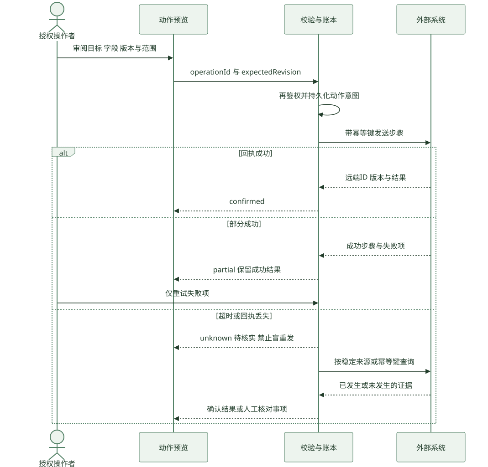

[可编辑源](diagrams/04-reliable-operation.mmd)

### 核心实体关系图


[可编辑源](diagrams/05-core-entities.mmd)

### 需求审批与测试实体关系


[可编辑源](diagrams/05b-approval-testing.mmd)

### 运行正常路径与取消


[可编辑源](diagrams/06-run-state.mmd)

### 变更hold与未知恢复


[可编辑源](diagrams/06b-run-recovery.mmd)

### 阶段依赖与支线


[可编辑源](diagrams/07-roadmap-dependencies.mmd)

### 中央任务工作区线框

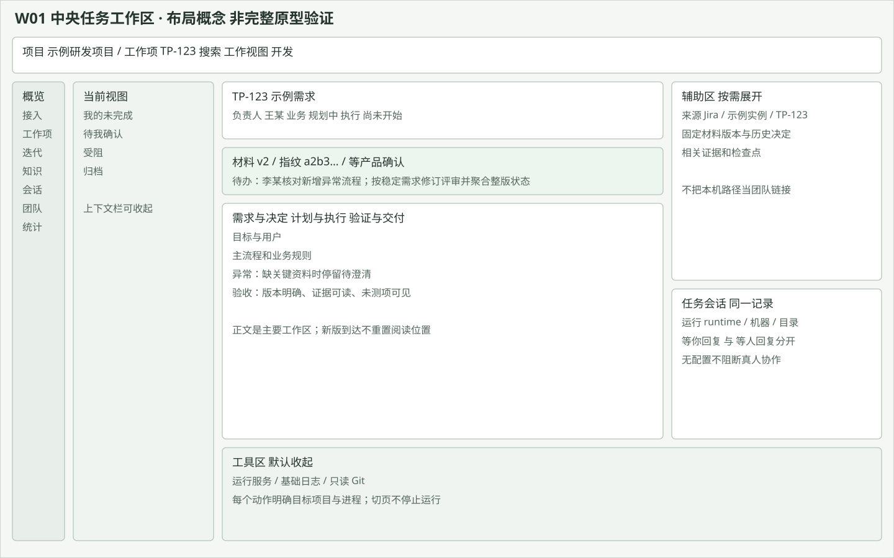

[可编辑源](diagrams/W01-task-workspace.svg)

### 版本确认线框

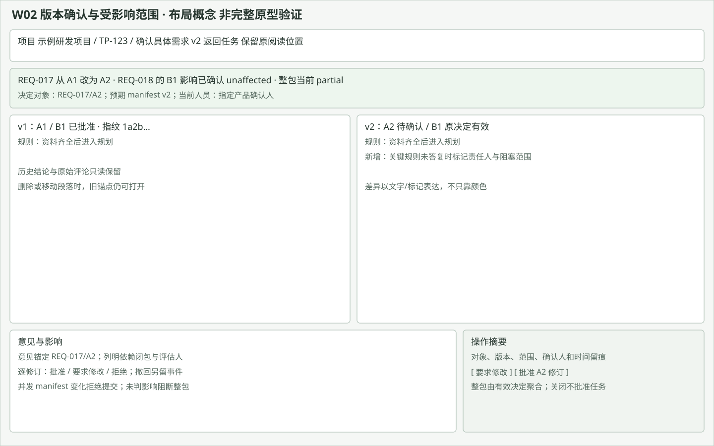

[可编辑源](diagrams/W02-review.svg)

### 基于实测启发的Trellis信息架构（D）


[可编辑源](diagrams/08-ui-informed-ia.mmd)

### 业务、运行、环境与交接的独立投影（D）


[可编辑源](diagrams/09-status-projections.mmd)

### 搜索与空态线框（布局概念）

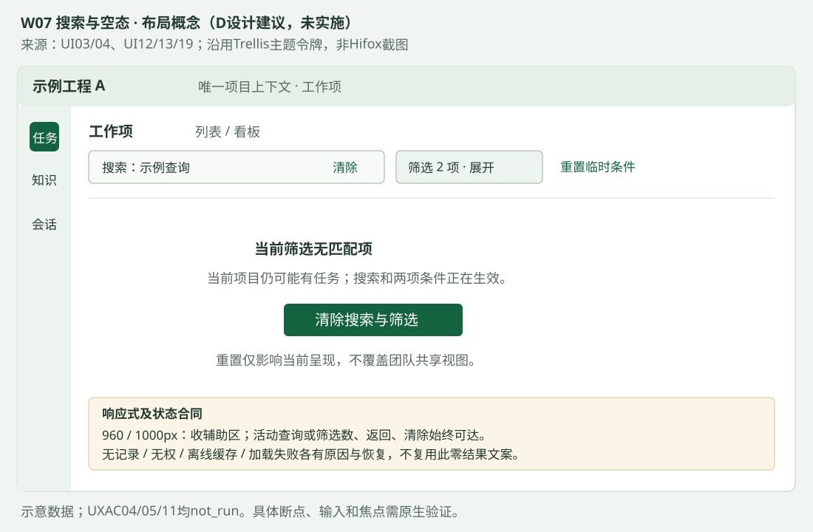

[可编辑源](diagrams/W07-filter-empty.svg)