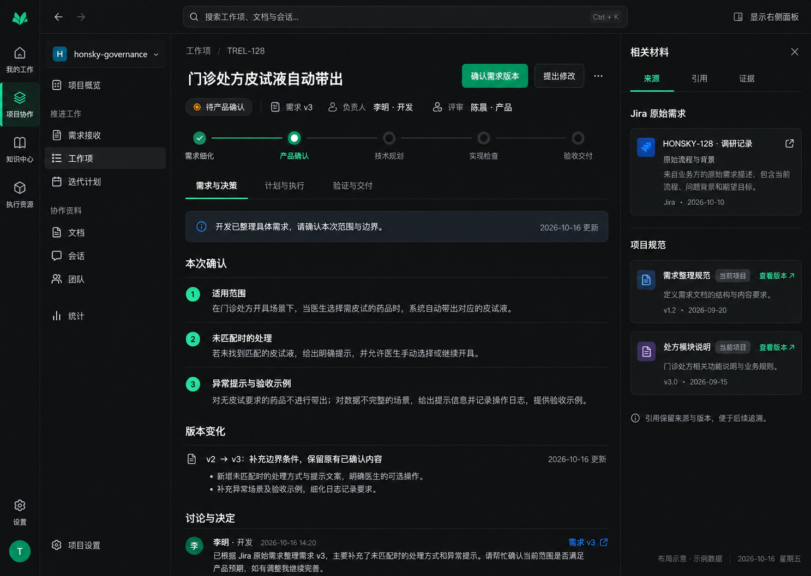
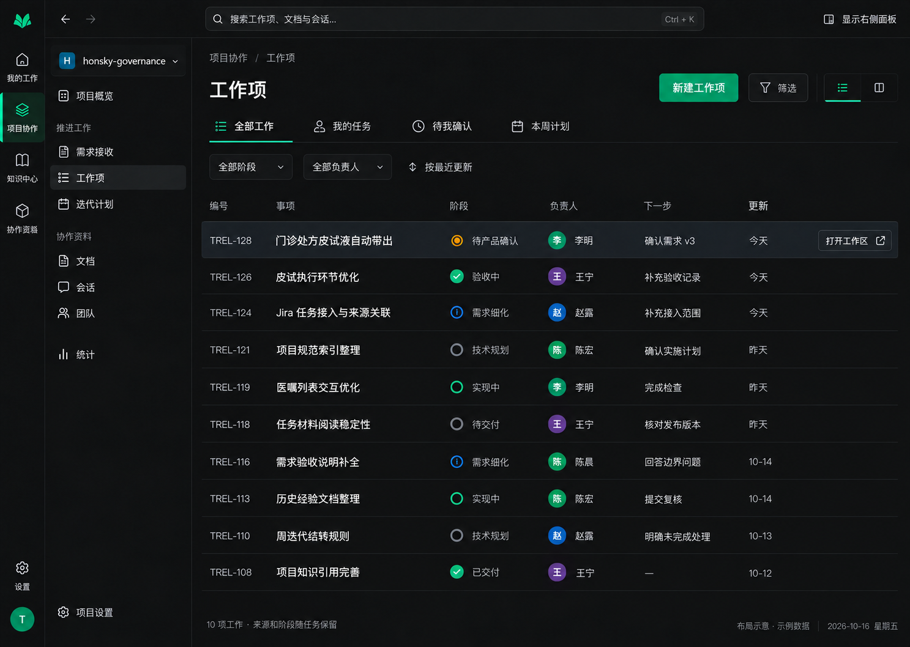
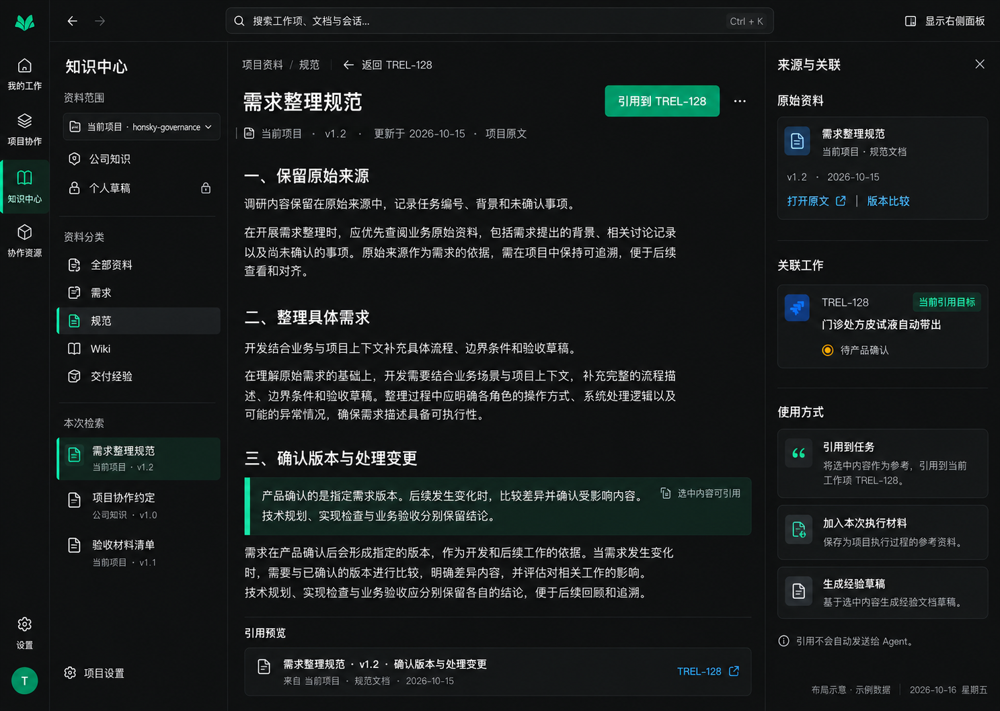

# Trellis 团队工作台布局方案

2026-10-16 · 产品设计建议稿 · 沿用现有项目和 Trellis 材料，具体实现按阶段讨论。

> **后续结构修订：项目提升为窗口根上下文。** 当前项目在窗口顶栏常驻一次，各页面不再重复选择。外部应用、多项目启动、基础日志与只读 Git 规划见 [Roadmap 补充](../2026-10-15-hifox-roadmap/05-project-workspace-and-integrations.md)。下文与三张图保留上一轮初稿；中央工作区和材料阅读可继续参考，顶级项目定位以补充为准。代码编辑与断点调试不在当前方向内。

> **实施版确认（2026-10-16）：** 保留最左侧固定模块栏，工作项、迭代、知识、会话、团队等并列；旁边上下文栏只显示当前模块的视图/对象，可收起，不再放第二个项目选择器。当前风格不变，亮色层级单独改善。下文的“四个工作范围”属于历史初稿，实施以[本版设计](../../../.trellis/tasks/10-16-project-workspace-uiux/design.md)为准。

推荐采用**工作范围窄栏、上下文导航、中央工作区、按需辅助区**。围绕同一个工作项连接需求、讨论、决定、执行与交付，让产品、开发、测试能够连续交接。当前以真人操作为主，Agent 作为其中一种执行方式接入。

本方案取代此前“把所有能力收进任务，再与 AI 对话、文档组成三个总入口”的设计约束。保留已有项目身份和会话隔离，不沿用那套菜单父子关系。

同一方案的三个状态：[工作项工作区](assets/task-workspace.png)、[工作项列表](assets/work-items.png)、[知识阅读](assets/knowledge-reader.png)。它们是结构与视觉示意，任务、成员、时间和业务内容均为示例，不是已实现功能或已确认业务规则。

## 1 一个稳定的空间骨架

| 区域 | 位置和建议尺寸 | 职责 | 不放什么 |
| --- | --- | --- | --- |
| 工作范围栏 | 最左，56px | 我的工作、项目协作、知识中心、执行资源；底部应用设置和账号 | 项目名称、任务列表、最近会话列表 |
| 上下文导航 | 左侧，约 224px，可折叠 | 当前范围内的入口；项目模式只有这里提供项目选择器 | 第二套组织/工作区/项目的同名容器 |
| 主工作区 | 中央，优先保障可读宽度 | 当前工作项、列表、迭代、文档、会话或团队视图 | 常驻大幅欢迎语、低频维护提醒、无意义指标墙 |
| 辅助区 | 右侧，约 340px，按需打开 | 当前对象的来源、引用、讨论、Agent 和交付证据 | 跨项目信息流、无法关联当前对象的运行日志 |

尺寸用于设计验证，不是不可变的实现常量。四个区域不要求同时展开；主工作区始终优先。顶栏提供返回、当前对象标题、全局搜索和辅助区开关，避免再叠加多层空标题栏。

最左栏选中的是工作范围，使用细强调标记；上下文侧栏只有当前页面使用完整行选中背景。所有模块的位置固定，切换页面不通过展开七个子项把其他主入口推走。

## 2 四个工作范围

| 范围 | 上下文入口 | 中央默认内容 | 数据边界 |
| --- | --- | --- | --- |
| 我的工作 | 待我处理、我的任务、关注与最近 | 需要我回答、评审、解除阻塞或推进的工作 | 首期可限定当前项目；跨项目聚合只覆盖实际接入且有权限的来源 |
| 项目协作 | 项目概览、需求接收、工作项、迭代计划、文档、会话、团队、统计 | 返回上次项目位置；首次进入展示可行动的项目概览 | 一个明确项目，上下文导航中的唯一选择器负责切换 |
| 知识中心 | 项目资料、公司知识、个人草稿、已采纳经验 | 带来源与范围的检索结果及阅读区 | 按真实授权检索；项目文件、外部公司库、个人资料分别标记 |
| 执行资源 | Agent 角色、技能与工具、电脑与目录、连接与模型 | 资源可用性与配置 | 资源配置可复用；每次使用仍显示本次项目、机器、路径和授权 |

“我的工作”回答我该做什么；“项目协作”回答这个项目怎样推进；“知识中心”回答依据是什么；“执行资源”回答可用什么执行。普通成员不需要配置 Agent 才能使用任务和评审。

资源中的条目按已实现能力和角色权限显示。现有团队页、头像或本机文件不能自动证明已具备跨电脑共享、成员权限或在线状态；这些能力需要实际数据与访问控制支撑。

## 3 项目内模块正常并列

项目选择器下面使用简短、不可点击的分组标题帮助扫描；不再做“任务下面挂所有功能”的树。

| 分组 | 并列模块 | 回答的问题 |
| --- | --- | --- |
| 推进工作 | 项目概览 | 当前目标、待交接工作和重要阻塞是什么？ |
| 推进工作 | 需求接收 | 哪些 Jira 粗需求或反馈准备进入这个项目？ |
| 推进工作 | 工作项 | 哪件具体工作由谁负责，处于哪个阶段？ |
| 推进工作 | 迭代计划 | 本周/本轮的范围、变化、完成与结转是什么？ |
| 协作资料 | 文档 | 当前项目的原始需求、设计、规范和交付资料在哪里？ |
| 协作资料 | 会话 | 该项目的任务关联对话和探索对话有哪些？ |
| 协作资料 | 团队 | 现在由谁负责，交接在等谁，需要怎样协调？ |
| 观察与配置 | 统计 | 哪些阶段等待、阻塞和返工，需要怎样改进？ |

项目设置固定在该侧栏底部。收藏视图放在固定模块之后，默认只显示少量收藏，更多项在管理入口展开，不改变主要模块的位置。

“我的任务、待我评审、受阻、已归档”属于视图或范围筛选。“列表、看板、表格、日历”属于展示方式；只在相关列表内切换。“Jira”是需求接收的来源与筛选项，同时保持来源编号和外部链接可见。

## 4 三种主工作区状态

### 工作项列表用于选择和判断

顶部是标题、搜索、过滤、布局切换和一个“新建工作项”主操作。默认列表优先展示任务名称、阶段、负责人、当前待办和更新时间。执行状态只在有意义时补充，不给每行叠加一排徽章。

单击行打开快速预览，列表保持筛选和滚动位置。选择“进入工作区”后，中央变为完整工作项，列表退出主画面；返回时回到原列表位置。通过任务链接进入时直接打开工作区，不要求先经过仪表盘。

### 工作项工作区用于实际推进

顶部持续显示项目归属、任务标题、真人负责人、当前阶段、材料版本，以及一个明确的主动作。主动作随阶段和本人职责变化，例如“提交产品确认”“确认需求版本”“开始技术规划”“提交验收”。没有权限的人看到责任人与原因，不出现可点击后才报错的主按钮。

正文使用三个相互衔接的材料视角：

- **需求与决策**：原始来源、开发整理的具体需求、未决问题、验收标准、已确认版本与变更。
- **计划与执行**：设计、实施计划、任务拆解、真人执行记录及按需 Agent 运行。
- **验证与交付**：检查结果、测试版本、业务验收、发布记录、已知问题和后续任务。

“活动与讨论”属于当前任务，意见能够关联到材料版本或具体内容。右侧辅助区按当前需要展示来源、引用、讨论、Agent 或证据，一次只突出其中一种。长文、会话或 Diff 可展开到主工作区，再返回原位置。

### 知识阅读用于找依据和复核

项目文档是材料的原始入口；知识中心提供检索、引用与经验沉淀，两者访问同一份材料及其版本。检索结果必须显示来源、范围、版本/更新时间和可打开的原文位置。

检索时先看到结果；选中后在主工作区阅读正文，结果列表收为窄列表或可返回状态。阅读区保留目录、版本比较和引用操作，避免把长文挤进 340px 辅助栏。知识问答的回答带引用，回答与原始规范有不同的权威等级。

## 5 团队协作形成交接入口

团队页默认展示**待交接工作与责任人**，可以按产品、开发、测试职责或成员查看。任务页组织具体工作，团队页组织人与交接关系。

重要条目直接说明“等谁、缺什么、针对哪个版本、下一步是什么”。点击进入同一工作项的对应位置，不再复制一份团队任务。成员负载用于协调，统计反映队列与等待，不用日志条数或 Agent 消耗给员工评分。

目前只有日志和快照的数据，只显示“最近更新”。在线状态、共享评论、跨人评审与通知必须由真实协作服务支持。讨论解决、材料确认、技术检查通过、业务验收和发布完成分别表达。

## 6 设置放到真正生效的范围

| 设置位置 | 管什么 | 原则 |
| --- | --- | --- |
| 账号菜单 / 个人设置 | 外观、快捷键、通知偏好、个人授权与草稿范围 | 只影响本人；已读不等于处理完成 |
| 项目侧栏底部 / 项目设置 | 项目仓库、Jira 来源、流程、字段、标签、可用视图和项目协作规则 | 显示当前项目；配置迁移要说明影响 |
| 执行资源 | Agent、技能、工具、电脑、模型、第三方连接 | 配置复用，凭证不写进任务和聊天 |
| “开始执行”面板 | 本次角色、Runtime、机器、目录、任务材料版本 | 本次覆盖默认值；保存为默认需要明确动作 |

外部连接的账号和凭证在连接管理中维护，项目只选择已有连接与接入范围。Jira 查询、导入、刷新、回写、持续同步是不同动作。项目默认值改变不静默迁移正在进行的会话或工作目录。

## 7 用真实流程检查布局

产品调研后把粗流程录入 Jira。开发在需求接收中预览并接入当前项目，进入工作项整理具体需求。产品从个人待处理中打开同一任务，对指定版本确认或提出修改；开发继续补充受影响内容，再进入技术规划。实现可由真人完成，也可显式调用 Agent。技术与业务分别复核后留下交付记录，再由指定动作更新 Jira、归档和沉淀经验。

每次交接延续同一任务标识、来源、材料版本和未决事项；导航不会为了流程前进而切换到另一套系统。完整异常与跨功能场景见 [流程与交互](02-workflows-and-interactions.md)。

## 8 视觉与窗口适配

沿用现有 Inter/中文系统字体、leaf 绿色和深浅主题语义令牌。灰阶建立层次，绿色主要用于当前范围、主动作和少量强调。状态同时使用图形与文字；感叹号只表示真正的注意事项。

优先通过留白、对齐和细分隔线分组，不给每段文字套卡片。中央标题、阶段、主动作形成焦点；普通表格和任务列表使用一个连续表面。阅读正文约 14–16px，界面文字沿用语义字号；落地时通过令牌扩展，不散落硬编码样式。

- **1440px 及更宽**：可同时展示范围栏、上下文导航、中央工作区和按需固定的辅助区。
- **1100–1439px**：辅助区使用覆盖抽屉，优先保障中央阅读宽度。
- **小于 1100px 或高缩放**：上下文导航可收起，范围栏保留；辅助内容使用独立覆盖层或完整阅读状态。

默认不强制四栏常驻。各项目的列表、阅读、会话与辅助区宽度分别记忆；切项目不串状态。具体视觉稿是结构示意，涉及的任务与成员为示意数据。

## 9 本轮产物与后续边界

本轮交付布局与交互方案，不修改应用代码、Trellis 阶段或运行框架。现有导航暂不会因这份建议稿改变。

现有工作项、多布局、材料阅读、Jira 接入、规范、知识检索、会话与项目隔离可继续复用。团队共享材料、真实评审通知、跨项目个人聚合和资源统一管理分别依赖相应能力，按 [产品 Roadmap](../2026-10-15-hifox-roadmap/01-product-roadmap.md) 分期建设。

审查时先看：是否找得到当前工作；是否知道范围和责任；从需求到验收能否持续处理同一工作项；知识引用能否查原文；普通成员是否无需配置环境就能推进真人流程。再决定实施顺序。

[信息与数据边界](01-boundaries-and-page-map.md) · [完整流程与异常交互](02-workflows-and-interactions.md) · [验收与现有能力映射](03-validation-and-rollout.md)

## 10 同一骨架的视觉状态

### 工作项工作区

### 工作项列表

### 知识阅读

出图使用内置 Image Gen，设计输入及正式稿约束见 [视觉说明](04-visual-brief.md)。正式命名统一为“执行资源”；完成勾仅用于已完成终态；知识结果来源必须与当前选择的检索范围一致。图中细小字样与符号不能取代这些约束。
