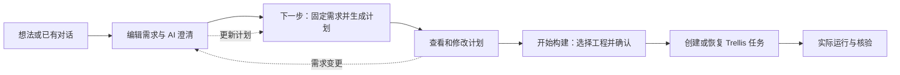

# 需求工作台：从想法到开发的产品需求

> 本文定义待建设的目标流程和验收要求。现有实现、原型、模拟测试或本文中的控件名称，不代表对应能力已经上线或验证通过。

## 1. 产品目标与边界

产品、设计和研发人员从一句想法或一段已有对话开始，与 AI 一起形成可编辑、可核对的需求；认可需求后生成实施计划，审阅计划并选择实际工程，再明确开始 Trellis 开发。整个过程中，用户应始终知道自己在编辑什么、AI 正在做什么、结果写到了哪里，以及下一步会产生什么实际影响。

工作台以文档为中心：左侧是用户和 AI 共同完善的需求，右侧提供与当前文档相关的建议、对话、资料和操作结果。需求与计划各有独立版本；生成计划不会开始开发，点击开始构建才进入执行准备和启动流程。

适用范围是桌面端的本人需求工作台，以及与其相连的本机 Trellis 开发入口。普通私人会话无需团队空间或工程即可开始；Code 中已有工程时可以直接使用该工程的上下文。团队评审、任务指派和发布使用已有业务流程，由用户显式发起。私人对话不自动共享。

### 术语

| 名称 | 含义 |
| --- | --- |
| 需求草稿 | 用户可编辑的本人需求文档，包含原始诉求、目标、范围、需求和验收等内容。 |
| 资料 | 用户明确选择的集成知识库摘录和本机文件；每一项有来源及可核对的版本或摘录标识。私人对话片段仅供本人澄清，不自动成为工程任务材料。 |
| 需求基线 | 用户点击下一步时保存并固定的需求版本，是某次计划生成的输入，不等于团队审批通过。 |
| 实施计划 | 根据指定需求基线和已选资料形成的独立文档，说明实现步骤、验证及待确认事项。 |
| 工程 | 承载实际代码和 `.trellis/` 的本机目录；与私人会话分组、团队空间分别管理。 |
| Trellis 任务 | 在目标工程内创建的实际任务及其材料、状态和后续工作流；需求草稿本身不是任务。 |
| 构建 | 用户明确启动的一次工程执行。开始前需确定工程、执行方式和权限；运行、完成和业务验收各自独立。 |

## 2. 完整操作流程

| 步骤 | 用户操作 | 系统行为与可见结果 | 下一步 |
| --- | --- | --- | --- |
| 1. 开始需求 | 在 Work 或 Code 会话选择“新建需求”，或在已有对话中选择“整理为需求” | 在当前会话打开需求工作台，建立本人草稿。若用户明确选择带入当前输入或对话片段，将选中内容放入草稿并标识来源；未选择时显示可直接编辑的需求模板 | 填写或整理需求 |
| 2. 编辑与澄清 | 左侧输入、粘贴、选中编辑；右侧自由提问或选择快捷方法 | 用户可以先写一句话；AI 根据草稿和显式选择的资料提出问题、研究或生成修改建议。左侧保持可编辑，右侧展示人可理解的回答与结果 | 完善需求 |
| 3. 应用结果 | 审阅 AI 的整篇或选区修改 | 结果指向明确的文档及版本；安全自动应用时立即更新左侧并提示可撤销。用户并发修改或来源变化时展示差异，由用户决定采用，不覆盖新编辑 | 继续编辑或下一步 |
| 4. 生成计划 | 用户认可当前需求并点击“下一步” | 保存当前需求和来源快照，以该版本自动发起计划生成；展示生成中与停止操作。成功后出现“计划已生成”结果卡，可查看和编辑计划 | 审阅计划 |
| 5. 确定开发上下文 | 在计划结果中选择“开始构建” | 已有可用 Code 工程时展示当前工程供核对；没有工程时要求选择本机工程。展示执行引擎、执行方式和真实权限；保留需求及计划 | 确认开始 |
| 6. 准备并启动 | 用户确认执行准备，核对工作流预览后再确认开始 | 首次确认创建或恢复同一份真实 Trellis 任务，固定材料并准备工程会话；第二次确认才启动既有工作流。各步骤只在实际成功后更新状态 | 查看开发过程 |
| 7. 执行与交付 | 用户查看运行、回答授权、停止或继续 | 展示当前阶段、可读进展、文件变更、实际错误和产物；完成后给出验证结果与后续动作。业务评审、团队发布和验收须各自明确执行 | 继续修改或交付 |

可以返回需求继续修改。已经生成计划时，需求或其关键来源发生变化应标记计划“需更新”；保留旧计划供比较，更新计划必须基于新的需求基线。已开始的执行仍保留其原始输入，新的需求不能悄悄改变正在运行的任务。

过期计划仅可阅读和比较，不能直接用于构建。用户更新需求后须重新固定需求并生成或更新计划，再核对新版本；界面不提供隐式使用旧版本开始构建的路径。

从已有对话进入时，先让用户选择带入当前输入、选中的消息或不带入；展示实际选中的范围并允许移除。对话可能很长，界面不能暗示已引用完整历史而实际只读取了部分消息。打开工作台后，原会话的未发送文字与附件保持原位，用户可以返回继续使用。

## 3. 工作台与编辑器

### 3.1 布局和主要动作

- 在现有应用外壳、私人会话和团队导航内打开工作台。左侧为需求文档，右侧为需求助手，两栏各自滚动；助手输入框固定在右侧底部。窄窗口允许收起助手并随时恢复，不能让编辑器和输入框互相遮挡。
- 左侧顶栏展示需求名称、保存状态、一个与当前阶段一致的主动作及关闭。没有计划时主动作是“下一步”；生成期间显示“生成计划中”及停止入口。计划生成后查看需求时显示“查看计划”，查看有效计划时显示“开始构建”；计划过期时显示“更新计划”。计划尚不存在时不展示空的计划标签；生成后提供清楚的“需求 / 计划”切换。源码与低频格式操作收在文档菜单中。不要把与当前阶段无关的工程交接和多组工具栏同时摆在顶栏。
- 左侧新建草稿默认提供可直接修改或删除的简洁模板：需求名称、背景、目标、范围、具体需求、验收标准、待确认问题。模板标题和空占位本身不算有效需求；用户可以删除模板自由写作。缺少业务事实时保留空白或“待确认”，不预填虚构结论。
- 右侧没有对话时，显示少量与当前需求相关的快捷操作；已有对话时展示对话和结果，并保留从输入框或紧凑菜单再次使用这些操作的入口。界面文案以操作名称和必要状态为主，过程细节按需展开。

### 3.2 直接编辑和选区操作

文档支持中文输入法、粘贴、段落与标题、列表、链接、撤销和重做。支持保真编辑的 Markdown 内容可在可视化模式编辑；无法无损转换的内容应保留原文，并提供可明确发现的源码视图，禁止静默删除或改写。Alt+F10 打开完整文档操作，Esc 关闭弹层并将焦点返回原位置。

选中文本后，在选区附近出现紧凑工具栏：基础格式、引用到助手、润色、解释及自定义修改。拖选时不抢焦点；键盘用户可以打开等价操作，Escape 关闭浮层并保留编辑位置。对图片、表格和无法安全定位的复杂选区，应明确支持范围；无法安全应用时提供可复制的建议或对比，不伪装成已修改。

“引用到助手”将实际选区和来源版本放入右侧输入区，允许继续编辑问题；点击发送才调用 AI。“润色”以选区为目标发起修改并展示处理状态，完成后就地显示原文与建议差异，提供“应用 / 放弃 / 重试”；应用仅影响选区，且可撤销。若选区或文档在等待期间发生变化，展示原文、当前内容和建议，由用户决定，不覆盖新编辑。不得把选区润色扩展成未提示的全文重写。

### 3.3 保存与恢复

输入后的草稿、问题答案和助手未发送输入应可靠地本地自动保存，手动保存仍可用。显示“保存中 / 已保存 / 保存失败”，保存失败保留本地内容并给出重试；重启或异常退出后恢复上次已持久化版本和未发送输入。自动保存不能把未确认的 AI 候选、外部改动或团队发布当作用户已接受内容。

保存和 AI 结果必须校验需求身份、文档版本与实际文件；外部文件发生变更时提供比较、读取外部版本或保留本地版本的选择。缺失、损坏、无权限和版本冲突分别说明，保留可导出的本地内容；计划文档提供同等恢复能力。写入文件与元数据中途失败时，重开后能够核对并修复，不得制造“已保存”的假状态。

## 4. 需求助手

### 4.1 快捷操作

快捷操作是可编辑的工作指令，而不是另起一套不透明流程。点击卡片将对应提示追加到右侧输入框并聚焦，已有输入保留并以空行分隔；用户可修改或撤销追加，再决定是否发送。实际发送时明确关联当前需求版本、用户选择的资料和选区；不自动选择私人会话以外的内容。

| 分组与入口 | 用户得到什么 | 结果如何作用于左侧 |
| --- | --- | --- |
| 澄清需求 | 找出目标、用户、范围和关键缺口，提出少量可回答的问题 | 回答由用户确认；可生成对应段落建议，缺失事实保留为待确认 |
| 研究已有资料 | 对明确选中的知识库、文件进行检索或整理，区分已有、待改、新增及无法判断 | 建议附可打开的来源；无证据不能声称功能不存在或已上线 |
| 完善需求文档 | 将已有描述整理为背景、目标、范围、需求与验收 | 生成完整候选；明确显示更新目标和应用结果 |
| 补充验收 | 检查可验证的正常、异常、权限和边界条件 | 生成验收条目建议，用户可编辑或采用 |
| 检查风险与疑问 | 找出冲突、依赖、假设和未决问题 | 输出位置明确的修改建议或待确认条目，不把推断写成事实 |
| 润色选区 | 改善所选内容的表达，保留业务含义 | 限定选区更新；并发变化时比较后采用 |

示例：用户输入“做一个个人博客”，选择“完善需求文档”，输入框得到可编辑指令“根据当前草稿整理目标、范围和可验证的验收标准；不确定的内容列为待确认”。发送后，右侧先显示处理，再展示简明结果；采用成功后左侧成为可编辑需求稿，而不是仅展示一条文件路径。

整篇文档的生成与选区润色采用不同的呈现方式：用户明确要求完善整篇需求时，若输入版本未变化，可在结果有效后更新左侧文档，并在右侧显示“需求已更新”、简短修改摘要和“查看修改 / 撤销”；若版本变化，先比较再采用。右侧普通问答只回答问题，不因一条聊天消息自行重写正文。用户明确要求更新需求、选择快捷修改指令或点击采用建议时，才执行写回。

例如，助手发现“文章是否需要评论”未明确时，应提出问题，或在草稿的待确认部分列出它；不能擅自写成“支持评论”。用户回答“首版不做评论”后，可以继续要求助手把答案更新到范围。用户看到左侧正文变化并保存，之后点击“下一步”；生成完成自动打开计划，右侧结果卡提供“查看计划”和“开始构建”。

快捷项可以按使用频率分组或放入“更多”，但每项必须有明确输入、可理解结果和真实处理能力。产品管理框架可以作为具体提示方法，不应要求用户先理解框架名称。已发送的用户指令、AI 回答和版本修改保持可回看；内部提示、候选 JSON 路径、逐条重试和已处理授权记录默认不占据主要对话区域。真实待授权请求、失败原因及可用操作必须可见。

### 4.2 知识、文件和设计语境

“资料”入口按需选择已有集成连接及允许访问的知识库，搜索并查看结果，再明确选取引用；也可引用本机文件。资料显示名称、来源、摘录和版本或返回标识。未连接、无权限、检索失败、无结果以及列表有更多数据分别处理；可访问知识库的分页或搜索必须可用。切换连接、重新搜索或暂时关闭工作台不得无提示丢弃已有选择。

生成时固定本次实际采用的资料；后续来源发生变化不会改写旧版依据。仅选择知识库范围不等于已引用其中内容；用户可以不选择知识库继续，但计划中应区分“未检索”与“未发现”。资料是参考而非指令，不得改变权限或自动触发工程执行。

“设计语境”仅在需要设计或界面工作时提供，可选择当前项目设计规范、引用素材及补充方向；显示已选来源并允许修改或清除。它影响需求、设计或计划生成，不隐含自动生成原型。没有设计语境仍可进行普通需求整理。

## 5. 需求到计划

点击“下一步”即表示用户希望以当前内容生成计划：先保存并固定当前需求、答案、已选资料与设计语境，再发起一次生成。若保存失败、模型未配置、权限不足、正在生成或文档为空，保留内容并说明下一步；允许取消等待或停止当前回合。生成期间用户可以继续阅读和编辑，但生成结果必须关联点击时的基线；若期间编辑，结果标注基线已变化，需比较或重新生成。

明确标为必答且尚未回答的问题，在下一步前展示；用户可以回答，也可以明确选择“带未决问题生成计划”。选择跳过时，问题必须进入计划的待确认部分，不得被标为已解决；需要团队业务确认的阻断问题仍由正式评审决定。

计划默认包括：目标与边界、需求依据、涉及现状与待核实项、实施步骤及依赖、验证与验收、风险和回退、尚未解决的问题。工程已选择且允许读取时，可按选定权限检查真实工程并引用依据；尚未选择工程时，计划明确标注工程现状待核对，不虚构技术栈。若后续选择的工程与计划依据不一致，开始构建前要求重新核对或更新计划。

生成成功后，自动展示可编辑的计划文档，同时在助手对话中显示结果卡：计划名称、生成状态、查看计划和“开始构建”。用户可以切回需求，也可在右侧继续提出计划修改；直接编辑或采用 AI 修改均保存为计划新版本。计划过期时，结果卡标记“需更新”，将“开始构建”替换为“更新计划”。结果卡仅在实际生成成功且文件和记录一致时出现。失败显示简短原因、检查或重试入口；前一版需求和计划保留。

## 6. 开始构建与 Trellis 交接

### 6.1 选择与确认

“开始构建”打开紧凑的执行准备，显示目标工程、执行引擎与模型、实际权限模式、执行方式以及要使用的需求和计划版本。默认值来自当前真实上下文；用户可修改。Work 没有工程时在此选择目录；Code 已绑定工程时展示并核对原目录，不能因为切换界面模式改变已运行会话的目录。

仅展示现有能力能够兑现的执行方式。当前工程与隔离工作副本如均受支持，可选择并说明影响；不支持或工程未初始化 Trellis 时，显示原因和真实的准备入口，不能把不可执行的选项伪装成可用。Git、工作副本和运行配置仅在工程场景展示。缺少模型、目录授权或工程配置时保留选择和草稿，修复后继续。

“开始构建”先打开同一个执行准备界面。用户确认“准备执行”后，系统创建或恢复 `planning` 任务并固定材料；先检查并完成目标工程要求的规划材料和评审，再激活任务、准备原生会话。准备完成后展示工作流、工程、执行引擎、固定材料及实际权限预览。用户再次明确选择“确认开始构建”才发送工作流启动请求。取消第二次确认保留已创建任务及实际准备状态，不发送执行请求；再次进入时读取原状态。若需要初始化、授权或处理冲突，在该流程内说明并等待用户完成。创建任务、规划评审、激活任务、创建会话和发送执行请求的状态必须各自以实际回执为准，准备好不等于已经运行。

### 6.2 固定材料与实际执行

用户确认准备前，先保存计划并核对实际文件与正文摘要，在界面展示即将固定的需求、计划和资料版本。准备过程中或启动确认前若文件、目录、授权或版本发生变化，应停止推进并要求重新核对；不能让界面展示一版而实际交接另一版。

任务已创建或会话已准备但尚未启动时，如果材料发生变化，保留原任务和准备记录，先核对原会话、激活与占用状态。在没有未确认的启动或副作用、且原占用已确认安全释放后，由用户显式预览并采用新基线、重新准备；若目标工作流不能在原任务采用新基线，则提供关联原任务的新任务入口。未确认前不能重用旧预览或继续启动。

首次确认后，在所选真实 Trellis 工程创建或恢复同一个任务，携带需求基线、用户确认的计划、明确选择可交接的知识摘录或文件及适用工程规范。私人对话片段即使被选作本人澄清依据，也不自动作为原始聊天记录或引用交接；用户已经写入并确认的需求正文可以作为需求材料交接。任务材料、工作流预览和实际发送给执行阶段的上下文必须指向相同固定版本；启动前核对内容、目录、权限和会话。计划及来源清单不能只是写入目录而没有进入实际工作流上下文；若适配器无法携带或验证，禁止声称已使用并给出可修复的阻断原因。

执行采用本项目现有 Trellis 阶段及工作流能力：需求、设计、开发和自检的实际阶段按所选模板展示。默认构建路径应以用户已确认的需求和计划为依据进入实际开发；若目标工程要求补充设计、实施材料或评审，展示具体缺项并完成该工程的要求。已有需求和计划应作为明确输入，避免在缺少理由时重新生成并覆盖；阶段的跳过或复用须由工作流真实支持，不能由界面伪造。当前工作流若不能满足以上要求，必须补齐适配后才开放这一路径。执行过程中保持需求、计划、进度、变更和授权可访问；回到私人对话或切换空间不会转移、停止或共享运行中的任务。

状态依次区分：待选择工程、待确认、创建任务中、准备执行中、准备完成、启动中、运行中、已停止、失败、完成及结果待核对。未知回执只核对原命令和实际任务，不自动重发或重复建任务；可以确认“未准入、无副作用”时，允许用户保留草稿并更换引擎或重新提交。已有真实任务、会话或外部副作用时，恢复必须回到原身份，不能创建同名替身。

运行后如果需求或计划变化，新版本先保存在本人工作台，不改变原任务的运行输入。原执行仍在运行时，可以预览新版本但不能替换其输入；执行已结束后，只有确认原生执行及工作副本占用已安全释放，或已选择并验证真正独立的工作副本时，用户才可以在原任务中显式预览并采用新基线，创建关联该任务的后继执行尝试。原版本和结果始终可查。“失败”不等于进程已停止或清理完成；结果或清理状态未知时先核对原执行，不能另起一次。若目标工作流暂不支持原任务采用新基线，应明确说明并提供关联原任务的新任务入口，不悄悄覆盖或声称已接续。

### 6.3 运行与完成

运行界面显示当前阶段和简洁进展，默认收起内部提示、原始参数和重复日志；需要用户决策的权限请求及真实失败原因直接显示。停止按钮使用图标、明确的无障碍名称和状态提示；停止请求、实际停止和未知结果分别表达。

开发完成时展示实际文件变更、已执行检查及其结果、未完成事项和可打开的产物；没有执行或无法确认的检查显示“未运行 / 未确认”。可返回需求、计划、工程任务或继续对话。任务完成、团队材料发布、测试通过和业务验收分别由各自真实流程确认。

## 7. 核心状态与异常

| 场景 | 用户可见结果 | 数据与恢复要求 |
| --- | --- | --- |
| 草稿为空或只有空模板 | 提示先描述需求；允许直接编辑 | 保留模板，不调用模型 |
| AI 处理、重试或停止 | 一条当前状态与停止图标；结果和用户输入可读 | 不重复提交；停止确认前保持状态，晚到结果不能冒充成功 |
| 模型未配置、断连或额度受限 | 简短原因和设置、检查或重试入口 | 保留原文、资料、选区及未发送输入；原因未知时如实显示 |
| 用户拒绝工具授权 | 表明本次操作未完成并提供下一步 | 不标记成功，不丢弃需求和已有计划 |
| 知识无权限、失败或无结果 | 分别说明；允许更换范围或无资料继续 | 不把失败表示为“没有资料”，已选资料不无提示清空 |
| AI 输出不完整、候选文件无效 | 显示未生成成功与可检查原因 | 保留旧文档，不采用候选；可重新发起明确操作 |
| AI 等待期间用户或外部修改 | 显示版本变化及差异 | 不覆盖新内容；用户决定应用、保留或重生成 |
| 计划过期、工程变更或来源失效 | 标出具体变化并提供核对或更新 | 旧计划保留；不能把旧计划当作新版本的已确认计划 |
| 资料清单过大 | 在产生不可逆交接前指出限制，允许减少或选择材料 | 不锁死草稿；没有实际创建时可安全修改并重试 |
| 执行准备明确未准入 | 展示具体阻断及可修改的工程、引擎或配置 | 确认没有副作用后允许重新选择；不遗留无法清理的本地锁 |
| 任务或会话结果未知 | 明确“待核对”，提供原任务、回执及检查动作 | 根据实际阶段核对原命令；禁止自动重复创建或执行 |
| 保存失败、进程退出或文件损坏 | 提示恢复状态和可用选择 | 持久化用户草稿；保留可导出内容，不能用旧结果覆盖新内容 |
| 取消或关闭工作台 | 回到原会话；正在执行的状态按真实结果继续 | 保留文档和未发送输入；关闭不等于停止或发布 |

## 8. 数据与权限要求

- 需求、计划、对话、工程任务和团队共享材料是独立对象。每次生成或执行记录原始对象、固定版本、所选来源、操作身份和实际状态；同一操作重试必须可识别，不能生成重复任务。
- 需求和计划保存完整可读正文；资料记录连接、库、文档、实际摘录或文件版本及可追溯标识。知识摘录标识只证明本次返回内容，不冒充上游完整文档版本。
- 选区操作保存原文、位置与所属文档版本；无法可靠定位时降级为比较或手动采用。用户的正文、未发送草稿、AI 候选和已确认版本分别存储，不能混为一个状态。
- 手动编辑与自动保存、AI 生成和外部写入并发时，保留彼此内容并提供冲突处理。超过大小、次数或缓存限制应在安全边界前告知，并允许减少输入或释放空间；限制不能成为永久锁定。
- 知识、文件、工程、模型和工具的访问分别按现有授权判断。未选择或未获授权的资料不发送给模型；团队发布前展示目标空间和共享范围，由用户确认。私人原始对话不因交接而自动上传。

## 9. 验收标准

### 用户主路径

1. 未加入团队空间的用户，从 Work 新建需求，直接在左侧模板输入“做一个个人博客”；草稿可编辑、保存、关闭后恢复。
2. 用户点击“完善需求文档”，先看到追加到输入框的可编辑提示，修改并发送；AI 完成后左侧得到完整可编辑需求，右侧显示清楚的结果，用户可撤销。
3. 选中一段文本并润色，用户看到差异并选择应用后，只有选区变化；生成期间编辑原文时，系统展示冲突和候选，不覆盖用户的新文字。
4. 点击“下一步”后，用户无需再寻找隐藏按钮即可看到计划生成、结果卡、查看与编辑计划；生成计划不会创建工程任务或开始开发。
5. 选择实际 Trellis 工程并确认准备后，界面展示真实任务及固定材料预览；仅在再次确认开始构建后启动工作流。实际任务、需求、计划、可交接资料和执行上下文的版本一致；没有回执时界面不显示成功。取消启动确认不发送执行请求。
6. Code 已有工程与 Work 未选工程分别完成同一主路径；会话分类、团队空间切换不会改变原执行目录。团队发布和业务评审仍由用户明确发起。

### 真实环境与异常

- 至少使用一个真实可写工具的配置模型、一个真实授权的集成知识库和隔离的本机 Trellis 工程，从需求输入走到实际执行；核对工作流实际组装和提交给引擎的需求、计划、引用版本与回执，并保存可复核的阶段结果。模型内部是否读取、依赖或遵循材料，除非有直接证据，否则标记为未知。另测模型只读或拒绝授权的真实阻断。
- 对计划生成失败、超时、取消、连接重试、权限拒绝、知识库失败、候选格式无效、输入超限、任务创建部分成功、回执丢失、进程重启和外部文件变更分别验证恢复；每次保持草稿及原身份，不重复创建或发送。
- 对目标工程要求规划评审的复杂任务，验证规划未完成前不会激活任务；验证准备完成但尚未启动时修改计划必须重新核对，旧预览不能启动。运行失败但进程或占用状态未知时，不能开始后继执行。
- 将私人对话片段用于澄清后交接任务，检查原始消息和片段不会自动进入任务材料；已由用户确认写入需求正文的内容按需求版本交接。
- 验证历史授权和重试日志默认收起，而当前授权、最终失败和可行动作可见；验证按钮、菜单、文档选区与弹层均可使用键盘，支持中文输入法、焦点返回和减少动态效果。
- 用实际渲染检查深浅主题、紧凑／标准／舒适三档密度及窄窗口；普通矩形组件使用项目 10px 圆角与共享 token，正文和描述有清晰层级，图标动效克制。在记录了具体硬件和系统缩放的 Windows 打包应用中，以 5 万中文字符的需求、同规模计划和 100 条折叠对话为负载，至少采样 100 次普通输入；输入事件到下一次绘制的第 95 百分位不超过 150ms，且无输入丢失或滚动位置跳动。模型网络等待和首次加载分别记录。
- 在用户保存、重开、撤销、对比和切换阶段时，确认内容与版本一致；自动保存不得阻塞持续输入。性能数据以实际测试结果记录，不能以静态截图或模拟回包替代。

## 10. 分阶段交付

1. **需求编辑闭环：** 模板、编辑与选区、自动保存恢复、右侧可编辑快捷指令、真实 AI 结果回写与冲突处理。
2. **计划闭环：** 下一步自动固定需求并生成计划，结果卡、查看编辑、失效与重生成；补齐真实授权知识库、文件及设计语境。
3. **构建闭环：** 工程选择、固定材料进入真实工作流、Trellis 任务创建与执行准备、显式开始、运行结果和失败恢复。
4. **验收与协作：** 真实模型／知识库／隔离工程端到端验收，接入现有团队产物发布、评审和任务流转，分别验证私人和团队权限。

每个阶段均以对应验收通过为完成条件。不可用的后续入口应明确说明状态，不能只显示按钮或依赖模拟成功回包。

## 11. 参考实现与依据

- Kun 本地源码版本 `0d8406128e2cede3bb5085c2d28fb90ab9e91f69`：

  | 交互 | Kun 源码中的行为 | 本需求采用的方式 |
  | --- | --- | --- |
  | 新建草稿 | 在当前工作区创建需求文件，使用名称、背景、目标、验收标准的空模板。[入口和模板](https://github.com/KunAgent/Kun/blob/0d8406128e2cede3bb5085c2d28fb90ab9e91f69/src/renderer/src/components/workbench/useWorkbenchSddThreadController.ts) | 保留可编辑模板；本人 Work 可以先开始，不强制选择代码工程。 |
  | 选区修改 | 拖选结束才显示菜单；原位 AI 编辑产生差异，接受后才应用。[编辑器](https://github.com/KunAgent/Kun/blob/0d8406128e2cede3bb5085c2d28fb90ab9e91f69/src/renderer/src/components/sdd/SddDraftEditorView.tsx) · [选区修改](https://github.com/KunAgent/Kun/blob/0d8406128e2cede3bb5085c2d28fb90ab9e91f69/src/renderer/src/components/write/selection-menu/use-selection-edit.ts) | 保留原位审阅和采用，并增加版本冲突保护。 |
  | 右侧快捷项 | 无会话内容时按厘清、结构和风险分组；点击将对应请求追加到输入框，不自动发送。[助手面板](https://github.com/KunAgent/Kun/blob/0d8406128e2cede3bb5085c2d28fb90ab9e91f69/src/renderer/src/components/sdd/SddAssistantPanel.tsx) · [快捷项处理](https://github.com/KunAgent/Kun/blob/0d8406128e2cede3bb5085c2d28fb90ab9e91f69/src/renderer/src/components/workbench/useWorkbenchSddTurnController.ts) · [框架注册](https://github.com/KunAgent/Kun/blob/0d8406128e2cede3bb5085c2d28fb90ab9e91f69/src/renderer/src/sdd/pm-skill-frameworks.ts) | 以用户目标组织少量快捷项，可编辑后发送；知识与来源按本项目权限选择。 |
  | 草稿更新 | 助手提示词带当前需求正文；要求更新时由模型使用工具改写文件，编辑器监听磁盘变化。[助手提示词](https://github.com/KunAgent/Kun/blob/0d8406128e2cede3bb5085c2d28fb90ab9e91f69/src/renderer/src/sdd/sdd-assistant-prompt.ts) · [文件同步](https://github.com/KunAgent/Kun/blob/0d8406128e2cede3bb5085c2d28fb90ab9e91f69/src/renderer/src/sdd/sdd-draft-actions.ts) | 明确关联目标和基线，结果写回左侧；冲突时比较，不能覆盖新编辑。 |
  | 生成计划 | “下一步”检查输入与运行状态，等待草稿保存，再发起计划回合；成功后按实际工具结果加载计划。[转计划控制](https://github.com/KunAgent/Kun/blob/0d8406128e2cede3bb5085c2d28fb90ab9e91f69/src/renderer/src/components/workbench/useWorkbenchSddTurnController.ts) · [计划结果](https://github.com/KunAgent/Kun/blob/0d8406128e2cede3bb5085c2d28fb90ab9e91f69/src/renderer/src/components/workbench-plan-controller.ts) | 一次下一步进入计划生成；结果卡和可编辑计划关联固定需求版本。 |
  | 构建 | 计划控件选择可用引擎、执行环境和方式；构建前保存计划并检查运行状态。[构建控件](https://github.com/KunAgent/Kun/blob/0d8406128e2cede3bb5085c2d28fb90ab9e91f69/src/renderer/src/components/plan/PlanBuildActions.tsx) · [构建准备](https://github.com/KunAgent/Kun/blob/0d8406128e2cede3bb5085c2d28fb90ab9e91f69/src/renderer/src/plan/prepare-plan-build.ts) | 使用本项目真实 Trellis 工程、权限及工作流。选择环境不等于已创建工作副本或执行成功。 |

- Kun 的工作副本方案包含对 Agent 的执行提示，不应仅凭提示推断工作副本、提交或合并一定成功；运行时行为需以实际回执和验证结果为准。[构建提示](https://github.com/KunAgent/Kun/blob/0d8406128e2cede3bb5085c2d28fb90ab9e91f69/kun/src/shared/plan-build-prompt.ts)
- 本项目使用 [PRODUCT.md](../PRODUCT.md)、[DESIGN.md](../DESIGN.md)、[需求工作台当前实现说明](./requirement-workbench.md)、[产品流程 F17](./product-flow-interaction-prd.md#f17-客户需求到标准需求与业务确认) 和 [桌面工作流](./workflow-application.md) 中的既有产品、视觉与执行边界。
