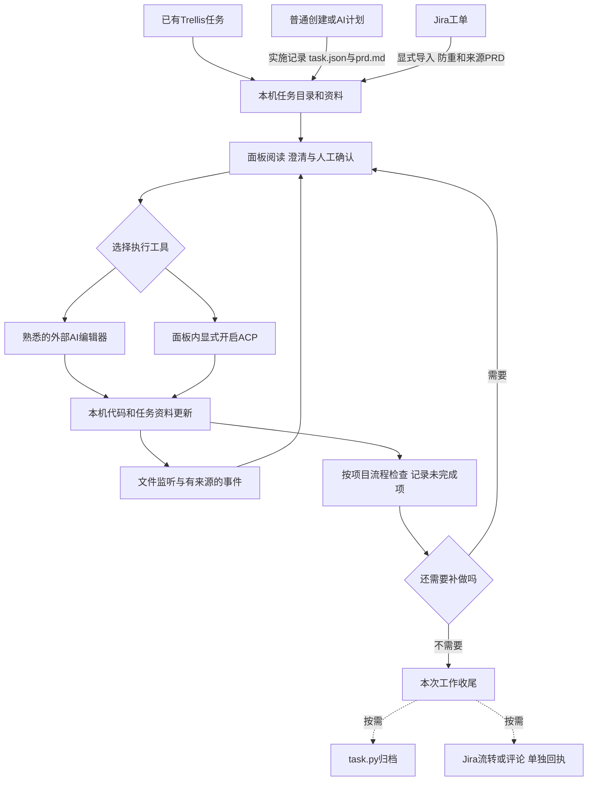
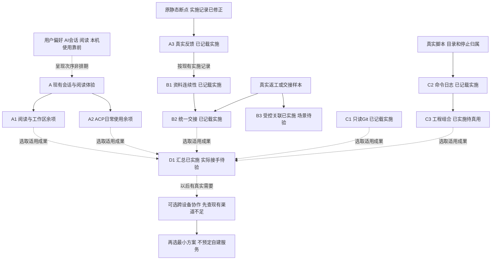
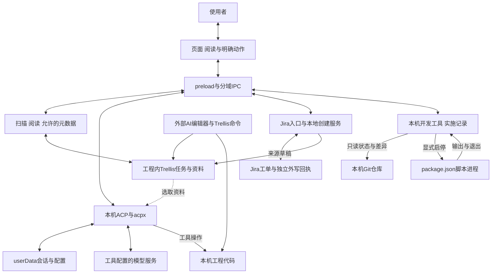
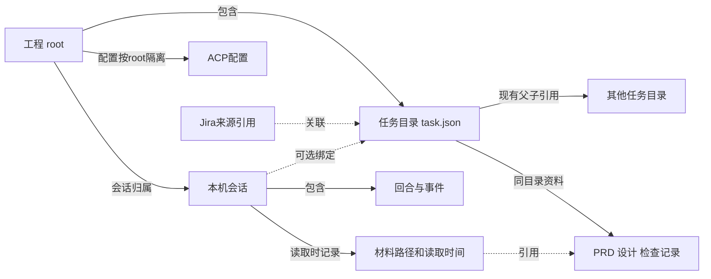

# Trellis Panel 完整场景化 Roadmap v2

整理日期：2026-10-17（Asia/Shanghai）。这是可直接阅读的完整整合版，包含规划正文、调研证据、需求与验收、数据模型、范围取舍、依赖与图源。原`roadmap.md`作为既有入口保留，本文件不要求读者先跳转到六份分散文档才能理解规划。

Trellis Panel已有本地任务、资料阅读、Jira来源接入与ACP会话基础。用户偏好让**AI会话、阅读和本机使用**靠前呈现；粗需求/旧任务接续、本机Git/运行/日志、检查与交接可按实际需要独立选择。Roadmap供用户后续决定任务与排期，不要求先锁定唯一主线。

**进度阅读规则：先看第1章的最新实施记录，再读各方向的设计说明。** v0.6规划形成后，仓库已经补充A3、B1/B2/B3、C1/C2/C3、D1和F04的实施记录。后文保留原问题与设计理由便于理解，但不把已记录完成的工作再次列为从零建设。原规划证据和未运行的验收计划也不会自动变为本次通过结果。

本次只生成`docs/roadmap_v2.md`，没有重新运行产品、模型、构建或冒烟，也没有修改产品代码、原roadmap或已有实施记录。项目状态来自现有文件；历史来源与当前实施记录分层引用。

## 阅读目录

1. [最新进度、证据口径与剩余验证](#progress)
2. [场景化方向：现在怎样用、可规划什么、怎样算完成](#scenarios)
3. [Crux调研：范围、覆盖、观察与可借鉴模式](#research)
4. [项目原规划基线与代码证据](#baseline)
5. [功能需求、非功能约束与完整验收计划](#requirements)
6. [数据、对象关系、状态与权限边界](#data-state)
7. [功能取舍及旧需求去向](#scope)
8. [工作包、依赖、风险与估算准备](#delivery)
9. [流程图、依赖图、数据流与对象关系：内嵌可编辑源](#diagrams)
10. [需求—证据—验收—工作包追溯](#trace)
11. [历史版本、资料来源与本次整合边界](#history)

## 1 最新进度、证据口径与剩余验证

### 怎样区分本文的几种结论

| 类别 | 能说明什么 | 不能据此推导什么 |
| --- | --- | --- |
| 最新实施记录 | 现有提案README记载的实现与已执行检查 | 不等于本次重新执行，也不等于原生/真实业务全部通过 |
| v0.6规划基线 | 当时的代码路径、用户证词、缺口和设计理由 | 代码后续已变时，不能继续称其为当前未修缺陷 |
| Crux官方说明 | 历史获取的公开文档所声明的能力 | 不证明客户端实测，更不要求Trellis逐项复制 |
| Crux网页观察 | 指定页面、操作和截图范围内的结构/行为 | 不证明原生桌面、双账号、写入或所有异常路径 |
| 规划与验收计划 | 希望得到的行为及后续应怎样核对 | 不代表已批准实施、固定排期或用例已通过 |

以下进度完整转录自已有[实施记录](proposals/2026-10-17-project-first-roadmap/README.md)，不由本次整合重新判定通过。ACP在那次实施中明确未改；A1原生外框/视觉、原生中文输入、真实多工程脚本与跨人接手等仍保留验证缺口。

### 已有实施记录（2026-10-17）

除 ACP 会话功能（用户明确要求不动；`services/acp*`、AcpConsole、acpx 相关零改动）外，本记录对应的小包已实现并通过 `npm run typecheck`（exit 0）、`npm run build`（exit 0）与既有冒烟（navigation / task-presentation / uiux-wiring / ipc-registry 169 通道 / render-contract / reading-session / task-reader / receipt-projection / jira-local-task / hook-emitter / proxy / chat / observability / reader-wiring / light-task-metrics）。

| 包 | 状态 | 实现要点 |
| --- | --- | --- |
| A3/F01 状态入口诚实化 | 已实现 | `issueToTaskPatch` 不再发送 status；`updateTaskRecordAt` 白名单外字段以 `ignored` 如实返回并由 UI 提示；列表/表格状态下拉改为"状态 + task.py 工作流命令入口"；看板拖拽改复制对应命令；批量"设为状态"移除；新建弹窗不再提供状态选择（创建合同固定 planning）。未放开生命周期白名单（PN-01） |
| A3/F02 创建产物合同 | 已实现 | `createTaskRecord` 支持 `prdContent`（写前查重不覆盖），返回真实 `files`/`warnings`；AI 计划确认后落 task.json + prd.md（含待确认问题）；完成页按实际产物展示、不再宣称不存在的 PRD |
| A3/F03+B2 交接收敛 | 已实现 | 删除 plan.ts `handoffTexts`（越权状态指引）与 `plan:handoff` 通道；计划完成页与任务详情统一走 `task:handoffBuild`（handoff.ts 确定性交接包，默认只核对与阅读） |
| B1 资料连续性 | 已实现 | 普通创建播种"原始描述"prd.md 草稿；AI 计划落完整 PRD；Jira 沿用既有来源 PRD——三入口原始资料均落在任务目录 |
| B3 任务关联 | 已实现 | peek 添加子任务改走受控 `task.py add/remove-subtask`（新 IPC `task:linkSubtask`，实出退出码），替代刷新即丢的视图层假链接 |
| C1 只读 Git | 已实现 | 新"本机开发工具"页：分支/基线/暂存/未暂存/未跟踪分组 + 文件级差异（有界、防路径穿越）；只发读取类 git 命令，非 git 目录中性降级 |
| C2/C3 运行与日志 | 已实现 | 同页：脚本来自 package.json（不改脚本、不代跑未声明脚本）；输出有界、退出码/信号如实呈现；停止仅作用于面板自启进程树；组合按顺序逐个启动、部分失败标注具体工程；进程存活不冒充服务就绪 |
| D1 检查/接续汇总 | 已实现 | 任务详情新增"接续与交接"：生命周期命令提示 + 意图选择 + 携带 PRD + 真实阅读清单与已知读取问题；真实接手试点（需第二人）仍待用户安排，not_run |
| F04 文案校准 | 已实现 | README（Jira 双向同步→来源集成/手动流转、拖拽改状态→工作流命令、WeKnora 归档沉淀→标注停用、AI 规划产物口径）与工具侧栏文案对齐当前实现 |
| A1 工作区余项 | not_run | 余项为原生外框/视觉复核，须真机目检（PN-06：构建通过不替代原生验收），留待用户走查 |

验证边界：以上均为静态实现+构建/冒烟证据；原生中文输入、真实多工程脚本、跨人接手未验证。已知无关旧伤：TPAP 冒烟 2 项失败（tool_search 关键词检索为空），在干净 HEAD（e07cdc0）复跑同样失败，先于本轮存在，未修（不在本蓝图范围）。

### 真机走查与真实使用验证（2026-10-17，桌面应用原生运行）

在桌面应用（electron-vite dev，原生窗口）中对第1章实施成果做了走查与真实验证；ACP 未启动会话、未改动。结果：

| 项 | 结果 | 证据与边界 |
| --- | --- | --- |
| A1 原生外框与亮色层级 | 通过 | 无边框集成项目标题生效：顶栏项目切换器（"选择项目，当前trellis-panel"）、窗口三键/胶囊模式/搜索框均带正确可访问标签；模块栏/上下文栏/内容卡片、chip、tab 高亮的亮色层级清晰。此前 design-qa blocked 的"最终原生帧捕获"已补真实原生证据 |
| C1 只读 Git 真实数据 | 通过 | 开发工具页 Git 区与本仓库实际状态一致：基线 e07cdc0、未暂存 37、未跟踪 29（含本 roadmap 文件），无任何写入口；非 git 降级路径未触发（本目录是 git 仓库） |
| C2 真实运行/输出/退出码 | 通过 | 从 package.json 选择 `typecheck` 真实运行两次：输出区呈现真实 npm/tsc 日志并以 `[dev-run] 进程退出，退出码 0` 收尾，与终端实测一致；"进程运行中（不代表服务已就绪）"文案如实 |
| C2 停止 | 部分验证 | 停止按钮带"仅面板自己启动的进程树"归属说明并可发出请求；因 typecheck 约 10 秒即完成，"已停止"终态未在界面捕获——留作真实长驻脚本使用时的观察项 |
| F01 状态工作流入口 | 通过 | 列表状态下拉显示"状态由 Trellis 工作流管理"：无命令状态灰显并说明原因，"已完成 · 复制 archive 命令"实测剪贴板得到 `python .trellis/scripts/task.py archive 00-bootstrap-guidelines`（dirName 正确） |
| B3 子任务提示 | 通过 | peek 子任务区显示"父子关联经 task.py add-subtask 写入 task.json，失败时会明确提示" |
| D1 接续与交接 | 通过 | 详情页"接续与交接"对 in_progress 任务给出正确的 finish 指引；"生成交接材料"端到端成功：阅读清单列出实际存在 3 文件（AGENTS.md / workflow.md / prd.md）、无虚构读取问题，复制内容与确定性交接包一致（任务/root/目录/阶段/读取时间/意图） |

未覆盖：深色主题（不改动用户主题偏好，切换入口在设置页原生可用）；原生窗口拖拽/resize 逐项；真实长驻脚本的停止终态；切A→B→A工程连续性（PA-01 完整口径）。PA-01..PA-11 记录状态保持 not_run，本表是部分原生证据，不整体关闭任何 PA。环境备注：npm ci 重装后 electron 二进制缺失曾致 dev 启动失败（"Electron uninstall"），在 `node_modules/electron` 执行 `node install.js` 补装后恢复——一次性环境修复，非产品缺陷。

### v0.6 蓝图完整度收尾（2026-10-17 第二轮）

对照本文逐条 PF 与数据附录"最小接续说明"表复核后，补齐三处真实缺口并通过真实退出码门禁（typecheck / build / 冒烟 exit 0）与桌面原生端到端验证；ACP 仍未改动：

| 缺口 | 依据 | 实现 | 原生验证 |
| --- | --- | --- | --- |
| 接续说明缺"本次变化/检查与未完成项/待确认问题" | PF-08"说明上次结果、本次增量、资料读取时间及缺失"；PF-11"汇总本次变化、实际检查、未覆盖"；数据附录§4 最小接续说明表 | 交接包（handoff.ts，确定性生成）新增三块：Git 变化摘要（当前分支/工作区未提交数/任务分支领先落后与最近提交，标注"归属以 git 为准"；无分支/非 git 如实说明）；检查记录（validation.md / check.md 等实际存在文件）与未勾选子任务；prd.md"待确认"小节未决项（上限 8）。详情页"接续与交接"面板分块呈现 | 真机对 10-16-project-workspace-uiux 生成：Git 块 4 行与实际一致（领先 main 52、最近提交 e07cdc0）、检查记录 validation.md、未完成子任务无、阅读清单 7 文件；复制文本剪贴板核对一致 |
| PF-07"本地相关资料放回原任务材料"缺轻量入口 | PF-07/B1"将原问题、本地相关资料、规则、待问问题放回原任务材料"；依赖节"先支持人工选取资料" | peek 属性栏新增"资料引入 → 添加项目资料"：输入项目内路径，读取（项目内包含检查）后经既有 taskWriteArtifact 复制进任务目录，原件不动、不建第二套资料库；writeArtifact 文件名校验放宽到中文等安全字符（仍禁路径分隔符） | 真机把 docs/access-protocol.md 复制进 10-16-project-workspace-uiux：toast"已复制到任务资料"、文档列表即时出现、磁盘 6162 字节与源一致（验证后测试文件已删除） |
| PF-01 切工程 A→B→A 未原生验证 | PF-01"切工程、开任务、展开和返回均保留正确root及来源" | 无需改动（实现已在） | 真机 trellis-panel → honsky-governance：任务列表完全切换为对方 6 项真实任务、旧详情关闭、零串线；切回后 12 项恢复、顺序一致。失败路径同样验证：切换到已不存在的 demo-project 时如实显示"项目打开失败"并保留原项目数据（PN-04） |

仍未验证（保留给真实使用）：PN-06 新页面窄宽度与深色主题走查；C3 真实多工程长驻脚本与"已停止"终态；D1 第二人接手试点；B2 换工具接续样本。PA-01..PA-11 记录状态保持 not_run。

### 怎样继续选择后续工作

v0.6 蓝图内可由本机单方完成的事项已全部实施并验证（两轮实施记录 + 真机走查 + 本轮收尾）。当前剩余的最有价值项都需要真实输入：ACP 原生体验（用户已排除，沿 A2 原任务记录）、开发工具在真实多工程脚本上的长驻运行/停止（需用户提供工程组合）、旧任务接续的实际样本（需真实返工与第二人）。若已实现功能足够，就使用并积累样本；不因存在roadmap工作包而重复开发。

跨设备协作、正式审批、更大规模自动化和更多平台接入仍是有条件的后续场景。先明确哪一处真实工作受阻，再决定最小增量；它们不构成本机能力的前置架构。

## 2 场景化方向与完成标准

Trellis Panel已经具备本地任务、材料阅读、Jira接入和面板内ACP会话基础。接下来可规划的方向是：把已有AI会话和阅读体验补齐，让粗需求和旧任务更容易接续，在本机看Git、启动工程和读日志，以及让一次工作有可核实的结果和交接说明。

**用户偏好：AI会话、阅读与本机使用靠前呈现。** 这决定文档的阅读次序，不是最终排期。用户会根据roadmap自行选择后续工作；本版只规划，不修缺陷、不实现功能，也不要求先指定唯一“主线”。已经批准的任务仍以原任务边界为准。

| 可规划方向 | 已有基础 | 主要收益 | 可独立选择的部分 |
| --- | --- | --- | --- |
| A 现有AI会话和阅读体验 | ACP/acpx、任务工作区、阅读与资料比较已有实现 | 少丢草稿、看清资料、正确处理权限/停止、反馈真实 | 阅读走查、ACP余项、创建/状态/交接候选修正可分开规划 |
| B 粗需求与旧任务接续 | Jira来源草稿、本地资料、任务关系、交接包 | 从原问题和上次结果继续，减少重复澄清 | 资料连续性、统一交接、已有任务关系按样本选择 |
| C 本机开发工具 | 单命令输出/中止、Git读取、文档差异基础 | 减少反复切终端和Git工具，分清运行与变更归属 | 只读Git可独立；单工程命令可靠后再规划多工程组合 |
| D 检查与交接 | 任务材料、检查记录、现有Jira/沟通工具 | 知道实际查了什么、缺什么、下次怎样继续 | 先改善原任务记录；跨设备协作为后续可选场景 |

这些方向不是必须全做的四阶段。依赖只约束确有先后关系的动作，例如多个工程的运行组合需要可靠的单工程进程归属；只读Git无需等待ACP、多人审批或新团队后端。团队近期围绕本机使用规划；跨设备确认以后若有真实需要，再确定最小共享方案。

下面的场景例子解释建议，不冒充新访谈。阅读、黑盒、接续、Jira粗需求和面板内Agent来自历史用户证词；新增功能的收益仍须实际使用验证。

### 1 现在一项工作怎么完成

打开工程后，工作项来自已有`.trellis/tasks`、手动新建或Jira导入。开发者读PRD/设计，与用户澄清并按项目工作流确认；可用外部AI编辑器，也可主动打开绑定任务的ACP会话。资料和代码仍落在本机。面板监听文件、显示材料版本和可观察到的活动。最后按项目流程检查、记录结果，需要时再归档；Jira流转、评论或外部发布各自决定。

这条路不是每个任务都必须经过Jira、AI规划、发布包、回写或团队审批。小修复可以走短路径，资料复杂的任务再多做澄清。原规划基线和限制见第4章，现状图见[C01](#flow)。

### 2 方向A：让已经做出来的工作台和ACP稳定好用

**进度补充**：实施记录已记载A3/F01–F03完成；A1原生外框/视觉仍not_run。ACP未在那次实施中改动，A2仍沿原任务记录处理。以下断点描述是规划时的问题与修正目标，不是对当前代码再次诊断。

**现在怎么做**：顶栏选工程，工作项/知识/会话并列；材料可展开到中央，已有新版提醒。Codex和Claude已接入acpx，最新验收记录包含真实工具、权限、停止和会话恢复。

**哪里仍需验证**：现有工作区还有原生外框/视觉复核，ACP还有原生中文输入法、配置操作及草稿切换走查。状态反馈、创建产物与两种交接出口已在后续实施记录中记载修正，原问题与VF验证方法保留在第4章；不要把这些旧断点重新安排成从零实现。

**改什么**：

- 可沿已有任务逐项关闭未完验收，不重写已通过的阅读器或ACP底座。
- 状态入口按现行Trellis权威说明能做什么；不能保存的动作不装成成功。是否以后增加受控状态命令，另行设计，不放开直接写状态来图省事。
- 普通创建、AI规划和Jira创建分别明确会生成哪些文件。先修“承诺了什么、实际得到什么”；计划确认后的材料应能从原任务读到。复用现有创建/资料能力，不另建一套任务库。
- 校准README等入口文案，避免继续称ACP只是未来能力，或把已停用归档/自动覆盖状态写成当前功能。

**改完怎么用**：选好工程后，能读当前任务、主动开启现有Agent、处理权限和停止，返回原材料也不丢位置；创建结果有真实文件或准确说明。用户不会仅因一个按钮样子像“完成”就误判工作已经结束。

**最小可独立交付**：A1工作区剩余视觉/阅读走查；A2 ACP原生输入/配置/草稿收尾；A3状态入口与创建结果一致性。三者可以分开验收，每项沿用原任务的实现和记录。

**完成标准**：在隔离项目中完成一次中文输入、改稿、发送/拒绝/停止、重新打开会话及返回材料；任务归属正确。状态操作不会短暂假成功后回退；创建页面所说的文件与磁盘一致。未运行的原生项继续标未验证，不能只以build通过代替。

**为什么靠前呈现**：用户最新偏好是AI会话、阅读和本机使用偏靠前；现有能力也已有投入和指定通过记录。最终做哪项、何时做仍由用户后续选择，不把偏好解释为实施授权或固定排期。

**这批不做**：自建共享身份服务、正式多人审批、远程机器调度、小队、通用自动化或新编码Agent底座。现有通用问答、Flow和频道继续保留入口。

### 3 方向B：把粗需求说清楚，隔几天也能回到原任务

**进度补充**：实施记录已记载B1资料连续性、B2统一交接、B3受控任务关联完成；真实返工/换工具/跨人接续的使用效果仍须适用样本核对。

**现在怎么做**：Jira通常只有问题摘要，细节可能在飞书；用户历史上会挑出相关内容放本地docs给AI读。Jira轻任务已有来源草稿和防重；本地也有PRD/设计、父子任务、知识检索、文档比较和交接文本。

**哪里仍需验证**：历史用户明确说过“隔了几个任务再优化，容易又从头来”。实施记录已记载两种交接出口统一、任务关系改为受控持久化；资料与接续说明能否帮助使用者回到原工作，还需真实返工样本。任务关系可保存也不等于已有完整的需求沿革系统。

**改什么**：把原始问题、选取的本地资料、已说清的规则、尚未回答的问题和本次要补什么放回同一任务。先用已有PRD/设计/检查记录和父子关系组织，不默认引入逐条需求审批、依赖闭包或额外审批数据库。收敛交接文本，明确“核对/阅读”与“开始实施”，显示资料读取时间和已知缺失。

**改完怎么用**：例如周一接到一条粗需求，先选相关本地资料并列待问问题；用户确认后再做。周三回来补一个规则，先打开原任务，看到上次改到哪里、依据哪些资料、哪些检查还没做。真正独立的后续工作再建关联任务，不自动复制全部任务。

**最小可独立交付**：B1三种创建入口的资料连续性；B2统一的任务接续/交接说明；B3原任务与后续任务的可读关联。B1可先交付，B2/B3用一个真实返工样本验证后再扩面。

**完成标准**：一个本地任务和一个适用的Jira任务均可读到各自真实资料；重复Jira导入打开原任务。接手者只靠原任务资料能说出“本次目标、上轮结果、当前缺项、下一步”；新说明不冒用旧确认，也不自动开启Agent。材料变化时能比较，旧正文不被静默换掉。

**依赖与顺序**：依赖现有项目/阅读归属和A3创建结果真实，不必等待ACP全部原生余项关闭。是否自动读飞书、产品是否必须跨设备确认，还没有足够依据；先支持人工选取资料与现有工具沟通。

**这批不做**：自动抓全公司飞书、把所有历史文档转成结构化需求图、强制每任务发布/双验收/回写、在本机面板伪造多人实时协作。

### 4 开发工作项：运行、日志和只读Git可以独立往前排

**进度补充**：实施记录已记载C1/C2/C3及本机开发工具页完成；以下说明保留设计目标，真实多工程脚本、部分失败和停止范围仍按实际工程补验。

这项有项目范围记录支持，不因Crux菜单而加入，也不需要等团队审批平台完成。它可以与其他候选包独立排期；如果用户当前更在意开发时反复切工具，可优先选择这里的小项。

**现在怎么做**：实施记录已记载新增“本机开发工具”页，包含只读Git分组与文件差异、来自package.json的脚本运行、有界日志、退出/信号与顺序启动组合。真实多工程脚本、停止归属和部分失败尚未完成实际使用验证；没有把进程存活当作服务就绪，也未证明完整的长期服务管理平台。

**准备改什么、怎样拆小**：

| 小项 | 先复用什么 | 改完如何用 | 独立完成标准 |
| --- | --- | --- | --- |
| C1只读Git | 现有Git状态、提交读取和差异组件 | 在任务旁看当前工程改了哪些文件、基线是什么；已有脏改动单独说明 | 无Git可正常读任务；多仓库来源明确；新入口无提交/切分支/重置副作用 |
| C2单工程命令与日志 | CLI输出、runId、中止机制 | 选择已存在的开发脚本，看到真实输出、退出码和归属 | 启动前说明目录/命令；不改现有脚本；暂停日志跟随不停止服务；不杀外部进程 |
| C3多个工程一起运行 | C2及团队已用的启动脚本 | 选择明确的工程组合，例如经确认的前后端服务，逐个看到启动/就绪/失败 | 部分失败可定位；依赖与停止范围清楚；没有已定义就绪检查时只说进程存活，不假称服务可用 |

**先后理由**：C1可先独立做；C2建立进程归属后才做C3，避免直接搭一个大调度平台。具体工程、脚本、就绪条件与最近痛点还需用户提供；本文不假造当前业务工程配置。多工程不等于多机或云开发。

**这项不做**：代码编辑器、断点调试、默认Git写操作、远程执行集群、公共预览发布平台。现有独立Git写能力不因本提案被删除，但不混入新的只读入口。

### 5 用一次真实工作把检查和接手验证清楚

**进度补充**：D1接续与交接汇总界面已记载完成；需要第二人的真实接手试点仍not_run。

**现在怎么做**：AI和开发按项目流程检查，结果留在任务材料或验收记录；需要归档时走task.py。产品/测试现在具体在哪里看资料、怎样回复，尚未有足够现行证据，不能假定大家已在面板审批。

**改什么**：在原任务集中呈现“这次改了什么、实际查了什么、未查什么、已知问题、怎么继续”。复用现有文件、提交/分支、会话和交接包。适合发Jira评论的任务可显式回写；无需回写的本地任务也能完成。先用现有Jira/飞书/文件或基座仓库交接一轮，再决定是否缺专门共享能力。

**改完怎么用**：自己或同事打开说明能核对本次结果，知道哪些结论来自检查、哪些只是Agent说完成；要补做时回到同一个任务。需要产品判断的规则留给具体人确认，不把代码检查通过当业务已认可。

**完成标准**：选一个适合的真实任务，由使用者记录实际入口、资料位置、未完成检查和接续结果；接手者能完成一次继续核对。若第二设备访问困难，记录究竟是文档位置、账号权限还是缺服务，避免直接把问题归为“必须自建团队平台”。本轮不虚构试点人选、效率提升比例或验收通过。

**这项不做**：要求每任务携带统一构建包、部署/发布、正式多人批准、远程撤回已下载副本或建设完整测试管理系统。

### 6 如何从roadmap选出后续工作

先选择当前最影响使用的一项场景，再以“当前缺口、改后用法、依赖、完成标准”形成独立任务。A靠前呈现符合用户偏好；C1可单独选择，C2/C3按真实运行依赖展开；B与D按实际接续和交接样本决定。原规划断点F01–F03已在后续实施记录中记载修正；后续只针对复验或实际使用发现的新缺口规划增量。

有现成功能就补经核实的缺口，不按竞品重复建设。没有真实使用场景的共享审批、专项、小队或通用自动化，可以长期不采用。对未来实施的设备、脚本、人员和数据范围，可以在选择相应小项后再查清；这些不是本份roadmap交付的阻塞问题。

[规划工作项及真实依赖图](#dependencies)展示可独立选择的部分；[实施准备（第8章）](#delivery)解释估算、风险及后续设计输入。本版不锁定单一路线，不设“答完问题才能继续规划”的前置条件。

## 3 Crux调研与UI/UX参考

### 研究范围与事实边界

资料入口为[Crux帮助文档](https://help.crux.com/docs/welcome)。已有采集记录覆盖2026-10-15当时公开链接可发现的47个文档页面；sitemap未能独立确认站点总量，因此不把“已发现正文均获取”称为全部产品功能验证。页面会变化，未来涉及实际集成或执行前再核实相关说明。本次整合没有重新联网采集。

既有体验审查包含已登录网页的低风险导航，形成25条观察记录、19张可交付截图及U01–U22覆盖矩阵。原生应用/本机桥接、双账号权限、跨设备、真实runtime执行和集成写入等没有完成验证。没有为了研究创建、发布、删除、付款、发消息或执行付费AI作业。

研究支持交互判断，不把Crux的组织、专项、小队、通用自动化或厂商目录反推为Trellis必建功能。下面保留原始事实与局限，迁移判断以本版取舍为准。

### 公开资料主题与逐页来源

主题覆盖包括开始使用、Agent与电脑、最佳实践、CLI与访问、外部集成、空间/组织工作和任务规则。下表引用原索引的原创摘要；没有沿用旧R0–R5和能力覆盖的排期映射。

| 来源 | 页面 | 历史摘要 |
| --- | --- | --- |
| S01 | [欢迎使用 Crux](https://help.crux.com/docs/welcome) | 渐进采用 Agent，保留原有工具与人的责任，并延展到研发、支持、测试和文档。 |
| S02 | [快速上手](https://help.crux.com/docs/quickstart) | 区分任务、角色和执行机器，先跑通一条小工作；机器连接成功仍需检查工具与登录。 |
| S03 | [Agent 如何执行任务](https://help.crux.com/docs/agent-and-computer/agent-task-execution) | 任务、上下文与执行环境共同决定一次运行；排队、等待人工、失败和结果需要分别说明。 |
| S04 | [Agent](https://help.crux.com/docs/agent-and-computer/agents) | 角色配置覆盖职责、可见性、工具、模型、技能、并发、连接器与历史。 |
| S05 | [与 Agent 对话](https://help.crux.com/docs/agent-and-computer/chat-with-agent) | 区分独立探索和任务会话，说明上下文、分享范围、常用快捷指令与已有记录的关系。 |
| S06 | [评论和回复](https://help.crux.com/docs/agent-and-computer/comments-and-replies) | 共享讨论、回复、附件、显式提及和讨论解决承载团队意见，但不同于执行会话和任务验收。 |
| S07 | [电脑](https://help.crux.com/docs/agent-and-computer/computers) | 机器连接、运行就绪、工具登录、路径、操作系统及共享目录并发都有各自边界。 |
| S08 | [小队](https://help.crux.com/docs/agent-and-computer/crews) | 队长协调人与多个执行角色，成员分工、目录约束、结果汇总与可见性需要明确。 |
| S09 | [收件箱](https://help.crux.com/docs/agent-and-computer/inbox) | 个人提醒按任务聚合，并区分待行动与普通动态；阅读、清理和暂缓不是任务完成。 |
| S10 | [连接代码库](https://help.crux.com/docs/agent-and-computer/repositories) | 仓库定义、空间默认值和执行电脑上的 Git 凭证各有作用，删除配置不等于删除代码。 |
| S11 | [技能](https://help.crux.com/docs/agent-and-computer/skills) | 可重复方法可以独立维护并绑定给角色；任务特有目标仍留在任务中。 |
| S12 | [Agent 工作目录](https://help.crux.com/docs/agent-and-computer/working-directory) | 既有目录与临时隔离目录用途不同；默认值改变不应静默迁移已有任务执行。 |
| S13 | [让文档更新跟着产品发布走](https://help.crux.com/docs/best-practices/documentation-automation-pipeline) | 从发布变化生成文档计划，由人定范围，再交给撰写角色修改、预览与复核。 |
| S14 | [连接飞书：让群聊里的问题真正被推进下去](https://help.crux.com/docs/best-practices/feishu-group-to-task) | 将明确要求跟进的话题整理成任务，保留原讨论、身份与附件，并把进展关联回来源。 |
| S15 | [全流程自动化测试：让测试跟上每天的发布节奏](https://help.crux.com/docs/best-practices/full-flow-automated-testing) | 版本预检、白盒、用例设计、黑盒和人工复核是独立环节；证据与环境准备影响可信度。 |
| S16 | [使用 Crux 推进产品研发](https://help.crux.com/docs/best-practices/product-development-workflow) | 从不完整想法到范围确认、任务拆解、执行、验收，再以目标和时间窗口组织整体推进。 |
| S17 | [个人访问令牌](https://help.crux.com/docs/cli/access-tokens) | 脚本访问应绑定真实身份和权限；凭证创建、失效、撤销与本地退出各有含义。 |
| S18 | [Crux CLI](https://help.crux.com/docs/cli/cli) | 命令行覆盖任务、讨论、运行与文档集，机器可读输出和明确操作范围支持集成。 |
| S19 | [CNB 集成](https://help.crux.com/docs/integration/cnb) | CNB 的仓库配对、凭证、流水线事件和任务回链有专门接入约束。 |
| S20 | [Jira、TAPD、禅道概念对照](https://help.crux.com/docs/integration/concept-mapping) | 不同平台的项目、需求层级、迭代、身份与字段含义不能按同名直接映射；覆盖规则需明确。 |
| S21 | [钉钉集成](https://help.crux.com/docs/integration/dingtalk) | 群聊任务助手与普通 Agent 机器人是独立能力，各自具有绑定、触发与文件返回规则。 |
| S22 | [Discord 集成](https://help.crux.com/docs/integration/discord) | 机器人、任务助手、线程、文件权限和可选消息触发需要分别配置。 |
| S23 | [飞书集成](https://help.crux.com/docs/integration/feishu) | 任务助手、Agent 机器人、资源工具连接和个人通知是不同连接；飞书与 Lark 授权也分开。 |
| S24 | [GitHub 集成](https://help.crux.com/docs/integration/github) | 组织应用与个人授权支持代码、Issue、PR 和回链关联，执行电脑的 Git 凭证另有作用。 |
| S25 | [GitLab 集成](https://help.crux.com/docs/integration/gitlab) | 云端与自建实例、内网访问、组织和个人授权、Issue 同步与事件回调各有边界。 |
| S26 | [Jira 集成](https://help.crux.com/docs/integration/jira) | 一次导入、持续同步、预览映射、去重、身份、附件、字段限制、内网和回退构成完整接入链。 |
| S27 | [Jira 兼容 API](https://help.crux.com/docs/integration/jira-api) | 兼容 Jira 风格接口是供既有客户端接入的适配层，有自身的查询、字段与流转边界。 |
| S28 | [PingCode 集成](https://help.crux.com/docs/integration/pingcode) | PingCode 的授权、导入、同步、成员映射和失败恢复需要平台专门处理。 |
| S29 | [Slack 集成](https://help.crux.com/docs/integration/slack) | 工作区任务卡与通知、任务助手和 Agent 机器人分别连接，并处理线程、身份与触发范围。 |
| S30 | [TAPD 集成](https://help.crux.com/docs/integration/tapd) | 企业 API 与个人令牌的能力、实时性和限流不同，历史导入与后续同步应分别说明。 |
| S31 | [Teambition 集成](https://help.crux.com/docs/integration/teambition) | 应用凭据与个人授权分别影响读取和远端写入；导入、Webhook 与轮询需要能力提示。 |
| S32 | [微信集成](https://help.crux.com/docs/integration/wechat) | 微信可绑定 Agent 外部会话，连接状态和新会话规则明确，聊天不自动形成任务。 |
| S33 | [企业微信集成](https://help.crux.com/docs/integration/wecom) | 企业微信的任务助手和 Agent 机器人相互独立，绑定、触发与身份有各自限制。 |
| S34 | [禅道集成](https://help.crux.com/docs/integration/zentao) | 禅道版本、产品线与项目线、地址、内网、映射、回调和导入恢复都需要独立校验。 |
| S35 | [自动化](https://help.crux.com/docs/space/automations) | 自动化有触发范围、执行身份、运行归属、通知、历史和暂停规则；失败不天然等于安全重试。 |
| S36 | [迭代](https://help.crux.com/docs/space/iterations) | 时间窗口管理范围、结转与历史，和长期目标及查看方式不同；自动加入只适用于明确规则。 |
| S37 | [成员](https://help.crux.com/docs/space/members) | 组织身份、实际协作范围和访问角色有不同含义，外部身份与 Agent 也不同于真人成员。 |
| S38 | [专项](https://help.crux.com/docs/space/projects) | 一组任务可共同服务于交付目标，并跟踪目标负责人、整体进展和时间线。 |
| S39 | [空间](https://help.crux.com/docs/space/spaces) | 持续协作范围承载任务、成员、功能开关和默认规则，而不等于一份本地代码目录。 |
| S40 | [任务](https://help.crux.com/docs/space/tasks) | 任务可从不完整描述开始，持续记录人员责任、执行位置、上下文、讨论、关联和结果。 |
| S41 | [分拣台](https://help.crux.com/docs/space/triage) | 外部工作进入项目前可接受、去重、拒绝或暂缓，并有明确分流责任；这不同于个人提醒。 |
| S42 | [视图和任务列表](https://help.crux.com/docs/space/views) | 过滤、分组、排序、字段和布局可保存成视图，私有定义、团队共享和个人收藏需要区分。 |
| S43 | [关注任务](https://help.crux.com/docs/task/follow-tasks) | 关注用于跟踪，@ 用于直接请求，负责用于推动工作；通知需要按关系和行动强度路由。 |
| S44 | [任务标签](https://help.crux.com/docs/task/task-labels) | 标签用于补充分类，互斥组、合并、归档和作用范围有助于避免重复和历史丢失。 |
| S45 | [任务关联](https://help.crux.com/docs/task/task-relations) | 层级拆解、阻塞、重复与相关是不同关系，关系本身不应隐含启动或完成任务。 |
| S46 | [任务状态](https://help.crux.com/docs/task/task-statuses) | 稳定类别承载生命周期，自定义名称可服务团队；配置迁移与 Agent 运行状态必须区分。 |
| S47 | [任务类型](https://help.crux.com/docs/task/task-types) | 类型决定工作对象的字段与可用流程，启停、切换和字段解绑可能影响历史数据。 |

### 应用体验覆盖矩阵

所有行均是部分或结构覆盖，未关闭全路径。`structure_only`没有完整可交付截图；UI06独立Agent会话不作为任务对话视觉覆盖。

| 编号/范围 | 原检查点 | 覆盖等级 | 已验证边界 | 限制 |
| --- | --- | --- | --- | --- |
| U01 启动、登录后首页、组织/空间切换 | 版本、身份范围、无空间、离线 | observed_partial | 已登录网页首屏；未测登录、组织切换、无空间、离线和原生启动版本。 | 未点击标已读/全部清理；没有真实通知，未验证通知聚合与处理副作用；未新建、上传、共享或搜索真实文档；跨设备访问和Agent实际读取未验证 |
| U02 全部任务/空间列表 | 列表、看板、搜索、筛选、零结果 | observed_partial | 仅示例看板与类型过滤入口；列表模式、复杂筛选、大数据量未验证。 | 未拖拽、未改状态、未保存视图；只有示例数据不能验证大数据量和复杂层级 |
| U03 已有任务详情 | 标题、人员、状态、材料、历史、返回位置 | structure_only | 仅已有示例任务结构和历史失败；材料返回位置、完整视觉未验证。 | 历史记录，不证明当前服务仍失败；未重试或打开原始数据；截图Page.captureScreenshot在5秒超时，视觉未验证；未更改任何字段、评论、反应、关注或任务关系；相关菜单和提交路径未验证；未获得完整可交付截图 |
| U04 新建任务表单 | 必填提示、取消、未保存草稿 | observed_partial | 空标题禁用、类型菜单、关闭已观察；未提交，不证明服务端幂等与保存。 | 未更改类型或属性、未提交、未上传附件；不验证服务端必填校验；未切换类型或进入管理；未验证角色差异和字段迁移 |
| U05 类型、标签、关系 | 菜单分类、循环依赖/重复解释 | observed_partial | 类型入口与属性结构已观察；标签编辑、循环依赖与重复合并未验证。 | 未更改任何字段、评论、反应、关注或任务关系；相关菜单和提交路径未验证；未获得完整可交付截图；未拖拽、未改状态、未保存视图；只有示例数据不能验证大数据量和复杂层级；未更改类型或属性、未提交、未上传附件；不验证服务端必填校验；未切换类型或进入管理；未验证角色差异和字段迁移 |
| U06 任务评论与回复 | 锚点、已解决、@ 真人/Agent 语义 | structure_only | 评论/回复结构已观察；未发送，不证明通知、锚点、解决和@语义。 | 未更改任何字段、评论、反应、关注或任务关系；相关菜单和提交路径未验证；未获得完整可交付截图 |
| U07 对话模块 | 发起者归属、等你/等人、行定位、未读 | observed_partial | 独立会话控件已观察；等你/等人、未读、发起者、并发未验证。 | 未切换模式、未新建会话、未发送；未测并发、重试或恢复 |
| U08 任务对话 | 历史、多会话、布局和返回 | structure_only | structure_only：仅任务对话结构和历史执行观察，没有可交付的任务对话截图。UI06仅为独立Agent会话入口参考，不计任务对话视觉覆盖；新运行、继续、取消、真实交接和布局恢复未验证。 | 历史记录，不证明当前服务仍失败；未重试或打开原始数据；截图Page.captureScreenshot在5秒超时，视觉未验证；未更改任何字段、评论、反应、关注或任务关系；相关菜单和提交路径未验证；未获得完整可交付截图 |
| U09 收件箱 | 聚合、重要、已读/稍后与对话分工 | observed_partial | 个人通知空态；无真实通知，不证明聚合、已读或稍后副作用。 | 未点击标已读/全部清理；没有真实通知，未验证通知聚合与处理副作用；无待分拣记录；未配置、创建、接受、拒绝、去重或暂缓 |
| U10 Agent 列表与详情 | 无 Agent、禁用、职责、runtime | observed_partial | 列表、搜索零结果实测；创建表单结构观察；禁用/详情/保存未验证。 | 没有执行对话、收藏或行操作；名称和所有者不进入交付截图；未证明后端检索完整性；早先更新前或无效尺寸截图均已拒用；不进行键盘读屏合规判断；未填写、未提交或安装；不验证默认值保存后的语义; visual capture did not show the dialog; no visual finding claimed；未创建或修改；截图超时且复查时弹层已消失，不能归因于产品；不交付视觉结论。主机名、所有者和Agent名称不交付 |
| U11 电脑与 runtime | 在线/离线、连接/安装/登录区分 | observed_partial | 电脑页本地桥接提示已观察；私有可用徽标仅结构观察；安装、认证、真正执行未验证。 | 未填写、未提交或安装；不验证默认值保存后的语义; visual capture did not show the dialog; no visual finding claimed；未切换模式、未新建会话、未发送；未测并发、重试或恢复；历史记录，不证明当前服务仍失败；未重试或打开原始数据；截图Page.captureScreenshot在5秒超时，视觉未验证；未启动/刷新服务，未连接新电脑，未点击电脑详情、检查凭据或执行任何Runtime；主机名与所有者不交付 |
| U12 工作目录/仓库 | 目录来源、锁、worktree 策略和权限 | observed_partial | 只看到会话目录入口与创建表单Git工作方式；未打开目录选择、锁和worktree策略。 | 未填写、未提交或安装；不验证默认值保存后的语义; visual capture did not show the dialog; no visual finding claimed；未切换模式、未新建会话、未发送；未测并发、重试或恢复 |
| U13 技能与小队 | 依赖、空态、队长与成员职责 | observed_partial | 技能空态与Agent/小队Tab入口已观察；小队详情、依赖、队长、执行均未验证。 | 没有执行对话、收藏或行操作；名称和所有者不进入交付截图；未导入、复制、安装或发布技能；实际可见性与执行权限未验证；未新建、上传、共享或搜索真实文档；跨设备访问和Agent实际读取未验证 |
| U14 成员与空间权限 | 可见、无权、角色范围和邀请副作用 | structure_only | 组织成员角色/空间列结构可见；只有所有者，普通成员、访客和拒绝场景未验证。 | 未邀请、复制链接、查看个人详情、修改角色或验证无权场景；裁切截图超时，视觉未验证；未创建或修改；截图超时且复查时弹层已消失，不能归因于产品；不交付视觉结论。主机名、所有者和Agent名称不交付 |
| U15 专项/交付目标 | 范围、负责人、进度和空态 | observed_partial | 专项解释与空态；无实际目标，负责人、进度、结束路径未验证。 | 未更改固定项或拖动导航；当前无专项；期限、负责人、进度汇总和跨任务交付未验证 |
| U16 保存视图 | 私有/共享、临时更改、重置、窄屏 | observed_partial | 保存视图空态；未创建、保存、共享或重置，权限未知。 | 未拖拽、未改状态、未保存视图；只有示例数据不能验证大数据量和复杂层级；未创建或保存视图，不证明多人共享与权限边界 |
| U17 迭代 | 当前/历史/无迭代、结转语义 | observed_partial | 迭代空态与过滤入口；无历史，不验证结束和结转。 | 当前无真实迭代，无法验证结束、结转、历史和跨周期统计 |
| U18 分拣台 | 接受/重复/拒绝/暂缓菜单及空态 | observed_partial | 分拣入口与空态；未分拣、配置或接收外部记录。 | 未更改固定项或拖动导航；无待分拣记录；未配置、创建、接受、拒绝、去重或暂缓 |
| U19 自动化 | 触发、范围、历史、失败原因 | observed_partial | 自动化空态与用途说明；未启用、运行、检查历史或补偿。 | 未新建、启用、触发或测试规则；运行历史和失败补偿未验证 |
| U20 Jira/Git/IM 集成 | 只读连接状态、字段方向、失效授权 | observed_partial | 目录分类和UI文案；没有连接、同步、回写或失效授权测试。 | 未打开凭据、授权、测试连接或发起同步；所有方向/范围能力仅是界面声明；未连接厂商、获取凭据、发消息或执行回写；当前只有目录声明 |
| U21 设置/CLI/PAT | 能力说明、掩码、撤销提示 | observed_partial | 设置导航、成员/集成/快捷键说明；未打开PAT、CLI、账号绑定或凭据页。 | 未打开凭据、授权、测试连接或发起同步；所有方向/范围能力仅是界面声明；未邀请、复制链接、查看个人详情、修改角色或验证无权场景；裁切截图超时，视觉未验证；未修改偏好、未发送内容、未做读屏和全键盘审查；没有交付截图 |
| U22 键盘/缩放/主题/窄屏 | 焦点、读序、状态非色彩表达 | observed_partial | 1000×900与1440×900网页视口、搜索展开和Esc关闭菜单；无原生/读屏/完整键盘/主题测试。 | 未证明后端检索完整性；早先更新前或无效尺寸截图均已拒用；不进行键盘读屏合规判断；未修改偏好、未发送内容、未做读屏和全键盘审查；没有交付截图 |

### 逐条观察与截图索引

“有图”表示经既有记录接纳的截图；结构记录不补造图片。截图和原始证据仍保存在项目的既有证据目录，本文已纳入全部观察文字与限制。

| 记录 | 截图 | 证据等级 | 观察事实 | 未验证 |
| --- | --- | --- | --- | --- |
| UI01-inbox-empty 首页与收件箱 | [有图](proposals/2026-10-15-crux-roadmap/evidence/ui/UI01-inbox-empty.jpg) | screenshot_and_structure | 收件箱/稍后/已清理和全部/重要/其他分层；主区暂无通知；组织与空间导航分开 | 未点击标已读/全部清理；没有真实通知，未验证通知聚合与处理副作用 |
| UI02-agents-overview 全部Agent和小队 | [有图](proposals/2026-10-15-crux-roadmap/evidence/ui/UI02-agents-overview.jpg) | screenshot_and_structure | 全部/Agent/小队/我的四种筛选；搜索；按空间分组计数；存在单条私有Agent，卡片区分runtime与所有者 | 没有执行对话、收藏或行操作；名称和所有者不进入交付截图 |
| UI03-agent-search-empty 窄屏Agent搜索零结果 | [有图](proposals/2026-10-15-crux-roadmap/evidence/ui/UI03-agent-search-empty.jpg) | screenshot_and_structure | 显示无匹配项；搜索框变为图标，关键词和清除入口暂不在主面板显示 | 未证明后端检索完整性；早先更新前或无效尺寸截图均已拒用 |
| UI04-narrow-search-expanded 窄屏搜索恢复 | [有图](proposals/2026-10-15-crux-roadmap/evidence/ui/UI04-narrow-search-expanded.jpg) | screenshot_and_structure | 原搜索词与清除搜索按钮可见 | 不进行键盘读屏合规判断 |
| UI05-agent-create-form 创建Agent未提交表单 | 仅结构记录／无可交付截图 | structure_only | 区分代码开发/日常办公；设计创意禁用；名称与职位、所属空间、私有默认、Runtime、工作方式和Git仓库分别配置 | 未填写、未提交或安装；不验证默认值保存后的语义; visual capture did not show the dialog; no visual finding claimed |
| UI06-conversation-controls 对话工作台输入与模式控件 | [有图](proposals/2026-10-15-crux-roadmap/evidence/ui/UI06-conversation-controls.jpg) | screenshot_and_structure | 底部提供微信/Slack/多会话视图控件；composer显示远程Runtime、工作目录控件、单对话模型与空输入禁用发送 | 未切换模式、未新建会话、未发送；未测并发、重试或恢复 |
| UI07-existing-run-failure 已有示例任务的历史失败 | 仅结构记录／无可交付截图 | structure_only | 任务业务状态为待开始；动态出现执行完成1次；右侧为执行失败，环境准备18秒，模型本轮无输出；提供重试和帮助入口 | 历史记录，不证明当前服务仍失败；未重试或打开原始数据；截图Page.captureScreenshot在5秒超时，视觉未验证 |
| UI08-task-discussion-structure 任务与讨论结构 | 仅结构记录／无可交付截图 | structure_only | 任务详情可见业务状态、优先级、专项、标签、更多属性、动态与对话记录页签；普通评论、回复、对话面板有不同输入；空输入提交按钮禁用 | 未更改任何字段、评论、反应、关注或任务关系；相关菜单和提交路径未验证；未获得完整可交付截图 |
| UI09-task-board 默认空间任务看板 | [有图](proposals/2026-10-15-crux-roadmap/evidence/ui/UI09-task-board.jpg) | screenshot_and_structure | 任务按待开始/待分拣/待规划/进行中/已完成分组；需求/缺陷/任务筛选；显示设置、视图搜索与新建视图独立；仅一条示例任务 | 未拖拽、未改状态、未保存视图；只有示例数据不能验证大数据量和复杂层级 |
| UI10-new-workitem-form 空间新建需求未提交表单 | [有图](proposals/2026-10-15-crux-roadmap/evidence/ui/UI10-new-workitem-form.jpg) | screenshot_and_structure | 当前类型为需求；标题和描述分开；处理人、业务状态、优先级、专项、标签独立；标题为空显示请先填写标题且创建禁用 | 未更改类型或属性、未提交、未上传附件；不验证服务端必填校验 |
| UI11-workitem-type-menu 工作项类型菜单 | [有图](proposals/2026-10-15-crux-roadmap/evidence/ui/UI11-workitem-type-menu.jpg) | screenshot_and_structure | 需求/缺陷/任务与管理任务类型入口分开 | 未切换类型或进入管理；未验证角色差异和字段迁移 |
| UI12-iterations-empty 迭代列表空态 | [有图](proposals/2026-10-15-crux-roadmap/evidence/ui/UI12-iterations-empty.jpg) | screenshot_and_structure | 迭代列表/规划迭代分开；可按状态筛选；还没有迭代明确引导创建第一轮 | 当前无真实迭代，无法验证结束、结转、历史和跨周期统计 |
| UI13-saved-views-empty 保存视图空态 | [有图](proposals/2026-10-15-crux-roadmap/evidence/ui/UI13-saved-views-empty.jpg) | screenshot_and_structure | 空态说明视图保存常用任务筛选和展示方式，可按处理人、状态、专项创建；新建与帮助入口并列 | 未创建或保存视图，不证明多人共享与权限边界 |
| UI14-task-navigation-more 任务子导航扩展 | [有图](proposals/2026-10-15-crux-roadmap/evidence/ui/UI14-task-navigation-more.jpg) | screenshot_and_structure | 迭代、分拣台、视图、专项在同一任务导航扩展；各入口的固定/移除控件独立 | 未更改固定项或拖动导航 |
| UI15-delivery-goals-empty 专项空态 | [有图](proposals/2026-10-15-crux-roadmap/evidence/ui/UI15-delivery-goals-empty.jpg) | screenshot_and_structure | 将专项解释为有限起止时间的攻坚目标，对应Epic；提供创建与帮助 | 当前无专项；期限、负责人、进度汇总和跨任务交付未验证 |
| UI16-triage-empty 分拣台空态 | [有图](proposals/2026-10-15-crux-roadmap/evidence/ui/UI16-triage-empty.jpg) | screenshot_and_structure | 待分拣任务计数为0；列表与详情双区；说明外部集成/访客任务先审核、定优先级，再接受或拒绝；责任配置单列 | 无待分拣记录；未配置、创建、接受、拒绝、去重或暂缓 |
| UI17-automation-empty 自动化空态 | [有图](proposals/2026-10-15-crux-roadmap/evidence/ui/UI17-automation-empty.jpg) | screenshot_and_structure | 说明由任务事件触发任务操作，并可组合Agent和第三方集成；仅新建入口，当前无规则记录 | 未新建、启用、触发或测试规则；运行历史和失败补偿未验证 |
| UI18-skills-empty 空间技能空态 | [有图](proposals/2026-10-15-crux-roadmap/evidence/ui/UI18-skills-empty.jpg) | screenshot_and_structure | 添加来源包括创建、URL导入和已连接电脑复制；页面处在空间上下文，空态文案同时提到组织中每个Agent可用 | 未导入、复制、安装或发布技能；实际可见性与执行权限未验证 |
| UI19-document-library-empty 文档库私有与团队范围 | [有图](proposals/2026-10-15-crux-roadmap/evidence/ui/UI19-document-library-empty.jpg) | screenshot_and_structure | 我的文档与团队文档分列；我的文档空态明确只属于自己；文档集、快速添加、上传文件为独立入口 | 未新建、上传、共享或搜索真实文档；跨设备访问和Agent实际读取未验证 |
| UI20-integration-directory 外部应用集成目录 | [有图](proposals/2026-10-15-crux-roadmap/evidence/ui/UI20-integration-directory.jpg) | screenshot_and_structure | 任务管理、Git仓库、协作工具分组；入口区分设置与即将推出；部分文案描述双向更新、回链或消息发送 | 未打开凭据、授权、测试连接或发起同步；所有方向/范围能力仅是界面声明 |
| UI21-git-and-collaboration-integrations Git与协作工具集成分类 | [有图](proposals/2026-10-15-crux-roadmap/evidence/ui/UI21-git-and-collaboration-integrations.jpg) | screenshot_and_structure | Git仓库与Git issues单独分类；协作平台与任务平台不同职责；部分未来平台显式即将推出 | 未连接厂商、获取凭据、发消息或执行回写；当前只有目录声明 |
| UI22-computer-local-bridge-unavailable 电脑与运行资源 | [有图](proposals/2026-10-15-crux-roadmap/evidence/ui/UI22-computer-local-bridge-unavailable.jpg) | screenshot_and_structure | 本地桌面桥接能力在当前Chrome扩展访问环境中不可用，页面给出重启/更新说明；共享远程电脑为空；私有电脑列表显示可用徽标及多个Runtime图标 | 未启动/刷新服务，未连接新电脑，未点击电脑详情、检查凭据或执行任何Runtime；主机名与所有者不交付 |
| UI23-members-role-scope 组织成员页 | 仅结构记录／无可交付截图 | structure_only | 成员与外部账号分Tab，表头分别列角色、空间、加入时间；当前只有一个所有者。 | 未邀请、复制链接、查看个人详情、修改角色或验证无权场景；裁切截图超时，视觉未验证 |
| UI24-keyboard-preferences 快捷键说明 | 仅结构记录／无可交付截图 | structure_only | 发送快捷键适用于对话、评论和回复；命令菜单、移动任务和当前视图查找分别提供快捷键说明。 | 未修改偏好、未发送内容、未做读屏和全键盘审查；没有交付截图 |
| UI25-agent-settings-form 组织设置创建Agent | 仅结构记录／无可交付截图 | structure_only | 空白表单将名称、职位/角色、所属空间、可见性、Runtime和工作方式分开；代码开发与日常办公可选，设计创意禁用。本次可见性显示共享，与UI05结构观察私有不同。 | 未创建或修改；截图超时且复查时弹层已消失，不能归因于产品；不交付视觉结论。主机名、所有者和Agent名称不交付 |

### UI/UX发现及本项目采用方式

严重度沿用既有审查，表达用户误解风险；不是已证实的安全漏洞或本轮新复现。迁移建议已按项目范围改写，不继承旧复杂实体与阶段门槛。

| 发现/风险 | 观察 | 影响 | 本版可借鉴方式 |
| --- | --- | --- | --- |
| UX01 业务、执行和环境是三种事实（高） | 已有示例任务仍待开始，但执行记录显示结束且右侧为失败；电脑页桥接不可用而私有电脑行有可用徽标。历史结果为结构观察，桥接提示有截图。 | 一个完成/可用绿点会使用户误把回合结束当交付通过，或误把设备存在当runtime可执行。 | 业务阶段、Agent回合、进程存活、服务就绪、检查与发布分开表述；沿当前任务/ACP/开发工具事实展示。 |
| UX02 收件箱、分拣台和对话用途不同（中） | 个人收件箱空态有稍后/已清理与重要性过滤；分拣台是反馈入口；独立会话有模式和runtime控件。 | 把通知、外部接收和正式交接合成同一计数会产生误处理。 | 保留各入口职责；不因此新建ActionItem或正式团队交接后端。 |
| UX03 空态可以说明功能目的，但原因仍需细分（中） | 多个空态给出用途和创建入口；当前工作区确实没有对应数据。 | 无记录、筛选零结果、无权、加载和服务不可用若同文案，会引导用户误创建。 | 区分无记录、筛选零结果、加载、失败和无权，保留恢复动作。 |
| UX04 窄视口搜索条件暂时不可见（中） | 1000px宽零结果页面搜索折为图标；点击后才看到仍存在的查询及清除按钮。 | 用户可能以为空列表为空库，忘记当前筛选。 | 折叠后仍提示查询/筛选，提供明确清除与焦点返回；须在Trellis实际页面验证。 |
| UX05 创建任务逐步暴露分类，空标题禁用（中） | 空白新建需求先显示标题/正文和常用属性，类型菜单有需求/缺陷/任务与管理入口；空标题提示且创建禁用。 | 禁用按钮若没有原因或取消丢草稿会阻断初次使用；分类管理可能超出操作人权限。 | 最少字段、解释必填、说明真实产物；依据最新创建合同显示task.json/PRD和警告。 |
| UX06 私人、空间和组织共享必须可解释（高） | 文档区分我的与团队；技能页处于空间上下文却写组织每个Agent可用；成员表区分角色与空间；两个创建Agent入口默认可见性结构观察不同。 | 范围文案可能造成分享误判；当前证据不证明越权漏洞或实际默认策略。 | 本机、工程、外部服务的资料范围可解释；不预建组织资源发布/RBAC平台。 |
| UX07 集成按工作目标分组比厂商罗列更清楚（中） | 任务系统、Git仓库和协作工具分组；部分卡片标即将推出。Git问题与代码托管不是同一用途。 | 设置按钮容易被误解为已连接；方向或自动更新文案可能掩盖外写。 | 按真实使用目的区分来源集成、授权、绑定和动作结果；不以厂商数量作为接入目标。 |
| UX08 专项与迭代是不同计划维度（中） | 迭代有列表/规划入口；专项说明有限起止日期和聚合目的。只有空态。 | 把专项直接称项目会与工程root混淆；无实例不能推断汇总和结转实现。 | 保留工程root与现有自然周；专项没有真实样本可不采用。 |
| UX09 自主自动化和技能不是轻量展示开关（中） | 自动化空态解释任务事件联动Agent/第三方；技能入口支持创建、URL导入或从电脑复制。 | 浏览页面不能证明规则安全、幂等、预算或技能依赖；复制/导入可能带来运行权限。 | 浏览不执行，启动/外写必须明确；复用已有Flow，自动化新范围须有稳定手动样本。 |
| UX10 可收起导航与辅助信息支持连续工作（低） | 任务子导航可展开，更多中可见迭代/分拣/视图/专项及固定项；会话控件就地可达。 | 固定项、展示模式和权限容易被混为一个设置；过多侧栏会挤压正文。 | 沿现有项目/模块/中央资料结构，辅助信息按需展开，返回保留任务和阅读位置。 |
| UX11 错误恢复需说明核实对象，不能只放重试（中） | 既有失败记录有重试/帮助/复制错误入口；电脑页给出重启/更新提示。没有触发恢复。 | 原始错误可能暴露路径/凭据；未知结果盲重试可重复执行。 | 说明影响范围、已保留成果与下一安全动作；复制错误脱敏，结果未知先核对再重试。 |
| UX12 权限和可访问性证据不足（待复核） | 只有所有者和两个网页视口；快捷键说明可见，但未改偏好、未全键盘走查或使用读屏。 | 不能从菜单可见或截图直接宣布角色隔离和标准符合性。 | 如实保留未测项；原生输入、键盘、主题、缩放、读屏及权限需各自验证，不宣称合规。 |

### 视觉与交互原则

沿用Trellis既有视觉与项目结构：正文和当前对象优先，辅助资料渐进展开；筛选条件不因折叠而消失；空态解释原因与下一动作；危险或外部动作说明目标与结果；业务、执行、环境、验证分别表达。界面像竞品不作为完成标准，当前使用场景是否更清楚、连续、可核实才是判断依据。

## 4 项目原规划基线与代码证据

> **时间边界**：本章记录v0.6规划形成时的代码路径，解释原问题及设计动机。现有实施记录发生在其后。尤其F01–F04和创建、交接、Git等路径已有更新，不能把本章的旧判断当作当前未修缺陷。最新进度见第1章；本次没有重跑VF01–VF03。

核对日期2026-10-17 UTC。范围是当前工作区代码、项目规范、原始用户证词与现有任务验收。没有重新运行应用、AI、Jira写入或业务服务，也没有用Crux截图填补Trellis验证。代码行号是本次检查点，文件内容指纹见[evidence/project-evidence.json](proposals/2026-10-17-project-first-roadmap/evidence/project-evidence.json)。仓库有并发修改，因此“当前代码”只代表采集时刻。

### 1 目标证据、假设和冲突

| 判断 | 证据与性质 | 本版如何处理 |
| --- | --- | --- |
| 资料阅读是立项初衷 | E01 P01，用户一手证词整理 | 放规划范围，不被管理功能稀释 |
| 看见上下文/过程，减少黑盒 | E01 P02/P03/P06；S0真实观测设计 | 保留有界观测，不承诺证明模型遵守或步骤全执行 |
| 隔几个任务能继续旧工作 | E01 P04 | 用真实返工样本验证接续说明，不先上复杂修订图 |
| Jira是来源之一，飞书可能有细节 | E01 P05；E12/E13 | 本地创建和Jira都可用；人工选择资料先行 |
| 要在面板真正使用Agent | E01 P09；E03用户明确ACP优先 | 复用当前acpx实现，先补其未完原生验收 |
| 希望扩成团队产品 | E01 P07/P08、S0背景 | 是方向，尚不能推出实时协作/审批/身份服务为近期必需 |
| 多项目启动/日志/Git查看 | E05 prd.md:14及扩展边界 | 有项目记录支持，可独立交付；不是无依据支线，也不是已批准所有实现细节 |
| 产品/测试现在必须在面板跨设备确认 | 未找到当前实际用法与完整需求 | 标待决策；先核对资料/回复的实际位置 |
| 小队、专项、分拣、高级字段、兼容API、非研发扩张必需 | 主要来自旧竞品覆盖映射 | 从场景规划移除；有明确触发条件才再评估 |

README同时写“面板不接管/派发会话”和当前ACP/频道能力，亦保留旧归档与双向同步概述。E03/E18/E10/E11说明这些文字已非统一可靠事实源；本稿以当前实现和有边界的验收记录交叉核对，后续小交付中应校准入口文案。

### 2 从入口到归档

| 环节 | 实现判断 | 现有做法 | 尚缺什么/不能推断 | 证据 |
| --- | --- | --- | --- | --- |
| 打开工程与找到工作 | 已实现主要结构，收尾验收中 | 顶栏工程、八个并列模块、概览我负责/我创建/最近更新；真实目录驱动 | 最终原生外框/视觉仍开；菜单不等于后端权限 | E05/E06/E08/E23 |
| 已有任务与本地新建 | 已实现基本写入 | 扫描任务文件；普通create写planning任务记录 | 普通创建没有自动PRD/清单种子；不能称已有完整Trellis创建合同 | E09/E10/E11/E21 |
| Jira到本地任务 | 已实现并有历史真实链路证据 | 当前项目导入、防重、来源PRD与中断对账 | 飞书详情需人工选择；公司完整基线未闭；本轮未连Jira | E07/E12/E13 |
| 计划与用户确认 | 已有人工流程及可编辑AI计划 | Trellis规划规范；PlanningModal生成/修改计划再创建 | 没有正式团队审批；计划成功文案与实际PRD落盘不符 | E02/E14/E15/E16 |
| 执行 | 已有外部工具路径与当前ACP底座 | 外部编辑器按项目流程；ACP复用acpx，显式启动/绑定材料 | 厂商核心通过记录不是本次重跑；最终原生输入/草稿/视觉未闭 | E03/E04/E18/E19 |
| 过程与资料观察 | 已实现并有部分验收 | 阅读版本比较、assembled/emitted回执、双来源事件 | 不能证明每一步工作流都执行、规范都遵守；未知须保留 | E07/E09/E18/E31/E33 |
| 周迭代 | 已有实现、任务仍进行中 | 自然周、周期字段、结转与分组 | 不是未来从零建设；无依据增加专项/复杂迭代平台 | E20/E32 |
| 检查/归档/外部动作 | 已有手工流程与分开的动作 | 检查记录与Trellis命令；归档复制命令；Jira评论/流转API | 没有统一发布/审批/构建闭环；旧直接归档和后台改状态已停用 | E02/E10/E23/E27 |
| 运行服务、日志、只读Git | 部分复用基础+有记录的后续方向 | CLI输出/中止、任务Git状态、文档差异 | 未见完整服务组/就绪管理/全工程Diff；不是已完成 | E05/E24/E25/E33 |
| 团队实时协同 | 未证实；当前主要为本机投影 | 成员从任务作者/负责人推导，已有团队/统计展示 | 不能据此声称在线身份、评论、正式待办或多人审批 | E22 |
| Flow与频道 | 已有独立工具，完整适用性未证 | 本机Flow模板、运行事件/历史；频道另有入口 | 不是外部Trellis工作流的全程状态，更不证明通用团队自动化成熟 | E26/E08 |

### 3 当前最值得先核实的实现断点

| 断点 | 当前调用链 | 可能造成的用户结果 | 建议最小处理 |
| --- | --- | --- | --- |
| F01 状态入口与生命周期权威不一致 | WorkItemsPage StateSelect→my/store updateIssue→adapter issueToTaskPatch.status→task.update→scan白名单忽略status/completedAt，IPC仍返回ok再刷新 | 静态推断：乐观状态不等于落盘；本轮未复现界面回退 | 先在隔离任务复现；明确只读/受控工作流入口与反馈，不直接放开status写入 |
| F02 AI计划成功文案与文件不一致 | PlanningModal:283–284称PRD已写→planning.ts:createFromPlan→state.ts:createTaskRecord仅写task.json | 静态推断：用户去读PRD可能没有对应文件 | 先明确创建产物合同；确保页面承诺与真实文件相符，优先复用已有来源/材料机制 |
| F03 两套交接指引冲突 | 新handoff.ts默认只读核对；旧plan.ts handoffTexts仍提示完成后更新task.json且被planning IPC调用 | 计划出口可能给出过时的状态操作指引 | 迁移到同一确定性交接意图；不做原生会话跨工具无损迁移承诺 |
| F04 说明文档落后真实实现 | README旧归档/状态同步/被动面板叙事与E10/E11/E18不一致 | 用户不知哪些当前可用，哪些停用/待验证 | 随对应小交付修入口说明，历史记录另留 |

以上是代码审查发现，未被称作本轮产品复现或已修复。本轮不运行测试改真实任务，也不在文档任务内修产品代码。F01/F02是路线依据，不用于证明新的大平台必需。

### 4 当前流程与建议流程的区别

- 当前：已有多种入口和工具；接入、计划、交接有若干历史路径并存，界面文案有承诺错位；用户确认主要在实际项目流程/对话中。
- 建议：先让每个入口产物和反馈真实；把原资料、当前缺项、上轮结果和下一步留在同一任务；继续使用现有Agent和项目工作流。只有真实试点显示缺共享能力才单独立项。
- 保持：任务资料以仓库为准；打开/阅读/指派不启动AI；Agent回合结束不批准任务；归档、Jira和发布各自真实反馈。

### 5 逐文件证据索引

| ID/类别 | 路径与定位 | 确认的事实 | 限制 |
| --- | --- | --- | --- |
| E01 目标证据 | `docs/proposals/2026-10-11-cockpit-counter-proposal/01-user-pain-points.md` P01–P09 | 用户一手证词：阅读、注入/流程黑盒、迭代接续、Jira/飞书资料与本机Agent需求；团队沉淀仍为理想 | 用户证词整理，不等于所有方案已批准 |
| E02 流程规范 | `.trellis/workflow.md` Core Principles / Task System / Phase Index | 先计划后代码；task create/start/finish/archive；finish清指针不改任务状态，archive写completed并归档 | 规范约束，不证明每次实际执行完整 |
| E03 已确认范围 | `.trellis/tasks/10-16-acp-runtime-foundation/prd.md` Confirmed background and decisions / R1–R8 | 用户优先ACP、指定Codex+Claude，选择acpx固定版与最小补丁；本机、显式执行；远程机器/小队/组织平台不在本任务 | 已批准该任务，不自动批准本新路线全部增量 |
| E04 历史验收 | `.trellis/tasks/10-16-acp-runtime-foundation/validation.md` Executed product matrix / Remaining work | 打包产品双厂商核心对话、工具、权限、取消、恢复有通过记录；原生IME/配置/草稿与最终视觉仍待补 | 本轮读取记录，未重新运行厂商或模型作业 |
| E05 已确认范围 | `.trellis/tasks/10-16-project-workspace-uiux/prd.md` L5–14 / R1–R8 / Out of scope | 项目顶栏、并列模块、中央材料；多项目启动/日志/Git查看是有记录的后续方向；不含编辑调试 | 功能范围与视觉最终验收分开 |
| E06 历史验收 | `.trellis/tasks/10-16-project-workspace-uiux/validation.md` Acceptance evidence / Remaining boundaries | 导航、阅读版本连续性等已有证据；最终原生外框视觉仍未关闭 | 检查点提交不等于全项验收 |
| E07 历史验收 | `.trellis/tasks/10-11-cockpit-s0-glass-box/validation/ac-matrix.md` AC1–AC10 | 阅读/回执/轻任务已有局部与真实链路记录；公司Jira完整基线、上游分发、跨人试点未闭 | 不能将历史passed泛化到全部主机/团队 |
| E08 当前代码 | `src/renderer/src/my/navigation.ts` L18–76 | 工作项/需求接入/知识/ACP/迭代等路由及项目/应用/本机范围已存在 | 有菜单不等于有服务端团队能力 |
| E09 当前代码 | `src/main/services/scan.ts` L133–161 / L345 / L412–460 | 扫描真实任务；元数据写回白名单排除status/completedAt，保留未知字段与mtime冲突检测 | 文件快照不是Agent过程或审批事实 |
| E10 当前代码 | `src/main/ipc/tasks.ts` L26–29 / L86–156 / L166–174 | 旧直接归档停用；Jira统一LocalTaskService；普通create走createTaskRecord；已有确定性交接包入口 | 不同创建入口尚非完全同一实现 |
| E11 当前代码 | `src/main/state.ts` L409–463 / L500–502 | 普通/AI计划创建器当前只写task.json；Jira后台自动覆盖任务状态已停用 | README中旧双向同步叙事需校准 |
| E12 当前代码 | `src/main/services/local-task/index.ts` L39–48 / L143 / L349–418 | Jira走task.py create --no-start、来源PRD、幂等/中断对账，并保护用户已改PRD | 不等于所有普通创建均有这些保障 |
| E13 当前代码 | `src/renderer/src/pages/Jira.tsx` L211–273 / L414 | 已有Jira创建/打开本地任务入口，导入目标是当前工程 | 不自动读取飞书完整需求或认领工单 |
| E14 当前代码 | `src/renderer/src/components/PlanningModal.tsx` L57 / L103–120 / L267–294 | AI计划可人工修改后建任务，成功文案说PRD已写入并提供handoff | 实际写入需与E11交叉核验 |
| E15 当前代码 | `src/main/ipc/planning.ts` L19–53 | 计划生成与createFromPlan分开；创建调用普通createTaskRecord；旧handoffTexts仍在被调用 | 尚无正式团队审批/多人决定后端 |
| E16 当前代码 | `src/main/services/plan.ts` L60–156 / L165–172 | 知识检索辅助AI计划；旧交接文本仍指引直接更新task.json状态 | 与新的确定性交接意图不一致，需收敛 |
| E17 当前代码 | `src/main/services/handoff.ts` L22–100 | 交接包默认只核对与阅读，列真实存在材料；显式携带PRD；不自动开始/归档 | 目前不是完整的跨工具原生会话迁移 |
| E18 当前代码 | `src/main/services/acp.ts` L6–8 / L312–355 / L378–435 | 当前已复用acpx；本机目录预检、手动会话、资料快照、运行事件与权限；回合结束未改业务任务 | 资料快照列文件/时间，不等于逐文件内容哈希或遵守证明 |
| E19 当前代码 | `src/main/services/acp/metadata.ts` L14–47 / L50–69 | 配置按root散列保存在userData，历史在acp-sessions；旧活跃状态按兼容规则处理 | 本机历史不是跨设备共享存储 |
| E20 当前代码 | `src/renderer/src/my/pages/WorkItemsPage.tsx` L380–429 / L598–604 / L954–959 / L1418–1452 | 状态选择器调用updateIssue；自然周分组与结转已有实现 | 状态能持久化须看E09/E21，不能只看控件 |
| E21 当前代码 | `src/renderer/src/my/store.ts` L223–260 | 状态乐观更新经issueToTaskPatch送IPC后刷新；普通创建走createTask | UI乐观变化不是落盘成功 |
| E22 当前代码 | `src/renderer/src/my/adapter.ts` L90–128 / L180–215 | 成员由creator/assignee推导，comments/intake/notifications为空；映射status到patch | 团队页不证明真实身份、在线、评论或审批能力 |
| E23 当前代码 | `src/renderer/src/my/pages/YourWorkPage.tsx` L65–82 | 我负责/我创建/最近更新；归档入口复制task.py archive命令 | 不是直接受管归档或业务验收 |
| E24 当前代码 | `src/main/services/git.ts` L33–105 / L108–115 | 已有任务分支/提交/脏状态读取，另有创建分支动作 | 不是完整多仓库Diff界面，新只读入口应隔离写操作 |
| E25 当前代码 | `src/main/services/cli.ts` L18–66 | 已有单命令子进程、stdout/stderr与中止 | 不等于服务组依赖、就绪检测和持续进程管理 |
| E26 当前代码 | `src/main/services/flow-run.ts` L34–65 / L185–223 / L240–310 | 已有Flow模板的本机执行、事件、内容规则gate和历史 | 不是外部Trellis工作流全步骤观测，亦非持久跨人审批 |
| E27 当前代码 | `src/main/ipc/jira.ts` L28–46 | Jira流转与评论为实际外部动作，成功后才发相应事件 | 并非每任务必须回写，外部失败不自动等同本地失败 |
| E28 当前代码 | `src/shared/types.ts` L36–65 / L1677–1739 | 真实TaskRecord与ACP状态/会话身份字段 | 不是旧稿提出的通用RequirementRevision/ApprovalDecision实体 |
| E29 历史文案 | `README.md` 功能总览 / 推荐任务流 / Jira连接 | 立项为Trellis本地可视化；仍写不派发、双向同步及旧归档能力 | 部分描述落后当前代码，不能单独当实现证明 |
| E30 历史视觉记录 | `design-qa.md` Reopened after user review / final result | 旧布局已有检查，用户重新打开原生视觉验收；最后为blocked | 本轮不复用过时截图冒充最终原生UI通过 |
| E31 当前代码 | `src/main/services/documents/controller.ts` L42 / L111 | 阅读器有内容修订与受控读取 | 单文档修订不等于正式需求逐义务批准 |
| E32 已存在任务 | `.trellis/tasks/10-15-weekly-cycles/task.json` status / description | 周周期、结转在in_progress既有工作中，零CLI/工作流改动 | 不应被写成未来才从零建设的Crux迭代系统 |
| E33 当前代码 | `src/main/services/documents/diff-service.ts` L173–215 | 会话打开基线与Git最近提交差异，失败有诊断降级 | 不是全工作区多仓库代码Diff管理器 |

### 6 验证口径

“当前代码存在”表示静态路径可追溯，不代表本轮运行通过；“有历史通过记录”指E04/E06/E07里的具体边界。用户原生输入与视觉、公司权限/完整数据、另一开发者/产品实际使用仍待验证。已有工作不重新排成远期从零建设，旧提案也不覆盖当前已批准任务的边界。

### 7 三处断点怎样验证（计划，尚未执行）

这些场景用于复核当前实现和未来修正，没有对真实业务任务操作。验证须使用隔离工程、静态输入和受控API；无需调用付费AI、Jira写回或修改生产资料。

| 场景 | 隔离准备与步骤 | 当前静态判断 | 修正后应核对的结果 | 尚未验证 |
| --- | --- | --- | --- | --- |
| VF01 状态选择与真实文件 | 准备planning任务并记录原字节；在列表/表格选择另一状态，观察task.update参数、反馈、刷新后状态与文件 | UI发status，但scan白名单忽略且IPC可返回ok；可能出现乐观显示与持久化不一致 | 不支持的生命周期动作明确只读/给流程入口；若另批准受控命令，需实际回执；不得把未落盘称成功 | 原生交互时序、提示与刷新表现；本轮未操作 |
| VF02 AI计划创建的真实产物 | 用已确认的静态TaskPlan夹具，不调用模型；从计划确认路径创建一次，核对task.json、prd.md、子任务和成功页 | createFromPlan调用普通创建器只写task.json，成功文案却说PRD已写 | 页面列出的产物实际存在且能打开；候选建议让确认计划落回既有PRD资料，按Trellis兼容合同实施；不覆盖已有用户内容 | 原生创建窗口与中断重试；本轮未创建 |
| VF03 同任务两种交接出口 | 对同一隔离任务分别从计划出口和任务详情构建交接；比较root/dir、实际材料、默认意图和状态指引 | 新服务默认只核对阅读，旧plan.handoff仍含直接更新task.json状态的指引 | 两出口语义一致；真实文件清单、缺项与用户意图明确；按项目流程继续，不自动开工/归档/重放旧prompt | 两出口完整UI接线与复制反馈；本轮未发送 |

VF01–03不是已复现缺陷或已修复证明。任何修复先确认本项目的生命周期和创建合同，不能为让演示通过而放开后端白名单或绕过Trellis。

### 与当前文件快照的差异提示

以下证据文件相对原规划指纹已有变化，因此原行号及“当前代码”措辞仅适用于原取证版本。完整原索引保留在上述E表；本表只提示时效，不对新实现作额外验收。

| 原证据 | 文件 | 本次整合处理 |
| --- | --- | --- |
| E08 | `src/renderer/src/my/navigation.ts` | 保留为原规划基线；最新实现参照第1章，后续定位须重查当前行号 |
| E09 | `src/main/services/scan.ts` | 保留为原规划基线；最新实现参照第1章，后续定位须重查当前行号 |
| E10 | `src/main/ipc/tasks.ts` | 保留为原规划基线；最新实现参照第1章，后续定位须重查当前行号 |
| E11 | `src/main/state.ts` | 保留为原规划基线；最新实现参照第1章，后续定位须重查当前行号 |
| E14 | `src/renderer/src/components/PlanningModal.tsx` | 保留为原规划基线；最新实现参照第1章，后续定位须重查当前行号 |
| E15 | `src/main/ipc/planning.ts` | 保留为原规划基线；最新实现参照第1章，后续定位须重查当前行号 |
| E16 | `src/main/services/plan.ts` | 保留为原规划基线；最新实现参照第1章，后续定位须重查当前行号 |
| E20 | `src/renderer/src/my/pages/WorkItemsPage.tsx` | 保留为原规划基线；最新实现参照第1章，后续定位须重查当前行号 |
| E21 | `src/renderer/src/my/store.ts` | 保留为原规划基线；最新实现参照第1章，后续定位须重查当前行号 |
| E22 | `src/renderer/src/my/adapter.ts` | 保留为原规划基线；最新实现参照第1章，后续定位须重查当前行号 |
| E24 | `src/main/services/git.ts` | 保留为原规划基线；最新实现参照第1章，后续定位须重查当前行号 |
| E28 | `src/shared/types.ts` | 保留为原规划基线；最新实现参照第1章，后续定位须重查当前行号 |
| E29 | `README.md` | 保留为原规划基线；最新实现参照第1章，后续定位须重查当前行号 |

## 5 功能需求与验收

需求行为与完成标准沿用v0.6，实施进度以第1章覆盖旧的状态描述。下文的新验收计划与记录中的构建/冒烟属于不同证据，不能相互替代。

本章供开发/测试追溯，不承担场景规划说明。PF编号只覆盖本版有项目依据的场景；旧48条FR及244+12条用例保持历史，不转成这里的必做清单。原始PA验收计划均not_run（最新实施记录见第1章）；第4章所引的历史通过记录仍按原范围引用，既不抹去已有成果，也不把新用例标通过。

### 1 场景需求

| 需求/当前判断 | 场景与包 | 具体行为 | 证据 | 可观察验收 |
| --- | --- | --- | --- | --- |
| PF-01 项目与当前对象连续；已有实现；原生视觉余项未验 | 打开工程知道在做什么 A1 | 切工程、开任务、展开和返回均保留正确root及来源；旧响应不能进入新工程。 | E05, E06, E08, E09 | 切A→B→A及预览/中央返回，任务和资料不串，来源位置恢复。 |
| PF-02 材料阅读与变更可理解；已有实现；保留阅读连续性核对 | 阅读PRD/设计/清单 A1 | 复用现有阅读与差异；缺失/坏文件保留原文与原因；新文件版本由用户选择，不静默替换正在读的内容。 | E01, E07, E31, E33 | 连续保存资料时正文/基线保持，显式阅读新版才切换；无Git/坏JSON仍可理解。 |
| PF-03 状态入口反馈真实；实施记录记载已完成诚实反馈修正 | 知道任务是否真的改变 A3 | 按当前Trellis生命周期权威处理状态；不支持的写入不乐观伪装成功。阶段记录、Agent结果、归档位置分别说明。 | E09, E10, E20, E21, E22 | 隔离任务状态操作的界面反馈与实际文件一致；不改生命周期白名单来掩盖问题。 |
| PF-04 创建结果与资料落盘一致；实施记录记载三入口产物合同已完成 | 把问题变成本地任务 A3/B1 | 普通、AI计划、Jira创建分别显示真实生成物；已确认的计划资料能在该任务中读到。复用现有来源幂等与中断恢复，不覆盖用户修改。 | E10, E11, E12, E13, E14, E15 | 每入口逐一核对页面声明与磁盘；Jira重复打开原任务；AI计划不再宣称不存在的PRD。 |
| PF-05 有边界地看过程；已有观测；本次未复验 | 看哪些材料确实被组装/输出 A1/B2 | 保留真实回执和来源/任务范围；计划清单、assembled、emitted、模型遵守分开。Flow模板事件不冒充外部Trellis步骤全部完成。 | E01, E07, E18, E26 | 未观察到不显示成功；项目级变化不挂错任务；不能从模板gate通过推导业务/技术验收。 |
| PF-06 Codex与Claude日常可用收尾；本次后续实施未改ACP；原任务余项按原记录 | 在面板实际使用已有Agent A2 | 继续复用固定版acpx和当前配置/权限/停止/恢复；完成原生IME、配置、草稿切换及最终视觉，保留已通过核心矩阵。 | E03, E04, E18, E19 | 按原任务未完AC记录真实原生结果；草稿不误发，停止未确认不假装结束，旧历史不自动重放。 |
| PF-07 澄清与人工确认沿用项目流程；实施记录记载资料连续性已完成；实际澄清效果待用 | 粗需求变清楚再开工 B1 | 将原问题、本地相关资料、规则、待问问题放回原任务材料；人工确认沿现有工作流/对话，不默认增加多人审批后端。 | E01, E02, E14, E15 | 读者可区分原始摘要/整理结论/未决问题；没有用户实施确认不把计划创建当开工。 |
| PF-08 旧任务接续与统一交接；实施记录记载统一交接与关联已完成；真实接续待用 | 隔几天或换工具继续 B2/B3 | 复用PRD/设计/检查记录、父子任务与确定性交接包；说明上次结果、本次增量、资料读取时间及缺失；收敛过时交接指令。 | E01, E16, E17, E18, E28 | 接手者说明目标/上次结果/缺项/下一步；默认核对阅读；不新建重复任务、不自动重放历史prompt。 |
| PF-09 工程代码只读查看；实施记录记载只读Git已完成；真实仓库使用待验 | 开发中定位改动 C1 | 使用现有Git读取/差异基础；标当前仓库、基线、暂存/未暂存和已有脏改动的归因限制；新只读入口无写操作。 | E05, E24, E33 | 只读路径不发Git写命令；无Git降级；多仓库如启用必须各自标明来源。 |
| PF-10 有归属的工程运行与日志；实施记录记载运行与日志已完成；真实多工程待验 | 少切终端看多个工程 C2/C3 | 先复用单工程命令输出/中止，再补明确目录、进程归属、日志来源、退出码与可选就绪检查；多工程依赖在单工程可靠后增加。 | E05, E25 | 未定义就绪不称服务可用；部分失败定位具体工程；只停止自己拥有的进程；暂停跟随不停止进程。 |
| PF-11 做完能核实并交给下一次；实施记录记载接续汇总已完成；第二人接手not_run | 检查、收尾和最小交接 D1 | 汇总本次变化、实际检查、未覆盖、已知问题、继续方式。归档遵循项目命令，Jira/外发单独决定；现有文档/仓库/沟通工具优先。 | E01, E02, E07, E17, E23, E27 | 自检通过不自动等同业务认可；不需要Jira/发布的本地任务也可完成；接手记录不虚构试点或效率。 |

机器可读文件：[project-requirements.json](proposals/2026-10-17-project-first-roadmap/project-requirements.json)、[acceptance-plan.json](proposals/2026-10-17-project-first-roadmap/acceptance-plan.json)。`已有`是静态实现/指定历史证据的判断，不表示全部可用性已经关闭。

### 2 非功能与安全约束

| 编号/目标 | 行为与验收方向 | 适用包 | 来源 |
| --- | --- | --- | --- |
| PN-01 原资料与Trellis权威 | 不另建同名任务/生命周期双主；未知字段和用户改动保留；状态变化走现有流程或单独批准的适配。 | 所有包 | E02/E09/E10/E12 |
| PN-02 工程与会话不串 | 每次动作校验真实root/task/session；迟到事件和历史记录保留原归属。 | A1/A2/B/C | E08/E18/E19 |
| PN-03 结果可解释 | 文件更新、回合结束、进程存活、服务就绪、检查通过、业务认可和外部发布不互相替代。 | 全部 | E07/E18/E25/E27 |
| PN-04 错误保留成果 | 读取失败保留可用旧内容；写冲突保留用户内容；外部结果不确定先核实，不自动重复副作用。 | A/B/D及适用外部动作 | E07/E09/E12/E27 |
| PN-05 本机与隐私边界 | 默认不分享代码、prompt、会话和日志；诊断不含凭据；显式携带资料说明范围；不为路线研究读取真实凭据。 | 全部 | E01/E17/E19 |
| PN-06 桌面交互真实可用 | 原生中文输入、草稿、焦点/Esc、窄宽度与主题需适用实测；浏览器/构建不替代原生验收，不作合规认证声明。 | A1/A2及新增页面 | E04/E06/E30 |
| PN-07 可维护与可停止 | 复用当前acpx固定版/补丁和已有服务；运行资源有归属；取消/断线按真实能力处理；不叠加第二套通用编码循环。 | A2/C2/C3 | E03/E04/E18/E25 |
| PN-08 时间与成本目标先有基线 | 性能阈值以现有夹具和目标设备确认；不照搬竞品承诺或虚构效率百分比；估算只计算剩余/新增工作。 | 各包开始前 | E01/E07 |

性能与可靠性不能只写形容词。每包开始前记录目标设备、数据量、使用步骤与允许阈值；本次不无依据设全平台SLO、存储RPO/RTO或团队可用率。C2/C3进入真实运行前须有受控夹具与停止规则；共享载体未选定时，不假定存在远程权限撤销或跨机缓存治理能力。

### 3 退出与范围控制

每个小包单独验收，未满足的原生、外部或跨人项明确not_run/blocked。A1/A2以当前任务AC为准，只补余项；不另做一遍全部ACP或阅读器。B包必须至少拿真实资料说明它解决了哪一个接续问题。C1无需等待C2/C3或团队服务；C3依赖可核实的进程归属和单工程行为。D1先验证实际接手，不先绑定新共享平台。

若未来确需正式跨人决定，先明确参与者、资料版本、回复渠道、责任和撤回情形，再评估是否需要实体/存储；旧稿的RequirementRevision/ApprovalDecision/多层授权模型仅供参考，不能以其存在为由反推必建后端。

### 完整场景验收计划

以下PA编号原始计划状态均为`not_run`。它们是行为验收，不因实施记录中typecheck/build/既有冒烟通过而自动关闭。本次仅展开正文，没有执行这些用例。

#### PA-01 · PF-01 · A1

- 准备与操作：打开工程知道在做什么；按该工作包在隔离夹具/适用真实场景执行
- 预期结果：切A→B→A及预览/中央返回，任务和资料不串，来源位置恢复。
- 验证方法：逐路径核对界面、实际文件/事件和回执；真实原生/外部/跨人项单独取证，不以文档或静态夹具替代
- 依据：E05, E06, E08, E09
- 本计划记录状态：`not_run`。

#### PA-02 · PF-02 · A1

- 准备与操作：阅读PRD/设计/清单；按该工作包在隔离夹具/适用真实场景执行
- 预期结果：连续保存资料时正文/基线保持，显式阅读新版才切换；无Git/坏JSON仍可理解。
- 验证方法：逐路径核对界面、实际文件/事件和回执；真实原生/外部/跨人项单独取证，不以文档或静态夹具替代
- 依据：E01, E07, E31, E33
- 本计划记录状态：`not_run`。

#### PA-03 · PF-03 · A3

- 准备与操作：知道任务是否真的改变；按该工作包在隔离夹具/适用真实场景执行
- 预期结果：隔离任务状态操作的界面反馈与实际文件一致；不改生命周期白名单来掩盖问题。
- 验证方法：逐路径核对界面、实际文件/事件和回执；真实原生/外部/跨人项单独取证，不以文档或静态夹具替代
- 依据：E09, E10, E20, E21, E22
- 本计划记录状态：`not_run`。

#### PA-04 · PF-04 · A3/B1

- 准备与操作：把问题变成本地任务；按该工作包在隔离夹具/适用真实场景执行
- 预期结果：每入口逐一核对页面声明与磁盘；Jira重复打开原任务；AI计划不再宣称不存在的PRD。
- 验证方法：逐路径核对界面、实际文件/事件和回执；真实原生/外部/跨人项单独取证，不以文档或静态夹具替代
- 依据：E10, E11, E12, E13, E14, E15
- 本计划记录状态：`not_run`。

#### PA-05 · PF-05 · A1/B2

- 准备与操作：看哪些材料确实被组装/输出；按该工作包在隔离夹具/适用真实场景执行
- 预期结果：未观察到不显示成功；项目级变化不挂错任务；不能从模板gate通过推导业务/技术验收。
- 验证方法：逐路径核对界面、实际文件/事件和回执；真实原生/外部/跨人项单独取证，不以文档或静态夹具替代
- 依据：E01, E07, E18, E26
- 本计划记录状态：`not_run`。

#### PA-06 · PF-06 · A2

- 准备与操作：在面板实际使用已有Agent；按该工作包在隔离夹具/适用真实场景执行
- 预期结果：按原任务未完AC记录真实原生结果；草稿不误发，停止未确认不假装结束，旧历史不自动重放。
- 验证方法：逐路径核对界面、实际文件/事件和回执；真实原生/外部/跨人项单独取证，不以文档或静态夹具替代
- 依据：E03, E04, E18, E19
- 本计划记录状态：`not_run`。

#### PA-07 · PF-07 · B1

- 准备与操作：粗需求变清楚再开工；按该工作包在隔离夹具/适用真实场景执行
- 预期结果：读者可区分原始摘要/整理结论/未决问题；没有用户实施确认不把计划创建当开工。
- 验证方法：逐路径核对界面、实际文件/事件和回执；真实原生/外部/跨人项单独取证，不以文档或静态夹具替代
- 依据：E01, E02, E14, E15
- 本计划记录状态：`not_run`。

#### PA-08 · PF-08 · B2/B3

- 准备与操作：隔几天或换工具继续；按该工作包在隔离夹具/适用真实场景执行
- 预期结果：接手者说明目标/上次结果/缺项/下一步；默认核对阅读；不新建重复任务、不自动重放历史prompt。
- 验证方法：逐路径核对界面、实际文件/事件和回执；真实原生/外部/跨人项单独取证，不以文档或静态夹具替代
- 依据：E01, E16, E17, E18, E28
- 本计划记录状态：`not_run`。

#### PA-09 · PF-09 · C1

- 准备与操作：开发中定位改动；按该工作包在隔离夹具/适用真实场景执行
- 预期结果：只读路径不发Git写命令；无Git降级；多仓库如启用必须各自标明来源。
- 验证方法：逐路径核对界面、实际文件/事件和回执；真实原生/外部/跨人项单独取证，不以文档或静态夹具替代
- 依据：E05, E24, E33
- 本计划记录状态：`not_run`。

#### PA-10 · PF-10 · C2/C3

- 准备与操作：少切终端看多个工程；按该工作包在隔离夹具/适用真实场景执行
- 预期结果：未定义就绪不称服务可用；部分失败定位具体工程；只停止自己拥有的进程；暂停跟随不停止进程。
- 验证方法：逐路径核对界面、实际文件/事件和回执；真实原生/外部/跨人项单独取证，不以文档或静态夹具替代
- 依据：E05, E25
- 本计划记录状态：`not_run`。

#### PA-11 · PF-11 · D1

- 准备与操作：检查、收尾和最小交接；按该工作包在隔离夹具/适用真实场景执行
- 预期结果：自检通过不自动等同业务认可；不需要Jira/发布的本地任务也可完成；接手记录不虚构试点或效率。
- 验证方法：逐路径核对界面、实际文件/事件和回执；真实原生/外部/跨人项单独取证，不以文档或静态夹具替代
- 依据：E01, E02, E07, E17, E23, E27
- 本计划记录状态：`not_run`。

## 6 数据、状态与权限

这里描述本次静态核对的现状，并列出少量设计建议；不把旧稿的通用协作模型当作已实现数据库。当前数据流见[C03](#dataflow)，图中只绘制规划范围核心，不穷举所有后台模块；当前人与工具的工作链见[C01](#flow)。双向线表示现有请求/响应或读写关系，不代表每次读取都会写入；Jira外写仍须显式动作。

### 1 数据在哪里、谁是事实源

| 数据/对象 | 当前字段或位置 | 产生/使用关系 | 边界与建议 |
| --- | --- | --- | --- |
| 工程上下文 | snapshot.meta.root、当前projectRoot | 扫描/导航/IPC/ACP动作按root关联 | UI派生project名字不是第二个工程权威 |
| 任务记录 | .trellis/tasks/<dir>/task.json；id/name/status/assignee/parent/children/branch/commit等 | 外部Trellis流程、不同创建器；scan读取；后续实施记录包含普通/AI的PRD产物与warnings | 生命周期归现行流程；panel只写允许元数据；未知字段保留 |
| 任务资料 | prd/design/implement.md、implement/check.jsonl和已有research/validation | 人与AI产出，阅读器/交接/ACP读取 | 清单是上下文引用，不是成功证据；资料缺失不伪造 |
| 阅读会话/修订 | documents读取与内容修订、打开基线/候选新版本 | 文件变化→候选提醒→用户选择比较/切换 | 本地文件版本不等于正式多人批准；旧确认不可冒称新版确认 |
| Jira来源/本地操作 | meta来源标识与LocalTaskService操作/来源控制记录 | 远端查询→受控创建→对账/来源草稿 | Jira自动后台覆盖任务状态已停用；后续实施记录记载普通/AI/Jira产物合同已补齐，实际使用仍需对应验证 |
| ACP配置 | userData/acp/profiles/<root-hash>.json | 可复用名字/职责/指令/runtime/default目录 | 本机配置按root分开，不是组织角色/执行授权 |
| ACP会话 | userData/acp-sessions/<sessionId>.json；projectRoot/taskDir/远端身份/turn/events/materialSnapshot | acpx事件与主进程投影，历史读取与受能力支持的恢复 | taskDir可空；本机记录不自动共享；材料快照不等于完整内容指纹或遵守证据 |
| 观测回执/活动 | 既有observability与activity服务 | Hook/文件/第一方动作→有来源记录→读模型 | assembled/emitted与模型接受/遵守分开；无记录不补成功 |
| 周期/视图偏好 | TaskRecord.cycle；按工程的本机偏好 | 工作项分组与自然周结转 | 没必要引入Crux式专项/共享视图实体才能使用当前周期 |
| Flow模板/运行 | .trellis/flows；userData/flow-runs | 定制中心显式运行模板，保存事件/结果 | 是另一工具路径，不是外部Trellis全生命周期审计 |
| Git/CLI事实 | taskGitInfo、文档基线；CliRun的id/proc与流式输出 | 读取Git或显式运行命令 | 文件脏改动未必属于当前任务；进程存活不等于就绪 |

实体关系采用当前实际对象：工程包含任务目录；任务可引用父/子任务及资料；会话可绑定任务，也可独立；一次会话可有多个turn；Jira来源引用关联本地任务。当前没有证据要求把每段文字都拆成RequirementRevision/ApprovalDecision/ImpactAssessment实体。先用真实任务文件和接续说明验证，复杂结构有需求再设计。

### 2 状态如何读

| 状态线 | 当前事实/代码 | 可以说明什么 | 不能代替什么 |
| --- | --- | --- | --- |
| 任务阶段 | task.json.status及workflow约定 | 项目记录在哪个阶段；自定义原值保留 | 不证明当次运行、检查或业务已经通过 |
| 当前任务指针 | Trellis会话运行记录；task.py start/finish | 某个会话绑定/清除当前任务 | finish不自动等于completed或archive |
| ACP会话 | starting/ready/busy/awaiting_permission/cancelling/disconnected/legacy/error/closed | 当前连接/回合/权限状态 | turn-done不批准任务、Jira或发布 |
| 工具/后台工作 | 真实tool状态、目录占用与进程事实 | 是否仍有未结束工作，谁占目录 | 未收到完成不能显示已释放/已停止 |
| Flow运行 | running/completed/error/aborted及模板步骤 | 该Flow定义的一次执行结果 | 不能称整个Trellis规范流程执行完毕 |
| 归档/Jira/发布 | 文件位置和外部独立回执 | 各自实际发生的动作 | 本地归档不自动代表Jira成功或软件已发布 |

旧稿的planned/preflight/hold_requested/unknown等是提案模型，并非当前ACP枚举。本版复用当前实现；“结果未知”可作为诊断含义，但不冒充已存在的新状态或要求立即迁移。取消与未结束工具的安全处理按现有ACP任务AC验收。

### 3 谁可以做什么

当前主要边界是本机路径访问、IPC工程/会话归属、runtime提供的权限选项和已有外部账号权限。成员名字由任务记录推导不代表登录身份；工作视图不授予权限；共享角色/指令不授予电脑执行权。

本机执行不等于模型请求一定离线。所选工具可能按已有配置把指令和选取资料发送到模型服务；本轮没有读取凭据、改变模型设置或执行请求。平台不额外镜像仓库的目标不能被写成模型永不接收代码。

新建议只补适用动作的检查与真实反馈：打开/阅读不执行；显式发起才发送资料/启动；外部写入说明目的地与结果；无人批准时不自行放大权限。没有正式跨设备协作目标时，不建一套组织RBAC/多层授权图作为前置。

### 4 最小接续说明（设计建议，优先存在原任务资料中）

| 字段 | 为什么需要 | 暂不要求 |
| --- | --- | --- |
| 原任务与本次目标 | 防止隔几个任务后重来或做错范围 | 新建第二个需求系统 |
| 原资料位置/读取时间与变化 | 知道AI/人依据哪份内容，能回看差异 | 每条义务不可变修订/完整依赖闭包 |
| 上轮实际结果/检查及未完成项 | 区分做过、失败、没测、待确认 | 每任务都绑定构建平台/正式双验收实体 |
| 下一步与需要谁回答的问题 | 接手者知道从哪里继续 | 完整通知/待办投递服务 |
| 明确动作意图 | 只核对阅读、继续规划或已授权实施分开 | 自动重放历史prompt或跨runtime进程无损迁移 |

如果真实接手验证说明这些字段已能从现有资料清楚获得，就只调整入口和文案，不新增重复表单或强迫维护第二份状态。

[当前对象关系图](#relations)只描述代码与文件关系，不是新增数据库或团队审批模型。

## 7 范围取舍及旧需求去向

旧版从Crux覆盖清单反推64项能力、48条FR和R0–R5，容易把“研究过”变成“迟早要做”。本版停止这种推导。旧研究与截图原样保留，证明当时看到了什么；是否进入产品路线必须再有本项目场景、现实缺口和用户目标。**没有64能力全覆盖目标，没有要求旧48条逐项通过的新门槛。**

### 1 Crux借鉴、暂缓与不采用

| 参考主题 | 本版取舍 | 项目理由 | 何时才改变 |
| --- | --- | --- | --- |
| 阅读、就地资料和渐进披露 | 借鉴细节，沿用现有实现 | 服务P01与E05；不重绘成Crux组织/空间结构 | 遇到当前阅读/窄屏问题时按真实截图验证 |
| 环境诊断与业务/运行分开 | 保留原则，复用当前ACP | E03/E18已有安装/认证/目录/会话事实；不能当未来全新平台 | 继续原任务的真实厂商与原生验收 |
| Agent列表/角色配置 | 复用现有ACP配置，适度借鉴 | 当前Codex/Claude和root配置已实现，不新增组织资源发布 | 有具体配置难用样本再调整交互 |
| 搜索条件/空态/错误恢复 | 仅作交互检查参考 | Crux截图可提示风险，不能替代Trellis复现 | 实际任务页出现相同问题才立项 |
| 周迭代 | 复用当前自然周，不照搬新平台 | E20/E32已有周期和结转；属于既有进行中工作 | 按原任务验证，新增复杂规则另决策 |
| 多工程运行/日志/只读Git | 项目主场景，可独立排期 | E05明确后续方向、E24/E25有基础；不依赖Crux或共享审批 | 由实际工程/脚本/优先级决定C1–C3顺序 |
| 专项/交付目标、分拣台 | 暂缓且允许不采用 | 当前没有独立长期目标或外部反馈分诊的具体样本；本地需求接入并不等于Crux分拣 | 出现跨任务目标管理/大量外部反馈，并证明现有任务与Jira不足 |
| 高级字段/任务类型平台 | 不纳入本规划范围 | 已有TaskRecord足以承接当前任务；照搬三类类型会增加迁移和管理 | 具体字段/检索无法表达且使用者确认收益 |
| 共享视图/通知/统计扩张 | 保留现有本机功能，暂缓团队平台化 | 个人保存视图与本机通知不被删除；没有跨人身份/投递数据就不补假在线或待办 | 真实多人流程出现明确漏接/视图共享问题，先用现有渠道试验 |
| 正式跨设备审批/组织权限 | 先验证实际协作，不预选平台 | E01确有团队目标，但不推出必须自建完整服务 | 用户确定产品/测试的实际入口、回复和权限需求后再选最小方案 |
| 小队/通用自动化/测试或文档流水线 | 候选，退出默认实施承诺 | 现有Flow/频道保持可用；没有证明哪条重复流程值得自动化 | 指定手动流程多次稳定、收益与责任/预算可核实，再做一条最小规则 |
| 其他任务平台/消息集成 | 不采用为覆盖目标 | 当前可见来源以本地/Jira与既有GitLab为主，厂商目录不是需求 | 真实迁移/接入要求出现才逐平台评估 |
| Jira兼容API、通用CLI/PAT平台 | 本路线不采用 | 没有现成客户端或外部调用场景；不扩张既有TPAP边界 | 用户提出确切调用者、动作、身份与运维要求 |
| 非研发场景扩张 | 本路线不采用 | 当前证据围绕本机研发工作，旧FR-045不构成产品承诺 | 出现真实新用户问题后独立立项 |
| 新编码Agent/远程机器/云开发 | 不纳入当前路线 | 当前已批准复用acpx且执行在员工本机；现有成熟工具为基础 | 本机无法满足的明确场景与责任/成本确认后再评估 |

“暂缓”不表示进入承诺队列；允许以后仍不采用。“不采用”针对本版新增范围，不删除产品已有工具。跨人确认有场景，也不等于需要自建完整身份、评论、批准和共享存储服务。

### 2 旧FR逐项处理

以下是历史条目的去向说明，不是新增待办。所有implementation_commitment=false；真正的本版可规划需求只看第5章的PF；只有用户后续选定的任务才形成实施范围。

| 旧ID/标题 | 本版处理 | 相关位置 | 理由 |
| --- | --- | --- | --- |
| FR-001 唯一项目上下文 | 复用并收尾 | PF-01 | 当前工程唯一上下文已有实现，不另起R0。 |
| FR-002 真实材料阅读 | 复用并收尾 | PF-02 | 当前阅读器与版本比较已有实现。 |
| FR-003 逐需求修订、发布版与发送证据 | 缩为原则/候选 | PF-02/PF-05/PF-08 | 保留资料版本和发送事实；逐义务修订/发布manifest不默认建。 |
| FR-004 普通本地创建、空态与上手 | 修现有断点 | PF-04 | 按真实创建入口产物改反馈，不假定已有统一CLI创建器。 |
| FR-005 兼容、冲突、取消与重开 | 保留权威原则 | PF-03/PF-11 | 取消/重开须现有流程支持，暂不搭完整新状态平台。 |
| FR-006 导出与恢复 | 缩为最小交接 | PF-11 | 先用现有文件/工具验证接手；全量备份服务非默认。 |
| FR-007 Jira 来源与幂等导入 | 复用现有 | PF-04 | Jira防重/来源草稿已存在，增量按真实实例。 |
| FR-008 具体需求、稳定修订与影响分析 | 缩为任务材料澄清 | PF-07/PF-08 | 具体规则/缺项留原任务，不先建依赖闭包。 |
| FR-009 逐项产品决定与整版批准 | 条件候选 | 可选跨人协作 | 正式逐项/整版审批需真实跨人需求，不设规划范围门槛。 |
| FR-010 真人分配门槛与执行槽 | 保留现有负责人字段 | PF-01/PF-07 | 未确认需要接受分配/执行槽制度，不默认加新门禁。 |
| FR-011 最小跨人共享和访问恢复 | 条件候选 | 可选跨人协作 | 跨设备需求先验证现有渠道，不默认共享服务硬前置。 |
| FR-012 讨论修订、稳定锚点和并发 | 条件候选 | 可选跨人协作 | 先用实际Jira/飞书/文档回复；不先建评论修订/锚点平台。 |
| FR-013 待办交接 | 条件候选 | 可选跨人协作 | 正式ActionItem/等你等人并无当前后端事实。 |
| FR-014 方案评审、覆盖分解与双验收 | 缩为人工流程 | PF-07/PF-11 | 沿用项目计划确认和检查，不默认双层审批实体。 |
| FR-015 R1手工交付最小合同 | 取消统一硬合同 | PF-11 | 每任务不必发布manifest/构建包/跨设备交付；按任务实际检查记录。 |
| FR-016 动作账本、授权与并发恢复 | 按现有副作用边界复用 | PF-03/PF-04/PN-04 | Jira本地操作控制已有；不为全部动作建通用新账本。 |
| FR-017 材料组织与搜索 | 复用现有 | PF-02/PF-07 | 知识与材料阅读沿用当前索引和来源。 |
| FR-018 任务类型与分类 | 不纳入默认 | 候选 | 不以Crux需求/缺陷/任务三类取代现有工程TaskRecord。 |
| FR-019 任务关系 | 缩为现有任务关联 | PF-08 | 先显示已有parent/children和后续任务，不建通用关系平台。 |
| FR-020 个人与共享视图 | 复用个人偏好，暂缓共享平台 | PF-01/候选 | 已有本机保存视图不删除；共享默认需真实团队场景。 |
| FR-021 迭代与交付目标 | 拆开处理 | 当前周期任务/候选 | 自然周已实现；专项/交付目标没有独立样本则暂缓。 |
| FR-022 可选接收队列 | 暂缓 | 候选 | 本地需求接入保留，外部反馈分拣不是必经步骤。 |
| FR-023 通知与权限路由 | 保留本机通知，暂缓扩张 | 候选 | 不默认建团队通知路由/身份投递平台。 |
| FR-024 流程度量 | 保留已有展示，暂缓扩张 | 候选 | 不以管理指标增加工作记录负担；无样本不补零。 |
| FR-025 执行角色与资源 | 复用当前ACP配置 | PF-06 | 已有角色配置不重做成组织资源库。 |
| FR-026 复用成熟运行层 | 已经选择并复用 | PF-06/PN-07 | 当前acpx固定版/补丁是现状，不再列远期技术选型。 |
| FR-027 分层环境预检 | 复用并收尾 | PF-06 | 环境诊断已有；按原AC补真实原生余项。 |
| FR-028 机器目录租约与并发 | 复用本机目录策略 | PF-06/PN-07 | 当前租约/后台工具处理已有，不引入分布式机器调度。 |
| FR-029 明确启动和发送防重 | 保留并验证 | PF-06 | 显式启动和busy草稿是当前行为边界。 |
| FR-030 取消、hold、权限与unknown恢复 | 以当前ACP实现为准 | PF-06/PN-07 | 旧hold/unknown提案不是当前枚举；安全停止原则保留，不能直接套新状态机。 |
| FR-031 Session归属与会话隐私 | 复用当前root/session归属 | PF-06/PN-02 | 本机会话隔离已有，不升级成团队会话权限平台。 |
| FR-032 跨 runtime 继续包 | 先做资料接续 | PF-08 | 可看历史/真实支持resume/新会话分清，不承诺跨runtime无损。 |
| FR-033 快捷指令 | 按实际动作另评 | 候选 | 通用快捷指令不是近期必须；浏览/开页不执行原则保留。 |
| FR-034 R4版本集成核验与手动测试增强 | 缩为适用的检查记录 | PF-11 | 不默认完整测试管理/CI版本平台。 |
| FR-035 交付与发布分离 | 保留事实分离 | PF-11/PN-03 | 完成/验收/发布分开，但不要求每任务走发布。 |
| FR-036 统一外部应用契约 | 保留扩展边界 | 候选 | 不先建统一连接器权限平台。 |
| FR-037 CLI API 与访问身份 | 本路线不采用扩张 | 候选 | 既有TPAP/CLI保留，新增访问身份平台无确切调用者。 |
| FR-038 逐字段同步与冲突 | 按真实Jira/GitLab场景 | PF-11/候选 | 现有回写可选，逐字段持续同步扩张不默认。 |
| FR-039 按需平台接入 | 取消覆盖目标 | 候选 | 其他平台只有实际接入需求才讨论。 |
| FR-040 独立证据、验收关联和保留 | 缩为文件和检查引用 | PF-11 | 独立证据库/保留治理依实际共享载体再决定。 |
| FR-041 受控小队 | 暂缓且允许不采用 | 候选 | 小队无当前具体手动流程收益证明。 |
| FR-042 自动化与补偿 | 保留既有工具，暂缓新平台 | 候选 | 当前Flow存在不等于需要通用自动化规划范围。 |
| FR-043 测试自动化 | 条件候选 | 候选 | 先验证实际测试步骤，不先组测试小队。 |
| FR-044 文档流水线 | 条件候选 | 候选 | 文档草稿可用现有工具，发布/回写需独立场景。 |
| FR-045 扩展场景边界 | 本路线不采用 | 范围外 | 不自动扩到非研发场景。 |
| FR-046 工程运行与跨项目总览 | 项目有依据的独立工作项 | PF-10 | 可按用户优先级前排，不依赖共享审批/R4。 |
| FR-047 基础日志 | 项目有依据的独立工作项 | PF-10 | 先真实命令输出/归属，再决定长期日志。 |
| FR-048 只读 Git 与工作视图 | 项目有依据的独立工作项 | PF-09 | 复用Git读取，不作为大交付平台之后的装饰支线。 |

旧R0–R5、旧ST/AP/SEC/NF和244+12条测试属于历史方案。关于文件不串、权限不能被角色名字代替、停止未核实不显示已停止等原则可参考；复杂实体、强制阶段依赖和测试编号不能直接变成本版代码要求。适用的新功能再做具体设计和原生/外部验证。

## 8 可选工作包、依赖、风险与估算

以下工作包说明范围、依赖与估算输入，不重新派发已完成的工作。A3、B、C、D1及F04的现有实施情况先读第1章；本章的“复现/估算/实施前”用于解释原包设计以及未来新缺口的处理方式。

本轮交付完整规划，用户以后根据roadmap选择任务。它不要求先定唯一主线，也不授权修代码或实现功能。AI会话、阅读和本机使用靠前是用户偏好，不是最终排期。已经批准的工程任务仍依原边界开展。

### 1 已明确的规划口径

| 记录 | 最新依据与处理 | 对规划的含义 |
| --- | --- | --- |
| D01 已明确：roadmap用于后续决策 | 用户说明只做规划、无需先考虑主线；若呈现顺序，AI会话和阅读偏靠前 | A方向靠前呈现，B/C/D仍可独立选择；不等待优先级问答、不固定单一路线 |
| D02 已明确：本机使用偏靠前 | 用户将本机使用列为靠前偏好；未要求当前必须跨设备审批 | 当前围绕本机能力规划；跨设备资料/回复/确认列后续可选场景，不预设共享服务架构 |
| 实施边界明确 | 本轮不做实现；静态代码断点只作候选修正项及验证方法 | 不新开实施任务，不修改状态、后端白名单或产品代码 |

最新用户说明见[evidence/user-directions.json](proposals/2026-10-17-project-first-roadmap/evidence/user-directions.json)。未来实施时仍需具体设备、数据量、脚本和使用样本；这些是选中对应工作项后的设计输入，不阻塞本份规划交付。

### 2 可独立选择的工作项

| 包 | 交付目标 | 前置 | 完成证据 | 边界 | 责任角色（未指定人员） |
| --- | --- | --- | --- | --- | --- |
| A1 | 原项目工作区余项 | 现有实现/任务AC，确认当前构建 | 按原任务原生视觉/阅读连续性余项留证 | 不重做导航与阅读器；不新增共享后端 | 原桌面任务维护者＋使用者 |
| A2 | ACP日常使用收尾 | 当前acpx与原厂商矩阵 | 原生IME/配置/草稿等未完项；旧通过矩阵不回退 | 不扩厂商/远程机/自建循环 | 原运行任务维护者＋使用者 |
| A3 | 状态/创建/交接承诺一致 | 隔离任务复现F01–F03 | 确认写入/不支持/文件实际结果；准确反馈 | 不直接放开生命周期写入；不拆成审批平台 | 桌面与Trellis适配维护者 |
| B1 | 粗需求到本地资料 | 一个资料样本；若涉及未落盘路径，先核实对应创建断点 | 本地/Jira都能读到准确原资料和待问问题 | 不自动抓全部飞书 | 任务处理人＋需求协作者 |
| B2 | 统一接续/交接 | 已有handoff服务与可读资料；对应交接差异先核实 | 一个隔天继续/换工具核对场景说清下一步 | 不承诺无损会话迁移 | 任务处理人 |
| B3 | 后续任务关联 | 真实返工样本与现有parent/children | 先验证现有字段/页面是否足够，再只补定位缺口 | 无样本不建通用关系图 | 任务处理人 |
| C1 | 只读Git入口 | 现有Git/差异基础及真实仓库范围 | 独立交付来源清楚的只读状态/Diff | 不等团队平台，不默认Git写操作 | 本机开发工具维护者 |
| C2 | 单工程命令/日志 | 明确脚本、目录、拥有者及停止规则 | 可核实输出/退出/占用与安全中止 | 不先做长期日志平台 | 本机运行维护者 |
| C3 | 多工程组合 | C2可靠，明确依赖/就绪定义 | 部分失败/按拥有者停止有证据 | 不扩成远程调度 | 本机运行维护者＋使用者 |
| D1 | 真实任务检查和接手 | 适用A/B/C成果，可先手工 | 实际接手者说明目标、结果、未测与下一步 | 不要求每任务发布/回写/共享服务 | 任务处理人＋实际接手者 |

### 3 估算与计划的实际口径

不沿用旧22工作包的人日总和，也不把已完成ACP/阅读/周迭代再估一次。原规划没有编造A1/A2余项或C2/C3建设的日历承诺；当前C2/C3已有实施记录，后续估算只计算真实工程验证与新发现的增量问题，不重新估一遍已实现页面。

每包估算前先列：当前已通过项、需要复现的断点、涉及文件/层、目标设备/脚本、所需权限与外部等待、质量负责人及可用投入。原包设计要求A3逐项复现再修正，C2先单命令、C3后补组合；当前已记载实现的部分以回归和真实使用为主，未出现新缺口不重复开发。CLI输出始终不等于完整服务调度。B3若现有关系已够用可不开发；D1可使用现有工具而不新建服务。

建议用“单个小包→一次真实使用→保留/调整/停止”的方式控制预算。需要估算时给低/中/高及明确假设，外部审批/账号/人员等待单列；在没有实际参与者和维护能力信息时，原稿2开发＋兼职测试的假设也不继续冒充团队承诺。

### 4 风险与如何避免方向失控

| 风险 | 当前事实/假设 | 处理 |
| --- | --- | --- |
| 已有能力被写成远期重建 | 当前ACP/阅读/周期已有实现 | 先对照原任务余项，避免重复项目 |
| 为竞品覆盖增加管理负担 | 旧64映射会制造迟早全做的暗示 | 第7章明确允许不采用；候选无自动排期 |
| UI说做成了，实际未落盘 | 原F01/F02已有修正记录，真实反馈仍需保持 | 隔离复现、实物核对与反馈；不靠换名掩盖 |
| 以本机字段假造团队能力 | 成员/评论/通知缺真实后端证据 | 使用中性记录归因，团队平台先有场景 |
| 接续说明变第二份重复台账 | 尚未做真实接手续用验证 | 现有资料能表达就只改入口，不加重复表单 |
| 新工程运行误杀/串日志 | CLI基础不等完整服务组 | 先单工程归属和退出，再组合，不杀外部进程 |
| 历史证据被当本次验收 | 本轮只静态核查/文档 | 所有新PA测试not_run；原证据按指定范围保留 |

### 5 后续可选场景与尚需输入

| 若选择此方向 | 再明确什么 | 当前不据此预建什么 |
| --- | --- | --- |
| 原生会话/阅读收尾 | 目标系统、IME、配置/草稿使用步骤和原任务未完AC | 第二套Agent运行层或新阅读器 |
| 多工程运行 | 使用者的工程组合、真实脚本、就绪条件、停止边界 | 分布式调度、远程机器或云IDE |
| 旧任务接续 | 一次实际返工/交接样本、当前资料和沟通位置 | 逐条需求审批、通用关系图或第二份任务状态 |
| 跨设备协作 | 谁读哪份资料、在哪回复、确认何事、现有渠道的具体不足 | 自建身份/评论/审批后端作为默认前置 |
| 可选自动化/更多集成 | 哪个稳定手动流程、真实调用者、频次和成本责任 | 按厂商目录逐一接入或先组“小队” |

### 6 交付物与历史处理（v0.6记录）

v0.6正式入口已更新到原提案目录；根docs/roadmap.md保留原内容为折叠历史，并把本版放在首屏。项目旧Crux目录不改原字节，原Library三个文件更新内容版本以保留版本历史。单独的v0.6-draft.1草稿也保留，不当作当前正式版本。

本版阅读层不继续铺陈旧64项能力、旧复杂实体和强制阶段。旧141文件只放在明确标记“已被本版取舍替代”的历史ZIP中，便于追溯研究证据；不将其作为现行附录或实施清单。当前48条历史FR的去向均implementation_commitment=false。

文档校验只验证证据引用、范围口径、图源与交付可读性，不关闭产品AC，不运行模型、业务服务或外部写入。后续若选择实施，仍按项目规范建立具体任务与验收范围。

## 9 内嵌流程图与可编辑源

本章把四份Mermaid源直接嵌入文件，支持Mermaid的阅读器可直接显示，原始文本也可直接编辑。它们表达主要关系，不是全系统的执行审计。原图中的已过时创建产物标签已按现有实施记录修正；工作项依赖图同时包括已实施与未来可选范围，不代表全部尚未实现。

### C01-current-flow · 当前流程：资料仍在工程，工具有多条入口

主要流程／对象关系示意；具体结果以真实回执为准。

### C02-proposed-flow · 规划工作项与依赖：可独立选择，不锁定排期

规划拆分与依赖（含已记录实施项）。

### C03-current-data-flow · 当前数据流：本地任务、会话与外部事实分开

主要流程／对象关系示意；具体结果以真实回执为准。

### C04-current-relations · 当前对象关系：工程、任务、材料与本机会话

主要流程／对象关系示意；具体结果以真实回执为准。

## 10 需求与版本追溯

本表把现有需求与证据、验收、工作项连起来。PF与PA是当前规划的追溯编号，旧FR仅作取舍对照；工作包不是必须全做的线性阶段。状态栏来自第1章实施记录与原任务验证边界，不替代实际验收。

| 需求 | 工作包 | 当前阅读口径 | 证据 | 验收 | 规划来源 |
| --- | --- | --- | --- | --- | --- |
| PF-01 项目与当前对象连续 | A1 | 已有实现；原生视觉余项未验 | E05；E06；E08；E09 | PA-01 | v0.6规划；本v2纳入后续实施记录 |
| PF-02 材料阅读与变更可理解 | A1 | 已有实现；保留阅读连续性核对 | E01；E07；E31；E33 | PA-02 | v0.6规划；本v2纳入后续实施记录 |
| PF-03 状态入口反馈真实 | A3 | 实施记录记载已完成诚实反馈修正 | E09；E10；E20；E21；E22 | PA-03 | v0.6规划；本v2纳入后续实施记录 |
| PF-04 创建结果与资料落盘一致 | A3；B1 | 实施记录记载三入口产物合同已完成 | E10；E11；E12；E13；E14；E15 | PA-04 | v0.6规划；本v2纳入后续实施记录 |
| PF-05 有边界地看过程 | A1；B2 | 已有观测；本次未复验 | E01；E07；E18；E26 | PA-05 | v0.6规划；本v2纳入后续实施记录 |
| PF-06 Codex与Claude日常可用收尾 | A2 | 本次后续实施未改ACP；原任务余项按原记录 | E03；E04；E18；E19 | PA-06 | v0.6规划；本v2纳入后续实施记录 |
| PF-07 澄清与人工确认沿用项目流程 | B1 | 实施记录记载资料连续性已完成；实际澄清效果待用 | E01；E02；E14；E15 | PA-07 | v0.6规划；本v2纳入后续实施记录 |
| PF-08 旧任务接续与统一交接 | B2；B3 | 实施记录记载统一交接与关联已完成；真实接续待用 | E01；E16；E17；E18；E28 | PA-08 | v0.6规划；本v2纳入后续实施记录 |
| PF-09 工程代码只读查看 | C1 | 实施记录记载只读Git已完成；真实仓库使用待验 | E05；E24；E33 | PA-09 | v0.6规划；本v2纳入后续实施记录 |
| PF-10 有归属的工程运行与日志 | C2；C3 | 实施记录记载运行与日志已完成；真实多工程待验 | E05；E25 | PA-10 | v0.6规划；本v2纳入后续实施记录 |
| PF-11 做完能核实并交给下一次 | D1 | 实施记录记载接续汇总已完成；第二人接手not_run | E01；E02；E07；E17；E23；E27 | PA-11 | v0.6规划；本v2纳入后续实施记录 |

## 11 历史及整合说明

当前有效的规划入口是[场景化Roadmap](#scenarios)及[取舍表](#scope)。

[Crux v0.5.1原始归档](proposals/2026-10-17-project-first-roadmap/history/crux-v0.5.1.zip)保存141个原文件，包括官方资料整理、19张应用网页截图、25条观察、覆盖矩阵、未验证范围、旧图源与当时提出的需求。归档保留原字节，便于追溯，不表示认可以前的范围推导。

**归档内旧64项能力、48条FR、R0–R5、244+12条用例和22工作包均不构成现行必建清单。** 当时文件中的“当前入口”“阶段合同”“必须”只属于历史版本；现行采纳、暂缓及不采用以第7章为准。新文档不会要求把竞品研究覆盖逐项实现。

原研究实际验证的是可访问的Crux网页；本机桥接不可用、原生应用与跨设备/双账号权限、runtime执行及真实集成写入等仍未验证，不能称为全功能遍历。官方文档声明、网页观察、当前Trellis静态证据及设计建议保持分开。

[更新前根roadmap原文](proposals/2026-10-17-project-first-roadmap/history/roadmap-before-v0.6.md)只供追溯，里面的旧“当前入口”已由本版替代。项目既有旧目录及原Library内容版本继续保留。

### 本次整合与资料维护方式

本文件合并现有六份规划正文、现有README的实施记录、Crux原始公开资料索引、22项应用覆盖、25条观察、12项UX发现、全部11条PA验收计划及四份图源。没有把旧64项能力或旧R0–R5再排成必建路线，没有重新提出先定主线的前置问题。

原roadmap和原提案文件保持原状。来源链接用于核对更细的原始记录，核心规划、观察、局限、需求、验收和模型已经放在本文，不以索引代替正文。今后若继续基于本文件交接，应先同步实际实施/验证记录，再调整相关场景与状态，保留未测项；代码变化时重查证据行号。
